# [Web逆向] 反爬虫之有个操作也许可以检测`aiohttp`、`httpx`，`requests`也尴尬？

- 原帖：https://www.52pojie.cn/forum.php?mod=viewthread&tid=1769299
- 抓取时间：2026-11-01T22:57:26

## 前言

最近发现一个很6的东西。这个问题是在差不多半个月前，在技术群里一个老哥发现的问题，然后在群里跟大家讨论。

这个网站，请求的时候，`requests`正常：

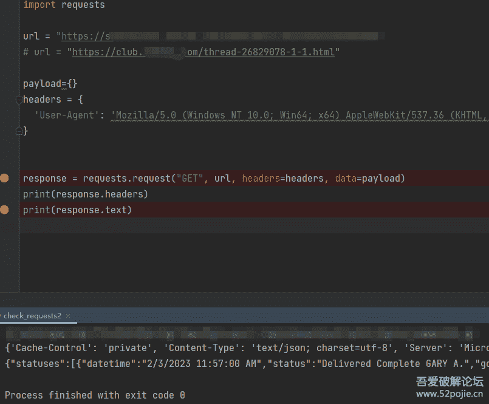

`1.jpg` (66.16 KB, 下载次数: 1)

[href="forum.php?mod=attachment&aid=MjYwNDQ0Mnw1NTRhNTgwMnwxNzkzNTczODQ0fDE2ODA4NnwxNzY5Mjk5&nothumb=yes" target="_blank"](https://www.52pojie.cn/forum.php?mod=attachment&aid=MjYwNDQ0Mnw1NTRhNTgwMnwxNzkzNTczODQ0fDE2ODA4NnwxNzY5Mjk5&nothumb=yes)

2023-4-3 18:09 上传

原始的`curl`也可以

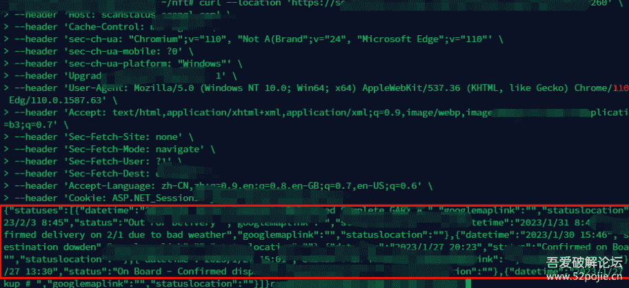

`2.jpg` (197.03 KB, 下载次数: 1)

[href="forum.php?mod=attachment&aid=MjYwNDQ0M3wzNzE3ZmNiNnwxNzkzNTczODQ0fDE2ODA4NnwxNzY5Mjk5&nothumb=yes" target="_blank"](https://www.52pojie.cn/forum.php?mod=attachment&aid=MjYwNDQ0M3wzNzE3ZmNiNnwxNzkzNTczODQ0fDE2ODA4NnwxNzY5Mjk5&nothumb=yes)

2023-4-3 18:11 上传

`aiohttp`，直接报错

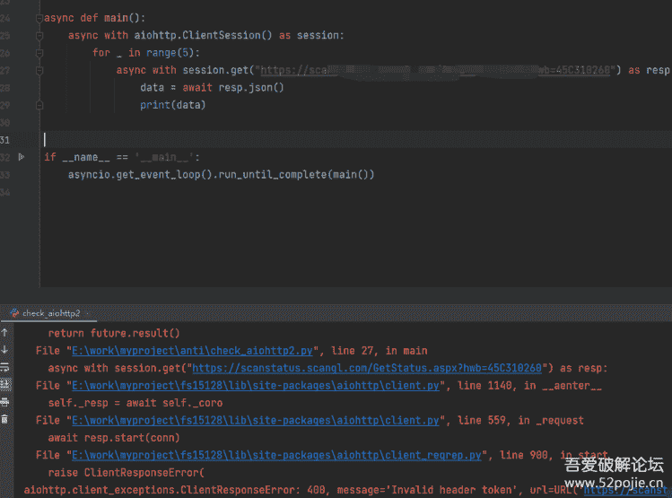

`3.jpg` (127.24 KB, 下载次数: 1)

[href="forum.php?mod=attachment&aid=MjYwNDQ0NXwzYjdkNTg4YXwxNzkzNTczODQ0fDE2ODA4NnwxNzY5Mjk5&nothumb=yes" target="_blank"](https://www.52pojie.cn/forum.php?mod=attachment&aid=MjYwNDQ0NXwzYjdkNTg4YXwxNzkzNTczODQ0fDE2ODA4NnwxNzY5Mjk5&nothumb=yes)

2023-4-3 18:11 上传

`httpx`，也直接报错：

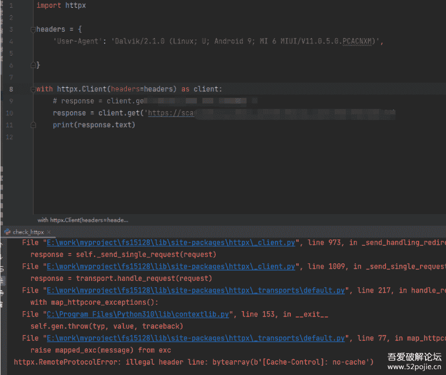

`4.jpg` (190.23 KB, 下载次数: 1)

[href="forum.php?mod=attachment&aid=MjYwNDQ1NXw5YzA5ODdmM3wxNzkzNTczODQ0fDE2ODA4NnwxNzY5Mjk5&nothumb=yes" target="_blank"](https://www.52pojie.cn/forum.php?mod=attachment&aid=MjYwNDQ1NXw5YzA5ODdmM3wxNzkzNTczODQ0fDE2ODA4NnwxNzY5Mjk5&nothumb=yes)

2023-4-3 18:12 上传

不过`httpx`的报错要明显点，这就进入了有意思的环节

## 分析

看到这里，估计就有朋友开始冷笑了：搞爬虫大部分不都用`requests`的吗，谁会用`httpx`和`aiohttp`这些啊，感觉这个是不是没啥用啊。

别急，朋友，在文章的下面会说这个，当然如果你赶时间或者觉得没啥意思，那就没必要浪费时间继续看了

### 1. `httpx`

拿着上面的报错，去网上搜，找到如下 issues:

> https://github.com/encode/httpx/issues/1561
>
> https://github.com/encode/httpx/issues/1363

看完里面各位大佬的一顿分析，说是`hyper`库的问题：

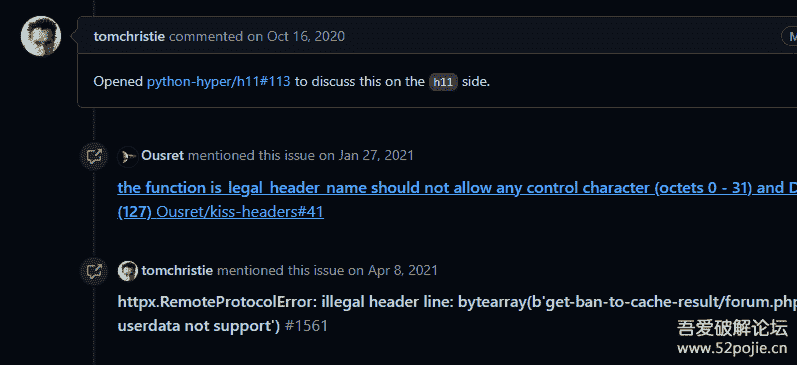

`5.jpg` (48.82 KB, 下载次数: 2)

[href="forum.php?mod=attachment&aid=MjYwNDQ1NHwzMDFiZWU3ZXwxNzkzNTczODQ0fDE2ODA4NnwxNzY5Mjk5&nothumb=yes" target="_blank"](https://www.52pojie.cn/forum.php?mod=attachment&aid=MjYwNDQ1NHwzMDFiZWU3ZXwxNzkzNTczODQ0fDE2ODA4NnwxNzY5Mjk5&nothumb=yes)

2023-4-3 18:12 上传

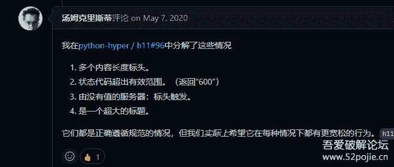

`6.jpg` (35.43 KB, 下载次数: 1)

[href="forum.php?mod=attachment&aid=MjYwNDQ1M3wzNDUzMjZkZnwxNzkzNTczODQ0fDE2ODA4NnwxNzY5Mjk5&nothumb=yes" target="_blank"](https://www.52pojie.cn/forum.php?mod=attachment&aid=MjYwNDQ1M3wzNDUzMjZkZnwxNzkzNTczODQ0fDE2ODA4NnwxNzY5Mjk5&nothumb=yes)

2023-4-3 18:12 上传

然后`hyper`库的开发者，如下链接回复：

> https://github.com/python-hyper/h11/issues/113

大概意思是这个不是一个问题，而是http请求的严格性判断问题，请求头的协议，按国际标准，是不能出现“`[Cache-Control]`”这种带有特殊符号作为响应头的键名的，所以报错

而`requests`却可以，或许是因为`requests`的校验不严格，直接就放过了：

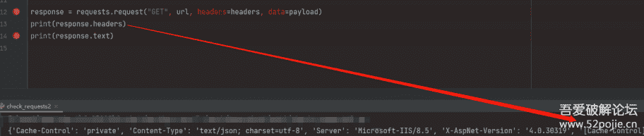

`7.jpg` (50.07 KB, 下载次数: 2)

[href="forum.php?mod=attachment&aid=MjYwNDQ1Mnw0MjQ4ZGU0OXwxNzkzNTczODQ0fDE2ODA4NnwxNzY5Mjk5&nothumb=yes" target="_blank"](https://www.52pojie.cn/forum.php?mod=attachment&aid=MjYwNDQ1Mnw0MjQ4ZGU0OXwxNzkzNTczODQ0fDE2ODA4NnwxNzY5Mjk5&nothumb=yes)

2023-4-3 18:12 上传

而，浏览器访问也是可以的：

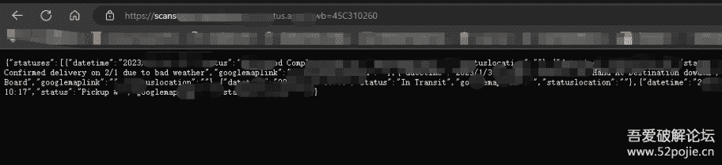

`8.jpg` (47.72 KB, 下载次数: 1)

[href="forum.php?mod=attachment&aid=MjYwNDQ1MXw0YTJlNDhmM3wxNzkzNTczODQ0fDE2ODA4NnwxNzY5Mjk5&nothumb=yes" target="_blank"](https://www.52pojie.cn/forum.php?mod=attachment&aid=MjYwNDQ1MXw0YTJlNDhmM3wxNzkzNTczODQ0fDE2ODA4NnwxNzY5Mjk5&nothumb=yes)

2023-4-3 18:12 上传

那么我个人就有理由认为

这是一个 bug，`httpx`和`aiohttp`都存在的 bug

`httpx`的作者，对这个问题那段时间确实在尝试解决，github机器人都想关闭了，`httpx`作者还不想放弃：

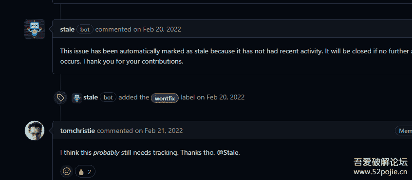

`9.jpg` (40.01 KB, 下载次数: 1)

[href="forum.php?mod=attachment&aid=MjYwNDQ1MHw4MGE4ZGE2Y3wxNzkzNTczODQ0fDE2ODA4NnwxNzY5Mjk5&nothumb=yes" target="_blank"](https://www.52pojie.cn/forum.php?mod=attachment&aid=MjYwNDQ1MHw4MGE4ZGE2Y3wxNzkzNTczODQ0fDE2ODA4NnwxNzY5Mjk5&nothumb=yes)

2023-4-3 18:11 上传

且至今没解决，遇到的人还不少，至少，上个月都还有人在说这个问题


`10.jpg` (80.48 KB, 下载次数: 1)

[href="forum.php?mod=attachment&aid=MjYwNDQ0OXw3NzA0MzI2NnwxNzkzNTczODQ0fDE2ODA4NnwxNzY5Mjk5&nothumb=yes" target="_blank"](https://www.52pojie.cn/forum.php?mod=attachment&aid=MjYwNDQ0OXw3NzA0MzI2NnwxNzkzNTczODQ0fDE2ODA4NnwxNzY5Mjk5&nothumb=yes)

2023-4-3 18:11 上传

卧槽，这时间，上周都还有人在问啊：

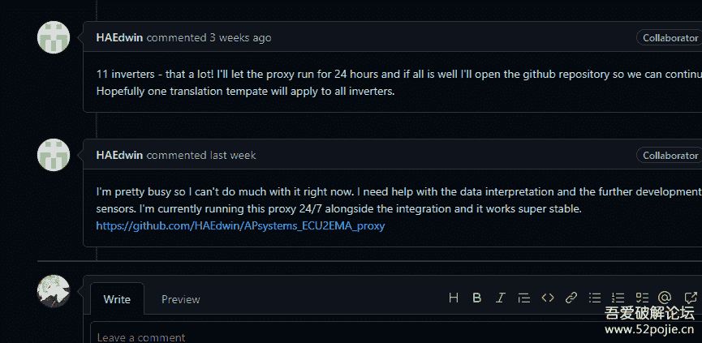

`11.jpg` (47.62 KB, 下载次数: 1)

[href="forum.php?mod=attachment&aid=MjYwNDQ0OHw3OTA0NmFhNHwxNzkzNTczODQ0fDE2ODA4NnwxNzY5Mjk5&nothumb=yes" target="_blank"](https://www.52pojie.cn/forum.php?mod=attachment&aid=MjYwNDQ0OHw3OTA0NmFhNHwxNzkzNTczODQ0fDE2ODA4NnwxNzY5Mjk5&nothumb=yes)

2023-4-3 18:11 上传

其中也有说解决办法，看到有个老哥说改`h11`的源码，改成这样：

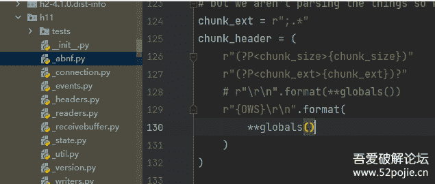

`12.jpg` (48.3 KB, 下载次数: 2)

[href="forum.php?mod=attachment&aid=MjYwNDQ0N3wyMDRmMTZhY3wxNzkzNTczODQ0fDE2ODA4NnwxNzY5Mjk5&nothumb=yes" target="_blank"](https://www.52pojie.cn/forum.php?mod=attachment&aid=MjYwNDQ0N3wyMDRmMTZhY3wxNzkzNTczODQ0fDE2ODA4NnwxNzY5Mjk5&nothumb=yes)

2023-4-3 18:11 上传

但是报错依然在

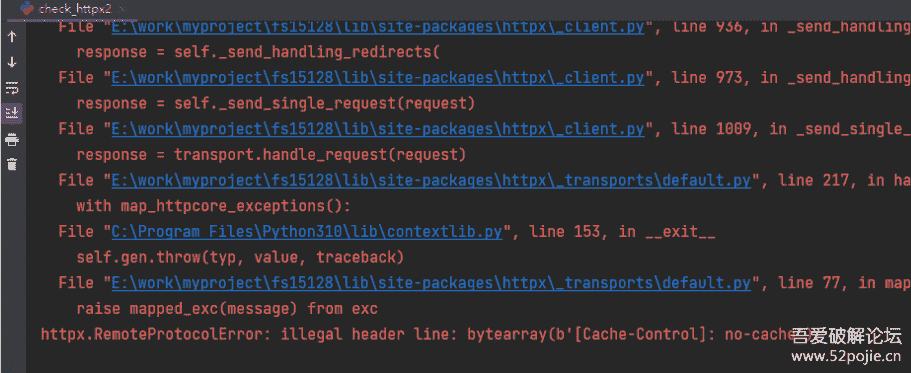

`13.jpg` (165.69 KB, 下载次数: 1)

[href="forum.php?mod=attachment&aid=MjYwNDQ0NnxmYzBjZDAyZXwxNzkzNTczODQ0fDE2ODA4NnwxNzY5Mjk5&nothumb=yes" target="_blank"](https://www.52pojie.cn/forum.php?mod=attachment&aid=MjYwNDQ0NnxmYzBjZDAyZXwxNzkzNTczODQ0fDE2ODA4NnwxNzY5Mjk5&nothumb=yes)

2023-4-3 18:11 上传

另外有个老哥说了这个方法：

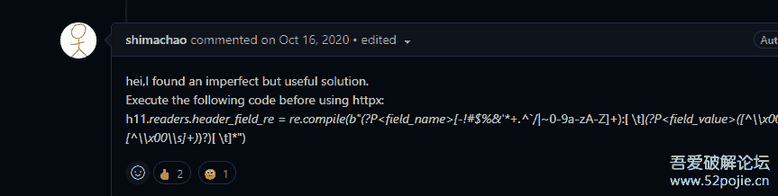

`14.jpg` (29.36 KB, 下载次数: 1)

[href="forum.php?mod=attachment&aid=MjYwNDQ2MXw2NmQwMjZhNXwxNzkzNTczODQ0fDE2ODA4NnwxNzY5Mjk5&nothumb=yes" target="_blank"](https://www.52pojie.cn/forum.php?mod=attachment&aid=MjYwNDQ2MXw2NmQwMjZhNXwxNzkzNTczODQ0fDE2ODA4NnwxNzY5Mjk5&nothumb=yes)

2023-4-3 18:14 上传

```
h11.readers.header_field_re = re.compile(b"(?P[-!#$%&'*+.^`/|~0-9a-zA-Z]+):[ \t](?P([^\\x00\\s]+(?:[ \t]+[^\\x00\\s]+))?)[ \t]*")
```

我把这个代码直接放我代码里，报错了，根本没有这个属性

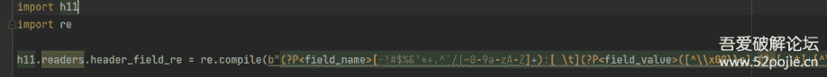

`15.jpg` (28.39 KB, 下载次数: 1)

[href="forum.php?mod=attachment&aid=MjYwNDQ2MHw2YjJhMWFiYnwxNzkzNTczODQ0fDE2ODA4NnwxNzY5Mjk5&nothumb=yes" target="_blank"](https://www.52pojie.cn/forum.php?mod=attachment&aid=MjYwNDQ2MHw2YjJhMWFiYnwxNzkzNTczODQ0fDE2ODA4NnwxNzY5Mjk5&nothumb=yes)

2023-4-3 18:14 上传

经过一顿查阅，他换了个属性名，是这个：

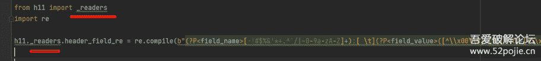

`16.jpg` (28.27 KB, 下载次数: 1)

[href="forum.php?mod=attachment&aid=MjYwNDQ1OXxiZWNhN2NkY3wxNzkzNTczODQ0fDE2ODA4NnwxNzY5Mjk5&nothumb=yes" target="_blank"](https://www.52pojie.cn/forum.php?mod=attachment&aid=MjYwNDQ1OXxiZWNhN2NkY3wxNzkzNTczODQ0fDE2ODA4NnwxNzY5Mjk5&nothumb=yes)

2023-4-3 18:14 上传

```
import h11

from h11 import _readers

import re

h11._readers.header_field_re = re.compile(b"(?P[-!#$%&'*+.^`/|~0-9a-zA-Z]+):[ \t](?P([^\\x00\\s]+(?:[ \t]+[^\\x00\\s]+))?)[ \t]*")
```

但是我试了，换成了新的报错：

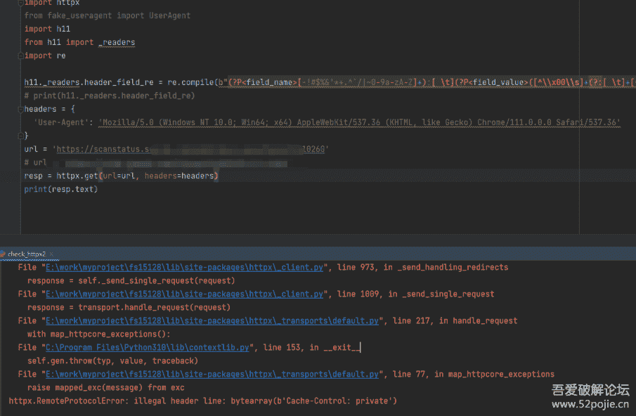

`17.jpg` (177.39 KB, 下载次数: 2)

[href="forum.php?mod=attachment&aid=MjYwNDQ1OHw2YTJkOWNkZXwxNzkzNTczODQ0fDE2ODA4NnwxNzY5Mjk5&nothumb=yes" target="_blank"](https://www.52pojie.cn/forum.php?mod=attachment&aid=MjYwNDQ1OHw2YTJkOWNkZXwxNzkzNTczODQ0fDE2ODA4NnwxNzY5Mjk5&nothumb=yes)

2023-4-3 18:14 上传

也许是正则表达式写的不完美：

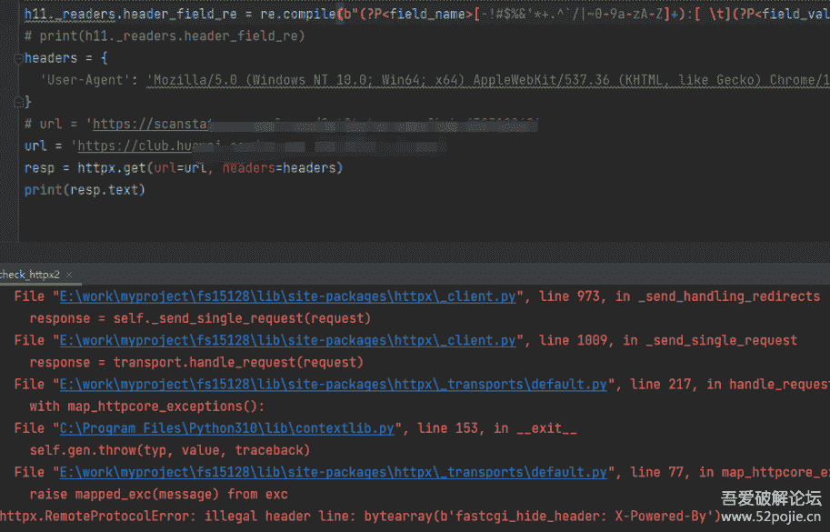

`18.jpg` (209.75 KB, 下载次数: 2)


[`href="forum.php?mod=attachment&aid=MjYwNDQ1N3xkNDMwZjEyMnwxNzkzNTczODQ0fDE2ODA4NnwxNzY5Mjk5&nothumb=yes" target="_blank"`](https://www.52pojie.cn/forum.php?mod=attachment&aid=MjYwNDQ1N3xkNDMwZjEyMnwxNzkzNTczODQ0fDE2ODA4NnwxNzY5Mjk5&nothumb=yes)

2023-4-3 18:14 上传

正则表达式通用匹配一下，然后就可以了：

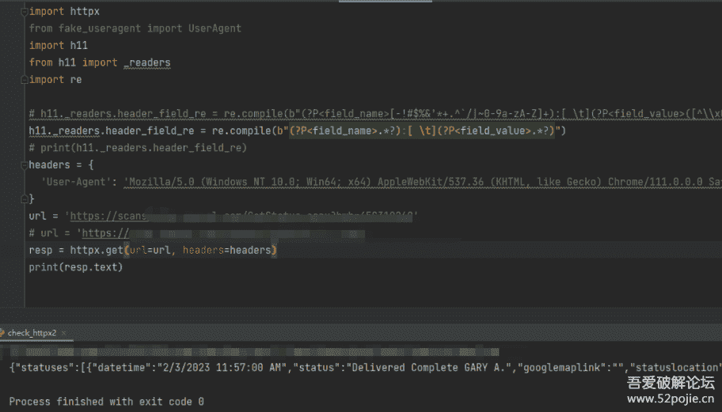

19.jpg (128.79 KB, 下载次数: 1)

[`href="forum.php?mod=attachment&aid=MjYwNDQ1NnwwMmFlN2QxOHwxNzkzNTczODQ0fDE2ODA4NnwxNzY5Mjk5&nothumb=yes" target="_blank"`](https://www.52pojie.cn/forum.php?mod=attachment&aid=MjYwNDQ1NnwwMmFlN2QxOHwxNzkzNTczODQ0fDE2ODA4NnwxNzY5Mjk5&nothumb=yes)

2023-4-3 18:14 上传

[Python] 纯文本查看 复制代码


# 1. `httpx`

```python
import httpx
import h11
from h11 import _readers
import re
# h11._readers.header_field_re = re.compile(b"(?P[-!#$%&'*+.^`/|~0-9a-zA-Z]+):[ \t](?P([^\\x00\\s]+(?:[ \t]+[^\\x00\\s]+))?)[ \t]*")
h11._readers.header_field_re = re.compile(b"(?P.*?):[ \t](?P.*?)")
headers = {'User-Agent': 'Mozilla/5.0 (Windows NT 10.0; Win64; x64) AppleWebKit/537.36 (KHTML, like Gecko) Chrome/111.0.0.0 Safari/537.36'}
url = '
# url = '
resp = httpx.get(url=url, headers=headers)
print(resp.text)
```

但是，我换了一个网站，也就是那个 issue 里某华某为的社区地址，不出正常的结果：

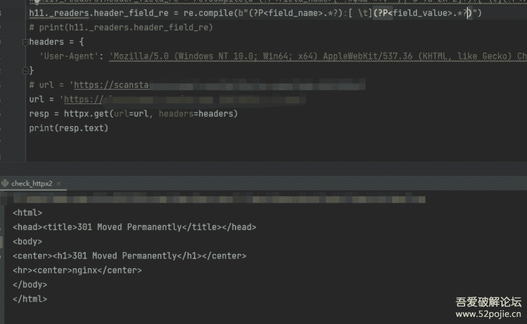

`20.jpg`（112.21 KB，下载: 1）

[附件下载](https://www.52pojie.cn/forum.php?mod=attachment&aid=MjYwNDQ4N3wyMjM3OTQyZXwxNzkzNTczODQ0fDE2ODA4NnwxNzY5Mjk5&nothumb=yes)

2023-4-3 18:18 上传

所以，修改正则表达式并不是一个通用的方案。

插一句，在请求的时候，就不要开代{过}{滤}理或者抓包软件了，不然他报错更奇怪：

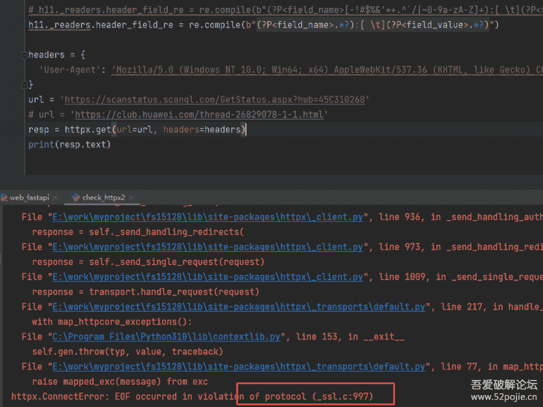

`21.jpg`（255.32 KB，下载: 2）

[附件下载](https://www.52pojie.cn/forum.php?mod=attachment&aid=MjYwNDQ4Nnw3YTM0ZmNiNHwxNzkzNTczODQ0fDE2ODA4NnwxNzY5Mjk5&nothumb=yes)

2023-4-3 18:18 上传

综上所述，也就是，只要服务器的返回头埋的坑够多，这个方法根本无法完美解决。那么这个问题，`httpx` 作者就给了个这个解释就没下文了：

> https://github.com/encode/httpx/issues/767#issuecomment-1367498458

就这么不了了之了。。。

因为根据 `http` 协议的响应头原理，确实不会出现这种不标准的字段。

更官方的解释可以去查查 `http` 协议原理，或者看看以下资料：

> https://developer.mozilla.org/zh-CN/docs/Glossary/Response_header

我的理解如下：

> 客户端需要先解析响应头，通过响应头的一些规范来解析返回的响应体的，既然你响应头都报错了，那后续的响应体解析自然也不会往下走了，直接报错退出。

# 2. `aiohttp`

对于 `aiohttp` 来说，像上面那么加正则表达式是无效的：

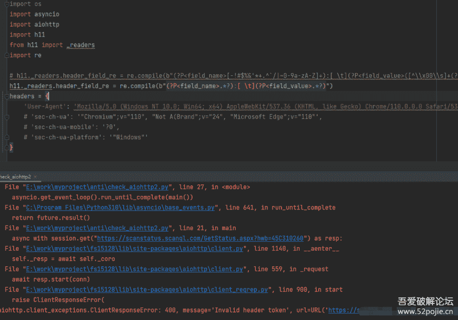

`22.jpg`（202.55 KB，下载: 2）

[附件下载](https://www.52pojie.cn/forum.php?mod=attachment&aid=MjYwNDQ4NXwyMTRmMzIxYnwxNzkzNTczODQ0fDE2ODA4NnwxNzY5Mjk5&nothumb=yes)

2023-4-3 18:18 上传

一顿搜索，发现有如下方案

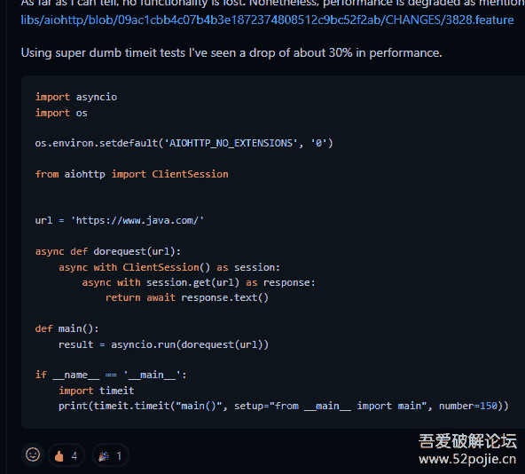

`23.jpg`（45.07 KB，下载: 2）

[附件下载](https://www.52pojie.cn/forum.php?mod=attachment&aid=MjYwNDQ4NHxlMzg1YjdhZnwxNzkzNTczODQ0fDE2ODA4NnwxNzY5Mjk5&nothumb=yes)

2023-4-3 18:18 上传

改完发现并没有用

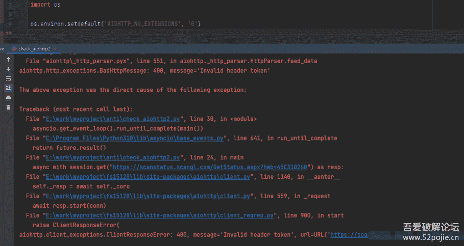

`24.jpg`（149.74 KB，下载: 1）

[附件下载](https://www.52pojie.cn/forum.php?mod=attachment&aid=MjYwNDQ4M3w5YmM3ZjUxYnwxNzkzNTczODQ0fDE2ODA4NnwxNzY5Mjk5&nothumb=yes)

2023-4-3 18:18 上传

这还有说，改成 1，也试了，不行


`25.jpg`（12.92 KB，下载: 1）

[附件下载](https://www.52pojie.cn/forum.php?mod=attachment&aid=MjYwNDQ4MnwxNDExNDEwMXwxNzkzNTczODQ0fDE2ODA4NnwxNzY5Mjk5&nothumb=yes)

2023-4-3 18:18 上传

更多的就不演示了。反正就是一顿查找，发现 `aiohttp` 上并没有合理方案解决。

## 针对的解决方案

### 1. 用 `requests`

上面有了，这里就不展示了。

但是 `requests` 我们知道，它是不支持 `http2.0` 协议的。

### 2. 用正则表达式替换

上面也有了，这里不贴了。但是不能完美覆盖后续的响应头特殊参数。

### 3. 用 `urllib3` 处理

这个库用的倒不多，但可以直接请求：

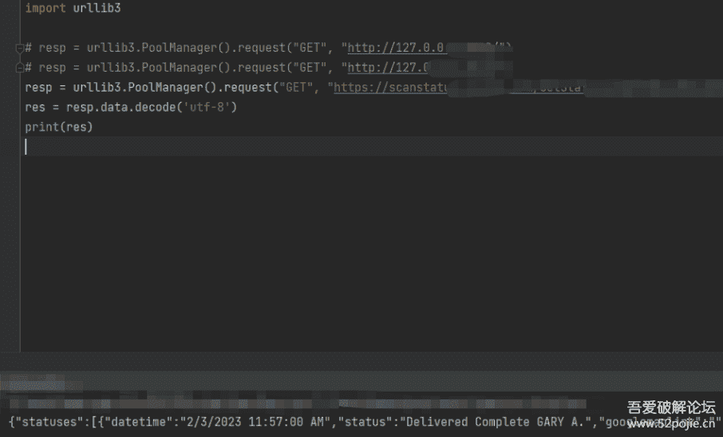

`26.jpg`（80.41 KB，下载: 2）

[附件下载](https://www.52pojie.cn/forum.php?mod=attachment&aid=MjYwNDQ4MXxlZmE4NmFiNXwxNzkzNTczODQ0fDE2ODA4NnwxNzY5Mjk5&nothumb=yes)

2023-4-3 18:18 上传

但是他也是个可以直接拿来请求的库，相比 `requets`，那很多功能还是没有。其实 `requests` 本质就是借助了 `urllib3` 库的。

所以，这个库，不出意外应该也是不支持 `http2.0` 的。

## 用非常规的请求库尝试

既然目前的方法，除了 `requests` / `urllib3`，其他都不行，那我在这个基础之上，强制 `http2`，是不是就可以干掉 `requets` 库了？Python 的常规请求库直接无可用的，直接干死这些爬虫？

想的挺美的，哈哈。

### 1. 用 `tls-client` 试试

虽然他是用来对抗 `tls` 的，试试呢：

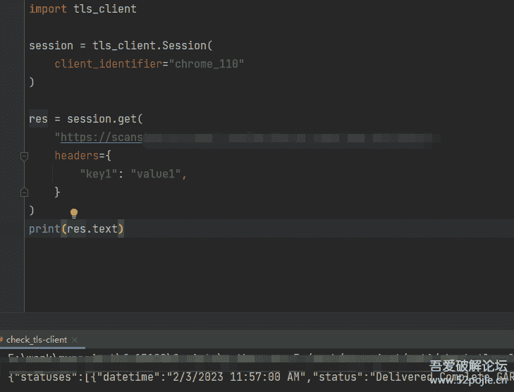

`27.jpg`（43.22 KB，下载: 1）

[附件下载](https://www.52pojie.cn/forum.php?mod=attachment&aid=MjYwNDQ4MHwwNzhmYjdjOXwxNzkzNTczODQ0fDE2ODA4NnwxNzY5Mjk5&nothumb=yes)

2023-4-3 18:18 上传

可行。为啥，因为他原理就是完全模拟浏览器，大概看了它的源码，用 `curl_impersonate` 库，打包成了一个 `dll`（具体怎么打包的不可知，这部分没开源，插一句，据群友反馈，也是因为这个 `dll`，会导致内存泄漏），然后可以直接用。上面说过了，浏览器可以访问，那这个库肯定也可以访问了。

那么测试那个某为的网址：

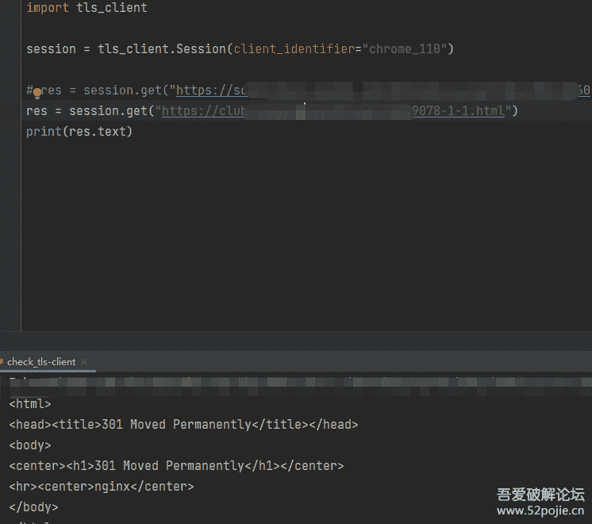

`28.jpg`（49.76 KB，下载: 1）

[附件下载](https://www.52pojie.cn/forum.php?mod=attachment&aid=MjYwNDQ3OXwyNmRiMjA5ZXwxNzkzNTczODQ0fDE2ODA4NnwxNzY5Mjk5&nothumb=yes)

2023-4-3 18:18 上传

不行，被识别了，牛吧，还是得是某为啊。

### 2. 用 `curl_cffi` 试试

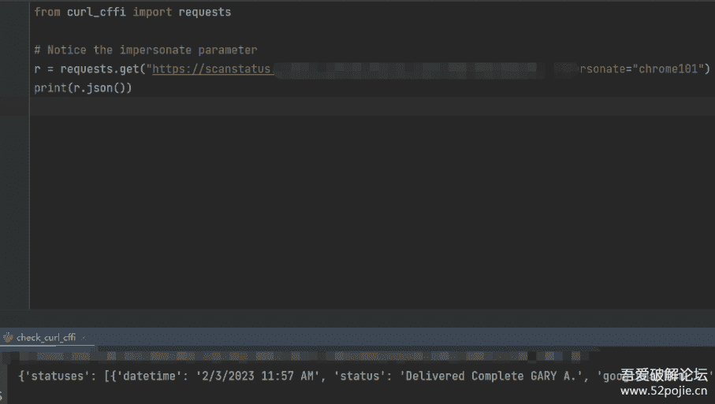

`29.jpg`（57.6 KB，下载: 0）

[附件下载](https://www.52pojie.cn/forum.php?mod=attachment&aid=MjYwNDQ3OHw3OTczYjFiMnwxNzkzNTczODQ0fDE2ODA4NnwxNzY5Mjk5&nothumb=yes)

2023-4-3 18:18 上传

再来测试那个某为的网址：

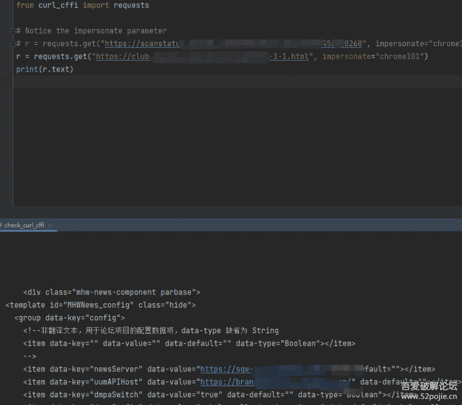

`30.jpg`（147.63 KB，下载: 2）

[附件下载](https://www.52pojie.cn/forum.php?mod=attachment&aid=MjYwNDQ3N3wwZDY1ZTJiNHwxNzkzNTczODQ0fDE2ODA4NnwxNzY5Mjk5&nothumb=yes)

2023-4-3 18:18 上传

这么对比，看来 `curl_cffi` 才是获胜者啊，只能说，牛逼啊！！！

# 实现一个 anti `aiohttp`、`httpx` 的服务

简单的用 `fastapi` 实现一个简单的服务，设置了下响应头，直接无情的嘲讽（只能设置英文状态的，要不然嘲讽力度拉满，嘿嘿）。

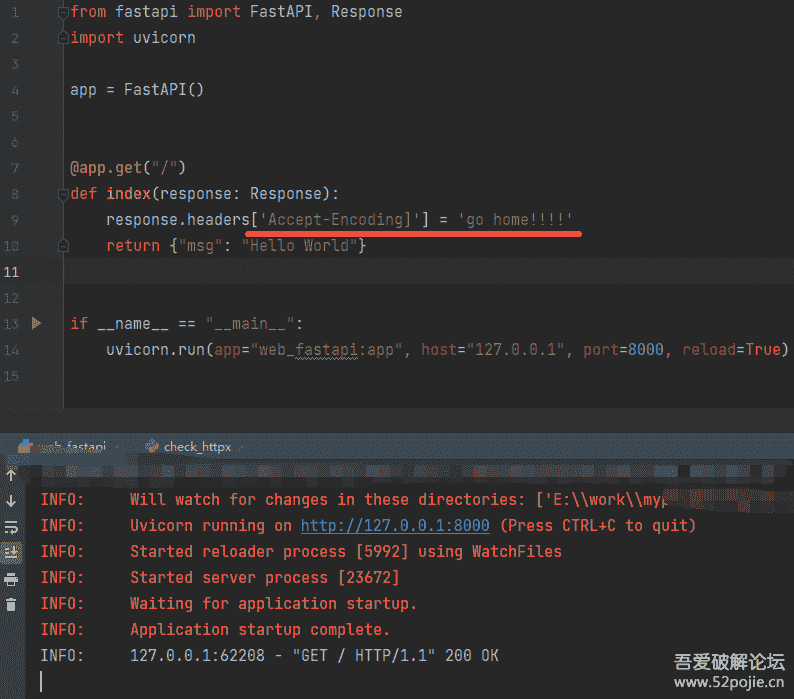

`31.jpg`（86.73 KB，下载: 2）

[附件下载](https://www.52pojie.cn/forum.php?mod=attachment&aid=MjYwNDQ3NnwxZWI1ZThkOXwxNzkzNTczODQ0fDE2ODA4NnwxNzY5Mjk5&nothumb=yes)

2023-4-3 18:18 上传

## 1. 用 `httpx` 请求

`httpx` 代码不变，只是把 `url` 换了，果然报错：

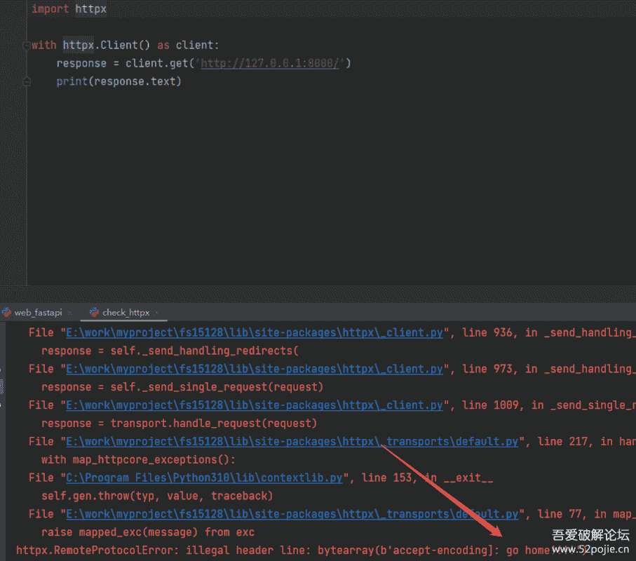

`32.jpg`（200.43 KB，下载: 3）

[附件下载](https://www.52pojie.cn/forum.php?mod=attachment&aid=MjYwNDQ3NXxjNzA0YTg3Y3wxNzkzNTczODQ0fDE2ODA4NnwxNzY5Mjk5&nothumb=yes)

2023-4-3 18:18 上传

## 2. 用 `aiohttp` 请求

再来看 `aiohttp`，果然报错，哈哈哈哈：

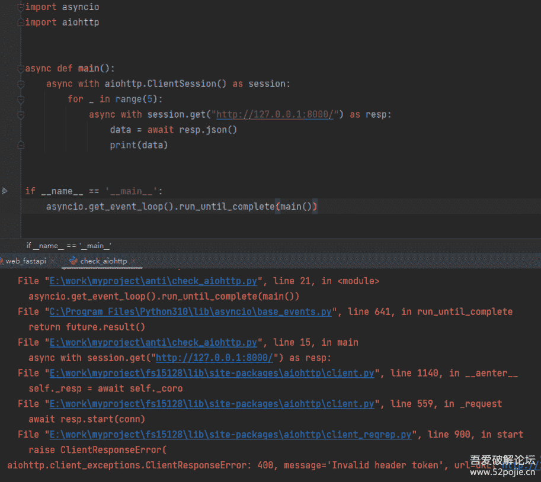

`33.jpg`（219.41 KB，下载: 1）

[附件下载](https://www.52pojie.cn/forum.php?mod=attachment&aid=MjYwNDQ3NHwwZDZmZWVkN3wxNzkzNTczODQ0fDE2ODA4NnwxNzY5Mjk5&nothumb=yes)

2023-4-3 18:18 上传

## 2. 用 `http.client` 请求

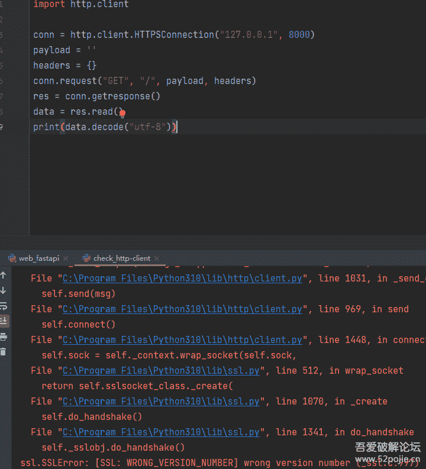

`34.jpg`（100.14 KB，下载: 2）

[附件下载](https://www.52pojie.cn/forum.php?mod=attachment&aid=MjYwNDQ3M3xlOWEyZjhkOXwxNzkzNTczODQ0fDE2ODA4NnwxNzY5Mjk5&nothumb=yes)

2023-4-3 18:18 上传

## 3. 用 `urllib3`、`requests` 测试

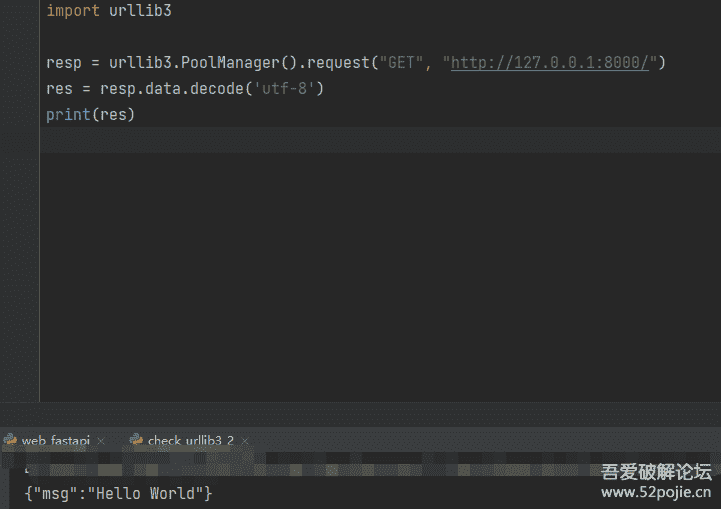

`35.jpg`（31.88 KB，下载: 3）

[附件下载](https://www.52pojie.cn/forum.php?mod=attachment&aid=MjYwNDQ3Mnw4ZGFkZTgyZXwxNzkzNTczODQ0fDE2ODA4NnwxNzY5Mjk5&nothumb=yes)

2023-4-3 18:18 上传

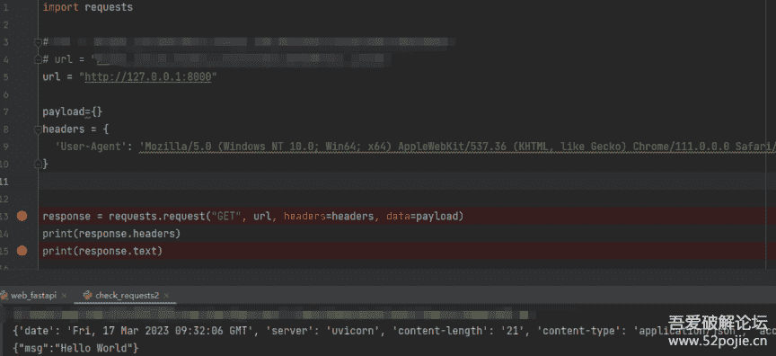

`36.jpg`（77.18 KB，下载: 1）

[附件下载](https://www.52pojie.cn/forum.php?mod=attachment&aid=MjYwNDQ3MXxjNjI3YWE0ZnwxNzkzNTczODQ0fDE2ODA4NnwxNzY5Mjk5&nothumb=yes)

2023-4-3 18:18 上传

还得是这哥俩啊，直接能跑。

## 4. 用 `node` 的 `request` 请求看看

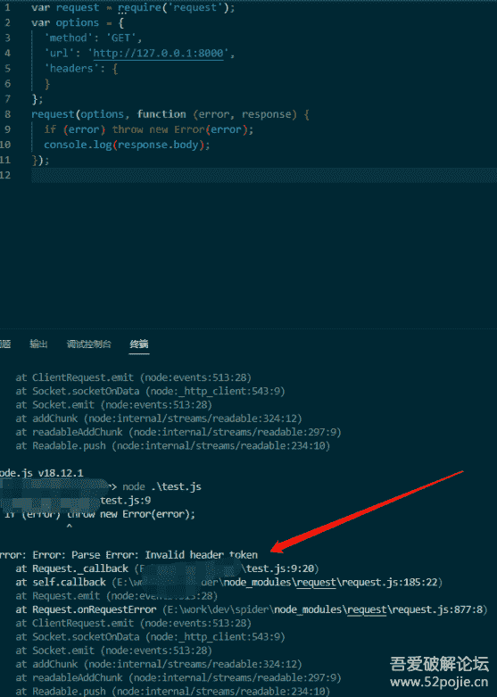

`37.jpg`（155.51 KB，下载: 0）

[附件下载](https://www.52pojie.cn/forum.php?mod=attachment&aid=MjYwNDQ3MHw0Y2IxMTc4ZXwxNzkzNTczODQ0fDE2ODA4NnwxNzY5Mjk5&nothumb=yes)

2023-4-3 18:18 上传

刺激，也给防住了。

## 5. 用 `golang` 看看

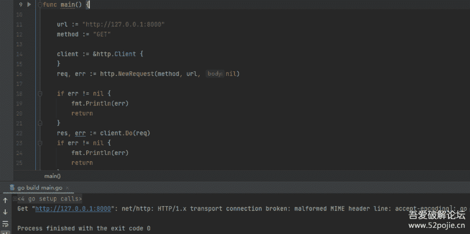

`38.jpg`（73.05 KB，下载: 1）

[附件下载](https://www.52pojie.cn/forum.php?mod=attachment&aid=MjYwNDQ2OXwxYjdhYTBiZnwxNzkzNTczODQ0fDE2ODA4NnwxNzY5Mjk5&nothumb=yes)

2023-4-3 18:18 上传

刺激啊，也没有正常返回。

## 6. 用 `postman` 看看

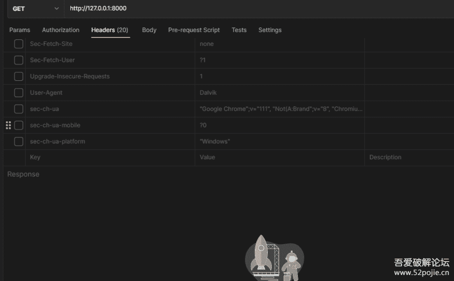

`39.jpg`（67.66 KB，下载: 1）

[附件下载](https://www.52pojie.cn/forum.php?mod=attachment&aid=MjYwNDQ2OHxlM2E4YTZlMnwxNzkzNTczODQ0fDE2ODA4NnwxNzY5Mjk5&nothumb=yes)

2023-4-3 18:18 上传

`postman` 也直接无返回。

## 7. 用安卓看看

[Java] 纯文本查看 复制代码

```java
```


## 客户端实现

```java
package com.geek.spiderclient;

import androidx.appcompat.app.AppCompatActivity;

import android.os.Bundle;
import android.util.Log;
import android.widget.TextView;

import java.io.BufferedReader;
import java.io.IOException;
import java.io.InputStream;
import java.io.InputStreamReader;
import java.io.UnsupportedEncodingException;
import java.net.HttpURLConnection;
import java.net.URL;

public class MainActivity extends AppCompatActivity {
    private TextView textView;

    @Override
    protected void onCreate(Bundle savedInstanceState) {
        super.onCreate(savedInstanceState);
        setContentView(R.layout.activity_main);
        textView = findViewById(R.id.hello);

        new Thread(new Runnable() {
            String result = "";

            @Override
            public void run() {
                try {
                    String url_string = "http://192.168.30.251:8000/"; // 由于高版本有https的限制，需要修改targetSdk为27及一下。
                    URL url = new URL(url_string);
                    //得到connection对象。
                    HttpURLConnection connection = (HttpURLConnection) url.openConnection();
                    //设置请求方式
                    connection.setRequestMethod("GET");
                    //连接
                    connection.connect();
                    //得到响应码
                    int responseCode = connection.getResponseCode();
                    Log.d("headers", "" + connection.getHeaderFields());
                    if (responseCode == HttpURLConnection.HTTP_OK) {
                        //得到响应流
                        InputStream inputStream = connection.getInputStream();
                        //将响应流转换成字符串
                        result = is2String(inputStream);//将流转换为字符串。
                        Log.d("result", "result=============" + result);
                    }
                } catch (Exception e) {
                    e.printStackTrace();
                }
                runOnUiThread(new Runnable() {
                    @Override
                    public void run() {
                        Log.e("result", "runOnUiThread");
                        textView.setText(result);
                    }
                });
            }
        }).start();
    }

    public String is2String(InputStream is) {
        //连接后，创建一个输入流来读取response
        BufferedReader bufferedReader = null;
        try {
            bufferedReader = new BufferedReader(new InputStreamReader(is, "utf-8"));
            String line = "";
            StringBuilder stringBuilder = new StringBuilder();
            String response = "";
            //每次读取一行，若非空则添加至 stringBuilder
            while ((line = bufferedReader.readLine()) != null) {
                stringBuilder.append(line);
            }
            //读取所有的数据后，赋值给 response
            response = stringBuilder.toString().trim();
            return response;
        } catch (IOException e) {
            e.printStackTrace();
        }
        return null;
    }
}
```

打包好之后：

安卓是可以的。

再来看看服务端这边。

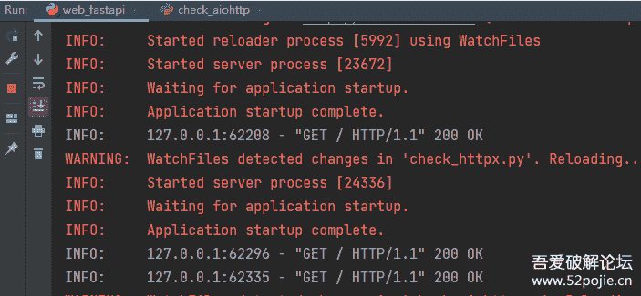

`40.jpg` (58.49 KB, 下载次数: 2)

[附件下载](https://www.52pojie.cn/forum.php?mod=attachment&aid=MjYwNDQ2N3w2OGE5MzQyMXwxNzkzNTczODQ0fDE2ODA4NnwxNzY5Mjk5&nothumb=yes)（2023-4-3 18:18 上传）

其实是有正常请求的，但是客户端那边无法正常解而已。

那么有朋友估计有想法，那既然报错，我捕获异常强制打印结果不行吗？

这里还是用回到 `python` `httpx` 库试试。

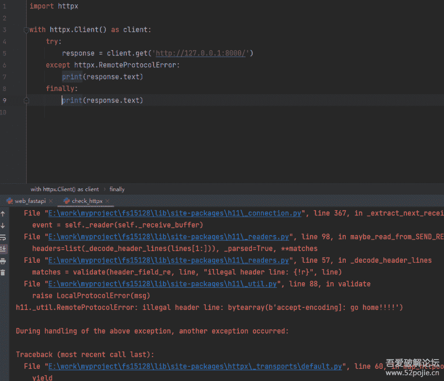

`41.jpg` (204.46 KB, 下载次数: 3)

[附件下载](https://www.52pojie.cn/forum.php?mod=attachment&aid=MjYwNDQ2Nnw5ZmIyMjk3MnwxNzkzNTczODQ0fDE2ODA4NnwxNzY5Mjk5&nothumb=yes)（2023-4-3 18:18 上传）

不行的哈哈，原因前面说过了。

## 配置将服务强制 `http2.0` 协议

### 1. 配置服务端

说干就干，准备尝试把代码移植刀服务器上，直接启动这边的服务，然后 `nginx` 搭建好，配置好 `http2`，我买的服务器它默认没给开 `80` 和 `443` 等常规的库，问了客服说要申请备案了才行，卧槽，很迷，无所谓，我把这个服务搭建到 `6363` 端口上：

`nginx` 如下配置：

```nginx
server {
    # listen 6363;
    listen [::]:6363 ssl http2; # managed by Certbot
    listen 6363 ssl http2; # managed by Certbot
    ssl_certificate /root/cert.pem; # managed by Certbot
    ssl_certificate_key /root/key.pem; # managed by Certbot
    if ($server_protocol !~* "HTTP/2.0") {
        return 444;
    }
    root /data/www/fast-tortoise;
    server_name 0.0.0.0;
    location / {
        proxy_set_header x-Real-IP $remote_addr;
        proxy_set_header X-Forwarded-For $proxy_add_x_forwarded_for;
        proxy_set_header Host $http_host;
        proxy_pass http://127.0.0.1:8000/; # gunicorn绑定的fastapi的端口号
    }
    # 配置static的静态文件：
    location ~ ^\/static\/.*$ {
        root /data/www/fast-tortoise/static;
    }
}
```

证书文件用以下命令生成即可：前提得安装 `openssl` 库。

```bash
openssl req -x509 -newkey rsa:4096 -keyout key.pem -out cert.pem -days 365 -nodes
```

### 2. 请求测试

配置好了之后，首先 `requests` 肯定是不行了，因为不支持 `http2.0`。这里就不演示了。

用 `httpx` 测试下，唉？直接就给放行了。

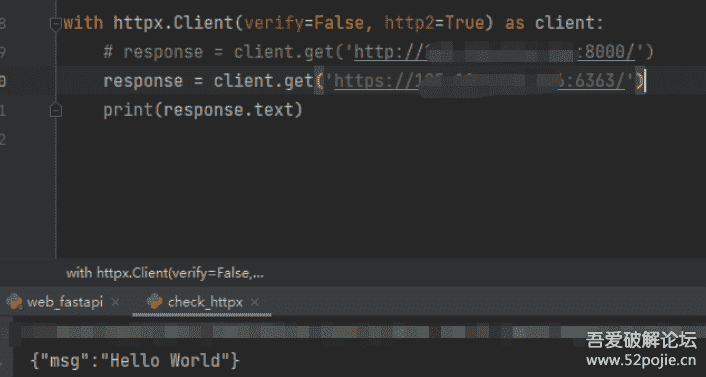

`43.jpg` (65.95 KB, 下载次数: 2)

[附件下载](https://www.52pojie.cn/forum.php?mod=attachment&aid=MjYwNDQ2NHxkNWIwOThmY3wxNzkzNTczODQ0fDE2ODA4NnwxNzY5Mjk5&nothumb=yes)（2023-4-3 18:18 上传）

卧槽？反爬虫路途创业未半中道崩卒....

.....

看来 `http2.0` 把这个问题修复了呀......

......

那就只能在 `http1.0`、`http1.1` 下防住一部分的爬虫了。

那有朋友估计要问了，你这个操作，好像只是有点奇怪，但实际并没有文章标题说的那么邪乎啊，说直接点，基本没啥用啊。

## 解惑

如果坚持看到这里的朋友，还没有忘记前面说的有关 `requests` 问的话。ok，这里开始说说。

其实我一开始发现这个所谓的 bug 的时候，感觉也不是太有用，`requests` 都能跑，没把 `requests` 防住，那肯定没啥意思啊。

那么这个所谓的 bug，真的没用吗？

只是这一个的话肯定防不住的，可以用来跟其他反爬手段组合啊，比如 `tls` 指纹，或者其他的风控检测手段等等的。

其实，我在发这篇文章之前，也开发了两个爬虫练习题：


`44.jpg` (45.62 KB, 下载次数: 1)

[附件下载](https://www.52pojie.cn/forum.php?mod=attachment&aid=MjYwNDQ2M3wyODI2NmEwZHwxNzkzNTczODQ0fDE2ODA4NnwxNzY5Mjk5&nothumb=yes)（2023-4-3 18:18 上传）

第一题就是这个 bug 了。

第二题是另外一个检测手段，可以检测到 `requests` 和 `httpx`、`tls-client`、`curl_cffi`、`aiohttp`，还有常规的请求软件，而且没有用到 `tls` 指纹。

本来说是先让群友拿来玩，然后过几天发文章公开检测手段以及如何 `bypass` 的。

我没想到，有无聊的人搞我服务器.....，所以我服务关了。

以后想好了再公布另一种检测方案吧。

## 结语

爬虫的核心，还是指纹等静态特征完全的模拟浏览器环境，行为等动态特征完全的模拟人为操作。

第一次在吾爱发帖，萌新表示好紧张，排版调了好半天。

感谢大哥大姐们的耐心观看！！！！
