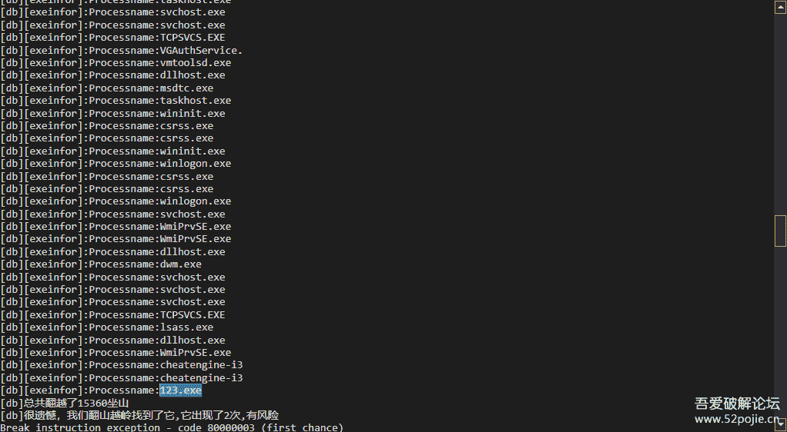
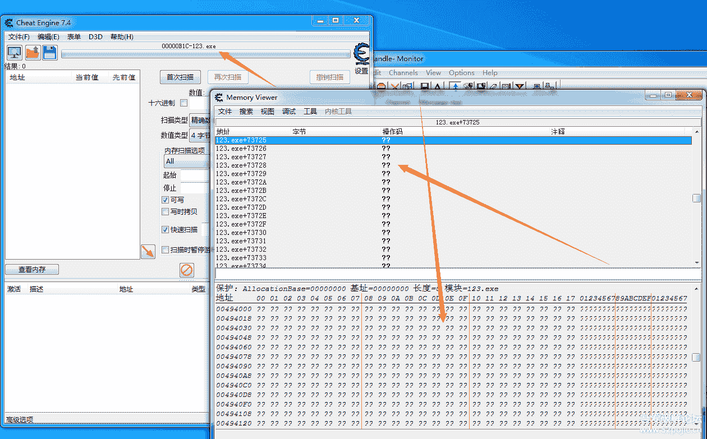

# [原创] 句柄降权

- 原帖: https://www.52pojie.cn/forum.php?mod=viewthread&tid=1771006
- 抓取时间: 2026-11-01T22:57:11

## 句柄降权保护自己

### 概述

通过句柄降权保护自己的内存

### 实验环境

Windows7 x86, Windbg

### 前置条件

必须要先看[这篇文章](https://www.52pojie.cn/thread-1770541-1-1.html)，不看的话以下内容基本上是看不懂的

### 原理讲解

私有句柄表中的值总共64bit位，高32bit位代表句柄拥有者对句柄对象的操作权限，低32bit位与运算上`0xF`是句柄对应的对象在内核中的地址，之所以与运算`0xF`是因为低32bit位中的最后3bit位为对象的三个属性。

### 速战速决

根据上面所说的原理我们通过举例一个句柄值来操作便知道具体操作了，加入现在有个私有句柄表中的句柄值为`000000039f026cc1`，那么此时`00000003`便是句柄拥有者的权限，权限有以下几种：

```
#define PROCESS_TERMINATE                  (0x0001)  
#define PROCESS_CREATE_THREAD              (0x0002)  
#define PROCESS_SET_SESSIONID              (0x0004)  
#define PROCESS_VM_OPERATION               (0x0008)  
#define PROCESS_VM_READ                    (0x0010)  
#define PROCESS_VM_WRITE                   (0x0020)  
#define PROCESS_DUP_HANDLE                 (0x0040)  
#define PROCESS_CREATE_PROCESS             (0x0080)  
#define PROCESS_SET_QUOTA                  (0x0100)  
#define PROCESS_SET_INFORMATION            (0x0200)  
#define PROCESS_QUERY_INFORMATION          (0x0400)  
#define PROCESS_SUSPEND_RESUME             (0x0800)  
#define PROCESS_QUERY_LIMITED_INFORMATION  (0x1000)  
#define PROCESS_SET_LIMITED_INFORMATION    (0x2000)  
#if (NTDDI_VERSION >= NTDDI_VISTA)
#define PROCESS_ALL_ACCESS        (STANDARD_RIGHTS_REQUIRED | SYNCHRONIZE | \0xFFFF)
```

当我们通过`OpenProcess`以多种权限申请打开进程时便将多种权限或运算就得到了我们想要的权限值，我们的目的是为了降低句柄拥有者对我们要保护的进程的操作权限，那最简单暴力的方法便是把高32bit位置0，直接让句柄拥有者对我们的进程失去所有权限。依然按照昨天必读那篇文章的保护进程`123.exe`来说，我们只需要在原判断成功`123.exe`进程对象句柄在其他进程里的时候把对应的句柄值的高32bit位置0就实现了，更改后的代码如下：

```
        count_2 = count_2 - 1;

        ULONG64 pTmpTableValue = 0;

        ULONG uHight32 = 0;

        ULONG uLow32 = 0;

        UCHAR uType = 0;

        PUCHAR pProcessName = NULL;

        ULONG uFindNum = 0;

        PULONG pTableAddr = 0;

        int iClearNum = 0;

        for (int i = 0; i > 32;

                        uLow32 = pTmpTableValue & 0x00000000ffffffff;

                        uLow32 = uLow32 & 0xFFFFFFF8;

                        if (uLow32 != 0 && uLow32>0x80000000)

                        {

                                uType = *(PUCHAR)((PUCHAR)uLow32 + 0xc);

                                if (uType == 0x7)

                                {

                                        pProcessName = (PUCHAR)((PUCHAR)uLow32 + 0x18 + 0x16c);

                                        if (strcmp(pProcessName, "123.exe") == 0)

                                        {

                                                //高32bit位写为0

                                                RtlCopyMemory(pTableAddr, &iClearNum, 4);

                                                openflag++;

                                        }

                                        DbgPrintEx(77, 0, "[db][exeinfor]:Processname:%s\n", pProcessName);

                                }

                        }

                        uFindNum++;

                }

        }
```

#### 结果

因为`123.exe`的句柄拥有者有CE调试器，所以如果我们保护成功了的话，CE是无法正常访问`123.exe`的进程数据的，所以看图



`Snipaste_2023-04-07_21-24-37.png` (76.99 KB, 下载次数: 0)

[附件](https://www.52pojie.cn/forum.php?mod=attachment&aid=MjYwNTY2OXwyY2M5NDQ5NXwxNzkzNTczODI4fDE2ODA4NnwxNzcxMDA2&nothumb=yes)

2023-4-7 21:24 上传



`image-20230407211343903.png` (201.75 KB, 下载次数: 0)

[附件](https://www.52pojie.cn/forum.php?mod=attachment&aid=MjYwNTY2Nnw3MjBiMTk1N3wxNzkzNTczODI4fDE2ODA4NnwxNzcxMDA2&nothumb=yes)

2023-4-7 21:17 上传

#### 结论

句柄降权暴力有效，但是任然能被化解，攻防就像矛盾！
