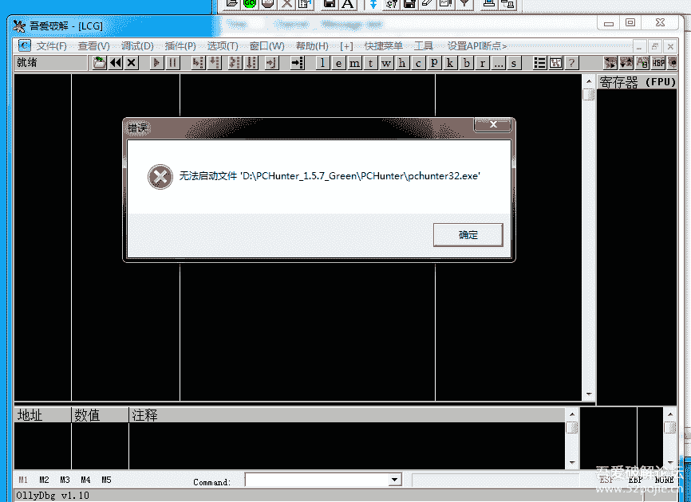
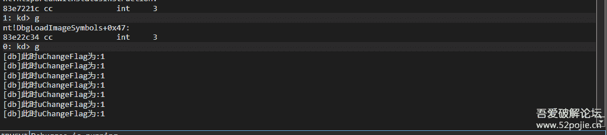

# [原创] 如何给自己加个看门狗来反调试

- 原帖: https://www.52pojie.cn/forum.php?mod=viewthread&tid=1771914
- 抓取时间: 2026-11-01T22:57:05

## 概述

通过修改全局调试对象属性来检测调试器、禁止常规调试。

## 实验环境

- Windows 7 x86
- WinDbg

## 实验原理

以不太严谨的话来说，Windows中万物皆对象，这些对象在Windows内核管理中都有着特定的属性，那我们通过在特定时期修改这些属性中的某些值便可以实现特定的需求。

## 0x1：Windows是如何识别调试对象的？

以`x32dbg`为例，它是通过注入调试器线程的方式实现调试功能。在注入调试器线程时，`x32dbg`会创建一个`DebugObject`对象，并将其附加到目标进程中。这个`DebugObject`对象被用来管理调试器线程和目标进程之间的通信和同步。因为这个原因Windows对象管理器就把`x32dbg`调试器识别为`DebugObject`了。

## 0x2：重要结构体以及变量介绍

`DbgkDebugObjectType`是个内核全局未导出变量，它记录了调试对象对应结构`_OBJECT_TYPE`所在的位置，结构体如下：

```
nt!_OBJECT_TYPE
   +0x000 TypeList         : _LIST_ENTRY [ 0x863cd440 - 0x863cd440 ]
   +0x008 Name             : _UNICODE_STRING "DebugObject"
   +0x010 DefaultObject    : (null) 
   +0x014 Index            : 0xb ''
   +0x018 TotalNumberOfObjects : 0
   +0x01c TotalNumberOfHandles : 0
   +0x020 HighWaterNumberOfObjects : 1
   +0x024 HighWaterNumberOfHandles : 1
   +0x028 TypeInfo         : _OBJECT_TYPE_INITIALIZER
   +0x078 TypeLock         : _EX_PUSH_LOCK
   +0x07c Key              : 0x75626544
   +0x080 CallbackList     : _LIST_ENTRY [ 0x863cd4c0 - 0x863cd4c0 ]
```

`+0x8`描述了对象类型名称，`+0x14`描述了该类型在系统对象类型数组中的索引，`+0x28`是最重要的一个成员，这个成员描述了内核对象类型的初始化参数，结构如下：

```
nt!_OBJECT_TYPE_INITIALIZER
   +0x000 Length           : 0x50
   +0x002 ObjectTypeFlags  : 0x8 ''
   +0x002 CaseInsensitive  : 0y0
   +0x002 UnnamedObjectsOnly : 0y0
   +0x002 UseDefaultObject : 0y0
   +0x002 SecurityRequired : 0y1
   +0x002 MaintainHandleCount : 0y0
   +0x002 MaintainTypeList : 0y0
   +0x002 SupportsObjectCallbacks : 0y0
   +0x002 CacheAligned     : 0y0
   +0x004 ObjectTypeCode   : 0
   +0x008 InvalidAttributes : 0
   +0x00c GenericMapping   : _GENERIC_MAPPING
   +0x01c ValidAccessMask  : 0x1f000f
   +0x020 RetainAccess     : 0
   +0x024 PoolType         : 0 ( NonPagedPool )
   +0x028 DefaultPagedPoolCharge : 0
   +0x02c DefaultNonPagedPoolCharge : 0x30
   +0x030 DumpProcedure    : (null) 
   +0x034 OpenProcedure    : (null) 
   +0x038 CloseProcedure   : 0x840c607f     void  nt!DbgkpCloseObject+0
   +0x03c DeleteProcedure  : 0x84095e5e     void  nt!FstubTranslatorNull+0
   +0x040 ParseProcedure   : (null) 
   +0x044 SecurityProcedure : 0x8407ce70     long  nt!SeDefaultObjectMethod+0
   +0x048 QueryNameProcedure : (null) 
   +0x04c OkayToCloseProcedure : (null) 
```

其中`+0x01c`处的`ValidAccessMask`描述了该对象能拥有的权限有哪些，比如我们申请了一个调试对象以后，申请的权限假设就只有读写，那么申请的权限就会和这个`ValidAccessMask`进行&操作，操作得到的结果就是申请得到的权限。那么此时你有没有看出问题来呢?既然是进行了&操作，那么也就是说任何进行对象申请的权限的最大阈值就是`ValidAccessMask`的值，也就是说，我们只要把`ValidAccessMask`修改为0不就限制了调试器的运行了吗？

## 0x3：做出一只看门狗

首先，我们需要获得当前系统中`DebugObject`的地址，可以通过全局未导出变量`DbgkDebugObjectType`获得，这里使用特征码暴力搜索可以得到，特征码搜索看我以前写的帖子有

```
PULONG pObjectForDebug = *DbgkDebugObjectType;
```

其次，通过上面结构体的介绍我们可以获得`ValidAccessMask`的地址

```
PULONG pMaskAddress = (PULONG)((PUCHAR)pObjectForDebug + 0x1c;
```

然后，利用`MDL`映射出来读写(映射读写纯属自己爱好,怕原地址不允许写)

```
PMDL pMDLForDebug = IoAllocateMdl(pMaskAddress, PAGE_SIZE, NULL, NULL, NULL);
BOOLEAN isLocked = FALSE;
PULONG pGetVirsualofMDL = NULL;
ULONG uNewMask = 0;
__try
{
    MmProbeAndLockPages(pMDLForDebug, KernelMode, IoWriteAccess);
    isLocked = TRUE;
    pGetVirsualofMDL = MmMapLockedPagesSpecifyCache(pMDLForDebug, KernelMode, MmNonCached, NULL, FALSE, NormalPoolPriority);
}
__except (1)
{
    if (!isLocked)
    {
        MmUnlockPages(pMDLForDebug);
    }
    IoFreeMdl(pMDLForDebug);
    return STATUS_UNSUCCESSFUL;
}
RtlCopyMemory(pGetVirsualofMDL, &iNewMask, sizeof(ULONG));
MmUnmapLockedPages(pGetVirsualofMDL, pMDLForDebug);
MmUnlockPages(pMDLForDebug);
IoFreeMdl(pMDLForDebug);
```

最后，我们需要创建一个线程去循环间隔一段时间去查询、修改`ValidAccessMask`为我们指定的值，而且要定义一个全局变量去记录每次轮询`ValidAccessMask`不等于我们指定值的次数，这样可以记录是否有可疑程序在试图破解我们的看门狗进而做出指定操作。

创建监控、修改线程

```
HANDLE hThread = NULL;
OBJECT_ATTRIBUTES objAttr;
InitializeObjectAttributes(&objAttr, NULL, OBJ_KERNEL_HANDLE, NULL, NULL);
// 初始化对象属性
PETHREAD pThread = NULL;
NTSTATUS status = PsCreateSystemThread(&hThread, THREAD_ALL_ACCESS, &objAttr, NULL, NULL, CheckChangeThread, NULL);
if (NT_SUCCESS(status))
{
    status = ObReferenceObjectByHandle(hThread, THREAD_ALL_ACCESS, NULL, KernelMode, (PVOID*)&pThread, NULL);
    if (NT_SUCCESS(status))
    {
        ObDereferenceObject(pThread);
    }
    ZwClose(hThread);
}
```

创建间隔时间

```
VOID WaitMicroSecond(LONG seconds)
{
    KEVENT KEnentTemp;
    LARGE_INTEGER waitTime;

    KeInitializeEvent(
        &KEnentTemp,
        SynchronizationEvent,
        FALSE
    );
    waitTime = RtlConvertLongToLargeInteger(-10 * seconds * 1000 * 1000);

    KeWaitForSingleObject(
        &KEnentTemp,
        Executive,
        KernelMode,
        FALSE,
        &waitTime
    );
}
```

线程执行内容

```
VOID CheckChangeThread(PVOID pContext)
{
    do
    {
        //这里我是通过调试器拿到的DbgkDebugObjectType
        PULONG pObjectForDebug = *(PULONG)0x83f4d4b8;
        PULONG pMaskAddress = (PULONG)((PUCHAR)pObjectForDebug + 0x28 + 0x1c);
        PMDL pMDLForDebug = IoAllocateMdl(pMaskAddress, PAGE_SIZE, NULL, NULL, NULL);
        BOOLEAN isLocked = FALSE;
        PULONG pGetVirsualofMDL = NULL;
        ULONG uNewMask = 0;
        __try
        {
            MmProbeAndLockPages(pMDLForDebug, KernelMode, IoWriteAccess);
            isLocked = TRUE;
            pGetVirsualofMDL = MmMapLockedPagesSpecifyCache(pMDLForDebug, KernelMode, MmNonCached, NULL, FALSE, NormalPoolPriority);
        }
        __except (1)
        {
            if (!isLocked)
            {
                MmUnlockPages(pMDLForDebug);
            }
            IoFreeMdl(pMDLForDebug);
            return STATUS_UNSUCCESSFUL;
        }
        if (*(PULONG)pGetVirsualofMDL!=0)
        {
            uChangeFlag++;
        }
        DbgPrintEx(77, 0, "[db]此时uChangeFlag为:%d\n", uChangeFlag);
        RtlCopyMemory(pGetVirsualofMDL, &uNewMask, sizeof(ULONG));
        MmUnmapLockedPages(pGetVirsualofMDL, pMDLForDebug);
        MmUnlockPages(pMDLForDebug);
        IoFreeMdl(pMDLForDebug);
        WaitMicroSecond(5);
    } while (1);
}
```

## 0x4：效果



image-20230410125551467.png (70.11 KB, 下载次数: 1)

[附件链接](https://www.52pojie.cn/forum.php?mod=attachment&aid=MjYwNjI1OXxjMmI5MzE3ZXwxNzkzNTczODIyfDE2ODA4NnwxNzcxOTE0&nothumb=yes)

2023-4-10 13:03 上传



image-20230410125808986.png (28.85 KB, 下载次数: 1)

[附件链接](https://www.52pojie.cn/forum.php?mod=attachment&aid=MjYwNjI2MHxiYTI0ODI1MHwxNzkzNTczODIyfDE2ODA4NnwxNzcxOTE0&nothumb=yes)

2023-4-10 13:03 上传

## 0x5：总结

你可以在检测到`uChangeFlag`时退出自己进程或者冻结用户账户指定权限等，在之前相对来说这个值比较隐蔽，所以很多游戏公司就是这样来实现反调试。好了，最后一点就是这个代码卸载是没终止线程会蓝屏，自己修复一下吧！
