# [.NET逆向] 某Excel全栈解决方案 逆向分析【后端组件篇】

- 原帖: https://www.52pojie.cn/forum.php?mod=viewthread&tid=1771932
- 抓取时间: 2026-11-01T22:57:02

## 前情提要

收到个消息推送，说是高性能Excel组件。然后一搜软文还不少，不知道是否真材实料。
然后 貌似还有配套的全栈解决方案...
那么应该可以拿来研究研究... 先从本职后端组件入手吧~

## 嘉宾介绍

`aHR0cHM6Ly93d3cuZ3JhcGVjaXR5LmNvbS9kb2N1bWVudHMtYXBpLWV4Y2Vs`

## 准备工作

`aHR0cHM6Ly93d3cuZ3JhcGVjaXR5LmNvbS9kb2N1bWVudHMtYXBpLWV4Y2VsL2RvY3Mvb25saW5lL0xpY2Vuc2VJbmZvcm1hdGlvbi5odG1s`

一般库 需要先看文档 看看要怎么注册 看看有啥限制。
总之 多看文档少走弯路

```
Workbook.SetLicenseKey(" Your License Key");
var workbook = new Workbook("Your License Key");

写个demo 跑跑
```

```
private static void GCExcelTest()
{
    string license = $"";
    try
    {
        Workbook workbook = new GrapeCity.Documents.Excel.Workbook();
        IWorksheet worksheet = workbook.Worksheets[0];
        worksheet.Cells[0].Value = "Hello word";
        workbook.Save(@"gcexcel.xlsx");
        workbook = new GrapeCity.Documents.Excel.Workbook(license);
        worksheet = workbook.Worksheets[0];
        worksheet.Cells[0].Value = "Hello word";
        workbook.Save(@"gcexcel2.xlsx");
    }
    catch (Exception e)
    {
        Console.WriteLine(e);
    }
}
```

没License 会提示异常。

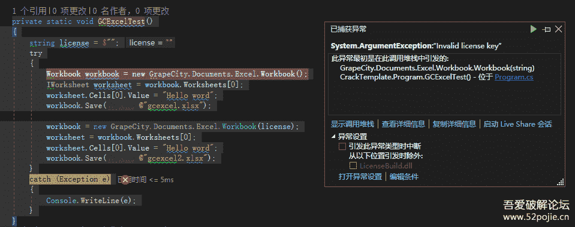

1.png (80.59 KB, 下载次数: 1)

[href="forum.php?mod=attachment&aid=MjYwNjI2OXxkY2NmYTUzNXwxNzkzNTczODIwfDE2ODA4NnwxNzcxOTMy&nothumb=yes" target="_blank"](https://www.52pojie.cn/forum.php?mod=attachment&aid=MjYwNjI2OXxkY2NmYTUzNXwxNzkzNTczODIwfDE2ODA4NnwxNzcxOTMy&nothumb=yes)

2023-4-10 13:41 上传

然后 未授权会有明显的水印。

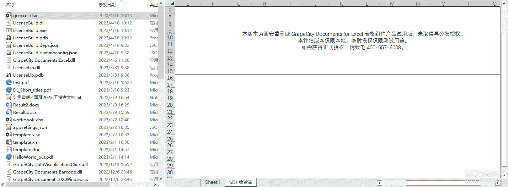

2.png (97.28 KB, 下载次数: 1)

[href="forum.php?mod=attachment&aid=MjYwNjI3MHwwODAwNWU4NXwxNzkzNTczODIwfDE2ODA4NnwxNzcxOTMy&nothumb=yes" target="_blank"](https://www.52pojie.cn/forum.php?mod=attachment&aid=MjYwNjI3MHwwODAwNWU4NXwxNzkzNTczODIwfDE2ODA4NnwxNzcxOTMy&nothumb=yes)

2023-4-10 13:41 上传

## 分析开始

先从 `dnspy` 定位到 `GrapeCity.Documents.Excel.Workbook.SetLicenseKey`

```
public static void SetLicenseKey(string key)
{
        Assembly callingAssembly = Assembly.GetCallingAssembly();
        //预处理 但是多了个函数可以先看看
        if (string.IsNullOrEmpty(key) || !Workbook.a(key, callingAssembly))
        {
                throw new ArgumentException(GrapeCity.Documents.Excel.Resources.a.ez());
        }
        bool flag = false;
        try
        {
                //核心验证应该在这里面
                amj.j(key, callingAssembly);
        }
        catch
        {
                flag = true;
        }
        //下面都是异常
        if (amj.c2())
        {
                throw new ArgumentException(GrapeCity.Documents.Excel.Resources.a.ey());
        }
        if (flag || amj.c3() == 0)
        {
                throw new ArgumentException(GrapeCity.Documents.Excel.Resources.a.ez());
        }
}
```

先看上面那个 预处理函数

```
internal static bool a(string A_0, Assembly A_1)
{
        return !amj.l(A_0) || amj.j(A_1);
}
```

```
//amj.l(A_0)
internal static bool l(string A_0)
{
        return ang.f.a(A_0);
}
```

```
//amj.j(A_1)
internal static bool j(object A_0)
{
        return ang.f.a(A_0);
}
```

好像 预处理 都在 一个 `ang.f` 里面

```
 //amj.l(A_0)
internal bool a(string A_0)
{
        return A_0 != null && A_0.StartsWith("GrapeCity-Internal-License,", StringComparison.Ordinal);
}

//amj.j(A_1)
internal bool a(object A_0)
{
        Assembly assembly = A_0 as Assembly;
        if (A_0 == null)
        {
                return false;
        }
        byte[] publicKeyToken = assembly.GetName().GetPublicKeyToken();
        ulong num = 0UL;
        if (publicKeyToken == null)
        {
                return false;
        }
        for (int i = 0; i  { 8757299328925775578UL, 10685601461268105732UL, 15833087347736823688UL, 11201956651387526890UL, 7968347106218921853UL }.Contains(num);
}
```

## 邪道解法

啊咧咧？

大概意思就是 `key` 如果是 `GrapeCity-Internal-License` 开头的话 并且 调用的 `Assembly` 不是 指定范围内的,则会触发异常...

那么搜一下？

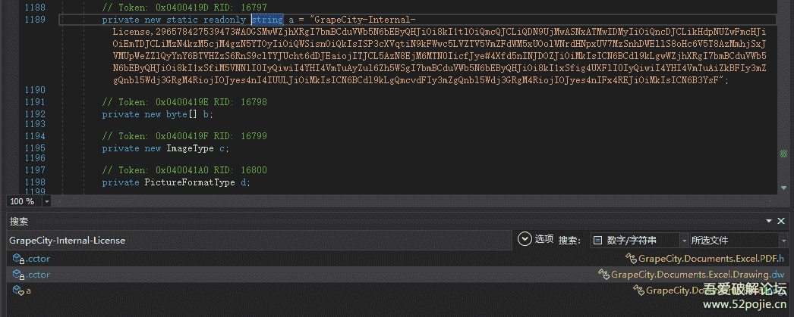

3.png (38.6 KB, 下载次数: 0)

[href="forum.php?mod=attachment&aid=MjYwNjI3MXxiODlhMDhhYnwxNzkzNTczODIwfDE2ODA4NnwxNzcxOTMy&nothumb=yes" target="_blank"](https://www.52pojie.cn/forum.php?mod=attachment&aid=MjYwNjI3MXxiODlhMDhhYnwxNzkzNTczODIwfDE2ODA4NnwxNzcxOTMy&nothumb=yes)

2023-4-10 13:41 上传

哦豁？！有内部用的注册码耶~( •̀ ω •́ )y

那我们简单 Hook 下？（当然爆破也行，但是一般 Nuget 的Lib类不推荐直接操刀Dll  

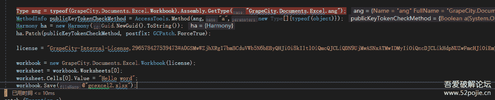

4.png (77.75 KB, 下载次数: 1)

[href="forum.php?mod=attachment&aid=MjYwNjI3Mnw3YTcyY2Q4MnwxNzkzNTczODIwfDE2ODA4NnwxNzcxOTMy&nothumb=yes" target="_blank"](https://www.52pojie.cn/forum.php?mod=attachment&aid=MjYwNjI3Mnw3YTcyY2Q4MnwxNzkzNTczODIwfDE2ODA4NnwxNzcxOTMy&nothumb=yes)

2023-4-10 13:41 上传

啊这...直接过了？水印也没了？！

还真就是 解毒剂往往长在毒药旁边

## 回归正途

```
//amj.j(key, callingAssembly)
internal static void j(string A_0, object A_1)
{
        ang.f.a(A_0, A_1);
}
```

```
//ang.f.a(A_0, A_1);
public void a(string A_0, object A_1)
{
        this.a.a(A_1);
        this.a.at7(A_0);
}
```

```
//private readonly ang.a a;
//this.a.a(A_1);
public void a(object A_0)
{
        this.h = A_0; //这里存的是 Assembly 估计是是有什么 程序集 匹配和产品什么的校验
}
```

```
//this.a.at7(A_0);
public void at7(string A_0) //这里是 str  所以 注册码是在这里面
{
        if (A_0 != this.a)
        {
                this.a = A_0;
                if (this.g != null) //有个 g 类型是 EventHandler
                {
                        this.g(this, EventArgs.Empty);
                }
        }
}
```

```
//private EventHandler g;
我们来查下 g 的调用
```

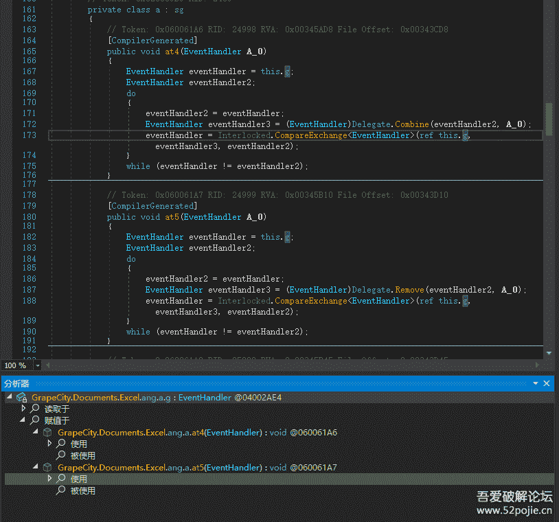

5.png (50.85 KB, 下载次数: 0)

[href="forum.php?mod=attachment&aid=MjYwNjI3M3w4YjVhOWI5Y3wxNzkzNTczODIwfDE2ODA4NnwxNzcxOTMy&nothumb=yes" target="_blank"](https://www.52pojie.cn/forum.php?mod=attachment&aid=MjYwNjI3M3w4YjVhOWI5Y3wxNzkzNTczODIwfDE2ODA4NnwxNzcxOTMy&nothumb=yes)

2023-4-10 13:41 上传

Σ(っ °Д °;)っ  竟然没有被用到么？那肿么办？！  
别急 看到子类上面那个 private class a : sg sg 了么？

```
internal interface sg
{
        // Token: 0x0600316C RID: 12652
        [CompilerGenerated]
        void at4(EventHandler A_0);

        // Token: 0x0600316D RID: 12653
        [CompilerGenerated]
        void at5(EventHandler A_0);

        // Token: 0x0600316E RID: 12654
        [CompilerGenerated]
        string at8();

        // Token: 0x0600316F RID: 12655
        [CompilerGenerated]
        string at9();

        // Token: 0x06003170 RID: 12656
        [CompilerGenerated]
        string at6();

        // Token: 0x06003171 RID: 12657
        [CompilerGenerated]
        void at7(string A_0);

        // Token: 0x06003172 RID: 12658
        [CompilerGenerated]
        object aua();
}
```

继承了 接口，那么 要查引用就要通过接口去查。。。

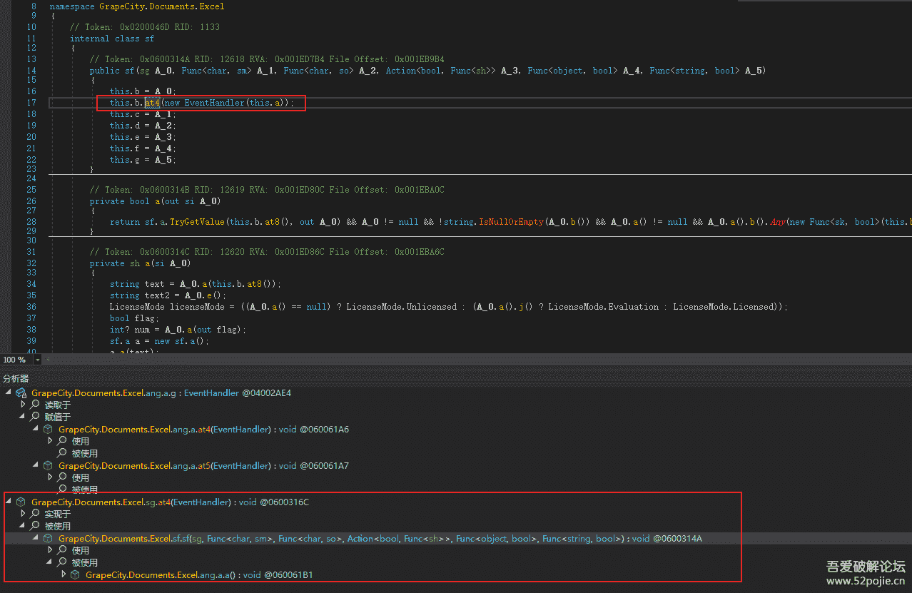

6.png (69.94 KB, 下载次数: 1)

[href="forum.php?mod=attachment&aid=MjYwNjI3NHw5ZjNjNGQ5MXwxNzkzNTczODIwfDE2ODA4NnwxNzcxOTMy&nothumb=yes" target="_blank"](https://www.52pojie.cn/forum.php?mod=attachment&aid=MjYwNjI3NHw5ZjNjNGQ5MXwxNzkzNTczODIwfDE2ODA4NnwxNzcxOTMy&nothumb=yes)

2023-4-10 13:42 上传

咿哈！逮到你了！

然后顺便看看 sf 的初始化在哪

```
//GrapeCity.Documents.Excel.ang.a.a() : void @060061B1
public a()
{
        this.b = new sf(this, new Func(ang.a.<>c.<>9.b), new Func(ang.a.<>c.<>9.a), new Action>(this.a), new Func(ang.a.<>c.<>9.a), new Func(ang.a.<>c.<>9.a));
}
```

里面有不少回调 感觉可以整理替换下 方便之后回顾

```
public sf(sg A_0, Func A_1, Func A_2, Action> A_3, Func A_4, Func A_5)
{
        this.b = A_0; //GrapeCity.Documents.Excel.ang.a 的实例
        this.b.at4(new EventHandler(this.a));
        this.c = A_1; //return new sm("Sample", "A0");
        this.d = A_2; //return new so("wE+VWE4exHP+ieziZg+Cgf7sJslBhVzJbPXZQwfGUfU27NqODPzCpizjAPz6NnKw8GCiHpug6D+bUxmutcBmUw==", "AQAB");

        this.e = A_3; //外部回调 
        this.f = A_4; //内部类 验证 上面出现过
        this.g = A_5; //return A_0 != null && A_0.StartsWith("GrapeCity-Internal-License,", StringComparison.Ordinal);
}
```

然后我们来看看 之前 那个 g 的 逻辑。

```
//这逻辑 开始 内外回调 绕起来了~
// this.b.at4(new EventHandler(this.a));
private void a(object A_0, EventArgs A_1)
{
        sf.b b = new sf.b();
        b.a = this;
        if (!this.a(out b.b))


# 注册码鉴权流程分析

## 入口与缓存校验

```
{
    b.b = this.a(this.b.at6(), this.c('c').a());

    if (this.d('s').a(string.Format(CultureInfo.InvariantCulture, "{0}{1}{2}", b.b.e(), b.b.f(), (b.b.a() == null) ? "" : b.b.a().a()), b.b.b()))
    {
        this.e(this.a(b.b.a()), new Func(b.c));
    }
}
}
```

```
// if (!this.a(out b.b))
private bool a(out si A_0)
{
    return sf.a.TryGetValue(this.b.at8(), out A_0) && A_0 != null && !string.IsNullOrEmpty(A_0.b()) && A_0.a() != null && A_0.a().b().Any(new Func(this.b));
}
```

- `sf.a` -> `private static readonly ConcurrentDictionary a = new ConcurrentDictionary();`
- `this.b.at8()` -> `GrapeCity.Documents.Excel.ang.a.at8` -> `return "WU5D";`
- 首次调用的话肯定返回的是 `false`，所以可以略过。
- 然后继续看 `b.b = this.a(this.b.at6(), this.c('c').a());`
- `this.b.at6()` -> `GrapeCity.Documents.Excel.ang.a.at6` -> `return 注册码;`
- `this.c('c').a()` -> `sm("Sample", "A0").a()` -> `#A0`

## 注册码字段解析

```
internal class sm
{
    public sm(string A_0, string A_1 = "A0")
    {
        this.a = A_0;
        this.b = "#" + A_1;
    }

    public string a()
    {
        return this.b;
    }

    //...
}
```

- `b.b = this.a(this.b.at6(), this.c('c').a());`
- `A_0`：注册码
- `A_1`：`#A0`

```
private si a(string A_0, string A_1)
{
    if (string.IsNullOrEmpty(A_0))
    {
        throw new sl(GrapeCity.Documents.Excel.Resources.a.ez());
    }

    int num = A_0.IndexOf(A_1, StringComparison.OrdinalIgnoreCase);

    if (num == -1)
    {
        throw new sl(GrapeCity.Documents.Excel.Resources.a.ez());
    }

    string text = A_0.Substring(0, num);
    string text2 = A_0.Substring(num + A_1.Length);

    //通过 #A0 去分割注册码，所以 码的本体在 #A0 后面

    si si = this.c('c').a(text2).a();
    si.d(A_1);
    si.c(text);

    return si;
}
```

`this.c('c').a(text2)`

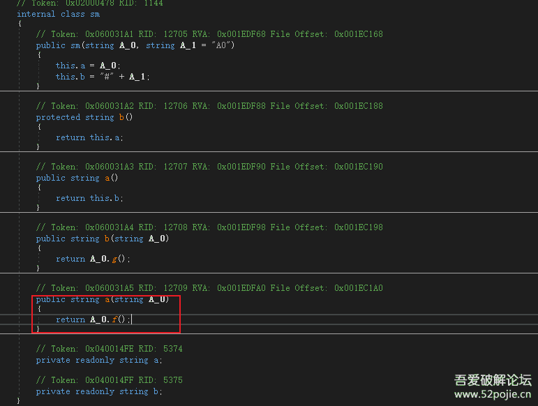

`7.png` (21.43 KB, 下载次数: 0)

[附件](https://www.52pojie.cn/forum.php?mod=attachment&aid=MjYwNjI3NXxlYmFhYzIzYnwxNzkzNTczODIwfDE2ODA4NnwxNzcxOTMy&nothumb=yes)

2023-4-10 13:42 上传

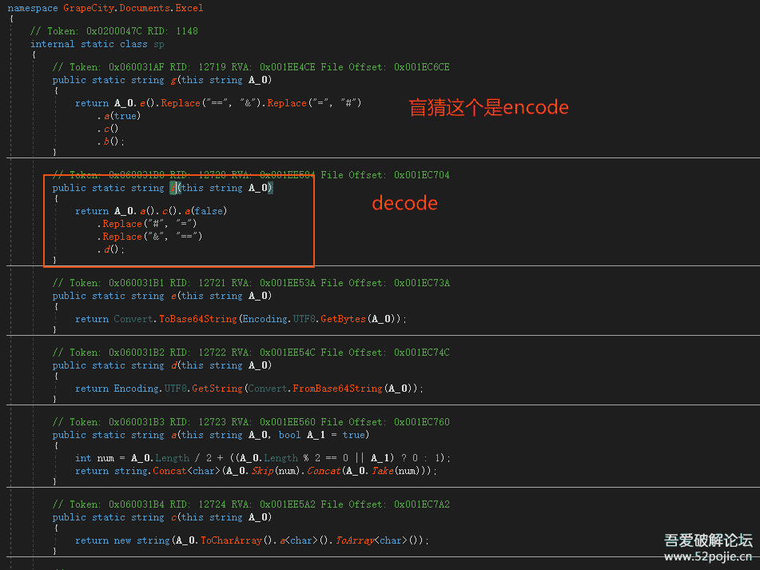

`8.png` (37.91 KB, 下载次数: 1)

[附件](https://www.52pojie.cn/forum.php?mod=attachment&aid=MjYwNjI3Nnw2NDUxN2RlOXwxNzkzNTczODIwfDE2ODA4NnwxNzcxOTMy&nothumb=yes)

2023-4-10 13:42 上传

接着就到了

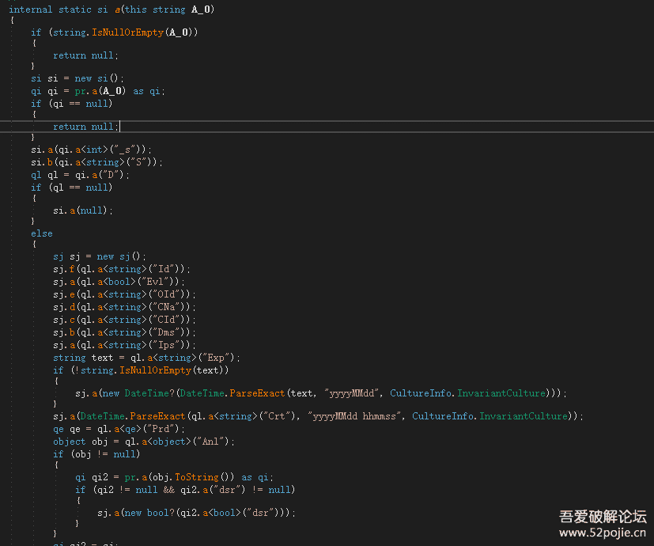

`9.png` (27.56 KB, 下载次数: 1)

[附件](https://www.52pojie.cn/forum.php?mod=attachment&aid=MjYwNjI3N3w3ZGMzYTc2OHwxNzkzNTczODIwfDE2ODA4NnwxNzcxOTMy&nothumb=yes)

2023-4-10 13:42 上传

这感觉不就来了嘛~

## 注册码完整解析与 JSON 结构

```
internal static si a(this string A_0)
{
    if (string.IsNullOrEmpty(A_0))
    {
        return null;
    }

    si si = new si(); //鉴权实体类
    qi qi = pr.a(A_0) as qi; //JSON解析器
    if (qi == null)
    {
        return null;
    }

    si.a(qi.a("_s"));
    si.b(qi.a("S"));
    ql ql = qi.a("D");
    if (ql == null)
    {
        si.a(null);
    }
    else
    {
        sj sj = new sj();
        sj.f(ql.a("Id"));
        sj.a(ql.a("Evl"));
        sj.e(ql.a("OId"));
        sj.d(ql.a("CNa"));
        sj.c(ql.a("CId"));
        sj.b(ql.a("Dms"));
        sj.a(ql.a("Ips"));
        string text = ql.a("Exp");
        if (!string.IsNullOrEmpty(text))
        {
            sj.a(new DateTime?(DateTime.ParseExact(text, "yyyyMMdd", CultureInfo.InvariantCulture)));
        }
        sj.a(DateTime.ParseExact(ql.a("Crt"), "yyyyMMdd hhmmss", CultureInfo.InvariantCulture));
        qe qe = ql.a("Prd");
        object obj = ql.a("Anl");
        if (obj != null)
        {
            qi qi2 = pr.a(obj.ToString()) as qi;
            if (qi2 != null && qi2.a("dsr") != null)
            {
                sj.a(new bool?(qi2.a("dsr")));
            }
        }
        sj sj2 = sj;
        sk[] array;
        if (qe != null)
        {
            array = qe.ToArray().Select(q=>{
                sk sk = new sk();
                sk.b(q.a("N"));
                sk.a(q.a("C"));
                return sk;
            }).ToArray();
        }
        else
        {
            array = null;
        }
        sj2.a(array);
        si.a(sj);
    }
    return si;
}
```

上面取值部分有兴趣的可以自己分析看看，这里不多阐述，直接说结果和必填项。

最后 JSON 类似

```
{
    "S": "sign",
    "D": {
        "Id": "52pojie",
        "Prd": [
            {
                "N": "",
                "C": ""
            }
        ],
        "Crt": "日期"
    }
}
```

注册码本体雏形有了 我们继续看之后的逻辑

## RSA 鉴权

```
// this.d('s').a() -> so("wE+VWE4exHP+ieziZg+Cgf7sJslBhVzJbPXZQwfGUfU27NqODPzCpizjAPz6NnKw8GCiHpug6D+bUxmutcBmUw==", "AQAB").a() -> RSA鉴权
internal class so
{
    // Token: 0x060031AD RID: 12717 RVA: 0x001EE44C File Offset: 0x001EC64C
    public so(string A_0, string A_1)
    {
        this.a.ImportParameters(new RSAParameters
        {
            Modulus = Convert.FromBase64String(A_0),
            Exponent = Convert.FromBase64String(A_1 ?? "AQAB")
        });
    }

    // Token: 0x060031AE RID: 12718 RVA: 0x001EE4A1 File Offset: 0x001EC6A1
    public bool a(string A_0, string A_1)
    {
        //使用的 系统函数鉴权 后续直接Hook
        return !string.IsNullOrEmpty(A_1) && this.a.VerifyData(Encoding.UTF8.GetBytes(A_0), "SHA1", Convert.FromBase64String(A_1));
    }

    // Token: 0x04001503 RID: 5379
    private readonly RSACryptoServiceProvider a = new RSACryptoServiceProvider();
}
```

RSA 解决后，就剩最后一个函数了，但是依旧挺绕的。

## 业务校验与结束

```
//this.e(this.a(b.b.a()), new Func(b.c));

//b.b.a() 这个是 JSON中 D 字段对象 sj

//this.a(b.b.a())

private bool a(sj A_0)
{
    if (A_0 == null) //D 不为空
    {
        return false;
    }

    if (A_0.b() == null) // D.Prd 不为空
    {
        return false;
    }

    /*
    //new Func(this.a)
    private bool a(sk A_0)
    {
        return A_0.a() == this.b.at8();//还记得这个 at8 吗 对应 WU5D
    }
    */
    if (A_0.b().Any(new Func(this.a)))// 判断 D.Prd 中 C 是否有对应值，GcExcel 的是 WU5D
    {
        //下面的基本都不用设 默认为true
        return 
        (A_0.d() == null || (A_0.d().Value - DateTime.Now.Date).Days > 0) //有没有到期时间，有的话验证
        && 
        !A_0.a().GetValueOrDefault(false) //Anl.dsr 有没有值什么的 默认没有的
        && 
        ((string.IsNullOrEmpty(A_0.f()) && string.IsNullOrEmpty(A_0.e())) //域名什么的验证
        || sf.a(this.b.at9(), A_0.f(), A_0.e(), A_0.a() == null)
        );
    }

    if (!this.g(this.b.at6()))//这里是判断注册码 开头是不是内部码
    {
        return false;
    }

    object obj = this.b.aua();//程序集是不是内部程序集
    return this.f(obj);
}
```

- `this.b.at9()` -> `GrapeCity.Documents.Excel.ang.a.at9` -> `return "localhost";`

晕了没？没晕就继续。


接着是 `new Func(b.c)`

```
//b.c
internal sh c()
{
    return this.a.a(this.b);
}
//this.a.a(this.b);
private sh a(si A_0)
{
    string text = A_0.a(this.b.at8()); //还是验证 Prd 里面 是否包含 WU5D
    string text2 = A_0.e(); //注册码 后半段
    //如果 Evl 为true 就是 Evaluation 模式 否则 Licensed，反正咱们没填
    LicenseMode licenseMode = ((A_0.a() == null) ? LicenseMode.Unlicensed : (A_0.a().j() ? LicenseMode.Evaluation : LicenseMode.Licensed));
    bool flag;
    int? num = A_0.a(out flag); //过期时间 没填
    sf.a a = new sf.a();
    a.a(text);
    a.b(text2);
    a.a(licenseMode);
    a.a(flag);
    a.a(num);
    a.a(A_0.d() ?? new string[0]);
    sf.a a2 = a;
    if (A_0.a().a() != null)
    {
        a2.a(A_0.a().a()); //Anl.dsr 反正没填
    }
    return a2;
}
```

终于又到之前 `e` 那个回调了。。。

```
//上面的 this.e = A_3 那个回调
private void a(bool A_0, Func A_1)
{
    this.c = A_1();

    if (!A_0) //因为 A_0 是 true 所以 不走这些
    {
        if (this.c.y0() == LicenseMode.Unlicensed)
        {
            this.c = null;
            return;
        }
        if (string.IsNullOrEmpty(this.c.y3()))
        {
            this.c = null;
            this.f = true;
            return;
        }
        if (this.c.y1())
        {
            this.e = new bool?(true);
            return;
        }
        this.c = null;
        return;
    }
    else
    {
        if (this.c.y2() != null) //过期时间 实际咱们没有 所以 跳过
        {
            this.d = DateTime.Today.AddDays((double)this.c.y2().Value);
            this.e = null;
            return;
        }
        this.e = new bool?(false); // 看来这个为 false 反而是真解
        return;
    }
}
```

## 4> 开工

分析完了 可以开始动工了

```
internal static string GetLicense(Type t)
{
    string name = "52pojie";
    var temp = new
    {
        S = Convert.ToBase64String(Encoding.UTF8.GetBytes("0")),
        D = new
        {
            Id = name,
            Prd = new[]
            {
                new {N = "WU5D", C = "WU5D"}
            },
            Crt = DateTime.Now.ToString("yyyyMMdd hhmmss", CultureInfo.InvariantCulture)
        }
    };
    string json = JsonConvert.SerializeObject(temp);
    //还记得之前那个盲猜的 encode吗？调用它试试~
    string lic = (string)t.Assembly.GetType("GrapeCity.Documents.Excel.sp").GetMethod("g").Invoke(null, new object?[] { json }); ;
    return $"{name}#A0{lic}";
}
```

### Hook 部分

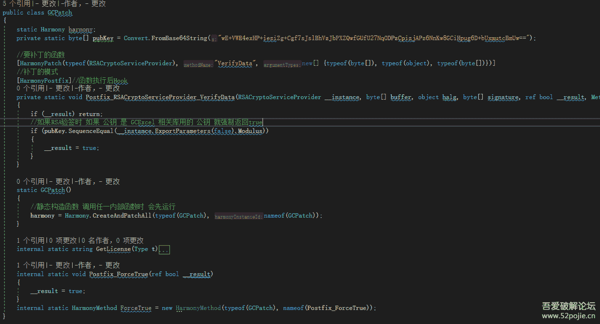

`10.png` (110.04 KB, 下载次数: 1)

[附件下载](https://www.52pojie.cn/forum.php?mod=attachment&aid=MjYwNjI3OHwxMDcxOTg1MXwxNzkzNTczODIwfDE2ODA4NnwxNzcxOTMy&nothumb=yes)

2023-4-10 13:42 上传

## 4> 结果

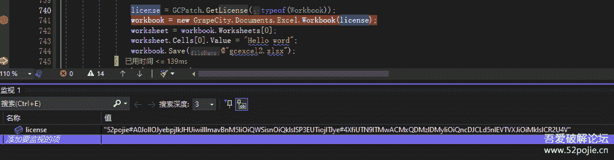

`11.png` (51.31 KB, 下载次数: 1)

[附件下载](https://www.52pojie.cn/forum.php?mod=attachment&aid=MjYwNjI3OXwwYmViMzBjMnwxNzkzNTczODIwfDE2ODA4NnwxNzcxOTMy&nothumb=yes)

2023-4-10 13:42 上传

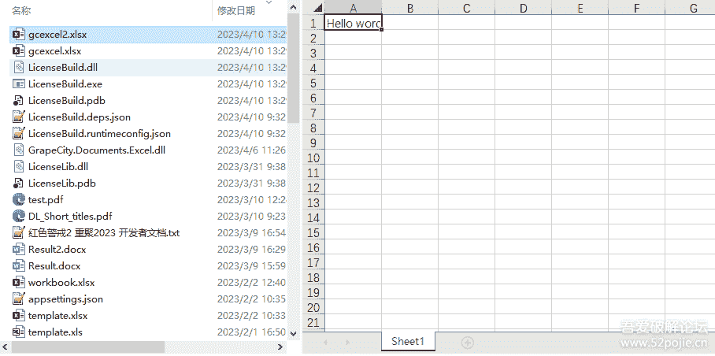

`12.png` (59.48 KB, 下载次数: 1)

[附件下载](https://www.52pojie.cn/forum.php?mod=attachment&aid=MjYwNjI4MHxkZjBhZmU0OHwxNzkzNTczODIwfDE2ODA4NnwxNzcxOTMy&nothumb=yes)

2023-4-10 13:42 上传

完美收工~

## 4> 注意事项

仅限于学习交流，请勿用于商业或非法用途

## 4> 附录

有兴趣的同学可以解析内部注册码 能少走一些弯路 (＾Ｕ＾)ノ~ＹＯ
