# [Web逆向] 某猫视频加密响应从app到web端的分析

- 原帖: https://www.52pojie.cn/forum.php?mod=viewthread&tid=1772146
- 抓取时间: 2026-11-01T22:56:58

> 本次分析仅作学习参考，别无他用，侵权即删。

## 4.12 更新

之前一直很疑惑为什么明明很简单的加密，却完全找不到一点蛛丝马迹。结果碰巧看到一篇文章，里面分析的app是`h5`套壳的，想到这个app同样有web端，是不是它的解密过程在某个`js`里面呢（虽然之前没发现）？

结果不出所料，在`./assets/index.android.bundle`中存放了`js`代码，而且密钥就以明文方式展示。

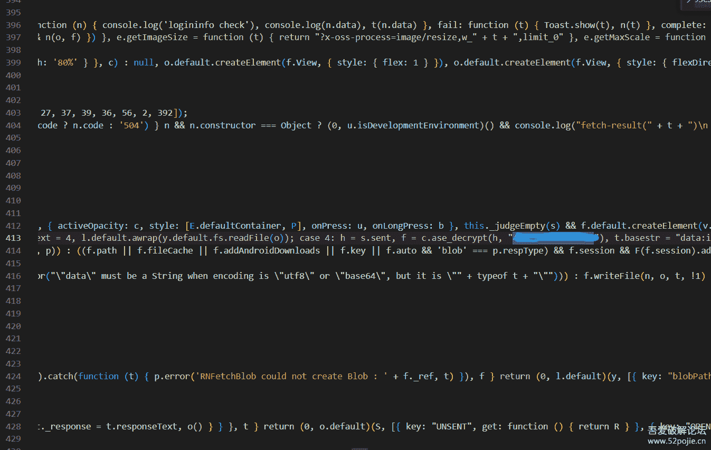

`n.png`（109.26 KB，下载次数：0） [附件下载](https://www.52pojie.cn/forum.php?mod=attachment&aid=MjYwNjg4M3xhZjMzNzEzN3wxNzkzNTczODE2fDE2ODA4NnwxNzcyMTQ2&nothumb=yes)  
2023-4-12 13:49 上传

## 1. 前言

最近接触到一款颜色app（我有一个朋友），由于其响应内容进行了未知加密，遂对其进行逆向分析。

## 2. 抓包响应结果

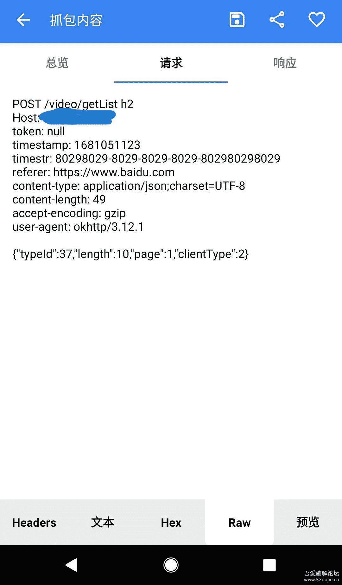

`1.jpg`（138.71 KB，下载次数：0） [附件下载](https://www.52pojie.cn/forum.php?mod=attachment&aid=MjYwNjQ0M3w2NGZkYmVlZHwxNzkzNTczODE2fDE2ODA4NnwxNzcyMTQ2&nothumb=yes)  
2023-4-10 21:54 上传

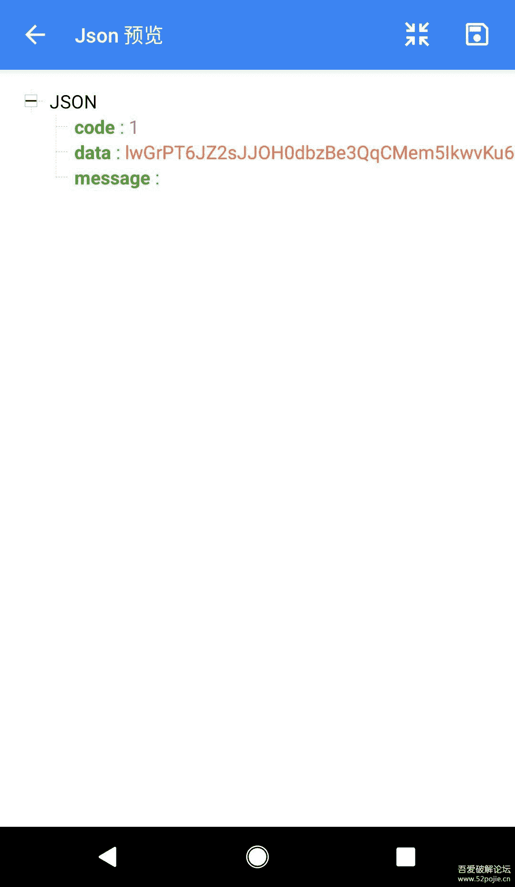

`2.jpg`（64.78 KB，下载次数：2） [附件下载](https://www.52pojie.cn/forum.php?mod=attachment&aid=MjYwNjQ0Mnw5ZTAyNmYyMHwxNzkzNTczODE2fDE2ODA4NnwxNzcyMTQ2&nothumb=yes)  
2023-4-10 21:54 上传

可以看到请求头和参数都十分简单，但是响应中的`data`是`base64`编码，解密后全是乱码，那么肯定进行加密了，先盲猜`AES`或`DES`吧。

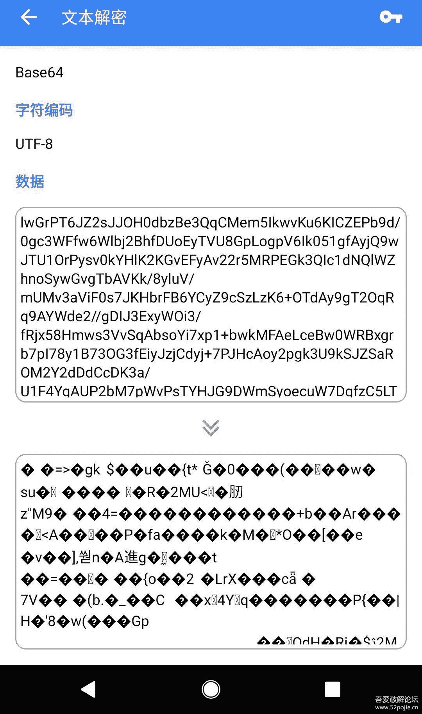

`3.jpg`（300.19 KB，下载次数：0） [附件下载](https://www.52pojie.cn/forum.php?mod=attachment&aid=MjYwNjQ0NHw0YzZhMWQ5N3wxNzkzNTczODE2fDE2ODA4NnwxNzcyMTQ2&nothumb=yes)  
2023-4-10 21:54 上传

## 3. app分析部分

首先使用已`root`的设备安装该app，使用算法助手并打开解密功能后启动app，捕获成功后返回算法助手并查看日志。

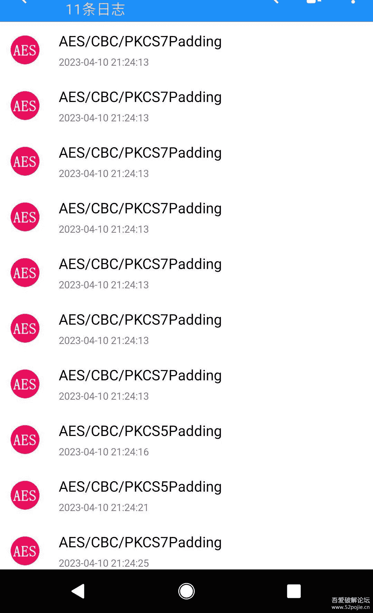

`4.jpg`（181.68 KB，下载次数：1） [附件下载](https://www.52pojie.cn/forum.php?mod=attachment&aid=MjYwNjQ0NXw1ZGE3YzUxYnwxNzkzNTczODE2fDE2ODA4NnwxNzcyMTQ2&nothumb=yes)  
2023-4-10 21:54 上传

可以看到日志中确实捕获到了加密过程，然而这组密钥并非用于app解密响应，似乎只是在app初始化时使用。

接下来的过程，使用`jadx`分析app，通过搜索关键词查看是否能够找到解密方法。首先搜索请求中的关键字（`clienttype`，`page`，`videolist`等），但是根本搜索不到，再尝试搜索响应中的`data`，搜索到的结果依然没有用处。再尝试搜索一些解密可能用到的关键字（`decrypt`，`AES`等），确实搜索到了一些结果，但是通过查看堆栈发现只是我们之间使用算法助手捕获到的部分。一番分析后只得作罢，无法找到解密入口。

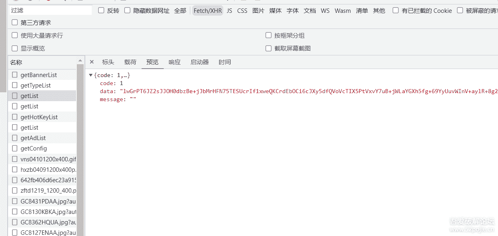

`5.png`（61.04 KB，下载次数：1） [附件下载](https://www.52pojie.cn/forum.php?mod=attachment&aid=MjYwNjQ0Nnw3NzhlMDhmNXwxNzkzNTczODE2fDE2ODA4NnwxNzcyMTQ2&nothumb=yes)  
2023-4-10 21:54 上传

但是在app内偶然看到其官网，于是在浏览器中打开，发现存在web端，抓包发现同样存在加密，那么可以尝试逆向web端，看看开发者是不是个懒虫（密钥一致）。

## 4. web端分析部分

web端就简单得多了，通过搜索请求中的关键字或者打`xhr`断点找到请求处，开始一步一步向下分析。

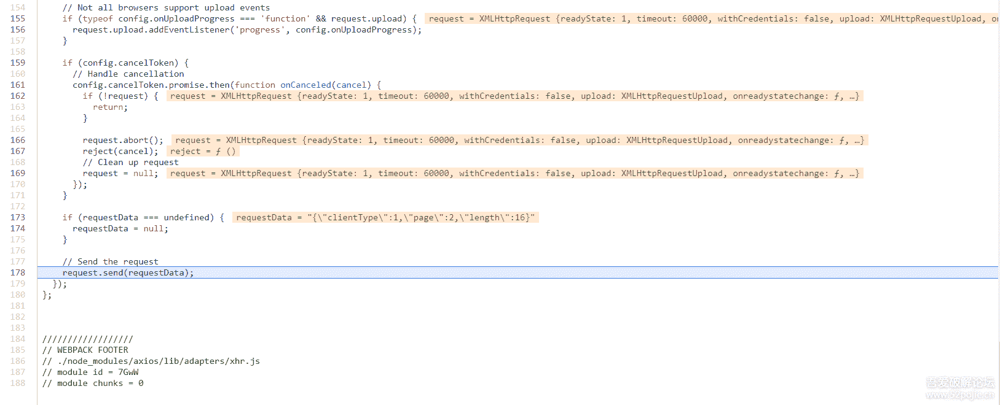

`6.png`（94.75 KB，下载次数：1） [附件下载](https://www.52pojie.cn/forum.php?mod=attachment&aid=MjYwNjQ1MHxkZmZmMmYyYnwxNzkzNTczODE2fDE2ODA4NnwxNzcyMTQ2&nothumb=yes)  
2023-4-10 21:54 上传

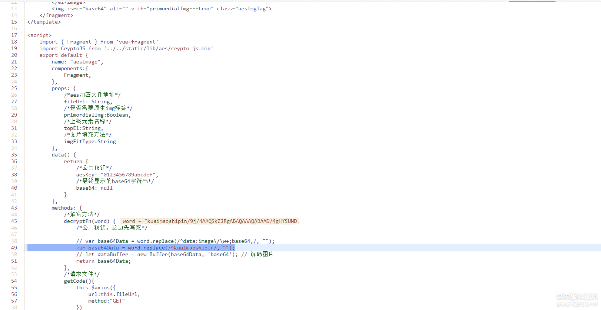

`7.png`（89.62 KB，下载次数：1） [附件下载](https://www.52pojie.cn/forum.php?mod=attachment&aid=MjYwNjQ0OHwxZTdlODkzZnwxNzkzNTczODE2fDE2ODA4NnwxNzcyMTQ2&nothumb=yes)  
2023-4-10 21:54 上传

最初不知道怎么回事，不停`f11`直接给跑到了图片解密的地方，在此处捣腾一会后发现似乎响应早在之前就已经解密了，于是只能回到之前的断点处，按下尊贵的`f9`，一步一步看了。机械地按了一会，终于找到了关键之处，这地方一看就是解密方法了。

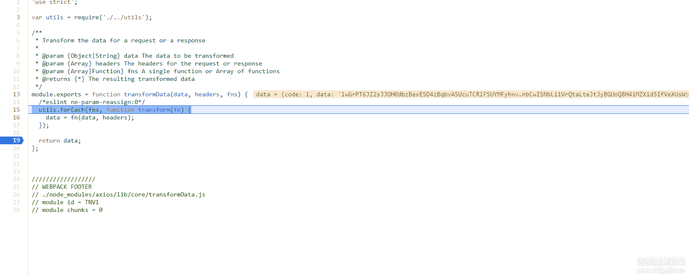

`8.png`（62.96 KB，下载次数：1） [附件下载](https://www.52pojie.cn/forum.php?mod=attachment&aid=MjYwNjQ0OXwxMmMzZTkyNXwxNzkzNTczODE2fDE2ODA4NnwxNzcyMTQ2&nothumb=yes)  
2023-4-10 21:54 上传

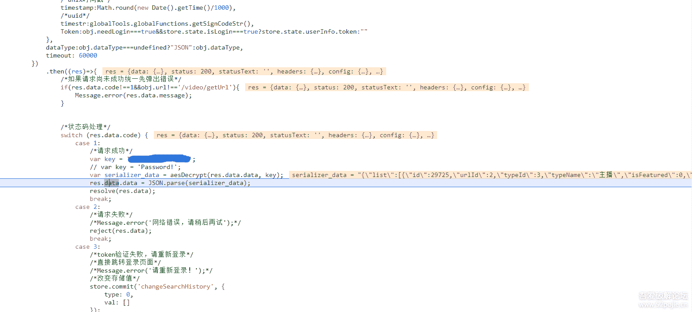

`9.png`（86.52 KB，下载次数：0） [附件下载](https://www.52pojie.cn/forum.php?mod=attachment&aid=MjYwNjQ0N3w2NWQ0NTgyM3wxNzkzNTczODE2fDE2ODA4NnwxNzcyMTQ2&nothumb=yes)  
2023-4-10 21:54 上传

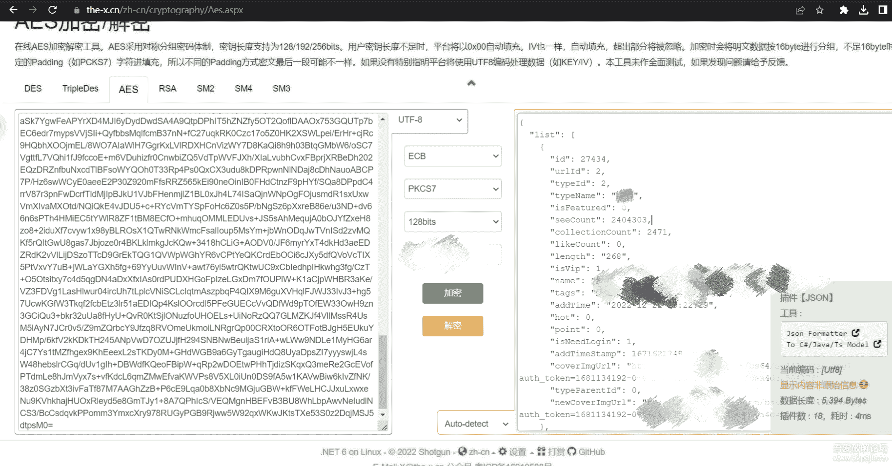

`10.png`（1.12 MB，下载次数：2） [附件下载](https://www.52pojie.cn/forum.php?mod=attachment&aid=MjYwNjQ0MXw5OGJjMGZjNXwxNzkzNTczODE2fDE2ODA4NnwxNzcyMTQ2&nothumb=yes)  
2023-4-10 21:53 上传

好家伙，密钥就摆在这了，一看`aes`方法，先不管什么模式有没有`iv`了，试一试`ECB`，直接解出来结果了，那后面的分析就没必要再展示了。按捺不住小心脏，我们直接试试解密app的响应结果。

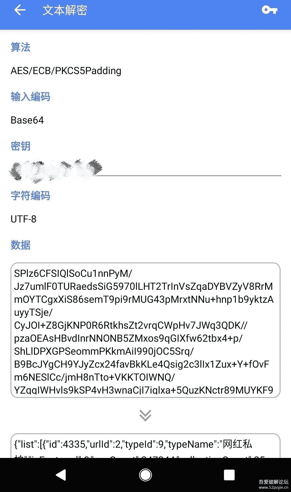

`11.jpg`（205.88 KB，下载次数：1） [附件下载](https://www.52pojie.cn/forum.php?mod=attachment&aid=MjYwNjQ0MHwwMjZmMjc5NnwxNzkzNTczODE2fDE2ODA4NnwxNzcyMTQ2&nothumb=yes)  
2023-4-10 21:53 上传

解密成功。

果然，是个懒虫……

果然，大佬全凭技术，菜鸟全凭运气……

## 总结

没有总结了，前面的话就是总结
