# [Web逆向] 简书游戏广告分析

- 原帖：img/5e056c500a1c4b6a7110b50d807bade5.png://www.52pojie.cn/forum.php?mod=viewthread&tid=1772913
- 抓取时间：2026-11-01T22:56:52

## 简书游戏广告分析

### 问题引出

今天上网时无意间打开简书，发现简书中直接插入了游戏广告：

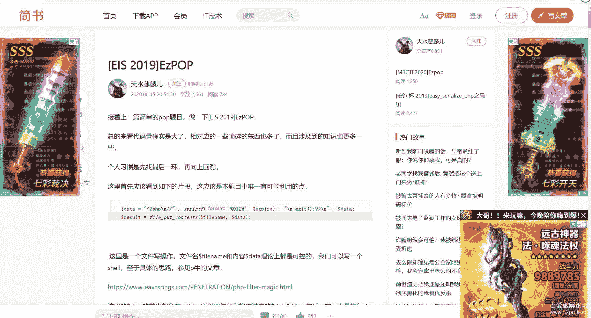

2023-04-11-15-48-19-image.jpg (249.12 KB, 下载次数: 3)，2023-4-12 16:27 上传

[附件下载](img/5e056c500a1c4b6a7110b50d807bade5.png://www.52pojie.cn/forum.php?mod=attachment&aid=MjYwNzAyN3wzY2Q4YTFmMHwxNzkzNTczODA5fDE2ODA4NnwxNzcyOTEz&nothumb=yes)

好奇心驱使下，分析了一下广告是怎么插进去的，并把过程分享一下（`url` 中的 `.` 均用 `_` 代替）。

### 目录

- 抓包
- 分析 js 依赖关系
- 分析代码
- 自动关闭广告

### 一、抓包

清除 Cookie，清除缓存，抓包。

找广告比较好找，可以从这些图片入手。

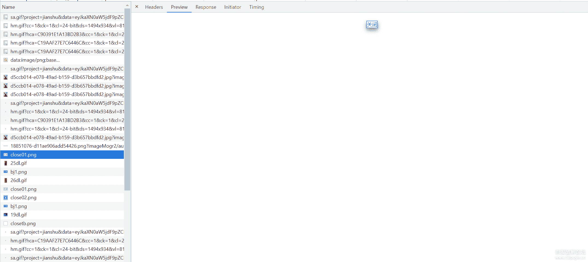

2023-04-11-15-52-30-image.png (126.13 KB, 下载次数: 1)，2023-4-12 16:27 上传

[附件下载](img/5e056c500a1c4b6a7110b50d807bade5.png://www.52pojie.cn/forum.php?mod=attachment&aid=MjYwNzAzNnxmZDIxYjY0ZXwxNzkzNTczODA5fDE2ODA4NnwxNzcyOTEz&nothumb=yes)

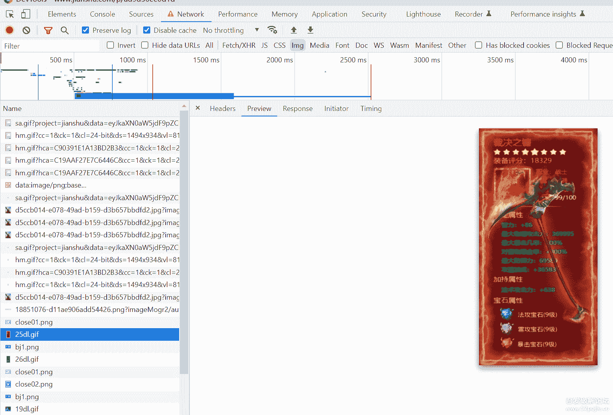

2023-04-11-15-50-24-image.png (471.57 KB, 下载次数: 1)，2023-4-12 16:27 上传

[附件下载](img/5e056c500a1c4b6a7110b50d807bade5.png://www.52pojie.cn/forum.php?mod=attachment&aid=MjYwNzAyOHwxYTM1M2IxNXwxNzkzNTczODA5fDE2ODA4NnwxNzcyOTEz&nothumb=yes)

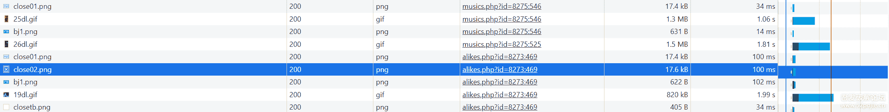

2023-04-11-15-54-32-image.png (54.61 KB, 下载次数: 2)，2023-4-12 16:27 上传

[附件下载](img/5e056c500a1c4b6a7110b50d807bade5.png://www.52pojie.cn/forum.php?mod=attachment&aid=MjYwNzA0N3wzYmFiYzMzOHwxNzkzNTczODA5fDE2ODA4NnwxNzcyOTEz&nothumb=yes)

很快就找到了图片链接，查看调用栈，发现了两个可疑文件：

- `//4698_chushoushijian_cn/alikes_php?id=8273`
- `//4698_chushoushijian_cn/musics_php?id=8275`

访问了一下 `//4698_chushoushijian_cn`，是动力广告，专门投放游戏广告的。


2023-04-11-15-56-20-image.jpg (147.22 KB, 下载次数: 3)，2023-4-12 16:27 上传

[附件下载](img/5e056c500a1c4b6a7110b50d807bade5.png://www.52pojie.cn/forum.php?mod=attachment&aid=MjYwNzAyOXxmYzNlZmY2NXwxNzkzNTczODA5fDE2ODA4NnwxNzcyOTEz&nothumb=yes)

右键选择按 `domain` 排序，可以发现更多的可疑链接。

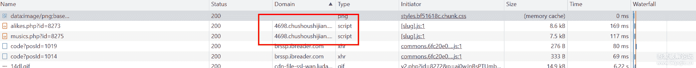

2023-04-11-16-26-25-image.png (76.44 KB, 下载次数: 1)，2023-4-12 16:27 上传

[附件下载](img/5e056c500a1c4b6a7110b50d807bade5.png://www.52pojie.cn/forum.php?mod=attachment&aid=MjYwNzA0OXwzNGQ1ZWUwZXwxNzkzNTczODA5fDE2ODA4NnwxNzcyOTEz&nothumb=yes)

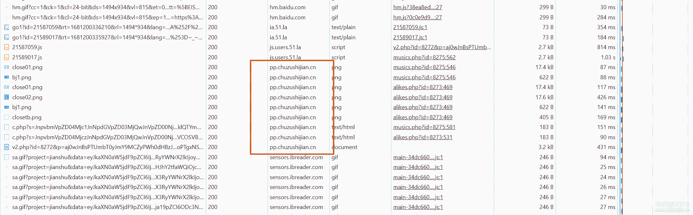

2023-04-11-16-27-13-image.png (164.33 KB, 下载次数: 0)，2023-4-12 16:27 上传

[附件下载](img/5e056c500a1c4b6a7110b50d807bade5.png://www.52pojie.cn/forum.php?mod=attachment&aid=MjYwNzAzNHw2Zjk2MTI4M3wxNzkzNTczODA5fDE2ODA4NnwxNzcyOTEz&nothumb=yes)

### 二、js依赖关系

分析一下加载流程。

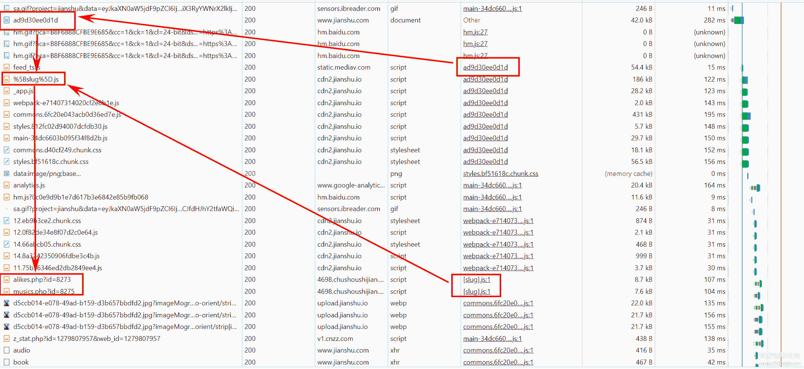

2023-04-11-16-28-47-image.png (252.83 KB, 下载次数: 1)，2023-4-12 16:34 上传

[附件下载](img/5e056c500a1c4b6a7110b50d807bade5.png://www.52pojie.cn/forum.php?mod=attachment&aid=MjYwNzA2MHxhZWYwYzE1MXwxNzkzNTczODA5fDE2ODA4NnwxNzcyOTEz&nothumb=yes)

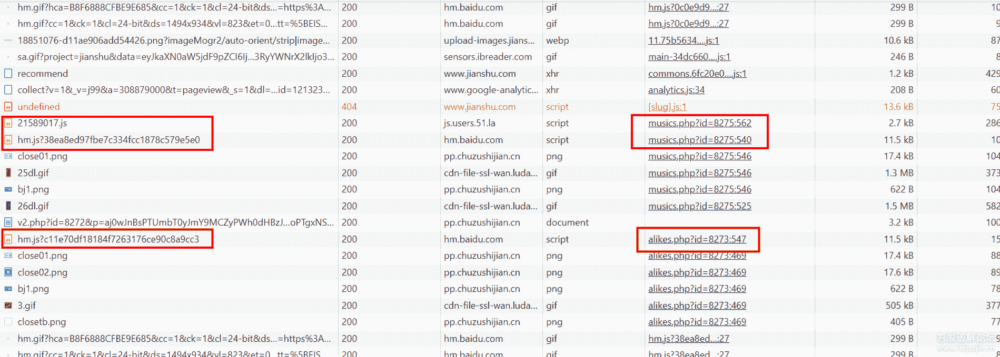

2023-04-11-16-32-57-image.png (351.52 KB, 下载次数: 4)，2023-4-12 16:27 上传

[附件下载](img/5e056c500a1c4b6a7110b50d807bade5.png://www.52pojie.cn/forum.php?mod=attachment&aid=MjYwNzAzMHwxNmEzMTBhOHwxNzkzNTczODA5fDE2ODA4NnwxNzcyOTEz&nothumb=yes)

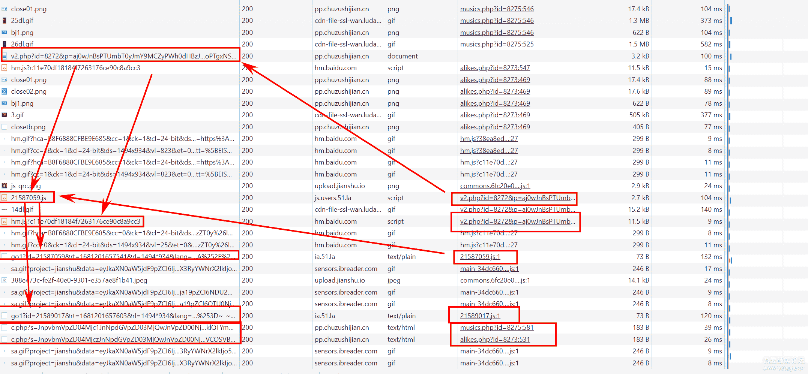

2023-04-11-16-37-25-image.png (268 KB, 下载次数: 3)，2023-4-12 16:27 上传

[附件下载](img/5e056c500a1c4b6a7110b50d807bade5.png://www.52pojie.cn/forum.php?mod=attachment&aid=MjYwNzAzMnw0NzBkMDBlOHwxNzkzNTczODA5fDE2ODA4NnwxNzcyOTEz&nothumb=yes)

整个加载过程非常复杂。

总的来看罪魁祸首是 `[slug].js`，而 `[slug].js` 由简书直接加载的。

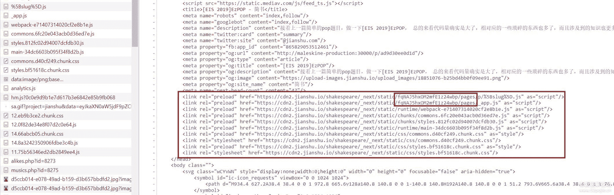

2023-04-11-16-42-19-image.jpg (330.67 KB, 下载次数: 2)，2023-4-12 16:27 上传

[附件下载](img/5e056c500a1c4b6a7110b50d807bade5.png://www.52pojie.cn/forum.php?mod=attachment&aid=MjYwNzAzMXw1Zjc1NGJkY3wxNzkzNTczODA5fDE2ODA4NnwxNzcyOTEz&nothumb=yes)

要么是广告商给钱，要么是 cdn 被投毒了。

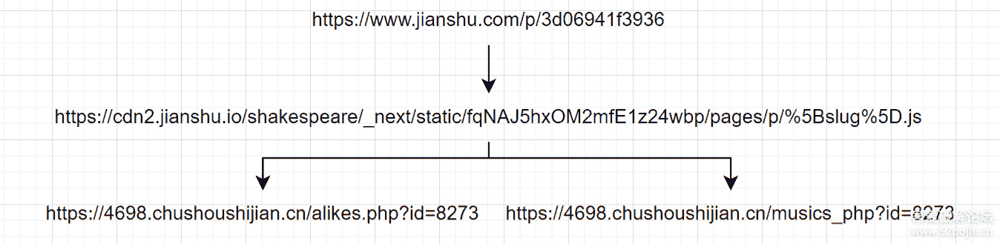

2023-04-12-09-40-46-image.png (78.26 KB, 下载次数: 1)，2023-4-12 16:27 上传

[附件下载](img/5e056c500a1c4b6a7110b50d807bade5.png://www.52pojie.cn/forum.php?mod=attachment&aid=MjYwNzA0NXw1M2QxMTYxZHwxNzkzNTczODA5fDE2ODA4NnwxNzcyOTEz&nothumb=yes)

### 三、分析代码

#### `[slug].js`

分析一下 `[slug].js`，19858 行代码。

代码中也有大量的业务逻辑，直接搜索一下关键字 `"chushoushijian"`。

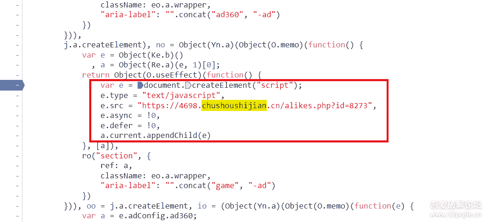

2023-04-11-16-48-04-image.png (65.68 KB, 下载次数: 2)，2023-4-12 16:28 上传

[附件下载](img/5e056c500a1c4b6a7110b50d807bade5.png://www.52pojie.cn/forum.php?mod=attachment&aid=MjYwNzA1M3xhYmVhZTg3ZnwxNzkzNTczODA5fDE2ODA4NnwxNzcyOTEz&nothumb=yes)

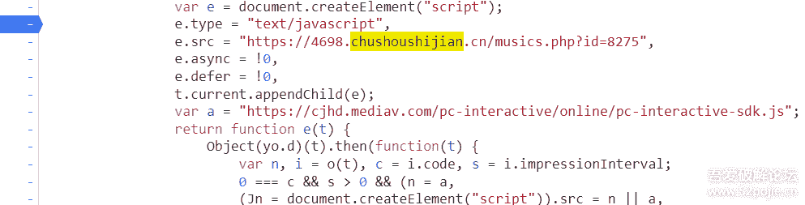

2023-04-11-16-48-34-image.png (43.91 KB, 下载次数: 0)，2023-4-12 16:28 上传

[附件下载](img/5e056c500a1c4b6a7110b50d807bade5.png://www.52pojie.cn/forum.php?mod=attachment&aid=MjYwNzA1OHw3ZWJmM2NkZHwxNzkzNTczODA5fDE2ODA4NnwxNzcyOTEz&nothumb=yes)

这里创建了 `script` 标签，将两个脚本引入了。

下个断点看看，这个函数是怎么被调用的。

没有详细去分析，大概看了看，这个函数被加入了一个链表，最终被调用。

#### `alikes.php`

接下来分析 `musics.php` 和 `alikes.php`。

先看 `alikes.php`。

1. 创建了好几个大对象。

```js
os = {
    "name": "win10",
    "is_mobile": "n"
}

ads = [{
    "headline": "",
    "description": "",
    "dispurl": "",
    "imageurl": null,
    "alt": "",
    "url": "img/5e056c500a1c4b6a7110b50d807bade5.png://pp.chuzushijian.cn/c.php?s=JnpvbmVpZD04MjczJnNpdGVpZD03MjQwJnVpZD00Njk4JmFkc2lkPTYmcGxhbmlkPTMwJnBsYW50eXBlPWNwdiZ1cmw9aHR0cHMlM0ElMkYlMkZ5eHRnLnRhb2ppa2UuY29tLmNuJTJGdGclMkZ0dGZjLmh0bWwlM0ZzYyUzRG1NMmlvWmx2d1omdnRpbWU9MjAyMy0wNC0xMSAxOTo0MjowMCZpcD0xMTUuMTcxLjIwLjE0Nw==;5b1dae569c2f22ddf1c291302ae7a738;",
    "adsid": "6",
    "planid": "30",
    "htmlcode": "img/5e056c500a1c4b6a7110b50d807bade5.png://cdn-file-ssl-wan.ludashi.com/wan/newswf/dlgglm/10.gif",
    "htmlcontrol": "",
    "c2_url": "img/5e056c500a1c4b6a7110b50d807bade5.png://pp.chuzushijian.cn/effect.php?type=ecv&planid=30&adsid=6&zoneid=8273&uid=4698&adtplid=1000&plantype=cpv"
}]
```


```javascript
z = {
    "zoneid": "8273",
    "uid": "4698",
    "plantype": "cpv",
    "sitetype": null,
    "site": {
        "www.jianshu.com": {
            "siteurl": "www.jianshu.com,*.jianshu.com",
            "sitetype": "177",
            "siteid": "7240"
        }
    },
    "adtplid": "1000",
    "width": "320",
    "height": "270",
    "adstyleid": "1000",
    "viewtype": "1",
    "viewadsid": "",
    "codestyle": '{"border":"FFFFFF","headline":"0000FF","background":"FFFFFF","description":"444444","dispurl":"008000","width":"320","height":"270","zoneid":"8273","plantype":"cpv","htmlcontrol":""}',
    "applyplanid": null,
    "userstatus": "2",
    "adstyle": null,
    "insite": "2",
    "pvstep": "0",
    "ckh": "24",
    "ckht": "1",
    "ckm": "1",
    "ckmt": "1",
    "wapckh": "24",
    "wapckht": "1",
    "wapckm": "1",
    "wapckmt": "1",
    "refs": "www.baidu.com,www.sogou.com,www.so.com,www.so.com,cn.bing.com",
    "waprefs": "so.m.sm.cn,m.baidu.com,m.sogou.com,wap.sogou.com,m.so.com",
    "refallowed": "1",
    "waprefallowed": "0",
    "checkuser": "a:2:{s:4:\"week\";a:1:{s:5:\"isacl\";s:3:\"all\";}s:4:\"city\";a:2:{s:5:\"isacl\";s:4:\"acls\";s:10:\"comparison\";s:2:\"==\";}}",
    "baiducheckuser": "a:2:{s:4:\"week\";a:1:{s:5:\"isacl\";s:3:\"all\";}s:4:\"city\";a:2:{s:5:\"isacl\";s:3:\"all\";s:10:\"comparison\";s:2:\"==\";}}",
    "jdcheckuser": "a:1:{s:4:\"city\";a:2:{s:5:\"isacl\";s:3:\"all\";s:10:\"comparison\";s:2:\"==\";}}",
    "webtitle": "请输入网站标题内容……,",
    "countdown": "15",
    "browser": "0",
    "browser_types": "s:0:\"\";",
    "uset": "0",
    "wapset": "0",
    "dlset": "1",
    "dl_width": "1200",
    "wapdl_width": "0",
    "wap_webtitle": "背投无效，请输入网站标题,"
}
```

```javascript
v = {

    "tpl": {

        "tplid": "1000",

        "adtypeid": "1000",

        "tplname": "PC端",

        "tpltype": "script",

        "viewjs": "",

        "iframejs": "",

        "customspecs": "1",

        "customcolor": "1",

        "description": "",

        "sort": "1",

        "status": "y",

        "addtime": "2015-05-25 17:21:43",

        "adnum": "1"

    },

    "style": {

        "styleid": "1000",

        "tplid": "1000",

        "stylename": "\u53f3\u4e0b\u89d2",

        "htmlcontrol": "",

        "specs": "320x270",

        "viewjs": "pvid.aid.push(ads[0].adsid); \r\npvid.pid.push(ads[0].planid);\r\npvstas(pvid);",

        "iframejs": "var ext= ads[0].htmlcode.substr(ads[0].htmlcode.lastIndexOf(\".\")).toLowerCase();\r\nif (ext=='.html'){\r\n\tvar str = '';\r\n} else if(ext=='.gif'){\r\n \tvar str = '';\r\n}  else if(ext=='.png'){\r\n \tvar str = '';\r\n}\r\n else if(ext=='!'){\r\n \tvar str = '' + ads[0].htmlcode + '';\r\n} else if(ext=='.jpg'){\r\n\tvar str = '';\r\n}else{\r\n\t var str = ""+ads[0].htmlcode+" \";\r\n}\r\ndocument.writeln(str);\r\nvar C_pv=new Image();\r\nvar m;\r\nvar o=0;\r\nvar iframes=document.getElementsByTagName("iframe"); \r\nfunction a(){\r\nfor(var i=0;i 0\r\n\tsetTimeout(function(){for(var i=0;i
```

```javascript
zone = {
    "border": "FFFFFF",
    "headline": "0000FF",
    "background": "FFFFFF",
    "description": "444444",
    "dispurl": "008000",
    "width": "320",
    "height": "270",
    "zoneid": "8273",
    "plantype": "cpv",
    "htmlcontrol": ""
}
```

### 2. 判断是否为手机

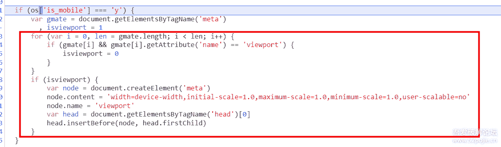

2023-04-11-20-00-10-image.png (73.01 KB, 下载次数: 3)

[href="forum.php?mod=attachment&aid=MjYwNzA1MXwwNzQzZDEwY3wxNzkzNTczODA5fDE2ODA4NnwxNzcyOTEz&nothumb=yes" target="_blank"](img/5e056c500a1c4b6a7110b50d807bade5.png://www.52pojie.cn/forum.php?mod=attachment&aid=MjYwNzA1MXwwNzQzZDEwY3wxNzkzNTczODA5fDE2ODA4NnwxNzcyOTEz&nothumb=yes)

2023-4-12 16:28 上传

查找是否有`name`为`viewport`的`meta`标签

如果不存在，就新建一个`meta`标签，如下：

`width=device-width` 表示将视口的宽度设置为设备的宽度，即以设备宽度作为视口宽度，以便更好地适配不同分辨率和屏幕尺寸的设备。

`initial-scale=1.0` 表示页面初始缩放比例为 1，即不进行缩放，这个值可以根据需要进行修改。

`maximum-scale=1.0` 表示用户最大缩放比例为 1，即不允许用户对页面进行缩放。

`minimum-scale=1.0` 表示用户最小缩放比例为 1，即不允许用户对页面进行缩放。

`user-scalable=no` 表示不允许用户对页面进行缩放。

`viewport` 的 `meta` 标签用于设置网页在移动设备中的显示效果，可以通过 `width`、`height`、`initial-scale`、`maximum-scale`、`minimum-scale`、`user-scalable` 等属性进行控制。在移动端浏览器中，由于屏幕尺寸、分辨率和像素密度等因素的不同，网页显示效果可能会出现问题，例如字体太小、排版混乱等。为了解决这个问题，开发者可以通过设置 `viewport` 的 `meta` 标签来调整网页在移动设备上的显示效果，从而更好地适配不同的手机屏幕。

具体来说， `viewport` 的 `meta` 标签通过设置 `content` 属性来指定一些参数，例如 `width` 表示视口宽度， `initial-scale` 表示初始缩放比例，`user-scalable` 表示是否允许用户缩放页面等等。通过调整这些参数，可以使网页在不同的设备上呈现出更为统一和美观的视觉效果。

### 3. 接着定义了一个`domain`，存放了两个地址

```javascript
domain = {
    jsurl: 'img/5e056c500a1c4b6a7110b50d807bade5.png://pp.chuzushijian.cn/',
    imgurl: 'img/5e056c500a1c4b6a7110b50d807bade5.png://pp.chuzushijian.cn/',
}
```

### 4. 获取浏览器UA，并从中正则提取出一些有用信息存入`__B`中

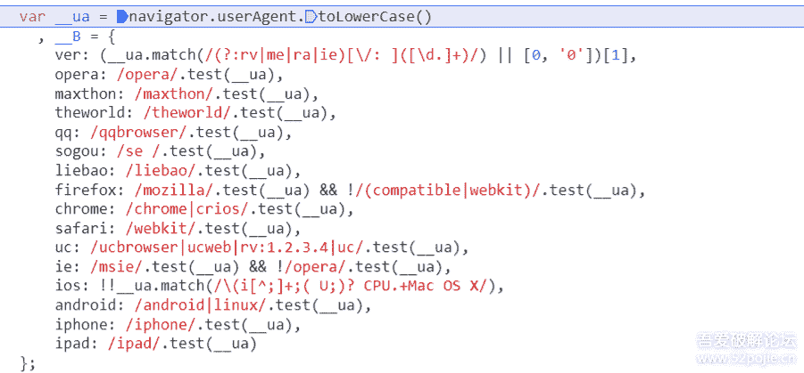

2023-04-11-20-06-26-image.png (123.1 KB, 下载次数: 2)

[href="forum.php?mod=attachment&aid=MjYwNzA0MXxhZTAzZmYyZHwxNzkzNTczODA5fDE2ODA4NnwxNzcyOTEz&nothumb=yes" target="_blank"](img/5e056c500a1c4b6a7110b50d807bade5.png://www.52pojie.cn/forum.php?mod=attachment&aid=MjYwNzA0MXxhZTAzZmYyZHwxNzkzNTczODA5fDE2ODA4NnwxNzcyOTEz&nothumb=yes)

2023-4-12 16:27 上传

包括当前浏览器的版本，种类

### 5. 构造两个链接

```javascript
 var ifsrc_cpc = 'img/5e056c500a1c4b6a7110b50d807bade5.png://pp.chuzushijian.cn/v2.php?id=' + (zone.zoneid - 1) + '&p=' + __P() + '&l=' + __LC() + '&t=' + 1681214767

 var ifsrc_adx = 'img/5e056c500a1c4b6a7110b50d807bade5.png://pp.chuzushijian.cn/news/33.html?id=' + (zone.zoneid - 1) + '&p=' + __P() + '&l=' + __LC() + '&t=' + 1681214767
```

先看`__P`方法，是一个大类，经过测试，每次运行的结果都一样，下面仔细分析一下


# `__P` 函数实现

```
function __P() {
    var win = window
      , doc = document
      , p = [];
    function r() {
        var c;
        try {
            c = win.opener ? win.opener.document.location.href : doc.referrer
        } catch (e) {
            c = doc.referrer
        }
        function K(r) {
            var s = ['wd', 'p', 'q', 'keyword', 'kw', 'w', 'key', 'word', 'query', 'q1', 'name'];
            if (r != '' && r != null) {
                for (var i = 0; i  0) {
            for (i in m) {
                if (m[i]['type'] == 'application/vnd.chromium.remoting-viewer') {
                    e = '1';
                }
            }
        }
        if (e != '1') {
            var _tk = 'track'in document.createElement('track')
              , _se = 'scoped'in document.createElement('style')
              , _vl = 'v8Locale'in window;
            if (_tk && !_se && !_vl) {
                e = '2';
            }
            if (_tk && _se && _vl) {
                e = '3';
            }
        }
        return {
            se: e
        };
    }
    function j() {
        return {
            j: navigator.javaEnabled() ? 1 : 0
        };
    }

    function pl() {
        return {
            pl: navigator.plugins.length
        };
    }

    function m() {
        return {
            m: navigator.mimeTypes.length
        };
    }

    function f() {
        var v = 0;
        if (navigator.plugins && navigator.mimeTypes.length) {
            var b = navigator.plugins['Shockwave Flash'];
            if (b && b.description)
                v = b.description.replace(/([a-zA-Z]|\s)+/, '').replace(/(\s)+r/, '.')
        } else if (__B.ie && !window.opera) {
            var c = null;
            try {
                c = new ActiveXObject('ShockwaveFlash.ShockwaveFlash.7')
            } catch (e) {
                var a = 0;
                try {
                    c = new ActiveXObject('ShockwaveFlash.ShockwaveFlash.6');
                    a = 6;
                    c.AllowScriptAccess = 'always'
                } catch (e) {
                    if (a == 6)
                        return a.toString()
                }
                try {
                    c = new ActiveXObject('ShockwaveFlash.ShockwaveFlash')
                } catch (e) {
                }
            }
            if (c != null) {
                var a = c.GetVariable('$version').split(' ')[1];
                v = a.replace(/,/g, '.')
            }
        }
        return {
            f: v
        }
    }

    function res() {
        var D = screen
          , v = D.width + 'x' + D.height;
        return {
            res: v
        }
    }

    function t() {
        var v = document.title;
        return {
            t: encodeURIComponent(v)
        }
    }

    function l() {
        var v = navigator.browserLanguage || navigator.language;
        return {
            l: v
        }
    }

    function c() {
        var v = navigator.cookieEnabled;
        v = v ? 1 : 0;
        return {
            c: v
        }
    }

    function H() {
        return document.body && {
            h: document.body.clientHeight
        };
    }

    var b = {};
    __E([j, pl, m, f, r, u, res, t, l, c, H, sE], function(a) {
        __M(b, a)
    });
    for (var e in b) {
        p.push(e + '=' + b[e]);
    }
    return Base64.encode(p.join('&'));
}
```

很容易分析出来，依次调用 `j`, `pl`, `m`, `f`, `r`, `u`, `res`, `t`, `l`, `c`, `H`, `sE` 函数，将其执行结果（均为字典）的键值全部存入 `b` 字典中

下面依次分析这些函数

## 函数详解

### `j` 函数
返回是否启用了 java

```
function j() {

    return {

        j: navigator.javaEnabled() ? 1 : 0

    };

}
```

### `pl` 函数
返回浏览器安装的插件数量

```
function pl() {
    return {
        pl: navigator.plugins.length
    };
}
```

### `m` 函数
返回浏览器支持的 mime 类型

```
function m() {

    return {

        m: navigator.mimeTypes.length

    };

}
```

### `f` 函数
检测当前浏览器是否支持 Adobe Flash 插件，并返回其版本号

```
function f() {
    var v = 0;
    if (navigator.plugins && navigator.mimeTypes.length) {
        var b = navigator.plugins['Shockwave Flash'];
        if (b && b.description)
            v = b.description.replace(/([a-zA-Z]|\s)+/, '').replace(/(\s)+r/, '.')
    } else if (__B.ie && !window.opera) {
        var c = null;
        try {
            c = new ActiveXObject('ShockwaveFlash.ShockwaveFlash.7')
        } catch (e) {
            var a = 0;
            try {
                c = new ActiveXObject('ShockwaveFlash.ShockwaveFlash.6');
                a = 6;
                c.AllowScriptAccess = 'always'
            } catch (e) {
                if (a == 6)
                    return a.toString()
            }
            try {
                c = new ActiveXObject('ShockwaveFlash.ShockwaveFlash')
            } catch (e) {
            }
        }
        if (c != null) {
            var a = c.GetVariable('$version').split(' ')[1];
            v = a.replace(/,/g, '.')
        }
    }
    return {
        f: v
    }
}
```

### `r` 函数
获取当前页面的来源信息和可能包含在来源信息中的关键词

```
function r() {

    var c;

    try {

        c = win.opener ? win.opener.document.location.href : doc.referrer

    } catch (e) {

        c = doc.referrer

    }

    function K(r) {

        var s = ['wd', 'p', 'q', 'keyword', 'kw', 'w', 'key', 'word', 'query', 'q1', 'name'];

        if (r != '' && r != null) {

            for (var i = 0; i 
```

### `u` 函数
获取当前页面的顶层窗口的 URL 地址

```
function u() {
    var c;
    try {
        c = win.top.document.location.href;
    } catch (e) {
        c = doc.location.href;
    }
    return {
        u: encodeURIComponent(c)
    };
}
```

### `res` 函数
获取当前屏幕的分辨率(例如:1494x934)

```
function res() {

    var D = screen

      , v = D.width + 'x' + D.height;

    return {

        res: v

    }

}
```

### `t` 函数
获取当前页面的标题

```
function t() {
    var v = document.title;
    return {
        t: encodeURIComponent(v)
    }
}
```

### `l` 函数
获取浏览器的语言设置

```
function l() {

    var v = navigator.browserLanguage || navigator.language;

    return {

        l: v

    }

}
```

### `c` 函数
检测浏览器是否支持 Cookie

```
function c() {
    var v = navigator.cookieEnabled;
    v = v ? 1 : 0;
    return {
        c: v
    }
}
```

### `H` 函数
获取当前页面的文档高度

```
function H() {

    return document.body && {

        h: document.body.clientHeight

    };

}
```

### `sE` 函数
检测当前浏览器是否支持某些特定的技术（如 WebRTC 和 CSS Scoped Styles）

```
function sE() {
    var e = 0, m = navigator.mimeTypes, i;
    if (navigator.mimeTypes != null && navigator.mimeTypes.length > 0) {
        for (i in m) {
            if (m[i]['type'] == 'application/vnd.chromium.remoting-viewer') {
                e = '1';
            }
        }
    }
    if (e != '1') {
        var _tk = 'track'in document.createElement('track')
          , _se = 'scoped'in document.createElement('style')
          , _vl = 'v8Locale'in window;
        if (_tk && !_se && !_vl) {
            e = '2';
        }
        if (_tk && _se && _vl) {
            e = '3';
        }
    }
    return {
        se: e
    };
}
```

最终生成了 `b`，`b` 包含了浏览器的一些特征，我的浏览器当前状态下的 `b` 如下：

```
b = {

    j =  0,

    pl =  5,

    m =  2,

    f =  0,

    r =  "img/5e056c500a1c4b6a7110b50d807bade5.png%3A%2F%2Fwww.baidu.com%2Flink%3Furl%3DxgtwhmaJd433Do_UUtcdd7fq1K02GypeMRyLUlIu0vD0CAkiZ9jtqa1kBQZsSvvq%26wd%3D%26eqid%3De2cfa4250000035600000003643510ba",

    k =  "",

    u =  "img/5e056c500a1c4b6a7110b50d807bade5.png%3A%2F%2Fwww.jianshu.com%2Fp%2Fad9d30ee0d1d",

    res =  "1494x934",

    t =  "%5BEIS%202019%5DEzPOP%20-%20%E7%AE%80%E4%B9%A6",

    l =  "zh-CN",

    c =  1,

    h =  815,

    se =  "2"

}
```

接着将 `b` 变成键=值并用 `&` 连接起来，`Base64` 一下

接下来看 `__LC` 函数,获取当前页面所在的顶层文档（或者当前文档）的主机地址，并进行 `Base64` 编码处理


```
function __LC() {
    var c;
    try {
        c = window.top.document.location.host;
    } catch (e) {
        c = document.location.host;
    }
    return Base64.encode(c);
}
```

## 6. 接下来调用`__S`函数，分析其流程

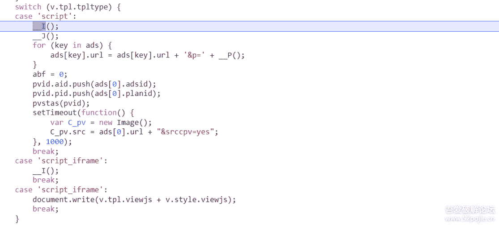

2023-04-11-21-20-03-image.png (83.76 KB, 下载次数: 2)

[href="forum.php?mod=attachment&aid=MjYwNzA0NnxlZTAzNjZkNHwxNzkzNTczODA5fDE2ODA4NnwxNzcyOTEz&nothumb=yes" target="_blank"](img/5e056c500a1c4b6a7110b50d807bade5.png://www.52pojie.cn/forum.php?mod=attachment&aid=MjYwNzA0NnxlZTAzNjZkNHwxNzkzNTczODA5fDE2ODA4NnwxNzcyOTEz&nothumb=yes)

2023-4-12 16:27 上传

### (1) 看`I`和`J`函数

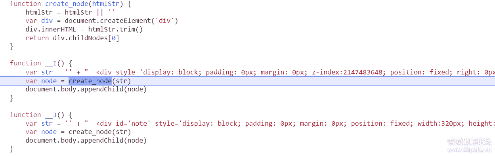

2023-04-11-21-20-54-image.png (50.93 KB, 下载次数: 2)

[href="forum.php?mod=attachment&aid=MjYwNzA1NXw1OGU1NjVhN3wxNzkzNTczODA5fDE2ODA4NnwxNzcyOTEz&nothumb=yes" target="_blank"](img/5e056c500a1c4b6a7110b50d807bade5.png://www.52pojie.cn/forum.php?mod=attachment&aid=MjYwNzA1NXw1OGU1NjVhN3wxNzkzNTczODA5fDE2ODA4NnwxNzcyOTEz&nothumb=yes)

2023-4-12 16:28 上传

新建了两个标签


```
    //pp.chuzushijian.cn/images/bj1.png@

}

    [//cdn-file-ssl-wan.ludashi.com/wan/newswf/dlgglm/18dl.gif @](img/5e056c500a1c4b6a7110b50d807bade5.png://pp.chuzushijian.cn/c.php?s=JnpvbmVpZD04MjczJnNpdGVpZD03MjQwJnVpZD00Njk4JmFkc2lkPTgmcGxhbmlkPTMwJnBsYW50eXBlPWNwdiZ1cmw9aHR0cHMlM0ElMkYlMkZ5eHRnLnRhb2ppa2UuY29tLmNuJTJGdGclMkZ0dGZjLmh0bWwlM0ZzYyUzRFJVWDQ1T2V0R3ImdnRpbWU9MjAyMy0wNC0xMSAyMDozODo0MSZpcD0xMTUuMTcxLjIwLjE0Nw==;03c8963a79ad640355e73402a148db11; +&do2click=true:
})
```


2023-04-12-09-02-57-image.jpg (71.6 KB, 下载次数: 2)

[href="forum.php?mod=attachment&aid=MjYwNzAzM3xmZTU2OWE3NnwxNzkzNTczODA5fDE2ODA4NnwxNzcyOTEz&nothumb=yes" target="_blank"](img/5e056c500a1c4b6a7110b50d807bade5.png://www.52pojie.cn/forum.php?mod=attachment&aid=MjYwNzAzM3xmZTU2OWE3NnwxNzkzNTczODA5fDE2ODA4NnwxNzcyOTEz&nothumb=yes)

2023-4-12 16:27 上传

分为两部分，看一下`iframe`这个请求

[//pp_chuzushijian_cn/v2_php" target="_blank" rel="noopener noreferrer nofollow"](img/5e056c500a1c4b6a7110b50d807bade5.png://pp_chuzushijian_cn/v2_php:rel="nofollow noopener" href="img/5e056c500a1c4b6a7110b50d807bade5.png)


2023-04-12-09-28-20-image.png (119.12 KB, 下载次数: 2)

[href="forum.php?mod=attachment&aid=MjYwNzA0MnwzMjNlM2Q4NXwxNzkzNTczODA5fDE2ODA4NnwxNzcyOTEz&nothumb=yes" target="_blank"](img/5e056c500a1c4b6a7110b50d807bade5.png://www.52pojie.cn/forum.php?mod=attachment&aid=MjYwNzA0MnwzMjNlM2Q4NXwxNzkzNTczODA5fDE2ODA4NnwxNzcyOTEz&nothumb=yes)

2023-4-12 16:27 上传

判断当前广告的`htmlcode`后缀名（在`html`中的显示类型），这里是`gif`

于是创建一个`a`标签


展示效果如下图所示：


2023-04-12-09-33-22-image.png (48.59 KB, 下载次数: 2)

[href="forum.php?mod=attachment&aid=MjYwNzA1NHw4NGRmNjJiN3wxNzkzNTczODA5fDE2ODA4NnwxNzcyOTEz&nothumb=yes" target="_blank"](img/5e056c500a1c4b6a7110b50d807bade5.png://www.52pojie.cn/forum.php?mod=attachment&aid=MjYwNzA1NHw4NGRmNjJiN3wxNzkzNTczODA5fDE2ODA4NnwxNzcyOTEz&nothumb=yes)

2023-4-12 16:28 上传


2023-04-12-09-32-49-image.png (19.46 KB, 下载次数: 1)

[href="forum.php?mod=attachment&aid=MjYwNzA2MXxlMDA1MzEyYXwxNzkzNTczODA5fDE2ODA4NnwxNzcyOTEz&nothumb=yes" target="_blank"](img/5e056c500a1c4b6a7110b50d807bade5.png://www.52pojie.cn/forum.php?mod=attachment&aid=MjYwNzA2MXxlMDA1MzEyYXwxNzkzNTczODA5fDE2ODA4NnwxNzcyOTEz&nothumb=yes)

2023-4-12 16:39 上传

接着给图片添加`click`和`mousemove`事件

### (2) 给`ads`（advertisement:广告）的`url`加上`p`参数

接着调用`pvstas`函数

```
function pvstas(pvid) {

    var aid, pid;

    if (pvid.aid.length > 1) {

        aid = pvid.aid.join(',').match(/([^,]+)(?!.*\1)/ig);

        pid = pvid.pid.join(',').match(/([^,]+)(?!.*\1)/ig);

    } else {

        aid = pvid.aid;

        pid = pvid.pid;

    }

    var pv_step = '10'

    var runm = z['pv_step'] || pv_step

    var rand = parseInt(Math.random() * runm + 1)

    if (rand === 1 && pv_step) {

        var url = domain.jsurl + 'stats.php?adsid=' + aid + '&planid=' + pid + '&uid=' + z['uid'] + '&siteid=&plantype=' + z['plantype'] + '&zoneid=' + z['zoneid'] + '&adtplid=' + z['adtplid'] + '&sep=' + runm

        __L(url)

    }

}
```

`pvstas`随机执行`L`函数，`L`函数里面创建了一个`script`标签，其`src`就是这个`url`，向服务器发送数据


2023-04-11-21-41-44-image.png (48.76 KB, 下载次数: 2)

[href="forum.php?mod=attachment&aid=MjYwNzA1N3xjOGIwMmQ5Y3wxNzkzNTczODA5fDE2ODA4NnwxNzcyOTEz&nothumb=yes" target="_blank"](img/5e056c500a1c4b6a7110b50d807bade5.png://www.52pojie.cn/forum.php?mod=attachment&aid=MjYwNzA1N3xjOGIwMmQ5Y3wxNzkzNTczODA5fDE2ODA4NnwxNzcyOTEz&nothumb=yes)

2023-4-12 16:28 上传

创建一个`script`标签，其`src`为百度的一个链接


2023-04-11-21-45-43-image.png (111.09 KB, 下载次数: 3)

[href="forum.php?mod=attachment&aid=MjYwNzA0M3wwYTNiNjE1OHwxNzkzNTczODA5fDE2ODA4NnwxNzcyOTEz&nothumb=yes" target="_blank"](img/5e056c500a1c4b6a7110b50d807bade5.png://www.52pojie.cn/forum.php?mod=attachment&aid=MjYwNzA0M3wwYTNiNjE1OHwxNzkzNTczODA5fDE2ODA4NnwxNzcyOTEz&nothumb=yes)

2023-4-12 16:27 上传

判断来源是不是以下几个

`www_baidu_com`,`www_sogou_com`,`www_so_com`,`www_so_com`,`cn_bing_com`

### (3) 为关闭按钮绑定`click`事件，只要一点击，立马先跳转到广告页面


2023-04-11-21-50-59-image.png (132.88 KB, 下载次数: 1)

[href="forum.php?mod=attachment&aid=MjYwNzA0MHxlYzQ1MGEwM3wxNzkzNTczODA5fDE2ODA4NnwxNzcyOTEz&nothumb=yes" target="_blank"](img/5e056c500a1c4b6a7110b50d807bade5.png://www.52pojie.cn/forum.php?mod=attachment&aid=MjYwNzA0MHxlYzQ1MGEwM3wxNzkzNTczODA5fDE2ODA4NnwxNzcyOTEz&nothumb=yes)

2023-4-12 16:27 上传

`alikes.php`主要负责右下角的广告，`musics_php`负责两边的广告

## 7. 广告是如何跳转的

这是广告的链接，很明显是这个投放公司的域名

```
img/5e056c500a1c4b6a7110b50d807bade5.png://pp_chuzushijian_cn/c_php?s=JnpvbmVpZD04Mjc1JnNpdGVpZD03MjQwJnVpZD00Njk4JmFkc2lkPTIwNSZwbGFuaWQ9MzUmcGxhbnR5cGU9Y3B2JnVybD1odHRwcyUzQSUyRiUyRnl4dGcudGFvamlrZS5jb20uY24lMkZ0ZyUyRnR0ZmMuaHRtbCUzRnNjJTNEcmtnN0pFWUJadSZ2dGltZT0yMDIzLTA0LTEyIDA5OjE4OjI1JmlwPTExNS4xNzEuMjAuMTQ3;b999ce64be4fd695e65ea594a8e904e8;&p=aj0wJm09MiZmPTAmcj0mdT1odHRwcyUzQSUyRiUyRnd3dy5qaWFuc2h1LmNvbSUyRnAlMkYzZDA2OTQxZjM5MzYmcmVzPTE0OTR4OTM0JnQ9JUUzJTgwJThBJUU1JThDJTg1JUU2JUIzJTk1JUU1JTg4JUE5JUU1JUE0JUFCJUU0JUJBJUJBJUUzJTgwJThCJUVGJUJDJTlBJUU1JUE5JTlBJUU1JUE0JTk2JUU3JTlBJTg0JUU1JTg1JUIzJUU3JUIzJUJCJUVGJUJDJThDJUU3JTlEJUExJUU4JUJGJTg3JUU1JUIwJUIxJUU3JUJCJTkzJUU2JTlEJTlGJUU0JUJBJTg2JUVGJUJDJThDJUU1JThFJTlGJUU1JTlCJUEwJUU1JUJFJTg4JUU3JThFJUIwJUU1JUFFJTlFJTIwLSUyMCVFNyVBRSU4MCVFNCVCOSVBNiZsPXpoLUNOJmM9MSZoPTgxNSZzZT0y&do2click=true
```

有几个参数：


2023-04-12-09-45-25-image.png (51.41 KB, 下载次数: 3)

[href="forum.php?mod=attachment&aid=MjYwNzA1MHxjOGM0NmY3YnwxNzkzNTczODA5fDE2ODA4NnwxNzcyOTEz&nothumb=yes" target="_blank"](img/5e056c500a1c4b6a7110b50d807bade5.png://www.52pojie.cn/forum.php?mod=attachment&aid=MjYwNzA1MHxjOGM0NmY3YnwxNzkzNTczODA5fDE2ODA4NnwxNzcyOTEz&nothumb=yes)

2023-4-12 16:28 上传

他会重定向到游戏的真实网页


2023-04-12-09-46-20-image.png (158.26 KB, 下载次数: 2)

[href="forum.php?mod=attachment&aid=MjYwNzAzN3xjODk5YTMzOXwxNzkzNTczODA5fDE2ODA4NnwxNzcyOTEz&nothumb=yes" target="_blank"](img/5e056c500a1c4b6a7110b50d807bade5.png://www.52pojie.cn/forum.php?mod=attachment&aid=MjYwNzAzN3xjODk5YTMzOXwxNzkzNTczODA5fDE2ODA4NnwxNzcyOTEz&nothumb=yes)

2023-4-12 16:27 上传

其中`p`参数为浏览器环境，之前分析了

这个`s`参数就是目标广告的信息，但是这是直接写死的，也无法分析具体是怎么加密的

## 四、自动关闭广告

大致分为以下几种方法

- 拦截该广告公司的请求
- 删除创建的广告标签

