# [Web逆向] 某Excel全栈解决方案 逆向分析【前端组件篇】+JSHook

- 原帖: https://www.52pojie.cn/forum.php?mod=viewthread&tid=1772986
- 抓取时间: 2026-11-01T22:56:47

## 前情提要

Σ(っ °Д °;)っ 上一篇被H大加精了？！

那必须整点干货庆祝庆祝了！

书接上回，既然是全栈解决方案，那么肯定还有前端部分。

那么咱们这次来操刀一下前端组件吧~

上文回顾：[//www.52pojie.cn/thread-1771932-1-1.html](https://www.52pojie.cn/thread-1771932-1-1.html)

## 嘉宾介绍

aHR0cHM6Ly93d3cuZ3JhcGVjaXR5LmNvbS9zcHJlYWRqcw==

不过这东西我没具体用过，只是研究研究，看着功能挺厉害的。

## 准备工作

当然先看文档和 Demo 啦！

文档地址：

aHR0cHM6Ly93d3cuZ3JhcGVjaXR5LmNvbS9zcHJlYWRqcy9kb2NzL2dldHN0YXJ0ZWQvdHJpYWxfU3ByZWFkSlM=

因为通过文档，你至少能很快知道有哪些限制（明面上的）和入口点在哪。

然后就是下载完整包了。

当然因为咱不是前端工程师，所以那些vue react nodejs 啥的咱也弄不懂，直接从原生js入手。

可能没导包那么方便，但是就分析而言，就从完整体入手吧~

下载好解压后，简单看看目录结构，有个`samples`。

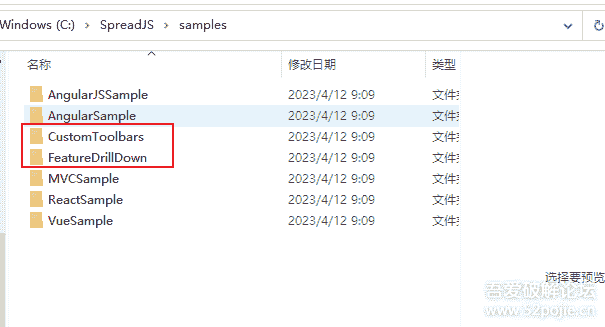

1.png (28.48 KB, 下载次数: 1)

[href="forum.php?mod=attachment&aid=MjYwNzA5Nnw2MjViNDRlMnwxNzkzNTczODA1fDE2ODA4NnwxNzcyOTg2&nothumb=yes" target="_blank"](https://www.52pojie.cn/forum.php?mod=attachment&aid=MjYwNzA5Nnw2MjViNDRlMnwxNzkzNTczODA1fDE2ODA4NnwxNzcyOTg2&nothumb=yes)

2023-4-12 18:31 上传

排除掉那些明显框架名的就两个看着是原生版...

选一个吧...

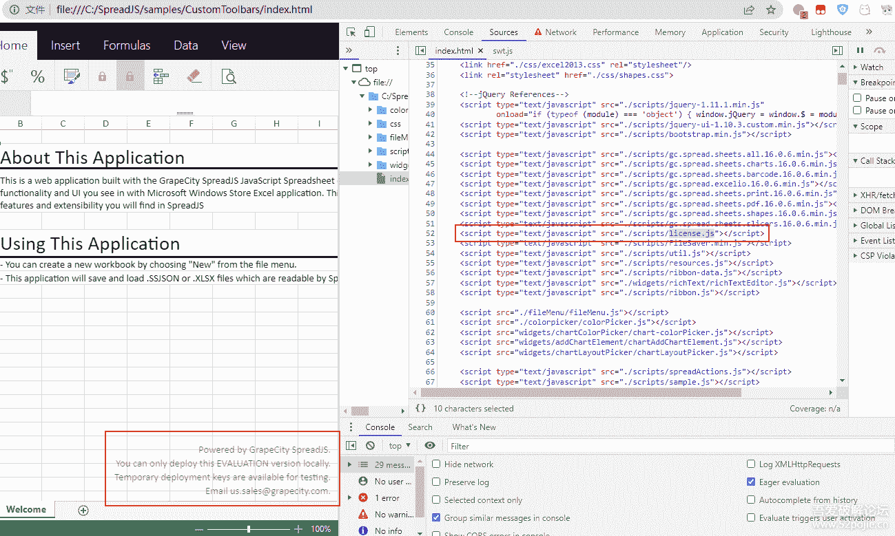

2.png (211.9 KB, 下载次数: 1)

[href="forum.php?mod=attachment&aid=MjYwNzA5N3xjMTc4ZjUyMXwxNzkzNTczODA1fDE2ODA4NnwxNzcyOTg2&nothumb=yes" target="_blank"](https://www.52pojie.cn/forum.php?mod=attachment&aid=MjYwNzA5N3xjMTc4ZjUyMXwxNzkzNTczODA1fDE2ODA4NnwxNzcyOTg2&nothumb=yes)

2023-4-12 18:31 上传

能看，有明显痕迹，那么可以开始动工了！

## 开始分析

根据文档，咱们知道注册码是通过启动前对`GC.Spread.Sheets.LicenseKey`赋值来触发的。

```js
//Please provide valid license key.
//GC.Spread.Sheets.LicenseKey = "Your key";
```

那么我们先来看看能不能找到这个对象或字段。

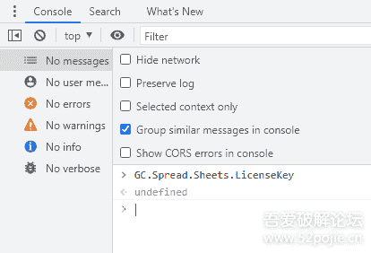

3.png (22.92 KB, 下载次数: 1)

[href="forum.php?mod=attachment&aid=MjYwNzA5OHwwYmVhYTk2M3wxNzkzNTczODA1fDE2ODA4NnwxNzcyOTg2&nothumb=yes" target="_blank"](https://www.52pojie.cn/forum.php?mod=attachment&aid=MjYwNzA5OHwwYmVhYTk2M3wxNzkzNTczODA1fDE2ODA4NnwxNzcyOTg2&nothumb=yes)

2023-4-12 18:31 上传

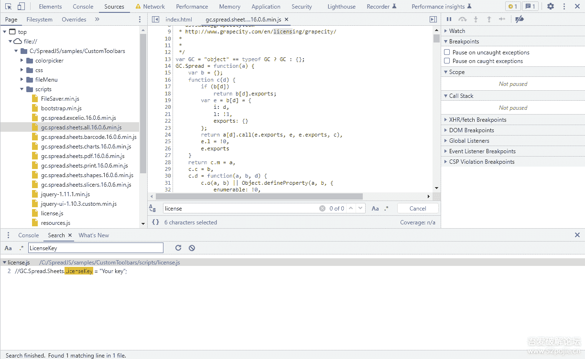

4.png (100.35 KB, 下载次数: 1)

[href="forum.php?mod=attachment&aid=MjYwNzA5OXwzZTliMjQ1OHwxNzkzNTczODA1fDE2ODA4NnwxNzcyOTg2&nothumb=yes" target="_blank"](https://www.52pojie.cn/forum.php?mod=attachment&aid=MjYwNzA5OXwzZTliMjQ1OHwxNzkzNTczODA1fDE2ODA4NnwxNzcyOTg2&nothumb=yes)

2023-4-12 18:31 上传

啊这。。。一点线索都不给啊。。。

那怎么办呢？

别急，.Net 里面不是可以给对象设置属性，然后还可以给属性设置`get`和`set`吗？

js 里面也有类似的。既然我们要看到底哪儿读了`LicenseKey`，我们就可以这样赋值。

```js
var lic = 'Your key';

Object.defineProperty(GC.Spread.Sheets, 'LicenseKey', {
  get() {
    //咱们给这个LicenseKey写成 get 的形式
    //然后在里面埋个debugger断点，这样devTools 发现脚本内 有 debugger 关键词就会触发断点
    //被访问的话就会断下来啦~
    debugger
    return lic;
  },
  configurable : true
});
```

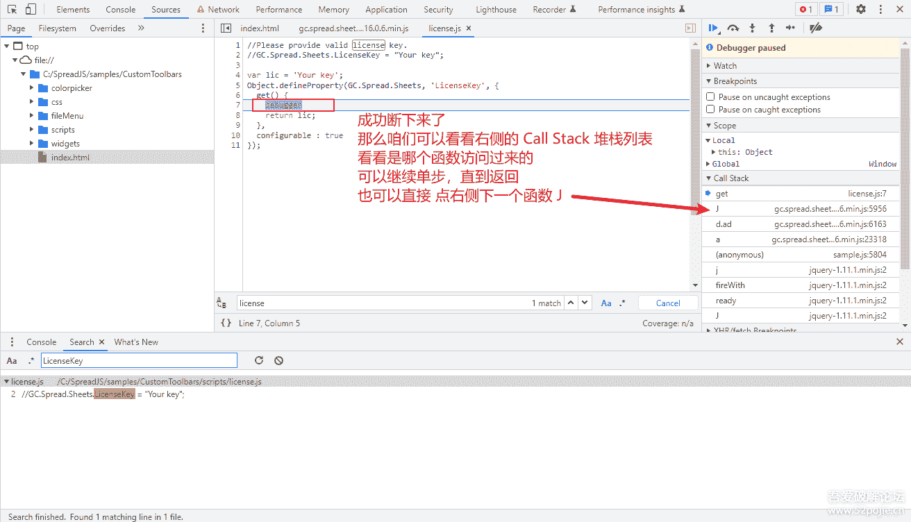

5.png (117.51 KB, 下载次数: 1)

[href="forum.php?mod=attachment&aid=MjYwNzEwMHw5ZjJkMzlkN3wxNzkzNTczODA1fDE2ODA4NnwxNzcyOTg2&nothumb=yes" target="_blank"](https://www.52pojie.cn/forum.php?mod=attachment&aid=MjYwNzEwMHw5ZjJkMzlkN3wxNzkzNTczODA1fDE2ODA4NnwxNzcyOTg2&nothumb=yes)

2023-4-12 18:31 上传

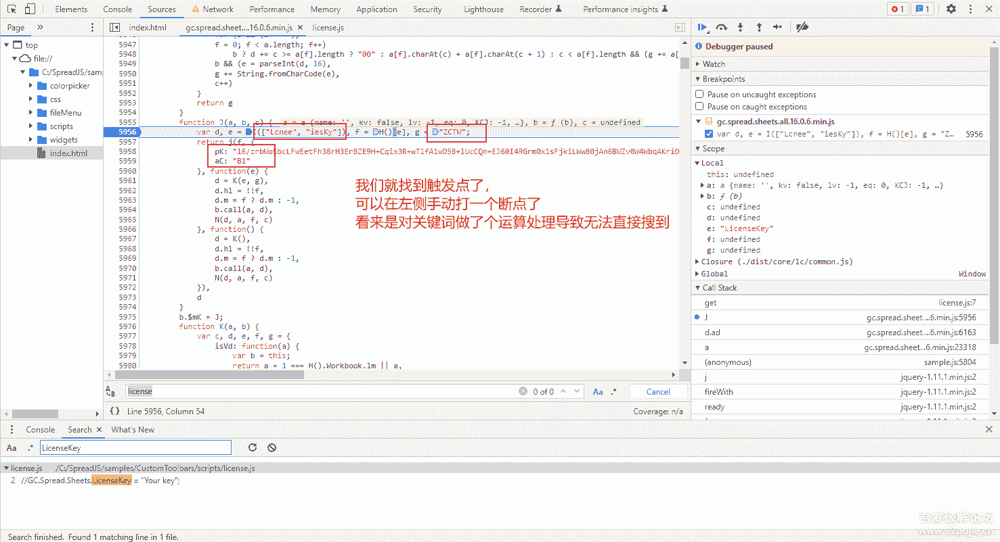

6.png (160.66 KB, 下载次数: 1)

[href="forum.php?mod=attachment&aid=MjYwNzEwMXxhNmM3MjdhN3wxNzkzNTczODA1fDE2ODA4NnwxNzcyOTg2&nothumb=yes" target="_blank"](https://www.52pojie.cn/forum.php?mod=attachment&aid=MjYwNzEwMXxhNmM3MjdhN3wxNzkzNTczODA1fDE2ODA4NnwxNzcyOTg2&nothumb=yes)

2023-4-12 18:31 上传

在这儿我们能看到

有一个四位字符`ZCTW`，在后端篇里面出现过类似的，可以留意一下。

有 "公钥" (我盲猜他是...这么长的 base64 不是RSA密钥就是AES或者别的啥密钥，问就是直觉...错了也不赌5毛)

然后还有个`B1`，Mark 一下。

当然，我们顺手在`j()`函数中间和末尾都打上断点吧~

万一里面太乱的话...(保险起见)

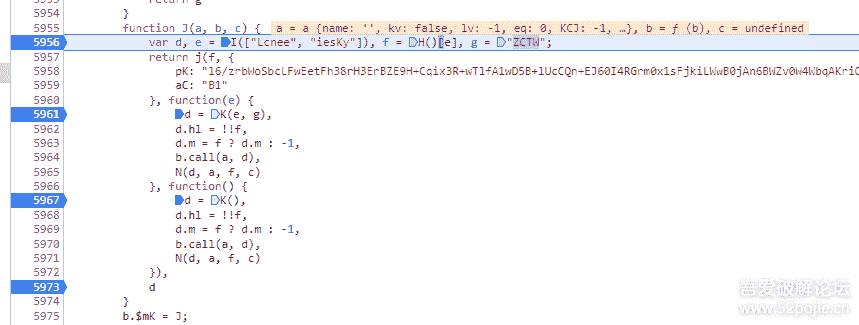

7.png (40.76 KB, 下载次数: 0)

[href="forum.php?mod=attachment&aid=MjYwNzEwMnxlYTE3NjIzM3wxNzkzNTczODA1fDE2ODA4NnwxNzcyOTg2&nothumb=yes" target="_blank"](https://www.52pojie.cn/forum.php?mod=attachment&aid=MjYwNzEwMnxlYTE3NjIzM3wxNzkzNTczODA1fDE2ODA4NnwxNzcyOTg2&nothumb=yes)

2023-4-12 18:31 上传

继续单步走起

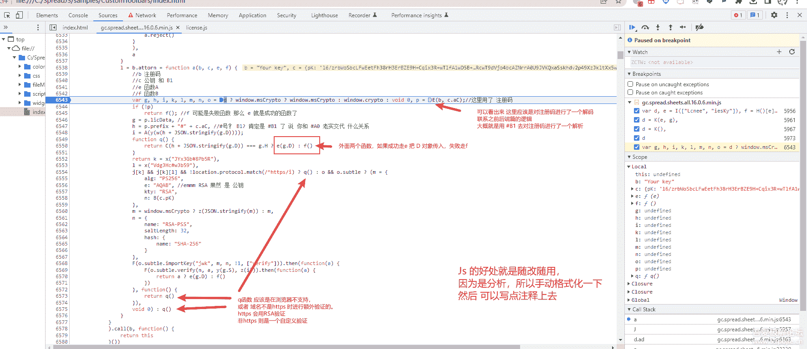

8.png (225.37 KB, 下载次数: 0)

[href="forum.php?mod=attachment&aid=MjYwNzEwM3xiZTQ0OWM5NHwxNzkzNTczODA1fDE2ODA4NnwxNzcyOTg2&nothumb=yes" target="_blank"](https://www.52pojie.cn/forum.php?mod=attachment&aid=MjYwNzEwM3xiZTQ0OWM5NHwxNzkzNTczODA1fDE2ODA4NnwxNzcyOTg2&nothumb=yes)

2023-4-12 18:31 上传

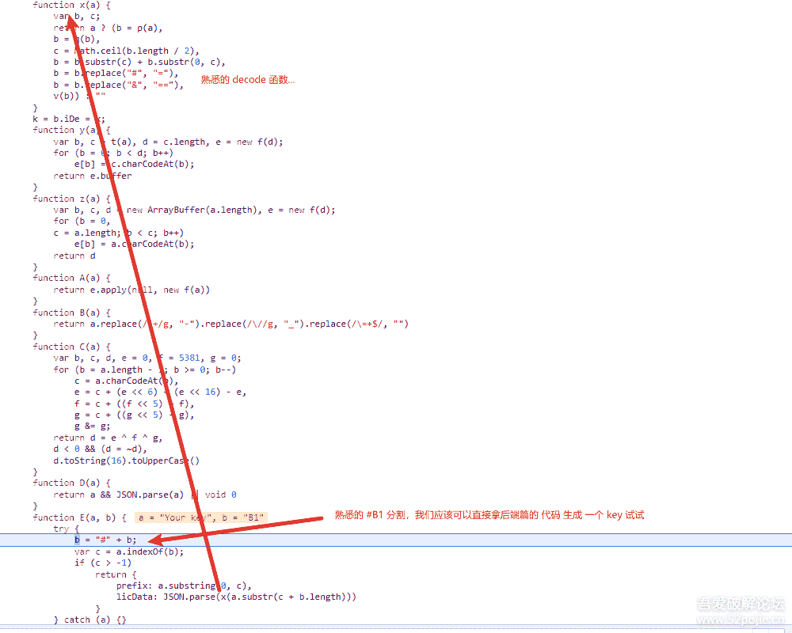

9.png (87.67 KB, 下载次数: 1)

[href="forum.php?mod=attachment&aid=MjYwNzEwNHw1ZmJlNzAwN3wxNzkzNTczODA1fDE2ODA4NnwxNzcyOTg2&nothumb=yes" target="_blank"](https://www.52pojie.cn/forum.php?mod=attachment&aid=MjYwNzEwNHw1ZmJlNzAwN3wxNzkzNTczODA1fDE2ODA4NnwxNzcyOTg2&nothumb=yes)

2023-4-12 18:31 上传

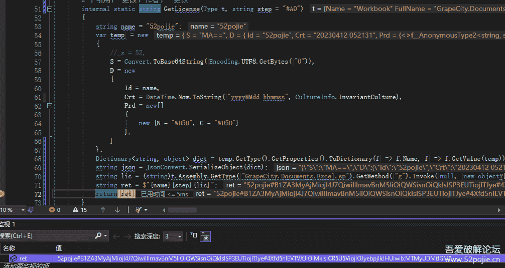

10.png (121.74 KB, 下载次数: 0)

[href="forum.php?mod=attachment&aid=MjYwNzEwNXwyYmU1NmI1OHwxNzkzNTczODA1fDE2ODA4NnwxNzcyOTg2&nothumb=yes" target="_blank"](https://www.52pojie.cn/forum.php?mod=attachment&aid=MjYwNzEwNXwyYmU1NmI1OHwxNzkzNTczODA1fDE2ODA4NnwxNzcyOTg2&nothumb=yes)

2023-4-12 18:31 上传

生成一个新码然后来跑跑看

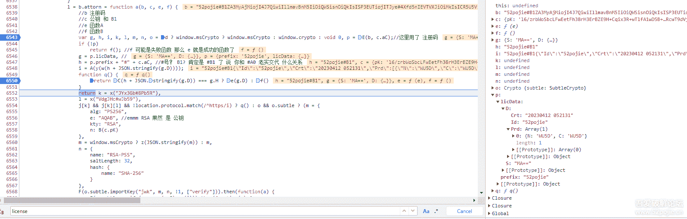

11.png (122.49 KB, 下载次数: 1)

[href="forum.php?mod=attachment&aid=MjYwNzEwNnxkOGNhYTRiYnwxNzkzNTczODA1fDE2ODA4NnwxNzcyOTg2&nothumb=yes" target="_blank"](https://www.52pojie.cn/forum.php?mod=attachment&aid=MjYwNzEwNnxkOGNhYTRiYnwxNzkzNTczODA1fDE2ODA4NnwxNzcyOTg2&nothumb=yes)

2023-4-12 18:31 上传

不错耶~ 解码过了~

因为我们的url协议是`file`不是`https`，所以走的`q()`函数。

那我们来看看那个`g.H`的算法吧。

```js
function C(a) {
    var b, c, d, e = 0, f = 5381, g = 0;
    for (b = a.length - 1; b >= 0; b--)
        c = a.charCodeAt(b),
        e = c + (e
```

我们可以先让他算好，然后我们直接在对象里面改，我们也可以拿 C# 自己实现一下。

因为是单向的，我就当他是`jsHash`吧~

```csharp
internal static string ToJsHash(this string a)
{
    int b, c, d, e = 0, f = 5381, g = 0;
    for (b = a.Length - 1; b >= 0; b--)
    {
        c = a[ b ];
        e = c + (e
```

生成注册码的函数里面加一段


```
if (step == "#B1")
{
    string jsonD = JsonConvert.SerializeObject(dict["D"]);
    string signTemp = $"{name}{step}{jsonD}";
    dict["H"] = signTemp.ToJsHash();
}
```

再生成一个跑跑看看

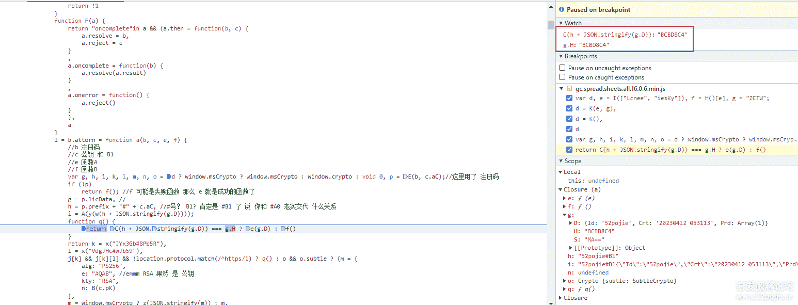

`12.png` (95.05 KB, 下载次数: 1)

[附件下载](https://www.52pojie.cn/forum.php?mod=attachment&aid=MjYwNzEwN3xiNTI0NjM3ZnwxNzkzNTczODA1fDE2ODA4NnwxNzcyOTg2&nothumb=yes)

2023-4-12 18:31 上传

Nice `F8` 放行！

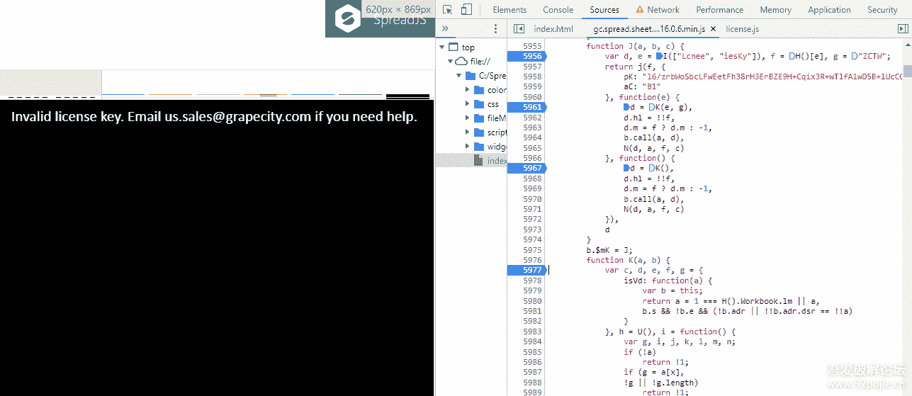

`13.png` (78.03 KB, 下载次数: 1)

[附件下载](https://www.52pojie.cn/forum.php?mod=attachment&aid=MjYwNzEwOHw2NmNiNjUwN3wxNzkzNTczODA1fDE2ODA4NnwxNzcyOTg2&nothumb=yes)

2023-4-12 18:31 上传

啊这... QAQ 看来后面还有别的验证...

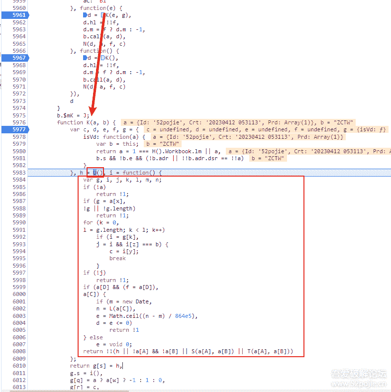

`14.png` (85.62 KB, 下载次数: 0)

[附件下载](https://www.52pojie.cn/forum.php?mod=attachment&aid=MjYwNzEwOXw1MGIyMjU4MXwxNzkzNTczODA1fDE2ODA4NnwxNzcyOTg2&nothumb=yes)

2023-4-12 18:31 上传

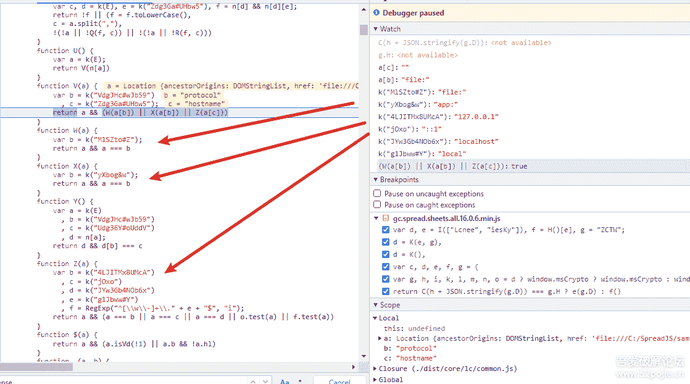

`15.png` (118.51 KB, 下载次数: 1)

[附件下载](https://www.52pojie.cn/forum.php?mod=attachment&aid=MjYwNzExMHwwODdlY2NkY3wxNzkzNTczODA1fDE2ODA4NnwxNzcyOTg2&nothumb=yes)

2023-4-12 18:31 上传

`U函数` 应该是判断是否为本地使用，晚点得弄 http 容器测。

`i函数` 如下

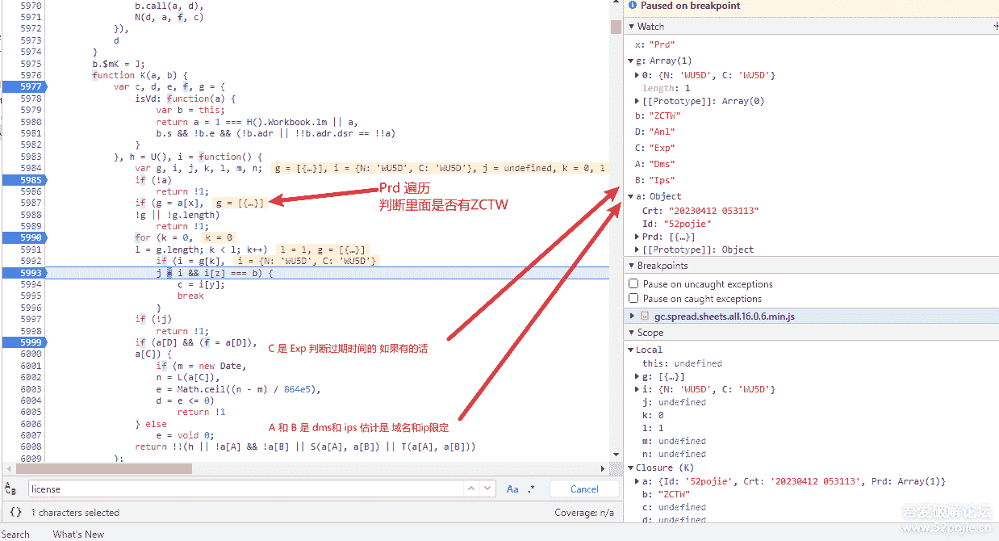

`16.png` (130.29 KB, 下载次数: 0)

[附件下载](https://www.52pojie.cn/forum.php?mod=attachment&aid=MjYwNzExMXw0YjI5ZmQ2M3wxNzkzNTczODA1fDE2ODA4NnwxNzcyOTg2&nothumb=yes)

2023-4-12 18:31 上传

那么我们得把 `ZCTW` 加到 `Prd` 里面再跑一次

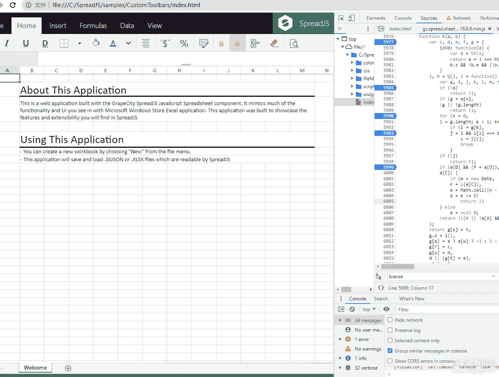

`17.png` (144.87 KB, 下载次数: 1)

[附件下载](https://www.52pojie.cn/forum.php?mod=attachment&aid=MjYwNzExMnxiNzA1Mzg5YXwxNzkzNTczODA1fDE2ODA4NnwxNzcyOTg2&nothumb=yes)

2023-4-12 18:31 上传

Nice 水印没有了，那我们换 http 和 https 试试？

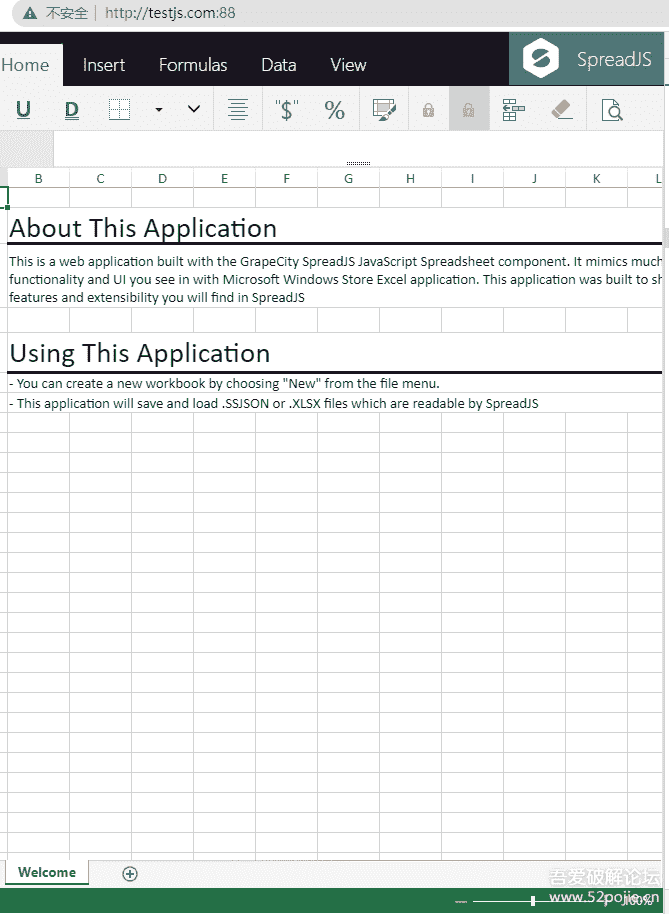

`18.png` (58.43 KB, 下载次数: 1)

[附件下载](https://www.52pojie.cn/forum.php?mod=attachment&aid=MjYwNzExM3w4NmZhNTJhMXwxNzkzNTczODA1fDE2ODA4NnwxNzcyOTg2&nothumb=yes)

2023-4-12 18:31 上传

不过 Https 还是出问题了，毕竟 RSA 部分咱们还没实现，那么怎么改呢~

有几种方案：

- 一个是自己生一对密钥，自己 `Sign`，然后把公钥替换掉。（改动最小）
- 一个是直接把 RSA 那段逻辑删掉，替换成 `return e(g.D)`，改的多甚至连 `jsHash` 那步都可以省略。

至于具体怎么实现就留给有兴趣的小伙伴当课后作业咯~

## 注意事项

仅限于学习交流，请勿用于商业或非法用途

## 附录

从文档中看到还有一个授权叫 Pivot Table Add-on

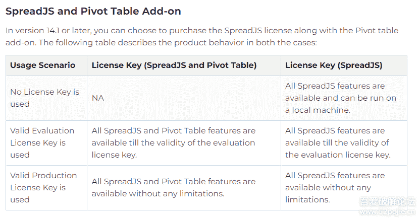

`19.png` (83.92 KB, 下载次数: 1)

[附件下载](https://www.52pojie.cn/forum.php?mod=attachment&aid=MjYwNzExNHw3ZmY4Zjk1NHwxNzkzNTczODA1fDE2ODA4NnwxNzcyOTg2&nothumb=yes)

2023-4-12 18:31 上传

那么咱们怎么找到并使用呢？

咱们可以通过 Demo 找到对应的功能演示

`aHR0cHM6Ly93d3cuZ3JhcGVjaXR5LmNvbS9zcHJlYWRqcy9kZW1vcy9mZWF0dXJlcy9waXZvdC10YWJsZS9vdmVydmlldy9wdXJlanM=`

然后咱们在控制台输入

`GC.Spread.Sheets.LicenseKey`

当当！

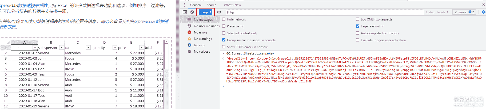

`20.png` (144.5 KB, 下载次数: 0)

[附件下载](https://www.52pojie.cn/forum.php?mod=attachment&aid=MjYwNzExNXw2NWJlM2MyZnwxNzkzNTczODA1fDE2ODA4NnwxNzcyOTg2&nothumb=yes)

2023-4-12 18:31 上传

有内部`Key`哟~ (＾Ｕ＾)ノ~ＹＯ

咱们可以通过在本地调试时找到的特征，直接在 demo 里面调试远端的 js。

然后看看授权的对象有哪些差别，自己生成的时候加上去就好了~

这个也当成课后作业吧~

## 补充

先在网上简单找了下 js hook 的文章，弄完后发现论坛里面其实也有，而且内容也一样，就贴一下，有兴趣的可以看看：

[https://www.52pojie.cn/thread-1519457-1-1.html](https://www.52pojie.cn/thread-1519457-1-1.html)

然后将代码微调了一下后

```
//js hook 优化

//提供伪造 native code 的函数

(() => {

    const $toString = Function.toString

    const myFunction_toString_symbol = Symbol('('.concat('', ')_', (Math.random()) + '').toString(36))

    const myToString = function (){

        return typeof this === 'function' && this[myFunction_toString_symbol] || $toString.call(this)

    }

    function set_native(func, key, value){

        Object.defineProperty(func, key, {

            enumerable: false,

            configurable: true,

            writable: true,

            value: value

        })

    }

    delete Function.prototype.toString

    set_native(Function.prototype, "toString", myToString)

    set_native(Function.prototype.toString, myFunction_toString_symbol, "function toString() { [native code] }")

    globalThis.func_set_native = (func) => {

        set_native(func, myFunction_toString_symbol, `function ${func.name || ''}() { [native code] }`)

    }

}).call(this);

//hook函数

//onEnter 执行前（不写则默认打印）

//onLeave 执行后（不写则默认打印）

//context 上下文对象（默认 window）

//funcName Hook的函数名（默认 当前函数名）

//flagName 自定义名称 用于将原始函数存于全局hooker对象中 避免同名函数Hook

Function.prototype.hook = function(onEnter, onLeave, context, funcName , flagName){

    window.hooker = window.hooker || {};

    if (!onEnter){

        onEnter = function (warpper){

            var args = warpper.args;

            console.log(args);

        }

    }

    if (!onLeave){

        onLeave = function (retval){

            console.log(retval);

        }

    }    

    var _context = context || window;

    var funcName = this.name || funcName;

    flagName = flagName || funcName;

    if (!funcName){

        console.error("hook function name is empty!");

        return false;

    }

    if(!window.hooker[flagName]) window.hooker[flagName] = this;

    _context[funcName] = function (){

        //debugger

        var args = Array.prototype.slice.call(arguments,0);

        var _this = this;

        var warpper = {

            args

        }

        var pre_val = onEnter.call(_this, warpper);

        if(pre_val){

            return pre_val;

        }

        var retval = window.hooker[flagName].apply(this, warpper.args);

        var hook_retval = onLeave.call(_this, retval);

        if (hook_retval){

            return hook_retval;

        }

        return retval;

    }

    Object.defineProperty(_context[funcName], "name", {

        get: function (){

            return funcName;

        }

    })

    func_set_native(_context[funcName]);

}
```

```
//那么我们可以尝试直接对浏览器内置的鉴权函数进行Hook
SubtleCrypto.prototype.verify.hook(
    //onEnter
    function(){
        //因为原始对象返回值 为 Promise 
        //我们 强制伪造一个 Promise 并默认返回 true
        return new Promise(function(resolve, reject){
            resolve(true);
        }); 
    },
    null,
    SubtleCrypto.prototype,
    'verify',
    'SubtleCrypto.prototype.verify'
);

//当然也可以最简单直接进行一个替换...
if(!SubtleCrypto.prototype.original_verify)
{
    SubtleCrypto.prototype.original_verify = SubtleCrypto.prototype.verify;
}
SubtleCrypto.prototype.verify = function(){
//let arg = arguments;
//return SubtleCrypto.prototype.original_verify.apply(this,arguments);
return new Promise(function(resolve, reject){
    resolve(true);
});
}
```
