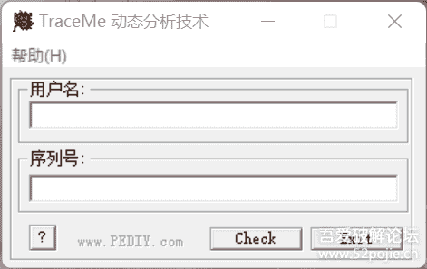
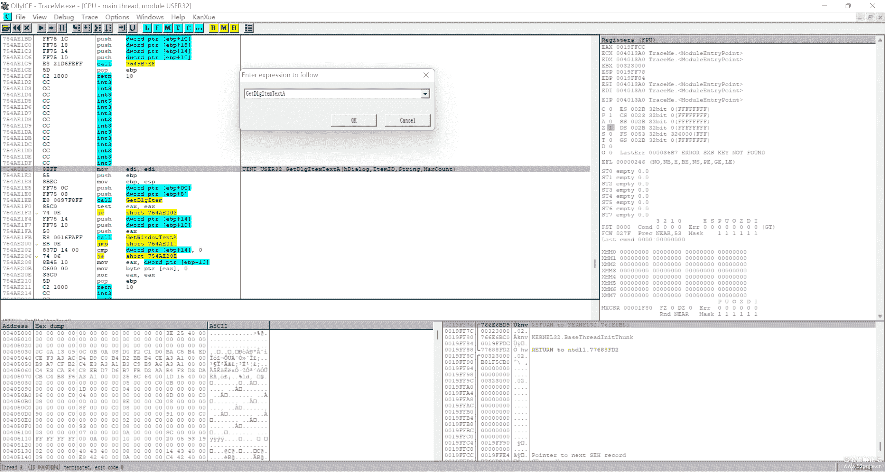
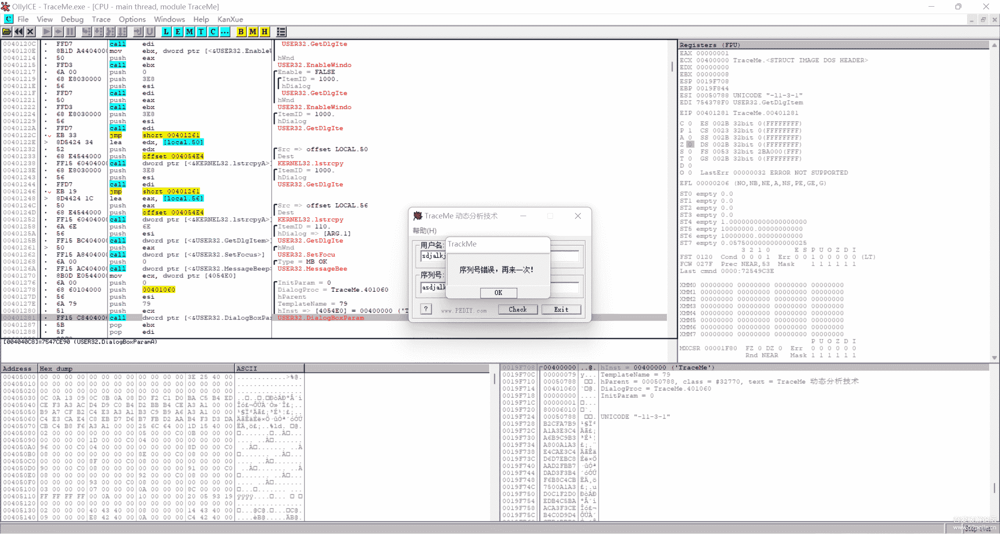
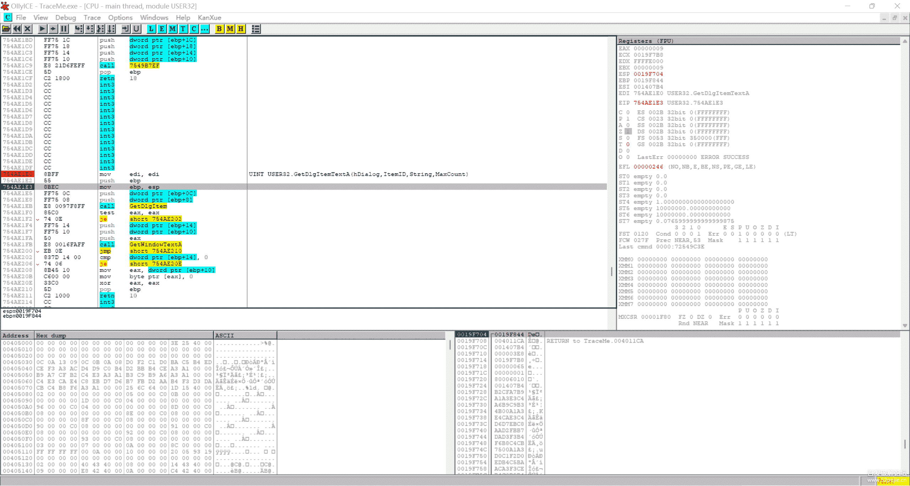
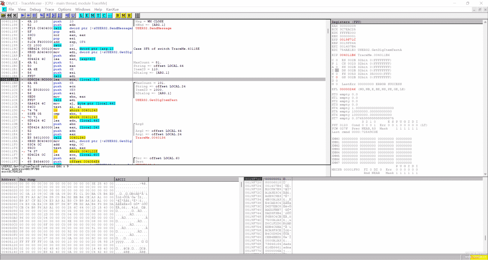
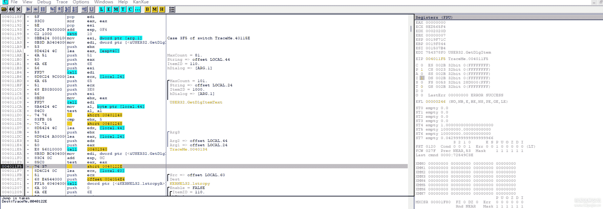
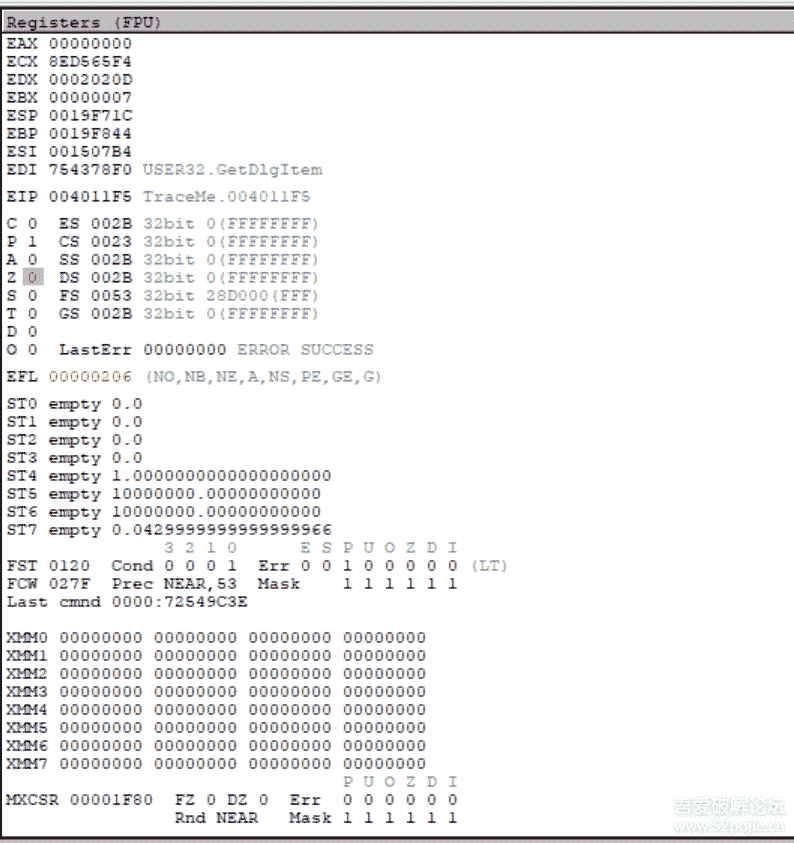
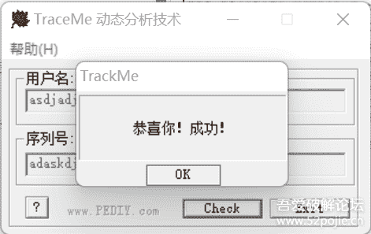

# [原创] 新人arct1cer加密与解密学习笔记，破解第一个程序

- 原帖: https://www.52pojie.cn/forum.php?mod=viewthread&tid=1775525
- 抓取时间: 2026-11-01T22:56:25

大家好，这里是新人arct1cer。刚学到加密与解密基础操作的[//www.52pojie.cn" target="_blank" class="relatedlink"](https://www.52pojie.cn:href="https)第一个程序，在明白原理后非常兴奋发帖子，这个帖子也算是我的个人笔记，今后我也会发更多的学习笔记在账号上。在写帖子的时候发现自己还有很多不足，希望各位大佬发现不足之处请提出，我会改正的。^—^ 首先打开[//www.52pojie.cn/thread-350397-1-1.html" target="_blank" class="relatedlink"](https://www.52pojie.cn/thread-350397-1-1.html:href="https)并且打开程序

1H[QJ9{KBW22GO1}J(T1BN5.png (25.2 KB, 下载次数: 0)
[href="forum.php?mod=attachment&aid=MjYwODQ4OHxiOGZhYjI2MnwxNzkzNTczNzgzfDE2ODA4NnwxNzc1NTI1&nothumb=yes" target="_blank"](https://www.52pojie.cn/forum.php?mod=attachment&aid=MjYwODQ4OHxiOGZhYjI2MnwxNzkzNTczNzgzfDE2ODA4NnwxNzc1NTI1&nothumb=yes)
2023-4-18 17:28 上传

在windos中，只要api函数被使用，想隐藏东西是比较困难的。我们应当以api函数为切入点
这是一个调用文本的函数
所以我们猜测可能是 `GetDlgItemTextA` 或 `GetDlgItemTextW`
在ascII版本中为`GetDlgItemTextA` 而在unicode版本中为 `GetDlgItemTextW`
我这个是ascII版本的 我们使用`ctrl+g` 进行搜素

BDXI1LFE60RXC4_R(}}0PS8.png (929 KB, 下载次数: 0)
[href="forum.php?mod=attachment&aid=MjYwODQ4OXxjMjkxZTM0ZXwxNzkzNTczNzgzfDE2ODA4NnwxNzc1NTI1&nothumb=yes" target="_blank"](https://www.52pojie.cn/forum.php?mod=attachment&aid=MjYwODQ4OXxjMjkxZTM0ZXwxNzkzNTczNzgzfDE2ODA4NnwxNzc1NTI1&nothumb=yes)
2023-4-18 17:28 上传

我们在这里按`f2`下一个断点然后运行一遍程序
`f8`单步步过，当我们听到蹬的一声的时候发现显示序列号错误

M1(0%[`9YER@[~]T[YVJ}S6.png (1.09 MB, 下载次数: 0)
[href="forum.php?mod=attachment&aid=MjYwODQ5MHw1MGRjNDJjNXwxNzkzNTczNzgzfDE2ODA4NnwxNzc1NTI1&nothumb=yes" target="_blank"](https://www.52pojie.cn/forum.php?mod=attachment&aid=MjYwODQ5MHw1MGRjNDJjNXwxNzkzNTczNzgzfDE2ODA4NnwxNzc1NTI1&nothumb=yes)
2023-4-18 17:29 上传

我们再次运行程序来到断点处，在这里到`call`时可以按`f7`进入原函数进行查看，这一部分《加密与解密》有对这一部分详细的解释
但我们需要的并不是这些，这只是一个验证程序，我们只需修改返回值就好，我们按`ctrl+9`返回，边按`f8`单步过边查看系统窗口的提示

2.png (889.49 KB, 下载次数: 0)
[href="forum.php?mod=attachment&aid=MjYwODQ5MXw4MTBlZWRlN3wxNzkzNTczNzgzfDE2ODA4NnwxNzc1NTI1&nothumb=yes" target="_blank"](https://www.52pojie.cn/forum.php?mod=attachment&aid=MjYwODQ5MXw4MTBlZWRlN3wxNzkzNTczNzgzfDE2ODA4NnwxNzc1NTI1&nothumb=yes)
2023-4-18 17:29 上传

当我们运行到这里时发现这是我们所输入的数据，且接着运行发现下面有我们的断点。

(46T(0183SV3JT$U@`(J7`K.png (979.75 KB, 下载次数: 0)
[href="forum.php?mod=attachment&aid=MjYwODQ5NHwwYWYxNDZhNHwxNzkzNTczNzgzfDE2ODA4NnwxNzc1NTI1&nothumb=yes" target="_blank"](https://www.52pojie.cn/forum.php?mod=attachment&aid=MjYwODQ5NHwwYWYxNDZhNHwxNzkzNTczNzgzfDE2ODA4NnwxNzc1NTI1&nothumb=yes)
2023-4-18 17:31 上传

这里补充一个知识点：大部分数据是储存在`eax`里的，这里我们对汇编代码进行解析发现这个`call`引用了上面几个指令并且在`je`的时候进行一个判断并且跳转
{`je` 表示等于就跳转
`je` 指令【Jump if Equals】在`ZF`被置位时跳转。`je` 是 `jz` 【Jump if Zero】的别名
`test` 指令用于两个操作数的按位AND运算，并根据结果设置标志寄存器，结果本身不会写回到目的操作数}
tips：大括号这一段是我从网上查来的资料（我在学汇编的时候并没有记下来所有的标志寄存器，只是草草带了一眼）^-^指令执行后，其结果是否为0，若结果为0，那么`ZF`=1；如果不为0，那么`ZF`=0我们找到右上方将双击`zf`标志寄存器将`zf`的值改为0

3.png (605.57 KB, 下载次数: 0)
[href="forum.php?mod=attachment&aid=MjYwODQ5NXwxYTY1NDI4YnwxNzkzNTczNzgzfDE2ODA4NnwxNzc1NTI1&nothumb=yes" target="_blank"](https://www.52pojie.cn/forum.php?mod=attachment&aid=MjYwODQ5NXwxYTY1NDI4YnwxNzkzNTczNzgzfDE2ODA4NnwxNzc1NTI1&nothumb=yes)
2023-4-18 17:31 上传

我们这时候再进行`f8`单步运行

5.png (229.56 KB, 下载次数: 0)
[href="forum.php?mod=attachment&aid=MjYwODQ5M3xhNzRjYWJmMnwxNzkzNTczNzgzfDE2ODA4NnwxNzc1NTI1&nothumb=yes" target="_blank"](https://www.52pojie.cn/forum.php?mod=attachment&aid=MjYwODQ5M3xhNzRjYWJmMnwxNzkzNTczNzgzfDE2ODA4NnwxNzc1NTI1&nothumb=yes)
2023-4-18 17:30 上传

这个程序即被我们破解

9.png (39.49 KB, 下载次数: 0)
[href="forum.php?mod=attachment&aid=MjYwODQ5Nnw1NDJiMjcxMHwxNzkzNTczNzgzfDE2ODA4NnwxNzc1NTI1&nothumb=yes" target="_blank"](https://www.52pojie.cn/forum.php?mod=attachment&aid=MjYwODQ5Nnw1NDJiMjcxMHwxNzkzNTczNzgzfDE2ODA4NnwxNzc1NTI1&nothumb=yes)
2023-4-18 17:33 上传

这是我写的第一个帖子，有很多不足指出希望各位大佬多多包涵和指正
