# [分享] 【2023.5.2】FastCopy 5.0.0 以上版本不能在 Windows PE 下运行的解决办法

- 原帖：<https://www.52pojie.cn/forum.php?mod=viewthread&tid=1775564>
- 抓取时间：2026-11-01T22:56:23

## 问题说明

FastCopy 5.0.0 以上官方原版和部分汉化版不能在 Windows PE 中运行，是 Windows PE 环境缺少 MSIX 组件导致的，可用以下方法解决。下面以汉化版为例，介绍详细操作过程：

## 操作步骤

### 打开 `FastCopy.exe`

使用 ResHacker 打开 32 位、64 位绿色版的 `FastCopy.exe` 文件。

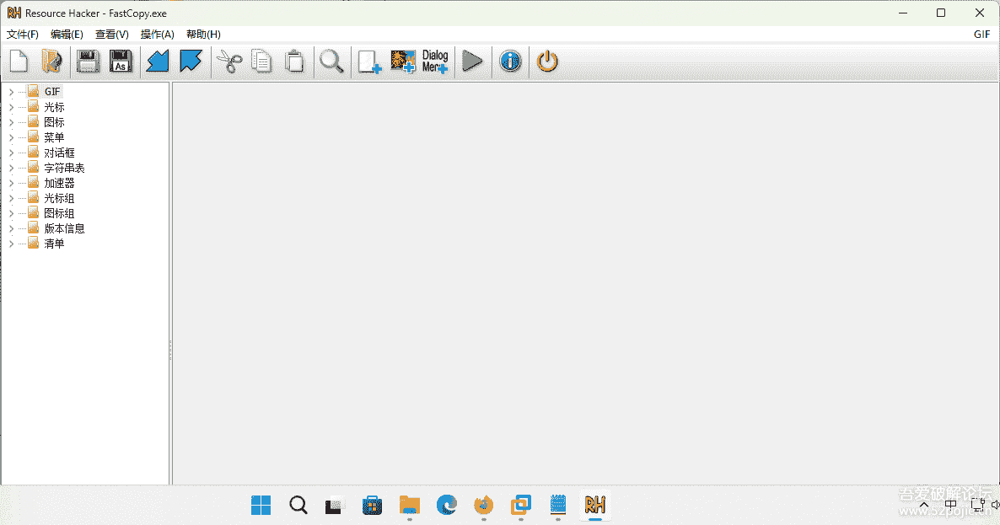
`1.png`（79.45 KB，下载次数：1；2023-4-18 19:20 上传）[附件下载](https://www.52pojie.cn/forum.php?mod=attachment&aid=MjYwODUyNnw0YTEwMTY1Y3wxNzkzNTczNzgxfDE2ODA4NnwxNzc1NTY0&nothumb=yes)

### 搜索 `msix`

以文本搜索：`msix`。

`2.png`（14.77 KB，下载次数：2；2023-4-18 19:20 上传）[附件下载](https://www.52pojie.cn/forum.php?mod=attachment&aid=MjYwODUyN3wyMDUzMmJhMXwxNzkzNTczNzgxfDE2ODA4NnwxNzc1NTY0&nothumb=yes)

### 删除清单项

将搜索到的清单：1 中 1041 处以下代码删除：

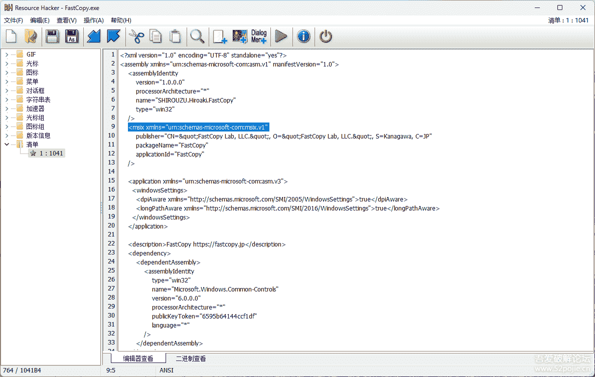
`3.png`（105.63 KB，下载次数：2；2023-4-20 18:14 上传）[附件下载](https://www.52pojie.cn/forum.php?mod=attachment&aid=MjYwOTA0OHxjOGZlZGNlN3wxNzkzNTczNzgxfDE2ODA4NnwxNzc1NTY0&nothumb=yes)

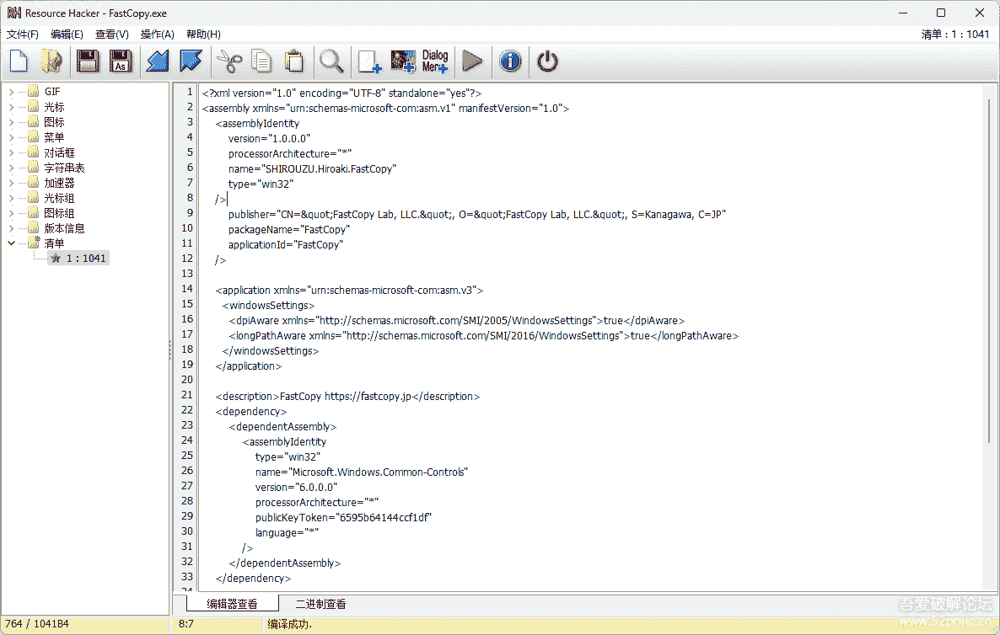
`4.png`（98.82 KB，下载次数：4；2023-4-20 18:14 上传）[附件下载](https://www.52pojie.cn/forum.php?mod=attachment&aid=MjYwOTA0OXwzOTRjZTcxZHwxNzkzNTczNzgxfDE2ODA4NnwxNzc1NTY0&nothumb=yes)

`5.png`（103.26 KB，下载次数：3；2023-4-20 18:14 上传）[附件下载](https://www.52pojie.cn/forum.php?mod=attachment&aid=MjYwOTA1MHw1MTUwODZlMHwxNzkzNTczNzgxfDE2ODA4NnwxNzc1NTY0&nothumb=yes)

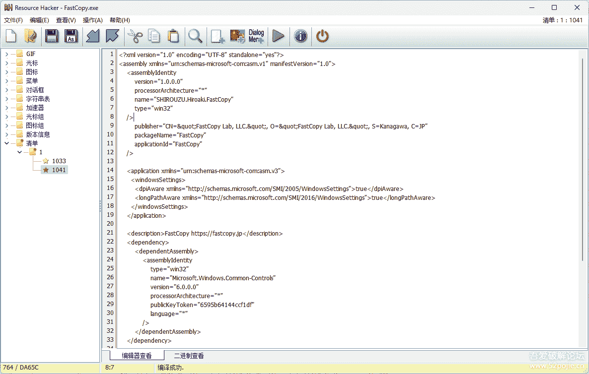
`6.png`（101.99 KB，下载次数：3；2023-4-20 18:14 上传）[附件下载](https://www.52pojie.cn/forum.php?mod=attachment&aid=MjYwOTA1MXxlNDk4NTFiZHwxNzkzNTczNzgxfDE2ODA4NnwxNzc1NTY0&nothumb=yes)

或将以下代码全部删除：

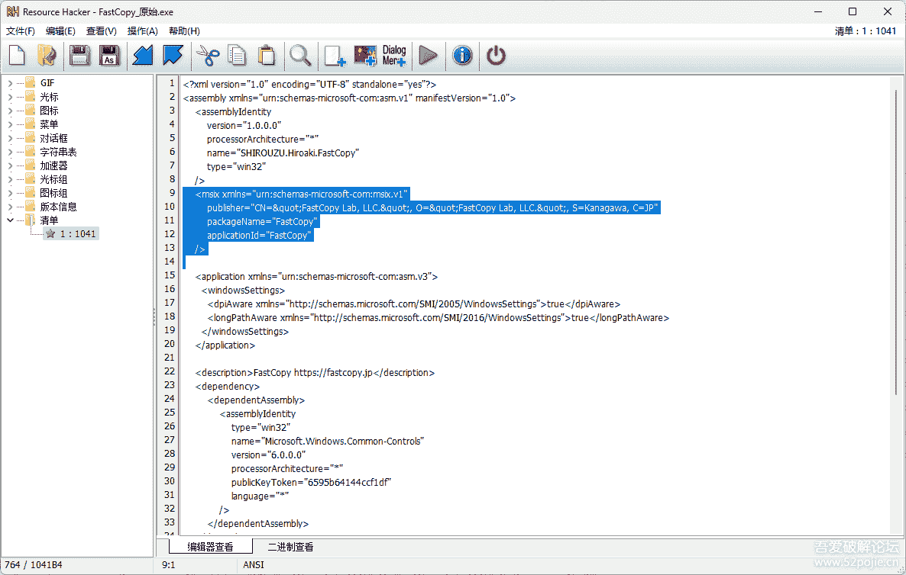
`7.png`（103.25 KB，下载次数：4；2023-4-20 18:14 上传）[附件下载](https://www.52pojie.cn/forum.php?mod=attachment&aid=MjYwOTA1MnwwZjBjYmZkNHwxNzkzNTczNzgxfDE2ODA4NnwxNzc1NTY0&nothumb=yes)

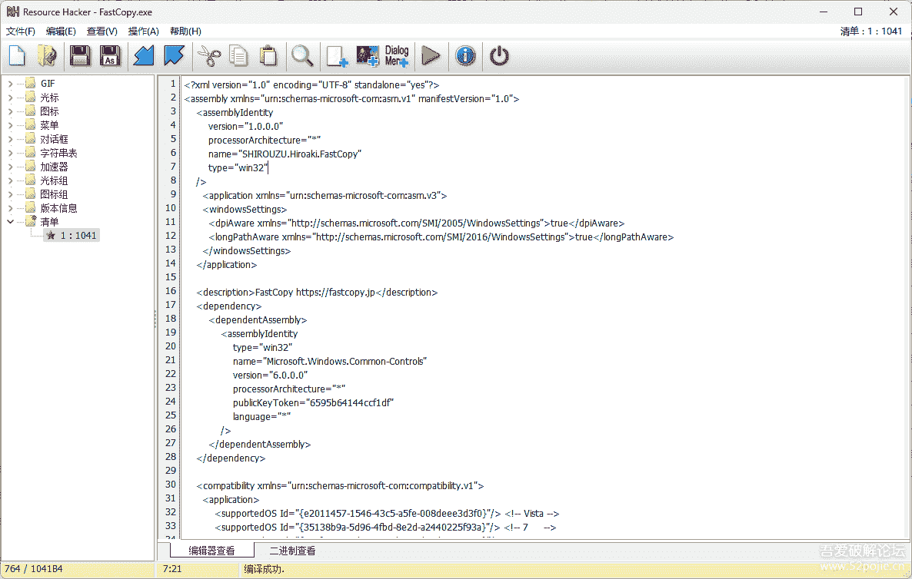
`8.png`（103.73 KB，下载次数：2；2023-4-20 18:14 上传）[附件下载](https://www.52pojie.cn/forum.php?mod=attachment&aid=MjYwOTA1M3w5MjZiZmMyZnwxNzkzNTczNzgxfDE2ODA4NnwxNzc1NTY0&nothumb=yes)

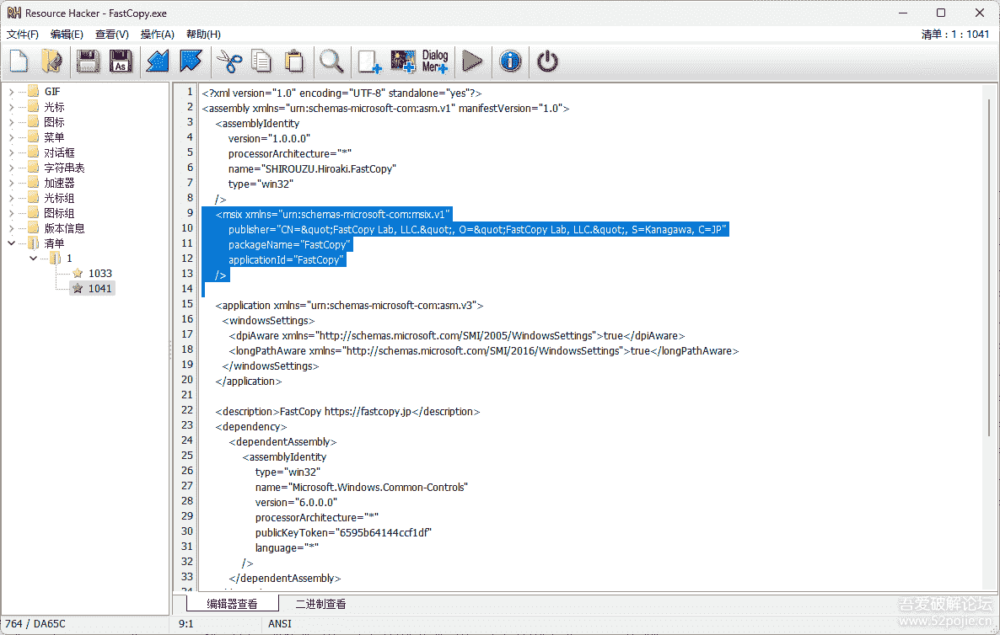
`9.png`（104.47 KB，下载次数：3；2023-4-20 18:14 上传）[附件下载](https://www.52pojie.cn/forum.php?mod=attachment&aid=MjYwOTA1NHxlYmRlYTdiMHwxNzkzNTczNzgxfDE2ODA4NnwxNzc1NTY0&nothumb=yes)

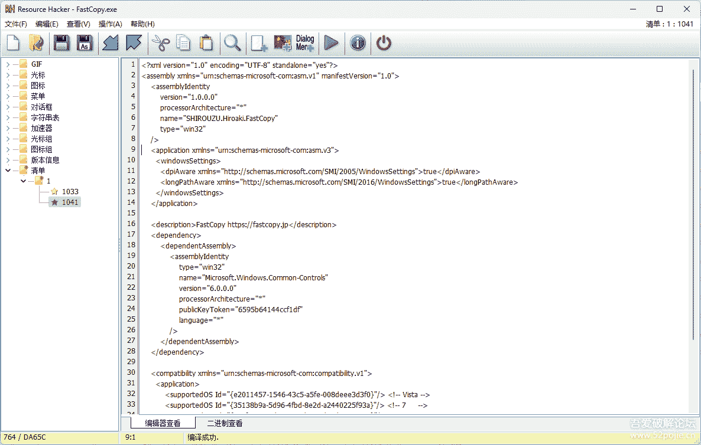
`10.png`（104.99 KB，下载次数：4；2023-4-20 18:14 上传）[附件下载](https://www.52pojie.cn/forum.php?mod=attachment&aid=MjYwOTA1NXwxNzAwZGQ2NHwxNzkzNTczNzgxfDE2ODA4NnwxNzc1NTY0&nothumb=yes)

32 位的还需删除 1033 处以下代码：

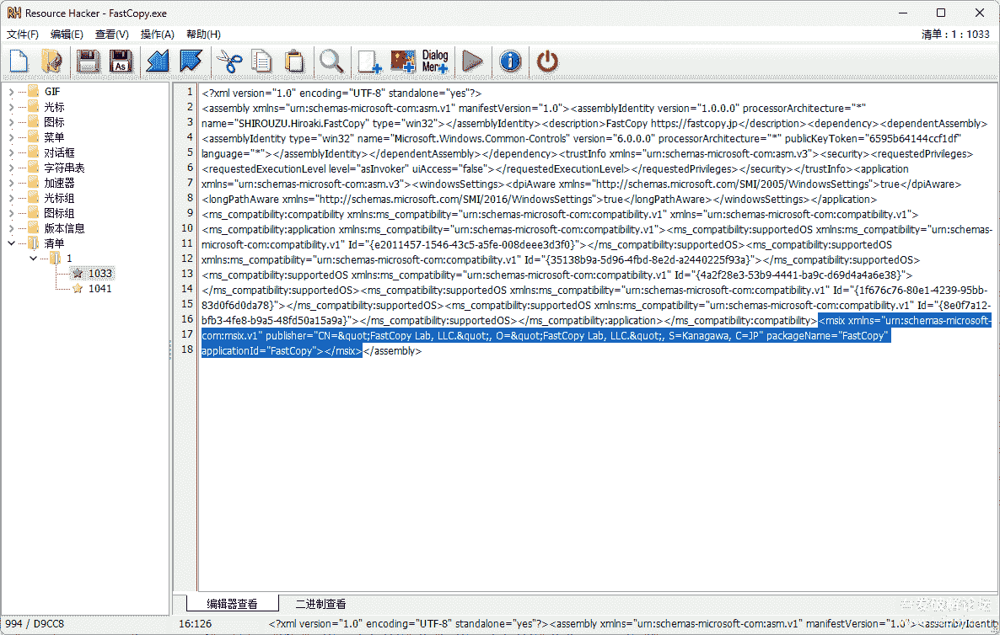
`11.png`（120.3 KB，下载次数：4；2023-4-20 18:14 上传）[附件下载](https://www.52pojie.cn/forum.php?mod=attachment&aid=MjYwOTA1NnxlNDhkODAwNHwxNzkzNTczNzgxfDE2ODA4NnwxNzc1NTY0&nothumb=yes)

### 编译脚本

然后点击三角形标志 `编译脚本(F5)`。

最后点击软盘标志 `编译脚本(ctrl+s)` 或 `另存为` 即可。

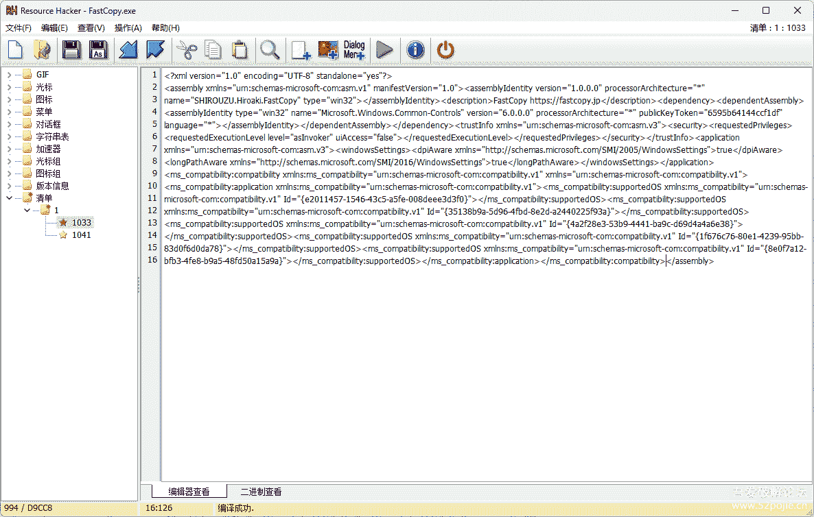
`12.png`（109.36 KB，下载次数：2；2023-4-20 18:14 上传）[附件下载](https://www.52pojie.cn/forum.php?mod=attachment&aid=MjYwOTA1N3w3MTVhNDBiNXwxNzkzNTczNzgxfDE2ODA4NnwxNzc1NTY0&nothumb=yes)

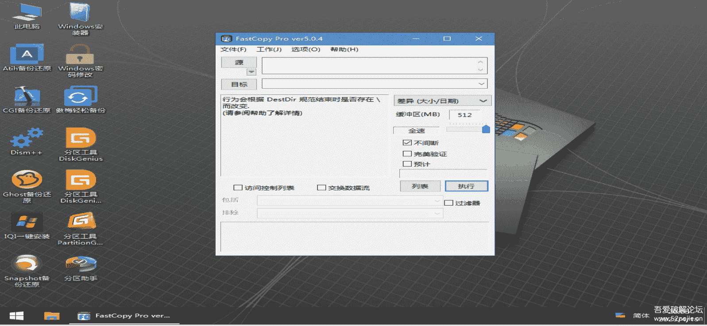
`13.png`（641.38 KB，下载次数：1；2023-4-20 18:14 上传）[附件下载](https://www.52pojie.cn/forum.php?mod=attachment&aid=MjYwOTA1OHwwM2ZiYjdkOXwxNzkzNTczNzgxfDE2ODA4NnwxNzc1NTY0&nothumb=yes)

## 下载地址

- ResHacker 5.1.8.360 下载地址：[https://www.lanzoue.com/iuGyY07zld0h](https://www.lanzoue.com/iuGyY07zld0h)
- 【鱼-软件成品(懒人用)】FastCopy Pro 5.2.2_x86_x64_2in1 单文件绿色版下载链接：[https://ww.lanzouv.com/ikWLF17e8jlg](https://ww.lanzouv.com/ikWLF17e8jlg)
- 【渔-打包素材(智者用)】FastCopy Pro 5.2.2_x86_x64_2in1绿色单文件打包素材20230502下载链接：[https://www.lanzouv.com/iZj0m17e8jqb](https://www.lanzouv.com/iZj0m17e8jqb)
