# [原创] 关于 java-web 应用程序的逆向-camunda 企业版

- 原帖：[https://www.52pojie.cn/forum.php?mod=viewthread&tid=1776897](https://www.52pojie.cn/forum.php?mod=viewthread&tid=1776897)
- 抓取时间：2026-11-01T22:55:03

关于 camunda，它是一款工作流组件，源自 activity5。支持 BPMN（工作流和流程自动化）、CMMN（案例管理）和 DMN（业务决策管理）的 Java 框架。德国的一个公司开发的。

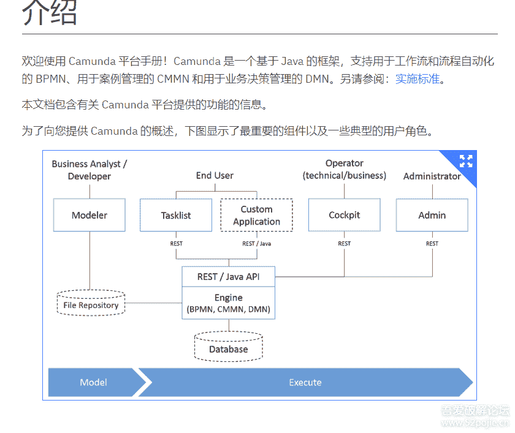

`camunda介绍.png`（92.64 KB，下载次数：2）  
[下载附件](https://www.52pojie.cn/forum.php?mod=attachment&aid=MjYwOTIxMnw0NTQxZDViMXwxNzkzNTczNzAwfDE2ODA4NnwxNzc2ODk3&nothumb=yes)  
2023-4-21 14:27 上传

## 题外话篇：一、如何下载企业版

下载地址：[https://camunda.com/download/](https://camunda.com/download/)

下载之前需要在 camunda 官网注册账号，账号和密码会发送到你的邮箱，如图：

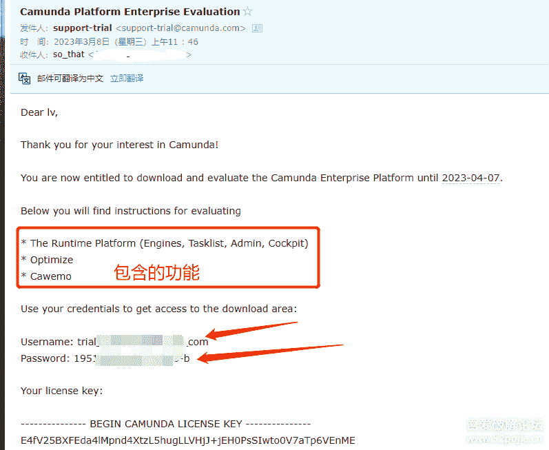

`邮件.png`（67.07 KB，下载次数：1）  
[下载附件](https://www.52pojie.cn/forum.php?mod=attachment&aid=MjYwOTIxNnxkMWY1MTc4YnwxNzkzNTczNzAwfDE2ODA4NnwxNzc2ODk3&nothumb=yes)  
2023-4-21 14:34 上传

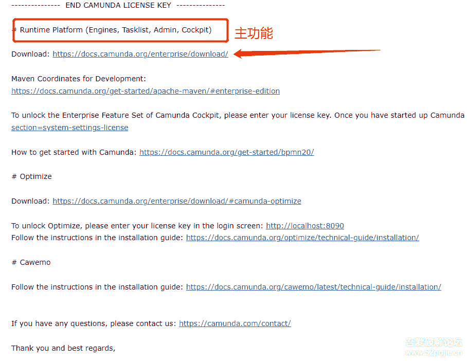

`邮件2.png`（60.82 KB，下载次数：1）  
[下载附件](https://www.52pojie.cn/forum.php?mod=attachment&aid=MjYwOTIxOXxhMjM0ZDg2YXwxNzkzNTczNzAwfDE2ODA4NnwxNzc2ODk3&nothumb=yes)  
2023-4-21 14:35 上传

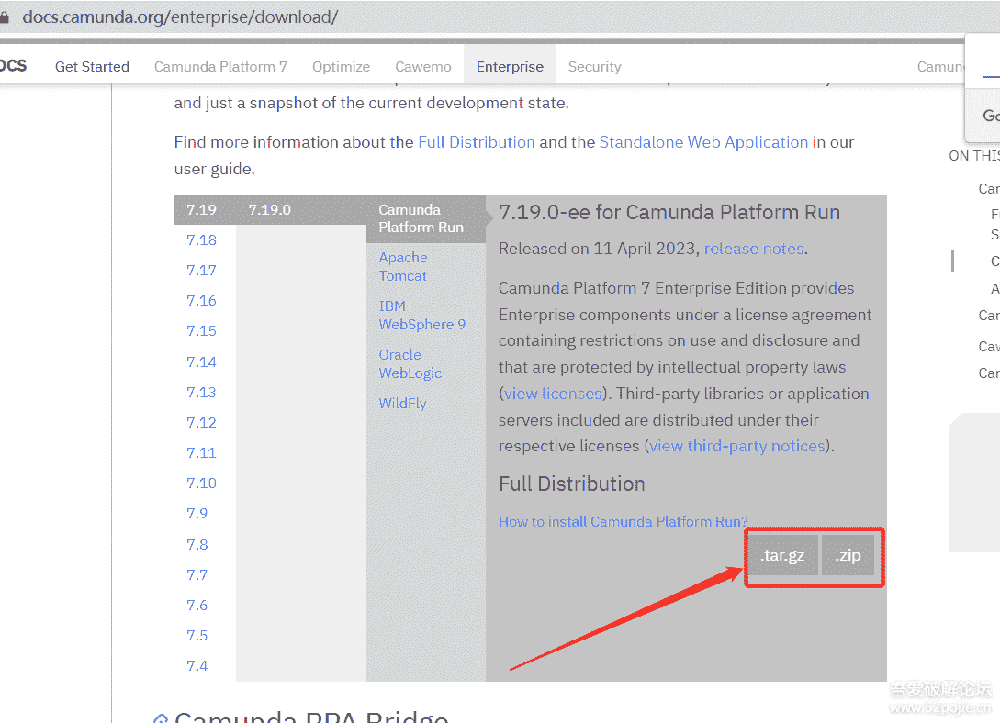

`下载地址.png`（104.92 KB，下载次数：0）  
[下载附件](https://www.52pojie.cn/forum.php?mod=attachment&aid=MjYwOTIyNHw2YTgxY2FjNXwxNzkzNTczNzAwfDE2ODA4NnwxNzc2ODk3&nothumb=yes)  
2023-4-21 14:37 上传

点击即可下载。

## 题外话篇：二、关于 camunda 的体验

注册后，他们的销售会联系你购买他们企业版，也就是推推业务员。

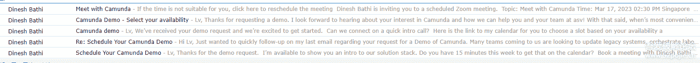

`会议1.png`（44.35 KB，下载次数：1）  
[下载附件](https://www.52pojie.cn/forum.php?mod=attachment&aid=MjYwOTIyOXw3MmJlNDY3YnwxNzkzNTczNzAwfDE2ODA4NnwxNzc2ODk3&nothumb=yes)  
2023-4-21 14:46 上传

基本都是给你发 meeting 会议链接。


`会议链接.png`（29.18 KB，下载次数：1）  
[下载附件](https://www.52pojie.cn/forum.php?mod=attachment&aid=MjYwOTIzMHwyYmU1NzYwMXwxNzkzNTczNzAwfDE2ODA4NnwxNzc2ODk3&nothumb=yes)  
2023-4-21 14:49 上传

简单的通过文字会议形式了解了一下的结果就是：人家不服务中国，不做中国市场业务。感兴趣伙伴可以注册下沟通就知道。

## 正文

下载下来后内容如下：

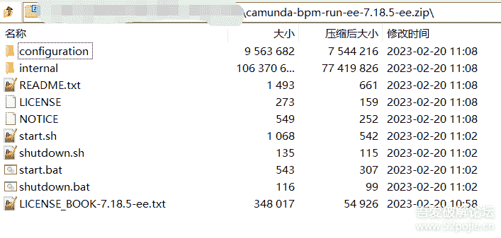

`压缩包.png`（39.13 KB，下载次数：1）  
[下载附件](https://www.52pojie.cn/forum.php?mod=attachment&aid=MjYwOTIzNXwxNTkzZmY3N3wxNzkzNTczNzAwfDE2ODA4NnwxNzc2ODk3&nothumb=yes)  
2023-4-21 14:56 上传

- `configuration`：一些启动的配置。
- `internal`：主要的程序包。
- `start.bat`：Windows 下的启动脚本。

启动后访问地址：[http://localhost:8080/camunda-welcome/index.html](http://localhost:8080/camunda-welcome/index.html)

### 界面

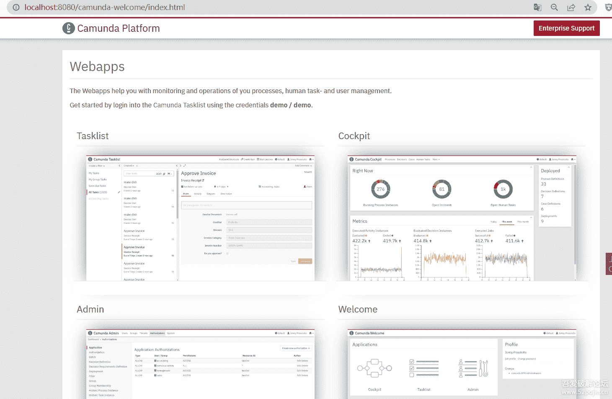

`界面1.png`（210.99 KB，下载次数：1）  
[下载附件](https://www.52pojie.cn/forum.php?mod=attachment&aid=MjYwOTIzNnxkYWIyZTY1NXwxNzkzNTczNzAwfDE2ODA4NnwxNzc2ODk3&nothumb=yes)  
2023-4-21 14:59 上传

随便点击 `tasklist` 或其他的几个界面，就如登录界面。默认账户密码都是 `demo`。

登录后：

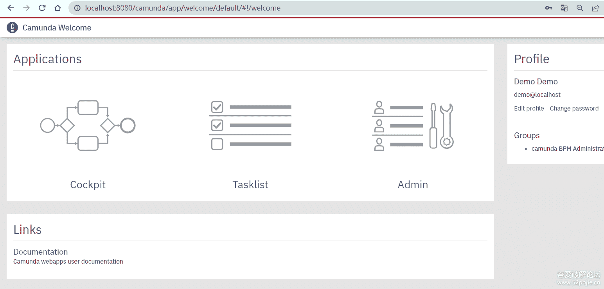

`界面2.png`（71.82 KB，下载次数：1）  
[下载附件](https://www.52pojie.cn/forum.php?mod=attachment&aid=MjYwOTIzN3wxYmNmYzkzMHwxNzkzNTczNzAwfDE2ODA4NnwxNzc2ODk3&nothumb=yes)  
2023-4-21 15:01 上传


`界面4.png`（95.19 KB，下载次数：1）  
[下载附件](https://www.52pojie.cn/forum.php?mod=attachment&aid=MjYwOTMwMnwzN2I3OGUxOXwxNzkzNTczNzAwfDE2ODA4NnwxNzc2ODk3&nothumb=yes)  
2023-4-21 17:48 上传

这是没有注册的。

可以看到这个是普通界面，并没有涵盖企业版的功能，需要输入注册的 License 才能看到企业级功能。

依次点击：`Admin` -> `License`，也可直接访问：

[http://localhost:8080/camunda/app/admin/default/#/system?section=system-settings-license](http://localhost:8080/camunda/app/admin/default/#/system?section=system-settings-license)

进入以下界面：

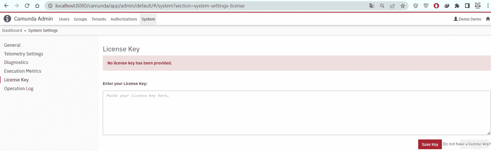

`界面3.png`（75.44 KB，下载次数：1）  
[下载附件](https://www.52pojie.cn/forum.php?mod=attachment&aid=MjYwOTIzOHw5NmVkMTYxNXwxNzkzNTczNzAwfDE2ODA4NnwxNzc2ODk3&nothumb=yes)  
2023-4-21 15:05 上传

随便输入点什么，提交一下看看请求地址。


`请求1.png`（27.51 KB，下载次数：1）  
[下载附件](https://www.52pojie.cn/forum.php?mod=attachment&aid=MjYwOTIzOXxkYzU1NzBmNnwxNzkzNTczNzAwfDE2ODA4NnwxNzc2ODk3&nothumb=yes)  
2023-4-21 15:07 上传

请求地址：[http://localhost:8080/camunda/api/admin/plugin/license/default/key](http://localhost:8080/camunda/api/admin/plugin/license/default/key)

返回数据：

```json
{"invalidMessage":"License Key has wrong format.","customerId":null,"validUntil":null,"valid":false,"unlimited":false,"licenseProvided":true}
```

提示格式不对。

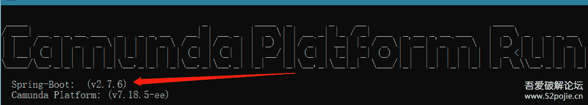

`启动1.png`（18.1 KB，下载次数：1）  
[下载附件](https://www.52pojie.cn/forum.php?mod=attachment&aid=MjYwOTI0MHw1ODcwYzU5MXwxNzkzNTczNzAwfDE2ODA4NnwxNzc2ODk3&nothumb=yes)  
2023-4-21 15:10 上传

通过启动脚本的日志可以看出是使用的 `Spring-Boot`，那么直接可以通过对应的请求地址，直接定位到他的服务类代码。

### 通过启动脚本分析

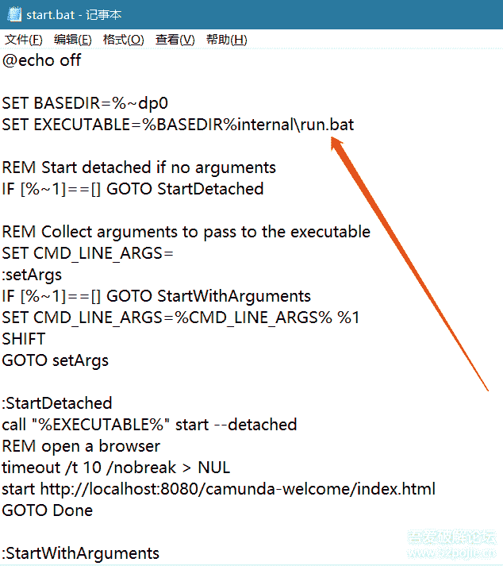

`启动脚本1.png`（49.58 KB，下载次数：1）  
[下载附件](https://www.52pojie.cn/forum.php?mod=attachment&aid=MjYwOTI0MnxiNDQ1MWQ4NHwxNzkzNTczNzAwfDE2ODA4NnwxNzc2ODk3&nothumb=yes)  
2023-4-21 15:15 上传

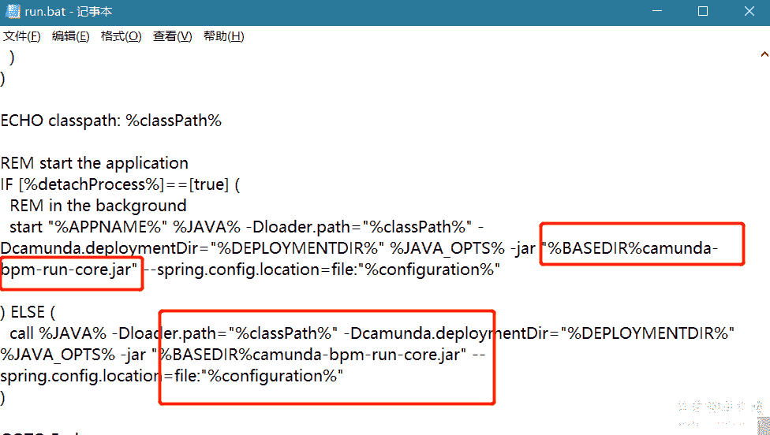

`启动脚本2.png`（43.57 KB，下载次数：1）  
[下载附件](https://www.52pojie.cn/forum.php?mod=attachment&aid=MjYwOTI0M3w3ZGQ5ZWEzNnwxNzkzNTczNzAwfDE2ODA4NnwxNzc2ODk3&nothumb=yes)  
2023-4-21 15:15 上传

结论：`start.bat` 调用了 `internal\run.bat`。

`run.bat` 执行的程序包为 `internal\camunda-bpm-run-core.jar`。

接下来就是分析这个程序包了，通过 `jd-gui` 查看，可以看到是没有加密或者混淆的，可以随便造。

社区版代码：[https://github.com/camunda/camunda-bpm-platform](https://github.com/camunda/camunda-bpm-platform)

可以看看社区版的代码，这个是开源的，只是功能没有企业版强大。

### 最后的分析结论

`internal\webapps\camunda-license-check-2.7.0.jar`

分析完你会知道，最终验证的代码都在这个程序包里面。

### 题外话：调试方法

这里有很多种追踪方法。这里说下我所用的方式：`remotedebug`。

在 `run.bat` 里面的启动方法 `-jar` 前面加入以下代码：

```
-agentlib:jdwp=transport=dt_socket,server=y,suspend=y,address=5005
```

通过调试模式启动这个服务。

使用 `jd-gui` 打开 `camunda-license-check-2.7.0.jar`，保存所有文件为源码，保存后直接导入 `IDE`，有报错不管他。

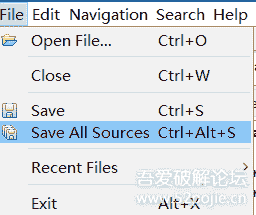

`存源码.png`（15.89 KB，下载次数：0）


## 启动与调试

[href="forum.php?mod=attachment&aid=MjYwOTI0OHwxZmVkOGVlYnwxNzkzNTczNzAwfDE2ODA4NnwxNzc2ODk3&nothumb=yes" target="_blank"](https://www.52pojie.cn/forum.php?mod=attachment&aid=MjYwOTI0OHwxZmVkOGVlYnwxNzkzNTczNzAwfDE2ODA4NnwxNzc2ODk3&nothumb=yes)

2023-4-21 15:47 上传

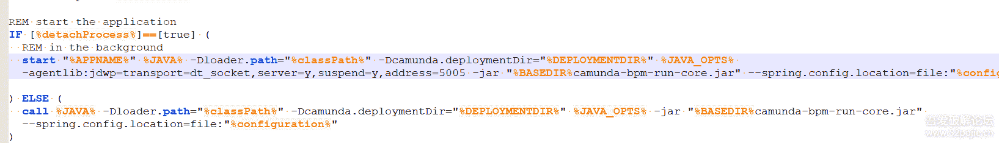

`启动3.png` (38.04 KB, 下载次数: 1)

[href="forum.php?mod=attachment&aid=MjYwOTI1MXxjMzFiZTAwYnwxNzkzNTczNzAwfDE2ODA4NnwxNzc2ODk3&nothumb=yes" target="_blank"](https://www.52pojie.cn/forum.php?mod=attachment&aid=MjYwOTI1MXxjMzFiZTAwYnwxNzkzNTczNzAwfDE2ODA4NnwxNzc2ODk3&nothumb=yes)

2023-4-21 15:52 上传

双击`start.bat`

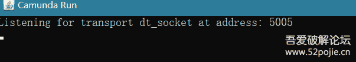

`启动4.png` (10.86 KB, 下载次数: 1)

[href="forum.php?mod=attachment&aid=MjYwOTI1MnxkNTg4NmExM3wxNzkzNTczNzAwfDE2ODA4NnwxNzc2ODk3&nothumb=yes" target="_blank"](https://www.52pojie.cn/forum.php?mod=attachment&aid=MjYwOTI1MnxkNTg4NmExM3wxNzkzNTczNzAwfDE2ODA4NnwxNzc2ODk3&nothumb=yes)

2023-4-21 15:53 上传

等待debug连接后启动

IDE打断点位置：

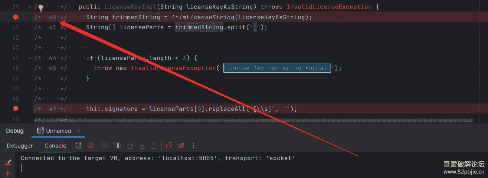

`代码1.png` (96.5 KB, 下载次数: 1)

[href="forum.php?mod=attachment&aid=MjYwOTI1NHxjYmQ0ZGRmMnwxNzkzNTczNzAwfDE2ODA4NnwxNzc2ODk3&nothumb=yes" target="_blank"](https://www.52pojie.cn/forum.php?mod=attachment&aid=MjYwOTI1NHxjYmQ0ZGRmMnwxNzkzNTczNzAwfDE2ODA4NnwxNzc2ODk3&nothumb=yes)

2023-4-21 15:54 上传

去`key`那边提交一下`key`，断点会停下来

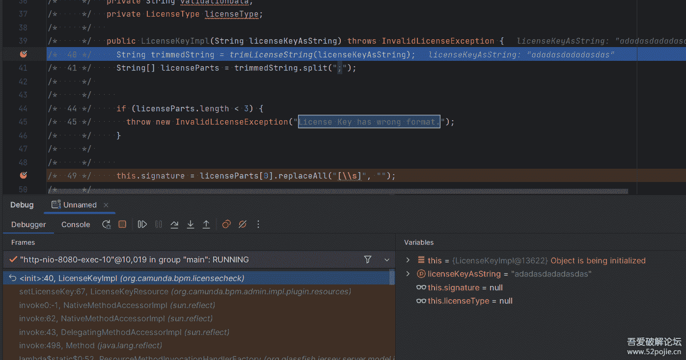

`代码2.png` (173.93 KB, 下载次数: 1)

[href="forum.php?mod=attachment&aid=MjYwOTI1NnwwYTY2YjRjOXwxNzkzNTczNzAwfDE2ODA4NnwxNzc2ODk3&nothumb=yes" target="_blank"](https://www.52pojie.cn/forum.php?mod=attachment&aid=MjYwOTI1NnwwYTY2YjRjOXwxNzkzNTczNzAwfDE2ODA4NnwxNzc2ODk3&nothumb=yes)

2023-4-21 15:56 上传

看看当前堆栈情况

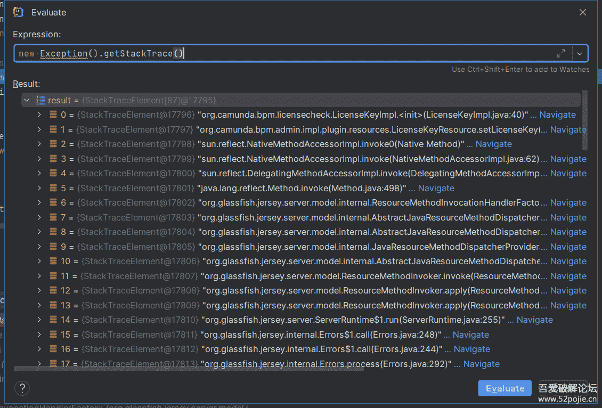

`代码3.png` (257.93 KB, 下载次数: 1)

[href="forum.php?mod=attachment&aid=MjYwOTI1N3xkMGY0MTdhNXwxNzkzNTczNzAwfDE2ODA4NnwxNzc2ODk3&nothumb=yes" target="_blank"](https://www.52pojie.cn/forum.php?mod=attachment&aid=MjYwOTI1N3xkMGY0MTdhNXwxNzkzNTczNzAwfDE2ODA4NnwxNzc2ODk3&nothumb=yes)

2023-4-21 15:57 上传

可以看到索引1就是调用这个方法的地方，索引0是当前的类

索引1：

`org.camunda.bpm.admin.impl.plugin.resources.LicenseKeyResource`

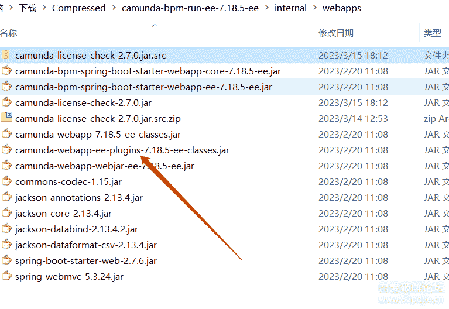

`代码4.png` (73.47 KB, 下载次数: 1)

[href="forum.php?mod=attachment&aid=MjYwOTI2M3w0ZGVjMTk3NHwxNzkzNTczNzAwfDE2ODA4NnwxNzc2ODk3&nothumb=yes" target="_blank"](https://www.52pojie.cn/forum.php?mod=attachment&aid=MjYwOTI2M3w0ZGVjMTk3NHwxNzkzNTczNzAwfDE2ODA4NnwxNzc2ODk3&nothumb=yes)

2023-4-21 16:02 上传

看它的包名可以知道，肯定是`plugin`模块，刚刚好，当前目录就有一个，

接口地址，请求方式，调用函数，直接拿下！

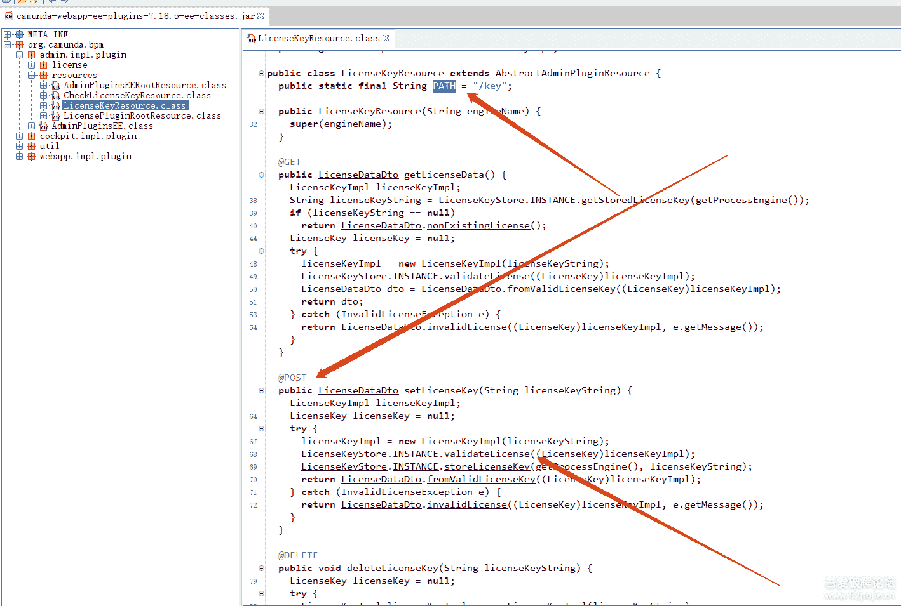

`代码5.png` (123.13 KB, 下载次数: 1)

[href="forum.php?mod=attachment&aid=MjYwOTI2NHw3MjA4YmEwNHwxNzkzNTczNzAwfDE2ODA4NnwxNzc2ODk3&nothumb=yes" target="_blank"](https://www.52pojie.cn/forum.php?mod=attachment&aid=MjYwOTI2NHw3MjA4YmEwNHwxNzkzNTczNzAwfDE2ODA4NnwxNzc2ODk3&nothumb=yes)

2023-4-21 16:04 上传

`LicenseKeyStore.INSTANCE.validateLicense((LicenseKey)licenseKeyImpl);`

`LicenseKeyStore.INSTANCE.storeLicenseKey(getProcessEngine(), licenseKeyString);`

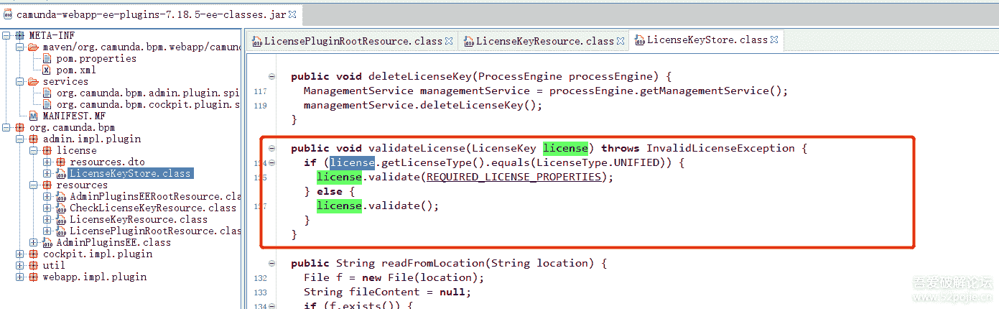

`代码6.png` (75.04 KB, 下载次数: 1)

[href="forum.php?mod=attachment&aid=MjYwOTI3MHxmMDM0YmZkOXwxNzkzNTczNzAwfDE2ODA4NnwxNzc2ODk3&nothumb=yes" target="_blank"](https://www.52pojie.cn/forum.php?mod=attachment&aid=MjYwOTI3MHxmMDM0YmZkOXwxNzkzNTczNzAwfDE2ODA4NnwxNzc2ODk3&nothumb=yes)

2023-4-21 16:08 上传

## 正文部分

本次的目的就是要分析`LicenseKeyImpl`的`validate()`函数。

这里直接贴代码，不贴图了

### 代码1

```
/*     */   public void validate() throws InvalidLicenseException {
/* 115 */     boolean signatureValid = SignatureValidator.validateSignature(this.validationData.getBytes(Charset.forName("UTF-8")), this.signature);
/*     */ 
/*     */     
/* 118 */     if (!signatureValid)
/* 119 */       throw new InvalidLicenseException("Your license is invalid."); 
/* 120 */     if (isExpired()) {
/* 121 */       throw new InvalidLicenseException("Your license has expired.");
/*     */     }
/*     */   }
/*     */ 
```

这里主要是验证一下`SignatureValidator.validateSignature`的返回值，直接往里面查找`validateSignature`

### 代码2

```
/*     */   public static boolean validateSignature(byte[] data, String base64EncodedSignature) {

/*  33 */     return validateSignature(data, BASE64.decode(base64EncodedSignature));

/*     */   }
```

继续查找

### 代码3

```
/*     */   public static boolean validateSignature(byte[] data, byte[] signatureBytes) {
/*  44 */     PublicKey publicKey = determinePublicKey(signatureBytes);
/*  45 */     String algorithmName = determineAlgorithmName(signatureBytes);
/*     */     
/*     */     try {
/*  48 */       Signature sig = getSignature(algorithmName);
/*  49 */       sig.initVerify(publicKey);
/*  50 */       sig.update(data);
/*  51 */       return sig.verify(signatureBytes);
/*  52 */     } catch (GeneralSecurityException e) {
/*  53 */       throw new RuntimeException("Cannot verify signature", e);
/*     */     } 
/*     */   }
```

根据代码

`PublicKey publicKey = determinePublicKey(signatureBytes);`

可以分析这个得知，服务端通过私钥加密，这里再通过公钥去解密。

### 代码4

```
/*     */   private static PublicKey determinePublicKey(byte[] signatureBytes) {
/*     */     String keyLocation;
/*  82 */     LicenseType licenseType = determineLicenseType(signatureBytes);
/*     */     
/*  84 */     if (licenseType == LicenseType.CAMUNDA_BPM) {
/*  85 */       keyLocation = "camunda_public_key.der";
/*  86 */     } else if (licenseType == LicenseType.OPTIMIZE) {
/*  87 */       keyLocation = "optimize_public_key.der";
/*     */     } else {
/*  89 */       keyLocation = "unified_public_key.der";
/*     */     } 
/*     */     
/*  92 */     return (new PublicKeyFileReader(keyLocation)).getKey();
/*     */   }
```

### 代码5

```
/*     */   public static LicenseType determineLicenseType(byte[] signatureBytes) {
/*     */     LicenseType type;
/*  70 */     if (signatureBytes.length == 128) {
/*  71 */       type = LicenseType.CAMUNDA_BPM;
/*  72 */     } else if (signatureBytes.length == 256) {
/*  73 */       type = LicenseType.OPTIMIZE;
/*     */     } else {
/*  75 */       type = LicenseType.UNIFIED;
/*     */     } 
```

这里是判断应该使用哪一种公钥，由于注册的时候会给你一个临时的注册码：

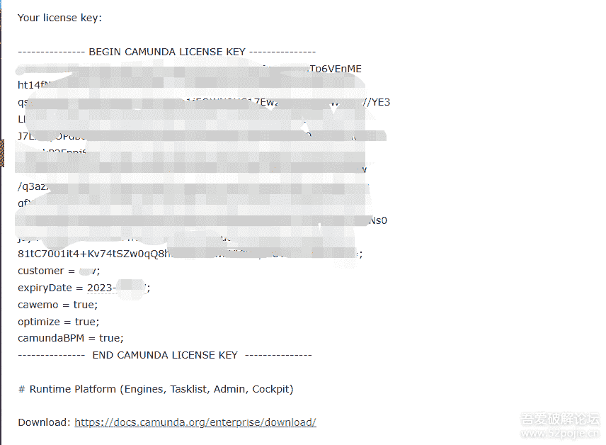

`注册码.png` (81.8 KB, 下载次数: 1)

[href="forum.php?mod=attachment&aid=MjYwOTI3NHw3YTJhMjE5NnwxNzkzNTczNzAwfDE2ODA4NnwxNzc2ODk3&nothumb=yes" target="_blank"](https://www.52pojie.cn/forum.php?mod=attachment&aid=MjYwOTI3NHw3YTJhMjE5NnwxNzkzNTczNzAwfDE2ODA4NnwxNzc2ODk3&nothumb=yes)

2023-4-21 16:17 上传

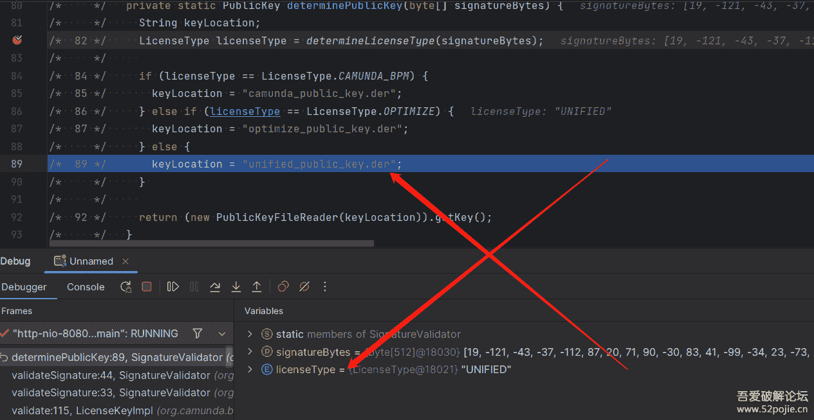

`代码7.png` (171.81 KB, 下载次数: 1)

[href="forum.php?mod=attachment&aid=MjYwOTI3OHw2MTYxNmNmZXwxNzkzNTczNzAwfDE2ODA4NnwxNzc2ODk3&nothumb=yes" target="_blank"](https://www.52pojie.cn/forum.php?mod=attachment&aid=MjYwOTI3OHw2MTYxNmNmZXwxNzkzNTczNzAwfDE2ODA4NnwxNzc2ODk3&nothumb=yes)

2023-4-21 16:23 上传

可以确定是`unified_public_key.der`

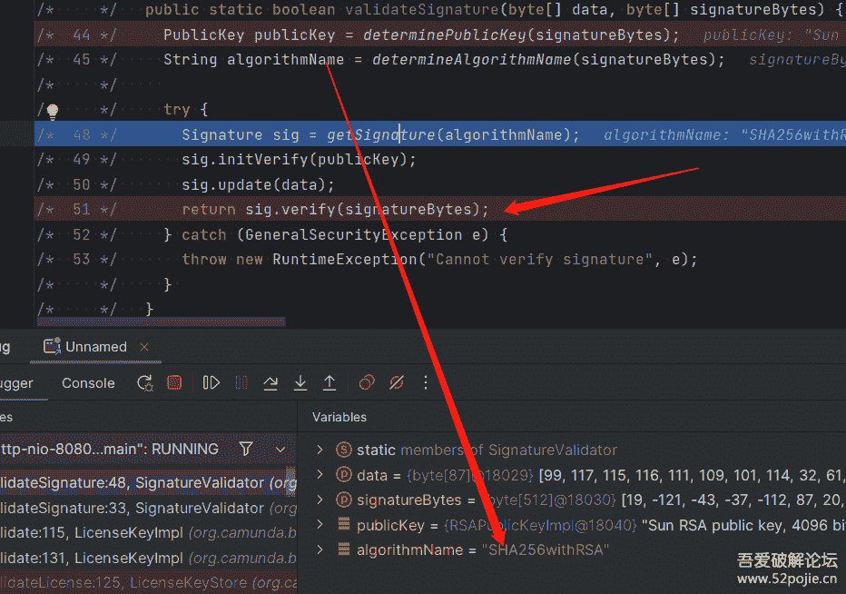

`代码8.png` (173.17 KB, 下载次数: 0)

[href="forum.php?mod=attachment&aid=MjYwOTI3OXwxNTRhM2I3ZnwxNzkzNTczNzAwfDE2ODA4NnwxNzc2ODk3&nothumb=yes" target="_blank"](https://www.52pojie.cn/forum.php?mod=attachment&aid=MjYwOTI3OXwxNTRhM2I3ZnwxNzkzNTczNzAwfDE2ODA4NnwxNzc2ODk3&nothumb=yes)

2023-4-21 16:25 上传

### 代码6

```
/*     */   private static Signature getSignature(String algorithmName) {
/*     */     try {
/* 113 */       return Signature.getInstance(algorithmName);
/*     */     }
/* 115 */     catch (NoSuchAlgorithmException e) {
/* 116 */       throw new RuntimeException("Cannot load signature algorithm " + algorithmName);
/*     */     } 
/*     */   }
```

可以得出：

`Signature.getInstance(“SHA256withRSA”);`


## 签名验签流程

通过这个方法去创建一个签名算法：

- 设置公钥 `publicKey`：`sig.initVerify(publicKey);`
- 要验证的数据 `data`：`sig.update(data);`
- 返回一个验证结果：`return sig.verify(signatureBytes);`

---

## 分析 `data` 是怎么来的

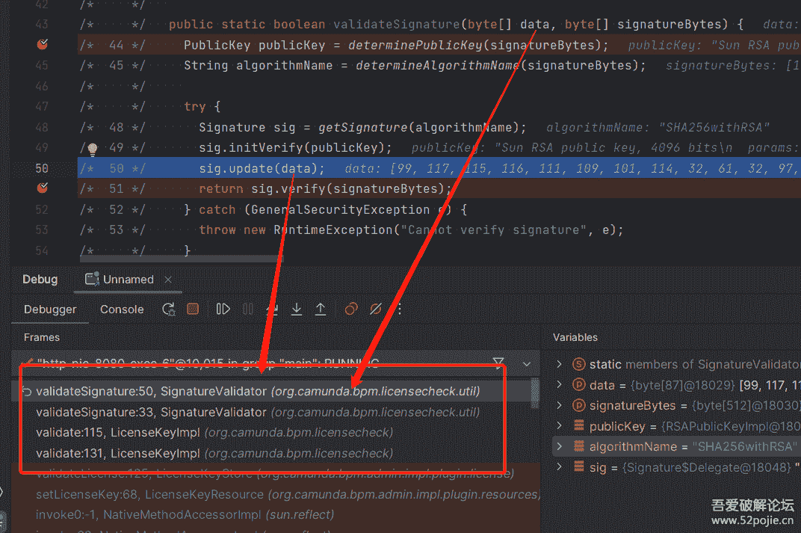

`代码9.png`（221.09 KB，下载次数：1）

[附件下载](https://www.52pojie.cn/forum.php?mod=attachment&aid=MjYwOTI4MXw0NDZhYzQ4NHwxNzkzNTczNzAwfDE2ODA4NnwxNzc2ODk3&nothumb=yes)

2023-4-21 16:29 上传

观察堆栈，不过四层而已，往上回溯。

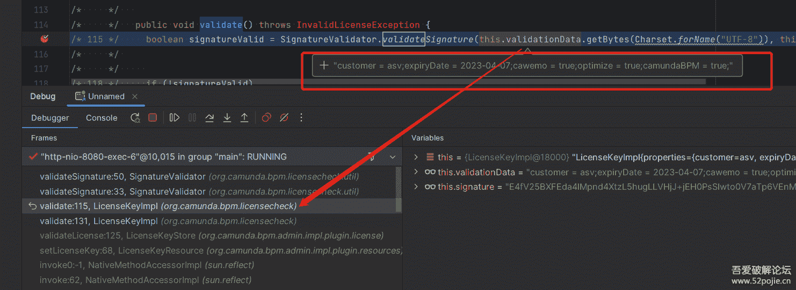

`代码10.png`（167.87 KB，下载次数：2）

[附件下载](https://www.52pojie.cn/forum.php?mod=attachment&aid=MjYwOTI4MnxiMTMwOWIxM3wxNzkzNTczNzAwfDE2ODA4NnwxNzc2ODk3&nothumb=yes)

2023-4-21 16:31 上传

再第三个地方直接明了，原来 `data` 是通过 `String` 类下面的 `getBytes(Charset.forName("UTF-8"))` 方法生成的。

---

到此所有流程分析完毕。

解决方式有二，以下将一一详解。

## 解决方式一：替换公钥文件

### 编码过程

通过以上分析，得出需要对数据通过公钥验签。

首先我们得需要自己生成的一个公钥对。

这里使用的是 [`cn.hutool/hutool-crypto`](https://mvnrepository.com/artifact/cn.hutool/hutool-crypto) 工具类。

```java
KeyPair rsa1 = SecureUtil.generateKeyPair("RSA", 4096);

PublicKey publicKey = rsa1.getPublic();
String publicKeyEncode = Base64.encode(publicKey.getEncoded());
PrivateKey aPrivate = rsa1.getPrivate();
String aPrivateEncode = Base64.encode(aPrivate.getEncoded());

System.out.println("publicKeyEncode:" + publicKeyEncode);
System.out.println("aPrivateEncode:" + aPrivateEncode);
```

编写一段需要验签的数据字符串，例如：`customer = 52pojie-lvbuqing;expiryDate = 2098-04-07;cawemo = true;optimize = true;camundaBPM = true;`。

对字符串转 `byte[]`：`byte[] validationDataBytes = validationData.getBytes(StandardCharsets.UTF_8);`。

用刚才生成的私钥进行验签：

```java
Signature signature = Signature.getInstance("SHA256withRSA");

signature.initSign(rsa.getPrivateKey());

signature.update(validationDataBytes);

byte[] sign1 = signature.sign();

return Base64.encode(sign1);
```

记住这个加签的数据。

将刚刚生成的私钥存为 `unified_public_key.der` 秘钥文件：

```java
FileUtil.writeBytes(rsa.getPublicKey().getEncoded(), "unified_public_key.der");
```

生成的方法使用方法就是替换原来 `jar` 包里面公钥文件。

对加签数据处理成以下格式：

```text
KMl0OK6eUNCBdznq6Eu1dXUsTrdZU9Ps7mGjhB9GdlIG6xUEePTyPTbpz
FEPAqrIlbGZFgaZubemqyGphyr935im51j5JWGCQzmf13/KMIL+60QoUJ
Gad3FN0J+2+UlxwD3lxDuubjfiQdsEVlRZR7VJ00vFECOfeO/qD6kUwP8
s1hRnyg9Q0XcdCGBYqjkEVol0X7A6azX0JSmTO8CiGE8zCqla8sn0+uEg
0raU+ydGcUpF5lbhPYOkU0PFx39eZ1KfwTAnATlY3DXURB+5mEwBfnjgx
Rima5OHUHzdi0U9wO6oduGjcgToP6+dS22desY8K7c1AEzTlYsXQ6+Lqf
PRZNIqXSqGu7FTByzxycxtV2sWWfm1YqnUV3fFK94CLaNhX+I5RlSqcf5
1pBaY+tqvmYKiMPSBkHY52sLkKKpy768a3LvktTeZ5g3pHOL6YHFgtaAq
8sS7/BFyABBYxG4X3BKhJbkp5xd8FuJ/KhEltLAwnc7LMw9UiSnxGWgGj
9uEuEXzi0dqpT3MQQf5qPZtFNf1xWGGwBABNZxQf95u6DWN12ISlPWjnW
CvYLye3rsCAxOQtOESFJm5dzlrhWOUFFz4SuIsRYPG3AsEaNmDalMeQco
HeWc012bCEIWwWYEaJ/Ir0uX88DOGRWIRSCTACbgXCj6N9x33QhCeYWM=;
customer = 52pojie-lvbuqing;
expiryDate = 2098-04-07;
cawemo = true;
optimize = true;
camundaBPM = true;
```

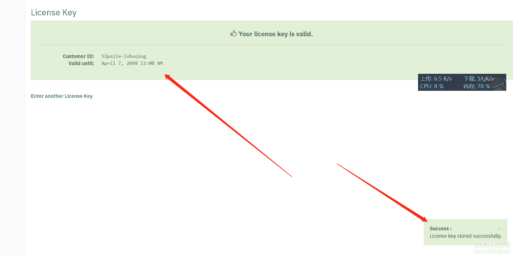

`验证成功1.png`（73.86 KB，下载次数：1）

[附件下载](https://www.52pojie.cn/forum.php?mod=attachment&aid=MjYwOTMwMHxmMTFlODU2OXwxNzkzNTczNzAwfDE2ODA4NnwxNzc2ODk3&nothumb=yes)

2023-4-21 17:45 上传

可以看到验证成功了，企业功能也出来了。

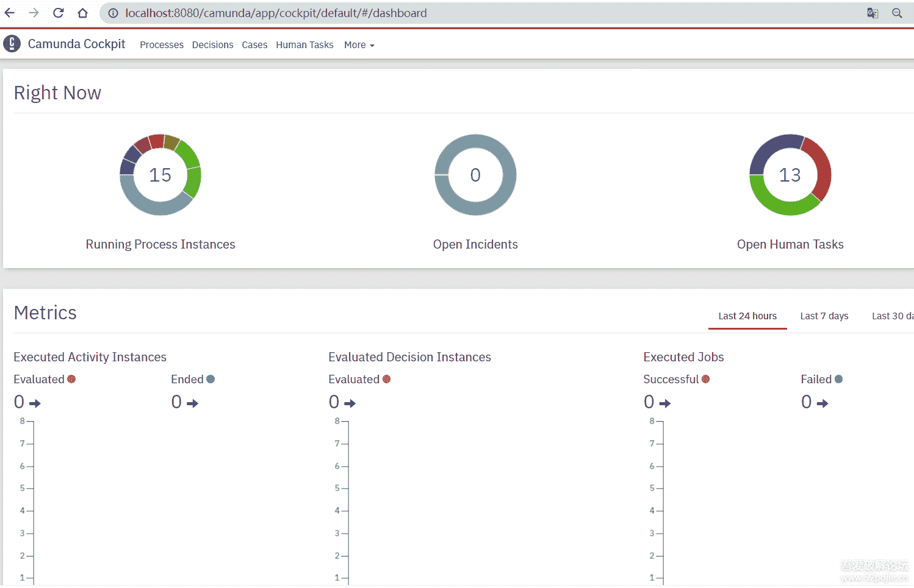

`验证成功2.png`（101.77 KB，下载次数：1）

[附件下载](https://www.52pojie.cn/forum.php?mod=attachment&aid=MjYwOTMwMXw5YzAyNmVjZnwxNzkzNTczNzAwfDE2ODA4NnwxNzc2ODk3&nothumb=yes)

2023-4-21 17:47 上传

---

## 解决方式二：使用 `javassist` 动态替换公钥

上面是解决方式 1，现在讲讲高阶的方法二，需要用到 `javassist`。

代码的大概意思是这样的，具体就是替换里面的公钥：

```java
static byte[] getbytes(string classname) {
    if (classname == null) {
        return null;
    }
    class_pool.appendclasspath(new loaderclasspath(thread.currentthread().getcontextclassloader()));
    string class_name = “org.camunda.bpm.licensecheck.publickeyfilereader”;
    string class_name_internal = class_name.replace('.', '/');
    if (!class_name_internal.equals(classname)) {
        return null;
    }
    try {
        ctclass ctclass = class_pool.get(class_name);
        ctmethod cm = ctclass.getdeclaredmethod("readpublickeyfromclasspath");
        string source = "这里填写公钥秘钥";
        cm.insertbefore(source);
        return ctclass.tobytecode();
    } catch (exception e) {
        return null;
    }
}
```

主类代码：

```java
public static void premain(String agentArgs, Instrumentation inst) {
    inst.addtransformer((loader, classname, classbeingredefined, protectiondomain, classfilebuffer) -> getbytes(classname));
}
```

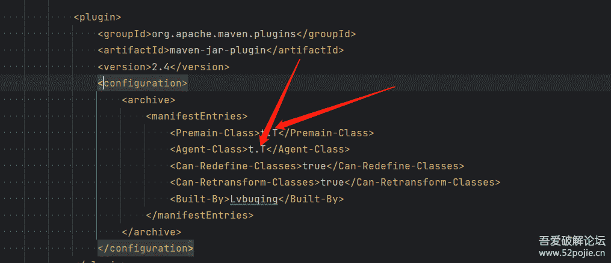

`打包.png`（59.16 KB，下载次数：1）

[附件下载](https://www.52pojie.cn/forum.php?mod=attachment&aid=MjYwOTMwM3xhMGRjMWE3NHwxNzkzNTczNzAwfDE2ODA4NnwxNzc2ODk3&nothumb=yes)

2023-4-21 17:56 上传

### 打包成 `jar` 包的调用

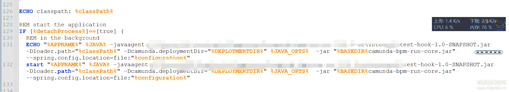

`调用.png`（111.29 KB，下载次数：0）

[附件下载](https://www.52pojie.cn/forum.php?mod=attachment&aid=MjYwOTMwNXw1NzdjYjZiMXwxNzkzNTczNzAwfDE2ODA4NnwxNzc2ODk3&nothumb=yes)

2023-4-21 17:58 上传

这样就可以啦！！！！

完结，撒花！


ps：camunda 公司真的是地域歧视
