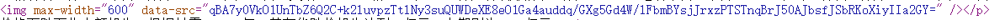
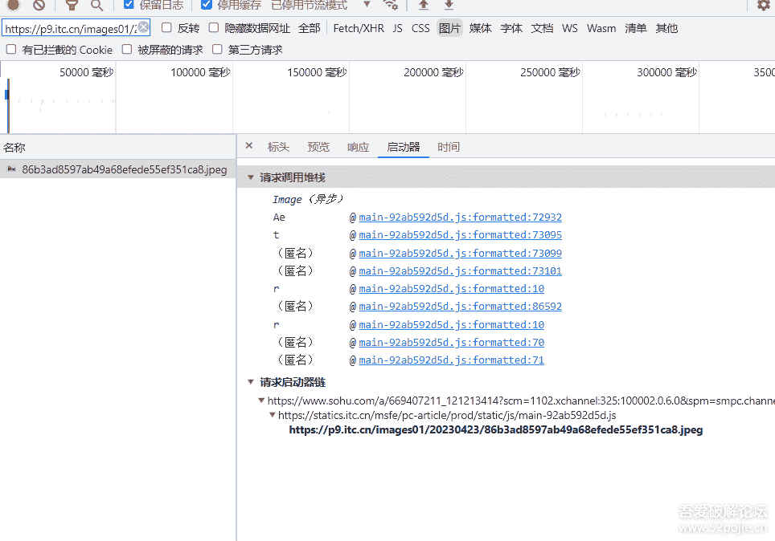
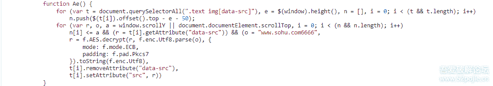

# [Web逆向] 某狐图片地址加密

- 原帖: https://www.52pojie.cn/forum.php?mod=viewthread&tid=1777579
- 抓取时间: 2026-11-01T22:53:36

新人第一次发帖

公司要求爬这个网站的图片

`aHR0cHM6Ly93d3cuc29odS5jb20vYS82Njk0MDcyMTFfMTIxMjEzNDE0P3NjbT0xMTAyLnhjaGFubmVsOjMyNToxMDAwMDIuMC42LjAmc3BtPXNtcGMuY2hhbm5lbF8yNDguYmxvY2szXzMwOF9ORGRGYm1fMV9mZC4xLjE2ODIyMzU2ODQ5MzBEUnQ1bUM1XzMyNA==`

## 检查源代码

发现是加密的



`image.png` (3.08 KB, 下载次数: 1)

[附件下载](https://www.52pojie.cn/forum.php?mod=attachment&aid=MjYwOTc2MXxlZjE2Njg0OHwxNzkzNTczNjE0fDE2ODA4NnwxNzc3NTc5&nothumb=yes)

2023-4-23 15:46 上传

## 搜索图片地址



`image.png` (75.11 KB, 下载次数: 0)

[附件下载](https://www.52pojie.cn/forum.php?mod=attachment&aid=MjYwOTc2MnwwNzdjNWZjNXwxNzkzNTczNjE0fDE2ODA4NnwxNzc3NTc5&nothumb=yes)

2023-4-23 15:47 上传

## 点击 `AE`



`image.png` (33.84 KB, 下载次数: 1)

[附件下载](https://www.52pojie.cn/forum.php?mod=attachment&aid=MjYwOTc2NHw3MjI3YTQ1OHwxNzkzNTczNjE0fDE2ODA4NnwxNzc3NTc5&nothumb=yes)

2023-4-23 15:48 上传

## 发现 `AES` 加密

密钥是 `o` 的内容

## 直接上代码

```javascript
const CryptoJS = require('crypto-js');
const ciphertext = ''; // 待解密的密文
const key = ''; // 密钥
const bytes = CryptoJS.AES.decrypt(ciphertext, CryptoJS.enc.Utf8.parse(key), {
  mode: CryptoJS.mode.ECB,
  padding: CryptoJS.pad.Pkcs7
});
const plaintext = bytes.toString(CryptoJS.enc.Utf8);
console.log(plaintext); // 输出解密后的明文
```

```python
import base64
from Crypto.Cipher import AES
ciphertext = base64.b64decode('') # 待解密的密文
key = ''.encode() # 密钥
cipher = AES.new(key, AES.MODE_ECB) # 使用ECB模式
cipher = cipher.decrypt(ciphertext) # 解密
a = cipher.decode('utf-8').rstrip('\r')
plaintext = AES.new(key, AES.MODE_ECB).decrypt(ciphertext).decode('utf-8').rstrip('\r')
print(plaintext) # 输出解密后的明文
```
