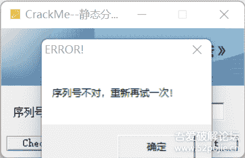
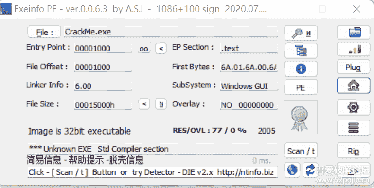
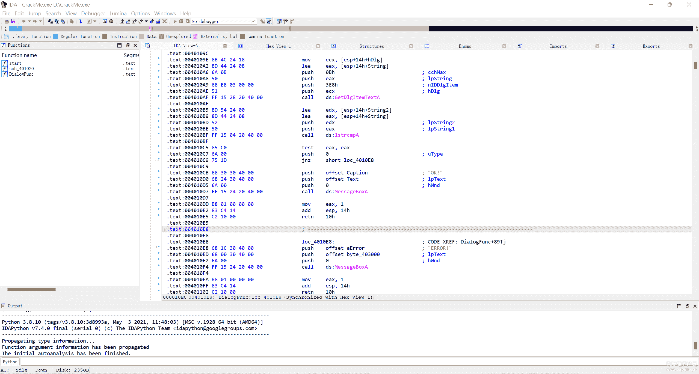
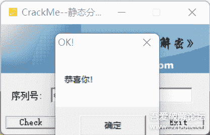

# [分享] arct1cer加密与解密学习二 ida静态分析

- 原帖: https://www.52pojie.cn/forum.php?mod=viewthread&tid=1778070
- 抓取时间: 2026-11-01T22:53:31

大家好这里是arct1cer，今天继续更新加密与解密学习笔记，我们来到了ida静态分析

本节内容是用ida[https://www.52pojie.cn](https://www.52pojie.cn)的一个简单程序和ida一些功能的介绍

首先打开程序，随便输入字符

[2.png (38.97 KB, 下载次数: 2)](https://www.52pojie.cn/forum.php?mod=attachment&aid=MjYwOTk0NHw0NmVkYmI4YnwxNzkzNTczNjA4fDE2ODA4NnwxNzc4MDcw&nothumb=yes)

2023-4-24 16:30 上传

显示序列号错误

我们先查下文件的壳

[1.png (101.21 KB, 下载次数: 2)](https://www.52pojie.cn/forum.php?mod=attachment&aid=MjYwOTk0N3w3YTJjYjZlOXwxNzkzNTczNjA4fDE2ODA4NnwxNzc4MDcw&nothumb=yes)

2023-4-24 16:31 上传

这是一个32位的文件 我们使用32位的ida打开

进入的时候是一个个窗口 我们选中空白处按右键 text view 转成文本形式看着舒服点

[3.png (227.85 KB, 下载次数: 1)](https://www.52pojie.cn/forum.php?mod=attachment&aid=MjYwOTk0OXw5YzZjZDIxMnwxNzkzNTczNjA4fDE2ODA4NnwxNzc4MDcw&nothumb=yes)

2023-4-24 16:33 上传

往下拉时我们看到这边有 ok 和 erro 显然是在进行判断

我们再分析一下这段代码

这边有一个`jnz`的跳转

如果跳转就会显示erro

我们选中这段代码右键 `assemble` 用`nop` 填充这段代码 这样就不会进行跳转了

我们选中改完后的 `nop` 代码

右键 `patching - apply patches to input file` 则成功保存

这样我们就爆破一个简单的程序了

[5E.png (43.64 KB, 下载次数: 2)](https://www.52pojie.cn/forum.php?mod=attachment&aid=MjYwOTk1Mnw1YTkwNjA0OHwxNzkzNTczNjA4fDE2ODA4NnwxNzc4MDcw&nothumb=yes)

2023-4-24 16:41 上传

下面是一些我从加密与解密 对于ida 功能的一些笔记 有些太过繁琐的功能没记下来 （^__^）

1.反汇编窗口

用户可以使用`ctrl+滚轮`调整图形大小，使用空格键在图形视图和文本视图之间切换，或选择右键快捷菜单中 text view 切换到文本视图

选择 view - open subviews - disassembly 打开反汇编子窗口 就可以使用多个子窗口分析同一程序

2.导航栏

view - toolbars -navigation 打开导航栏 可以看到被加载文件的线性视图

library function 为库函数 data 为数据 regular dunction 为规则函数 unexplored 为未查过的 instruction 为指令 external symbol 为外部符号 用户可根据需要快速跳转到相关代码处

在导航栏中执行右键快捷菜单 zoom in 和 zoom out 可以调整导航栏的显示比例

3.注释

在窗口右边空白处单击右键，将显示输入注释快捷菜单项 一个是 enter comment（快捷键是冒号） 另一个是 enter repetable comment（快捷键是分号）

； 输入的注释在所有交叉参考处都会出现

： 输入的注释只在该处出现

如果一个地址有两种注释 只会显示非重复注释

4.提示窗口

反馈各种信息 如分析进度 状态消息 错误消息等

5.字符串窗口

`f12`？

6.输入窗口

输入窗口中列出了可执行文件调用的所有函数，双击函数ida将跳转到反汇编窗口的函数地址处

7.跳转到地址窗口

在反汇编窗口滚动

若知道目标地址

快捷键 `G` 打开 jump to address （跳转到地址窗口

8.交叉参考

交叉参考可以知道指令代码互相调用的关系

9.参考重命名

可将反汇编清单中一些默认名称改为有意义名称，增强代码可读性

单击希望修改的名称 用快捷键 `n` 打开更名对话框

10.标签用法

单机菜单项 jump - mark position 打开 标记当前位置功能 出现对话框

为这个标记（当前光标位置）加上标签 “ 输入的字符 ”标签就是需要返回的位置

当离开这标签并返回时 选择菜单 jump - jump to marked position 或 `ctrl+m` 快捷键 执行跳转到标记位置 功能

选择返回的标签并双击 即可跳转到指定代码处

11.函数操作

ida允许手动干预创建、编辑、删除函数

将光标移到要创建函数的第一个字节上 edit - functions - create function 创建一个函数 （快捷键 `P` )

ida会将数据转换为代码，以便分析函数结构 如果能找到函数结束部分 将生成新的函数名 如果无法确定函数结束部分或发现非法指令 操作将终止

删除函数 edit - functions - delete functions

12.代码和数据转换

ida交互性使用可将某段十六进制数据指定为代码或数据

如果确信某段十六进制数据是一段指令 将光标移到第一个字节偏移位置 edit - code 或 `C` 即可

`P` 键可将某段代码定义为子程序 并列出参数调用

取消定义 edit - undefine 或 `U` 键

在代码行 `D` 键 数据类型会在 `db` `dw` `dd` 之间转换

options - setup data types 可设置更多类型

如果一个字节被转换过 再次转换ida会提示用户确认

13.字符串

`A` 键设置默认c语言字符串

options - ascII string style 设置其他字符串默认格式

小结：这次破解的程序并不难 与上期[https://www.52pojie.cn/thread-350397-1-1.html](https://www.52pojie.cn/thread-350397-1-1.html) 破解的程序基本无异 但是这次使用ida爆破的

简单介绍了一些ida 的功能

想知道更多功能可以去看 《ida pro 权威指南》

新人初学发的帖所以可能有些地方不是很准确

如有错误请各位大佬指出
