# [.NET逆向] 某Excel插件 MagicalVBA 激活码逆向分析

- 原帖：<https://www.52pojie.cn/forum.php?mod=viewthread&tid=1779204>
- 抓取时间：2026-11-01T22:53:27

## 前情提要

某日 某 3xx3 佬 给咱传了个 链接，说他搞不定这个。。。

咱问他是干啥的，他说 他也不清楚 就是看了名字觉得想弄一下。。。

啊这... 不过咱也好奇 到底是个啥，就折腾看看...

PS.

这个好像是个VBA学习工具，里面生产力的功能到是不多，但是不少图文教程。

[https://zhuanlan.zhihu.com/p/77623351](https://zhuanlan.zhihu.com/p/77623351)

淘宝里面有点贵好像。。。

就用来当 5.1 礼物吧... （当然想嫖还是要点技术的

## 准备工作

下载安装包

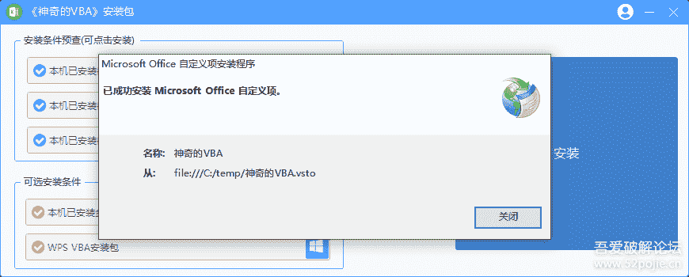

`1.png`（45.16 KB，下载次数：1） 2023-4-27 10:48 上传 [附件链接](https://www.52pojie.cn/forum.php?mod=attachment&aid=MjYxMDc0MHxlODU1NGQ3NHwxNzkzNTczNjA0fDE2ODA4NnwxNzc5MjA0&nothumb=yes)

安装完了

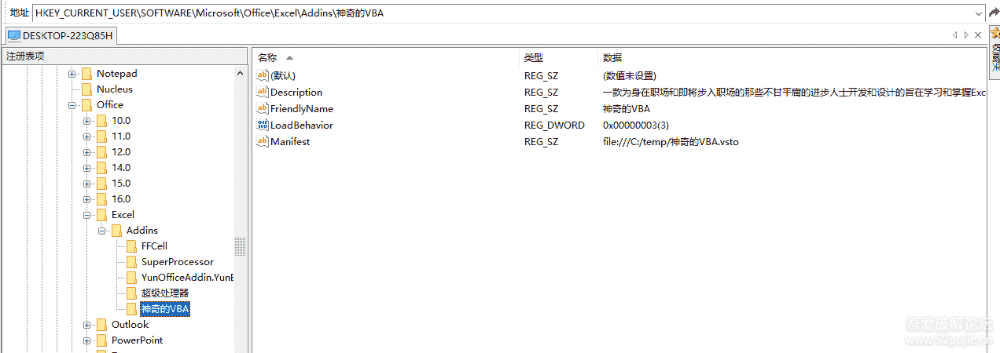

`2.png`（50.52 KB，下载次数：1） 2023-4-27 10:49 上传 [附件链接](https://www.52pojie.cn/forum.php?mod=attachment&aid=MjYxMDc0MXxlYmQ5MTEyZnwxNzkzNTczNjA0fDE2ODA4NnwxNzc5MjA0&nothumb=yes)

注册表也有了

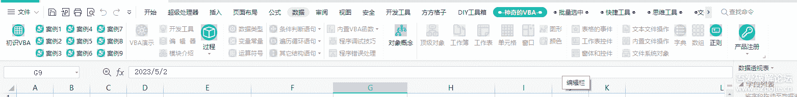

`3.png`（73.02 KB，下载次数：2） 2023-4-27 10:49 上传 [附件链接](https://www.52pojie.cn/forum.php?mod=attachment&aid=MjYxMDc0Mnw2ZWM0NGQ2NHwxNzkzNTczNjA0fDE2ODA4NnwxNzc5MjA0&nothumb=yes)

功能也出来了，但是插件的 `dll` 呢？文件没了？！这不科学……

看样子是安装完就自动删除了……

得想办法把文件提取出来……

由于对这块儿不熟，所以直接笨办法，那杀毒软件给屏蔽了删除操作。

最后提取出了具体的安装文件和 `vsto`

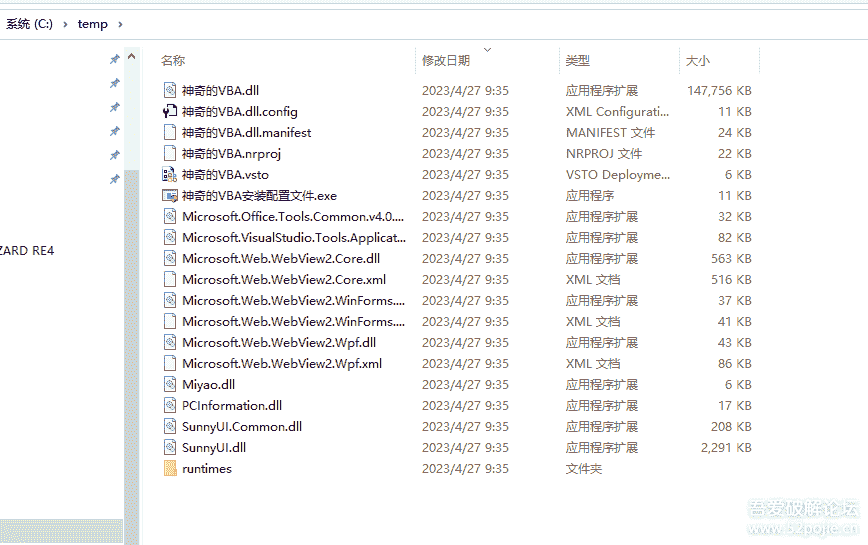

`4.png`（81.64 KB，下载次数：2） 2023-4-27 10:49 上传 [附件链接](https://www.52pojie.cn/forum.php?mod=attachment&aid=MjYxMDc0M3w5MWFhOWRjMXwxNzkzNTczNjA0fDE2ODA4NnwxNzc5MjA0&nothumb=yes)

这个会和原始安装包一起放出来，方便大伙分析。

[https://pan.baidu.com/s/1f6TpscStub1YmvVfUEaeKA?pwd=52pj](https://pan.baidu.com/s/1f6TpscStub1YmvVfUEaeKA?pwd=52pj)

## 开始分析

打开产品注册窗口

中文软件的好处就是可以直接搜名字，比如激活，产品注册界面

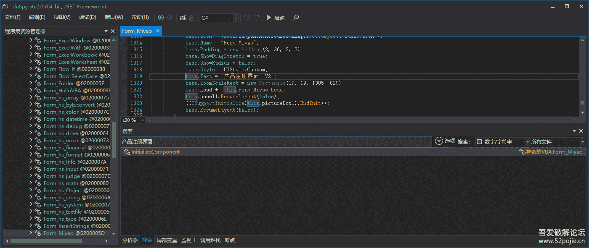

`5.png`（107.39 KB，下载次数：1） 2023-4-27 10:49 上传 [附件链接](https://www.52pojie.cn/forum.php?mod=attachment&aid=MjYxMDc0NHw1YTg3OWFhMHwxNzkzNTczNjA0fDE2ODA4NnwxNzc5MjA0&nothumb=yes)

然后，既然是个 `Form`，那里面的按钮肯定是 `Button`，简单看一眼

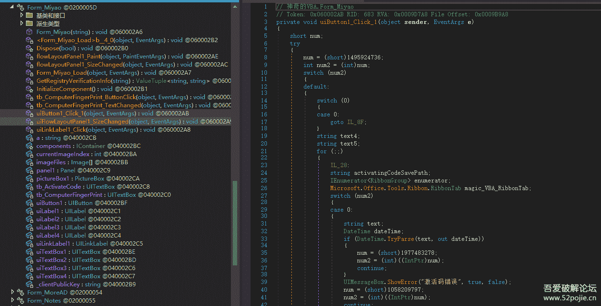

`6.png`（134.48 KB，下载次数：4） 2023-4-27 10:49 上传 [附件链接](https://www.52pojie.cn/forum.php?mod=attachment&aid=MjYxMDc0NXxkYzFjMDBiYnwxNzkzNTczNjA0fDE2ODA4NnwxNzc5MjA0&nothumb=yes)

试着先去个混淆

```
private void uiButton1_Click_1(object sender, EventArgs e)
{
        try
        {
                string text = this.tb_ComputerFingerPrint.Text;  //机器码文本框的值 基本就是 编码后的机器码
                string text2 = this.tb_ActivateCode.Text;        //激活码文本框 就是 传入的激活码 了
                if (!string.IsNullOrWhiteSpace(text2))
                {
                        //RSA解密 
                        string[] array = new RSA(this._clientPublicKey).DencryptWithPublicKey(text2).Split(new char[] { '隔' });
                        //解析后 用 隔 分割，长度为3
                        if (array.Length != 3)
                        {
                                UIMessageBox.ShowError("激活码错误", true, false);
                        }
                        else
                        {
                                string text3 = array[0];
                                string text4 = array[1];
                                string text5 = array[2];
                                if (text == text3) //array[0] 要和 编码后的机器码一致
                                {
                                        DateTime dateTime;
                                        if (DateTime.TryParse(text5, out dateTime)) //array[2] 是日期
                                        {
                                                if (DateTime.Today.Subtract(dateTime).Days ().Magic_VBA_RibbonTab;
                                                        foreach (RibbonGroup ribbonGroup in magic_VBA_RibbonTab.Groups)
                                                        {
                                                                //....................
                                                        }
                                                        magic_VBA_RibbonTab.ResumeLayout(true);
                                                        magic_VBA_RibbonTab.PerformLayout();
                                                        base.Dispose();
                                                }
                                                else
                                                {
                                                        UIMessageBox.ShowError("当前激活码授予的使用权已过期！请购买新的激活码", true, false);
                                                }
                                        }
                                        else
                                        {
                                                UIMessageBox.ShowError("激活码错误", true, false);
                                        }
                                }
                                else
                                {
                                        UIMessageBox.ShowError("激活码错误", true, false);
                                }
                        }
                }
        }
        catch (Exception ex)
        {
                MessageBox.Show(ex.Message);
        }
}
```

再来看看 密钥 在哪儿

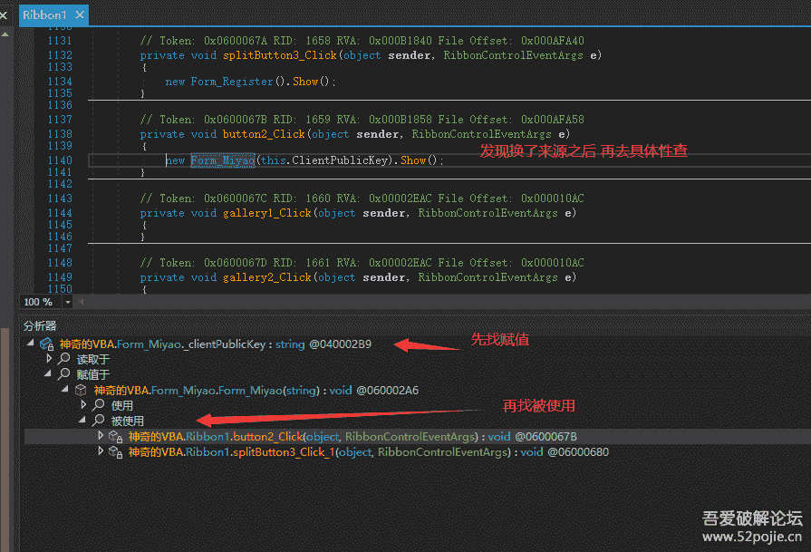

`7.png`（54.7 KB，下载次数：1） 2023-4-27 10:49 上传 [附件链接](https://www.52pojie.cn/forum.php?mod=attachment&aid=MjYxMDc0NnwzM2JhNDY3NHwxNzkzNTczNjA0fDE2ODA4NnwxNzc5MjA0&nothumb=yes)

密钥在这儿了

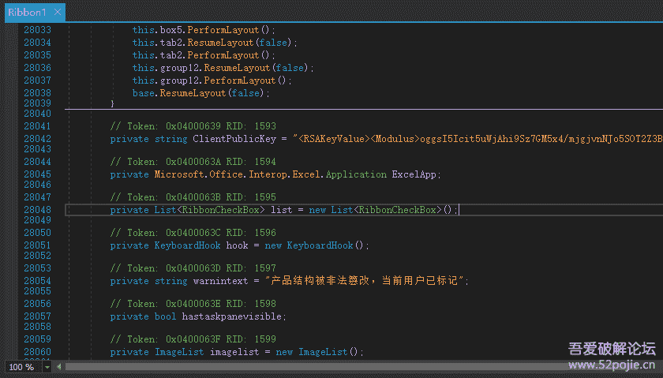

`8.png`（27.12 KB，下载次数：2） 2023-4-27 10:49 上传 [附件链接](https://www.52pojie.cn/forum.php?mod=attachment&aid=MjYxMDc0N3xhZDQ1ZWMzM3wxNzkzNTczNjA0fDE2ODA4NnwxNzc5MjA0&nothumb=yes)

既然上了 `RSA`，那肯定要替换密钥，

怎么换可以参考其他帖子，这里不详述。

值得一提的是，里面有一个明显字样

```
private string warnintext = "产品结构被非法篡改，当前用户已标记";
```

咱们瞧瞧都用在哪儿了

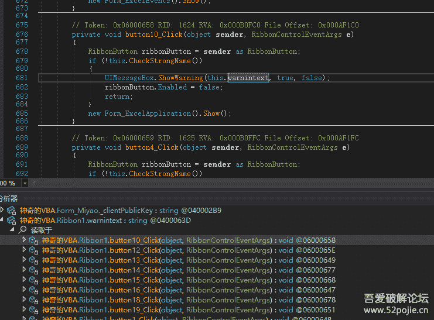

`9.png`（75.66 KB，下载次数：1） 2023-4-27 10:49 上传 [附件链接](https://www.52pojie.cn/forum.php?mod=attachment&aid=MjYxMDc0OHxkOTg3YzlmNHwxNzkzNTczNjA0fDE2ODA4NnwxNzc5MjA0&nothumb=yes)

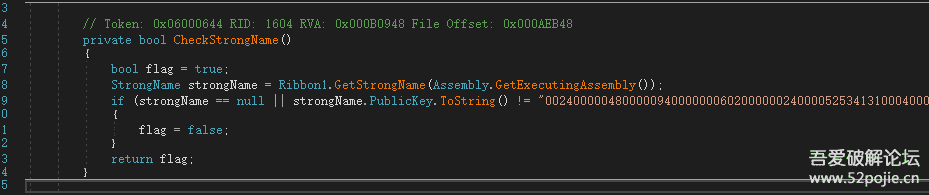

`10.png`（13.96 KB，下载次数：1） 2023-4-27 10:49 上传 [附件链接](https://www.52pojie.cn/forum.php?mod=attachment&aid=MjYxMDc0OXwzMDE1NWU5NnwxNzkzNTczNjA0fDE2ODA4NnwxNzc5MjA0&nothumb=yes)

霍儿~ 用了强命名检查呢~

数据是这儿的

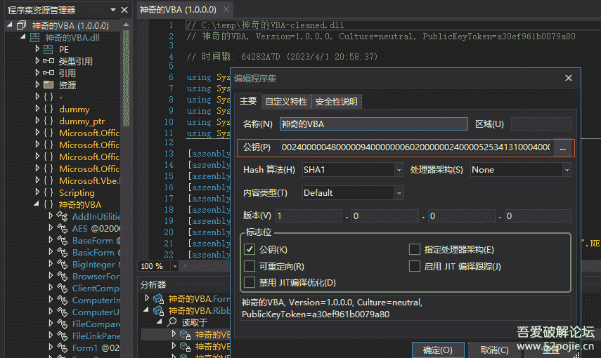

`11.png`（88.86 KB，下载次数：2）


[附件下载](https://www.52pojie.cn/forum.php?mod=attachment&aid=MjYxMDc1MHwwZDY3M2QxMXwxNzkzNTczNjA0fDE2ODA4NnwxNzc5MjA0&nothumb=yes)

2023-4-27 10:49 上传

基本如果要改就是修改上面这两处位置了。

替换一个RSA密钥，然后 替换一下强签名验证的密钥，当然也可以直接强制改为判断成功。

咱这边就没动太多 改了两处文本。

## 编码逻辑

改完文本就要来实现激活码了。

之前已经分析出来 激活码的 格式很简单

```
[编码后的机器码，激活开始日期，激活结束日期]
然后 用字符 隔 拼接
然后 RSA 加密 具体看看怎么加密的
```

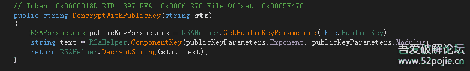

12.png (11.94 KB, 下载次数: 1)

[附件下载](https://www.52pojie.cn/forum.php?mod=attachment&aid=MjYxMDc1MXxmMjY3NjE4NHwxNzkzNTczNjA0fDE2ODA4NnwxNzc5MjA0&nothumb=yes)

2023-4-27 10:49 上传

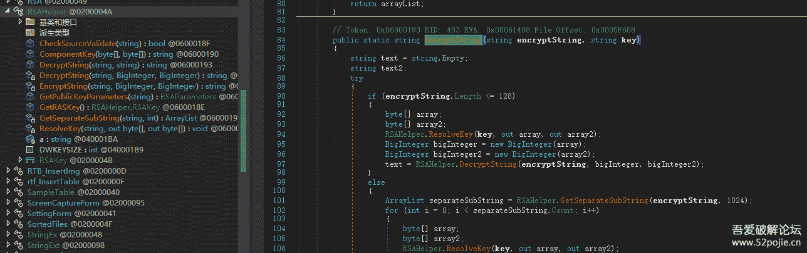

13.png (82.72 KB, 下载次数: 0)

[附件下载](https://www.52pojie.cn/forum.php?mod=attachment&aid=MjYxMDc1MnxhY2E0NDgzZXwxNzkzNTczNjA0fDE2ODA4NnwxNzc5MjA0&nothumb=yes)

2023-4-27 10:49 上传

可以看到 有个 加密函数在

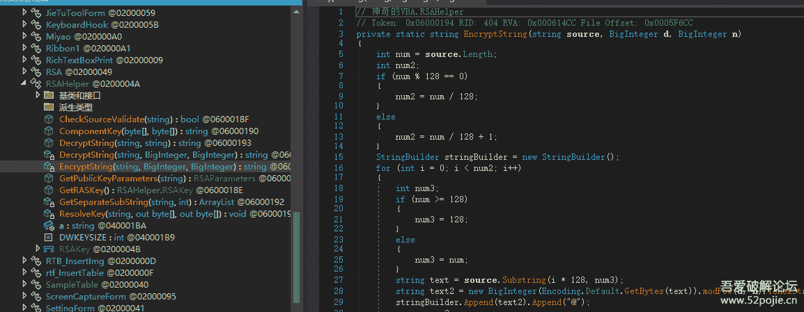

14.png (85.07 KB, 下载次数: 2)

[附件下载](https://www.52pojie.cn/forum.php?mod=attachment&aid=MjYxMDc1M3wzN2ViYzZlMnwxNzkzNTczNjA0fDE2ODA4NnwxNzc5MjA0&nothumb=yes)

2023-4-27 10:49 上传

但是 入参是 两个 `BigInteger`

我们可以逆推一下

```
//公钥解密是下面这样
RSAHelper.ResolveKey(key, out array, out array2);
BigInteger bigInteger = new BigInteger(array);
BigInteger bigInteger2 = new BigInteger(array2);
text = RSAHelper.DecryptString(encryptString, bigInteger, bigInteger2);
key = RSAHelper.ComponentKey(publicKeyParameters.Exponent, publicKeyParameters.Modulus);
```

那么 私钥加密 也应该是 类似这样

然后 看到 上面有个

```
public static RSAHelper.RSAKey GetRASKey()
{
    RSACryptoServiceProvider.UseMachineKeyStore = true;
    RSAParameters rsaparameters = new RSACryptoServiceProvider(1024).ExportParameters(true);
    return new RSAHelper.RSAKey
    {
        PublicKey = RSAHelper.ComponentKey(rsaparameters.Exponent, rsaparameters.Modulus),
        PrivateKey = RSAHelper.ComponentKey(rsaparameters.D, rsaparameters.Modulus)
    };
}
```

那么很明显了 私钥大概 用的就是 `rsaparameters.D` 和 `rsaparameters.Modulus`

```
key = RSAHelper.ComponentKey(rsaparameters.D, rsaparameters.Modulus);
RSAHelper.ResolveKey(key, out array, out array2);
BigInteger bigInteger = new BigInteger(array);
BigInteger bigInteger2 = new BigInteger(array2);
text = RSAHelper.EncryptString(encryptString, bigInteger, bigInteger2);
```

可以直接省略为

```
BigInteger bigInteger = new BigInteger(rsaparameters.D);
BigInteger bigInteger2 = new BigInteger(rsaparameters.Modulus);
text = RSAHelper.EncryptString(encryptString, bigInteger, bigInteger2);
```

## 开工

开始码代码实现了，老样子 偷懒用反射

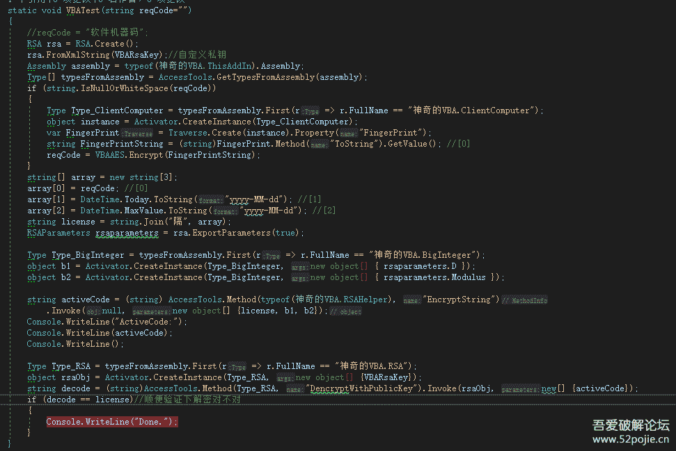

15.png (48.78 KB, 下载次数: 2)

[附件下载](https://www.52pojie.cn/forum.php?mod=attachment&aid=MjYxMDc1NHwxNjg5YTRhZHwxNzkzNTczNjA0fDE2ODA4NnwxNzc5MjA0&nothumb=yes)

2023-4-27 10:49 上传

## 杂项

默认的 插件安装逻辑里面 好像还有 强签名验证，`vsto` 验证什么的。

如果对插件进行修改后不重新签名 可能导致插件不加载

这里又是一大段的重新签名环节，而且感觉网上对这块儿 说明甚少。

为了减少影响 我真不做详细说明。

有兴趣的 可以自己去尝试，我这边会提供重新签名之后的补丁供大家尝试。

`vsto` 重新签名参考文档：

[vsto 重新签名参考文档](https://learn.microsoft.com/zh-cn/visualstudio/deployment/how-to-re-sign-application-and-deployment-manifests?view=vs-2022)

`.net` `dll` 重新强签名网上一堆。

最后 卸载原版 使用重新签名后的版本安装后。

## 验证结果

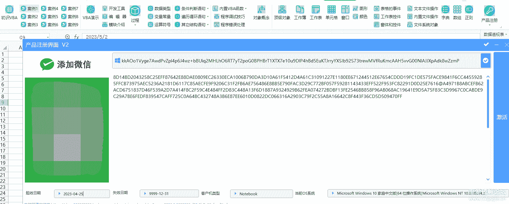

16.png (341.41 KB, 下载次数: 1)

[附件下载](https://www.52pojie.cn/forum.php?mod=attachment&aid=MjYxMDc1NXw1ZmRlZWIxZXwxNzkzNTczNjA0fDE2ODA4NnwxNzc5MjA0&nothumb=yes)

2023-4-27 11:25 上传

## 补丁下载

这里的补丁 只是做了重新签名，不是破解补丁！  
这里的补丁 只是做了重新签名，不是破解补丁！  
这里的补丁 只是做了重新签名，不是破解补丁！

其中将密钥改为了私钥。

可以拿来针对这个特定版本计算激活码。

下载后 覆盖到 提取的插件目录内，然后双击 `vsto` 安装即可。

[百度网盘下载](https://pan.baidu.com/s/1nkJOpJA5UTimaCjCFQ92_A?pwd=52pj)

## 郑重声明

仅供学习交流，请勿用于商业，觉得工具好用的还请支持正版

## 附录：关于 Excel 插件 某某格子

这个说实话 当打开它的时候 还没出手 它就躺下了... 里面是裸的...

虽说价格其实不贵，结果可网上注册机还满天飞...

你要是真想用 推荐支持正版，毕竟好功能都是联网的 按量计费。

其他的 你真想白嫖用用 下面给个图 自己悟吧。

搞 `.Net` 应该一眼就看懂了，不懂的看了我其他帖子也就多少懂了。

所以说 它很良心了 以后就无视它吧...

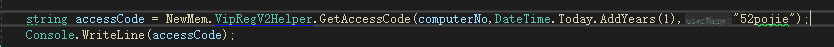

17.png (3.66 KB, 下载次数: 2)

[附件下载](https://www.52pojie.cn/forum.php?mod=attachment&aid=MjYxMDc1NnwyZjA4MTVlNHwxNzkzNTczNjA0fDE2ODA4NnwxNzc5MjA0&nothumb=yes)

2023-4-27 10:50 上传
