# [原创] 易语言（初试牛刀）

- 原帖：<https://www.52pojie.cn/forum.php?mod=viewthread&tid=1779879>
- 抓取时间：2026-11-01T22:53:17

因学习语言用到图片抓抓工具，找到的工具都收费，挑战一下自己，边学边整，废话少说上步骤。

## 操作步骤

### 1. 查壳

初始先查一下工具有没有加壳（不多介绍）。

### 2. 使用 `OD` 文本搜索

直接`OD`（有提示框，直接文本搜索）。

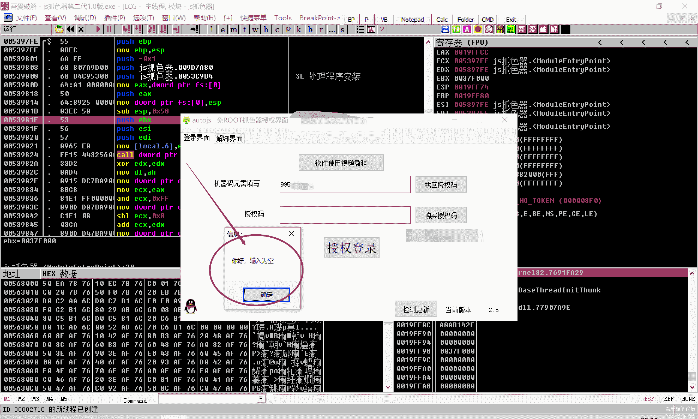

`js抓抓02.PNG`（175.76 KB，下载次数：0）  
附件：[下载](https://www.52pojie.cn/forum.php?mod=attachment&aid=MjYxMTIwNHw3MTU4M2M1M3wxNzkzNTczNTk1fDE2ODA4NnwxNzc5ODc5&nothumb=yes)（2）  
2023-4-28 23:45 上传

### 3. 定位结果

果然有结果，双击内容进行跳转。

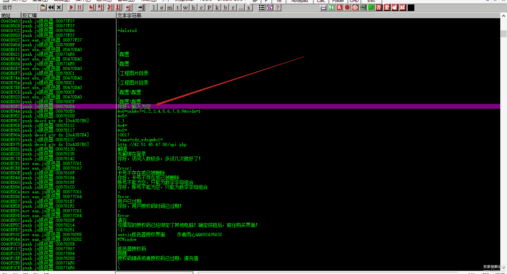

`js抓抓03.PNG`（86.63 KB，下载次数：0）  
附件：[下载](https://www.52pojie.cn/forum.php?mod=attachment&aid=MjYxMTIwNXxjNzQxYTc4Y3wxNzkzNTczNTk1fDE2ODA4NnwxNzc5ODc5&nothumb=yes)（3）  
2023-4-28 23:45 上传

### 4. 发现 `je` 判断

发现有`je`判断。

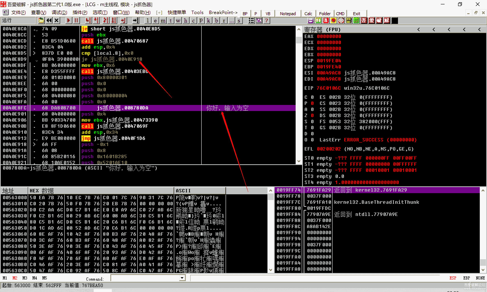

`js抓抓04.PNG`（144.22 KB，下载次数：1）  
附件：[下载](https://www.52pojie.cn/forum.php?mod=attachment&aid=MjYxMTIwNnxkNzU4NjBmMnwxNzkzNTczNTk1fDE2ODA4NnwxNzc5ODc5&nothumb=yes)（4）  
2023-4-28 23:46 上传

### 5. 查看 `jmp` 内容

`je`跳入了`jmp`中，查看`jmp`内容。

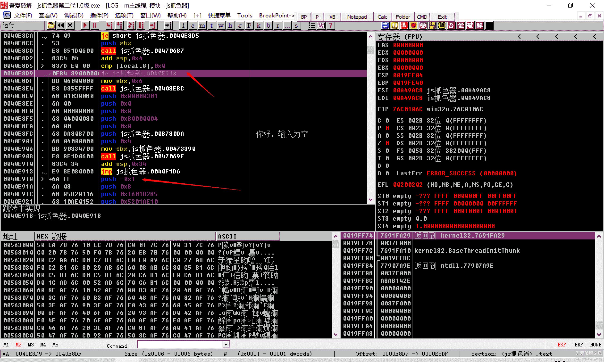

`js抓抓05.PNG`（138.09 KB，下载次数：1）  
附件：[下载](https://www.52pojie.cn/forum.php?mod=attachment&aid=MjYxMTIwN3wyYzdjNGQwOHwxNzkzNTczNTk1fDE2ODA4NnwxNzc5ODc5&nothumb=yes)（5）  
2023-4-28 23:46 上传

### 6. 查看授权码算法

发现`jmp`是一个跳转，查看发现是比较授权码算法。

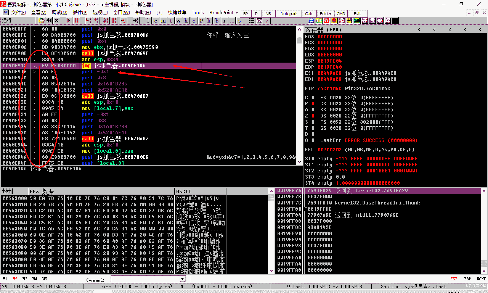

`js抓抓06.PNG`（156.97 KB，下载次数：0）  
附件：[下载](https://www.52pojie.cn/forum.php?mod=attachment&aid=MjYxMTIwOHxmNmVjYzVhMXwxNzkzNTczNTk1fDE2ODA4NnwxNzc5ODc5&nothumb=yes)（6）  
2023-4-28 23:46 上传

### 7. 大跳转

所有授权码出现的情况都在内，是一个大跳转。

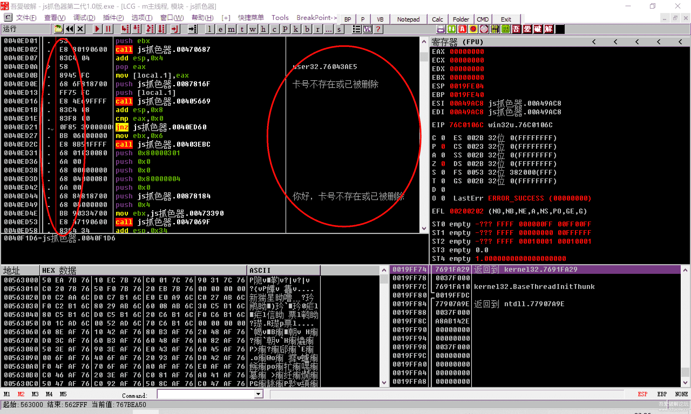

`js抓抓07.PNG`（169.58 KB，下载次数：2）  
附件：[下载](https://www.52pojie.cn/forum.php?mod=attachment&aid=MjYxMTIwOXxkYzU4MDhkN3wxNzkzNTczNTk1fDE2ODA4NnwxNzc5ODc5&nothumb=yes)（7）  
2023-4-28 23:46 上传

### 8. 发现 `push` 主窗口

到大跳转末尾发现`push`了主窗口（看视频学到`52010001`为主窗口）。

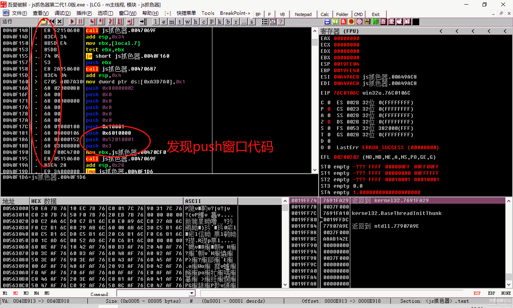

`js抓抓08.png`（164.71 KB，下载次数：0）  
附件：[下载](https://www.52pojie.cn/forum.php?mod=attachment&aid=MjYxMTIxMHw0YmZlZjQ1M3wxNzkzNTczNTk1fDE2ODA4NnwxNzc5ODc5&nothumb=yes)（8）  
2023-4-28 23:46 上传

### 9. 查看 `je` 跳转位置

查看从上面`je`跳下来的。

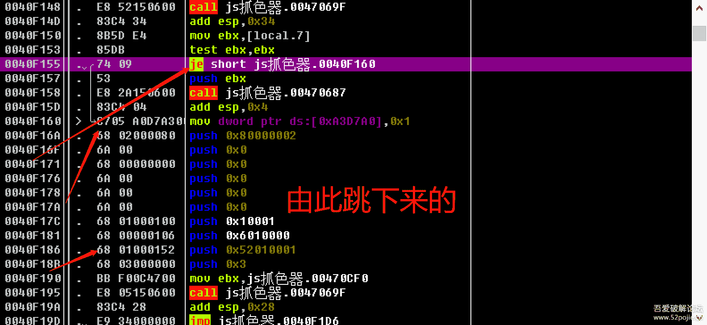

`js抓抓09.png`（44.34 KB，下载次数：2）  
附件：[下载](https://www.52pojie.cn/forum.php?mod=attachment&aid=MjYxMTIxMXw5NzU1NWU2OHwxNzkzNTczNTk1fDE2ODA4NnwxNzc5ODc5&nothumb=yes)（9）  
2023-4-28 23:46 上传

### 10. 修改 `je` 为 `jmp`

直接修改`je`为`jmp`（无条件跳转）。

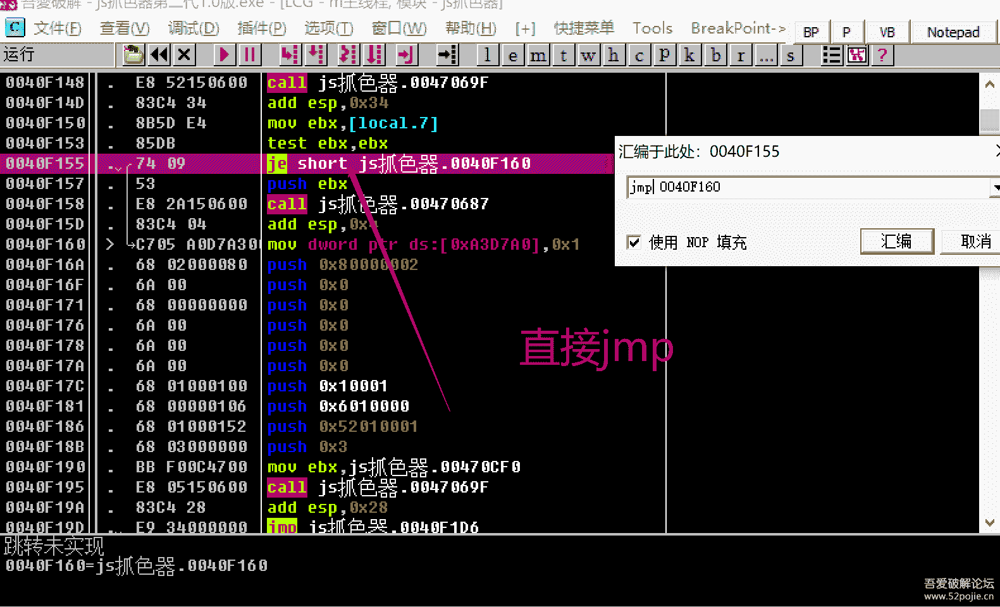

`js抓抓10.png`（67.73 KB，下载次数：2）  
附件：[下载](https://www.52pojie.cn/forum.php?mod=attachment&aid=MjYxMTIxMnwxNmNkMmI5ZHwxNzkzNTczNTk1fDE2ODA4NnwxNzc5ODc5&nothumb=yes)（10）  
2023-4-28 23:46 上传

### 11. 复制 `jmp` 跳转

将此`jmp`跳转复制给判断为空的`je`（执行判断为空直接跳转生产主窗口）。

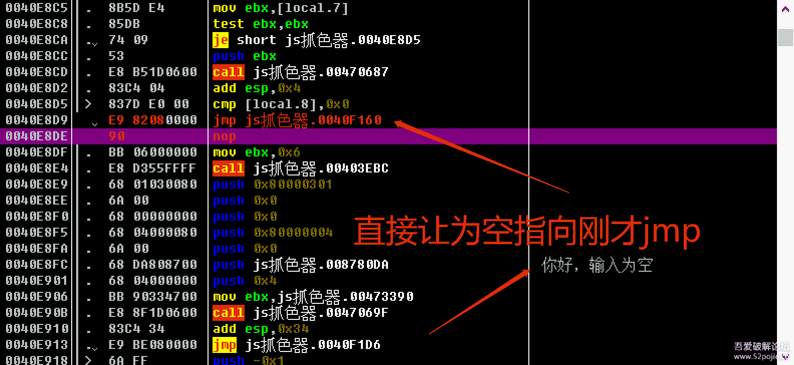

`js抓抓11.PNG`（48.78 KB，下载次数：1）  
附件：[下载](https://www.52pojie.cn/forum.php?mod=attachment&aid=MjYxMTIxM3xmNmUwNGEzM3wxNzkzNTczNTk1fDE2ODA4NnwxNzc5ODc5&nothumb=yes)（11）  
2023-4-28 23:46 上传

### 12. 测试结果

测试结果（直接跳过中间判断授权码）。

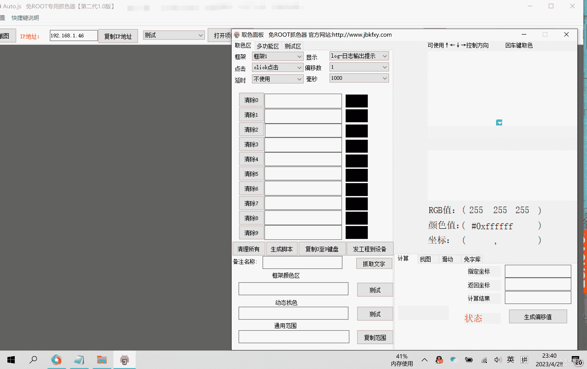

`js抓抓12.PNG`（223.75 KB，下载次数：2）  
附件：[下载](https://www.52pojie.cn/forum.php?mod=attachment&aid=MjYxMTIxNHwwNTY5NWNhZXwxNzkzNTczNTk1fDE2ODA4NnwxNzc5ODc5&nothumb=yes)（12）  
2023-4-28 23:46 上传

### 13. 总结

虽然赶紧思路不难，0基础看贴吧文章一点一点了解每个关键词是干什么的，中间经历了多少次失望，又是贴吧又是视频进行学习，终于在16个小时后成功了，

这中成就感，让我赶紧写个帖子记录一下，P处作品，以后会更加努力，感谢yyhd作者，写的一篇篇精髓，让我这么快了解上手，谢谢大佬！！！
