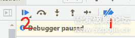
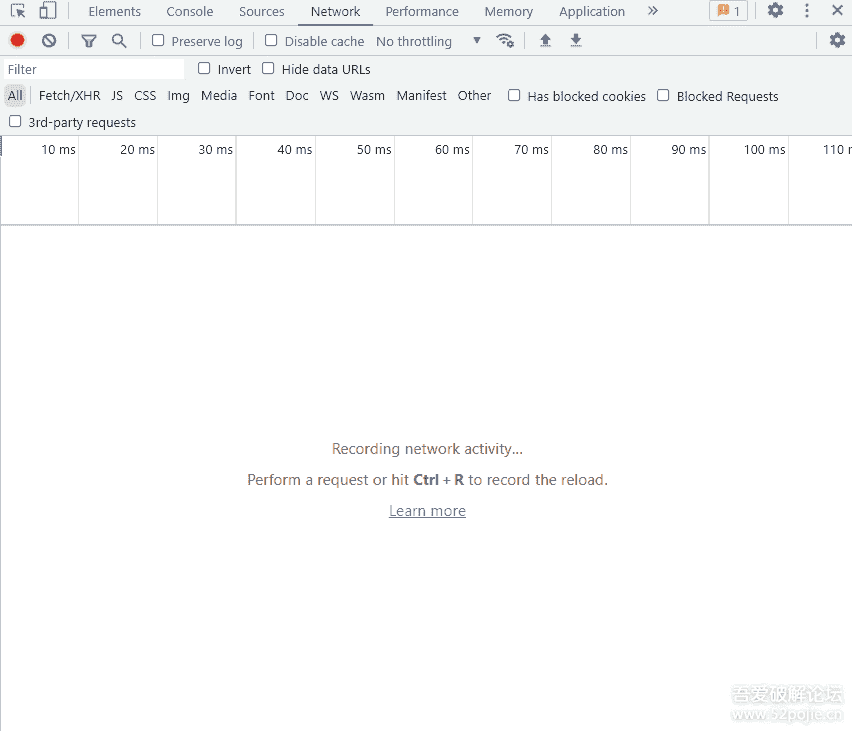
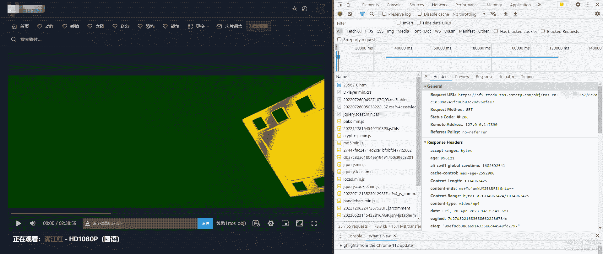
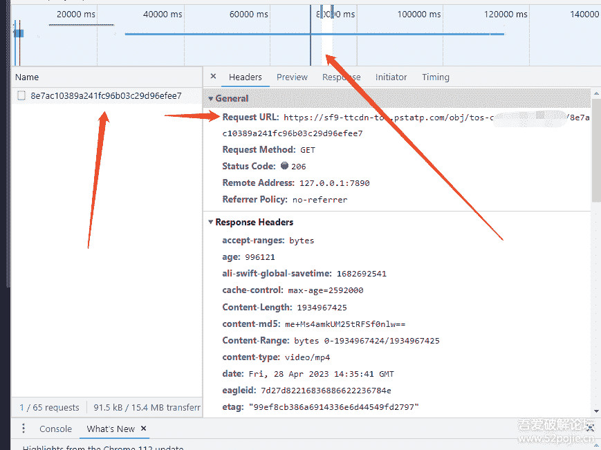
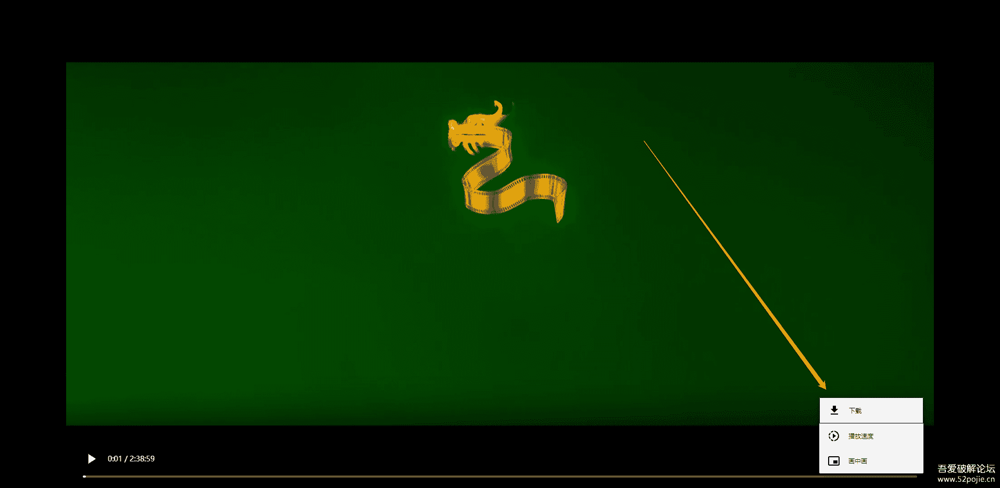
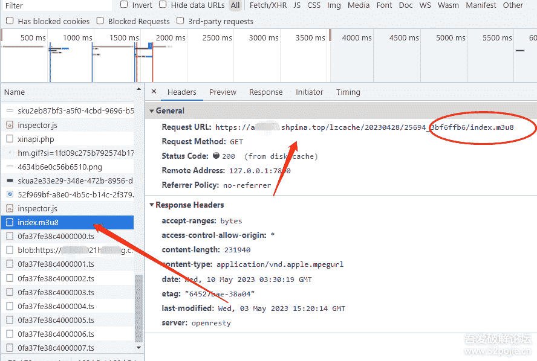

# [Web逆向] 用`F12`审查元素轻松下载电影视频

- 原帖：<https://www.52pojie.cn/forum.php?mod=viewthread&tid=1783663>
- 抓取时间：2026-11-01T22:52:57

## 前言

看到论坛有很多人看到喜欢的电影或者电视视频资源想下载下来，但是不知道怎么操作，下载了一堆软件，不是广告就是收费软件。我这里分享几种方法供大家学习交流，若有违反，请联系删除，谢谢！

## 正文

我们这次以某影视网来做目标网站，选择一个自己想看的影视剧，我这里以满江h为例。

我们按`F12`，如果按`F12`提示禁止审查元素或者其他行为的，我们就点浏览器设置，找到开发者选项，或者右键审查元素，每个浏览器的名称不一样，这里不一一展示，可以百度你当前浏览器型号审查元素。

### Paused in Debugger

如果出现`Paused in Debugger`我们就点击箭头指向的按钮，目前他是灰色，第一步给他点到蓝色状态，第二步点击左侧的按钮就跳过了。

*图1：`image.png`（11.1 KB，下载次数：3），2023-5-10 11:15 上传；[附件下载](https://www.52pojie.cn/forum.php?mod=attachment&aid=MjYxMzUxMnw1Zjc1MTNjYXwxNzkzNTczNTc0fDE2ODA4NnwxNzgzNjYz&nothumb=yes)*

跳过之后选`network`选项，提示我们要重新加载，`Ctrl+R`，我们重新加载一下。

*图2：`image.png`（35.07 KB，下载次数：2），2023-5-10 11:17 上传；[附件下载](https://www.52pojie.cn/forum.php?mod=attachment&aid=MjYxMzUxM3wzNDdkYThjN3wxNzkzNTczNTc0fDE2ODA4NnwxNzgzNjYz&nothumb=yes)*

*图3：`image.png`（281.35 KB，下载次数：3），2023-5-10 11:20 上传；[附件下载](https://www.52pojie.cn/forum.php?mod=attachment&aid=MjYxMzUxNHwxOWI1MDY5MXwxNzkzNTczNTc0fDE2ODA4NnwxNzgzNjYz&nothumb=yes)*

我们看到有很多个文件已经抓到了，但是我们的电影在哪里呢？我们可以明显看到有一条蓝色的线加载的很长，如果大家没有加载，可以尝试拖动一下进度条，也会出现，那么大概率你就抓到了这个链接，我们点进去看一下。

*图4：`image.png`（68.32 KB，下载次数：0），2023-5-10 11:22 上传；[附件下载](https://www.52pojie.cn/forum.php?mod=attachment&aid=MjYxMzUxNXw2ZmVmNzU4Y3wxNzkzNTczNTc0fDE2ODA4NnwxNzgzNjYz&nothumb=yes)*

`Request URL: https://sf9-*****-tos.pstatp.com/obj/*************/8e7ac10389a2*******03c29d96efee7`

这个就是我们要的URL链接，我们直接复制到浏览器。右下角点击下载就可以了。

*图5：`image.png`（185.2 KB，下载次数：1），2023-5-10 11:25 上传；[附件下载](https://www.52pojie.cn/forum.php?mod=attachment&aid=MjYxMzUxNnwmYTZhYjRjMHwxNzkzNTczNTc0fDE2ODA4NnwxNzgzNjYz&nothumb=yes)*

### M3U8

有些同学会遇到的是`http:******/******.m3u8`

*图6：`image.png`（84.33 KB，下载次数：3），2023-5-10 11:34 上传；[附件下载](https://www.52pojie.cn/forum.php?mod=attachment&aid=MjYxMzUxOHw2YzFmNTQ1ZXwxNzkzNTczNTc0fDE2ODA4NnwxNzgzNjYz&nothumb=yes)*

这种链接我们复制到新的浏览器并没有下载按钮，这时候我们要配合`m3u8`工具下载。

我这里推荐 [M3U8批量下载器 V1.4.8 0508【5月8日更新】](https://www.52pojie.cn/forum.php?mod=viewthread&tid=1631141&highlight=m3u8)。

工具具体用法详细见他这个帖子。

### 猫抓

还有一个工具就是猫抓，猫抓是一键抓取浏览器资源，是浏览器的扩展程序插件，提供猫抓下载链接：<https://aoligei121.lanzouy.com/ishKT0v4nwef>。

## 结尾

大家也可能会遇到根本抓不到的影视网站，获取不到他的URL也没有关系，也可能遇到了只有`.TS`的切片文件，没有`.m3u8`，我们抓不到的时候可以尝试切换线路，可能是他的线路出了问题。

欢迎大家来评论区讨论，这么详细的教程，你学会了吗？
