# [原创] Mobaxterm 全版本汉化教程，安全第一，授人以渔

- 原帖：https://www.52pojie.cn/forum.php?mod=viewthread&tid=1784116
- 抓取时间：2026-11-01T22:52:51

Mobaxterm 全版本汉化教程，安全第一，授人以渔。

- 包含 Mobaxterm、`MoTTYNew.exe`、`MobaRTE.exe` 等
- 界面翻译、非标字符翻译、16 进制替换翻译

## 1. 前言

前两年曾经跟进 Mobaxterm 的版本汉化，由于个人时间问题 22.1 后续没更新了，陆续有朋友问我能否继续更新。

在此统一告知，因个人生活工作时间原因，没有足够的精力跟进更新（基本不再跟进更新）。

在此发布详细的汉化流程/教程/语言资源等，喜欢使用新版本的小伙伴可以自己照着去翻译。另外 Mobaxterm 毕竟是远程连接的工具，出于安全考虑还是建议自己去翻译比较稳妥（当然如果你不在意安全问题可以随意~~）。看到论坛有朋友讲到有些汉化版中有后门，所以安全问题还是重视点。

另外偶然发现在 GitHub 上也有朋友一直跟进翻译，至于安全与否自行斟酌使用，不做评价。可以搜 MobaXterm Chinese Simplified。

## 2. 工具准备

- Sisulizer 4：自己搜。用作界面翻译（因为 Radialix 3 部分界面反编译失败，无法展示和修改）。
- Radialix 3：自己搜。用作界面翻译和非标字符翻译。
- [aardio](https://ide.update.aardio.com/releases/aardio.7z)：用作 16 进制替换（有兴趣可以自己改成 `python` 脚本）。已经上传 `python3` 脚本（感谢 GPT 同学友情提供  平替 `aardio` 脚本），可以看 17 楼或者直接资源下载。

## 3. 翻译流程

视频 B 站已发布（建议看视频，流程清晰）：[B 站视频](https://www.bilibili.com/video/BV14M4y147cR/?vd_source=fa3cd723fed2150fe5834826df880e88)

- `sisulizer4` 翻译部分界面
- Radialix 3 翻译部分界面中只读字符对象，非标字符（只读）翻译
- `aardio` 脚本进行 16 进制翻译
- 翻译 `MoTTYNew.exe` 和 `MobaRTE.exe` 等
- `7z` 替换 `CygUtils.plugin` 中插件

### 3.1 使用 `sisulizer4`

创建翻译项目

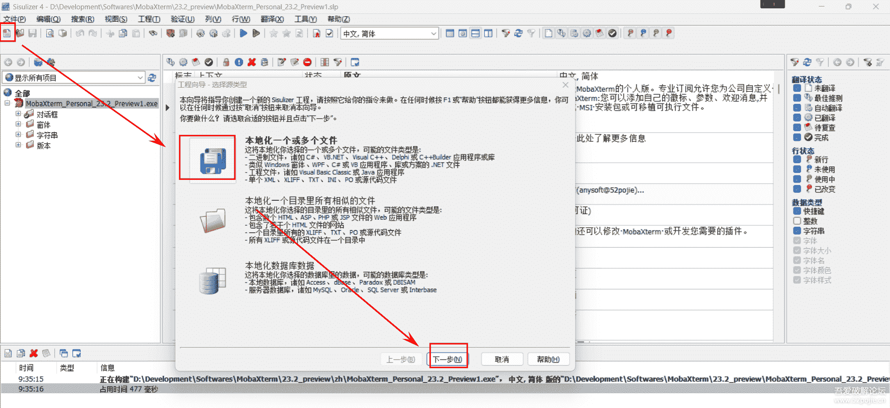

`1683771987301.png` (549.34 KB, 下载次数: 3) [附件下载](https://www.52pojie.cn/forum.php?mod=attachment&aid=MjYxMzg0OHw3ZjYwNWVlNnwxNzkzNTczNTY4fDE2ODA4NnwxNzg0MTE2&nothumb=yes) 2023-5-11 10:33 上传

选择要翻译的程序

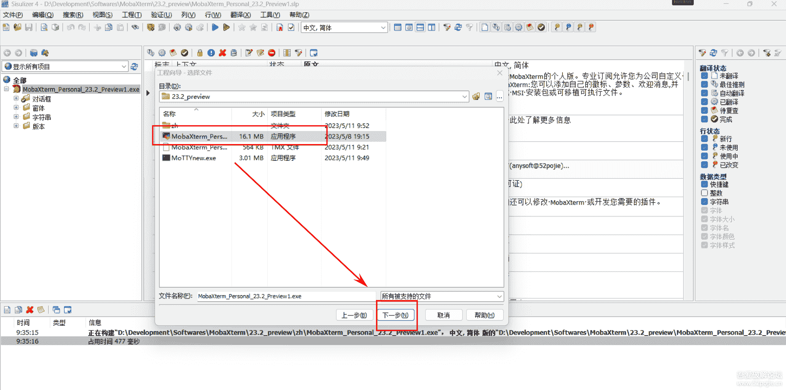

`1683772029293.png` (362.55 KB, 下载次数: 2) [附件下载](https://www.52pojie.cn/forum.php?mod=attachment&aid=MjYxMzg0OXwwNmNlMmM2MXwxNzkzNTczNTY4fDE2ODA4NnwxNzg0MTE2&nothumb=yes) 2023-5-11 10:33 上传

文件格式默认不要修改

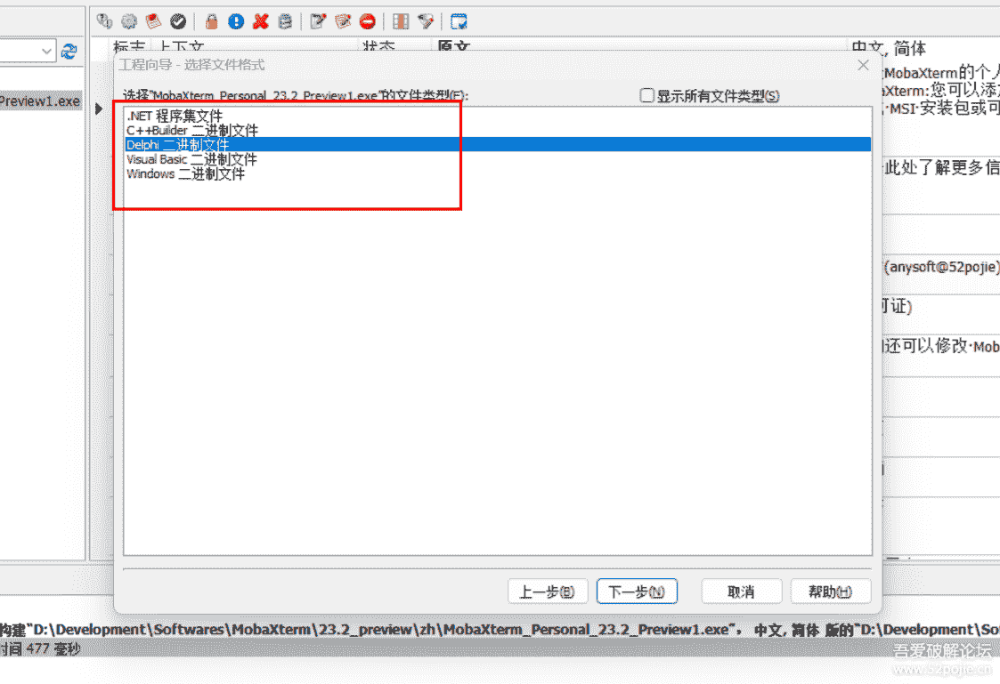

`1683772050361.png` (164.53 KB, 下载次数: 3) [附件下载](https://www.52pojie.cn/forum.php?mod=attachment&aid=MjYxMzg1MHwzYTU3M2ZhYnwxNzkzNTczNTY4fDE2ODA4NnwxNzg0MTE2&nothumb=yes) 2023-5-11 10:33 上传

不要全选，否则会导致翻译后程序无法正常加载插件包

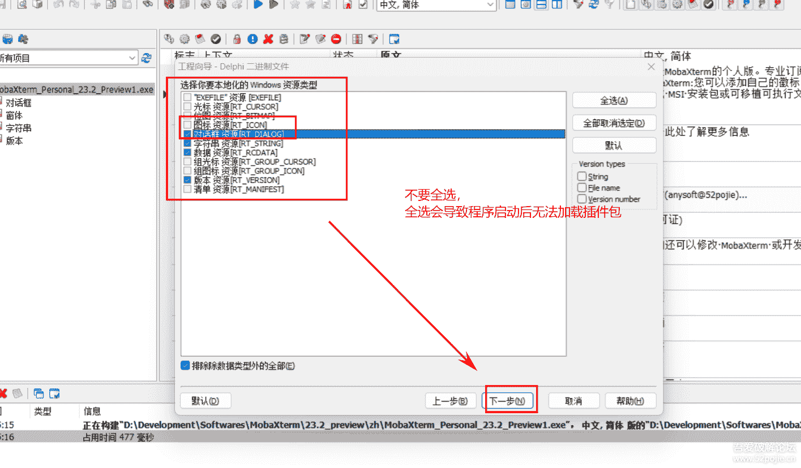

`1683772130142.png` (321.52 KB, 下载次数: 3) [附件下载](https://www.52pojie.cn/forum.php?mod=attachment&aid=MjYxMzg1MXxjZTQ0NTg1NXwxNzkzNTczNTY4fDE2ODA4NnwxNzg0MTE2&nothumb=yes) 2023-5-11 10:33 上传

选中扫描继承窗口

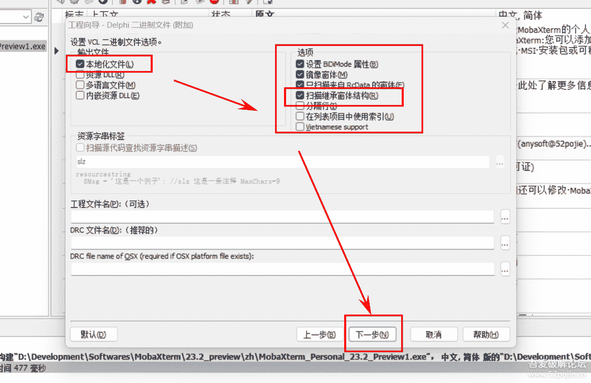

`1683772172332.png` (241.91 KB, 下载次数: 3) [附件下载](https://www.52pojie.cn/forum.php?mod=attachment&aid=MjYxMzg1MnxmM2M0YmNjNnwxNzkzNTczNTY4fDE2ODA4NnwxNzg0MTE2&nothumb=yes) 2023-5-11 10:33 上传

语言选中文简体就行，和翻译文件配套

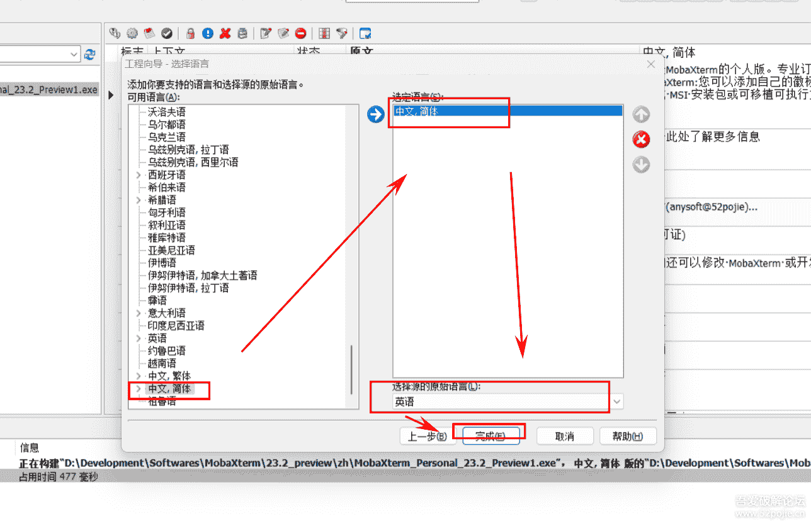

`1683772204297.png` (245.16 KB, 下载次数: 3) [附件下载](https://www.52pojie.cn/forum.php?mod=attachment&aid=MjYxMzg1M3xiNjMxOTI5MXwxNzkzNTczNTY4fDE2ODA4NnwxNzg0MTE2&nothumb=yes) 2023-5-11 10:33 上传

项目创建完成后，选择 `文件 --> 导入`，选择对应的 `tmx` 文件对程序进行自动翻译

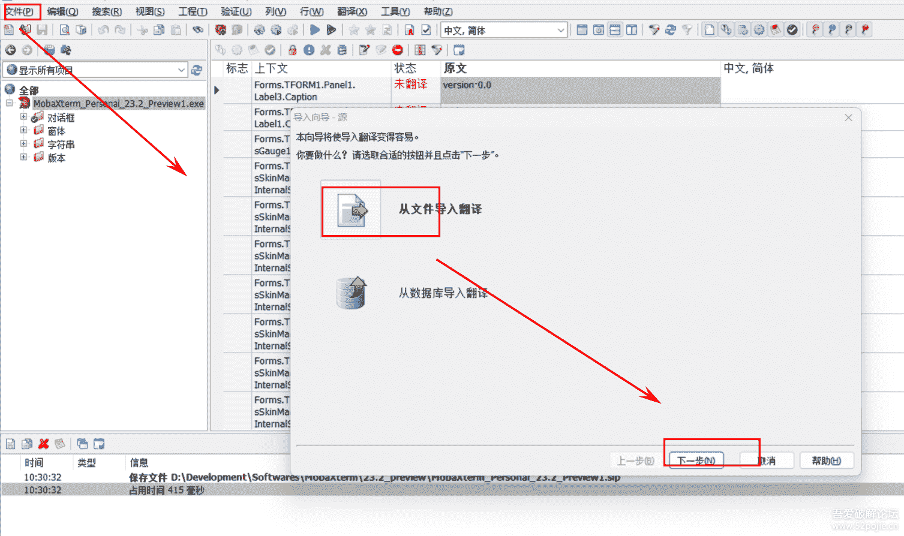

`1683772252512.png` (307.53 KB, 下载次数: 3) [附件下载](https://www.52pojie.cn/forum.php?mod=attachment&aid=MjYxMzg1NHwzN2ZiODc5YnwxNzkzNTczNTY4fDE2ODA4NnwxNzg0MTE2&nothumb=yes) 2023-5-11 10:33 上传

选择 `tmx`

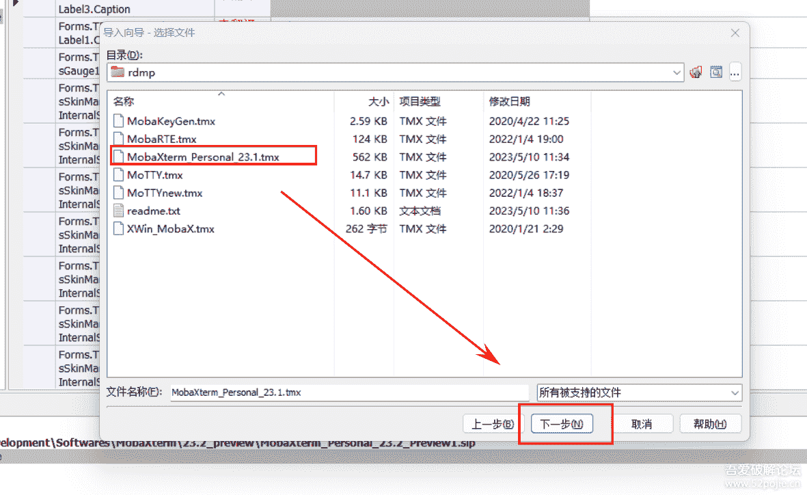

`1683772290394.png` (200.74 KB, 下载次数: 1) [附件下载](https://www.52pojie.cn/forum.php?mod=attachment&aid=MjYxMzg1NXwwYWEzYjk5MXwxNzkzNTczNTY4fDE2ODA4NnwxNzg0MTE2&nothumb=yes) 2023-5-11 10:33 上传

翻译完成，右击左边的菜单，选择构建会在程序目录 `zh` 文件夹下生成一个翻译后的 `exe`

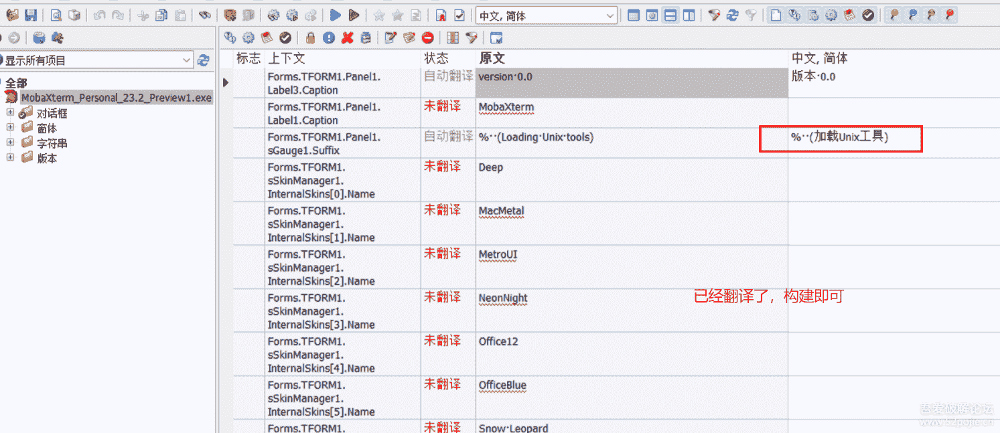

`1683772326502.png` (264.27 KB, 下载次数: 3) [附件下载](https://www.52pojie.cn/forum.php?mod=attachment&aid=MjYxMzg1Nnw5MzczMmE5N3wxNzkzNTczNTY4fDE2ODA4NnwxNzg0MTE2&nothumb=yes) 2023-5-11 10:34 上传

把 `CygUtils.plugin` 复制到 `zh` 文件夹（不然程序启动会提示缺少包文件），启动 `zh` 文件夹下 `MobaXterm_Personal_23.1.exe` 即可看到翻译效果。

到了这里大部分已经翻译完成，还有一些界面及菜单问题需要下一步翻译

### 3.2 Radialix 3 翻译非标字符

创建项目

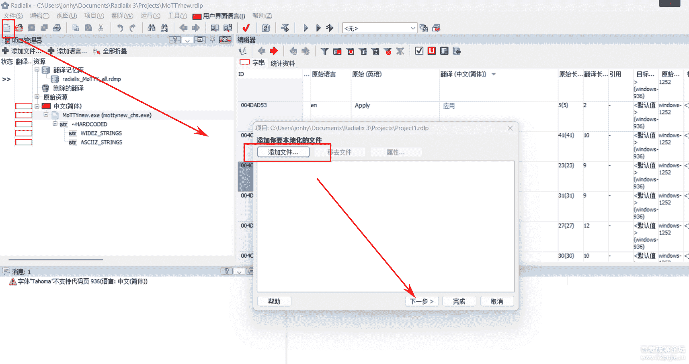

`1683773095257.png` (330.05 KB, 下载次数: 4) [附件下载](https://www.52pojie.cn/forum.php?mod=attachment&aid=MjYxMzg1OHw3OGRhYzVhM3wxNzkzNTczNTY4fDE2ODA4NnwxNzg0MTE2&nothumb=yes) 2023-5-11 10:48 上传

选择源语言为英语（美国）

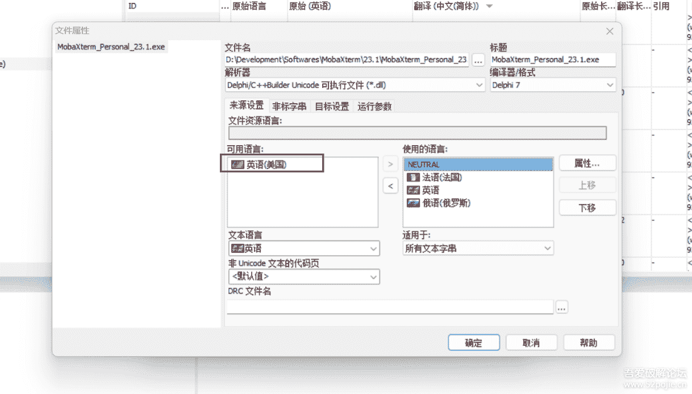

`1683773142066.png` (173.76 KB, 下载次数: 3) [附件下载](https://www.52pojie.cn/forum.php?mod=attachment&aid=MjYxMzg1OXxhYjNhY2U5NnwxNzkzNTczNTY4fDE2ODA4NnwxNzg0MTE2&nothumb=yes) 2023-5-11 10:48 上传

非标字符标签页勾选提取非标字符串

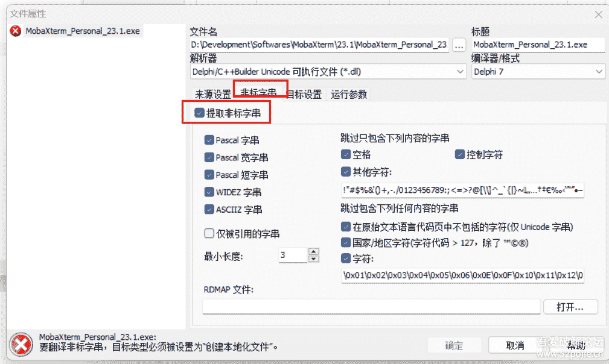

`1683773172403.png` (169.56 KB, 下载次数: 2) [附件下载](https://www.52pojie.cn/forum.php?mod=attachment&aid=MjYxMzg2MHwwZDJkYTVlM3wxNzkzNTczNTY4fDE2ODA4NnwxNzg0MTE2&nothumb=yes) 2023-5-11 10:48 上传

目标设置选项页选择为：“创建本地化文件”

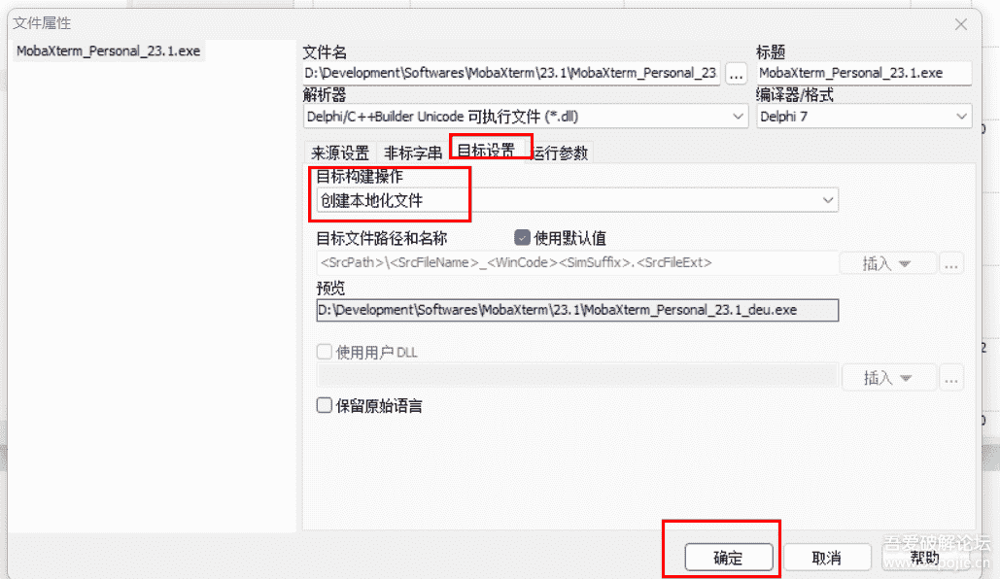

`1683773196090.png` (113.11 KB, 下载次数: 4) [附件下载](https://www.52pojie.cn/forum.php?mod=attachment&aid=MjYxMzg2MXxlOWViYTliNnwxNzkzNTczNTY4fDE2ODA4NnwxNzg0MTE2&nothumb=yes) 2023-5-11 10:48 上传

目标语言选择“中文（简体）”

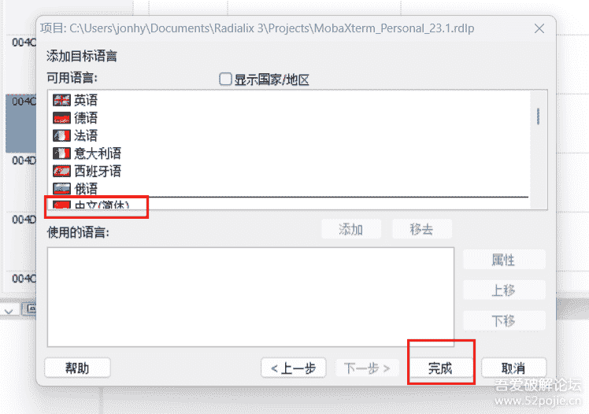

`1683773222028.png` (74.17 KB, 下载次数: 3) [附件下载](https://www.52pojie.cn/forum.php?mod=attachment&aid=MjYxMzg2MnxhZGY2OWFmYXwxNzkzNTczNTY4fDE2ODA4NnwxNzg0MTE2&nothumb=yes) 2023-5-11 10:48 上传

在使用 Radialix 3 翻译时候，需要注意两点

1. 关联完记忆库后需要在菜单栏 `项目 --> 属性 --> 自动翻译` 中去掉模糊翻译。
2. `RT_RCDATA` -- `TFORMXTERM` 和 `TFORMPORTFORWARDINGEDIT`，需要切换只读后翻译，再切换回来（确保被翻译和翻译后的对象处于非只读状态，也就是颜色不是灰色）。

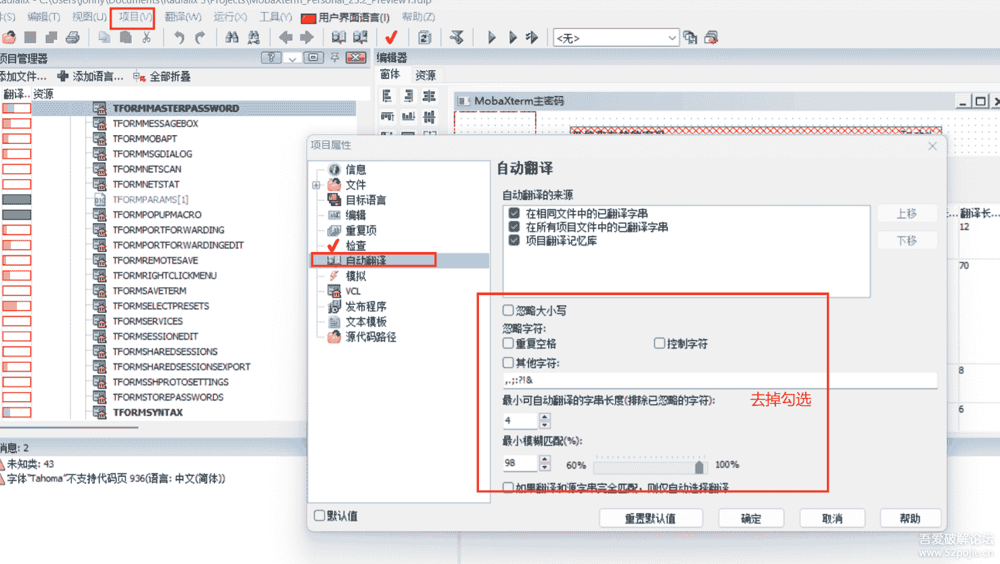

`1683773718368.png` (377.83 KB, 下载次数: 3) [附件下载](https://www.52pojie.cn/forum.php?mod=attachment&aid=MjYxMzg2NHw2MDZiODBmMXwxNzkzNTczNTY4fDE2ODA4NnwxNzg0MTE2&nothumb=yes) 2023-5-11 10:56 上传

### 3.3 16 进制替换

针对菜单和一些弹出对话框消息的字符需要用 16 进制替换

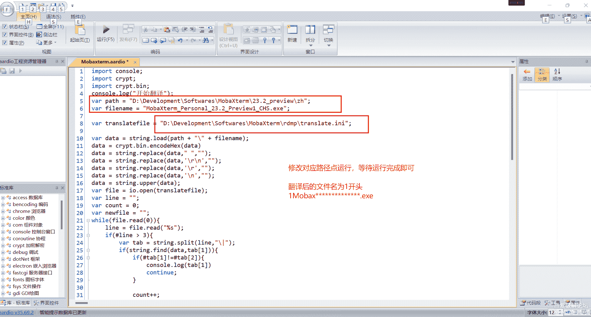

`1683772877134.png` (328.07 KB, 下载次数: 2) [附件下载](https://www.52pojie.cn/forum.php?mod=attachment&aid=MjYxMzg1N3w3ODIwMGYwMnwxNzkzNTczNTY4fDE2ODA4NnwxNzg0MTE2&nothumb=yes) 2023-5-11 10:41 上传

### 3.4 TTY和RTE替换

`MoTTY`为远程连接的`ssh`界面

`MobaRTE`为远程文件对比的程序

翻译流程参考3.1 3.2 即可

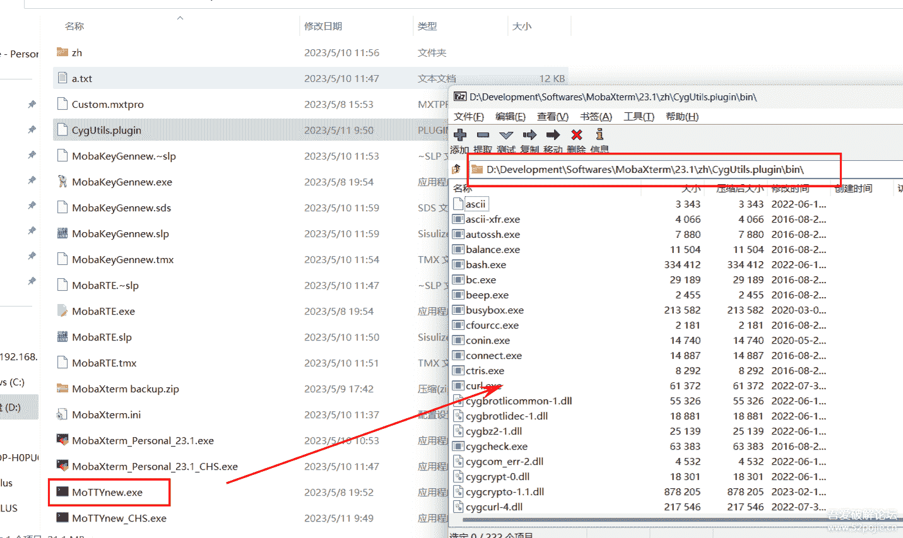

`1683773295299.png` (309.08 KB, 下载次数: 3)

[`forum.php?mod=attachment&aid=MjYxMzg2M3wzMTViYjA1MnwxNzkzNTczNTY4fDE2ODA4NnwxNzg0MTE2&nothumb=yes`](https://www.52pojie.cn/forum.php?mod=attachment&aid=MjYxMzg2M3wzMTViYjA1MnwxNzkzNTczNTY4fDE2ODA4NnwxNzg0MTE2&nothumb=yes)

2023-5-11 10:48 上传

## 4. 资源

<https://wwi.lanzoup.com/b0be9oscj>

密码:`h6k4`

所有用到资源均已上传，其他程序自行搜索下载

## 5. 参考

不懂得可以参考大佬的教程

[`//www.52pojie.cn/thread-613863-1-1.html`](https://www.52pojie.cn/thread-613863-1-1.html)

[`//www.52pojie.cn`](http://www.52pojie.cn)

[`//www.52pojie.cn/thread-614047-1-1.html`](https://www.52pojie.cn/thread-614047-1-1.html)

[`//www.52pojie.cn`](http://www.52pojie.cn)

## 6. 结语

### 同类产品

目前远程连接工具很多，收费的，免费的，开源的都有。英文版本也不是啥门槛，刚开始习惯中文，慢慢的用久了就可以全英文版本了。没必要为了中文或则好看而忽视了安全你问题。

Xshell / Portx / Termius / windterm /tabby

建议多端使用可以用Termius 免费版，window下喜欢花哨的话可以用 mobaxterm原版或自己翻译，服务器较多且经常传输文件建议还是用xshell吧。
