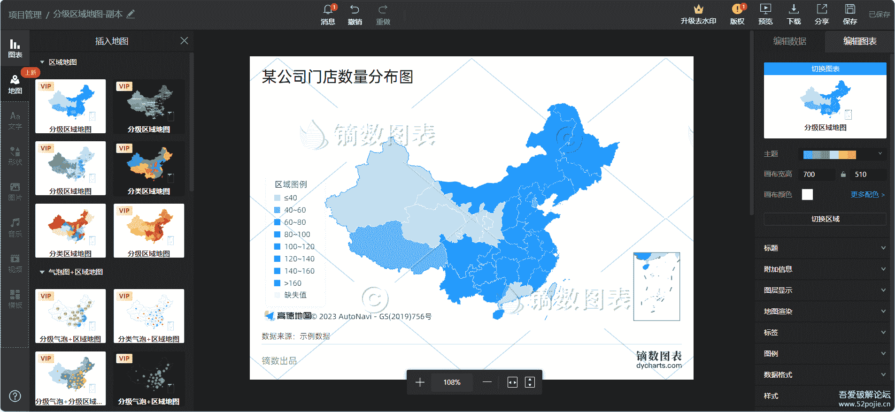
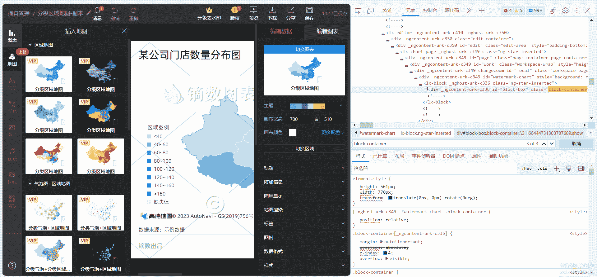
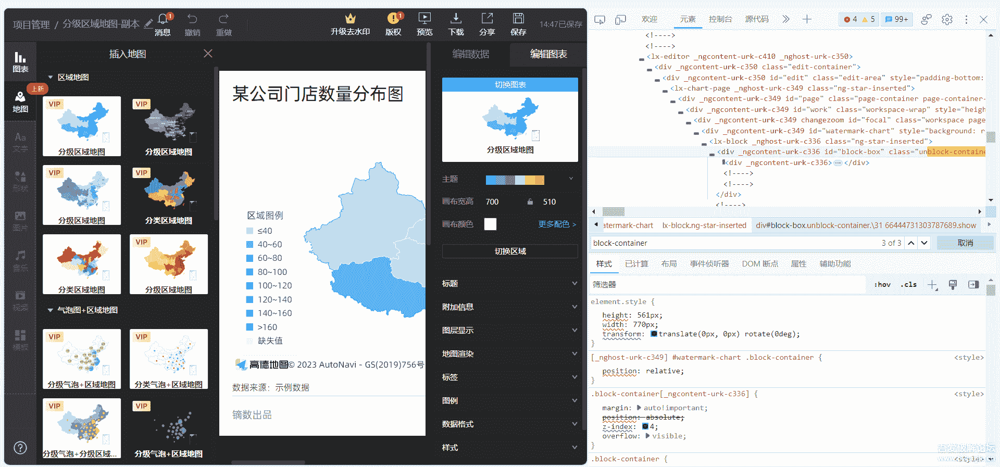
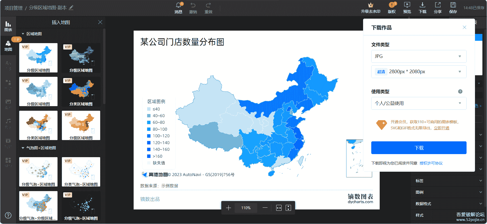
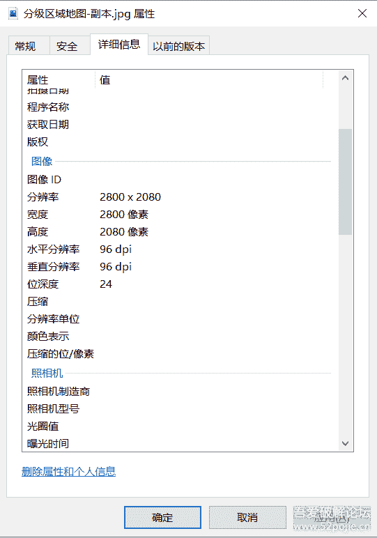

# [Web逆向] 通过审查元素去某数图表水印

- 原帖：[https://www.52pojie.cn/forum.php?mod=viewthread&tid=1785291](https://www.52pojie.cn/forum.php?mod=viewthread&tid=1785291)
- 抓取时间：2026-11-01T22:52:40

第一次发帖，系昨天浏览到了另一篇去除在线水印的帖子：[https://www.52pojie.cn/thread-1782726-1-1.html](https://www.52pojie.cn/thread-1782726-1-1.html)、[http://www.52pojie.cn](http://www.52pojie.cn)

就想到了之前制作某图表时也运用`f12`去除了水印，并且可以下载高清图片。

链接：[https://dycharts.com/appv2/#/pages/home/index](https://dycharts.com/appv2/#/pages/home/index)

随便打开一个需要vip的图表

`微信截图_20230514145445.png` (392.48 KB, 下载次数: 0)

[附件](https://www.52pojie.cn/forum.php?mod=attachment&aid=MjYxNDYzNHwzN2ViYmExOXwxNzkzNTczNTU4fDE2ODA4NnwxNzg1Mjkx&nothumb=yes)

2023-5-14 14:57 上传

按`f12`搜索`block-container`，一共三个，找到图片位置中的这个

`微信截图_20230514144814.png` (391.54 KB, 下载次数: 1)

[附件](https://www.52pojie.cn/forum.php?mod=attachment&aid=MjYxNDYzNXxkMDRkMmI5MHwxNzkzNTczNTU4fDE2ODA4NnwxNzg1Mjkx&nothumb=yes)

2023-5-14 14:57 上传

修改为`unblock-container`

`微信截图_20230514144840.png` (362.86 KB, 下载次数: 0)

[附件](https://www.52pojie.cn/forum.php?mod=attachment&aid=MjYxNDYzNnxlNjI5NDI4N3wxNzkzNTczNTU4fDE2ODA4NnwxNzg1Mjkx&nothumb=yes)

2023-5-14 14:58 上传

可以看到水印已经没有了

`微信截图_20230514144903.png` (336.95 KB, 下载次数: 0)

[附件](https://www.52pojie.cn/forum.php?mod=attachment&aid=MjYxNDYzN3xmZjAxZDIxOHwxNzkzNTczNTU4fDE2ODA4NnwxNzg1Mjkx&nothumb=yes)

2023-5-14 14:59 上传

选择个人使用，就可以导出高清大图了

`微信截图_20230514150104.png` (41.96 KB, 下载次数: 0)

[附件](https://www.52pojie.cn/forum.php?mod=attachment&aid=MjYxNDYzOHw3ODY2ZDY3MHwxNzkzNTczNTU4fDE2ODA4NnwxNzg1Mjkx&nothumb=yes)

2023-5-14 15:00 上传
