# [原创] 手动修改PE文件实现dll注入-记事本

- 原帖：https://www.52pojie.cn/forum.php?mod=viewthread&tid=1785865
- 抓取时间：2026-11-01T22:52:39

## 定位输入表

目标：通过手动修改 PE 文件实现弹出一个窗口。首先是找到输入表的文件偏移位置。使用 010 Editor 打开`notepad.exe`。在`struct IMAGE_NT_HEADERS NtHeader`下的`struct IMAGE_OPTIONAL_HEADER32 OptionalHeader`下的`struct IMAGE_DATA_DIRECTORY_ARRAY DataDirArray`的第二个元素中可以找到输入表的地址。如下图。

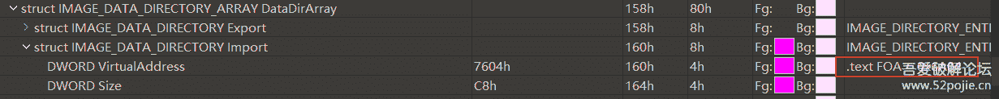

`image-20230514211558699.png` (23.95 KB, 下载次数: 0) · 2023-5-15 20:42 上传 · [下载附件](https://www.52pojie.cn/forum.php?mod=attachment&aid=MjYxNDk0M3xlYzBjNDQ3M3wxNzkzNzM1NTZ8MTY4MDg2fDE3ODU4NjU&nothumb=yes)

`7604h`是输入表的内存虚拟地址，由于`notepad.exe`的`ImageBase`为`01000000h`，所以输入表在内存的地址为`01000000h + 7604h = 01007604h`。在[打开 `notepad.exe`](https://www.52pojie.cn/thread-350397-1-1.html)转到地址`01007604h`可以发现，是`IID`表（数组）的位置。如下图。

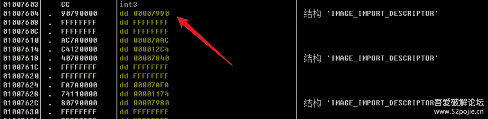

`image-20230514205250438.png` (56.72 KB, 下载次数: 1) · 2023-5-15 20:42 上传 · [下载附件](https://www.52pojie.cn/forum.php?mod=attachment&aid=MjYxNDk0NHw1MGU1YTI3ZHwxNzkzNTczNTU2fDE2ODA4NnwxNzg1ODY1&nothumb=yes)

`IID`表在文件中的位置为`0x6A04`，如下图。

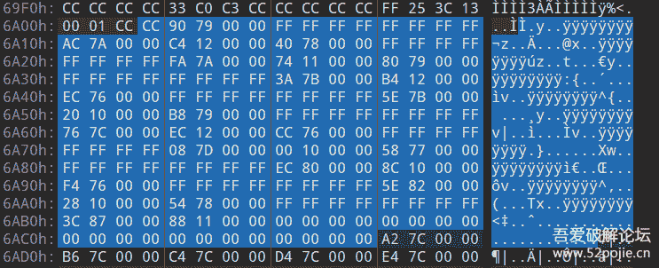

`image-20230514214757329.png` (52.35 KB, 下载次数: 1) · 2023-5-15 20:42 上传 · [下载附件](https://www.52pojie.cn/forum.php?mod=attachment&aid=MjYxNDk0NXxjMjk1NDc1OXwxNzkzNTczNTU2fDE2ODA4NnwxNzg1ODY1&nothumb=yes)

## 寻找可放置 IID 数组的空间

要添加一个`IID`数组，就要修改当前数组的一块内存。这块内存一般是与`IID`相关联的结构`OriginalFirstThunk`和`FirstThunk`，不能被覆盖，所以只能将整个数组移到一个新的区域里。接下来就是思考将`IID`数组放在哪一个位置了。由于`IID`数组的大小为`C8h`，新加一个数组后，`IID`的数组大小为`0xDC`（`0xC8 + 0x14`）。新加入`IID`数组的空隙地址要大于`0xDC`。此时要考虑节区之间的空隙地址。`notepad.exe`程序下的节区只有三个：`.text`、`.data`和`.rsrc`。如下图。

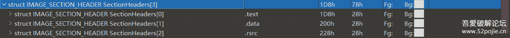

`image-20230514212602939.png` (21.88 KB, 下载次数: 1) · 2023-5-15 20:43 上传 · [下载附件](https://www.52pojie.cn/forum.php?mod=attachment&aid=MjYxNDk0Nnw0YzA1MjA5MXwxNzkzNTczNTU2fDE2ODA4NnwxNzg1ODY1&nothumb=yes)

由于本程序中`FileAlignment`为`200h`，所以节区的对齐都是以`200h`为标准的。先看`.text`节区。

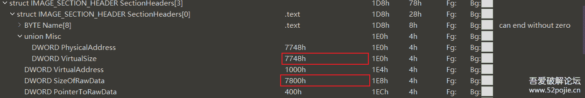

`image-20230514212711941.png` (32.75 KB, 下载次数: 0) · 2023-5-15 20:43 上传 · [下载附件](https://www.52pojie.cn/forum.php?mod=attachment&aid=MjYxNDk0N3xkYzliOTNhMXwxNzkzNTczNTU2fDE2ODA4NnwxNzg1ODY1&nothumb=yes)

`VirtualSize`：指出实际被使用的区块的大小，是在进行对齐处理前区块的实际大小。如果`VirtualSize`的值大于`SizeOfRawData`的值，那么`SizeOfRawData`表示来自可执行文件初始化数据的大小，与`VirtualSize`相差的节区用 0 填充。`SizeOfRawData`：该块在磁盘中所占的空间。`PointerToRawData`：该块在磁盘文件中的偏移。可以看到`.text`节区剩余的区域为`7800h - 7748h = 0xB8`（小于`0xDC`），所以不能作为新的`IID`数组地址位置。接下来看`.data`节区。

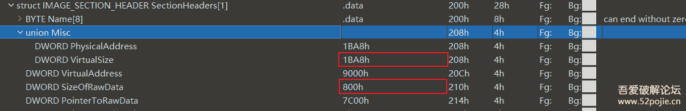

`image-20230514212956941.png` (30.41 KB, 下载次数: 0) · 2023-5-15 20:43 上传 · [下载附件](https://www.52pojie.cn/forum.php?mod=attachment&aid=MjYxNDk0OXxmOGNjZjdhMHwxNzkzNTczNTU2fDE2ODA4NnwxNzg1ODY1&nothumb=yes)

`.data`也没有空余空间。最后看一下`.rsrc`节区。

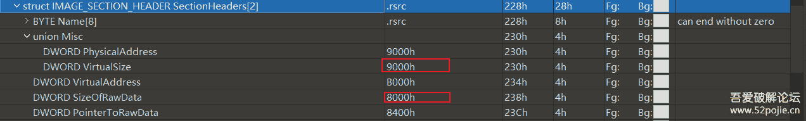

`image-20230514213929254.png` (30.82 KB, 下载次数: 0) · 2023-5-15 20:44 上传 · [下载附件](https://www.52pojie.cn/forum.php?mod=attachment&aid=MjYxNDk1MHxhNDQxYmVkNXwxNzkzNTczNTU2fDE2ODA4NnwxNzg1ODY1&nothumb=yes)

`.rsrc`的`VirtualSize`也小于`SizeOfRawData`。由于这三个节区都没有足够的空隙空间，所以只能扩展最后一块节区的空间了。最后一个节区的结束地址为`PointerToRawData + SizeOfRawData = 0x10400`。将`IID`数组复制到`0x10400`地址中。

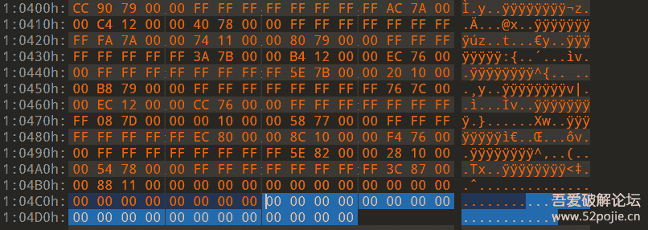

`image-20230514215802699.png` (45.5 KB, 下载次数: 1) · 2023-5-15 20:44 上传 · [下载附件](https://www.52pojie.cn/forum.php?mod=attachment&aid=MjYxNDk1MXw2YmNlMDQ4NXwxNzkzNTczNTU2fDE2ODA4NnwxNzg1ODY1&nothumb=yes)

## 构造新的 IID 数组与导入函数

在`104B4`后的`0x14`个地址是准备新加入的`IID`数组，后面还要添加一项全是 0 的数组元素作为数组结尾。

```
IMAGE_IMPORT_DESCRIPTOR STRUCT
    union
        Characteristics DWORD ?
        OriginalFirstThunk DWORD ? ;指向INT
    ends
    TimeDateStamp DWORD ?
    ForwarderChain DWORD ?
    Name DWORD ?
    FirstThunk DWORD ? ;指向IAT
IMAGE_IMPORT_DESCRIPTOR ENDS
```

接下来在原来的`IID`区域构建新的`OriginalFirstThunk`和`FirstThunk`，这些只是数据，之后会在新的`IID`区域写上指针指向这些数据。首先要写`OriginalFirstThunk`和`FirstThunk`，并以 0 项结尾。

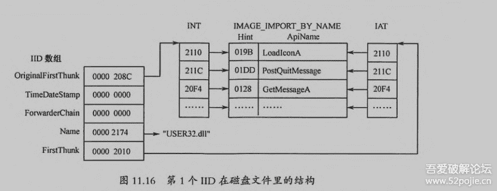

`image-20230515103152486.png` (140.57 KB, 下载次数: 1) · 2023-5-15 20:44 上传 · [下载附件](https://www.52pojie.cn/forum.php?mod=attachment&aid=MjYxNDk1NHxiOTQzNjkzOXwxNzkzNTczNTU2fDE2ODA4NnwxNzg1ODY1&nothumb=yes)

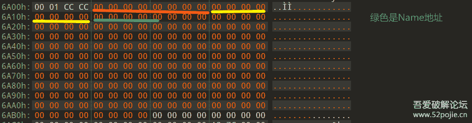

`image-20230515113425590.png` (33 KB, 下载次数: 1) · 2023-5-15 20:45 上传 · [下载附件](https://www.52pojie.cn/forum.php?mod=attachment&aid=MjYxNDk1N3w1NTgwN2YzM3wxNzkzNTczNTU2fDE2ODA4NnwxNzg1ODY1&nothumb=yes)

在原来的`IID`地址中写上数据（也可以不在原来的位置写，只是原来的位置已经没用了）。在绿色的地方写上 DLL 名字：`MsgDll.dll`（以`00`结尾，`4D 73 67 44 6C 6C 2E 64 6C 6C`）。在`6A20h`处写上函数名（`IMAGE_IMPORT_BY_NAME`）。第一个字节是`IMAGE_IMPORT_BY_NAME`结构中的`hint`（`WORD`），不是必需的，一般为`00 00`。之后的`Name`写为`Msg`（`4D 73 67 00`，以`NULL`结尾，可能要对齐一个`WORD`）。`Msg`的文件偏移地址为`6A20h`，所以 RVA 为`0x6A20 - 0x400 + 0x1000 = 0x7620`。所以`OriginalFirstThunk`和`FirstThunk`都要指向`0x7620`。注意小端模式。更改后的原`IID`地址。


`image-20230515120156784.png` (22.56 KB, 下载次数: 0) · 2023-5-15 20:45 上传 · [下载附件](https://www.52pojie.cn/forum.php?mod=attachment&aid=MjYxNDk1OHxiOWU3NDY5MXwxNzkzNTczNTU2fDE2ODA4NnwxNzg1ODY1&nothumb=yes)

还要修改新`IID`数组的信息：`OriginalFirstThunk`的偏移量是`0x7604`（将上图的文件偏移量转化即可），`Name`的偏移量是`0x7614`，`FirstThunk`的偏移量是`0x760C`。修改后如下图。

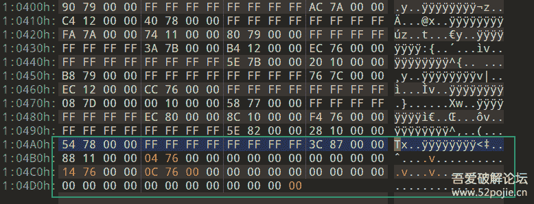

`image-20230515124835610.png` (47.83 KB, 下载次数: 1) · 2023-5-15 20:45 上传 · [下载附件](https://www.52pojie.cn/forum.php?mod=attachment&aid=MjYxNDk1OXw2NWUxODJjNHwxNzkzNTczNTU2fDE2ODA4NnwxNzg1ODY1&nothumb=yes)

## 修改 PE 文件头

接下来就是修改 PE 文件头了，因为`IID`数组的位置已经改变了，即输入表的位置和大小都改变了。所以要修改 PE 文件头。还有一个小细节：将最后一个节区的偏移量增加到`0x200`的倍数。修改`import`表的`DWORD VirtualAddress`和`DWORD Size`。

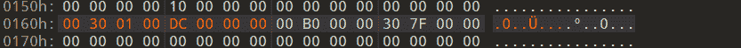

`image-20230515123804810.png` (5.97 KB, 下载次数: 0) · 2023-5-15 20:45 上传 · [下载附件](https://www.52pojie.cn/forum.php?mod=attachment&aid=MjYxNDk2MHw5NGM3MTY2ZHwxNzkzNTczNTU2fDE2ODA4NnwxNzg1ODY1&nothumb=yes)

修改最后一个节区的大小（`SizeOfRawData`）。改成`8400h`。由于加了`200h`，`VirtualSize`还有很多空间，所以不用改`VirtualSize`。

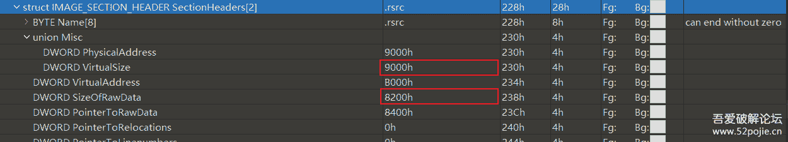

`image-20230515203128385.png` (34.48 KB, 下载次数: 0) · 2023-5-15 20:46 上传 · [下载附件](https://www.52pojie.cn/forum.php?mod=attachment&aid=MjYxNDk2MXwwOTJlM2NiY3wxNzkzNTczNTU2fDE2ODA4NnwxNzg1ODY1&nothumb=yes)

改后。

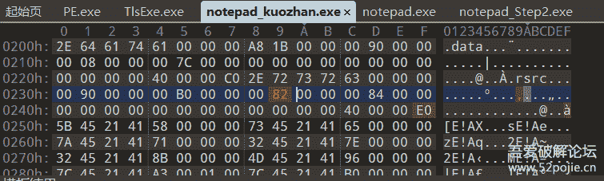


`image-20230515203339245.png`（42.87 KB，下载次数：1）  
[附件下载](https://www.52pojie.cn/forum.php?mod=attachment&aid=MjYxNDk2Mnw3NzI5MGQ2ZnwxNzkzNTczNTU2fDE2ODA4NnwxNzg1ODY1&nothumb=yes)  
2023-5-15 20:46 上传

## 修改节区块属性

最后还有修改以下节区的块属性（`IMAGE_SECTION_HEADER`的最后一个成员`Charateristics`）。块属性的值是叠加了。例子如下。`E0000020h=20000000h | 40000000h | 8000 0000h | 0000 0020h`，代表该块包含执行代码，可读、可写、可执行。由于原来`IID`数组的位置用来存放`FirstThunk`了，这个值载入内存时会被改的。它原来的文件偏移量时`0x6A0C`。

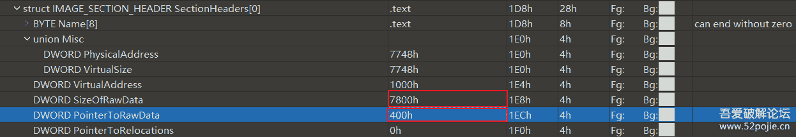

`image-20230515184041676.png`（32.58 KB，下载次数：1）  
[附件下载](https://www.52pojie.cn/forum.php?mod=attachment&aid=MjYxNDk2M3w3M2JiOTg4MXwxNzkzNTczNTU2fDE2ODA4NnwxNzg1ODY1&nothumb=yes)  
2023-5-15 20:46 上传

可见，`400h`到`400h+7800h`地址内的区域都是`.text`节区。

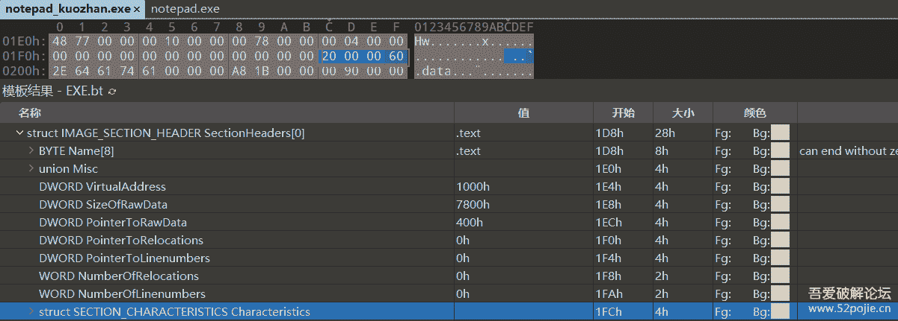

`image-20230515184255455.png`（56.6 KB，下载次数：1）  
[附件下载](https://www.52pojie.cn/forum.php?mod=attachment&aid=MjYxNDk2NHwwZjQ1ZTA2ZXwxNzkzNTczNTU2fDE2ODA4NnwxNzg1ODY1&nothumb=yes)  
2023-5-15 20:46 上传

该值初始为`0x60000020`，将该值改成`0x60000020|0x80000000=E0000020h`后，可表示改`.text`就可以进行写了。

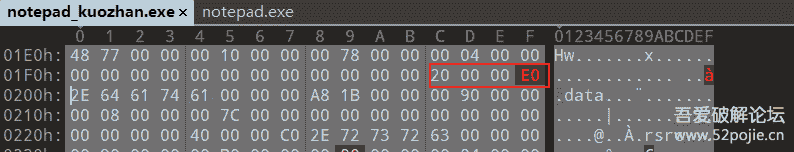

`image-20230515184526941.png`（27.1 KB，下载次数：1）  
[附件下载](https://www.52pojie.cn/forum.php?mod=attachment&aid=MjYxNDk2NXw1ZWE1YTYwZHwxNzkzNTczNTU2fDE2ODA4NnwxNzg1ODY1&nothumb=yes)  
2023-5-15 20:46 上传

## 清除 `Bound Import Table`

改后如上图。但更改后预想中的弹窗还是没有出现，因为其他输入表数组的`TimeDateStamp`都是`0xFFFFFFFF`，也就是`-1`，从`IMAGE_IMPORT_DESCRIPTOR`的定义可知，如果这个值为`-1`，表示该输入项是预先`bound`（绑定）。如果系统发现绑定是有效的，就不会去处理输入表的加载了。所以要把`PE`文件头数据目录中的`Bound Import Table`清零，强制重新处理输入表。

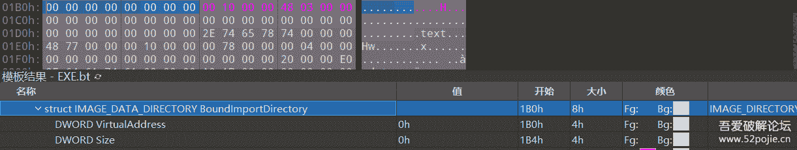

`image-20230515202021808.png`（34.23 KB，下载次数：0）  
[附件下载](https://www.52pojie.cn/forum.php?mod=attachment&aid=MjYxNDk2NnxmOGQyMzkzYnwxNzkzNTczNTU2fDE2ODA4NnwxNzg1ODY1&nothumb=yes)  
2023-5-15 20:47 上传

清完如上图所示。至此打开文件，可以发现先弹出了弹窗。

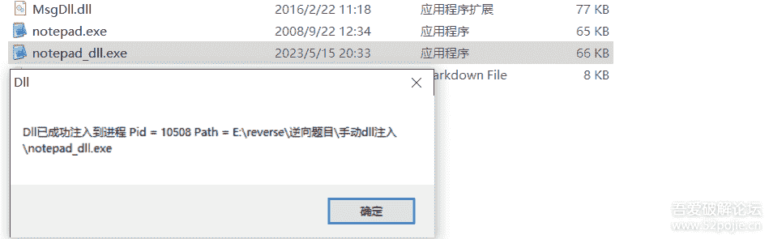

`image-20230515203930679.png`（41.36 KB，下载次数：1）  
[附件下载](https://www.52pojie.cn/forum.php?mod=attachment&aid=MjYxNDk2N3xiMzE3ODk3NXwxNzkzNTczNTU2fDE2ODA4NnwxNzg1ODY1&nothumb=yes)  
2023-5-15 20:47 上传
