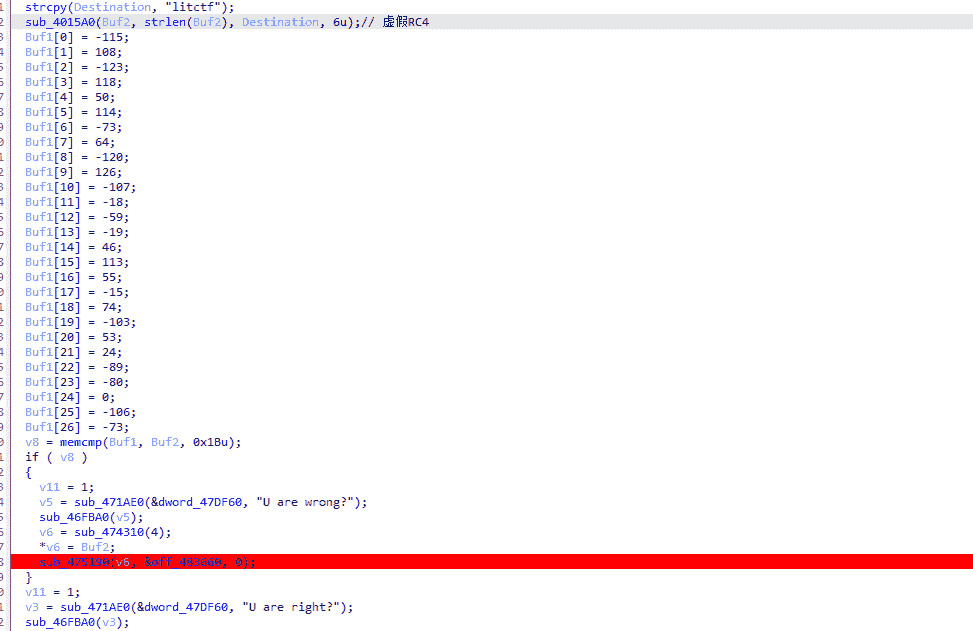
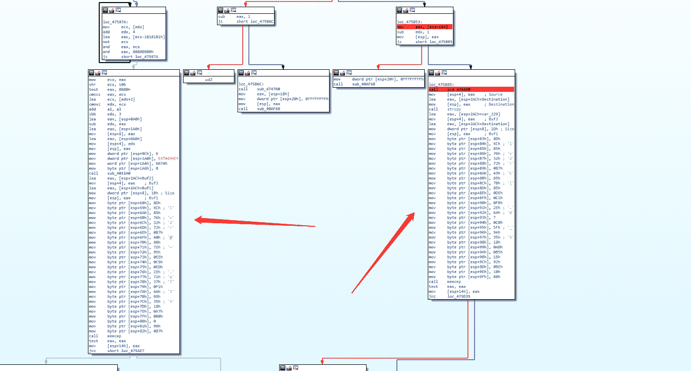
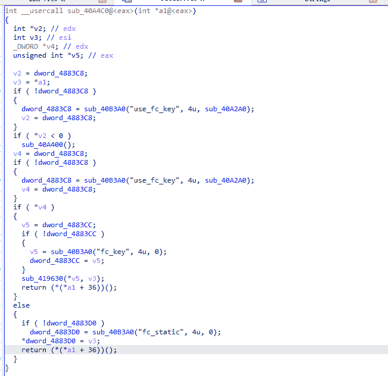
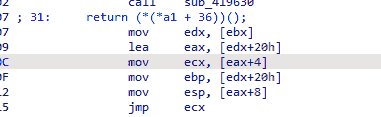
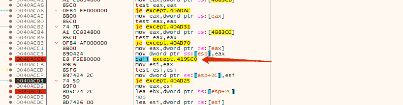
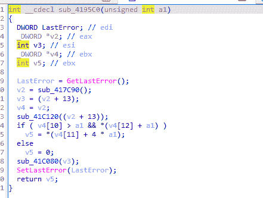
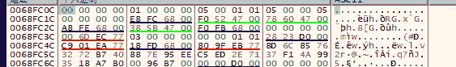
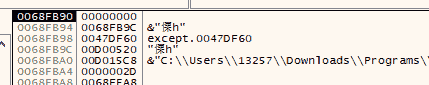

# [CTF] LitCTF-RE -程序和人有一个能跑就行了 【简单探究】

- 原帖：[https://www.52pojie.cn/forum.php?mod=viewthread&tid=1786386](https://www.52pojie.cn/forum.php?mod=viewthread&tid=1786386)
- 抓取时间：2026-11-01T22:52:35

### 初步分析

`sub_4015A0` 是一个 RC4 加密函数，`key` 为 `litctf`。

加密 `Buf2`（我们输入的 `flag`）后，与 `Buf1` 比较，不过 `Buf1` 是假数据。解密出来得到的是 `LitCTF{this_is_a_fake_flag}`。

数据是假的，但是函数是正常的功能函数。

接着我们需要注意 `sub_475190` 这个函数，也就是那一串红条。

这个函数很特别，里面进行了一些我看不懂的操作。当你在函数外试图 `F8` 步过的时候，会进入到正确密文的处理流程里，但其实这时并没有步过 `sub_475190`。因为处理正确密文的操作是在 `sub_475190` 里调用的，而这时你的调试器就会在这个流程里中断。

根据其他选手写的 wp，据说是 C++ 异常处理。但目前没有人给出一个详细的说明（坐等官方 wp）。

我自己临时补充了相关的知识，感觉这题并不是简单使用了 C++ 里的 `try`、`catch`、`throw` 等函数，因为我找不到使用这些函数的特征。。应该是用了别的方法来处理异常。

这边提一嘴一个非常简单发现“解密正确密文”流程的方法：

如图，右边是正常的解密流程，左边是虚假的流程。其实只有密文不一样。

IDA 提供的汇编代码是能够正确反映各操作的关系的，但是转伪代码的时候忽略掉了。

正确的 `flag` 是：`LitCTF{welcome_to_the_litctf}`

### 浅浅探究

这题的最终题解数为 50几个，但实际上只是为了解题的话，简单的可怕。这告诉我们不要太依赖 `F5`。

但他究竟是怎么阻碍我们用伪代码分析的呢？emm，说实话，我也不知道。

就算你使用普通的 `try`、`catch`、`throw` 函数，IDA 的伪代码也是会忽略掉 `catch` 里的代码的。

但我现在好奇的是他到底是怎么处理异常的，或者说真的是用了异常处理吗？

我们跟进 `sub_475190`，经过恶心眩晕的大量 `F7` 步进操作，最终让程序进入正确解密流程的函数为：

`sub_475190 --> sub_40AC80 --> LABEL_10: sub_40A4C0`，如图：

我们把目光聚焦到：

`return (*(*a1+36))`

这是个函数地址，指向正确的解密流程。

这个地址怎么得到的？看下汇编：

地址存在了 `ecx`，`ecx` 又是“`ebx + 偏移`”得到的，而再往上溯源，看地址 `40ACD7` 就会发现 `ebx` 是“`eax + 偏移`”得来的。

而 `eax` 的值又是箭头所指向的 `call` 赋予的。也就是说，正确的地址，是 `eax` 经过了一系列的偏移得到的。

经过计算，偏移量为 36，眼熟吗？

`return (*(*a1+36))`

而此时 `eax` 所存地址即为 `a1`。

那我们来看看，这个 `call`，究竟是干嘛的：

`sub_417C90` 是一些线程操作，水平有限，看不懂。

`sub_41C120` 有提到：`_InterlockedAdd()` 我也不知道干嘛的。

总之 `v5` 的值即为 `eax`。

按照 `eax` 存的地址，内存窗口追过去，就是这样：

堆栈里是这样：

嗯，本人水平有限，分析到这就分析不动了。

不过看到这里，也许确实是用异常处理的方式来执行正确流程。

那到底怎么执行的这个异常处理的- -

坐等 wp。
