# [.NET逆向] 某尖顶.办公系列组件许可证分析

- 原帖：https://www.52pojie.cn/forum.php?mod=viewthread&tid=1787033
- 抓取时间：2026-11-01T22:52:34

## 前情提要

看了下论坛，虽然有几篇和这个组件相关的帖子，但似乎没有看到完整的许可分析贴，所以就弄一个吧，不知道这个层次够不够。

## 嘉宾介绍

```text
官网地址：aHR0cHM6Ly93d3cuZS1pY2VibHVlLmNvbS9JbnRyb2R1Y2Uvc3BpcmUtb2ZmaWNlLWZvci1uZXQuaHRtbA==
许可证文档：aHR0cHM6Ly93d3cuZS1pY2VibHVlLmNvbS9UdXRvcmlhbHMvTGljZW5zaW5nL0xpY2Vuc2luZy5odG1s
```

## 准备工作

包括之前的帖子，首先就是 `NuGet` 导包，这个真没啥好说的。

然后弄个控制台程序，然后在 `Main()` 里面贴代码。

```csharp
private static void SpireOfficeTest()
{
    //Spire.License.LicenseProvider.SetLicenseKey("");
    var document = new Spire.Doc.Document();
    var section = document.AddSection();
    var paragraph = section.AddParagraph();
    paragraph.AppendText("Hello World");
    document.SaveToFile("Hello Wrold.doc", Spire.Doc.FileFormat.Doc);
    Console.WriteLine("Word文档创建成功!");

    //Create a new workbook
    var workbook = new Spire.Xls.Workbook();
    //Initialize worksheet        
    var sheet = workbook.Worksheets[0];
    //Append text
    sheet.Range["A1"].Text = "Demo: Save Excel in .NET";
    //Save it as Excel file
    workbook.SaveToFile("Sample.xls", ExcelVersion.Version97to2003);
    Console.WriteLine("Excel 创建成功!");

    BarcodeSettings bs = new BarcodeSettings();
    bs.Type = BarCodeType.Code39;
    bs.Data = "*ABC 12345* ";
    BarCodeGenerator bg = new BarCodeGenerator(bs);
    bg.GenerateImage().Save("Code39Code.png");
    Console.WriteLine("BarCode 创建成功!");

    PdfDocument pdf = new Spire.Pdf.PdfDocument();
    PdfPageBase page = pdf.Pages.Add();
    PdfTrueTypeFont font = new PdfTrueTypeFont(@"C:\WINDOWS\Fonts\CONSOLA.TTF", 20f, PdfFontStyle.Underline);
    PdfSolidBrush brush = new PdfSolidBrush(new PdfRGBColor(System.Drawing.Color.Blue));
    page.Canvas.DrawString("Hello E-iceblue Support Team", font, brush, new PointF(10, 20));
    pdf.SaveToFile("Result.pdf", Spire.Pdf.FileFormat.PDF);
    Console.WriteLine("PDF 创建成功!");

    //create PPT document
    Presentation presentation = new Spire.Presentation.Presentation();
    //add new shape to PPT document           
    IAutoShape shape = presentation.Slides[0]
        .Shapes.AppendShape(Spire.Presentation.ShapeType.Rectangle,
            new RectangleF(0, 50, 200, 50));
    shape.ShapeStyle.LineColor.Color = Color.White;
    shape.Fill.FillType = Spire.Presentation.Drawing.FillFormatType.None;
    //add text to shape
    shape.AppendTextFrame("Hello World!");
    //set the Font fill style of text  
    var textRange = shape.TextFrame.TextRange;
    textRange.Fill.FillType = Spire.Presentation.Drawing.FillFormatType.Solid;
    textRange.Fill.SolidColor.Color = Color.Black;
    textRange.LatinFont = new TextFont("Arial Black");
    //save the document
    presentation.SaveToFile("hello.pptx", Spire.Presentation.FileFormat.Pptx2010);
    Console.WriteLine("PPT 创建成功!");

    var addressFrom = new Spire.Email.MailAddress("daisy.zhang@e-iceblue.com", "Daisy Zhang");
    var addressTo = new Spire.Email.MailAddress("susanwong32@outlook.com");
    var mail = new Spire.Email.MailMessage(addressFrom, addressTo);
    mail.Subject = "This is a test message";
    string htmlString = @"

        Dear Ms. Susan,

        This is an example of creating an outlook message (msg).

-  Create a message with RTF file 

-  Create a message with attachment

        This text is in red 

        Best regards, 

        Daisy 

";
    mail.BodyHtml = htmlString;
    mail.Attachments.Add(new Spire.Email.Attachment("Code39Code.png"));
    mail.Save("Sample.msg", Spire.Email.MailMessageFormat.Msg);
    Console.WriteLine("Mail 创建成功!");
}
```

## 开工

我们直接从 `Demo` 中查一下 `Spire.License.LicenseProvider.SetLicenseKey` 这玩意的所属。

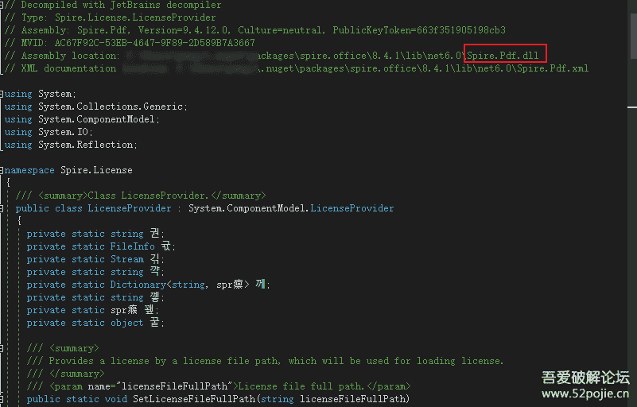
[附件下载](https://www.52pojie.cn/forum.php?mod=attachment&aid=MjYxNTcwOXw5NWUzYWU0MnwxNzkzNTczNTUxfDE2ODA4NnwxNzg3MDMz&nothumb=yes)
1.png (31.79 KB, 下载次数: 0) 2023-5-18 15:02 上传

发现所属于 `Spire.Pdf.dll`。后面专门分析它就行了。

简单看一眼，有字符串混淆。

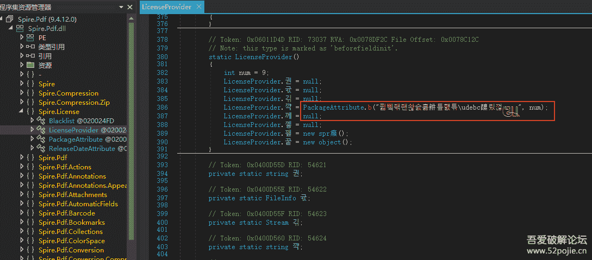
[附件下载](https://www.52pojie.cn/forum.php?mod=attachment&aid=MjYxNTcxMHxhNTI2ZmE5YXwxNzkzNTczNTUxfDE2ODA4NnwxNzg3MDMz&nothumb=yes)
2.png (66.05 KB, 下载次数: 0) 2023-5-18 15:02 上传

为了方便分析和理解，老样子 `de4dot` 处理下先。

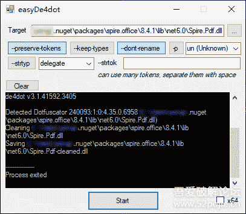
[附件下载](https://www.52pojie.cn/forum.php?mod=attachment&aid=MjYxNTcxMnxhM2UyNzhkNnwxNzkzNTczNTUxfDE2ODA4NnwxNzg3MDMz&nothumb=yes)
3.png (33.55 KB, 下载次数: 0) 2023-5-18 15:02 上传

由于该库用了类似韩文混淆，后续为了方便解说，我会使用 `dnspy` 适当修改一些字段或函数名便于理解。

自然是先分析 `SetLicenseKey()` 这个函数了，并分析调用。

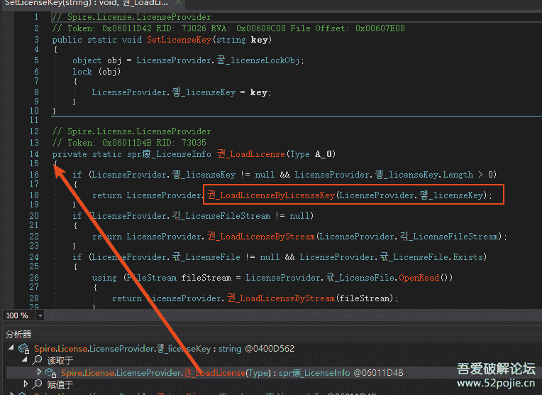
[附件下载](https://www.52pojie.cn/forum.php?mod=attachment&aid=MjYxNTcxM3w2MjFiYjIyYXwxNzkzNTczNTUxfDE2ODA4NnwxNzg3MDMz&nothumb=yes)
4.png (47.86 KB, 下载次数: 0) 2023-5-18 15:02 上传

```csharp
// Spire.License.LicenseProvider
// Token: 0x06011D49 RID: 73033
private static spr癝_LicenseInfo 권_LoadLicenseByLicenseKey(string A_0)
{
    return spr禛.께_LoadLicenseByLicenseKey(A_0);
}
```

继续追。

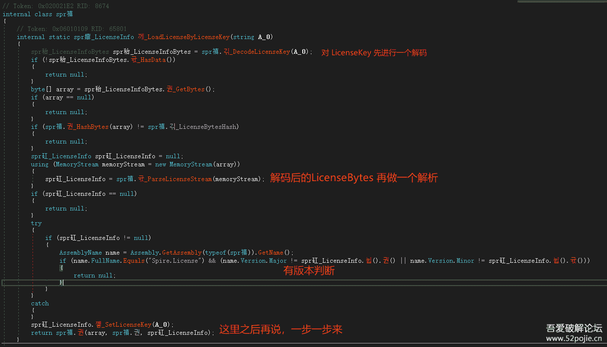
[附件下载](https://www.52pojie.cn/forum.php?mod=attachment&aid=MjYxNTcxNHwwNGJlMjRmNHwxNzkzNTczNTUxfDE2ODA4NnwxNzg3MDMz&nothumb=yes)
5.png (51.21 KB, 下载次数: 0) 2023-5-18 15:02 上传

然后看 `DecodeAndCheck()`。

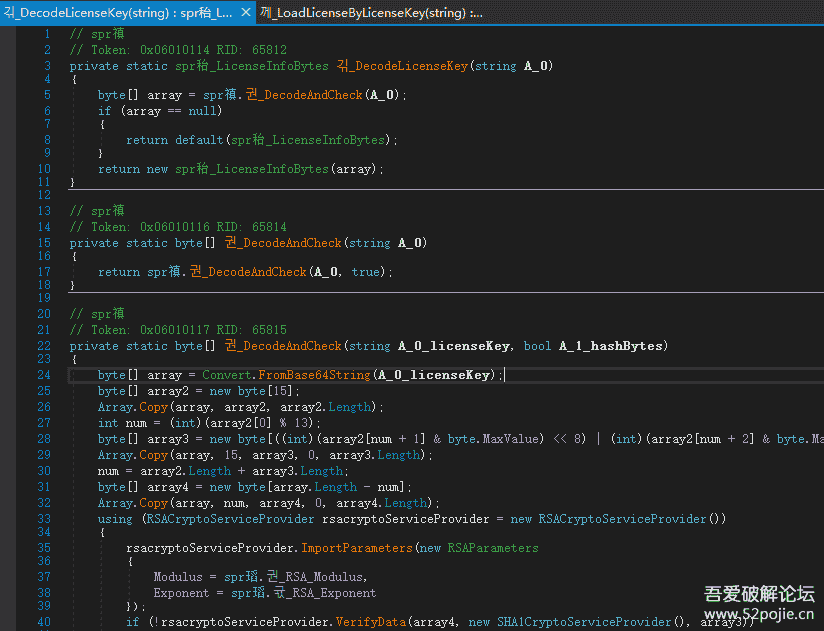
[附件下载](https://www.52pojie.cn/forum.php?mod=attachment&aid=MjYxNTcxNXw3NzUzYWZlZXwxNzkzNTczNTUxfDE2ODA4NnwxNzg3MDMz&nothumb=yes)
6.png (37.02 KB, 下载次数: 0) 2023-5-18 15:02 上传

```csharp
// spr禛
// Token: 0x06010117 RID: 65815
private static byte[] 권_DecodeAndCheck(string A_0_licenseKey, bool A_1_hashBytes)
{
    byte[] array = Convert.FromBase64String(A_0_licenseKey); //licenseKey 是 base64编码的
    byte[] array2 = new byte[15];
    //复制前15个字节
    Array.Copy(array, array2, array2.Length); 
    //取第一个字节的值，然后对13取余
    int num = (int)(array2[0] % 13); 
    //取第num+1个字节的值，然后与255取与，再左移8位，然后与第num+2个字节的值与255取与，最后取或
    //也就是取第num+1个字节和第num+2个字节的值，然后组成一个short类型的值
    byte[] array3 = new byte[((int)(array2[num + 1] & byte.MaxValue)  0)
    {
        memoryStream2.Write(array8, 0, num2);
    }
    array7 = memoryStream2.ToArray();
    }
    }
    }
    }
    //DES 解密后的数据 用一个自定义算法计算一下 hash
    if (A_1_hashBytes)
    {
        spr禛.긲_LicenseBytesHash = spr禛.권_HashBytes(array7);
    }
    return array7;
}
```

由上述解码函数可以得知：

```text
//LicenseKey 由 15字节的head + sign + data 后 base64 组成  
//data 由 DESIV.Len + DESIV + DES(LicenseBytes) 组成
//其中 heade 只有 根据首位 计算的下标 +1 和 +2 的值有用 对应实现运算后 要等与 sing 的长度
//伪代码

data = DESIV.Len + DESIV + DES(LicenseBytes)
sign = RSASign(data)
head = 随机生成15字节()
int num = head[0] % 13
calcSignLen(sign.Len,out int n1,out int n2);
head[num+1] = n1;
head[num+2] = n2;
LicenseKey = base64(head + sign + data)
```

接着继续看 `LicenseBytes` 是怎么解析的：

```csharp
// spr禛
// Token: 0x0601010D RID: 65805
private static spr矼_LicenseInfo 귟_ParseLicenseStream(Stream A_0)
{
    if (A_0 == null)
```


```csharp
{
    return null;
}

spr矼_LicenseInfo spr矼_LicenseInfo = null;
A_0.Position = 0L;
using (XmlReader xmlReader = XmlReader.Create(A_0))
{
    bool flag = false;
    bool flag2 = false;
    while (!xmlReader.EOF)
    {
        //License 节点
        if (xmlReader.LocalName == "License")
        {
            if (!xmlReader.IsEmptyElement && xmlReader.NodeType == XmlNodeType.Element)
            {
                if (spr矼_LicenseInfo == null)
                {
                    spr矼_LicenseInfo = new spr矼_LicenseInfo();
                }
                string attribute = xmlReader.GetAttribute("Key"); //License Key 子节点
                string attribute2 = xmlReader.GetAttribute("Version");//License Version 子节点
                spr矼_LicenseInfo.꼫_SetKey(attribute);
                spr矼_LicenseInfo.嘬_SetVersion(attribute2);
                flag = true;
            }
        }
        //ServerInfo 节点
        else if (xmlReader.LocalName == "ServerInfo" && !xmlReader.IsEmptyElement && xmlReader.NodeType == XmlNodeType.Element)
        {
            if (spr矼_LicenseInfo == null)
            {
                spr矼_LicenseInfo = new spr矼_LicenseInfo();
            }
            spr矼_LicenseInfo.꽾_SetServerInfoString(xmlReader.ReadInnerXml());
            flag2 = true;
        }
        if (flag && flag2)
        {
            break;
        }
        xmlReader.Read();
        spr禛.권_XmlReaderNext(xmlReader);
    }
}
return spr矼_LicenseInfo;
}
```

比较直观和简洁，`LicenseBytes` 是个 XML，里面有 `License` 和 `ServerInfo` 两个节点。

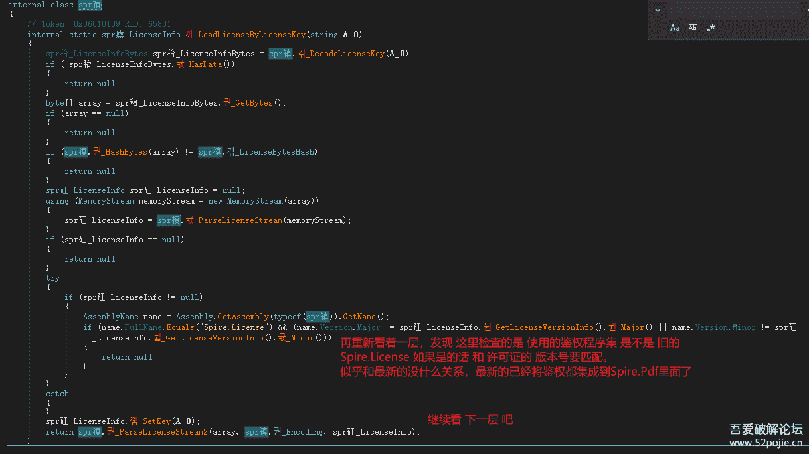

`7.png` (66.66 KB, 下载次数: 0)

[href="forum.php?mod=attachment&aid=MjYxNTcxNnxlZTNjZjkzYXwxNzkzNTczNTUxfDE2ODA4NnwxNzg3MDMz&nothumb=yes" target="_blank"](https://www.52pojie.cn/forum.php?mod=attachment&aid=MjYxNTcxNnxlZTNjZjkzYXwxNzkzNTczNTUxfDE2ODA4NnwxNzg3MDMz&nothumb=yes)

2023-5-18 15:02 上传

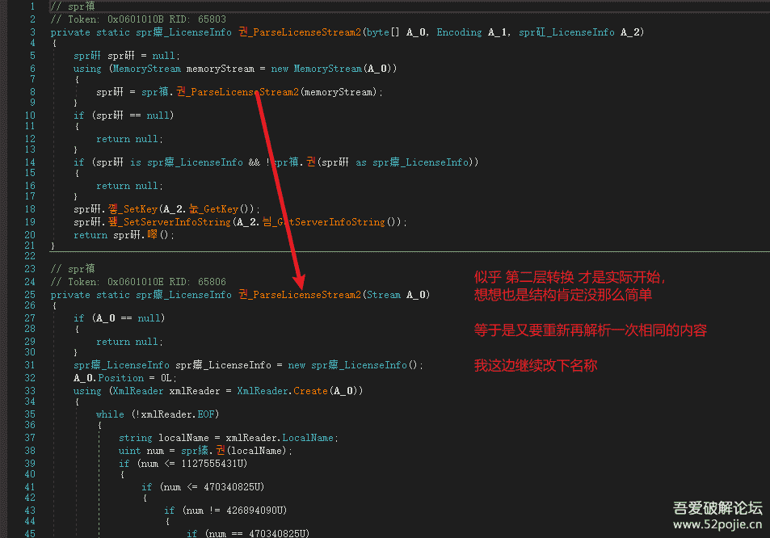

`8.png` (55.65 KB, 下载次数: 0)

[href="forum.php?mod=attachment&aid=MjYxNTcxN3wxMDVmNmVlOHwxNzkzNTczNTUxfDE2ODA4NnwxNzg3MDMz&nothumb=yes" target="_blank"](https://www.52pojie.cn/forum.php?mod=attachment&aid=MjYxNTcxN3wxMDVmNmVlOHwxNzkzNTczNTUxfDE2ODA4NnwxNzg3MDMz&nothumb=yes)

2023-5-18 15:03 上传


```
// spr禛_LicenseManager
// Token: 0x0601010E RID: 65806
private static spr癝_LicenseInfo 권_ParseLicenseStream2(Stream A_0)
{
        if (A_0 == null)
        {
                return null;
        }
        spr癝_LicenseInfo spr癝_LicenseInfo = new spr癝_LicenseInfo();
        A_0.Position = 0L;
        using (XmlReader xmlReader = XmlReader.Create(A_0))
        {
                while (!xmlReader.EOF)
                {
                        string localName = xmlReader.LocalName;
                        uint num = spr縥.권(localName); //这个不用管 类似控制流 混淆 决定下一步判断走哪儿 不影响分析
                        if (num  list = new List();
                        spr眃_ProductInfo spr眃_ProductInfo = new spr眃_ProductInfo();
                        while (A_0.LocalName != "Products")
                        {
                                string localName = A_0.LocalName;
                                if (!(localName == "Product"))
                                {
                                        if (!(localName == "Name"))
                                        {
                                                if (!(localName == "Version"))
                                                {
                                                        if (localName == "Subscription" && !A_0.IsEmptyElement && A_0.NodeType == XmlNodeType.Element)
                                                        {
                                                                spr禛_LicenseManager.권_SetSubscription(A_0, spr眃_ProductInfo);
                                                        }
                                                }
                                                else if (!A_0.IsEmptyElement && A_0.NodeType == XmlNodeType.Element)
                                                {
                                                        if (string.IsNullOrEmpty(A_0.Value))
                                                        {
                                                                A_0.Read();
                                                                spr禛_LicenseManager.권_XmlReaderNext(A_0);
                                                        }
                                                        if (A_0.NodeType == XmlNodeType.Text)
                                                        {
                                                                spr眃_ProductInfo.귟_SetVersion(A_0.Value);
                                                        }
                                                }
                                        }
                                        else if (!A_0.IsEmptyElement && A_0.NodeType == XmlNodeType.Element)
                                        {
                                                if (string.IsNullOrEmpty(A_0.Value))
                                                {
                                                        A_0.Read();
                                                        spr禛_LicenseManager.권_XmlReaderNext(A_0);
                                                }
                                                if (A_0.NodeType == XmlNodeType.Text)
                                                {
                                                        spr眃_ProductInfo.권_Name(A_0.Value);
                                                }
                                        }
                                }
                                else if (!A_0.IsEmptyElement && A_0.NodeType == XmlNodeType.Element)
                                {
                                        spr眃_ProductInfo = new spr眃_ProductInfo();
                                        list.Add(spr眃_ProductInfo);
                                }
                                A_0.Read();
                                spr禛_LicenseManager.권_XmlReaderNext(A_0);
                        }
                        if (list.Count > 0)
                        {
                                A_1.권_SetProductInfos(list.ToArray());
                        }
                }
                return;
        }
}

// spr禛_LicenseManager
// Token: 0x06010111 RID: 65809
private static void 권_SetSubscription(XmlReader A_0, spr眃_ProductInfo A_1)
{
        if (A_0 != null && A_1 != null)
        {
                if (A_0.LocalName == "Subscription")
                {
                        A_0.Read();
                        spr禛_LicenseManager.권_XmlReaderNext(A_0);
                        A_1.권_SubscriptionInfo(new spr睖_SubscriptionInfo());
                        while (A_0.LocalName != "Subscription")
                        {
                                string localName = A_0.LocalName;
                                if (!(localName == "NumberOfPermittedDeveloper"))
                                {
                                        if (!(localName == "NumberOfPermittedSite"))
                                        {
                                                if (localName == "NumberOfServerLicenses" && !A_0.IsEmptyElement && A_0.NodeType == XmlNodeType.Element)
                                                {
                                                        if (string.IsNullOrEmpty(A_0.Value))
                                                        {
                                                                A_0.Read();
                                                                spr禛_LicenseManager.권_XmlReaderNext(A_0);
                                                        }
                                                        if (A_0.NodeType == XmlNodeType.Text)
                                                        {
                                                                string value = A_0.Value;
                                                                int num;
                                                                if (!string.IsNullOrEmpty(value) && int.TryParse(value, NumberStyles.Integer, CultureInfo.InvariantCulture, out num))
                                                                {
                                                                        A_1.긲_SubscriptionInfo().긲_NumberOfServerLicenses(num);
                                                                }
                                                        }
                                                }
                                        }
                                        else if (!A_0.IsEmptyElement && A_0.NodeType == XmlNodeType.Element)
                                        {
                                                if (string.IsNullOrEmpty(A_0.Value))
                                                {
                                                        A_0.Read();
                                                        spr禛_LicenseManager.권_XmlReaderNext(A_0);
                                                }
                                                if (A_0.NodeType == XmlNodeType.Text)
                                                {
                                                        string value2 = A_0.Value;
                                                        int num2;
                                                        if (!string.IsNullOrEmpty(value2) && int.TryParse(value2, NumberStyles.Integer, CultureInfo.InvariantCulture, out num2))
                                                        {
                                                                A_1.긲_SubscriptionInfo().귟_NumberOfPermittedSite(num2);
                                                        }
                                                }
                                        }
                                }
                                else if (!A_0.IsEmptyElement && A_0.NodeType == XmlNodeType.Element)
                                {
                                        if (string.IsNullOrEmpty(A_0.Value))
                                        {
                                                A_0.Read();
                                                spr禛_LicenseManager.권_XmlReaderNext(A_0);
                                        }
                                        if (A_0.NodeType == XmlNodeType.Text)
                                        {
                                                string value3 = A_0.Value;
                                                int num3;
                                                if (!string.IsNullOrEmpty(value3) && int.TryParse(value3, NumberStyles.Integer, CultureInfo.InvariantCulture, out num3))
                                                {
                                                        A_1.긲_SubscriptionInfo().권_NumberOfPermittedDeveloper(num3);
                                                }
                                        }
                                }
                                A_0.Read();
                                spr禛_LicenseManager.권_XmlReaderNext(A_0);
                        }
                }
                return;
        }
}
```

上面的也没啥好说的 就是 单纯的 解析 XML 根据上面的 代码 可以得到 许可证的 XML 模板


## 回溯分析

但是，我们好像还没碰到这些值具体都有什么用。

那就接着往上层回溯。

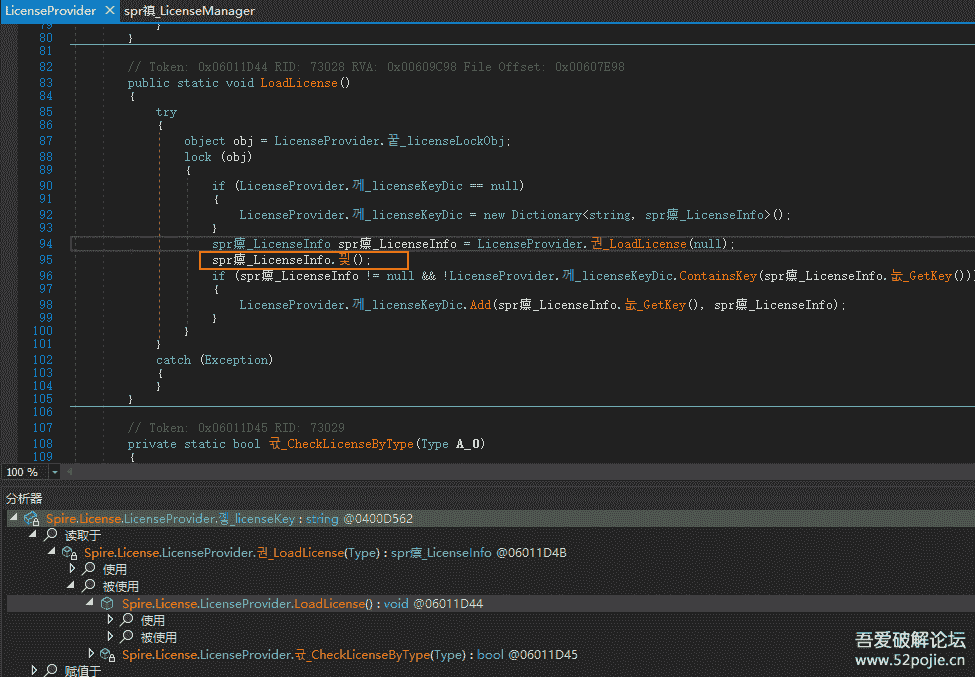

`9.png` (56.59 KB, 下载次数: 0)

[附件下载](https://www.52pojie.cn/forum.php?mod=attachment&aid=MjYxNTcxOHw2M2QwNjM0NXwxNzkzNTczNTUxfDE2ODA4NnwxNzg3MDMz&nothumb=yes)

2023-5-18 15:03 上传

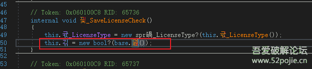

`10.png` (11.97 KB, 下载次数: 0)

[附件下载](https://www.52pojie.cn/forum.php?mod=attachment&aid=MjYxNTcxOXxlNGY4ZTJhYXwxNzkzNTczNTUxfDE2ODA4NnwxNzg3MDMz&nothumb=yes)

2023-5-18 15:03 上传

发现红框中的赋值好像并没有在之前的解析中涉及到，咱们查一下谁改动和读取了这里。

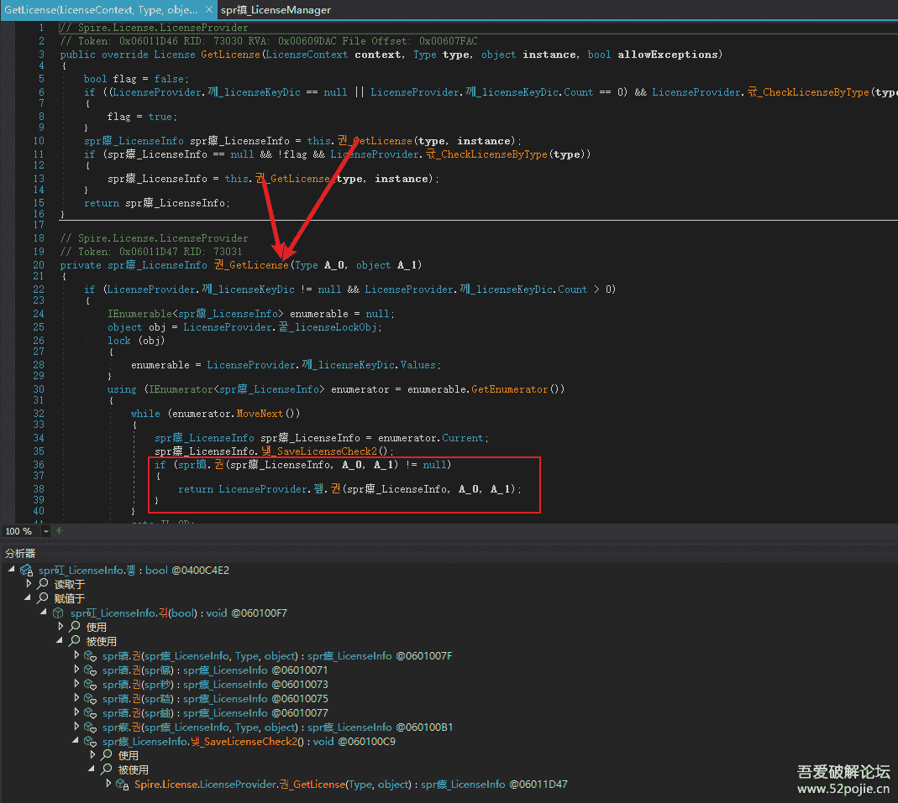

`11.png` (89.67 KB, 下载次数: 0)

[附件下载](https://www.52pojie.cn/forum.php?mod=attachment&aid=MjYxNTcyMHxjYTA1YjBmNXwxNzkzNTczNTUxfDE2ODA4NnwxNzg3MDMz&nothumb=yes)

2023-5-18 15:03 上传

## 验证 `License` 逻辑

```
// spr璾
// Token: 0x0601007F RID: 65663
internal static spr癝_LicenseInfo 권_VerifyLicense(spr癝_LicenseInfo A_0, Type A_1, object A_2)
{
        if (A_0 == null)
        {
                return null;
        }
        Assembly assembly = Assembly.GetAssembly(A_1);
        AssemblyName name = assembly.GetName();
        string text = spr璾.권(assembly);
        text = text.Replace(".Office.", ".");

        PackageAttribute[] array = PackageAttribute.GetPackage(assembly); // 取程序集上的 Package 特性
        PackageAttribute packageAttribute = null;
        DateTime? dateTime;

        PackageAttribute[] array2 = spr璾.권(assembly, array, out dateTime);  
        // 这里又过了一次 特性校验 有兴趣可以自己深入
        // dateTime 默认是 程序集特性 [assembly: ReleaseDate("2023-04-27")] 但是 会过一次解码验证 可能被重新赋值。
        // 由于我们对这些不做改动 所以略过
        if (array2 != null)
        {
                array = array2;
        }
        spr眃_ProductInfo spr眃_ProductInfo = null;
        spr眃_ProductInfo[] array3 = A_0.꿑_GetProductInfos();
        int i = 0;
        while (i = 0) || (A_0.녰_GetMergedLicenseVersionInfo() == null && A_0.뉩_GetLicenseVersionInfo().권_DiffVersion(1, 3) >= 0)) && array != null && array.Length != 0)
                {
                        PackageAttribute[] array4 = array;
                        int j = 0;
                        while (j  list = spr甑.꺅();
                        if (list == null && list.Count  num)
                {
                        A_0.긲_InValid(true);
                }
                if (A_0.덢_InValid())
                {
                        return A_0;
                }

                //如果之前没判定为失效的话 
                //如果订阅类型为 Developer 或 SiteEnterprise 且 ExpiredDate 大于当前时间
                //会将 License 上报到 服务器？？？
                if (!A_0.덢_InValid() && (spr瞩_SubscriptionType == spr瞩_SubscriptionType.귟_Developer || spr瞩_SubscriptionType == spr瞩_SubscriptionType.꺅_SiteEnterprise) && A_0.꽾_ExpiredDate() >= DateTime.Now)
                {
                        try
                        {
                                if (!spr笺.꺅_IsInServerBlackList()) //如果服务器返回 1 或者 别的 就会标记为 true。 然后 再走就默认失效了。
                                {

                                        spr笺.긲_ReportLicenseToServer(A_0.넝_GetSerialNumberOrMD5LicenseKey(), A_0.긲_GetUsername(), (int)spr瞩_SubscriptionType, spr竧.권_DateFormate(A_0.꽾_ExpiredDate()));
                                        goto IL_36A;
                                }
                                A_0.긲_InValid(true);
                        }
                        catch (Exception ex)
                        {
                                spr竧.권("LicenseUtilities_Validate", ex);
                                goto IL_36A;
                        }
                        return A_0;
                }
                IL_36A:
                if (A_0.귟_LicenseType() == spr碢_LicenseType.꺅_unknow)
                {
                        A_0.권_LicenseType(spr碢_LicenseType.긲_runtime);
                }
                return A_0;
        }
        goto IL_111;
}
```

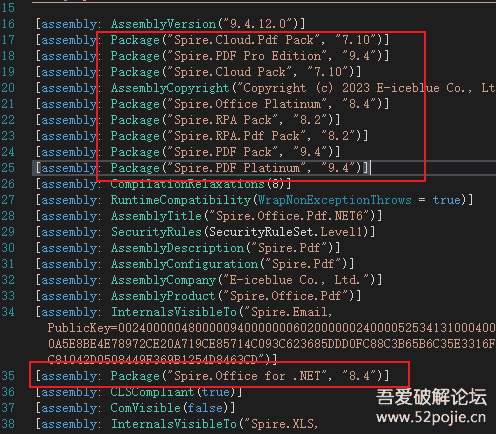

`12.png` (21.92 KB, 下载次数: 1)

[附件下载](https://www.52pojie.cn/forum.php?mod=attachment&aid=MjYxNTcyMXw1ZTAxNjVlYnwxNzkzNTczNTUxfDE2ODA4NnwxNzg3MDMz&nothumb=yes)

2023-5-18 15:03 上传

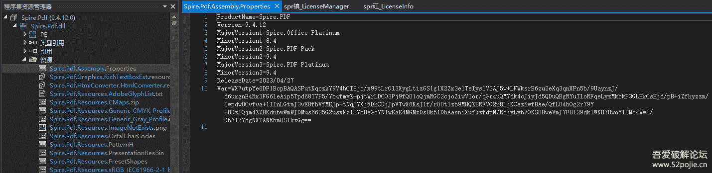

`13.png` (55.95 KB, 下载次数: 0)

[附件下载](https://www.52pojie.cn/forum.php?mod=attachment&aid=MjYxNTcyMnwxZGM0ZmY3Y3wxNzkzNTczNTUxfDE2ODA4NnwxNzg3MDMz&nothumb=yes)

2023-5-18 15:03 上传

所以，我们不能配置为 `Developer` 或 `SiteEnterprise` 的订阅。

```
internal spr瞩_SubscriptionType 께_SubscriptionType()

{

        if (this.긲_NumberOfServerLicenses() > 0)

        {

                return spr瞩_SubscriptionType.꼫_CloudServer;

        }

        if (this.권_NumberOfPermittedDeveloper() == 1 && this.귟_NumberOfPermittedSite() == 1)

        {

                return spr瞩_SubscriptionType.귟_Developer;

        }

        if (this.권_NumberOfPermittedDeveloper() == 1 && this.귟_NumberOfPermittedSite() == 2147483647)

        {

                return spr瞩_SubscriptionType.긲_DeveloperOEM;

        }

        if (this.권_NumberOfPermittedDeveloper() == 10 && this.귟_NumberOfPermittedSite() == 10)

        {

                return spr瞩_SubscriptionType.꺅_SiteEnterprise;

        }

        if (this.권_NumberOfPermittedDeveloper() == 50 && this.귟_NumberOfPermittedSite() == 2147483647)

        {

                return spr瞩_SubscriptionType.께_SiteOEM;

        }

        return spr瞩_SubscriptionType.귟_Developer;

}
```

可选的就是 `DeveloperOEM` 或 `SiteOEM`。

我们再来看最后一个函数。

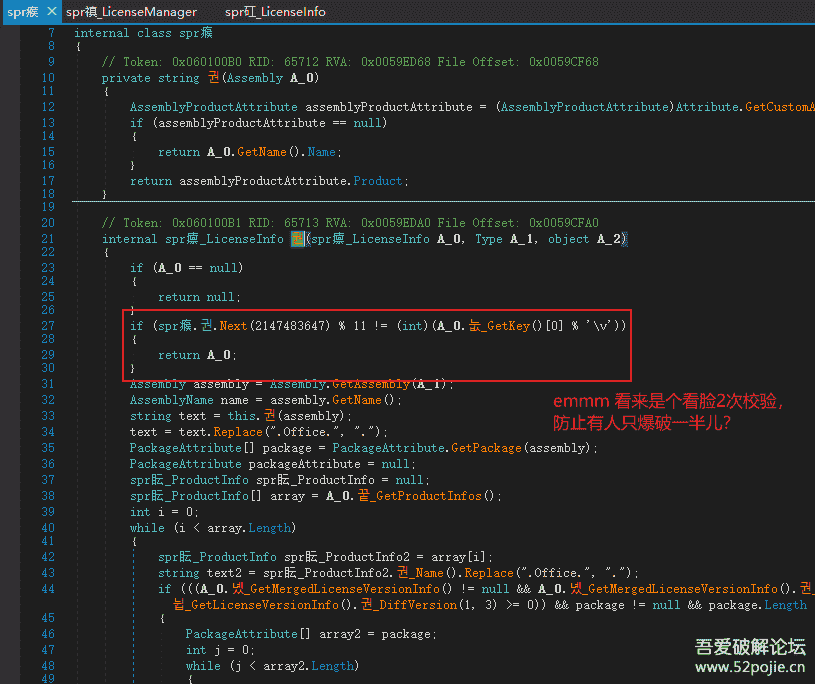

`14.png` (48.28 KB, 下载次数: 0)

[附件下载](https://www.52pojie.cn/forum.php?mod=attachment&aid=MjYxNTcyM3xhNjM4YzI4MHwxNzkzNTczNTUxfDE2ODA4NnwxNzg3MDMz&nothumb=yes)

2023-5-18 15:03 上传

那么 `License` 完整答案就有了！其他没什么用的拿掉拿掉~

## 4> 生成许可证

```
const string licTemplate = @"

- 
    Runtime
    52Pojie
    
- 2099-01-01T12:00:00Z
    2099-12-31T12:00:00Z
    
        
            Spire.Office Platinum
            999.999
            
                50
                2147483647
            
        
    
";
```

```
string GetLicense()

{

        //根据字节长度 计算一下 head 需要设置的 n1 和 n2

        bool genHeader(int signLen, out byte b1, out byte b2)

        {

                for (int i = 0; i 
```

## 4> 验证

生成一个 `License`


```
PF82R8LWxV8dAQC8/toZAAAAAAAAAAAAAAAAAAAAAAAAAAAAAAAAAAAAAAAAAAAAAAAAAAAAAAAAAAAAAAAAAAAAAAAAAAAAAAAAAAAAAAAAAAAAAAAAAAAAAAAAAAAAAAAAAAAAAAAAAAAAAAAAAAAAAAAAAAAAAAAAAAAAAAAAAAAAAAAAAAAAAAAAAAAAAAAAAAAAAAAAAAAAAAAAAAAAAAAAAAAAAAAAAAAAAAAAAAAAAAAAAAAAAAAAAAAAAAAAAAAAAAAAAAAAAAAAAAAAAAAAAAAAAAAAAAAAAAAAAAAAAAAAAAAAAAAAAAAAAAAAAAAAAAAAAAAAAAAAAAAAAAAAAAAAAAAAAAAAAAjGAKOCYiGhh9jGrfm3vT/Y1fcdDhaAmvgYw1ppUKudl811mv5I6IccnGjD4b42bNZo6/RaMd4Z4V7VzsvoSUUr8em6t8puATVS+oNPiUGSYROTLBvE/rE4WKodXu83ZhUDLyh3CSeV8735GOdxAbB23bilhiaUEwieHNKDepjMX28ENvPweqq55XP1l9bKVsUGbiIXWEttYfQKTt14DLpRZTMQiq1lXqKeOXOTbti3ZC3Vqcepqc+0ujiiFAwHNfrtfD8UllEJZ+jDUt0iqUxRicdDCZ/ZXpaFcZ5NlG8jVmCzA1oOvp1SespdPhkB1JopFD18nVI0UIZCAzwnF5evdUZ8GjNBgM00nxQ71WrueYt9lNKMbfjK1fyAVtF9xr+2kfC7OtpzG23NHiW0LESQdwoiQkJGgp/hmNVACnA7ToUdG9zMWCwMKwpslLBmacduTyC+AAU1mEZ83XSdej9yRoai85dB8OMGB0Rd0/TxWLvn4KLrZvhAEWNs8haevICuelazDfIX2pBGlLi25w0528CaQYKAVR9JPTV7+ES1QMzfzF5CpQgl6t/X0QnHc8NC8/tXRmONE4BN/TkkpAV4wWwtFTyxImrSljHffUXvxQSviqw2tiFjU3x8UHJSkMR4cKjgFqIs5SJxUzNdUDIDtzTYqzlczre7S9KaQO//59byEngoMqfE2QY1Nogu0Jq2PWDUnbel2Z41RAdpymNn8Dr36wb7/WuX8OazwwgrmqZDmggb9NHsZKW4H8PIteVFMM0x2iVKJyu/our5ExJjOZXFTfm9UHcU48wuAPSrgAEJZxf9b7j7zEHw+Zm+n3fC0KNIbO2rm8SND7Q1JxfmeLxRULcZGuOr9WxKYKCNUg==
```

配合 Hook `RSA VerifyData`，这次就不贴图了，可以参考其他帖子。

自己动手尝试记忆更深。

[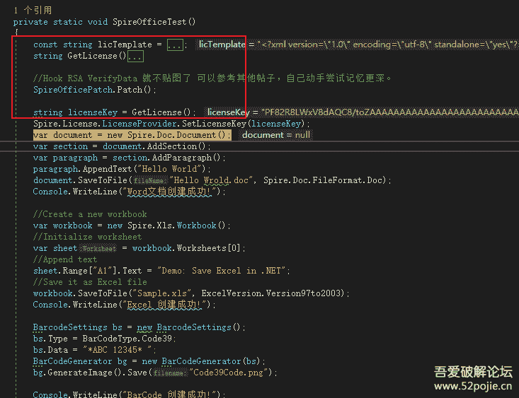](https://www.52pojie.cn/forum.php?mod=attachment&aid=MjYxNTcyNHw4MzA5ZDJhN3wxNzkzNTczNTUxfDE2ODA4NnwxNzg3MDMz&nothumb=yes)

`15.png` (40.58 KB, 下载次数: 0) · 2023-5-18 15:03 上传

[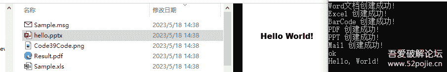](https://www.52pojie.cn/forum.php?mod=attachment&aid=MjYxNTcyNXwwNDYxODJhN3wxNzkzNTczNTUxfDE2ODA4NnwxNzg3MDMz&nothumb=yes)

`16.png` (22.83 KB, 下载次数: 0) · 2023-5-18 15:03 上传

完美~ 水印空空~

### 4> 声明

仅限学习交流，请勿用于商业或非法用途。
