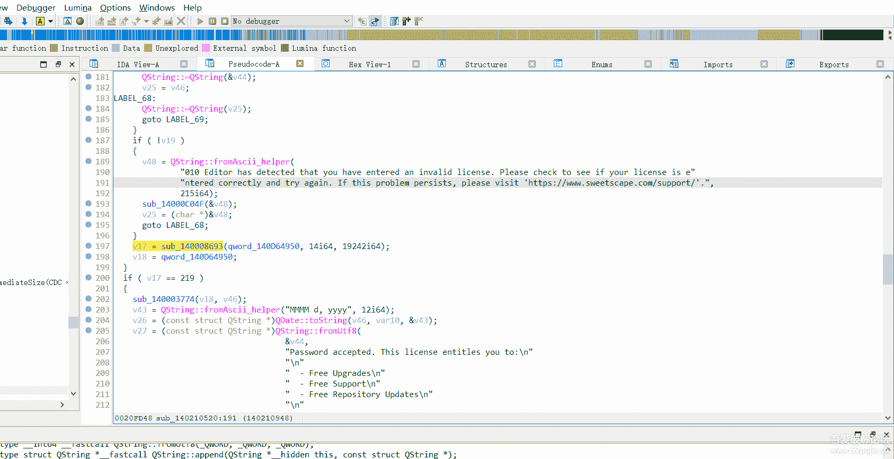
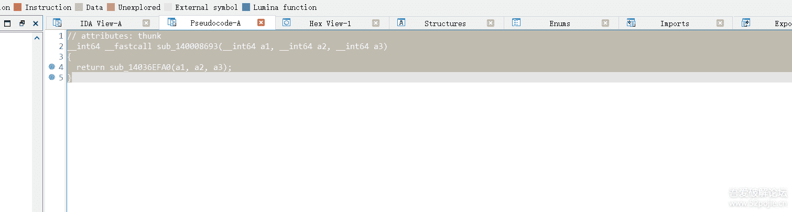
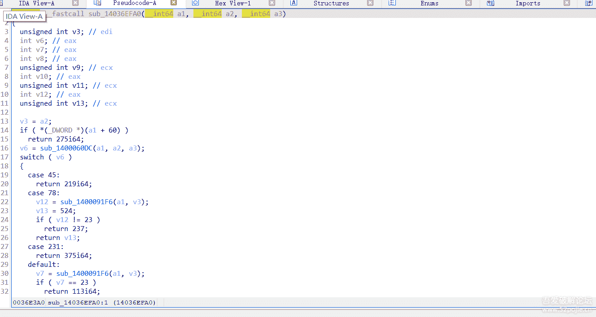
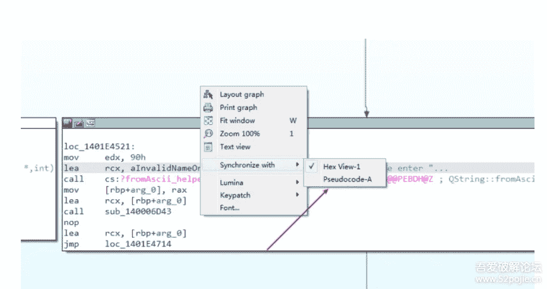
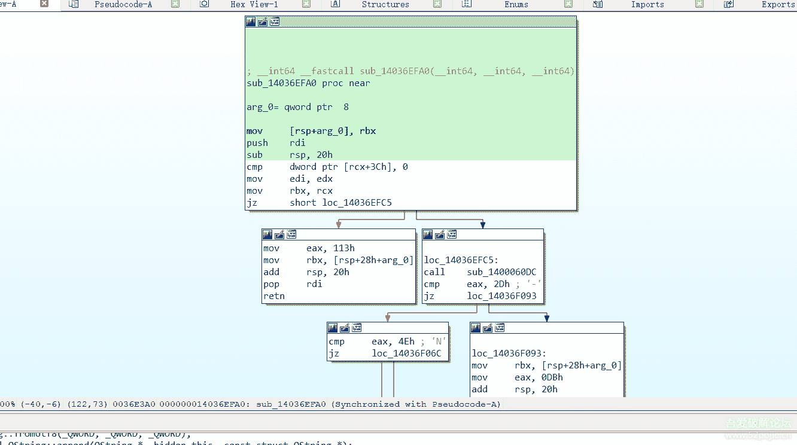
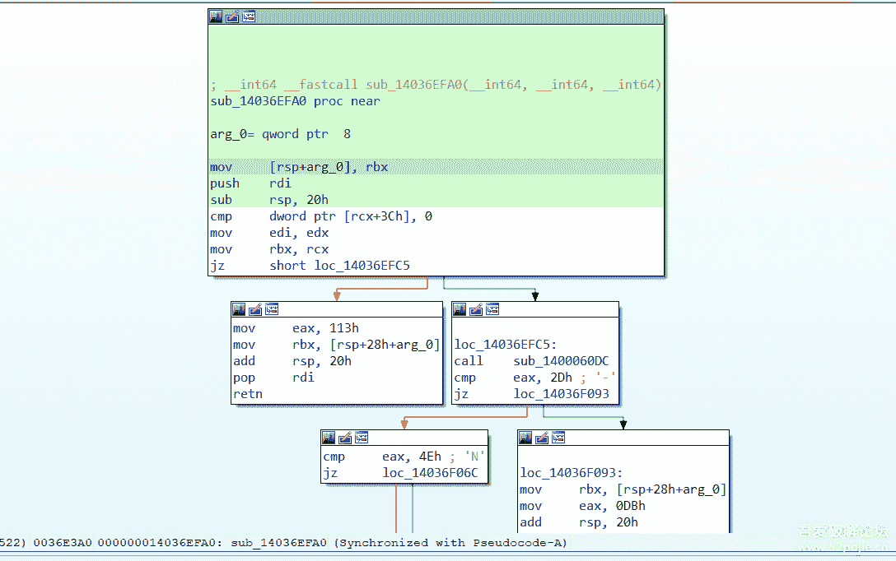
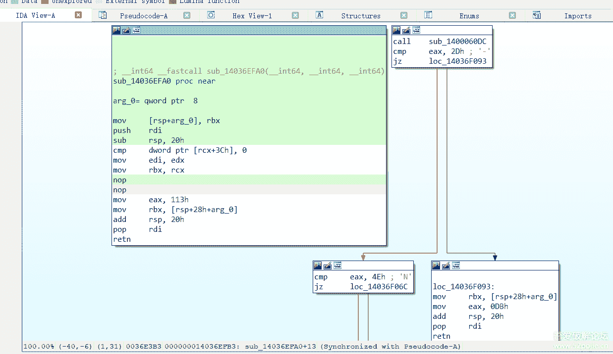
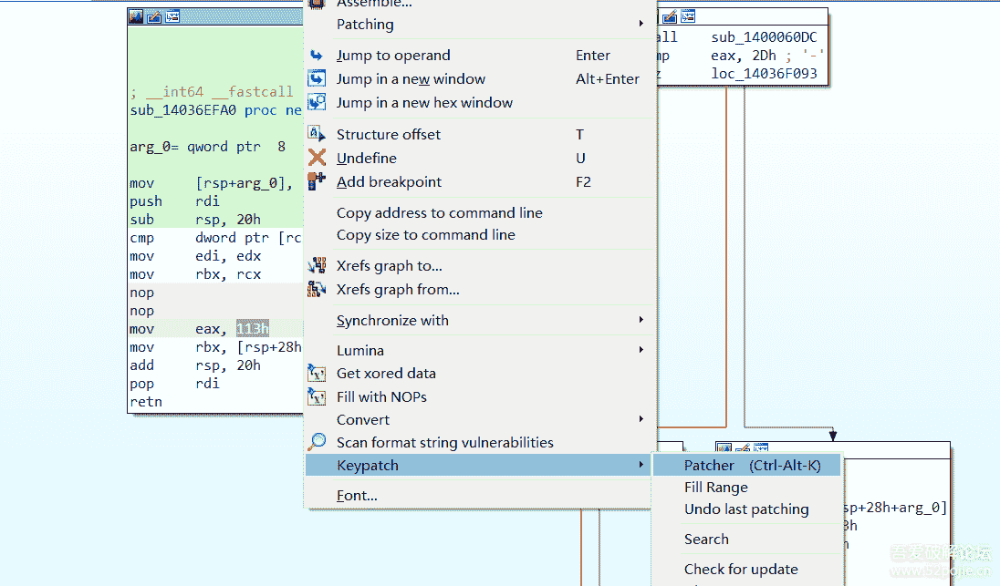
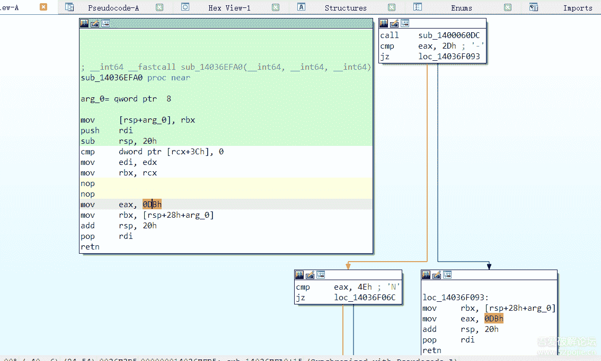

# [原创] 新手上路，记录一个某编辑010软件的注册破解过程

- 原帖：<https://www.52pojie.cn/forum.php?mod=viewthread&tid=1787906>
- 抓取时间：2026-11-01T22:52:26

## 分析过程

最近下载了某著名二进制编辑软件，试用期1个月，快到期了，版本是64位13.01。

然后本着不浪费的态度，祭出`ida`。

首先注意到注册的时候失败会提示一堆字符。

然后就查找字符串，关键字：`Invalid name`。

定位到相关位置后，按查看此处代码之前的部分，会发现以下关键代码：

`1.png` (107.38 KB, 下载次数: 0)  
[附件下载](https://www.52pojie.cn/forum.php?mod=attachment&aid=MjYxNjI5MHw1YzQyMjQ2NnwxNzkzNTczNTQ0fDE2ODA4NnwxNzg3OTA2&nothumb=yes)  
2023-5-20 21:28 上传

如果`sub_140008693`的结果是`219`，则可以注册成功。

`2.png` (24.42 KB, 下载次数: 0)  
[附件下载](https://www.52pojie.cn/forum.php?mod=attachment&aid=MjYxNjI5MXw4Nzg4ZGM4ZHwxNzkzNTczNTQ0fDE2ODA4NnwxNzg3OTA2&nothumb=yes)  
2023-5-20 21:28 上传

跳到`V17`之后发现执行了一个`return sub_14036EFA0`。

`3.png` (61.18 KB, 下载次数: 0)  
[附件下载](https://www.52pojie.cn/forum.php?mod=attachment&aid=MjYxNjI5MnwzODE4Y2NjZXwxNzkzNTczNTQ0fDE2ODA4NnwxNzg3OTA2&nothumb=yes)  
2023-5-20 21:28 上传

此时切换主窗口到：

`4.png` (150.79 KB, 下载次数: 0)  
[附件下载](https://www.52pojie.cn/forum.php?mod=attachment&aid=MjYxNjI5M3xiZDYyNmMzYnwxNzkzNTczNTQ0fDE2ODA4NnwxNzg3OTA2&nothumb=yes)  
2023-5-20 21:28 上传

`5.png` (60.8 KB, 下载次数: 0)  
[附件下载](https://www.52pojie.cn/forum.php?mod=attachment&aid=MjYxNjI5NHxiNGQ0ODQ0NnwxNzkzNTczNTQ0fDE2ODA4NnwxNzg3OTA2&nothumb=yes)  
2023-5-20 21:28 上传

此时关系图如下：

`6.png` (53.65 KB, 下载次数: 0)  
[附件下载](https://www.52pojie.cn/forum.php?mod=attachment&aid=MjYxNjI5NXwwNTgxYjYwNXwxNzkzNTczNTQ0fDE2ODA4NnwxNzg3OTA2&nothumb=yes)  
2023-5-20 21:28 上传

点击`short`后，后面变红。

在第一次跳转使用`ptach`，直接`nor`掉，就成了下面的图：

`7.png` (58.45 KB, 下载次数: 0)  
[附件下载](https://www.52pojie.cn/forum.php?mod=attachment&aid=MjYxNjI5NnwwMjNlNTYxMHwxNzkzNTczNTQ0fDE2ODA4NnwxNzg3OTA2&nothumb=yes)  
2023-5-20 21:28 上传

`8.png` (75.13 KB, 下载次数: 0)  
[附件下载](https://www.52pojie.cn/forum.php?mod=attachment&aid=MjYxNjI5N3xmY2MyYmM4N3wxNzkzNTczNTQ0fDE2ODA4NnwxNzg3OTA2&nothumb=yes)  
2023-5-20 21:28 上传

然后把返回值改为`219`，也就是`0DBh`：

`9.png` (54.99 KB, 下载次数: 0)  
[附件下载](https://www.52pojie.cn/forum.php?mod=attachment&aid=MjYxNjI5OHw0NjY2MmY5NHwxNzkzNTczNTQ0fDE2ODA4NnwxNzg3OTA2&nothumb=yes)  
2023-5-20 21:28 上传

这就解决了。

## 总结

整体流程就是很典型的定位，查找成功返回代码，然后修改跳转的返回值，一气呵成即可。
