# [原创] tvm分析与还原

- 原帖: https://www.52pojie.cn/forum.php?mod=viewthread&tid=1789892
- 抓取时间: 2026-11-01T22:52:18

## tvm简介

一句话概括就是腾讯自家的虚拟化加密壳。把腾讯的安全产品拉入 PE 工具，看到区段中有`.tvm0`那就没跑了。

### demo

这次还原用到的demo是前段时间 [gslab.qq.com/html/competition/2023/race-final.htm](https://gslab.qq.com/html/competition/2023/race-final.htm) 一个非常好的demo，驱动基本上全vm了。

还要特别感谢 [bbs.kanxue.com/thread-276892.htm](https://bbs.kanxue.com/thread-276892.htm)，给我节省了许多验证还原效果的时间。

## 资料

还原脚本项目地址：[pan.baidu.com/s/1gjmYQHXELELJwqhb-HJ9iA?pwd=ICEY](https://pan.baidu.com/s/1gjmYQHXELELJwqhb-HJ9iA?pwd=ICEY)

文档我也只说明了一些明显的点，还是看代码更加清晰。

然后给你的`idapython`安装以下的库:

```python
import capstone
import keystone
import copy
import unicorn
```

## 混淆

### 1.

```
1400d302c : not     r10                               ,R10
```

可优化成：

```
1400d3031 : mov     [rbp+var_s8], rax
```

直接特征识别即可，请参考`idapython/TVMunicornTrace.py` `.tvmFunTask.mabe_1()`.

### 2.

```
1400d5b36 : xchg    rax, r11                          ,RAX
```

可优化成：

```
1400d5b38 : mov     r11, [rbp+98h]
```

直接特征识别即可，请参考`idapython/TVMunicornTrace.py` `.tvmFunTask.mabe_2()`.

### 3.

```
1400d9156 : push    r10                               ,RSP
```

可优化成：

```
1400d9156 : jmp     1400d7560

1400d7560 : nop
```

直接特征识别即可，请参考`idapython/TVMunicornTrace.py` `.tvmFunTask.mabe_3_4()`.

### 4. (类似 3)

```
1400d7240 : push    r10                               ,RSP
```

可优化成：

```
1400d7240 : jmp 1400d99d9

1400d99d9 : nop
```

直接特征识别即可，请参考`idapython/TVMunicornTrace.py` `.tvmFunTask.mabe_3_4()`.

去混淆前：

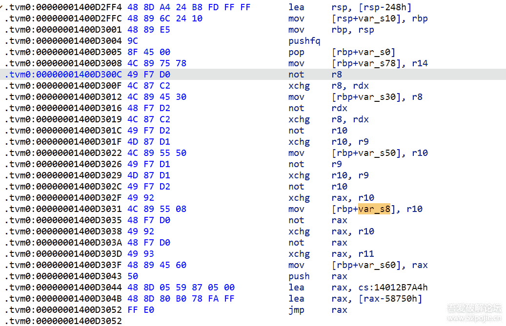

0去混淆前.png (98.63 KB, 下载次数: 2)

2023-5-26 00:48 上传

去混淆后：

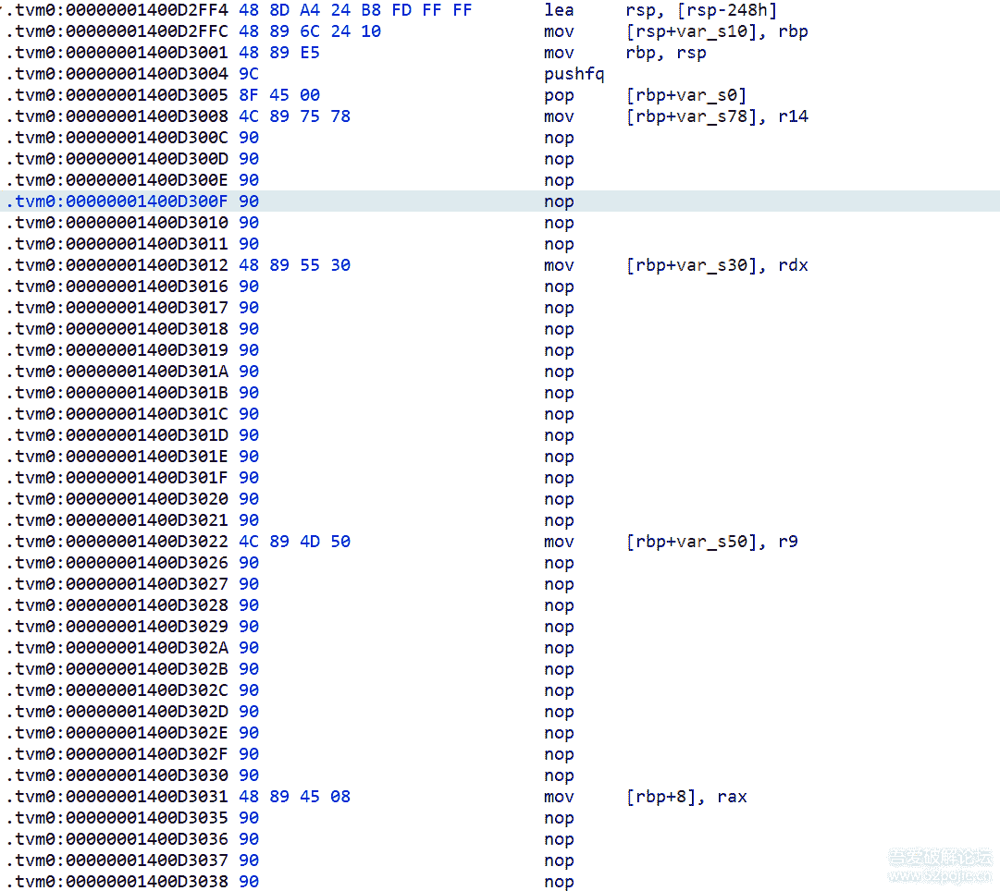

1 去混淆后1.png (109.81 KB, 下载次数: 0)

2023-5-26 00:48 上传

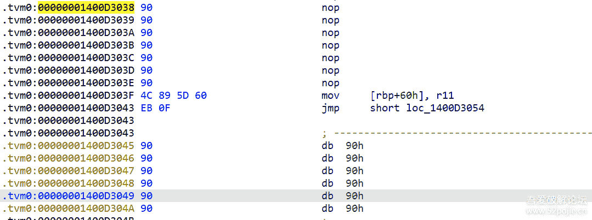

2 去混淆后2.png (50.94 KB, 下载次数: 1)

2023-5-26 00:48 上传

## TVM

虚拟机的大致架构如下，非常标准。

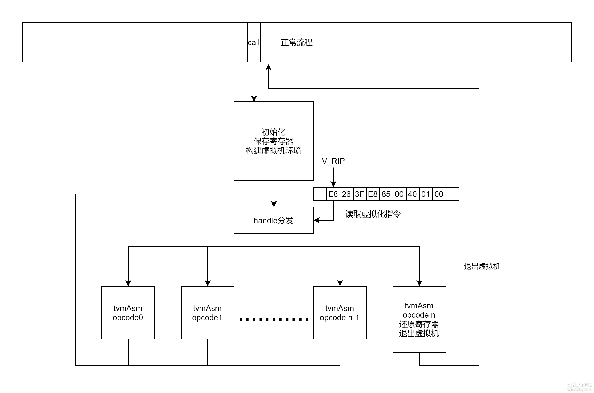

03虚拟机架构.png (116.91 KB, 下载次数: 2)

2023-5-26 00:48 上传

实际上tvm有多个handle分发器和多张`handleTable`，但是它们的作用、内容完全一致，所以我就只画出一个handle分发器，下面也只讲解一张`handleTable`。

### 如何进入虚拟机

使用`unicorn`跟一次tvm入口到出口，脚本参考：`idapython/TVMunicornTrace.py`

初始`rsp`设置为`0x1800`

入口：(已去混淆) 完整文件请查看`trace_file/tvm入口到出口 去混淆.log`，未去混淆的查看`trace_file/tvm入口到出口 未去混淆.log`

```
140086efa : call    sub_1400085E8                     ,RSP
```

从`1400d2ffc`到`1400d315f`，tvm第一次保存进入虚拟机前的寄存器状态：

```
rsp = rbp = 15b0
[15b0](rbp+0)        rflag
[15b8](rbp+8)        rax
[15c0](rbp+10)        rbp            (原来的栈底)
[15c8](rbp+18)        rbx
[15d0](rbp+20)        rcx
[15d8](rbp+28)        rdi
[15e0](rbp+30)        rdx
[15e8](rbp+38)        rsi
[15f0](rbp+40)        rsp         (原来的栈顶)
[15f8](rbp+48)        r8
[1600](rbp+50)        r9
[1608](rbp+58)        r10
[1610](rbp+60)        r11
[1618](rbp+68)        r12
[1620](rbp+70)        r13
[1628](rbp+78)        r14
[1630](rbp+80)        r15
```

接下来是第二次保存进入虚拟机前的寄存器状态：

```
1400d3160 : lea     r11, [rbp+90h]                    ,R11
```

从`1400d3160`到`1400d30aa`，保存状态如下：

```
[1640](r11+0)        rax
[1648](r11+8)        rbx
[1650](r11+10)        rcx
[1658](r11+18)        rdx
[1660](r11+20)        rsp
[1668](r11+28)        rbp
[1670](r11+30)        rsi
[1678](r11+38)        rdi
[1680](r11+40)        r8
[1688](r11+48)        r9
[1690](r11+50)        r10
[1698](r11+58)        r11
[16a0](r11+60)        r12
[16a8](r11+68)        r13
[16b0](r11+70)        r14
[16b8](r11+78)        r15
[16c0](r11+80)        rflag
```

接下来保存虚拟机指令起始点和虚拟机寄存器的起始指针：

```
1400d30b1 : lea     r11, byte_14006024B+1             ,R11
```

结构如下：

```
[15a0]        V_RIP                                                        虚拟指令起始点
[15a8]        V_REG_P                                                        1638（虚拟机寄存器）
```

`14006024c`这是当前函数的虚拟指令起始点，可以先记住，后面就知道为什么我这么说了。

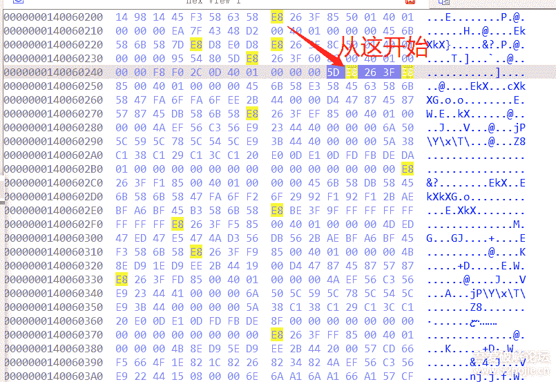

3虚拟指令.png (90.85 KB, 下载次数: 0)

2023-5-26 00:48 上传

接下来进入：

```
1400d30d1 : call    sub_1400D5B02                     ,RSP
```

进`call`，`return`地址入栈：

```
[1598] = return add（call    sub_1400D5B02 下一行的地址 是int3）
```

这个函数，它也会保存一下寄存器状态，但是没啥用：

```
1400d5b02 : lea     rsp, [rsp-8]                      ,RSP
```

保存的状态如下：

```
[1570]  r15                                                                rbp = 15b0
[1578]  rbp
[1580]  rdi
[1588]  rsi
[1590]  rbx
```

然后会把`V_RIP`换个位置：

```
1400d5b2f : sub     rsp, 68h                          ,RSP
```

接下来就开始处理虚拟指令了。先把栈空间的格式整理一下：（这个地方非常重要）

```
虚拟机内RBP = RSP = 1508 ,R10 = V_REG_P
[1508] int3指令指针
[1510] V_RIP                                                                        //当前执行到的位置
.....

[1570]  r15                                                                rbp = 15b0
[1578]  rbp
[1580]  rdi
[1588]  rsi
[1590]  rbx
[1598] = return add（sub_1400D5B02 下一行的地址 是int3）

[15a0]        V_RIP                                                                        //虚拟指令起始点,这是不会变的
[15a8]        V_REG_P                                                                        //1638（虚拟机寄存器）,这是不会变的

[15b0](rbp+0)        rflag                                                        //这里以下是进入虚拟机前的寄存器状态
[15b8](rbp+8)        rax
[15c0](rbp+10)        rbp            (原来的栈底)
[15c8](rbp+18)        rbx
[15d0](rbp+20)        rcx
[15d8](rbp+28)        rdi
[15e0](rbp+30)        rdx
[15e8](rbp+38)        rsi
[15f0](rbp+40)        rsp         (原来的栈顶)
[15f8](rbp+48)        r8
[1600](rbp+50)        r9
[1608](rbp+58)        r10
[1610](rbp+60)        r11
[1618](rbp+68)        r12
[1620](rbp+70)        r13
[1628](rbp+78)        r14
[1630](rbp+80)        r15

[1638]        UnKnow                            V_REG_P = r10 = 1638 //虚拟机的虚拟寄存器从 1638 开始往下都是
[1640](r11+0)        rax                                                                //这里以下是进入虚拟机前的寄存器状态
[1648](r11+8)        rbx
[1650](r11+10)        rcx
[1658](r11+18)        rdx
[1660](r11+20)        rsp
[1668](r11+28)        rbp
[1670](r11+30)        rsi
[1678](r11+38)        rdi
[1680](r11+40)        r8
[1688](r11+48)        r9
[1690](r11+50)        r10
[1698](r11+58)        r11
[16a0](r11+60)        r12
[16a8](r11+68)        r13
[16b0](r11+70)        r14
[16b8](r11+78)        r15
[16c0](r11+80)        rflag
```

其实只需要记住`R10`放着`V_REG_P`和`[rbp+8]`放着`V_RIP`。

### handle分发

这是一段tvm handle的分发（`tvmopcode`的处理方式）：

```
1400d7234 : mov     r9, [rbp+8]                       ,R9
```

`[rbp+8]`是`V_RIP`，放入`r9`，然后从`[R9]`取出`tvmopcode`放入`r8b`，然后异或`0x5D`，然后`r9 + 1`（上面是混淆过的，实际效果就是`+ 1`）。


# TVM 逆向分析

## 初始判断与 `handle` 跳转

`R8b - 1` 如果大于 `0xC8`，就跳转到 `1400D9954`，说明这是未知的 `tvmopcode`，出错。`1400D9954` 是 `int3` 指令。

然后 `handleTable` 放入 `R9`，取表项 `[R9 + R8 *8]`，即为这个 `handle` 的偏移，加上基址 `0x140000000`，即为这个 `handle` 的实际处理地址：`1400d60f2`，通过 `jmp r8` 跳转过去。

（可以看到取得第一个 `tvmopcode` 是 `0xe8`，和上面图中的是一样的）

## 6. 小总结

### 1. 从 `tvmopcode` --> `handle` 的方式

```
handleTableBase = 0x1400db5aa
Dllbase = 0x140000000
handle = Dllbase + qword[(tvmopcode^0x5d - 1)*8 + handleTableBase]
```

注意，`tvm` 有多张 `handleTable`，但是里面的内容都是一样的。所以拿到一张表就行了。

### 2. `handle` 的个数

从 `tvmopcode^0x5d - 1` 可以推测一共有 `0xc8`（`0~0xc7`）个 `tvmopcode`，例：

```
handleTable的第 0x00 项: tvmopcode = (0x00 + 1) ^ 0x5d = 0x5c

......

handleTable的第 0x3c 项: tvmopcode = (0x3c + 1) ^ 0x5d = 0x60

......

handleTable的第 0xc7 项: tvmopcode = (0xc7 + 1) ^ 0x5d = 0x95
```

### 3. 导出所有 `handle`

现在我们知道，`tvm` 的 `handleTable` 有 `0xc8` 个有效项，我们就可以遍历 `handleTable`，并且静态跟踪出 `handle`。看它是如何处理的：

导出 `handle` 代码（`idapython/TVMHandleOut.py`）

补充：虽然 `handle` 有 `0xc8` 个有效项，但是很多是重复的，是留作拓展用的，真正有效的 `handle` 就 80 个：

左边是 `handle` 处理地址，右边是 `tvmopcode`

```
1400d9954 : 9a  9b  98  99  9c  9d  e2  e3  e0  e1  e6  e7  e4  eb  ec  ed  f2  f3  f0  f1  f6  f7  f5  fa  fb  f9  fe  ff  c2  c0  c1  c6  c7  c4  c5  c8  ce  cf  cc  cd  db  d8  de  df  dc  dd  23  26  27  24  2a  28  2e  2c  2d  32  33  30  31  36  37  34  35  3a  3b  38  39  3e  3f  3d  02  03  00  07  04  05  0a  0b  08  0e  0f  0d  12  13  10  17  14  15  1a  1b  18  1e  1f  1c  63  61  66  67  64  6b  69  6f  6c  71  76  77  74  7b  79  7e  7f  7c  53  50  55  5b  58  59  5e  5f  5c
1400d8eb1 : 5a
1400d5b5a : 54
1400d5cd8 : 57
1400db3d3 : 56
1400d761b : 51
1400da3e5 : 52
1400dabb0 : 4d
1400d8196 : 4c
1400d6c8c : 4f
1400d82fa : 4e
1400d6e7d : 49
1400d7172 : 48
1400d9374 : 4b
1400daa8e : 4a
1400db0f9 : 45
1400dae51 : 44
1400d8be2 : 47
1400d946b : 46
1400d995a : 41
1400daf90 : 40
1400d7a8a : 43
1400d5e10 : 42
1400d7258 : 7d
1400daecb : 78
1400d5d02 : 7a
1400d974c : 75
1400d7f26 : 70
1400d8e1b : 73
1400d8dbf : 72
1400d8362 : 6d
1400d6fc9 : 6e
1400d7c1f : 68
1400d63cd : 6a
1400d9abb : 65
1400d8431 : 60
1400d7797 : 62
1400da161 : 1d
1400d7313 : 19
1400d92b0 : 16
1400d9c5c : 11
1400dab1e : 0c
1400d86e2 : 09
1400d7352 : 06
1400dad5e : 01
1400d9524 : 3c
1400dad2c : 2f
1400d8b8d : 29
1400d7d39 : 2b
1400d8f7b : 25
1400d696f : 21
1400d71f5 : 20
1400d71b3 : 22
1400d770e : d9
1400da48c : da
1400d74d2 : d5
1400d70ee : d4
1400d95ad : d7
1400d6f6c : d6
1400d84d0 : d1
1400da357 : d0
1400d78f9 : d3
1400d7998 : d2
1400d8561 : c9
1400d624c : cb
1400d9169 : ca
1400d64ac : c3
1400d5c7b : fd
1400d9dd5 : fc
1400d6913 : f8
1400dafcf : f4
1400d7bc7 : ef
1400d7fc4 : ee
1400d9446 : e9
1400d60f2 : e8
1400d69e8 : ea
1400d9584 : e5
1400da10c : 9f
1400d8e89 : 9e
1400d8cdd : 95
```

### 4. 全部 `handle` 跟踪

并在当前文件夹 `/handleout` 文件夹内，输出全部 `handle` 静态跟踪（运行脚本的同时会对 `handle` 去简单的混淆）：

（刚好 80 个不相同的 `handle`，文件名用 `tvmopcode`）

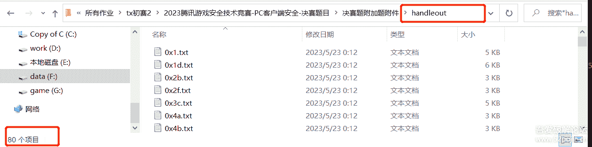

`4全部handle跟踪.png`（53.12 KB，下载次数：1）

[https://www.52pojie.cn/forum.php?mod=attachment&aid=MjYxNzM0OXw0NmI2YjU4N3wxNzkzNTczNTM1fDE2ODA4NnwxNzg5ODky&nothumb=yes](https://www.52pojie.cn/forum.php?mod=attachment&aid=MjYxNzM0OXw0NmI2YjU4N3wxNzkzNTczNTM1fDE2ODA4NnwxNzg5ODky&nothumb=yes)

2023-5-26 00:48 上传

一共有 80 个不同功能的 `tvmopcode`，为节省篇幅，我这里挑一个常见的讲解，全部的 `handle` 分析，其余的全部放在（`handle_out/`）

（那个特别多的是 `int3`，应该是预留以后更新用的）

我静态跟踪 `handle` 是以 `jnb` 为结尾的（就是判断是否大于 `0xc8` 后的 `jnb`），所以跟踪文件后半段有一些不用看。

```
0xe8 p_a b_ULONG64

0x3F26

*(PULONG64)p_a = b_ULONG64;

v_mov_iregll_ll

----------------------------------------//虚线以上是分析出来的

0x1400d60f5 : mov     r9, [rbp+8]

0x1400d6102 : mov     r8w, [r9]                       这里取2字节 (取虚拟寄存器都是取2字节)

0x1400d6106 : xor     r8w, 3F26h                      异或 3F26(不同的handl异或的值不同) 得到 a,

0x1400d610c : mov     rdx, 0F84A86395161A270h         所以就是取虚拟机寄存器  V_REG_P + a

0x1400d6116 : not     rdx

0x1400d6119 : jmp     loc_1400D9077

0x1400d9078 : lea     rdx, [r10+rdx]

0x1400d907c : movzx   r8, r8w

0x1400d9080 : mov     rcx, 7B579C6AE9E5D8Eh

0x1400d908a : not     rcx

0x1400d908d : add     r8, rcx

0x1400d9090 : lea     r8, [rdx+r8]                    p_a = r8 = V_REG_P + a

0x1400d9094 : lea     r9, [r9+2]                      V_RIP+=2

0x1400d909b : mov     rdx, [r9]                       b_ULONG64  从tvm指令表中取8字节

0x1400d909e : jmp     loc_1400DA2DD

0x1400da2ed : mov     [r8], rdx                       放入 [r8],即放入 p_a

0x1400da2f0 : jmp     loc_1400DA9AC

0x1400da9b4 : lea     r9, [r9+8]                      V_RIP+=8

0x1400da9be : mov     [rbp+8], r9                     V_RIP放回[rbp+8]

0x1400da9c8 : jmp     loc_1400DAC79

0x1400dac7c : mov     r9, [rbp+8]                     这里以下属于下一个handle分发，不用看

0x1400dac89 : mov     r8b, [r9]

0x1400dac8c : xor     r8b, 5Dh

0x1400dac90 : mov     rdx, 0D3676A56DAFF3C65h

0x1400dac9a : jmp     loc_1400D7763

0x1400d7764 : not     rdx

0x1400d7767 : lea     rdx, [r9+rdx]

0x1400d776b : mov     r9, 2C9895A92500C398h

0x1400d7775 : not     r9

0x1400d7778 : lea     r9, [rdx+r9]

0x1400d777f : jmp     loc_1400D5B91

0x1400d5b95 : mov     [rbp+8], r9

0x1400d5b9e : movzx   r8, r8b

0x1400d5ba2 : sub     r8, 1; switch 200 cases

0x1400d5ba6 : jmp     loc_1400D98A8

0x1400d98aa : cmp     r8, 0C8h

0x1400d98b1 : jnb     def_1400D655C;
```

我对 `tvmAsm` 的命名规则：

```
v_opcode_op0_op1_op2_....._opn

例如:
v_mov_iregw_iregw :
从虚拟寄存器op1 取 2字节 放入虚拟寄存器op0
w 表示 USHORT

v_mov_ipreg_iregl :
从虚拟机寄存器op1 取4字节，放入以虚拟机寄存器op0作为地址的空间，有点类似与:
mov [reg],reg

v_mov_iregb_b :
从tvm指令表中取1字节放入虚拟机寄存器op0中,类似于Asm中的立即数赋值:
mov reg,0xff

v_and_oregl_iregl_iregl_oregl:(i 就是 in ，o 就是 out 的意思)
取虚拟寄存器op1 和 虚拟寄存器op2进行与运算，并将结果放入虚拟寄存器op0，与运算后的 rflag 放入 虚拟寄存器op3
l 表示 ULONG32

v_cmp_iregll_iregll_oregl:
即为 cmp 虚拟寄存器op0,虚拟寄存器op1 ，cmp后的rflag 放入 虚拟寄存器op2
ll 表示 ULONG64
```

我这里直接将全部 `tvmAsm` 展示出来：（参考 `idapython/deTvm.py`，`tvmHandleTableInit()`）

```
TVMTABEL.append("v_sar_oregll_iregll_iregb_oregl",0x01,0xF8BE)

    TVMTABEL.append("v_or_oregll_iregll_iregll_oregl",0x1D,0x4AA7)

    TVMTABEL.append("v_mov_iregll_iregl",0x2B,0xBF3E)

    TVMTABEL.append("v_movzx_iregl_iregb",0x2F,0x7EE9)

    TVMTABEL.append("v_ror_oregb_iregb_iregb_oregl",0x3C,0xF8E1)

    TVMTABEL.append("v_mov_iregl_iregl",0x4A,0x564B)

    TVMTABEL.append("v_mov_iregw_iregw",0x4B,0xD916)

    TVMTABEL.append("v_add_oregb_iregb_iregb_oregl",0x4C,0xDD9D)

    TVMTABEL.append("v_add_oregll_iregll_iregll",0x4D,0x477D)

    TVMTABEL.append("v_add_oregl_iregl_iregl_oregl",0x4E,0xA9C7)

    TVMTABEL.append("v_add_oregw_iregw_iregw_oregl",0x4F,0x82BC)

    TVMTABEL.append("v_sub_oregl_iregl_iregl_oregl",0x5A,0xC198)

    TVMTABEL.append("v_sar_oregl_iregl_iregb_oregl",0x06,0x8374)

    TVMTABEL.append("v_and_oregl_iregl_iregl_oregl",0x6A,0x5CF0)

    TVMTABEL.append("v_and_oregll_iregll_iregll_oregl",0x6D,0xD9B1)

    TVMTABEL.append("v_and_oregl_iregl_iregl",0x6E,0xA1CE)

    TVMTABEL.append("v_xor_oregl_iregl_iregl_oregl",0x7A,0xD8ED)

    TVMTABEL.append("v_mov_ipreg_iregll",0x7D,0xD878)

    TVMTABEL.append("v_shr_oregll_iregll_iregb_oregl",0x09,0x9D87)
```


## TVM 指令表

```
TVMTABEL.append("v_int3",[0x9a,0x9b,0x98,0x99,0x9c,0x9d,0xe2,0xe3,0xe0,0xe1,0xe6,0xe7,0xe4,0xeb,0xec,0xed,0xf2,0xf3,0xf0,0xf1,0xf6,0xf7,0xf5,0xfa,0xfb,0xf9,0xfe,0xff,0xc2,0xc0,0xc1,0xc6,0xc7,0xc4,0xc5,0xc8,0xce,0xcf,0xcc,0xcd,0xdb,0xd8,0xde,0xdf,0xdc,0xdd,0x23,0x26,0x27,0x24,0x2a,0x28,0x2e,0x2c,0x2d,0x32,0x33,0x30,0x31,0x36,0x37,0x34,0x35,0x3a,0x3b,0x38,0x39,0x3e,0x3f,0x3d,0x2,0x3,0x0,0x7,0x4,0x5,0xa,0xb,0x8,0xe,0xf,0xd,0x12,0x13,0x10,0x17,0x14,0x15,0x1a,0x1b,0x18,0x1e,0x1f,0x1c,0x63,0x61,0x66,0x67,0x64,0x6b,0x69,0x6f,0x6c,0x71,0x76,0x77,0x74,0x7b,0x79,0x7e,0x7f,0x7c,0x53,0x50,0x55,0x5b,0x58,0x59,0x5e,0x5f,0x5c],0x0000)
TVMTABEL.append("v_jmp_iregxR11",0x9E,0x0AD7)
TVMTABEL.append("v_jmp_iregxR10",0x9F,0x2E72)
TVMTABEL.append("v_shl_oregll_iregll_iregb_oregl",0x11,0x5403)
TVMTABEL.append("v_shl_oregl_iregl_iregb_oregl",0x16,0xEEF7)
TVMTABEL.append("v_not_oregll_iregll",0x19,0x1400)
TVMTABEL.append("v_setz_oregb_iregl",0x20,0x0D45)
TVMTABEL.append("v_movsxd_iregll_iregl",0x21,0x8BC8)
TVMTABEL.append("v_setR8d_iregl",0x22,0x77D7)
TVMTABEL.append("v_movsx_iregl_iregb",0x25,0xD8E4)
TVMTABEL.append("v_movzx_iregl_iregw",0x29,0xF10A)
TVMTABEL.append("v_mov_ipreg_iregb",0x40,0xE304)
TVMTABEL.append("v_mov_iregll_ipreg",0x41,0xE229)
TVMTABEL.append("v_mov_ipreg_iregl",0x42,0x5431)
TVMTABEL.append("v_mov_ipreg_iregw",0x43,0x02CB)
TVMTABEL.append("v_mov_iregb_ipreg",0x44,0xBE8C)
TVMTABEL.append("v_mov_iregll_iregll",0x45,0x58FB)
TVMTABEL.append("v_mov_iregl_ipreg",0x46,0x10BC)
TVMTABEL.append("v_mov_iregw_ipreg",0x47,0x6F62)
TVMTABEL.append("v_mov_iregb_iregb",0x48,0xCFFE)
TVMTABEL.append("v_add_oregll_iregll_iregll_oregl",0x49,0x41AA)
TVMTABEL.append("v_not_oregll_iregll",0x51,0xDB42)
TVMTABEL.append("v_add_oregl_iregl_iregl",0x52,0x77C6)
TVMTABEL.append("v_not_oregb_iregb",0x54,0xDCF3)
TVMTABEL.append("v_not_oregl_iregl",0x56,0xE297)
TVMTABEL.append("v_not_oregw_iregw",0x57,0x666D)
TVMTABEL.append("v_or_oregb_iregb_iregb_oregl",0x60,0xFBFD)
TVMTABEL.append("v_or_oregl_iregl_iregl_oregl",0x62,0x7819)
TVMTABEL.append("v_and_oregll_iregll_iregll_oregl",0x65,0x2954)
TVMTABEL.append("v_and_oregb_iregb_iregb_oregl",0x68,0xD8A5)
TVMTABEL.append("v_and_oregb_iregb_iregb_oregl",0x70,0x64D1)
TVMTABEL.append("v_and_oregl_iregl_iregl_oregl",0x72,0x4A64)
TVMTABEL.append("v_and_oregw_iregw_iregw_oregl",0x73,0xB562)
TVMTABEL.append("v_xor_oregll_iregll_iregll_oregl",0x75,0x69C2)
TVMTABEL.append("v_xor_oregb_iregb_iregb_oregl",0x78,0x19C1)
TVMTABEL.append("v_ret_iregx",0x95,0x805C)
TVMTABEL.append("v_shr_oregb_iregb_iregb_oregl",0x0c,0x62D7)
TVMTABEL.append("v_dec_oregl_iregl_oregl",0xc3,0x467C)
TVMTABEL.append("v_inc_oregb_iregb_oregl",0xc9,0x4267)
TVMTABEL.append("v_inc_oregll_iregll_oregl",0xca,0x6EE0)
TVMTABEL.append("v_inc_oregl_iregl_oregl",0xcb,0x7FB4)
TVMTABEL.append("v_test_iregw_iregw_oregl",0xd0,0x0499)
TVMTABEL.append("v_test_iregb_iregb_oregl",0xd1,0x2A99)
TVMTABEL.append("v_test_iregll_iregll_oregl",0xd2,0x8606)
TVMTABEL.append("v_test_iregl_iregl_oregl",0xd3,0x7FDE)
TVMTABEL.append("v_cmp_iregw_iregw_oregl",0xd4,0x87DF)
TVMTABEL.append("v_cmp_iregb_iregb_oregl",0xd5,0x3728)
TVMTABEL.append("v_cmp_iregll_iregll_oregl",0xd6,0x637D)
TVMTABEL.append("v_cmp_iregl_iregl_oregl",0xd7,0xCBEF)
TVMTABEL.append("v_sbb_oregb_iregb_iregb_oregl",0xd9,0x3F78)
TVMTABEL.append("v_sbb_oregll_iregll_iregll_oregl",0xda,0x0E0D)
TVMTABEL.append("v_jmp_iregxRax",0xe5,0xCD84)
TVMTABEL.append("v_mov_iregll_ll",0xe8,0x3F26)
TVMTABEL.append("v_mov_iregl_l",0xe9,0x448A)
TVMTABEL.append("v_mov_iregll_ll",0xea,0x43EF)
TVMTABEL.append("v_mov_iregw_w",0xee,0x44B1)
TVMTABEL.append("v_mov_iregb_b",0xef,0x144C)
TVMTABEL.append("v_mul_oregll_oregll_iregll_iregll",0xf4,0xEB97)
TVMTABEL.append("v_jmp_ll",0xf8,0x0000)
TVMTABEL.append("v_rep stosb_iregll_iregb_iregll",0xfc,0x8D54)
TVMTABEL.append("v_je_iregb_ll_ll",0xfd,0xDE5E)
```

## 解释

`TVMTABEL.append` 第一个参数是我给 `tvmAsm` 取的名字，第二个参数就是 `tvmopcode`，第三个参数是：如果这个 `handle` 要取虚拟寄存器，就必须通过这个值解密取得虚拟寄存器，就像是我上文中解释的：

```
TVMTABEL.append("v_mov_iregll_ll",0xe8,0x3F26)
```

这里再挑几个特殊说明一下：

- `TVMTABEL.append("v_jmp_ll",0xf8,0x0000)`：因为有一些指令，`tvm` 并没有对其进行模拟，所以需要临时退出虚拟机，然后执行那种指令，再返回虚拟机。（下文细说）
- `TVMTABEL.append("v_je_iregb_ll_ll",0xfd,0xDE5E)`：当虚拟机寄存器 `op0` 为 `0x1` 时，`V_RIP + op1`，否则 `V_RIP + op2`，以实现虚拟机内的跳转。
- `TVMTABEL.append("v_ret_iregx",0x95,0x805C)`：这是退出虚拟机的 `tvmasm`，具体实现是恢复原始寄存器，然后通过 `ret` 退出虚拟机。
- `TVMTABEL.append("v_jmp_iregxR11",0x9E,0x0AD7)`、`TVMTABEL.append("v_jmp_iregxR10",0x9F,0x2E72)`、`TVMTABEL.append("v_jmp_iregxRax",0xe5,0xCD84)`：这三个 `tvmasm` 也是恢复原始寄存器，但是是通过 `jmp` 跳出虚拟机：`jmp r11`、`jmp r10`、`jmp rax`。
- `TVMTABEL.append("v_mul_oregll_oregll_iregll_iregll",0xf4,0xEB97)`：乘法，虚拟机寄存器 `op2 * op3`，结果高 64 位放入虚拟机寄存器 `op0`，低 64 位放入虚拟机寄存器 `op1`。

把 `tvm` 的跟踪规则写好后，就可以跟踪导出这个函数的虚拟化控制流：跟踪参考 `idapython/deTvm.py` . `traceTask.track()`

## 3> 获取 `tvmAsmTrace`

这是我挑的一个短的函数：`0x140001250`，参考 `trace_file/sub_0x140001250.log`。

使用函数 `traceTask.track(0) + traceTask.traceOut()`，输出如下：

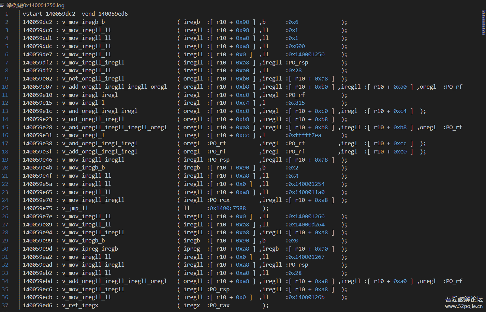

5 jld.png (183.04 KB, 下载次数: 1)

[附件下载](https://www.52pojie.cn/forum.php?mod=attachment&aid=MjYxNzM1MHwwMzA0ZGFlMHwxNzkzNTczNTM1fDE2ODA4NnwxNzg5ODky&nothumb=yes)

2023-5-26 00:48 上传

### `PO_reg` 的来源

可能会好奇这些 `PO_reg` 怎么来的，其实这是我对 `traceCode` 的优化：

```
XXREGNAME = {"PO_rax":0x08,
             "PO_rbx":0x10,
             "PO_rcx":0x18,
             "PO_rdx":0x20,
             "PO_rsp":0x28,
             "PO_rbp":0x30,
             "PO_rsi":0x38,
             "PO_rdi":0x40,
             "PO_r8":0x48,
             "PO_r9":0x50,
             "PO_r10":0x58,
             "PO_r11":0x60,
             "PO_r12":0x68,
             "PO_r13":0x70,
             "PO_r14":0x78,
             "PO_r15":0x80,
             "PO_rf":0x88}
```

正常的取虚拟机寄存器都是 `[r10 + xxx]`，`r10` 就是 `V_REG_P`，前面说过了，看下面这一段（前面也出现过）。

```
[1638]        UnKnow                            V_REG_P = r10 = 1638 //虚拟机的虚拟寄存器从 1638 开始往下都是
[1640](r11+0)        rax                                                                //这里以下是进入虚拟机前的寄存器状态
[1648](r11+8)        rbx
[1650](r11+10)        rcx
[1658](r11+18)        rdx
[1660](r11+20)        rsp
[1668](r11+28)        rbp
[1670](r11+30)        rsi
[1678](r11+38)        rdi
[1680](r11+40)        r8
[1688](r11+48)        r9
[1690](r11+50)        r10
[1698](r11+58)        r11
[16a0](r11+60)        r12
[16a8](r11+68)        r13
[16b0](r11+70)        r14
[16b8](r11+78)        r15
[16c0](r11+80)        rflag
```

例如 `PO_r8` 其实就是 `[r10 + 0x48]`。

所以 `tvmAsm` 对 `PO_reg` 操作可以理解为对虚拟机外的真实寄存器操作。

## 4> `tvmAsm` to `Asm`

这里我使用了标记 `working` + 赋值表记录的方法，将所有有意义的 `tvmAsm` 找出来。

先说哪种 `tvmAsm` 会被标记为 `working`：（标记为 `working` 表明至少可以还原出一条原始 `Asm`）


# TVM 指令还原与 Asm 还原分析

## 指令识别与还原推测

```text
v_mov_iregll_iregll                ( iregll :PO_rsp         ,iregll :[ r10 + 0xa8 ]  );
```

第一个参数必须为原始寄存器 `PO_reg`。这一句，会将 `[r10 + 0xa8]` 的值放入 `PO_rsp`，那么我们就可以推测，原 Asm 可能为 `mov rsp,xxx`（也不一定对，但至少可以还原出一条 Asm）。

```text
v_mov_ipreg_iregll                ( iregll :PO_rsp         ,iregll :[ r10 + 0xa8 ]  );
```

同理可以推测原 Asm 为 `mov qword ptr[rsp],xxx`（也不一定对，但至少可以还原出一条 Asm）。

```text
v_jmp_ll                           ( ll     :0x1400c7588     );
```

上文说过，`tvm` 并不能模拟全部指令，有一些指令需要临时退出虚拟机去执行，所以遇到这种指令，必然可以还原出一条 Asm。

`v_ret_iregx`、`v_jmp_iregxR11`、`v_jmp_iregxR10`、`v_jmp_iregxRax`

上文说过，这几个指令可以直接还原成 `ret`、`jmp r11`、`jmp r10`、`jmp rax`。

`v_je_iregb_ll_ll`

这个可以还原出 `jcc + jmp`（下文详解）。

`v_rep stosb_iregll_iregb_iregll`

这个可以还原出 `rep stosb`，不用管参数。

`v_test_iregx_iregx_oregl`

可以还原成 `test`。

`v_cmp_iregx_iregx_oregl`

可以还原成 `cmp`。

只要标记好这几个点，就能还原出全部的 Asm。参考（`idapython/deTvm.py` 中的 `traceTask.track()`）。

那么我们标记好后，这段 `tvm` 指令就如下：

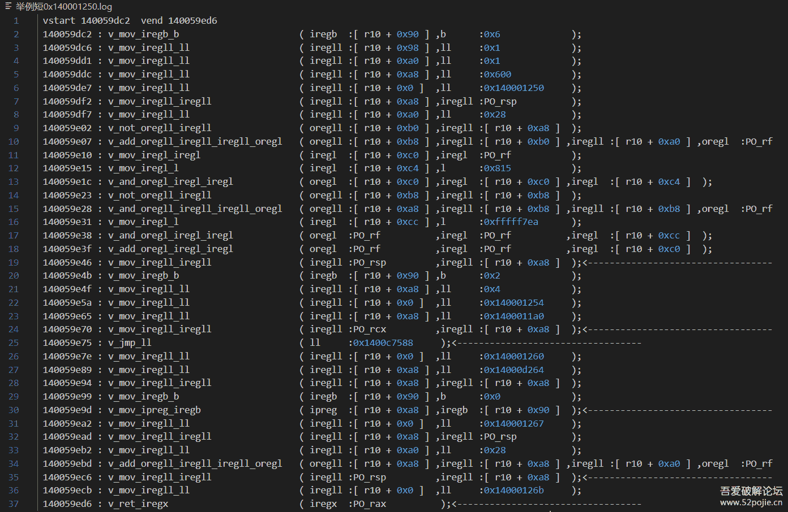

8 标记.png (180.82 KB, 下载次数: 1)

[附件下载](https://www.52pojie.cn/forum.php?mod=attachment&aid=MjYxNzM1M3xlNTkwY2E1Y3wxNzkzNTczNTM1fDE2ODA4NnwxNzg5ODky&nothumb=yes)

2023-5-26 00:49 上传

箭头指着的就是标记为 `working` 的 TraceCode。那么接下来要干嘛，就很清晰了，把相关的 traceCode 找出来（变量溯源）。

## 标记 `working` TraceCode 与变量溯源

### 例子1

这一句被标记为 `working`，我们找他使用的参数的赋值语句，直到找到整数或 `PO_reg`。

```text
140059e46 : v_mov_iregll_iregll                ( iregll :PO_rsp         ,iregll :[ r10 + 0xa8 ]  );
```

我们把 `[r10 + 0xa8]` 的赋值语句找出来（往上找）：

```text
140059e28 : v_and_oregll_iregll_iregll_oregl   ( oregll :[ r10 + 0xa8 ] ,iregll :[ r10 + 0xb8 ] ,iregll :[ r10 + 0xb8 ] ,oregl  :PO_rf           );
```

这一句用到了 `[r10 + 0xb8]`，找它的赋值语句：

```text
140059e23 : v_not_oregll_iregll                ( oregll :[ r10 + 0xb8 ] ,iregll :[ r10 + 0xb8 ]  );
```

又是 `[r10 + 0xb8]`，再往上找：

```text
140059e07 : v_add_oregll_iregll_iregll_oregl   ( oregll :[ r10 + 0xb8 ] ,iregll :[ r10 + 0xb0 ] ,iregll :[ r10 + 0xa0 ] ,oregl  :PO_rf           );
```

用到 `[r10 + 0xb0]` 和 `[r10 + 0xa0]`，往上找：

`[r10 + 0xb0]`：

```text
140059e02 : v_not_oregll_iregll                ( oregll :[ r10 + 0xb0 ] ,iregll :[ r10 + 0xa8 ]  );
```

`[r10 + 0xa0]`：

```text
140059df7 : v_mov_iregll_ll                    ( iregll :[ r10 + 0xa0 ] ,ll     :0x28            );
```

`[r10 + 0xa0]` 找到尽头了，`[r10 + 0xb0]` 还没找到尽头，继续往上找 `[r10 + 0xa8]` 的赋值语句：

```text
140059df2 : v_mov_iregll_iregll                ( iregll :[ r10 + 0xa8 ] ,iregll :PO_rsp          );
```

找到尽头，是将 `PO_rsp` 放入。我们把这些 traceCode 放在一起：

参考 `idapython/deTvm.py` 中的 `traceTask.VRegRecord()`

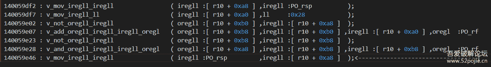

9 还原一句.png (39.75 KB, 下载次数: 0)

[附件下载](https://www.52pojie.cn/forum.php?mod=attachment&aid=MjYxNzM1NHxkMTMzNzEyOHwxNzkzNTczNTM1fDE2ODA4NnwxNzg5ODky&nothumb=yes)

2023-5-26 00:55 上传

这样也有点不好看，用变量传播优化一下：

参考 `idapython/deTvm.py` 中的 `tvmToAsm.optimize()`

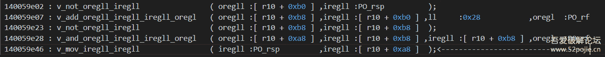

10 还原一句 变量传播优化.png (30.94 KB, 下载次数: 0)

[附件下载](https://www.52pojie.cn/forum.php?mod=attachment&aid=MjYxNzM1NXwxNWQ2MmJiOXwxNzkzNTczNTM1fDE2ODA4NnwxNzg5ODky&nothumb=yes)

2023-5-26 00:55 上传

这一些 traceCode，就可以还原出一句 Asm：（以下我们对这一段可还原成 Asm 的 TraceCode 集合统称为一个 `tvmToAsm` 结构）

```text
[r10 + 0xb8] =  ~(~rsp + 0x28) = rsp - 0x28           //前五句结合

[r10 + 0xa8] = [r10 + 0xb8] & [r10 + 0xb8] = [r10 + 0xb8]    //没变化
```

于是这一段就可以还原成：

```text
sub rsp,0x28
```

为什么是 `sub rsp,0x28` 而不是 `lea rsp,[rsp - 0x28]` 是有讲究的：

看 traceCode 中的一句 `v_add_oregll_iregll_iregll_oregl`，他是有输出 `rflag` 的，并且放入的位置就是 `PO_rf`，说明这一句 ASM 是会影响标志位，而 `lea` 是不影响标志位的，所以将它还原成 `sub`。

## 5> 手动还原 Asm

我们顺势对这个函数的所有被标记为 `working` 的 traceCode 进行变量溯源 + 优化，那么最后就可以得到：`tvmToAsmAll`

一个函数内的所有 `tvmToAsm` 组成一个 `tvmToAsmAll`，下图中一段一段的就是 `tvmToAsm`

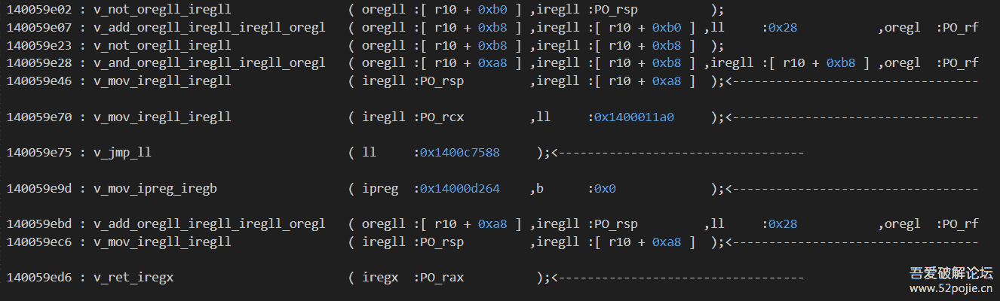

11 优化一个函数.png (57.61 KB, 下载次数: 0)

[附件下载](https://www.52pojie.cn/forum.php?mod=attachment&aid=MjYxNzM1NnxjOWE2ZWE1Y3wxNzkzNTczNTM1fDE2ODA4NnwxNzg5ODky&nothumb=yes)

2023-5-26 00:55 上传

看，真正有效的就这一些，其余的都可以看作花指令。所以这个函数的原始 ASM 就是：（手动还原）

```text
sub rsp,0x28

mov rcx,0x1400011a0

call    sub_140005E38                                #下文解释为什么 V_jmp_ll(0x1400c7588) 可以转换成 这个

mov byte ptr[0x14000d264],0x0

add rsp,0x28

ret
```

### 关于 `v_jmp_ll`

上文说过，`tvm` 不能模拟全部的 Asm，所以有些 Asm 需要暂时退出虚拟机执行，然后再返回虚拟机：

我们到 `0x1400c7588`，然后往下跟（中间是还原真实寄存器），直到出现 `mov rsp,[rsp]`，之后的下一句就是真实需要执行的 ASM 了。即为 `call sub_140005E38`。

接下来会重新进入虚拟机，步骤和上文进入虚拟机的步骤大致相同。

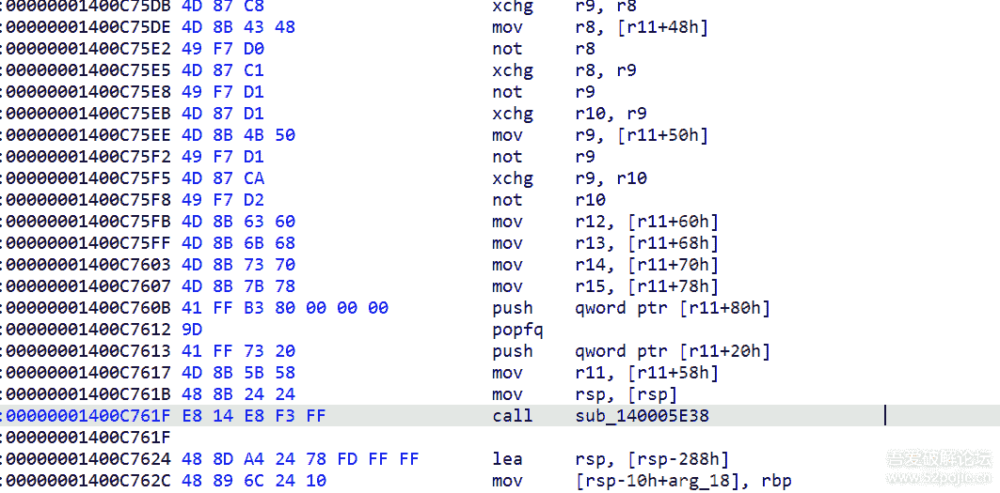

12 v_jmp_ll.png (75.82 KB, 下载次数: 0)

[附件下载](https://www.52pojie.cn/forum.php?mod=attachment&aid=MjYxNzM1N3wyMDQ2YWNkZXwxNzkzNTczNTM1fDE2ODA4NnwxNzg5ODky&nothumb=yes)

2023-5-26 00:55 上传

所以 `v_jmp_ll` 是最容易还原成 Asm 之一的 `tvmAsm` 了。

参考 `idapython/deTvm.py` 中的 `tvmToAsm.vjmp_handle()`

## 5> 补充：查找 `workingTraceCode` 的相关 traceCode

关于如何找到 `workingTraceCode` 的相关 traceCode，我的方案如下：（如果你有其他方案，可以不用看这一段）

把全部 traceCode 的赋值语句找出来，然后给相关虚拟机寄存器添加赋值记录，形成一张赋值表，例如：

```text
140059dc2 : v_mov_iregb_b                      ( iregb  :[ r10 + 0x90 ] ,b      :0x6             );
140059dc6 : v_mov_iregll_ll                    ( iregll :[ r10 + 0x98 ] ,ll     :0x1             );
140059dd1 : v_mov_iregll_ll                    ( iregll :[ r10 + 0xa0 ] ,ll     :0x1             );
140059ddc : v_mov_iregll_ll                    ( iregll :[ r10 + 0xa8 ] ,ll     :0x600           );
140059de7 : v_mov_iregll_ll                    ( iregll :[ r10 + 0x0 ]  ,ll     :0x140001250     );
140059df2 : v_mov_iregll_iregll                ( iregll :[ r10 + 0xa8 ] ,iregll :PO_rsp          );
140059df7 : v_mov_iregll_ll                    ( iregll :[ r10 + 0xa0 ] ,ll     :0x28            );
140059e02 : v_not_oregll_iregll                ( oregll :[ r10 + 0xb0 ] ,iregll :[ r10 + 0xa8 ]  );
140059e07 : v_add_oregll_iregll_iregll_oregl   ( oregll :[ r10 + 0xb8 ] ,iregll :[ r10 + 0xb0 ] ,iregll :[ r10 + 0xa0 ] ,oregl  :PO_rf           );
```

我就可以得到这么一张表：

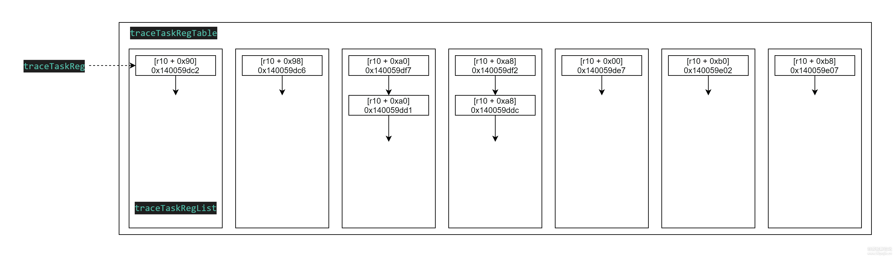

13 赋值表结构.png (85.22 KB, 下载次数: 0)

[附件下载](https://www.52pojie.cn/forum.php?mod=attachment&aid=MjYxNzM1OHwzYWIwZjBjYXwxNzkzNTczNTM1fDE2ODA4NnwxNzg5ODky&nothumb=yes)

2023-5-26 00:55 上传

`traceTaskRegTable` 为总赋值表，`traceTaskRegList` 为单个虚拟机寄存器的赋值栈，`traceTaskReg` 为入栈的单个记录。

相关定义参考：`idapython/deTvm.py` 的三个类，命名同上。

当需要检索这一句 traceCode 的相关 traceCode 时：

```text
140059e02 : v_not_oregll_iregll                ( oregll :[ r10 + 0xb0 ] ,iregll :[ r10 + 0xa8 ]  );
```

就可以直接查表，先找到 `[r10 + 0xa8]` 的赋值记录栈 `traceTaskRegList`，然后通过地址找到最近的一次赋值 `traceTaskReg`，然后 `traceTaskReg` 记录了这一句 traceCode，就可以找到了。

于是就找到了相关 traceCode：

```text
140059df2 : v_mov_iregll_iregll                ( iregll :[ r10 + 0xa8 ] ,iregll :PO_rsp          );
```

因为是将 `PO_reg` 赋值给它，所以到此检索完毕，如果不是，则按照相同的方法继续往上找。

相关代码参考：`idapython/deTvm.py` 中的 `traceTask.VRegRecord()`

## 一些特殊的例子

例如有两个连续的 `tvmToAsm`，导出的相关 traceCode 如下：

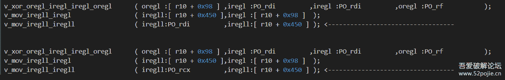

14 标记法.png (34.28 KB, 下载次数: 1)

[附件下载](https://www.52pojie.cn/forum.php?mod=attachment&aid=MjYxNzM1OXxlYTlmMzA3ZnwxNzkzNTczNTM1fDE2ODA4NnwxNzg5ODky&nothumb=yes)

2023-5-26 01:02 上传

我们可以发现，有两段相关 traceCode 是相同的，这就出现问题了：

第一个 `tvmToAsm` 可以翻译成 `xor edi,edi`，那么第二个 `tvmToAsm` 能翻译成什么呢？

如果我们人为识别，就可以将其翻译成 `mov ecx,edi`，因为 `[r10 + 450]` 在前面已经放入了 `PO_rdi`，下面又取它放入 `PO_rcx`。

于是我们可以进行优化，如果有一句 `v_mov_iregx_iregx(PO_reg , xxxx)`，那么我们就可以将 `xxxx` 的上一次赋值标记为 `PO_reg`，还是以上面的那一段代码为例：

```text
v_mov_iregll_iregll                ( iregll:PO_rdi         ,iregll:[ r10 + 0x450 ] ); 
```

`[r10 + 0x450]` 上一次赋值语句为：


## 标记法优化

`v_mov_iregll_iregl( iregll:[ r10 + 0x450 ],iregl :[ r10 + 0x98 ] );`

我们可以将其标记为 `PO_rdi`，那么当其他的 `workingTraceCode` 向上进行查找赋值表的时候，就可以找到 `PO_rdi`，于是就优化为了：

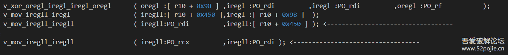

15 标记法优化.png (23.83 KB, 下载次数: 1)

[附件下载](https://www.52pojie.cn/forum.php?mod=attachment&aid=MjYxNzM2MHwwMTY3YzNlZXwxNzkzNTczNTM1fDE2ODA4NnwxNzg5ODky&nothumb=yes)

2023-5-26 01:06 上传

实现代码参考：`idapython/deTvm.py . traceTask.VRegRecord()`

## 关于 `push` 和 `pop`

### `push`

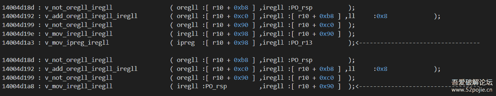

16 push 举例0.png (48.38 KB, 下载次数: 1)

[附件下载](https://www.52pojie.cn/forum.php?mod=attachment&aid=MjYxNzM2MXxkMTVkZDQzMHwxNzkzNTczNTM1fDE2ODA4NnwxNzg5ODky&nothumb=yes)

2023-5-26 01:06 上传

这是两个连续的 `tvmToAsm`。

如果按照一般的分析方式，那么这两句可以翻译为：

```
mov qword ptr[rsp - 0x8],r13
lea rsp,[rsp - 8]
```

乍一看没什么问题，就是将 `push r13` 分开成两句执行，可是如果是 `pop`，那么情况就有点不同了：

### `pop`

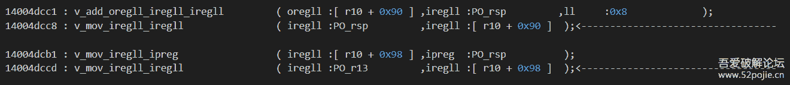

17 pop举例.png (25.78 KB, 下载次数: 0)

[附件下载](https://www.52pojie.cn/forum.php?mod=attachment&aid=MjYxNzM2Mnw1NGMzZWVmY3wxNzkzNTczNTM1fDE2ODA4NnwxNzg5ODky&nothumb=yes)

2023-5-26 01:06 上传

如果按照一般的分析方式，那么这两句可以翻译为：

```
lea rsp,[rsp + 8]

mov r13,qword ptr[rsp]
```

这就出问题了，这两句并不等于 `pop r13` 指令，那么问题出在哪呢，我们取消掉变量传播优化再看看：

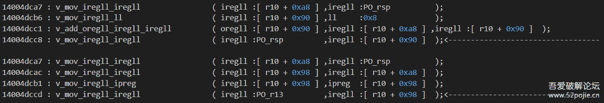

18 取消优化pop.png (42.91 KB, 下载次数: 1)

[附件下载](https://www.52pojie.cn/forum.php?mod=attachment&aid=MjYxNzM2M3w4MjY0MjNhY3wxNzkzNTczNTM1fDE2ODA4NnwxNzg5ODky&nothumb=yes)

2023-5-26 01:06 上传

问题就出在，这两句 `workingTraceCode` 在进行变量溯源时，都找到了 `0x14004dca7` 这一句，

将 `PO_rsp` 放入虚拟机寄存器 `[r10 + 0xa8]`，并且在第一句 `workingTraceCode` 中，又更改了 `PO_rsp` 的值，所以导致出错。

幸运的是这种情况只会出现在 `push` 和 `pop` 中（参考 `idapython/deTvm.py . tvmToAsmAll.outerror()`），

所以我们要对 `push` 和 `pop` 特殊处理，请参考：`idapython/deTvm.py . tvmToAsmAll.findPushAndPop()`

特殊处理、优化后的 `push` 和 `pop`：

#### `push`

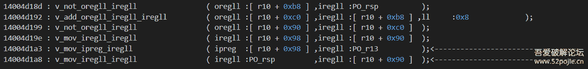

19优化后的push.png (34.1 KB, 下载次数: 0)

[附件下载](https://www.52pojie.cn/forum.php?mod=attachment&aid=MjYxNzM2NHxlY2I4YjQ1OXwxNzkzNTczNTM1fDE2ODA4NnwxNzg5ODky&nothumb=yes)

2023-5-26 01:06 上传

#### `pop`

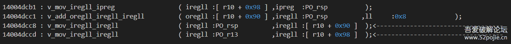

20 优化后的pop.png (25.52 KB, 下载次数: 1)

[附件下载](https://www.52pojie.cn/forum.php?mod=attachment&aid=MjYxNzM2NXxjYmI5MmNkZHwxNzkzNTczNTM1fDE2ODA4NnwxNzg5ODky&nothumb=yes)

2023-5-26 01:06 上传

这就清晰很多了。

## 关于 `jcc`

前置知识：

各个标志位的位置：

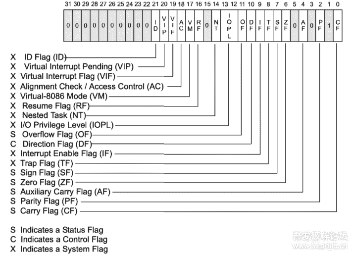

21 rflag.png (133.35 KB, 下载次数: 2)

[附件下载](https://www.52pojie.cn/forum.php?mod=attachment&aid=MjYxNzM2NnwxYmZkZmQ3N3wxNzkzNTczNTM1fDE2ODA4NnwxNzg5ODky&nothumb=yes)

2023-5-26 01:06 上传

```
JO                                jmp if OF = 1
JNO                                jmp if OF = 0
JB JC JNAE                jmp if CF = 1
JNB JNC JAE                jmp if CF = 0
JZ JE                        jmp if ZF = 1
JNZ JNZ                        jmp if ZF = 0
JBE JNA                        jmp if CF = 1 or  ZF = 1
JNBE JA                        jmp if CF = 0 and ZF = 0
JS                                jmp if SF = 1
JNS                                jmp if SF = 0
JP JPE                        jmp if PF = 1
JNP JPO                        jmp if PF = 0
JL JNGE                        jmp if SF != OF
JNL JGE                        jmp if SF = OF
JLE JNG                        jmp if ZF = 1 or SF != OF
JNLE JG                        jmp if ZF = 0 and SF = OF
```

`tvm` 巧妙地利用了 `and`、`sub`、`setz`、`je` 这四种指令模拟一个 `jcc`，例如：

### `JE`

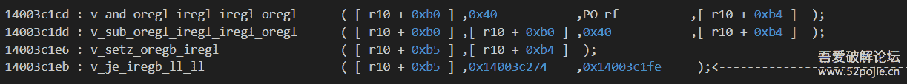

22 vjcc_je.png (24.9 KB, 下载次数: 0)

[附件下载](https://www.52pojie.cn/forum.php?mod=attachment&aid=MjYxNzM2N3w0OGM1NjQ4OHwxNzkzNTczNTM1fDE2ODA4NnwxNzg5ODky&nothumb=yes)

2023-5-26 01:06 上传

（`v_je` 的跳转是通过加减 `V_RIP` 实现的，我这里直接优化成绝对地址，省了我们去计算）

上面的代码，先保留 `rflag` 的 `zf` 位，然后再减去 `zf` 位，如果结果为 `0`，那么 `V_RIP` 就变成 `v_je` 的第二个操作数 `0x14003c274`，否则 `V_RIP` 变为 `0x14003c1fe`。

于是，上面这段 `tvmasm` 可以翻译为：

```
je xxx(V_RIP = 0x14003c274)

jmp xxx(V_RIP = 0x14003c1fe)
```

### `JG`

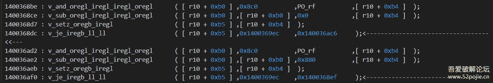

23 vjcc_jg.png (44.97 KB, 下载次数: 1)

[附件下载](https://www.52pojie.cn/forum.php?mod=attachment&aid=MjYxNzM2OHxiMGRlOGUwZHwxNzkzNTczNTM1fDE2ODA4NnwxNzg5ODky&nothumb=yes)

2023-5-26 01:06 上传

第一个 `tvmToAsm`：

如果 `zf = sf = of = 0`，则 `V_RIP = 0x1400369ec`，否则 `V_RIP = 0x140036ac6`（其实就是下面那一段，因为优化了所以地址对不上）。

第二个 `tvmToAsm`：

如果 `zf = 0` 且 `sf = of = 1`，则 `V_RIP = 0x1400369ec`，否则 `VRIP = 0x1400368ef`。

于是，上面这段 `tvmasm` 可以翻译为：

```
jg xxx(V_RIP = 0x1400369ec)
jmp xxx(V_RIP = 0x1400368ef)
```

### 提取特征

`JE` 的特征 `0x40 0x40`（看上图你就知道是什么特征了）。

`JG` 的特征 `0x8c0 0x0 0x8c0 0x880`（看上图你就知道是什么特征了）。

全部的 `jcc` 特征：（代码参考 `idapython/deTvm.py . tvmToAsm.vjcc_handle()`）

```
JBE JNA  

0x41 0x1 0x41 0x40 （这其实是错误的，tvm的bug？）

JGE JNL

0x880 0x0 0x880 0x880

JL JNGE

0x880 0x800 0x880 0x80

JG JNLE

0x8C0 0x0 0x8C0 0x880

JZ JE

0x40 0x40 

JNZ JNE

0x40 0x0 

JS

0x80 0x80 

JNS

0x80 0x0

JC JB JNAE

0x1 0x1 

JNC JNB JAE

0x1 0x0 

JA JNBE

0x41 0x0 

JP JPE

0x4 0x4 0x0 0x0

JNP JPO

0x4 0x0 

JO

0x800 0x800

JNO

0x800 0x0

JLE JNG

0x8C0 0x40          zf

0x8C0 0x800         of

0x8C0 0x80                 sf

0x8C0 0xC0                 zf+sf

0x8C0 0x840         zf+of

0x8C0 0x8C0         zf+of+sf
```

上面我说 `JBE JNA` 的特征是 `0x41 0x1 0x41 0x40`，这其实是错误的：

因为这只是 `jmp if ZF != CF`，真正的 `JBE JNA` 是 `jmp if CF = 1 or ZF = 1`，对应的特征应该是 `0x41 0x1 0x41 0x40 0x41 0x41`。在这个版本的 `tvm` 中，它将 `JBE JNA` 错误处理成了 `jmp if ZF != CF`。

我逆了较新版本的 `tvm`，`JBE JNA` 这里的 bug 就被修复了，就是 `0x41 0x1 0x41 0x40 0x41 0x41`。

（看来 ACE 部门用的 `tvm` 版本不够新啊）

## 脚本还原 ASM

参考 `idapython/deTvm.py . tvmToAsmAll.AllTvmAsmToAsm()`

### 第一步：先识别所有的 `AsmOpcode`

`push` 和 `pop` 在上文已经识别出来了，

`jcc` 在上文也识别出来了，

`tvm` 没有模拟的 `Asm`，也可以通过跟踪 `v_jmp_ll` 得到，上文也说了。

一些明显的 `tvmAsm` 也可以直接识别原本的 `AsmOpcode`：

```
asmOpcode = [
    "sar", "or", "ror", "xor", "shr", "shl", "movsxd",
    "movsx", "movzx", "dec", "inc", "test",
    "cmp", "rep stosb", "sbb", "int3"
]
```

如果 `tvmToAsm` 中的 `traceCode` 的 `tvmAsm` 含有以上的字符串，

那么可以直接将这个 `tvmtoAsm` 的 `AsmOpcode` 设置为对应项，例如：

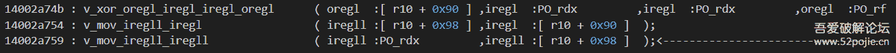

24 xor举例.png (20.83 KB, 下载次数: 0)

[附件下载](https://www.52pojie.cn/forum.php?mod=attachment&aid=MjYxNzM2OXxmMjkxZjM3Y3wxNzkzNTczNTM1fDE2ODA4NnwxNzg5ODky&nothumb=yes)

2023-5-26 01:06 上传

可以直接将 `Asm` 的 `Opcode` 设置成 `xor`，如果要翻译成 `Asm` 的话，就翻译成了 `xor edx,edx`。

如果 `tvmToAsm` 只出现了 `and`，没有出现 `not add`，那么可以识别成 `and`。

如果 `tvmToAsm` 只出现了 `not`，没有出现 `and add`，那么可以识别成 `not`。

以上部分，参考代码：`idapython/deTvm.py . tvmToAsm.setASMOpcode_1()`

### 识别 `lea`、`mov`、`add`、`sub`

识别 `lea`、`mov`、`add`、`sub`，这部分比较复杂，如果是人为识别就简单。

我们先对每一个 `tvmToAsm` 内的 `traceCode` 再进行一次变量分析，列出一个赋值表，类似于上文赋值表的结构。

除此之外，我们还要对其进行标记设置，例如：

`sub`：

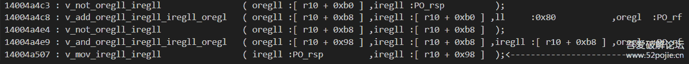

25 跟踪举例1.png (29.27 KB, 下载次数: 1)


# 标记结构与 `AsmOpcode` 识别

[forum.php?mod=attachment&aid=MjYxNzM3MHwwMmM3ZjM2NXwxNzkzNTczNTM1fDE2ODA4NnwxNzg5ODky&nothumb=yes](https://www.52pojie.cn/forum.php?mod=attachment&aid=MjYxNzM3MHwwMmM3ZjM2NXwxNzkzNTczNTM1fDE2ODA4NnwxNzg5ODky&nothumb=yes)

2023-5-26 01:06 上传

## 标记结构

标记的结构：`[handle,tvmPara,IsUseRflag]`，依次是处理手段、虚拟机寄存器、是否使用(输出)标志位。

## `AsmOpcode` 识别示例

### `sub`

```
14004a4c3 : 将 [r10 + 0xb0] 标记为 [not,PO_rsp,False]
14004a4c8 : 将 [r10 + 0xb8] 标记为 [not,PO_rsp,False],[add,0x80,True]                        //会拷贝前一个的标记
14004a4e4 : 将 [r10 + 0xb8] 标记为 [not,PO_rsp,False],[add,0x80,True],[not,None,False] 
                        -优化-> [None,PO_rsp,False],[sub,0x80,True]                                                 //会拷贝前一个的标记
14004a4e9 : 将 [r10 + 0x98] 标记为 [None,PO_rsp,False],[sub,0x80,True]                        //会拷贝前一个的标记
```

有了这些标记，再加上 `14004a507` 这一句指令，我们就可以识别这个 `tvmToAsm` 的 `AsmOpcode` 了：

出现 `sub`，且影响标志位，所以为 `sub`。

### `add`

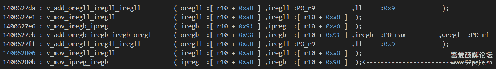

27 add复杂.png (40.72 KB, 下载次数: 0)

[forum.php?mod=attachment&aid=MjYxNzM3MnxhMWVlOGNhM3wxNzkzNTczNTM1fDE2ODA4NnwxNzg5ODky&nothumb=yes](https://www.52pojie.cn/forum.php?mod=attachment&aid=MjYxNzM3MnxhMWVlOGNhM3wxNzkzNTczNTM1fDE2ODA4NnwxNzg5ODky&nothumb=yes)

2023-5-26 01:06 上传

```
1400627da : [r10 + 0xa8] 标记 [None,PO_r9,False],[add,0x9,False]
1400627e1 : 同上
1400627e6 : [r10 + 0x91] 标记 [None,PO_r9,False],[add,0x9,False],[mem,None,False]
1400627eb : [r10 + 0x90] 标记 [None,PO_r9,False],[add,0x9,False],[mem,None,False],[add,PO_rax,True]
1400627ff : [r10 + 0xa8] 标记 [None,PO_r9,False],[add,0x9,False]
140062806 : 同上
```

有了这些标记，再加上 `14006280b` 这一句指令，我们就可以识别这个 `tvmToAsm` 的 `AsmOpcode` 了：

出现了 `add` 标记，并且影响标志位，只能是 `add`。

### `lea`

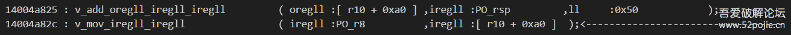

26 lea.png (15.53 KB, 下载次数: 0)

[forum.php?mod=attachment&aid=MjYxNzM3MXxkMTg1NGIzZXwxNzkzNTczNTM1fDE2ODA4NnwxNzg5ODky&nothumb=yes](https://www.52pojie.cn/forum.php?mod=attachment&aid=MjYxNzM3MXxkMTg1NGIzZXwxNzkzNTczNTM1fDE2ODA4NnwxNzg5ODky&nothumb=yes)

2023-5-26 01:06 上传

```
14004a825 : [r10 + 0xa0] 标记 [None,PO_rsp,False],[add,0x50,False]
```

有了这些标记，再加上 `14004a82c` 这一句指令，我们就可以识别这个 `tvmToAsm` 的 `AsmOpcode` 了：

标记中出现了 `add`，且不影响标志位，就只能是 `lea`。

### `mov`

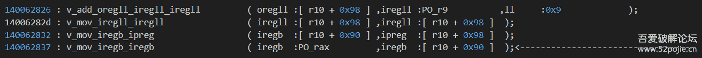

28 mov.png (26.49 KB, 下载次数: 0)

[forum.php?mod=attachment&aid=MjYxNzM3M3w2NDYwNzdiOXwxNzkzNTczNTM1fDE2ODA4NnwxNzg5ODky&nothumb=yes](https://www.52pojie.cn/forum.php?mod=attachment&aid=MjYxNzM3M3w2NDYwNzdiOXwxNzkzNTczNTM1fDE2ODA4NnwxNzg5ODky&nothumb=yes)

2023-5-26 01:06 上传

```
140062826 : [r10 + 0x98] 标记 [None,PO_r9,False],[add,0x9,False]
14006282d : 同上
140062832 : [r10 + 0x90] 标记 [None,PO_r9,False],[add,0x9,False],[mem,None,False]
```

有了这些标记，再加上 `140062837` 这一句指令，我们就可以识别这个 `tvmToAsm` 的 `AsmOpcode` 了：

标记中出现了 `add`，但不影响标志位，并且出现了 `mem`，那么只能是 `mov`。

### 分类参考

以上部分都只是一些简单例子，关于更加严格的 `sub`、`add`、`lea`、`mov` 分类，参考代码：

`idapython/deTvm.py` 中的 `tvmToAsm.record_tage()` 负责跟踪标记。

`idapython/deTvm.py` 中的 `tvmToAsm.setASMOpcode_2()` 负责分类 `sub`、`add`、`lea`、`mov`。

## 第二步：操作数识别

到这里的时候，全部 `tvmToAsm` 的 `AsmOpcode` 都已经全部识别。

首先介绍一个工具函数：`GetAsmPara` 可以将标记转换成 Asm 操作数的格式。

### `mov` 操作数识别

例子和上图是一样的。转换为标记如下：

```
140062826 : [r10 + 0x98] 标记 [None,PO_r9,False],[add,0x9,False]
14006282d : 同上
140062832 : [r10 + 0x90] 标记 [None,PO_r9,False],[add,0x9,False],[mem,None,False]
```

看到 `140062837` 这一条 `workingTraceCode`：

```
v_mov_iregb_iregb          ( iregb  :PO_rax     ,iregb  :[ r10 + 0x90 ]  );
```

看到第二个参数的类型为 `iregb`，是 8bit 宽的操作数。

`GetAsmPara(PO_rax)` 返回 `"al"`。

`GetAsmPara([r10 + 0x90])`：

通过标记 `[None,PO_r9,False]`、`[add,0x9,False]`、`[mem,None,False]`，返回 `"[r9 + 0x9]"`。

我们知道这个 `tvmToAsm` 的 `AsmOpcode` 为 `mov`，且 `workingTraceCode` 的第二个参数类型为 `iregb`，那么我们就可以知道：第一个操作数为 `al`，第二个操作数为 `byte ptr[r9 + 0x9]`。

于是这个 `tvmToAsm` 就可以翻译为：

```
mov al,byte ptr[r9 + 0x9]
```

代码参考：`idapython/deTvm.py` 中的 `tvmToAsm.mov_handle()`。

### `lea` 操作数识别

例子和上图是一样的。转换为标记如下：

```
14004a825 : [r10 + 0xa0] 标记 [None,PO_rsp,False],[add,0x50,False]
```

看到 `14004a82c` 这一条 `workingTraceCode`：

```
v_mov_iregll_iregll                ( iregll :PO_r8          ,iregll :[ r10 + 0xa0 ]  );
```

`GetAsmPara(PO_r8)` 返回 `"r8"`。

`GetAsmPara([r10 + 0xa0])`：

通过标记 `[None,PO_rsp,False]`、`[add,0x50,False]`，返回 `"rsp + 0x50"`（没有中括号，标记中出现 `mem` 才会有中括号，`lea` 要后面自己加中括号）。

我们知道这个 `tvmToAsm` 的 `AsmOpcode` 为 `lea`，且 `workingTraceCode` 的第二个参数类型为 `iregll`，那么我们就可以知道：第一个操作数为 `r8`，第二个操作数为 `[rsp + 0x50]`。

于是这个 `tvmToAsm` 就可以翻译为：

```
lea r8,[rsp + 0x50]
```

代码参考：`idapython/deTvm.py` 中的 `tvmToAsm.lea_handle()`。

### `add` 与 `sub` 操作数识别

用上面 `add` 的例子，但是进行 `GetAsmPara` 的是红框框起来的这两个：（对于 `sub` 的处理是一样的）

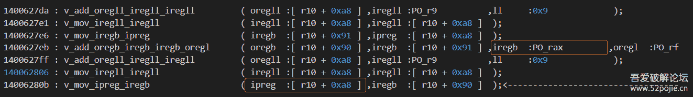

29 add 获取.png (41.31 KB, 下载次数: 1)

[forum.php?mod=attachment&aid=MjYxNzM3NHwzODg3NWY3NXwxNzkzNTczNTM1fDE2ODA4NnwxNzg5ODky&nothumb=yes](https://www.52pojie.cn/forum.php?mod=attachment&aid=MjYxNzM3NHwzODg3NWY3NXwxNzkzNTczNTM1fDE2ODA4NnwxNzg5ODky&nothumb=yes)

2023-5-26 01:06 上传

```
1400627ff : [r10 + 0xa8] 标记 [None,PO_r9,False],[add,0x9,False]
140062806 : 同上
```

对红框的两个参数进行 `GetAsmPara`：

看类型 `iregb`，8bit 宽度。

`GetAsmPara(PO_rax)` 返回 `"al"`。

`GetAsmPara([r10 + 0xa8])`：

标记为：`[None,PO_r9,False]`、`[add,0x9,False]`。

因为 `[r10 + 0xa8]` 类型为 `ipreg`，且 8bit 宽度，所以返回 `"byte ptr[r9 + 0x9]"`。

于是这个 `tvmToAsm` 就可以翻译为：

```
add byte ptr[r9 + 0x9],al
```

代码参考：`idapython/deTvm.py` 中的 `tvmToAsm.add_sub_handle()`。

以下都是对红框框起来的 `tvmPara` 进行 `GetAsmPara`：

### `push`

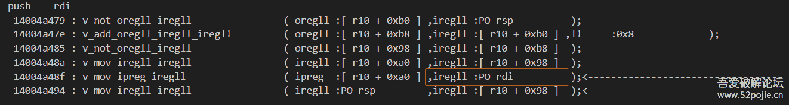

30 push.png (32.67 KB, 下载次数: 1)

[forum.php?mod=attachment&aid=MjYxNzM3NXw5NjhmZWMwYnwxNzkzNTczNTM1fDE2ODA4NnwxNzg5ODky&nothumb=yes](https://www.52pojie.cn/forum.php?mod=attachment&aid=MjYxNzM3NXw5NjhmZWMwYnwxNzkzNTczNTM1fDE2ODA4NnwxNzg5ODky&nothumb=yes)

2023-5-26 01:06 上传

代码参考：`idapython/deTvm.py` 中的 `tvmToAsm.push_handle()`。

### `pop`

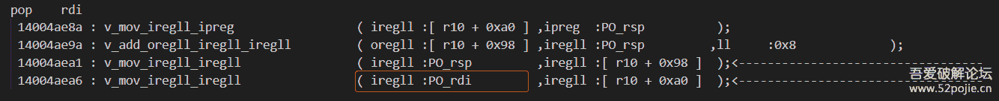

31 pop.png (24.78 KB, 下载次数: 1)

[forum.php?mod=attachment&aid=MjYxNzM3NnwwM2NhYWJkN3wxNzkzNTczNTM1fDE2ODA4NnwxNzg5ODky&nothumb=yes](https://www.52pojie.cn/forum.php?mod=attachment&aid=MjYxNzM3NnwwM2NhYWJkN3wxNzkzNTczNTM1fDE2ODA4NnwxNzg5ODky&nothumb=yes)

2023-5-26 18:56 上传

代码参考：`idapython/deTvm.py` 中的 `tvmToAsm.pop_handle()`。

### `cmp` 与 `test`

#### `cmp`

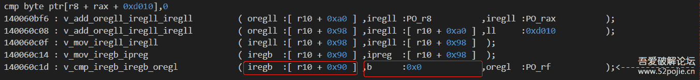

32 cmp.png (34.64 KB, 下载次数: 0)

[forum.php?mod=attachment&aid=MjYxNzM3N3xlMDkzNDViNXwxNzkzNTczNTM1fDE2ODA4NnwxNzg5ODky&nothumb=yes](https://www.52pojie.cn/forum.php?mod=attachment&aid=MjYxNzM3N3xlMDkzNDViNXwxNzkzNTczNTM1fDE2ODA4NnwxNzg5ODky&nothumb=yes)

2023-5-26 01:06 上传

#### `test`

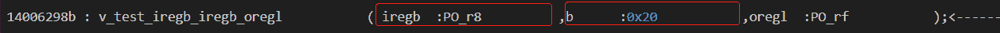

33 test.png (4.01 KB, 下载次数: 1)

[forum.php?mod=attachment&aid=MjYxNzM3OHwzZTdhMjU4N3wxNzkzNTczNTM1fDE2ODA4NnwxNzg5ODky&nothumb=yes](https://www.52pojie.cn/forum.php?mod=attachment&aid=MjYxNzM3OHwzZTdhMjU4N3wxNzkzNTczNTM1fDE2ODA4NnwxNzg5ODky&nothumb=yes)

2023-5-26 01:06 上传

代码参考：`idapython/deTvm.py` 中的 `tvmToAsm.cmp_test_handle()`。

### `movzx`、`movsx`、`movsxd`

举例如果 `opcode` 是 `movzx`：

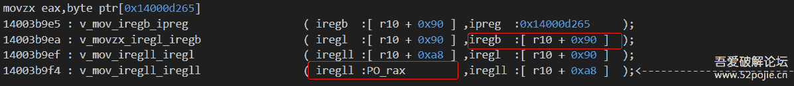

34 movzx.png (29.11 KB, 下载次数: 1)

[forum.php?mod=attachment&aid=MjYxNzM3OXxlZmEwNTZiZXwxNzkzNTczNTM1fDE2ODA4NnwxNzg5ODky&nothumb=yes](https://www.52pojie.cn/forum.php?mod=attachment&aid=MjYxNzM3OXxlZmEwNTZiZXwxNzkzNTczNTM1fDE2ODA4NnwxNzg5ODky&nothumb=yes)

2023-5-26 01:07 上传

其余的一样，取 `opcode` 对应的第二个参数，然后对 `workingTraceCode` 的第一个参数进行 `GetAsmPara`。

代码参考：`idapython/deTvm.py` 中的 `tvmToAsm.movzx_movsx_movsxd_handle()`。

### `not`

取 `tvmAsmOpcode` 内含有 `"not"` 字符串的那一句 `traceCode`，取第二个参数进行 `GetAsmPara`。

代码参考：`idapython/deTvm.py` 中的 `tvmToAsm.not_handle()`。

### `xor`、`sar`、`shr`、`shl`、`sbb`、`ror`、`or`、`and`

取 `tvmAsmOpcode` 含有上述 `opcode` 的 `traceCode`，取第三个参数进行 `GetAsmPara`。

取 `workingTraceCode` 的第一个参数进行 `GetAsmPara`，以 `xor` 为例：

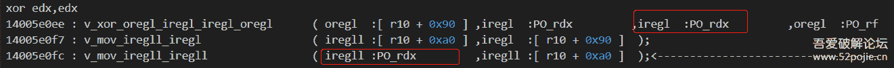

35 xor.png (22.65 KB, 下载次数: 1)


[href="forum.php?mod=attachment&aid=MjYxNzM4MHwyYjY2NWQwM3wxNzkzNTczNTM1fDE2ODA4NnwxNzg5ODky&nothumb=yes" target="_blank"](https://www.52pojie.cn/forum.php?mod=attachment&aid=MjYxNzM4MHwyYjY2NWQwM3wxNzkzNTczNTM1fDE2ODA4NnwxNzg5ODky&nothumb=yes)

2023-5-26 01:07 上传

代码参考：`idapython/deTvm.py` . `tvmToAsm.xxx_handle()`

## jcc

上面我们已经获取了 `jcc` 的类型，和它的两个跳转地址，虽然都是 `V_RIP`，

我们对这两个 `V_RIP` 往下找第一个 `workingTrace`，它所在的 `tvmToAsm` 就是对应的跳转地址，

我们可以给这个地址的的 `Asm` 打上跳转目的地标签，例如：

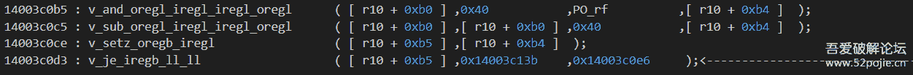

36 举例用jcc.png (25.04 KB, 下载次数: 0)

[href="forum.php?mod=attachment&aid=MjYxNzM4MXw1NTlhODdjYXwxNzkzNTczNTM1fDE2ODA4NnwxNzg5ODky&nothumb=yes" target="_blank"](https://www.52pojie.cn/forum.php?mod=attachment&aid=MjYxNzM4MXw1NTlhODdjYXwxNzkzNTczNTM1fDE2ODA4NnwxNzg5ODky&nothumb=yes)

2023-5-26 01:07 上传

可以翻译为：

```
......
je lable1
jmp label2
......
label2:        ;(0x14003c0e6往下找第一个tvmToAsm)
mov rax,1      ;只是举个例子
......
label1:        ;(0x14003c13b往下找第一个tvmToAsm)
mov rcx,2      ;只是举个例子
......
```

参考代码：`idapython/deTvm.py` . `tvmToAsm.jcc_handle()`

## ASM 2 HEX

这部分略，比较简单，就是通过 `keystone` 库函数将 `Asm` 编译成十六进制机器码，然后再创建一个段，把内存写进去。详情参考：`idapython/deTvm.py` . `tvmToAsmAll.WriteHex()` 和 `main0` 函数。

值得一提的是，我发现了 `keystone` 的一个 `bug`，你们可以试一下：

```
import keystone

ASM2HEX = keystone.Ks(keystone.KS_ARCH_X86, keystone.KS_MODE_64)

asm = """

mov rcx,qword ptr ds:[0x14000d250]

"""

byte,con = ASM2HEX.asm(asm,addr=0x1400ef00a)

for by in byte:

    print("%02x"%by,end="")
```

输出的结果是：

```
48 8b 0d 50 d2 00 40
```

将其转换成 `ASM`，是

```
1400ef00a  mov rcx, qword ptr [rip + 0x4000d250]
```

这明显是错误的，0x1400ef00a+0x7+0x4000d250 != 0x14000d250

```
asm = """
mov qword ptr ds:[0x14000d250],rcx
"""
byte,con = ASM2HEX.asm(asm,addr=0x1400ef00a)
```

就能输出正确的字节码。

所以我采用的方法是一句一句将 `Asm` 转换成 `HEX`，如果遇到 `mov reg,qword ptr[xxx]`，就把格式改成 `mov reg,qword ptr[rip + yyy]`，详情参考代码：`idapython/deTvm.py` . `Asm.AsmToHex()`

## deTvm.py脚本玩法

`main0` 是对全部 `ida` 识别的函数进行特征分析，如果符合 `tvm` 函数特征，就对它进行还原。

可以算是一键还原全部 `tvm` 函数了，有可能有些 `tvm` 函数不符合特征，你也可以手动添加还原函数。

例如：

你知道一个函数 `0x140001250` 它是被 `vm` 的，那么你这么写，脚本就会自动特征识别 `V_RIP`。

```
testTrace = traceTask(0x140001250,tvm0base)          #tvm0base是tvm0段的起始地址

testTrace.track(0)                                                                #开始跟踪 得到traceCode

testTrace.traceOut()                                                        #输出原始traceCode
```

如果你这个被 `vm` 的函数不符合我写的特征，但它确实是 `tvm` 的函数，那么可以这么写，自己设置 `V_RIP`：

```
#上一个例子的 函数 0x140001250 它的 V_RIP 就是 0x140059dc2
testTrace = traceTask(0,tvm0base)
testTrace.VStart = 0x140059dc2                #自己找这个vm函数的起始地址 例如V_RIP = 0x140059dc2 
testTrace.track(0)                                        #开始跟踪 得到traceCode
testTrace.traceOut()                                #输出原始traceCode
```

`traceOut(0)` 输出的结果如下：（基本没做处理）

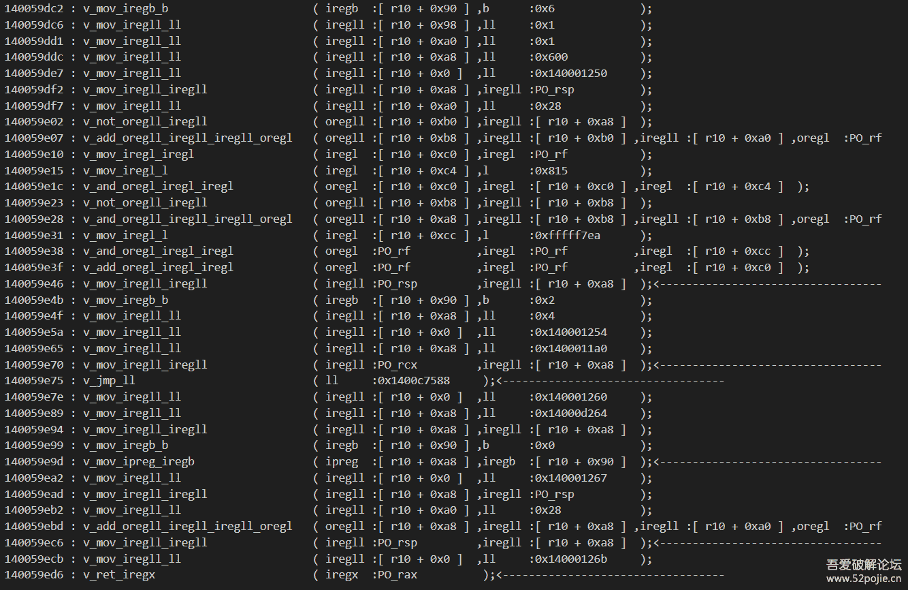

37 traceOut测试.png (147.1 KB, 下载次数: 0)

[href="forum.php?mod=attachment&aid=MjYxNzM4Mnw5YmQwNmUwY3wxNzkzNTczNTM1fDE2ODA4NnwxNzg5ODky&nothumb=yes" target="_blank"](https://www.52pojie.cn/forum.php?mod=attachment&aid=MjYxNzM4Mnw5YmQwNmUwY3wxNzkzNTczNTM1fDE2ODA4NnwxNzg5ODky&nothumb=yes)

2023-5-26 01:07 上传

如果想看 对标记 `working` 的 `traceCode` 进行变量溯源的结果，你可以这么写：

```
testTrace = traceTask(0x140001250,tvm0base)          #tvm0base是tvm0段的起始地址

testTrace.track(0)                                                                #开始跟踪 得到traceCode

testTrace.VRegRecord(True)                                                #如果是False就是不使用标记（上文说过）

testTrace.tvmToAsmAll.printAll()                                #输出
```

输出：

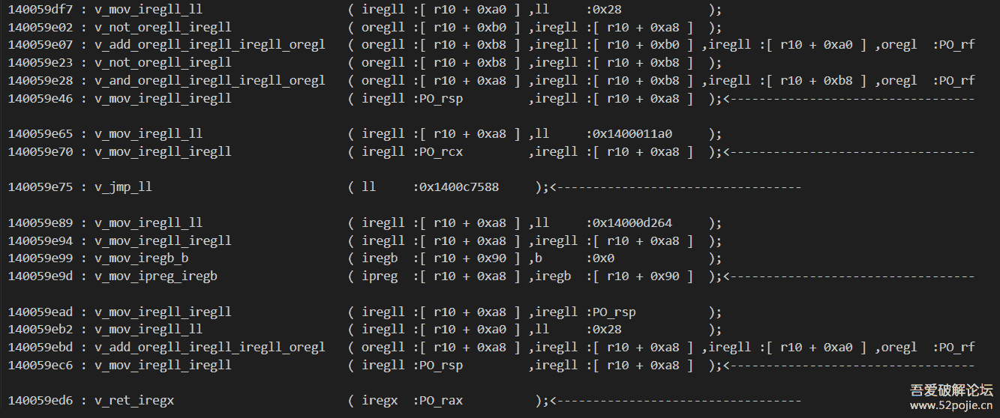

38 VRegRecord.png (79.63 KB, 下载次数: 1)

[href="forum.php?mod=attachment&aid=MjYxNzM4M3w5NjZiNWE2ZHwxNzkzNTczNTM1fDE2ODA4NnwxNzg5ODky&nothumb=yes" target="_blank"](https://www.52pojie.cn/forum.php?mod=attachment&aid=MjYxNzM4M3w5NjZiNWE2ZHwxNzkzNTczNTM1fDE2ODA4NnwxNzg5ODky&nothumb=yes)

2023-5-26 01:07 上传

如果想进一步的进行变量传播优化还有 `push`、`pop` 优化，可以这么写：

```
testTrace = traceTask(0x140001250,tvm0base)          #tvm0base是tvm0段的起始地址
testTrace.track(0)                                                                #开始跟踪 得到traceCode
testTrace.VRegRecord(True)                                                #如果是False就是不使用标记（上文说过）
testTrace.tvmToAsmAll.optimizeAll()                                #变量传播优化,push、pop优化
testTrace.tvmToAsmAll.printAll()                                #输出
```

输出：

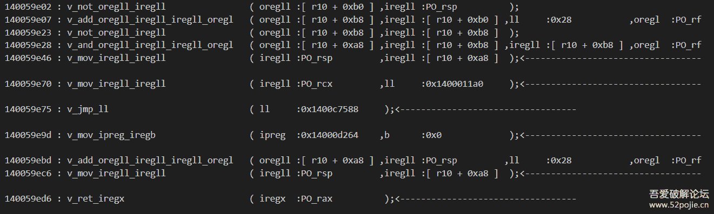

39 传播优化.png (52 KB, 下载次数: 2)

[href="forum.php?mod=attachment&aid=MjYxNzM4NHw3ZjY1ZDMzM3wxNzkzNTczNTM1fDE2ODA4NnwxNzg5ODky&nothumb=yes" target="_blank"](https://www.52pojie.cn/forum.php?mod=attachment&aid=MjYxNzM4NHw3ZjY1ZDMzM3wxNzkzNTczNTM1fDE2ODA4NnwxNzg5ODky&nothumb=yes)

2023-5-26 01:07 上传

如果想看还原成 `ASM` 是什么样的，可以这样写：

```
testTrace = traceTask(0x140001250,tvm0base)          #tvm0base是tvm0段的起始地址

testTrace.track(0)                                                                #开始跟踪 得到traceCode

testTrace.VRegRecord(True)                                                #如果是False就是不使用标记（上文说过）

testTrace.tvmToAsmAll.optimizeAll()                                #变量传播优化,push、pop优化

testTrace.tvmToAsmAll.AllTvmAsmToAsm()                         #转换成ASM  注意，一定要VRegRecord + optimizeAll 后才可以调用

testTrace.tvmToAsmAll.printAsmAll()                                #输出ASM
```

输出：

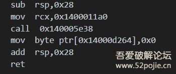

40 输出ASM.png (13.56 KB, 下载次数: 1)

[href="forum.php?mod=attachment&aid=MjYxNzM4NXwyYjUxZGQ3MHwxNzkzNTczNTM1fDE2ODA4NnwxNzg5ODky&nothumb=yes" target="_blank"](https://www.52pojie.cn/forum.php?mod=attachment&aid=MjYxNzM4NXwyYjUxZGQ3MHwxNzkzNTczNTM1fDE2ODA4NnwxNzg5ODky&nothumb=yes)

2023-5-26 01:07 上传

如果想看 `tvmToAsm` 和 `Asm` 对应起来的输出，可以这样写：

```
testTrace = traceTask(0x140001250,tvm0base)          #tvm0base是tvm0段的起始地址
testTrace.track(0)                                                                #开始跟踪 得到traceCode
testTrace.VRegRecord(True)                                                #如果是False就是不使用标记（上文说过）
testTrace.tvmToAsmAll.optimizeAll()                                #变量传播优化,push、pop优化
testTrace.tvmToAsmAll.AllTvmAsmToAsm()                         #转换成ASM

tvmToAsm_P = testTrace.tvmToAsmAll.tvmToAsmHead #结构为tvmToAsm
while (tvmToAsm_P != None):
    tvmToAsm_P.printAsm()                       #输出Asm
    tvmToAsm_P.print()                          #输出traceCodeAll
    print("")                                   #隔开
    tvmToAsm_P = tvmToAsm_P.BLink               #下一个
```

输出：

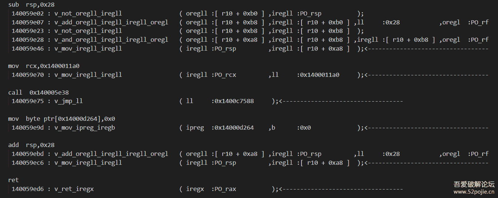

41 对应输出.png (62.2 KB, 下载次数: 1)

[href="forum.php?mod=attachment&aid=MjYxNzM4NnwzNTBiOWYxMHwxNzkzNTczNTM1fDE2ODA4NnwxNzg5ODky&nothumb=yes" target="_blank"](https://www.52pojie.cn/forum.php?mod=attachment&aid=MjYxNzM4NnwzNTBiOWYxMHwxNzkzNTczNTM1fDE2ODA4NnwxNzg5ODky&nothumb=yes)

2023-5-26 01:07 上传

## 还原例子

总所周知 `ACE-BASE.sys` 的 `DriverUnload` 函数是被 `vm` 了的，那么我们就用它来看看还原效果：

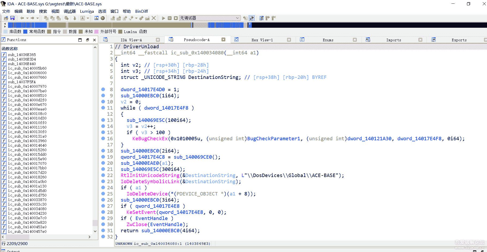

42 ACE-BASE测试.png (181.53 KB, 下载次数: 1)

[href="forum.php?mod=attachment&aid=MjYxNzM4N3w4NGQ5ZWYxY3wxNzkzNTczNTM1fDE2ODA4NnwxNzg5ODky&nothumb=yes" target="_blank"](https://www.52pojie.cn/forum.php?mod=attachment&aid=MjYxNzM4N3w4NGQ5ZWYxY3wxNzkzNTczNTM1fDE2ODA4NnwxNzg5ODky&nothumb=yes)

2023-5-26 01:07 上传

不错，很符合我对 `DriverUnload` 的想象。

左边 命名为 `icxxx` 的函数均为还原成功的函数。

还原脚本项目地址：[//pan.baidu.com/s/1gjmYQHXELELJwqhb-HJ9iA?pwd=ICEY" target="_blank" rel="noopener noreferrer nofollow"](https://pan.baidu.com/s/1gjmYQHXELELJwqhb-HJ9iA?pwd=ICEY:rel="nofollow noopener" href="https)

## 一些补充

这个脚本只适用于这个版本的 `tvm` (`ACE` 用的版本)。

新一点的 `tvm`，虽然用的是同一套虚拟化指令集，但它会对整数进行加密，读取时进行简单的 `xor` 解密，并且新增了一些 虚拟指令。

而且 进入虚拟机的特征也有点不一样，不过对脚本进行简单的修改即可兼容。

### 一些闲话

`ACE` 你快用新版的 `tvm`，你现在用的版本是有 `bug` 的(`JBE` `JNA` 的模拟是错的)。

