# [Web逆向] 记一次某洗钱资金盘后台爆破记录

- 原帖：https://www.52pojie.cn/forum.php?mod=viewthread&tid=1791964
- 抓取时间：2026-11-01T22:52:02

起因是我姐给我说最近有个网站可以薅羊毛，她和她同事都参与进去了，但是现在银行卡涉嫌诈骗被冻结，叫我过去看看。

网站现在打不开，总是就是低价买平台的东西，然后再在平台卖出去，赚取中间的佣金。

这不妥妥的洗钱吗？话不多说，小赞一点。

Ps：图片有点多，有点啰嗦

工具：Burp Suite

## 操作步骤

1. 首先 Burp Suite 的界面设置代{过}{滤}理

   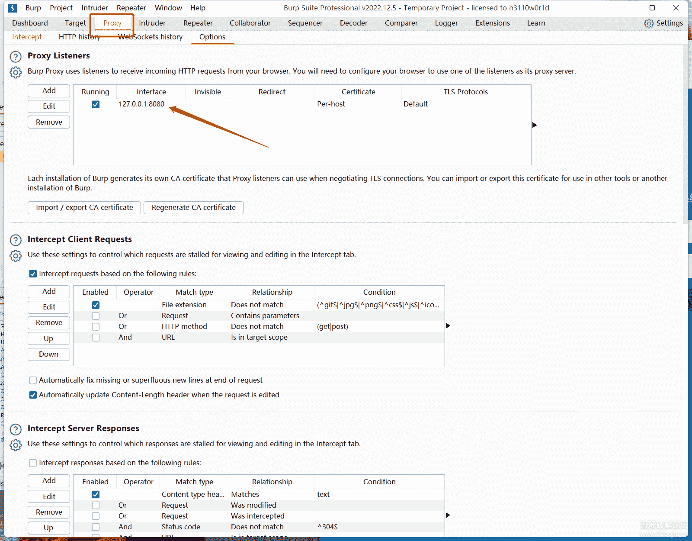

2. 给浏览器设置代{过}{滤}理，让 Burp 可以抓包（这边使用的是 Firefox）

   如果需要证书，自己百度配置一下

   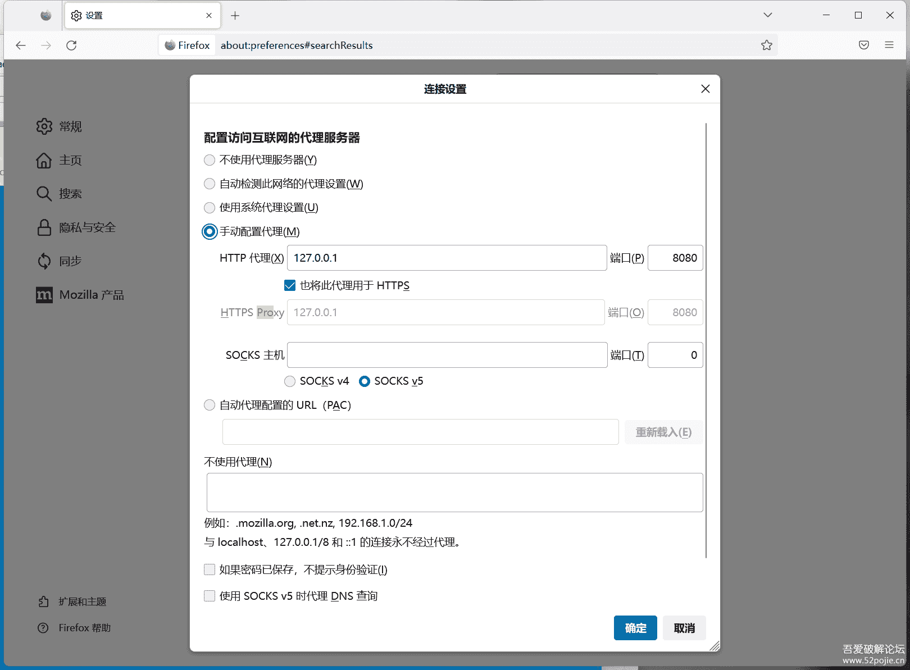

3. 开启抓后台登陆数据。

   我提前用御剑扫了后台登陆网页，所以扫描后台这步省略

   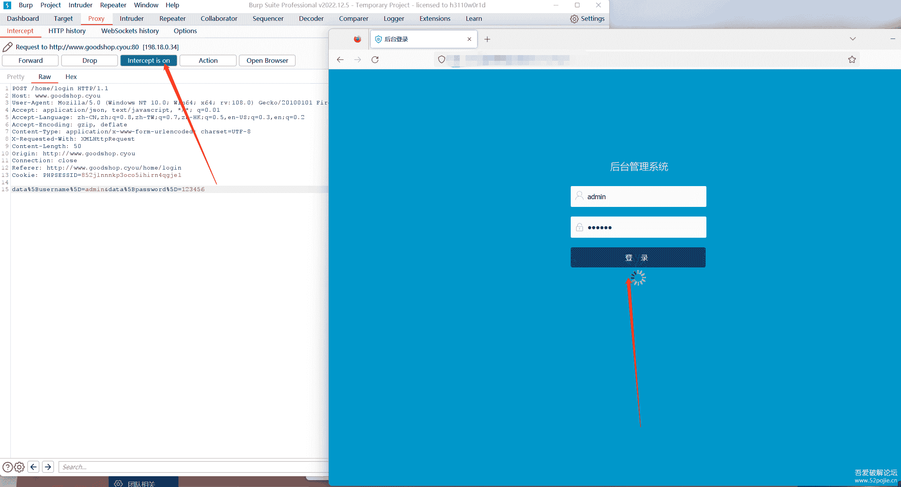

4. 把抓到的数据发送到爆破参数界面

   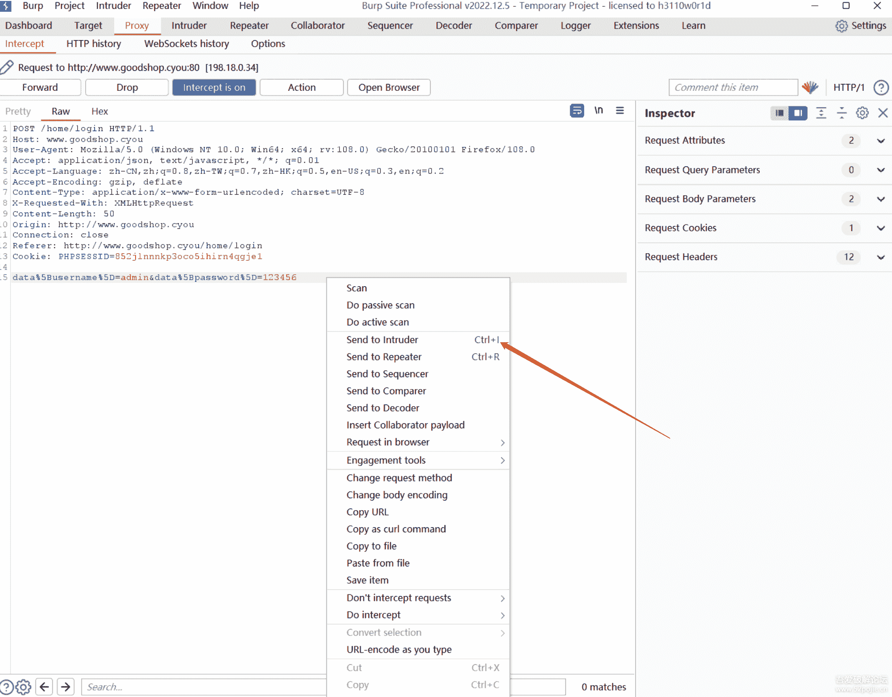

5. 抓到的数据清除一下参数

   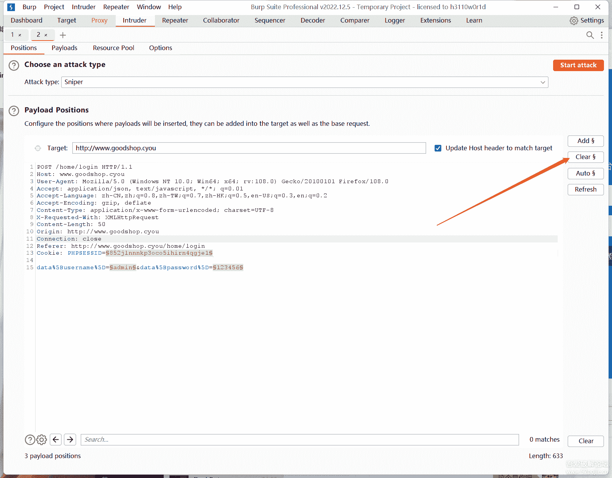

6. 设置一下主要爆破参数

   这里有点运气成分，我猜疑的 `admin` 是账户，所以只爆破了密码

   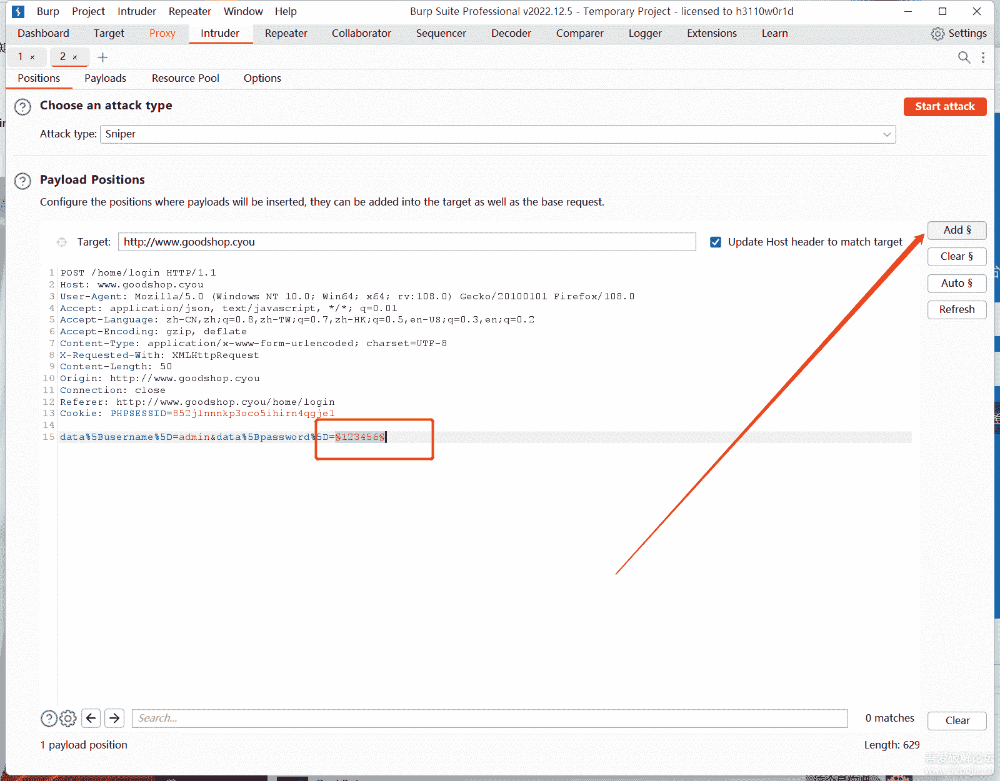

7. 去 `payloads` 加载一下字典，主要用来猜测密码，具体字典可以去 Github 找

   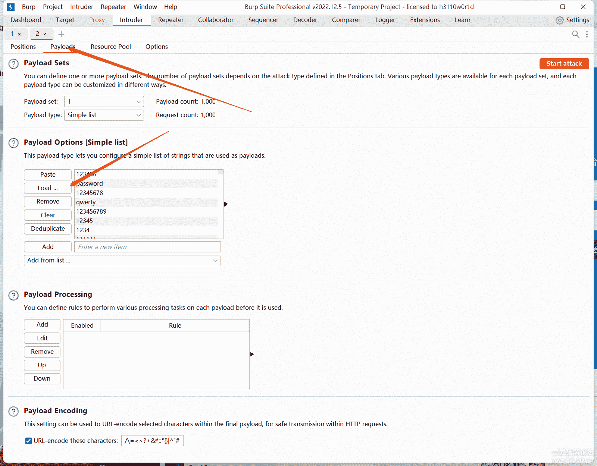

   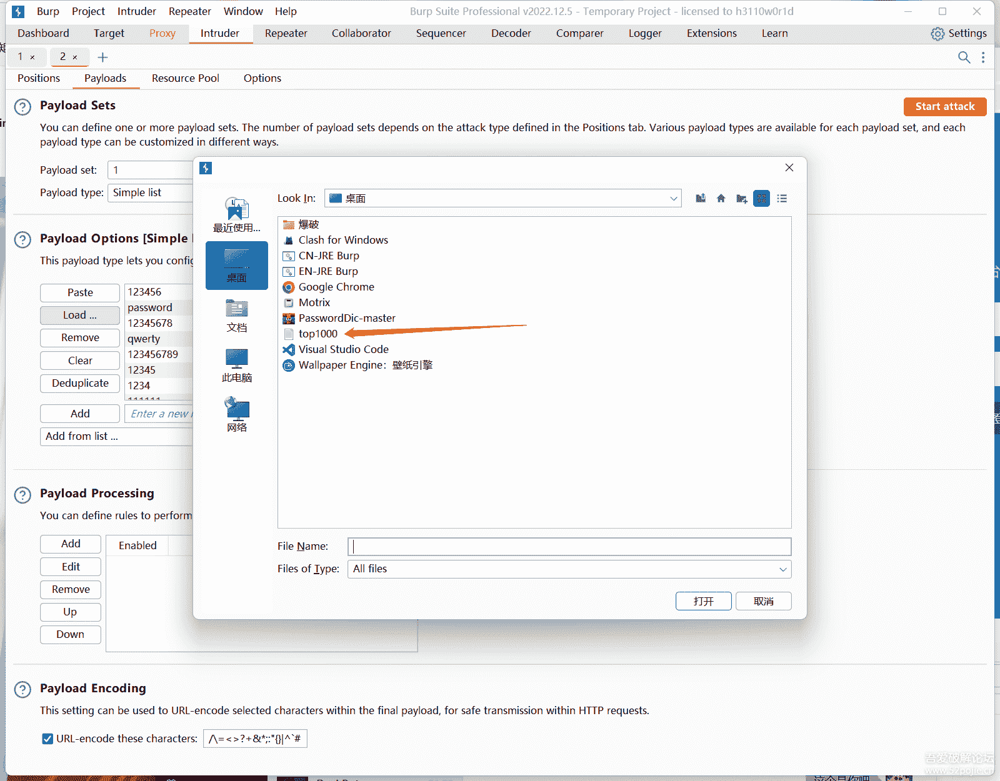

8. 开始爆破

   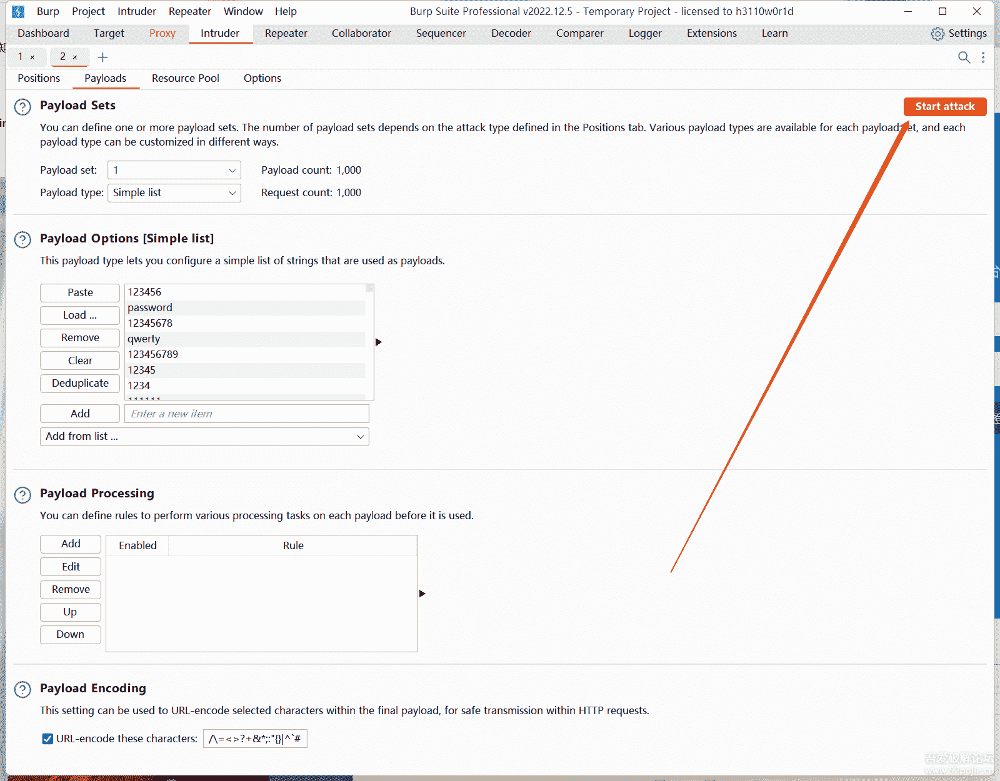

9. 查看爆破数据，`Length` 的长度判断

   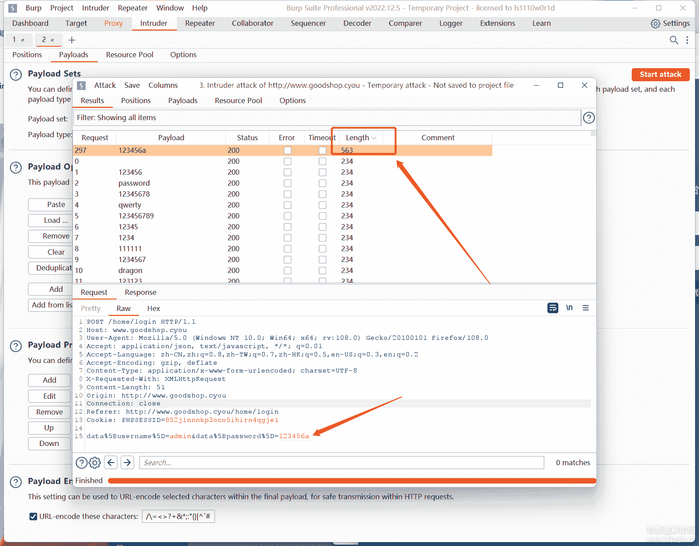

   至此，可以说运气还不错，爆破出来了密码。

   从参数看出，账户为 `admin`，密码为 `123456a`

   Ps：大家不要设置弱口令密码

10. 登陆后台，查找有用信息

    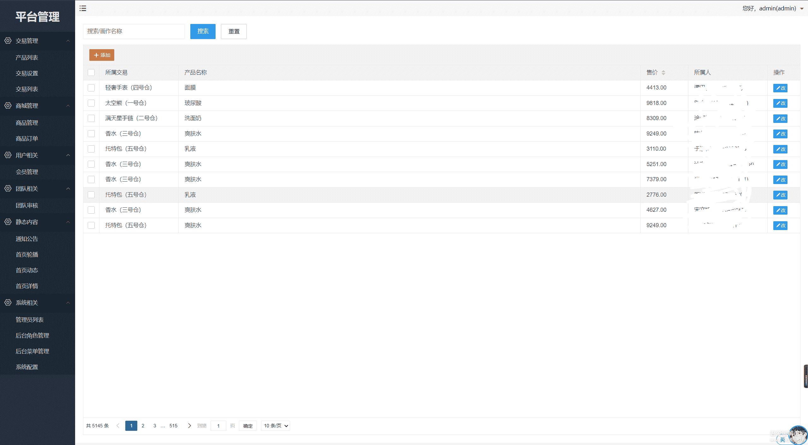

11. 部分数据查看

    记录了对方的阿里云 OSS

    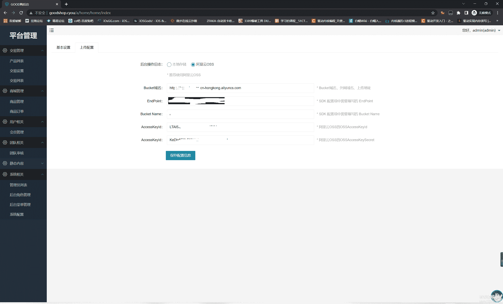

12. 交易记录

    大约 `2554*20=51080` 条记录，洗的钱应该不少，可望不可及

    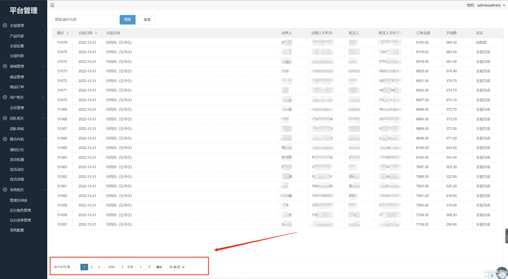

13. 开启后台登陆日志，查看后台访问 IP

    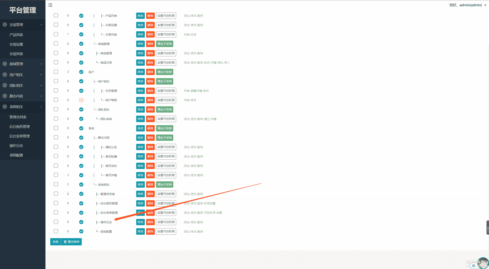

14. 后台日志记录

    这一步我就不传图片了，大致国内 IP 都在河北附近。

15. 至此，结束，只能说本次爆破运气成分占据 99%，因为弱口令密码很简单就才出来。
