# [原创] `x32` `x64dbg` 插件HyperHide的安装详细教程（过强壳vmp啥的）

- 原帖: https://www.52pojie.cn/forum.php?mod=viewthread&tid=1793931
- 抓取时间: 2026-11-01T22:51:42

来论坛这么久了，第一次发帖  ，如有违规，请见谅

我是在真机上面，我电脑系统是win10

我是看了这位兄弟的文章，安装成功的。身边几个朋友说让我出个更详细教程，我就厚着脸皮在@[//www.52pojie.cn/home.php?mod=space&uid=1699696" target="_blank"](https://www.52pojie.cn/home.php?mod=space&uid=1699696:href="https)的基础上，写了更详细一点的流程

感谢@[//www.52pojie.cn/home.php?mod=space&uid=1699696" target="_blank"](https://www.52pojie.cn/home.php?mod=space&uid=1699696:href="https)

[//www.52pojie.cn/thread-1642721-1-1.html" target="_blank"](https://www.52pojie.cn/thread-1642721-1-1.html:href="https)

他也在B站上面发了视频教程，文字版看不明白的可以移步去看下。

这篇是：hyperhide插件下载地址

https://www.52pojie.cn/forum.php?mod=viewthread&tid=1456759&highlight=hyperhide

这个是下载地址：https://github.com/Air14/HyperHide

我在文章最后面放了我自己在用的插件。有朋友反应，官方下载的跟我的不一样，我也不知道咋回事。按照我的流程+我放上来的插件，是可以安装成功并使用的

## 安装流程

### 1. 右键单击左下角的图标

`11.png` (19.16 KB, 下载次数: 3)

[href="forum.php?mod=attachment&aid=MjYxOTg5N3wyMjNlMzZmOHwxNzkzNTczNDk5fDE2ODA4NnwxNzkzOTMx&nothumb=yes" target="_blank"](https://www.52pojie.cn/forum.php?mod=attachment&aid=MjYxOTg5N3wyMjNlMzZmOHwxNzkzNTczNDk5fDE2ODA4NnwxNzkzOTMx&nothumb=yes)

2023-6-5 23:06 上传

### 2. 单击搜索

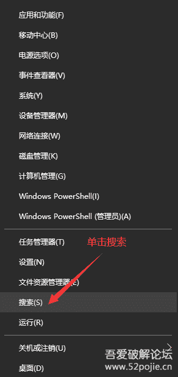

`12.png` (37.4 KB, 下载次数: 2)

[href="forum.php?mod=attachment&aid=MjYxOTkxMHwwNWI5ZGRkZXwxNzkzNTczNDk5fDE2ODA4NnwxNzkzOTMx&nothumb=yes" target="_blank"](https://www.52pojie.cn/forum.php?mod=attachment&aid=MjYxOTkxMHwwNWI5ZGRkZXwxNzkzNTczNDk5fDE2ODA4NnwxNzkzOTMx&nothumb=yes)

2023-6-5 23:07 上传

### 3. 搜索栏输入`cmd`并以管理员身份运行命令提示符

搜索栏，输入`cmd`，然后在命令提示符右键单击，选择以管理员身份运行

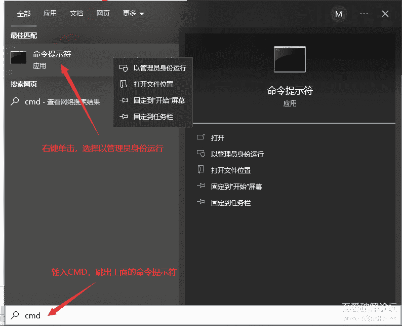

`13.png` (285.29 KB, 下载次数: 2)

[href="forum.php?mod=attachment&aid=MjYxOTg5OHxkNWNjYWZiZHwxNzkzNTczNDk5fDE2ODA4NnwxNzkzOTMx&nothumb=yes" target="_blank"](https://www.52pojie.cn/forum.php?mod=attachment&aid=MjYxOTg5OHxkNWNjYWZiZHwxNzkzNTczNDk5fDE2ODA4NnwxNzkzOTMx&nothumb=yes)

2023-6-5 23:07 上传

### 4. 复制或者手动输入测试模式命令

复制或者手动输入这个命令`bcdedit /set testsigning on`，按回车，然后重启电脑以后，就进入了电脑的测试模式了。

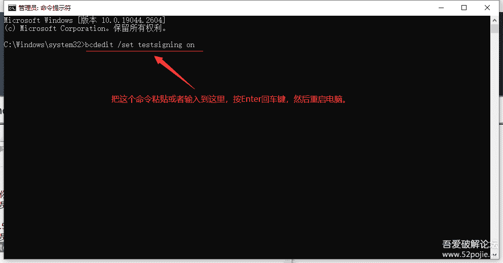

`14.png` (35.54 KB, 下载次数: 2)

[href="forum.php?mod=attachment&aid=MjYxOTg5OXxjZjI2ZjlkYnwxNzkzNTczNDk5fDE2ODA4NnwxNzkzOTMx&nothumb=yes" target="_blank"](https://www.52pojie.cn/forum.php?mod=attachment&aid=MjYxOTg5OXxjZjI2ZjlkYnwxNzkzNTczNDk5fDE2ODA4NnwxNzkzOTMx&nothumb=yes)

2023-6-5 23:07 上传

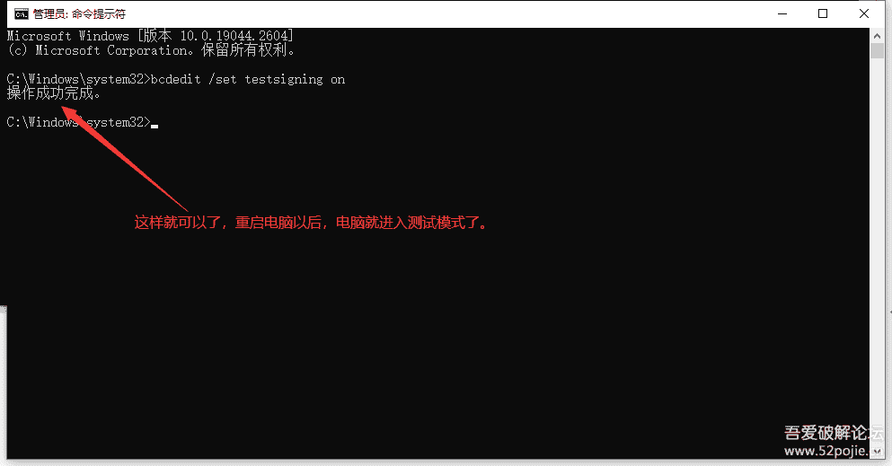

`15.png` (30.21 KB, 下载次数: 2)

[href="forum.php?mod=attachment&aid=MjYxOTkwMHwwNTlhNjFiOHwxNzkzNTczNDk5fDE2ODA4NnwxNzkzOTMx&nothumb=yes" target="_blank"](https://www.52pojie.cn/forum.php?mod=attachment&aid=MjYxOTkwMHwwNTlhNjFiOHwxNzkzNTczNDk5fDE2ODA4NnwxNzkzOTMx&nothumb=yes)

2023-6-5 23:07 上传

`16.png` (99.6 KB, 下载次数: 2)

[href="forum.php?mod=attachment&aid=MjYxOTkwMXw4YmNiMWI3MHwxNzkzNTczNDk5fDE2ODA4NnwxNzkzOTMx&nothumb=yes" target="_blank"](https://www.52pojie.cn/forum.php?mod=attachment&aid=MjYxOTkwMXw4YmNiMWI3MHwxNzkzNTczNDk5fDE2ODA4NnwxNzkzOTMx&nothumb=yes)

2023-6-5 23:07 上传

### 5. 将驱动文件放入系统驱动目录

把`HyperHideDrv.sys`和`airhv.sys`放入`C：\Windows\System32\drivers`里面

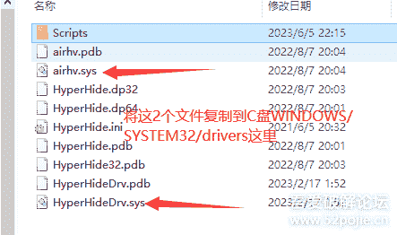

`17.png` (39.14 KB, 下载次数: 1)

[href="forum.php?mod=attachment&aid=MjYxOTkwMnw5Njk4ODIwYnwxNzkzNTczNDk5fDE2ODA4NnwxNzkzOTMx&nothumb=yes" target="_blank"](https://www.52pojie.cn/forum.php?mod=attachment&aid=MjYxOTkwMnw5Njk4ODIwYnwxNzkzNTczNDk5fDE2ODA4NnwxNzkzOTMx&nothumb=yes)

2023-6-5 23:07 上传

`C:\Windows\System32\drivers`

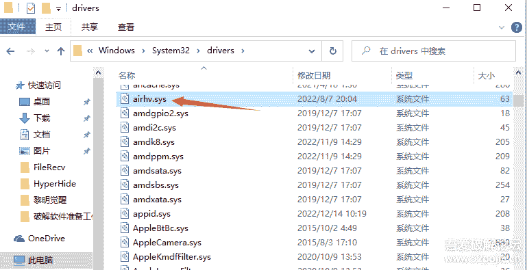

`18.png` (80.07 KB, 下载次数: 2)

[href="forum.php?mod=attachment&aid=MjYxOTkwM3xiMDIyMzRkOXwxNzkzNTczNDk5fDE2ODA4NnwxNzkzOTMx&nothumb=yes" target="_blank"](https://www.52pojie.cn/forum.php?mod=attachment&aid=MjYxOTkwM3xiMDIyMzRkOXwxNzkzNTczNDk5fDE2ODA4NnwxNzkzOTMx&nothumb=yes)

2023-6-5 23:07 上传

### 6. 运行`on.bat`启动驱动

然后打开文件夹`\HyperHide\HyperHide\Scripts`，以管理员运行`on.bat`，启动驱动

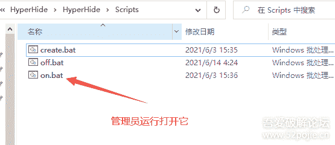

`19.png` (29.88 KB, 下载次数: 3)

[href="forum.php?mod=attachment&aid=MjYxOTkwNHxjMzQ5NDlkMnwxNzkzNTczNDk5fDE2ODA4NnwxNzkzOTMx&nothumb=yes" target="_blank"](https://www.52pojie.cn/forum.php?mod=attachment&aid=MjYxOTkwNHxjMzQ5NDlkMnwxNzkzNTczNDk5fDE2ODA4NnwxNzkzOTMx&nothumb=yes)

2023-6-5 23:07 上传

这样就启动驱动，如果你想关闭驱动，就管理员运行打开`off.bat`,就可以了。必须是这样，才能用。

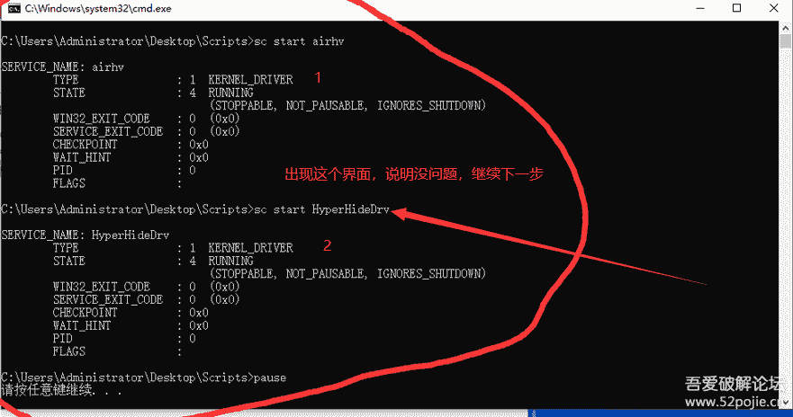

`20.png` (201 KB, 下载次数: 2)

[href="forum.php?mod=attachment&aid=MjYxOTkwNXw4MTE3MTA3ZHwxNzkzNTczNDk5fDE2ODA4NnwxNzkzOTMx&nothumb=yes" target="_blank"](https://www.52pojie.cn/forum.php?mod=attachment&aid=MjYxOTkwNXw4MTE3MTA3ZHwxNzkzNTczNDk5fDE2ODA4NnwxNzkzOTMx&nothumb=yes)

2023-6-5 23:07 上传

### 7. 配置`x32`的插件目录

接下来就是配置`x32`和`x64dbg`了。将`HyperHide.ini`和`HyperHide.dp32`复制到`\x32\plugins\`目录。

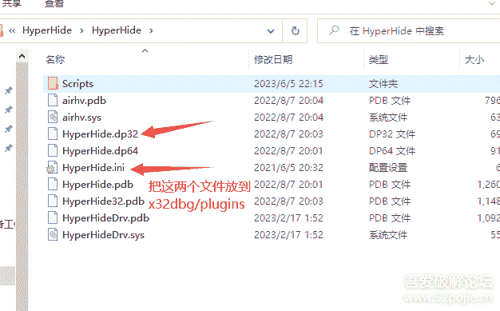

`21.png` (53.97 KB, 下载次数: 2)

[href="forum.php?mod=attachment&aid=MjYxOTkwNnwwZDcxYjU1MXwxNzkzNTczNDk5fDE2ODA4NnwxNzkzOTMx&nothumb=yes" target="_blank"](https://www.52pojie.cn/forum.php?mod=attachment&aid=MjYxOTkwNnwwZDcxYjU1MXwxNzkzNTczNDk5fDE2ODA4NnwxNzkzOTMx&nothumb=yes)

2023-6-5 23:07 上传

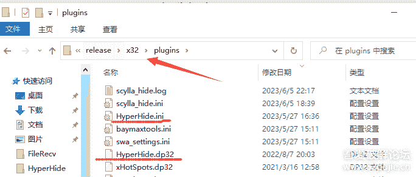

`22.png` (54.48 KB, 下载次数: 3)

[href="forum.php?mod=attachment&aid=MjYxOTkwN3xkOGM0ODdlNnwxNzkzNTczNDk5fDE2ODA4NnwxNzkzOTMx&nothumb=yes" target="_blank"](https://www.52pojie.cn/forum.php?mod=attachment&aid=MjYxOTkwN3xkOGM0ODdlNnwxNzkzNTczNDk5fDE2ODA4NnwxNzkzOTMx&nothumb=yes)

2023-6-5 23:07 上传

### 8. 配置`x64`的插件目录

将`HyperHide.ini`和`HyperHide.dp64`复制到`\x64\plugins\`目录。

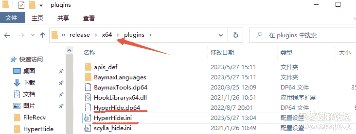

`23.png` (55.17 KB, 下载次数: 1)

[href="forum.php?mod=attachment&aid=MjYxOTkwOHw0ODBhZWE3ZXwxNzkzNTczNDk5fDE2ODA4NnwxNzkzOTMx&nothumb=yes" target="_blank"](https://www.52pojie.cn/forum.php?mod=attachment&aid=MjYxOTkwOHw0ODBhZWE3ZXwxNzkzNTczNDk5fDE2ODA4NnwxNzkzOTMx&nothumb=yes)

2023-6-5 23:07 上传

### 9. 运行`x32dbg`并打开插件查看效果

管理员运行打开`x32dbg`，并打开插件hyperhide，看下效果图

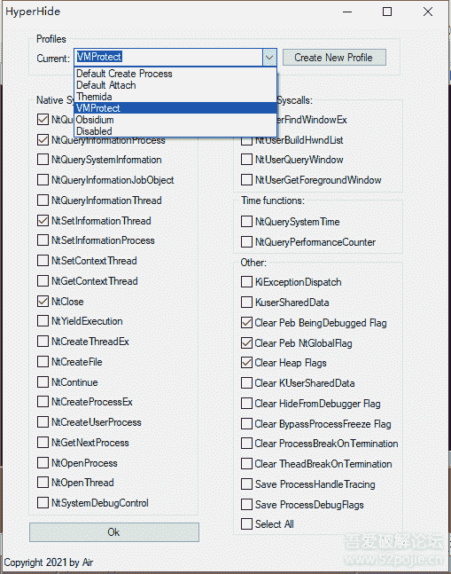

`24.png` (67.81 KB, 下载次数: 2)

[href="forum.php?mod=attachment&aid=MjYxOTkwOXxhZTlkYjc2MHwxNzkzNTczNDk5fDE2ODA4NnwxNzkzOTMx&nothumb=yes" target="_blank"](https://www.52pojie.cn/forum.php?mod=attachment&aid=MjYxOTkwOXxhZTlkYjc2MHwxNzkzNTczNDk5fDE2ODA4NnwxNzkzOTMx&nothumb=yes)

2023-6-5 23:07 上传

至此，插件安装完成。

[href="forum.php?mod=attachment&aid=MjYxOTkxMnwzZGZiYThlM3wxNzkzNTczNDk5fDE2ODA4NnwxNzkzOTMx" target="_blank"](https://www.52pojie.cn/forum.php?mod=attachment&aid=MjYxOTkxMnwzZGZiYThlM3wxNzkzNTczNDk5fDE2ODA4NnwxNzkzOTMx)

(925.82 KB, 下载次数: 1379)

2023-6-5 23:11 上传

点击文件名下载附件

`HyperHide`

下载积分: 吾爱币 -1 CB
