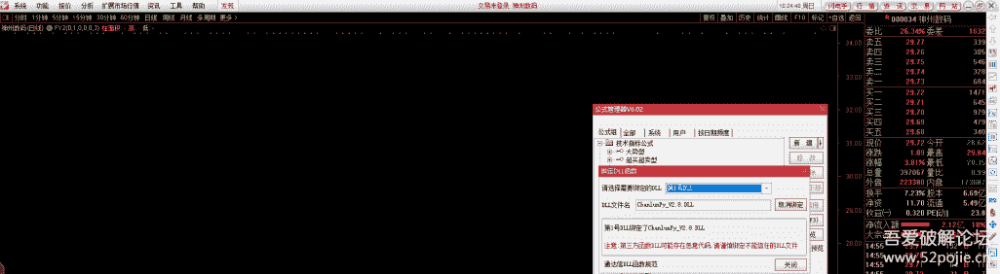
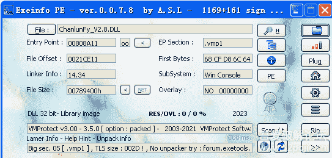
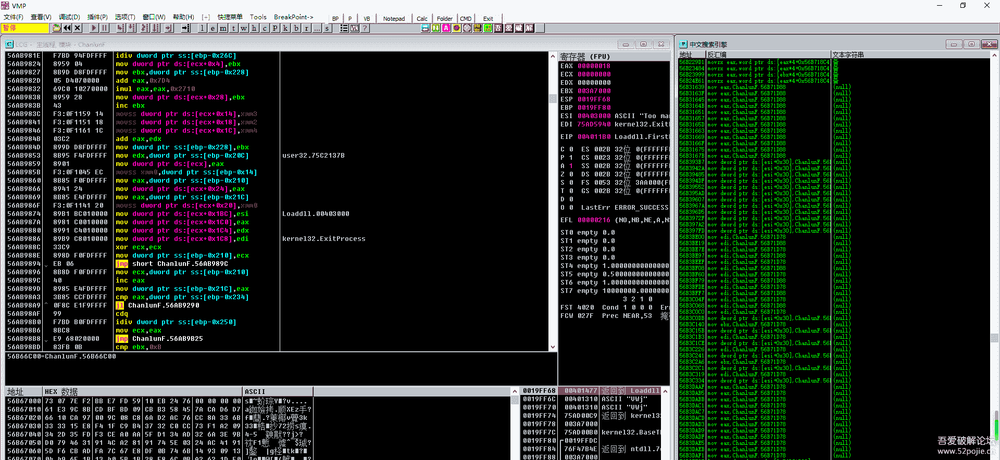
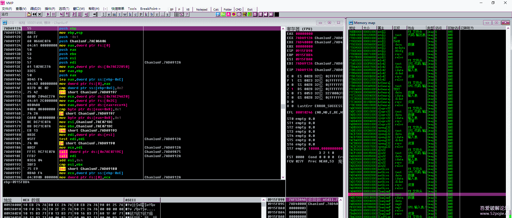
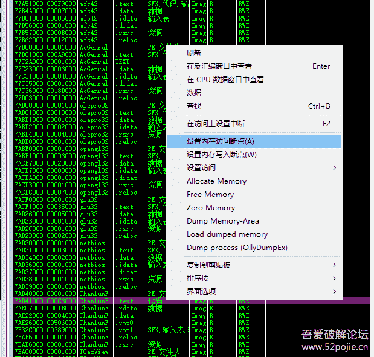
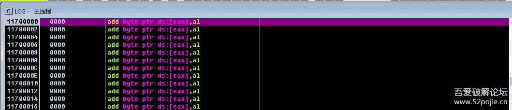
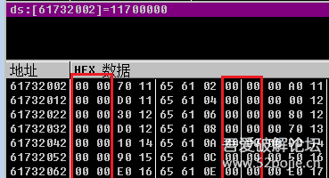
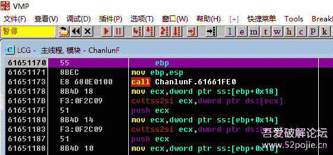

# [原创] 缠中说禅-浮云版V2.8过期无显示的一种和谐方法

## 基本信息

- 原帖：https://www.52pojie.cn/forum.php?mod=viewthread&tid=1799007
- 抓取时间：2026-11-01T22:51:27
- 工具：52 下的 OD、ExeinfoPe
- 研究对象：缠中说禅-浮云版V2.8
- 来源：网络
- 理由：和谐过程中的一点心得
- 软件类型：`ChanlunFy_V2.8.dll`
- 要达到目的：解决过期恢复显示

## 初始特征与现象

这个软件根据我碰到的很多软件来讲，还是有点意思，软件除了加强壳还采取了静默式加密。来看看初始特征。

`图片1.png`（89.47 KB，下载次数：0）

[附件下载](https://www.52pojie.cn/forum.php?mod=attachment&aid=MjYyMjMzNnxlYzliMThhYXwxNzkzNTczNDg1fDE2ODA4NnwxNzk5MDA3&nothumb=yes)

2023-6-18 20:28 上传

软件出现问题所产生的现象，K线走势图一片空白。

`图片2.png`（99.83 KB，下载次数：0）

[附件下载](https://www.52pojie.cn/forum.php?mod=attachment&aid=MjYyMjMzN3w4NzNlZTNjM3wxNzkzNTczNDg1fDE2ODA4NnwxNzk5MDA3&nothumb=yes)

2023-6-18 20:30 上传

软件加VMProtect v3.00 - 3.5.0壳

`图片3.png`（126.79 KB，下载次数：0）

[附件下载](https://www.52pojie.cn/forum.php?mod=attachment&aid=MjYyMjMzOHwxNDE0NTcyYnwxNzkzNTczNDg1fDE2ODA4NnwxNzk5MDA3&nothumb=yes)

2023-6-18 20:31 上传

## 断点尝试

52的OD能正常加载。通过智能搜素，没发现任何提示文本。初一看，无从下手，这个时候觉得那种`messagebox`是多么的可爱。OD加载TDX平台，用内存`F2`断点试试

`图片4.png`（113.41 KB，下载次数：0）

[附件下载](https://www.52pojie.cn/forum.php?mod=attachment&aid=MjYyMjMzOXwxMWY3M2ViNHwxNzkzNTczNDg1fDE2ODA4NnwxNzk5MDA3&nothumb=yes)

2023-6-18 20:33 上传

通达信点开上图一界面，OD没有任何反应，内存`F2`断点无效。

`图片5.png`（48.63 KB，下载次数：0）

[附件下载](https://www.52pojie.cn/forum.php?mod=attachment&aid=MjYyMjM0MHxhNTdjMjNkN3wxNzkzNTczNDg1fDE2ODA4NnwxNzk5MDA3&nothumb=yes)

2023-6-18 20:34 上传

改内存访问断点，重复上面的步骤，OD依然没有任何反应，内存访问断点无效。这种和谐的常用方法都失效了，看来这个软件的加密别有洞天。从最原始最基础的地方来分析，从TDX平台的加载机理来分析：

## 从 TDX 平台加载机理分析

找到OD中模块`TCalc`，在`0399640F`地址下`F2`断点

`图片6.png`（11.54 KB，下载次数：0）

[附件下载](https://www.52pojie.cn/forum.php?mod=attachment&aid=MjYyMjM0MXxkMTY5NTMwNXwxNzkzNTczNDg1fDE2ODA4NnwxNzk5MDA3&nothumb=yes)

2023-6-18 20:36 上传

点击K线图界面，程序断在上面`F2`断点，`F7`

`图片7.png`（16.54 KB，下载次数：0）

[附件下载](https://www.52pojie.cn/forum.php?mod=attachment&aid=MjYyMjM0M3w1NzUwZmEwYXwxNzkzNTczNDg1fDE2ODA4NnwxNzk5MDA3&nothumb=yes)

2023-6-18 20:37 上传

走到了地址`11700000`，该地址没有有效指令，离前面下内存`F2`和内存访问断点的地址很遥远，可以肯定这里软件动了手脚。重新走到前一条指令，来分析一下这里。

看信息窗口：

`图片8.png`（13.95 KB，下载次数：1）

[附件下载](https://www.52pojie.cn/forum.php?mod=attachment&aid=MjYyMjM0NHw2YTc1MjEwNHwxNzkzNTczNDg1fDE2ODA4NnwxNzk5MDA3&nothumb=yes)

2023-6-18 20:39 上传

数据窗口中跟随地址：

`图片9.png`（11.62 KB，下载次数：0）

[附件下载](https://www.52pojie.cn/forum.php?mod=attachment&aid=MjYyMjM0NXw5NjFiNWQ4YXwxNzkzNTczNDg1fDE2ODA4NnwxNzk5MDA3&nothumb=yes)

2023-6-18 20:40 上传

根据我的经验，发现多了红框 2 排`00`的数据。把多余的 2 排`00`去掉

`图片10.png`（9.74 KB，下载次数：1）

[附件下载](https://www.52pojie.cn/forum.php?mod=attachment&aid=MjYyMjM0N3xlNDI1OWFjY3wxNzkzNTczNDg1fDE2ODA4NnwxNzk5MDA3&nothumb=yes)

2023-6-18 20:42 上传

`F7`，

`图片11.png`（24.13 KB，下载次数：0）

[附件下载](https://www.52pojie.cn/forum.php?mod=attachment&aid=MjYyMjM0OHw3MDZmZTk3YXwxNzkzNTczNDg1fDE2ODA4NnwxNzk5MDA3&nothumb=yes)

2023-6-18 20:43 上传

运行到了有效指令。写个补丁，把多出来的 2 排`00`去掉。看K线图效果：

`图片12.png`（107.66 KB，下载次数：0）

[附件下载](https://www.52pojie.cn/forum.php?mod=attachment&aid=MjYyMjM0OXw5OGVjZDFlNnwxNzkzNTczNDg1fDE2ODA4NnwxNzk5MDA3&nothumb=yes)

2023-6-18 20:44 上传
