# [Web逆向] 一个菜鸡对关注公众号回复密码获取下载链接的分析

- 原帖: https://www.52pojie.cn/forum.php?mod=viewthread&tid=1799911
- 抓取时间: 2026-11-01T22:51:25

## 序言

> 

半原创笔记一篇。

鄙人不才，作为一个菜鸡，在吾爱破解这种大佬云集，各类原创教程浩如烟海的论坛里面就是一枚不起眼的水滴，因为技术实在是弱鸡，而且学习能力真心太差，无法发帖进行交流。每日只能各种破事水，而且还不一定能水到点上，属实是属于含盐量过高的咸鱼了。。。。

今日恰好自己碰上了点事情，看了大佬的[//www.52pojie.cn/thread-1713452-1-1.html" target="_blank" rel="noopener noreferrer nofollow"](https://www.52pojie.cn/thread-1713452-1-1.html:href="https)后前去实践，虽然最后还是靠自己分析代码内容才获得了结果，但是还是很感谢大佬的分享，故将此笔记发出作为补充内容供各位刚刚入门的学习。。

## 前因

早晨睡不着，发现现在下载要关注个公众号回复才能下载了。。

这站点因为以前经常去，通用密码肯定是知道的，然而我发现密码已经被改了。。

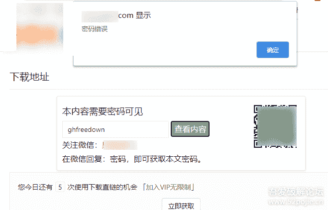

image-20230621053237528.png (42.13 KB, 下载次数: 1)

[href="forum.php?mod=attachment&aid=MjYyMjc1MnxmNzBjNGI1NHwxNzkzNTczNDgyfDE2ODA4NnwxNzk5OTEx&nothumb=yes" target="_blank"](https://www.52pojie.cn/forum.php?mod=attachment&aid=MjYyMjc1MnxmNzBjNGI1NHwxNzkzNTczNDgyfDE2ODA4NnwxNzk5OTEx&nothumb=yes)

2023-6-21 06:47 上传

虽然公众号我是关注了的，但是我坐电脑前面，手机在床头充电，三米距离宛若生死鸿沟，就是不想拿手机去回复！

来，请跟我念：

遇事不决，吾爱破解！

遇事不决，吾爱破解！

遇事不决，吾爱破解！

走，搜大佬的笔记去。。。

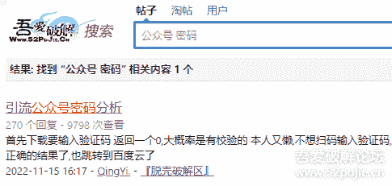

image-20230621053514235.png (33.73 KB, 下载次数: 1)

[href="forum.php?mod=attachment&aid=MjYyMjczOXwwNjRjNDMyM3wxNzkzNTczNDgyfDE2ODA4NnwxNzk5OTEx&nothumb=yes" target="_blank"](https://www.52pojie.cn/forum.php?mod=attachment&aid=MjYyMjczOXwwNjRjNDMyM3wxNzkzNTczNDgyfDE2ODA4NnwxNzk5OTEx&nothumb=yes)

2023-6-21 06:00 上传

> 

引流公众号密码分析

[//www.52pojie.cn/thread-1713452-1-1.html" target="_blank" rel="noopener noreferrer nofollow"](https://www.52pojie.cn/thread-1713452-1-1.html:href="https)

## 实践

看了下帖子的内容，接下来就是实践了。实践肯定多多少少与帖子不一样的，就当是锻炼自己了！;www

先用错误的密码看看返回的信息。

就这个`shortcodeapi`灰常的可疑啊，

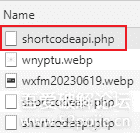

image-20230621060455332.png (11.77 KB, 下载次数: 1)

[href="forum.php?mod=attachment&aid=MjYyMjc0MXxkOTQ4MTI3N3wxNzkzNTczNDgyfDE2ODA4NnwxNzk5OTEx&nothumb=yes" target="_blank"](https://www.52pojie.cn/forum.php?mod=attachment&aid=MjYyMjc0MXxkOTQ4MTI3N3wxNzkzNTczNDgyfDE2ODA4NnwxNzk5OTEx&nothumb=yes)

2023-6-21 06:05 上传

Form Data 有提交表格

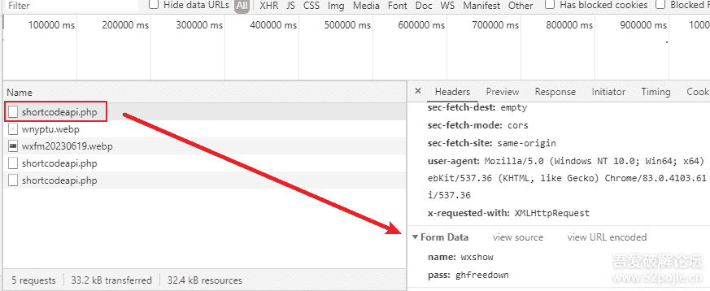

image-20230621045428258.png (52.95 KB, 下载次数: 2)

[href="forum.php?mod=attachment&aid=MjYyMjc0MnxkMzJjMjU4Y3wxNzkzNTczNDgyfDE2ODA4NnwxNzk5OTEx&nothumb=yes" target="_blank"](https://www.52pojie.cn/forum.php?mod=attachment&aid=MjYyMjc0MnxkMzJjMjU4Y3wxNzkzNTczNDgyfDE2ODA4NnwxNzk5OTEx&nothumb=yes)

2023-6-21 06:05 上传

看看响应内容返回值，完美对应，成功一半！

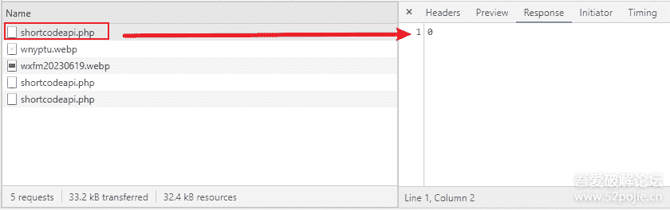

image-20230621045447634.png (22.49 KB, 下载次数: 1)

[href="forum.php?mod=attachment&aid=MjYyMjc0NHxlMmQ0YjA2NXwxNzkzNTczNDgyfDE2ODA4NnwxNzk5OTEx&nothumb=yes" target="_blank"](https://www.52pojie.cn/forum.php?mod=attachment&aid=MjYyMjc0NHxlMmQ0YjA2NXwxNzkzNTczNDgyfDE2ODA4NnwxNzk5OTEx&nothumb=yes)

2023-6-21 06:18 上传

看看点击事件

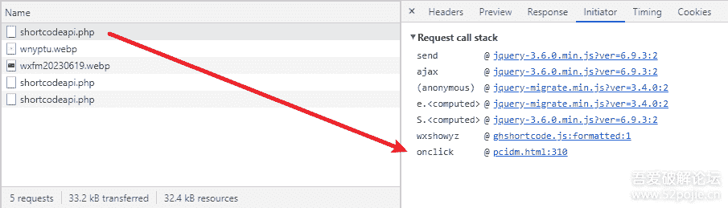

image-20230621045550644.png (45.27 KB, 下载次数: 3)

[href="forum.php?mod=attachment&aid=MjYyMjc0NXwxZTQ3YmQzZHwxNzkzNTczNDgyfDE2ODA4NnwxNzk5OTEx&nothumb=yes" target="_blank"](https://www.52pojie.cn/forum.php?mod=attachment&aid=MjYyMjc0NXwxZTQ3YmQzZHwxNzkzNTczNDgyfDE2ODA4NnwxNzk5OTEx&nothumb=yes)

2023-6-21 06:18 上传

看看对应的`html`代码

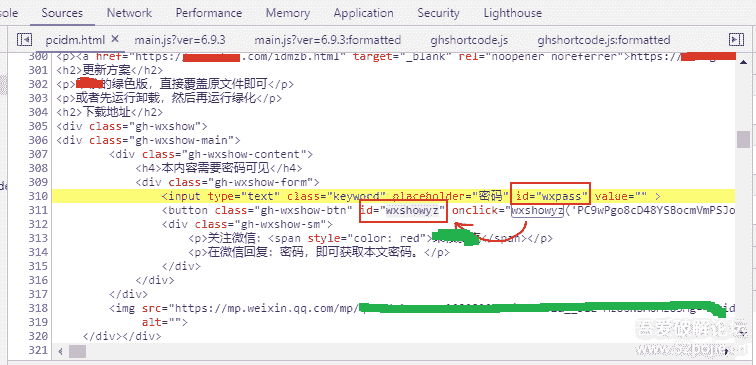

image-20230621045905226.png (72.09 KB, 下载次数: 3)

[href="forum.php?mod=attachment&aid=MjYyMjc0Nnw3NjM4MWIwN3wxNzkzNTczNDgyfDE2ODA4NnwxNzk5OTEx&nothumb=yes" target="_blank"](https://www.52pojie.cn/forum.php?mod=attachment&aid=MjYyMjc0Nnw3NjM4MWIwN3wxNzkzNTczNDgyfDE2ODA4NnwxNzk5OTEx&nothumb=yes)

2023-6-21 06:20 上传

拿笔记记下`id`和参数。。

```
查看内容
```

当时看到这边的时候只是觉得这个参数最后面有两个"="(等于号)很眼熟。。

并没有认真看，毕竟传一个`token`或者是加密的参数实在是太常见了！！！

作为一个能力不足的，知道自己没能力分析是好事！

事实证明这个想法让我错过了能快速解决问题的捷径。。

返回网络这边看看事件？恩，`wxshowyz`对应上了

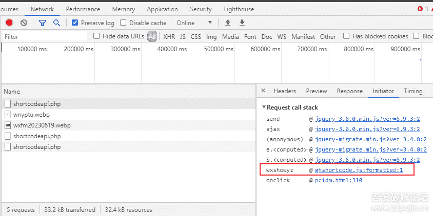

image-20230621045955800.png (56.05 KB, 下载次数: 2)

[href="forum.php?mod=attachment&aid=MjYyMjc0N3wxMjA2Y2I2YXwxNzkzNTczNDgyfDE2ODA4NnwxNzk5OTEx&nothumb=yes" target="_blank"](https://www.52pojie.cn/forum.php?mod=attachment&aid=MjYyMjc0N3wxMjA2Y2I2YXwxNzkzNTczNDgyfDE2ODA4NnwxNzk5OTEx&nothumb=yes)

2023-6-21 06:21 上传

点去看看这个`js`，别忘了格式化

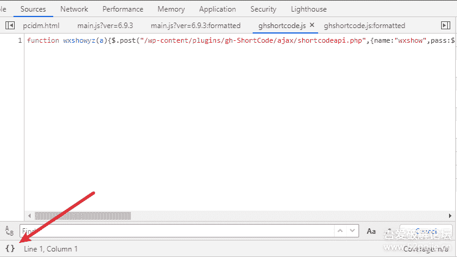

image-20230621050057140.png (28.68 KB, 下载次数: 3)

[href="forum.php?mod=attachment&aid=MjYyMjc0OHw4YWQxZGM3YnwxNzkzNTczNDgyfDE2ODA4NnwxNzk5OTEx&nothumb=yes" target="_blank"](https://www.52pojie.cn/forum.php?mod=attachment&aid=MjYyMjc0OHw4YWQxZGM3YnwxNzkzNTczNDgyfDE2ODA4NnwxNzk5OTEx&nothumb=yes)

2023-6-21 06:21 上传

格式化后

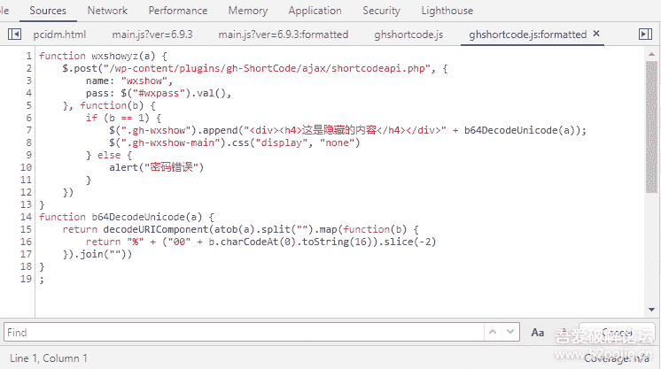

image-20230621050132597.png (53.53 KB, 下载次数: 3)

[href="forum.php?mod=attachment&aid=MjYyMjc0OXxhOWZkMmM4M3wxNzkzNTczNDgyfDE2ODA4NnwxNzk5OTEx&nothumb=yes" target="_blank"](https://www.52pojie.cn/forum.php?mod=attachment&aid=MjYyMjc0OXxhOWZkMmM4M3wxNzkzNTczNDgyfDE2ODA4NnwxNzk5OTEx&nothumb=yes)

2023-6-21 06:22 上传

还是要阅读代码的，作为一个啥都懂得一点，啥都不精通的论坛水友，大致看懂是没啥问题的。。

> 

把表格提交后，跟大佬的帖子一样，返回一个参数。

如果返回值等于1就显示隐藏的下载链接。如果不是1就弹框密码错误。

我知道`chrome`有个控制台，可以执行`js`和方法，帖子也有说，但是呢他这个网站的是匿名函数，我还真的不知道怎么控制台里面弄。。。

那就直接硬啃代码吧，反正才19行，而且看着也简单。。。

成功后就添加`html`元素，没啥问题，

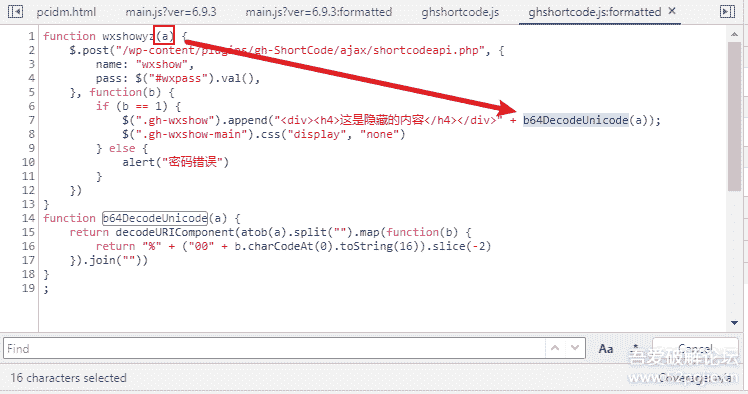

image-20230621050258258.png (54.41 KB, 下载次数: 2)

[href="forum.php?mod=attachment&aid=MjYyMjc1MXwwYTVkNGRhY3wxNzkzNTczNDgyfDE2ODA4NnwxNzk5OTEx&nothumb=yes" target="_blank"](https://www.52pojie.cn/forum.php?mod=attachment&aid=MjYyMjc1MXwwYTVkNGRhY3wxNzkzNTczNDgyfDE2ODA4NnwxNzk5OTEx&nothumb=yes)

2023-6-21 06:23 上传

这个`b64DecodeUnicode`有点眼熟啊..

```
function b64DecodeUnicode(a) {
    return decodeURIComponent(atob(a).split("").map(function(b) {
        return "%" + ("00" + b.charCodeAt(0).toString(16)).slice(-2)
    }).join(""))
}
```
`base64`解码再把双引号转为url编码？？？

想到那个令我眼熟的参数。。回去看看。。

```
查看内容
```

好家伙，感情这段代码不是 `token` 而是 `base64`啊！

兜了一大圈，结果就是返回一个参数1告诉你的浏览器让他`base64`解码？？？？？

3> 结果

拿去解码看看结果。。。

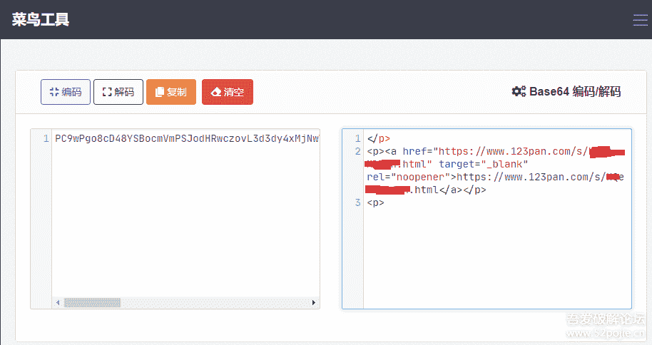

image-20230621050525555.png (50.61 KB, 下载次数: 2)

[href="forum.php?mod=attachment&aid=MjYyMjc0M3w3NWNkMTBmY3wxNzkzNTczNDgyfDE2ODA4NnwxNzk5OTEx&nothumb=yes" target="_blank"](https://www.52pojie.cn/forum.php?mod=attachment&aid=MjYyMjc0M3w3NWNkMTBmY3wxNzkzNTczNDgyfDE2ODA4NnwxNzk5OTEx&nothumb=yes)

2023-6-21 06:15 上传

搞定！

贼心不死试试控制台执行。。

```
