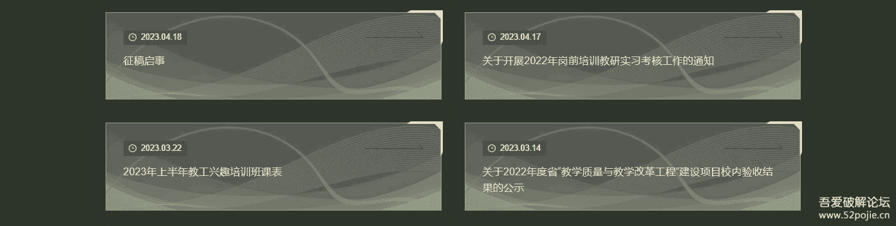

# [原创] 爬虫小试牛刀（爬取学校通知公告）

- 原帖：https://www.52pojie.cn/forum.php?mod=viewthread&tid=1800082
- 抓取时间：2026-11-01T22:51:23
- 完成抓取并解析通知公告12页数据，并提交excel文件格式数据，数据需要包含日期标题，若能够实现将详情页主体内容与发布人信息数据也一并抓取更佳
- 提交内容：Excel数据文件

## 爬虫开始

首先看到页面呈现规则的各个方框，这意味着它们之间的一定是一样的。

此处该有图



`pC32YiF.png` (149.63 KB, 下载次数: 0)

[href="forum.php?mod=attachment&aid=MjYyMzI2MnxkNDZmMjE3MHwxNzkzNTczNDgxfDE2ODA4NnwxODAwMDgy&nothumb=yes" target="_blank"](https://www.52pojie.cn/forum.php?mod=attachment&aid=MjYyMzI2MnxkNDZmMjE3MHwxNzkzNTczNDgxfDE2ODA4NnwxODAwMDgy&nothumb=yes)

2023-6-24 12:56 上传

我们点开后台可以看见属于通知活动的代码中很多这类 `<li>` 标签。


```html
-
2023.06.09
5> 关于开展2018届毕业生中期发展评价的通知
```

那么我们可以分别截取一下几个标签，分别是：

时间标签：

标题标签：`<h5>`

前期工作准备结束了，让我们打开 `pycharm`，引入本次的包。

```python
import requests  # 经典请求包
from bs4 import BeautifulSoup
import pandas as pd  # 生成xlsx文档包
```

为了我们的页面的中文正常输出，我们必须对获取的内容进行一个转码。

```python
url = 'example.com' + str(page) + '.htm'
r = requests.get(url)
r.encoding = 'utf-8'
```

我观察到页面的顺序并不是从1往后的，而是从第12页为`1.html`，第11页为`2.html`，以此类推，而第一页则是`index/tzgg.htm`。

所以我的循环体设置循环12次，最后一次如果返回的是`404`的话，则访问的上面的网页。

```python
if r.status_code == 404:
    url = 'example.com/index/tzgg.htm'
    r = requests.get(url)
    r.encoding = 'utf-8'
```

根据开头的标签，接下来就可以直接获取该标签上面的内容。

```python
title = article.find('h5', {'class': 'overfloat-dot-2'}).text.strip()
date = article.find('div', {'class': 'll'}).text.strip()
```

此时你会发现我没有解释这个 `article` 怎么来的，是因为我发现如果只是按照上面的方法直接获取 `<li>` 标签的话，页面中其他的该标签也会算进来，到时候就分不开产生 bug。

所以为了区别开其他的同种标签，页面范围内比 `<li>` 大的标签，可以排除掉其他同类型标签的影响。

```python
articles = soup.find('section', {'class': 'n_container'})
articles = articles.find_all('li')
```

到这里，时间和标题我们就得到了。接下来我们需要到详情页去获取发布者名字。

同样，详情页的 `url` 也在 `<a>` 标签中。

```python
href = article.find('a', href=True)
href = href['href']
article_detail_url = 'example.com' + href
```

然后通过再访问这个链接进去以同样的方式获取发布者名字，还得和上文一样，分开是不是第一页的子链接，如果是则需要更换第一页的 `url` 才能防止返回 `404` 状态。

```python
article_detail_url = 'example.com/index/tzgg/' + href

# 获取详情页信息
detail_r = requests.get(article_detail_url)
if detail_r.status_code == 404:
    url = 'example.com' + href
    detail_r = requests.get(url)
    detail_r.encoding = 'utf-8'
    detail_soup = BeautifulSoup(detail_r.text, 'html.parser')
    author = detail_soup.find('h6').find_all('span')[2].text
```

我们需要的信息就完全抓取下来了。本次任务就结束了，接下来导出 Excel 文件。

```python
# 将数据存储成DataFrame，并导出为Excel文件
df = pd.DataFrame(data_list, columns=['日期', '标题', '发布者'])
df.to_excel('通知公告.xlsx', index=False)
```

## 总结

这次做完通知公告爬虫，感觉不是很难，因为网站没有对请求头进行限制，所以让我直接 `request` 就行了。

不过这次让我对python在爬虫之类的作用更加感兴趣，希望下次能了解更多的这类知识，以后也能学会如何防爬虫的知识。
