# [分享] 萌新记录自己的第一次逆向操作（bushi）

- 原帖: https://www.52pojie.cn/forum.php?mod=viewthread&tid=1801490
- 抓取时间: 2026-11-01T22:51:21

萌新记录一下自己的第一次实操，防止过后忘掉操作过程

（我真是太笨了，这根本就是用别人的工具实现的）

目标程序：`review.exe`

使用工具：1. `exeinfope.exe` 2. dnSpy

## 步骤1：首先使用exeinfope查看一下本次目标的成分（不知道应该怎么形容）结果如下图

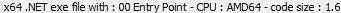

Snipaste_2023-06-25_21-31-29.jpg (4.32 KB, 下载次数: 2)

[href="forum.php?mod=attachment&aid=MjYyMzQ4NnxlNWZiMzRlN3wxNzkzNTczNDc5fDE2ODA4NnwxODAxNDkw&nothumb=yes" target="_blank"](https://www.52pojie.cn/forum.php?mod=attachment&aid=MjYyMzQ4NnxlNWZiMzRlN3wxNzkzNTczNDc5fDE2ODA4NnwxODAxNDkw&nothumb=yes)

2023-6-25 21:34 上传

既然是.NET就可以快乐的使用DNSPY咧~

## 步骤2：用DNSPY打开目标程序

直接右键转到入口点：

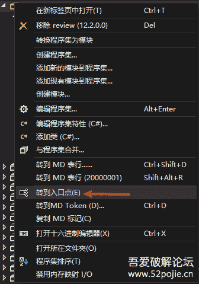

image.png (33.5 KB, 下载次数: 0)

[href="forum.php?mod=attachment&aid=MjYyMzQ4N3w4NzZkYWM3OHwxNzkzNTczNDc5fDE2ODA4NnwxODAxNDkw&nothumb=yes" target="_blank"](https://www.52pojie.cn/forum.php?mod=attachment&aid=MjYyMzQ4N3w4NzZkYWM3OHwxNzkzNTczNDc5fDE2ODA4NnwxODAxNDkw&nothumb=yes)

2023-6-25 21:39 上传

由于dnspy过于给力，接下来基本上就是阅读源码的操作：

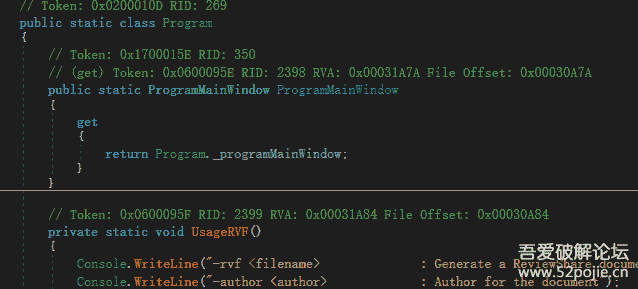

image.png (44.6 KB, 下载次数: 1)

[href="forum.php?mod=attachment&aid=MjYyMzQ4OXw0MmU0MDAxMHwxNzkzNTczNDc5fDE2ODA4NnwxODAxNDkw&nothumb=yes" target="_blank"](https://www.52pojie.cn/forum.php?mod=attachment&aid=MjYyMzQ4OXw0MmU0MDAxMHwxNzkzNTczNDc5fDE2ODA4NnwxODAxNDkw&nothumb=yes)

2023-6-25 22:26 上传

经过漫长的寻找，终于找到了下面这行license象关的内容：

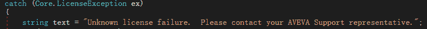

image.png (7.53 KB, 下载次数: 0)

[href="forum.php?mod=attachment&aid=MjYyMzQ5MnwxOGJjMDk3YXwxNzkzNTczNDc5fDE2ODA4NnwxODAxNDkw&nothumb=yes" target="_blank"](https://www.52pojie.cn/forum.php?mod=attachment&aid=MjYyMzQ5MnwxOGJjMDk3YXwxNzkzNTczNDc5fDE2ODA4NnwxODAxNDkw&nothumb=yes)

2023-6-25 22:48 上传

未完明天继续。。。。

拒绝托更，从我做起

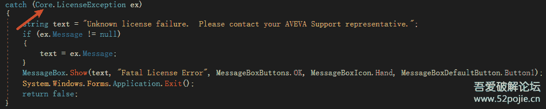

image.png (33.36 KB, 下载次数: 2)

[href="forum.php?mod=attachment&aid=MjYyMzYxOXw5NDljMzE0MnwxNzkzNTczNDc5fDE2ODA4NnwxODAxNDkw&nothumb=yes" target="_blank"](https://www.52pojie.cn/forum.php?mod=attachment&aid=MjYyMzYxOXw5NDljMzE0MnwxNzkzNTczNDc5fDE2ODA4NnwxODAxNDkw&nothumb=yes)

2023-6-26 21:18 上传

这里这个异常是由这个`Core`抛出的，license象关的验证应该就在这个里面：

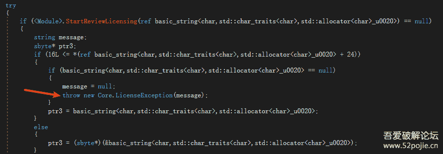

image.png (46.86 KB, 下载次数: 2)

[href="forum.php?mod=attachment&aid=MjYyMzYzMHw1N2IxOTk2OXwxNzkzNTczNDc5fDE2ODA4NnwxODAxNDkw&nothumb=yes" target="_blank"](https://www.52pojie.cn/forum.php?mod=attachment&aid=MjYyMzYzMHw1N2IxOTk2OXwxNzkzNTczNDc5fDE2ODA4NnwxODAxNDkw&nothumb=yes)

2023-6-26 21:32 上传

在`Core`里可以从反编译看出这个链接库是一个包装了cpp的，红色箭头这里看到抛出了一个 `throw new Core.LicenseException(message);`

最简单的应对方法就是跳过这个exception，这边打算依靠dnspy的强大功能直接修改代码：

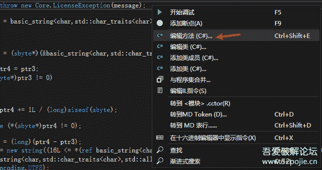

image.png (55.66 KB, 下载次数: 1)

[href="forum.php?mod=attachment&aid=MjYyMzYzNnwwYjNkODk3ZXwxNzkzNTczNDc5fDE2ODA4NnwxODAxNDkw&nothumb=yes" target="_blank"](https://www.52pojie.cn/forum.php?mod=attachment&aid=MjYyMzYzNnwwYjNkODk3ZXwxNzkzNTczNDc5fDE2ODA4NnwxODAxNDkw&nothumb=yes)

2023-6-26 21:39 上传

报错了（我的理解是源文件和cpp一起编译的，dnspy没法将这些引用找回来）：

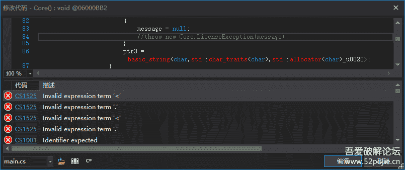

image.png (29.27 KB, 下载次数: 1)

[href="forum.php?mod=attachment&aid=MjYyMzYzOHxmZTUzMTNkOHwxNzkzNTczNDc5fDE2ODA4NnwxODAxNDkw&nothumb=yes" target="_blank"](https://www.52pojie.cn/forum.php?mod=attachment&aid=MjYyMzYzOHxmZTUzMTNkOHwxNzkzNTczNDc5fDE2ODA4NnwxODAxNDkw&nothumb=yes)

2023-6-26 21:41 上传

既然最直白的修改C#代码这条路被堵死了，只能换个方法试一试：

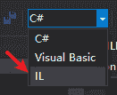

image.png (2.91 KB, 下载次数: 1)

[href="forum.php?mod=attachment&aid=MjYyMzY0MnxmNjJmNjE3ZXwxNzkzNTczNDc5fDE2ODA4NnwxODAxNDkw&nothumb=yes" target="_blank"](https://www.52pojie.cn/forum.php?mod=attachment&aid=MjYyMzY0MnxmNjJmNjE3ZXwxNzkzNTczNDc5fDE2ODA4NnwxODAxNDkw&nothumb=yes)

2023-6-26 21:46 上传

将反编译代码修改为IL指令（转换到IL之前可以先在要修改内容处打个断点以免找不到目标：

）下面是两种代码对比：

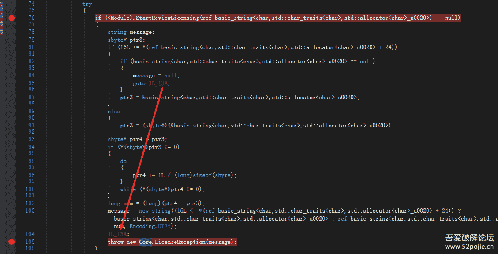

image.png (105.88 KB, 下载次数: 1)

[href="forum.php?mod=attachment&aid=MjYyMzY2OXw4NWFlYjcxZHwxNzkzNTczNDc5fDE2ODA4NnwxODAxNDkw&nothumb=yes" target="_blank"](https://www.52pojie.cn/forum.php?mod=attachment&aid=MjYyMzY2OXw4NWFlYjcxZHwxNzkzNTczNDc5fDE2ODA4NnwxODAxNDkw&nothumb=yes)

2023-6-26 22:30 上传

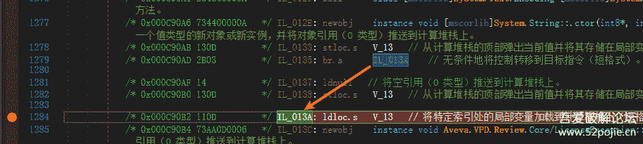

image.png (63.27 KB, 下载次数: 2)

[href="forum.php?mod=attachment&aid=MjYyMzY3MHw1ZGIwNjI5M3wxNzkzNTczNDc5fDE2ODA4NnwxODAxNDkw&nothumb=yes" target="_blank"](https://www.52pojie.cn/forum.php?mod=attachment&aid=MjYyMzY3MHw1ZGIwNjI5M3wxNzkzNTczNDc5fDE2ODA4NnwxODAxNDkw&nothumb=yes)

2023-6-26 22:35 上传

根据瞎猜，只要编辑跳转到`IL_013A`的指令指向别处就可以跳过license验证。

右键编辑IL指令：

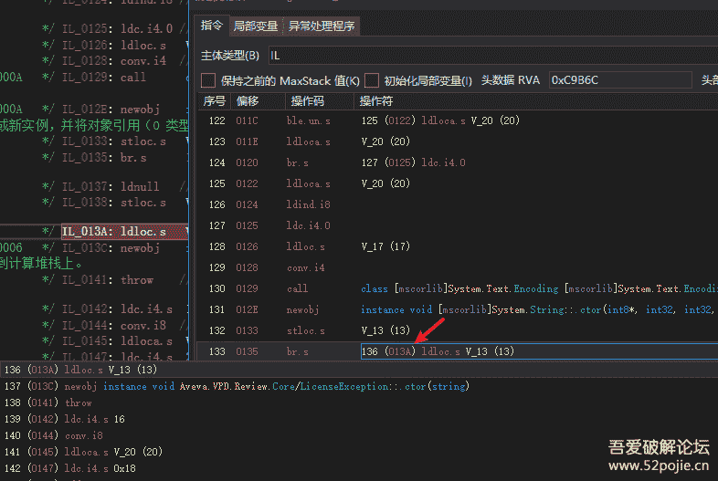

image.png (58.54 KB, 下载次数: 1)

[href="forum.php?mod=attachment&aid=MjYyMzY3MXwzM2RlODQxZnwxNzkzNTczNDc5fDE2ODA4NnwxODAxNDkw&nothumb=yes" target="_blank"](https://www.52pojie.cn/forum.php?mod=attachment&aid=MjYyMzY3MXwzM2RlODQxZnwxNzkzNTczNDc5fDE2ODA4NnwxODAxNDkw&nothumb=yes)

2023-6-26 22:38 上传

编辑好保存即可，接下来尝试一下是否跳转成功：

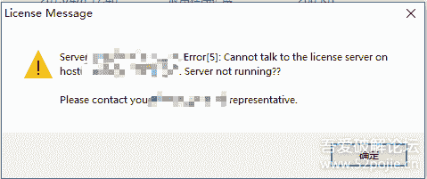

image.png (15.16 KB, 下载次数: 2)

[href="forum.php?mod=attachment&aid=MjYyMzY3MnxmZWEwYTllMHwxNzkzNTczNDc5fDE2ODA4NnwxODAxNDkw&nothumb=yes" target="_blank"](https://www.52pojie.cn/forum.php?mod=attachment&aid=MjYyMzY3MnxmZWEwYTllMHwxNzkzNTczNDc5fDE2ODA4NnwxODAxNDkw&nothumb=yes)

2023-6-26 22:41 上传

弹了一个license message：

image.png (30.3 KB, 下载次数: 1)

[href="forum.php?mod=attachment&aid=MjYyMzY3M3wyNWYyNDM1M3wxNzkzNTczNDc5fDE2ODA4NnwxODAxNDkw&nothumb=yes" target="_blank"](https://www.52pojie.cn/forum.php?mod=attachment&aid=MjYyMzY3M3wyNWYyNDM1M3wxNzkzNTczNDc5fDE2ODA4NnwxODAxNDkw&nothumb=yes)

2023-6-26 22:44 上传

哇哈哈，但是并不影响进入程序。

PS 整个分析过程都是一知半解，希望路过的大佬能够指正一下本菜鸡。
