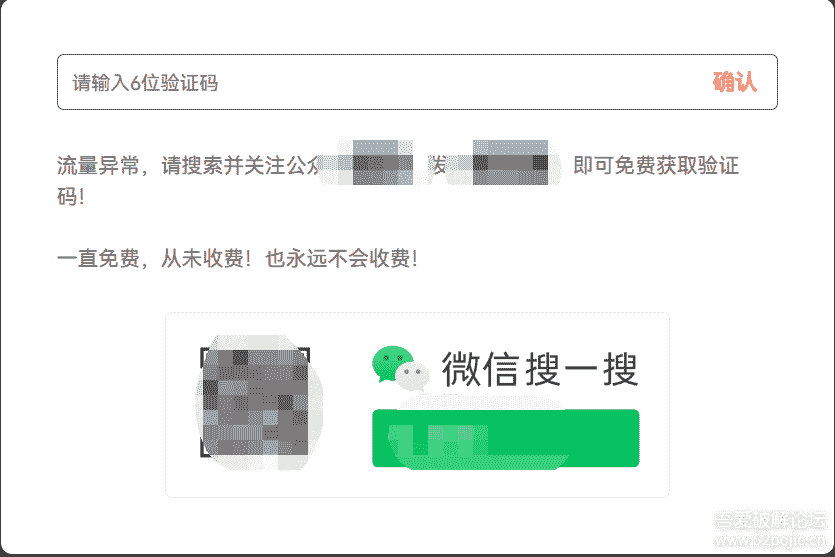
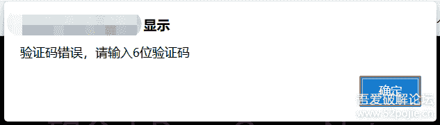
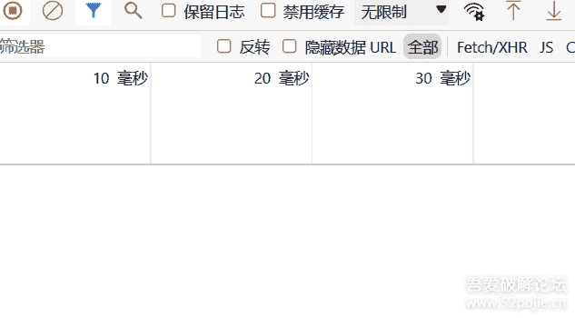
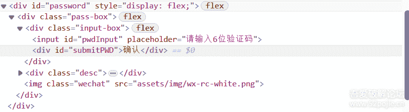
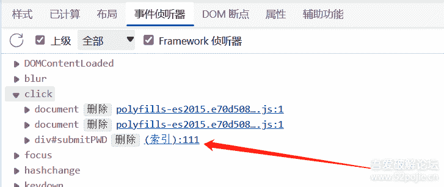
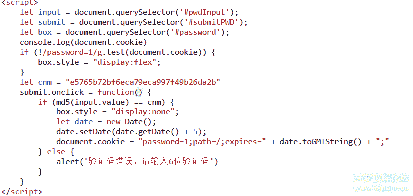
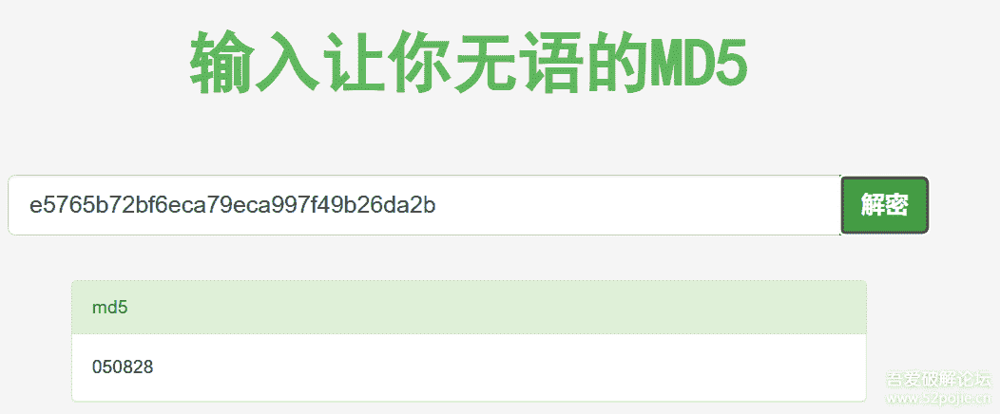

# [Web逆向] 一个菜菜鸡看了菜鸡的帖子对关注公众号回复密码获取验证码的分析

- 原帖：<https://www.52pojie.cn/forum.php?mod=viewthread&tid=1804662>
- 抓取时间：2026-11-01T22:51:04

## 前言

刚入职没事情干，看了一个大佬的帖子，心血来潮也想自己尝试一下逆向分析（不知道算不算逆向分析），在b站上随便找了个推荐的网站就拿来尝试，话不多说直接开始。

附上大佬的帖子：

[一个菜鸡对关注公众号回复密码获取下载链接的分析](https://www.52pojie.cn/thread-1799911-1-1.html)

（出处：[吾爱破解论坛](https://www.52pojie.cn)）

## 正文

### 1、来到网站映入眼帘的就是这个弹框，先不管其他无脑点确定看看有什么反应

`7370cc868b733b880b69b33566da660.png` (53.02 KB, 下载次数: 1)

[附件下载](https://www.52pojie.cn/forum.php?mod=attachment&aid=MjYyNTEyOHxjYWI0YTI0N3wxNzkzNTczNDYyfDE2ODA4NnwxODA0NjYy&nothumb=yes)

1

2023-7-4 15:31 上传

### 2、可以看到调试窗口里的网络并无任何反应，由此可以推断出他的密码是不需要向服务端发器请求进行验证的，我门直接转战前端代码部分

`3a1296d0b867ad426978dc884bb1a7b.png` (15.89 KB, 下载次数: 0)

[附件下载](https://www.52pojie.cn/forum.php?mod=attachment&aid=MjYyNTEyOXw5ODA5Y2Y5ZHwxNzkzNTczNDYyfDE2ODA4NnwxODA0NjYy&nothumb=yes)

2

2023-7-4 15:34 上传

`94566bca17b97710e35df3ede68b167.png` (23.18 KB, 下载次数: 1)

[附件下载](https://www.52pojie.cn/forum.php?mod=attachment&aid=MjYyNTEzMXw1ZjA2Y2MyZXwxNzkzNTczNDYyfDE2ODA4NnwxODA0NjYy&nothumb=yes)

3

2023-7-4 15:34 上传

### 3、直接用浏览器的检查点击输入框定位到代码部分，可以发现并没有什么函数调用，再检查一下确定通过查看事件监听器可以发现有一个`js`方法被调用了

`3752621aed8358157ae45f10b3e79f9.png` (33.18 KB, 下载次数: 2)

[附件下载](https://www.52pojie.cn/forum.php?mod=attachment&aid=MjYyNTEzNHwwNjVjNGRmNHwxNzkzNTczNDYyfDE2ODA4NnwxODA0NjYy&nothumb=yes)

2023-7-4 15:37 上传

`d0eff06b88b2135003b8191034c286a.png` (33.98 KB, 下载次数: 2)

[附件下载](https://www.52pojie.cn/forum.php?mod=attachment&aid=MjYyNTEzNnxhM2QwNzdjZHwxNzkzNTczNDYyfDE2ODA4NnwxODA0NjYy&nothumb=yes)

2023-7-4 15:40 上传

### 4、直接定位到这个方法

可以发现这里的是使用了`document.querySelector`选择到`id`为`submitPWD`的`div`将其赋值给`submit`，并给`submit`绑定了一个`onclick`方法用于校对验证码，其中逻辑也不难看懂，就是将输入框的值通过`md5`加密后和参数`cnm`做对比（看起来这个网站的前端写这段代码的时候心情不是很好 ），一样了就给你的浏览器加上个`cookie`，就可以访问后续内容了

`ac7ec3d87d1dc82cdaad96ca7b42f67.png` (45.55 KB, 下载次数: 1)

[附件下载](https://www.52pojie.cn/forum.php?mod=attachment&aid=MjYyNTEzOHw5M2E4Nzk5NnwxNzkzNTczNDYyfDE2ODA4NnwxODA0NjYy&nothumb=yes)

2023-7-4 15:41 上传

### 5、最后就很简单了，去度娘找一个`md5`解密的网站拿上代码里定义好的参数`cnm`去解密

`694b202cd674f79bf428f5186719ebb.png` (45.44 KB, 下载次数: 2)

[附件下载](https://www.52pojie.cn/forum.php?mod=attachment&aid=MjYyNTE0NXxhNDJmNGYzYXwxNzkzNTczNDYyfDE2ODA4NnwxODA0NjYy&nothumb=yes)

7

2023-7-4 15:53 上传

## 结束语

应该还有更简单的办法的欢迎大家来讨论！第一次发帖发的不好的地方大家不要吝啬你们的意见

