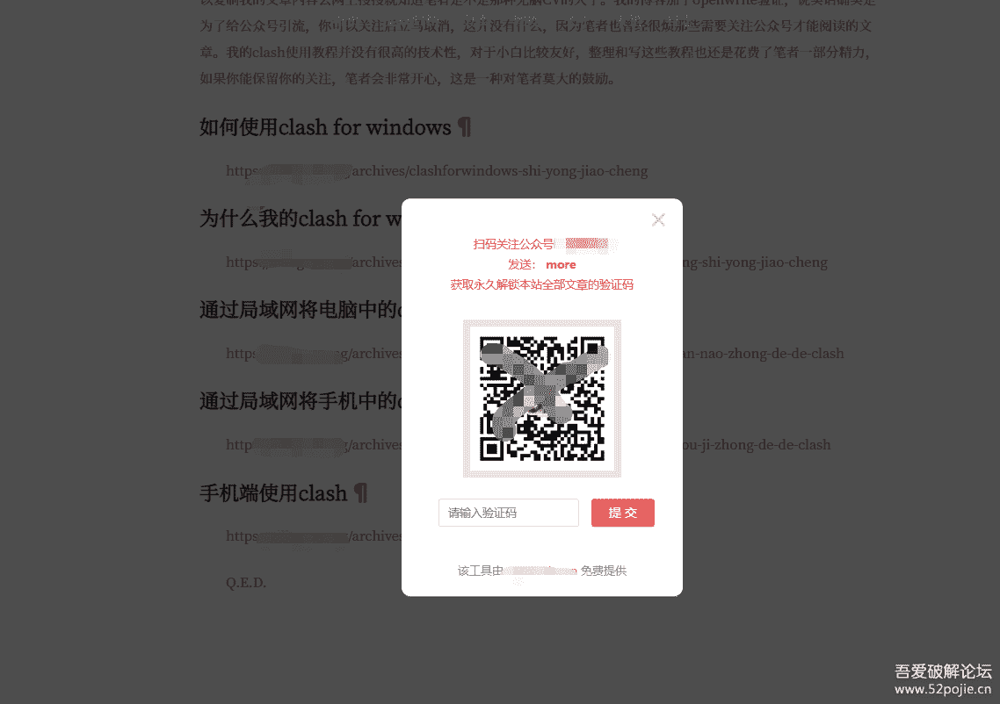
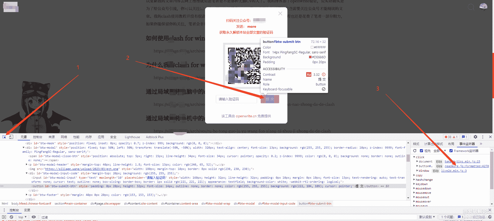
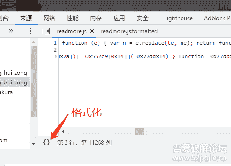
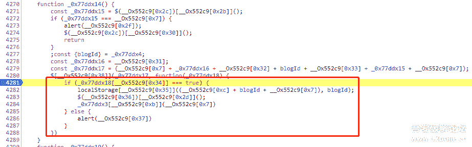
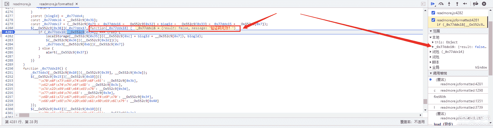
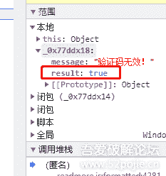

# [Web逆向] 记一个菜菜菜鸡看了菜菜鸡的帖子对关注公众号回复密码获取验证码的分析

- 原帖: [https://www.52pojie.cn/forum.php?mod=viewthread&tid=1807169](https://www.52pojie.cn/forum.php?mod=viewthread&tid=1807169)
- 抓取时间: `2026-11-01T22:50:54`

## 序言

公司业绩不好没事干，看了一位坛友的帖子，心血来潮之下也想自己动手试一下[//www.52pojie.cn" target="_blank" class="relatedlink"](<https://www.52pojie.cn:href="https>)公众号验证码引流，刚好找到一个符合条件的某博客网站。

附上坛友的帖子 @i不存在的

[一个菜菜鸡看了菜鸡的帖子对关注公众号回复密码获取验证码的分析](<https://www.52pojie.cn/thread-1804662-1-1.html:href="https>)

## 正文

### 1、经典验证码页面

我们随便输入一串密码看看，出现了`alert`弹窗。

1.png (161.41 KB, 下载次数: 2)

[附件下载](https://www.52pojie.cn/forum.php?mod=attachment&aid=MjYyNjMyNHw0ZDFlZGJlZHwxNzkzNTczNDUyfDE2ODA4NnwxODA3MTY5&nothumb=yes)

2023-7-11 11:44 上传

5.png (48.28 KB, 下载次数: 1)

[附件下载](https://www.52pojie.cn/forum.php?mod=attachment&aid=MjYyNjMyNXw1YzRmMjVkYXwxNzkzNTczNDUyfDE2ODA4NnwxODA3MTY5&nothumb=yes)

2023-7-11 11:44 上传

### 2、定位确认按钮触发的函数

打开`F12`开发人员工具，定位确认按钮触发的 js 函数，点进 js 文件并格式化。

2.png (326.58 KB, 下载次数: 3)

[附件下载](https://www.52pojie.cn/forum.php?mod=attachment&aid=MjYyNjMyOXw1ZWUzMjFlZXwxNzkzNTczNDUyfDE2ODA4NnwxODA3MTY5&nothumb=yes)

2023-7-11 11:48 上传

3.png (26.01 KB, 下载次数: 3)

[附件下载](https://www.52pojie.cn/forum.php?mod=attachment&aid=MjYyNjMzMHwxNThmZmI4YnwxNzkzNTczNDUyfDE2ODA4NnwxODA3MTY5&nothumb=yes)

2023-7-11 11:51 上传

### 3、在`if`语句中设置断点

发现在`0x77ddx14( )`函数中的`if`语句中有个`alert`，初步判断为验证失败的弹窗，我们将4281行进行断点运行，再次提交随意输入的密码试试。

4.png (53.22 KB, 下载次数: 2)

[附件下载](https://www.52pojie.cn/forum.php?mod=attachment&aid=MjYyNjMzMXw2N2MzNmI4NnwxNzkzNTczNDUyfDE2ODA4NnwxODA3MTY5&nothumb=yes)

2023-7-11 11:52 上传

### 4、修改`false`返回值

发现在断点的`if`语句前有一个`false`返回值，修改它。

6.png (117.34 KB, 下载次数: 3)

[附件下载](https://www.52pojie.cn/forum.php?mod=attachment&aid=MjYyNjMzNXw1ZDI0OTA2OXwxNzkzNTczNDUyfDE2ODA4NnwxODA3MTY5&nothumb=yes)

2023-7-11 11:57 上传

7.png (17.67 KB, 下载次数: 0)

[附件下载](https://www.52pojie.cn/forum.php?mod=attachment&aid=MjYyNjMzNnw3OWFkNzdiZHwxNzkzNTczNDUyfDE2ODA4NnwxODA3MTY5&nothumb=yes)

2023-7-11 11:58 上传

### 5、验证成功

继续运行，验证成功

## 结语

没啥技术难度，所有的信息在获取服务端验证码之前就已经加载完毕了，验证码只是走个流程，不然我这个菜菜菜鸡也破解不了

