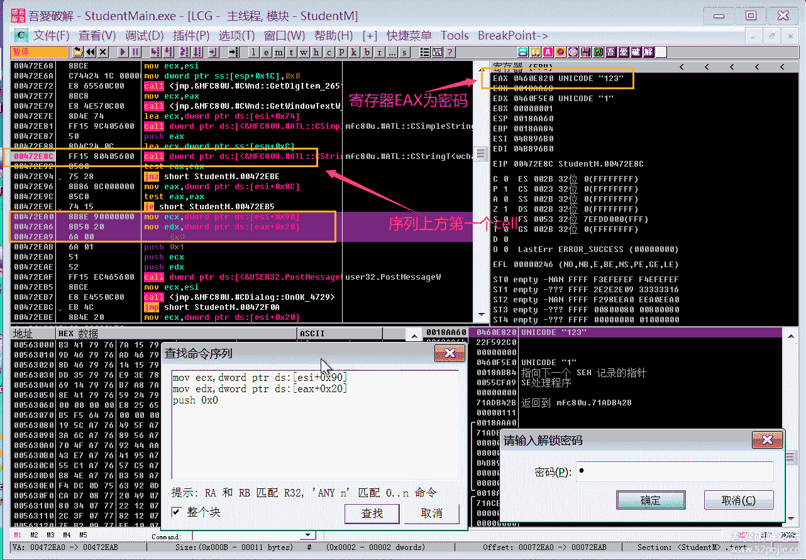
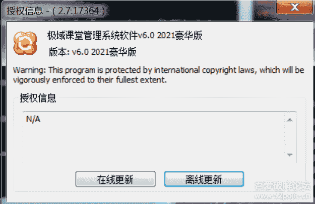
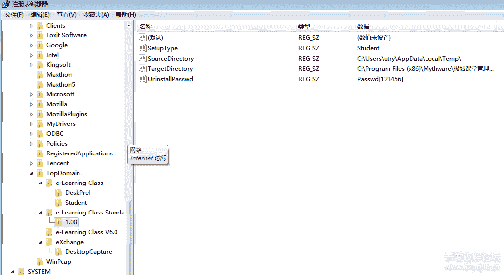
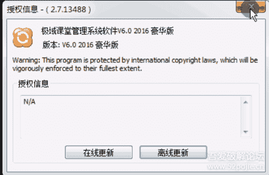

# [分享] 极域电子教室2021获取密码

- 原帖：<https://www.52pojie.cn/forum.php?mod=viewthread&tid=1807265>
- 抓取时间：2026-11-01T22:50:52

## 学生端密码获取

1. 打开学生端输入密码的窗口，`od`附加。
2. `od`内`ctrl+g`跳转到`00401000`，随后`ctrl+s`查找命令序列。
3. 黏贴如下序列：

```
mov ecx,dword ptr ds:[esi+0x90]
mov edx,dword ptr ds:[eax+0x20]
push 0x0
```

4. 跳转后的结构如图，如果不是的可以尝试继续查找，给离序列最近的一个`call`打断点（如红框`00472E8C`处）。
5. `od`继续运行程序，输入密码后点击确定，程序断下，寄存器的`EAX`存放了真实密码（`UNICODE`后不包括双引号）。


`QQ截图20230714130050.png`（222.6 KB，下载次数：1） 2023-7-14 13:01 上传 [附件下载](https://www.52pojie.cn/forum.php?mod=attachment&aid=MjYyNjk3NXwxMDAyN2U1MnwxNzkzNTczNDUwfDE2ODA4NnwxODA3MjY1&nothumb=yes)

对应学生端如下版本：


`QQ截图20230711154932.png`（119.02 KB，下载次数：2） 2023-7-11 15:49 上传 [附件下载](https://www.52pojie.cn/forum.php?mod=attachment&aid=MjYyNjQwNXxlZWY4ZjNkNHwxNzkzNTczNDUwfDE2ODA4NnwxODA3MjY1&nothumb=yes)

## 教师端注册方案

顺便附上教师端的注册方案，使用任意十六进制编辑器编辑教师端的`TeacherMain.exe`，修改下列4处（论坛内复制）：

1. `(00158780)`：`FC FF FF 83 F8 06 75 14 E8 06 75` --》`07 75`
2. `(00158790)`：`76 00 00 50 00 00 00 E9 50 00` --》`EB 03`
3. `(00175FA0)`：`63 00 00 01 00 00 00 E9 01 00` --》`EB 03`
4. `(0017C640)`：`76 00 00 01 00 00 00 E9 01 00` --》`EB 03`

## 备注与说明

备注：2021版（包括2016版）实际上是无法用超级密码`mythware_super_password`登录，也无法从注册表获取密码。

可以看下图，显示的密码是`123456`，实际密码是`123`。


`QQ截图20230714124306.png`（105.93 KB，下载次数：2） 2023-7-14 12:43 上传 [附件下载](https://www.52pojie.cn/forum.php?mod=attachment&aid=MjYyNjk2NnwxOWE5MjAyMXwxNzkzNTczNDUwfDE2ODA4NnwxODA3MjY1&nothumb=yes)

下图是以前发的2016的获取密码教程，可以看到版本是V6.0，网上流传的超级密码和注册表方式应该是基于4.0的版本，各位可以自行尝试。


`QQ截图20230714125141.png`（72.21 KB，下载次数：2） 2023-7-14 12:51 上传 [附件下载](https://www.52pojie.cn/forum.php?mod=attachment&aid=MjYyNjk2OXw3ZGM1M2JiMnwxNzkzNTczNDUwfDE2ODA4NnwxODA3MjY1&nothumb=yes)

顺便问下论坛里有没有专业的律师处理欠薪半年的问题？
