# [.NET逆向] 某工程制图插件逆向(一)程序崩溃的代码修复

- 原帖: https://www.52pojie.cn/forum.php?mod=viewthread&tid=1811291
- 抓取时间: 2026-11-01T22:49:28

## 前言

### 故事的由来

前几天有人在求助区发了一个求助帖(帖子违规已被删除),通过分析源程序代码,发现帖子的贴图注册码明显不对,于是就勾起了我的好奇心!

然后我就在虚拟机中安装了,打开注册窗口直接弹出错误信息崩溃了(后来经过分析是因为在虚拟机中调试的原因),这我的暴脾气就上来了,到底要看看怎么个情况,查找问题的途中学到了很多新东西,所以就发出来和大家分享.

### 分享的目的

分享的目的不是为了让大家去破解这个软件,而是在破解的途中学习关于Visual Studio 开平台下的C#编程语言中的Winform开发模式,学习别人的代码架构和注册验证逻辑,还有一些功能实现的代码应用.

破解是逆向的过程,那么开发就是正向的过程,和衣服一个道理,只有知道衣服是怎么穿上的,脱衣服的时候才能游刃有余!

对于这个逆向的研究将会分为三个独立的帖子进行解析,依次是:

1. 程序崩溃的代码修复(本帖内容)-中等难度
2. 爆破方式与各种爆破点的定位-初级难度  
   [https://www.52pojie.cn/thread-1811554-1-1.html](https://www.52pojie.cn/thread-1811554-1-1.html)
3. 注册码的分析与注册机的编写-高级难度  
   [https://www.52pojie.cn/thread-1814183-1-1.html](https://www.52pojie.cn/thread-1814183-1-1.html)

### 所需工具

- Detect It Easy(查壳工具)
- `de4dot`(脱壳工具)
- `dnspy`(查看代码/修改程序)
- Visual Studio 2013(程序开发工具)

插件安装包下载地址:

aHR0cDovLzI5NTA4MDAueXNlcGFuLmNvbS8=

A.52PJ专区 CadPlugin

## 分析过程

安装过程省略.....

其实大家也没必要安装宿主软件和这个插件,安装过程一波三折...

### 关键文件定位

1. 打开宿主软件,点击插件的注册窗口

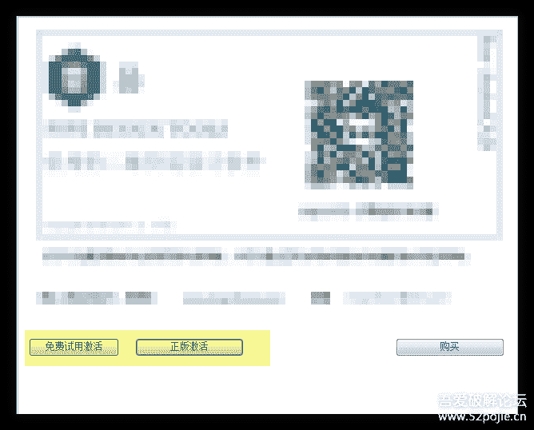

sshot-1.png (19.08 KB, 下载次数: 0)

[附件](https://www.52pojie.cn/forum.php?mod=attachment&aid=MjYyODU0MnxhNTk3MDM2MnwxNzkzNTczMzY2fDE2ODA4NnwxODExMjkx&nothumb=yes)

2023-7-22 04:23 上传

2. 点击激活,直接报错了

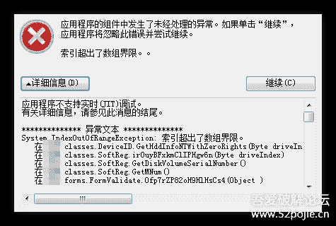

sshot-2.png (26.61 KB, 下载次数: 0)

[附件](https://www.52pojie.cn/forum.php?mod=attachment&aid=MjYyODU0M3xlNDA1YWY5YnwxNzkzNTczMzY2fDE2ODA4NnwxODExMjkx&nothumb=yes)

2023-7-22 04:23 上传

3. 仔细看后面的方法是乱的,说明方法被加密了,而且根据错误信息判断很可能是C#开发的

4. 关掉软件,查看插件目录中所有文件,并分析内容

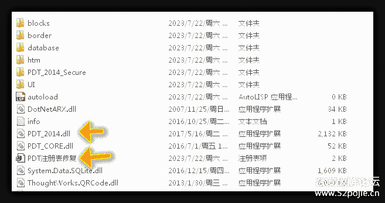

sshot-6.png (51.29 KB, 下载次数: 0)

[附件](https://www.52pojie.cn/forum.php?mod=attachment&aid=MjYyODU0NHxkN2Q2ZmZiY3wxNzkzNTczMzY2fDE2ODA4NnwxODExMjkx&nothumb=yes)

2023-7-22 04:28 上传

5. 重点关注一下`注册表修复.reg`文件内容

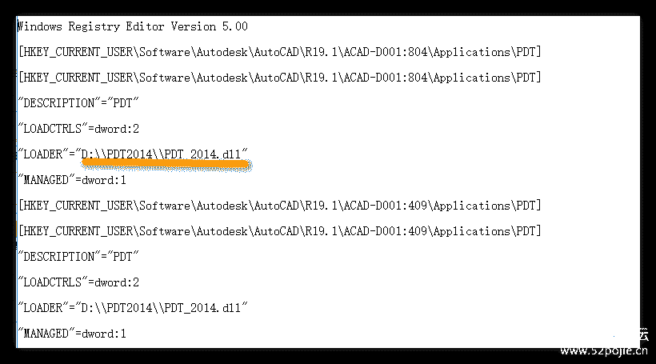

sshot-7.png (24.28 KB, 下载次数: 0)

[附件](https://www.52pojie.cn/forum.php?mod=attachment&aid=MjYyODU0N3w0NmY0NmU0ZXwxNzkzNTczMzY2fDE2ODA4NnwxODExMjkx&nothumb=yes)

2023-7-22 04:32 上传

### 分析插件文件

1. 通过这个注册表文件可以初步判断宿主软件是调用这个dll文件来加载插件功能,然后我们对这个文件进行查壳

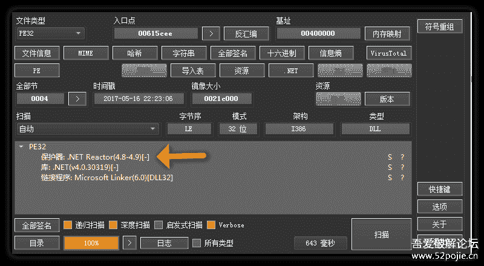

sshot-3.png (37.37 KB, 下载次数: 0)

[附件](https://www.52pojie.cn/forum.php?mod=attachment&aid=MjYyODU0OHwwYTA4OGZlNXwxNzkzNTczMzY2fDE2ODA4NnwxODExMjkx&nothumb=yes)

2023-7-22 04:36 上传

2. 直接上`de4dot`脱壳,用法请参考:

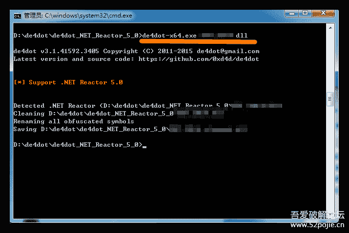

sshot-4.png (48.04 KB, 下载次数: 0)

[附件](https://www.52pojie.cn/forum.php?mod=attachment&aid=MjYyODU0OXxkY2Y1NDZjMnwxNzkzNTczMzY2fDE2ODA4NnwxODExMjkx&nothumb=yes)

2023-7-22 04:37 上传

#### 实用小技巧

我们可以在`de4dot`程序目录下新建一个批处理文件

写入一行代码

```
cmd.exe %cd%
```

这样就可以在打开`cmd`的同时跳转到当前目录了

3. 脱壳后我们用`dnspy`打开这个文件看一下脱壳效果,嗯~比较满意

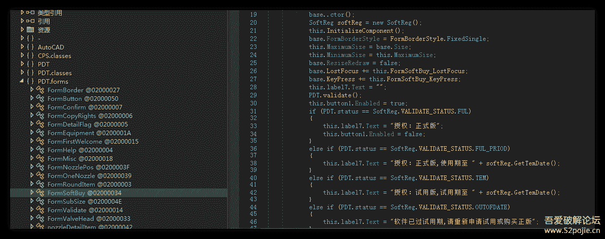

sshot-8.png (69.48 KB, 下载次数: 0)

[附件](https://www.52pojie.cn/forum.php?mod=attachment&aid=MjYyODU1MHwyZDY2MGM5OHwxNzkzNTczMzY2fDE2ODA4NnwxODExMjkx&nothumb=yes)

2023-7-22 04:40 上传

4. 我们把脱壳后的文件改名覆盖回原来的文件,打开宿主软件并再次尝试注册,再次报错,不过这次调用的[方法]是还原之后的

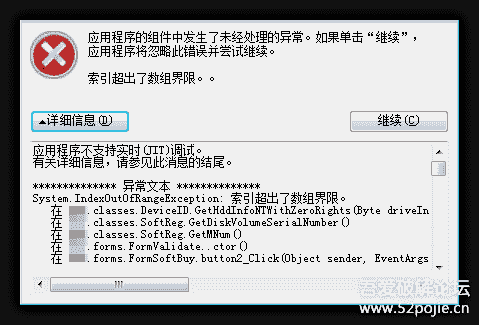

sshot-5.png (26.89 KB, 下载次数: 0)

[附件](https://www.52pojie.cn/forum.php?mod=attachment&aid=MjYyODU1MXw4ZTZhODEzNnwxNzkzNTczMzY2fDE2ODA4NnwxODExMjkx&nothumb=yes)

2023-7-22 04:40 上传

#### 实用小技巧

这个错误信息作为一个C#的程序员经常遇到,如何理解这个错误呢?

我们可以从下往上看,也就是说是下面的[方法]调用上面的方法,我们可以把[方法]理解成子程序.

通过这个错误信息我们就可以判断我们点击的激活按钮就是来自

`XXX..forms.FormSoftBuy.button1_Click` 的事件响应

复制并保存这些信息,对于我们分析很重要哦~

我们用`dnspy`打开这个文件,然后定位到这个按钮的点击事件代码上

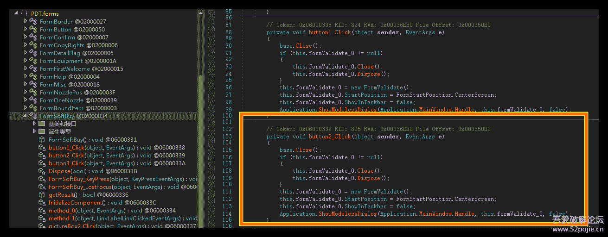

sshot-9.png (96.69 KB, 下载次数: 0)

[附件](https://www.52pojie.cn/forum.php?mod=attachment&aid=MjYyODU1MnxmYmJjYzkyZHwxNzkzNTczMzY2fDE2ODA4NnwxODExMjkx&nothumb=yes)

2023-7-22 04:42 上传

### 编程软件登场

目的:我们虽然可以使用`dnspy`的附加进程功能来调试软件,但是宿主软件太占用内存了,而且插件崩溃也容易引起宿主软件崩溃,所以我们要脱离宿主软件来调试这个插件,就需要写一个软件来模拟这个激活操作.

1. 打开Visual Studio新建一个Winform工程

#### 特别提示

大家可以在B站或者搜索引擎上搜索 C#光速入门教程

快速入门C#编程,全都是干货(原创视频)

2. 在主窗体上放置一个按钮,然后添加引用,引入上面的这个文件,双击按钮控件,代码窗口添加`dnspy`中的目标窗体的命名空间

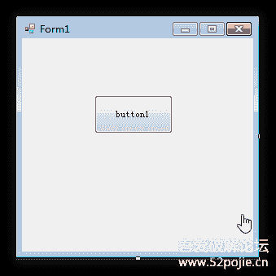

sshot-10.png (14.41 KB, 下载次数: 0)

[附件](https://www.52pojie.cn/forum.php?mod=attachment&aid=MjYyODU1M3w5MDNkZjRjZXwxNzkzNTczMzY2fDE2ODA4NnwxODExMjkx&nothumb=yes)

2023-7-22 04:45 上传

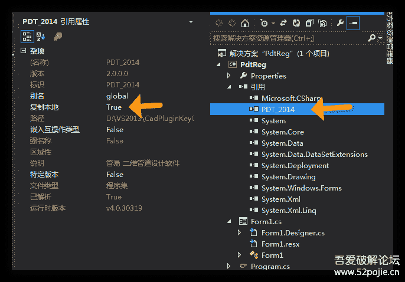

sshot-12.png (63.26 KB, 下载次数: 0)

[附件](https://www.52pojie.cn/forum.php?mod=attachment&aid=MjYyODU1NXwyNWU0YjM3YnwxNzkzNTczMzY2fDE2ODA4NnwxODExMjkx&nothumb=yes)

2023-7-22 04:46 上传

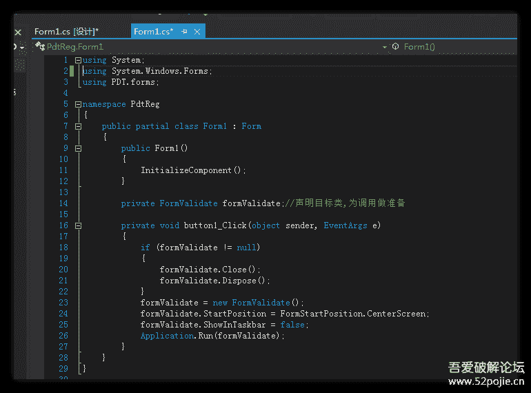

sshot-11.png (27.76 KB, 下载次数: 0)

[附件](https://www.52pojie.cn/forum.php?mod=attachment&aid=MjYyODU1NHxmNzJiNjc3NHwxNzkzNTczMzY2fDE2ODA4NnwxODExMjkx&nothumb=yes)

2023-7-22 04:46 上传

3. 拷贝`dnspy`中的按钮代码,并且简单修改一下


```
                private FormValidate formValidate;//声明目标类,为调用做准备

        private void button1_Click(object sender, EventArgs e)
        {
            if (formValidate != null)
            {
                formValidate.Close();
                formValidate.Dispose();
            }
            formValidate = new FormValidate();
            formValidate.StartPosition = FormStartPosition.CenterScreen;
            formValidate.ShowInTaskbar = false;
            Application.Run(formValidate);
        }
```

### 4. 编译程序
把编译后的程序复制到插件同目录下,以下我们称作这个程序为调试用程序.

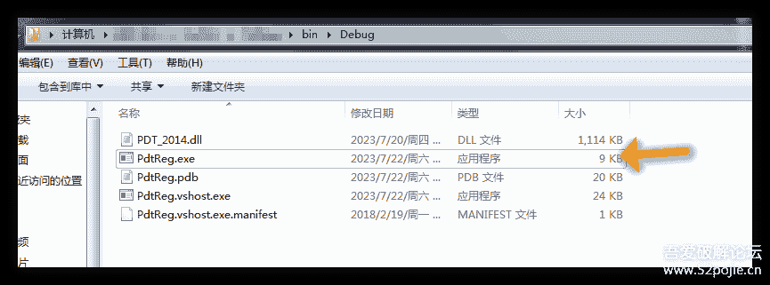

sshot-13.png (49.37 KB, 下载次数: 0)

[href="forum.php?mod=attachment&aid=MjYyODU1NnxiMjFjYzU5NXwxNzkzNTczMzY2fDE2ODA4NnwxODExMjkx&nothumb=yes" target="_blank"](https://www.52pojie.cn/forum.php?mod=attachment&aid=MjYyODU1NnxiMjFjYzU5NXwxNzkzNTczMzY2fDE2ODA4NnwxODExMjkx&nothumb=yes)

2023-7-22 04:48 上传

### 5. 实用小技巧
添加引用后一定要设置这个引用的文件属性为复制到本地 true

### 4. 调试程序
我们用`dnspy`打开调试用程序,然后定位到我们编写的程序位置

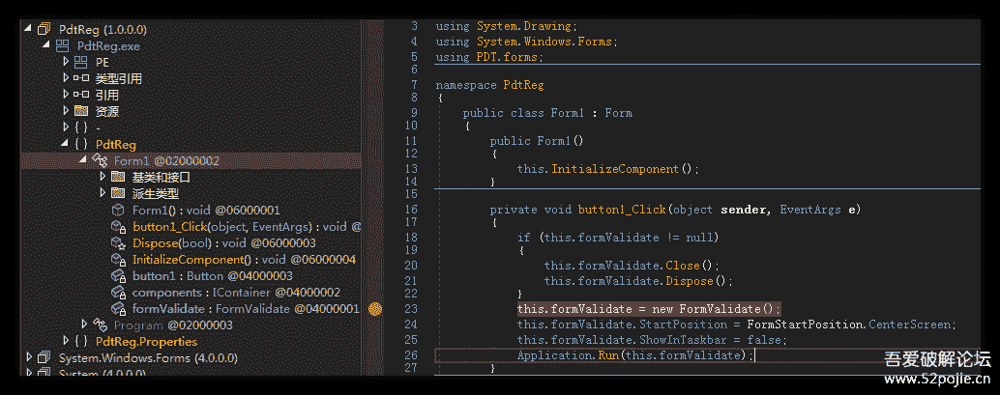

sshot-14.png (57.62 KB, 下载次数: 0)

[href="forum.php?mod=attachment&aid=MjYyODU1N3xkYWQ0NTMyM3wxNzkzNTczMzY2fDE2ODA4NnwxODExMjkx&nothumb=yes" target="_blank"](https://www.52pojie.cn/forum.php?mod=attachment&aid=MjYyODU1N3xkYWQ0NTMyM3wxNzkzNTczMzY2fDE2ODA4NnwxODExMjkx&nothumb=yes)

2023-7-22 04:50 上传

1.在`formValidate = new FormValidate();`,打上断点,

为什么在这里打断点?

还记得我们之前那个软件的崩溃信息吗?

`FormValidate..ctor()`

我们用`dnspy`定位到这个位置就会发现这个位置是程序实例化预执行程序,意思就是这个要运行这个类的程序代码首先要预先执行这个程序段,错误也就出在这个预执行的位置

2.我们使用`F11`单步跟进程序,一步一步的调试(高手略过),如果是高手那么直接跳转到插件程序段内直接在最后一个错误信息的方法内下断点

3.通过跟进,我们最后发现是由于获取硬盘序列号时出现的问题

### 2. 问题展开
通过`PDT.classes.SoftReg.GetDiskVolumeSerialNumber()`方法内的代码,我们可以知道程序尝试调用`PDT.classes.DeviceID`类下的四种方法来获取硬件信息

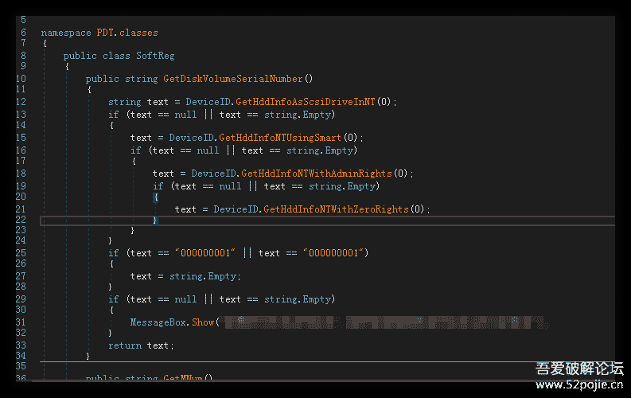

sshot-15.png (25.99 KB, 下载次数: 0)

[href="forum.php?mod=attachment&aid=MjYyODU1OHxjMTI1ZTM0NHwxNzkzNTczMzY2fDE2ODA4NnwxODExMjkx&nothumb=yes" target="_blank"](https://www.52pojie.cn/forum.php?mod=attachment&aid=MjYyODU1OHxjMTI1ZTM0NHwxNzkzNTczMzY2fDE2ODA4NnwxODExMjkx&nothumb=yes)

2023-7-22 04:52 上传

所以我们要分析`DeviceID`类下的所有代码来分析问题所在

### 5. 导入函数分析
1.通过`DllImport("kernel32.dll"`我们可以知道是通过调用`kernel32.dll`的API来实现获取硬件信息的,那么我们就要补习`kernel32.dll`这几个调用的API的作用

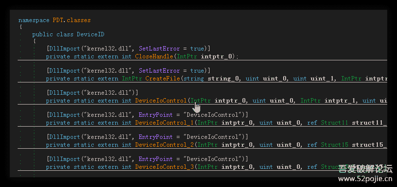

sshot-16.png (25.44 KB, 下载次数: 0)

[href="forum.php?mod=attachment&aid=MjYyODU1OXw1ZjcxOTE4MHwxNzkzNTczMzY2fDE2ODA4NnwxODExMjkx&nothumb=yes" target="_blank"](https://www.52pojie.cn/forum.php?mod=attachment&aid=MjYyODU1OXw1ZjcxOTE4MHwxNzkzNTczMzY2fDE2ODA4NnwxODExMjkx&nothumb=yes)

2023-7-22 04:53 上传

2.开始恶补C/C++的导入函数知识

`CloseHandle`

不用查就知道是关闭句柄的,

`CreateFile`

[//www.cnblogs.com/findumars/p/5636108.html" target="_blank" rel="noopener noreferrer nofollow"](https://www.cnblogs.com/findumars/p/5636108.html:rel="nofollow noopener" href="https)

大体上概括就是创建一个访问操作对象的指针,就像C#的实例化一样,申请内存空间存储数据用的

`DeviceIoControl`

[//baike.baidu.com/item/DeviceIoControl" target="_blank" rel="noopener noreferrer nofollow"](https://baike.baidu.com/item/DeviceIoControl:rel="nofollow noopener" href="https)

读写硬件数据用的,对于开发硬件驱动的程序员应该再熟悉不过了

### 5. 导入函数参数分析
3.弄明白了导入函数,我们再来分析方法内参数

`PhysicalDrive` `Scsi`

[//zhidao.baidu.com/question/1372368563552081619.html" target="_blank" rel="noopener noreferrer nofollow"](https://zhidao.baidu.com/question/1372368563552081619.html:rel="nofollow noopener" href="https)

通过搜索引擎搜索这些事硬盘的标识符信息,所以我们确定软件是通过绑定硬盘信息来进行授权的

然后我们再看`DeviceIoControl`参数

十进制        十六进制

475264U    74080

508040U    7C088

2954240U   2D1400

[//blog.csdn.net/yanchenyu365/article/details/85061879" target="_blank" rel="noopener noreferrer nofollow"](https://blog.csdn.net/yanchenyu365/article/details/85061879:rel="nofollow noopener" href="https)

```
#define  DFP_GET_VERSION          0x00074080

//获取硬件版本

#define  DFP_RECEIVE_DRIVE_DATA   0x0007c088

//获取驱动信息
```

通过单步调试分析发现前三种获取方式每次都是执行`DeviceIoControl`获取数据时条件不满足而返回

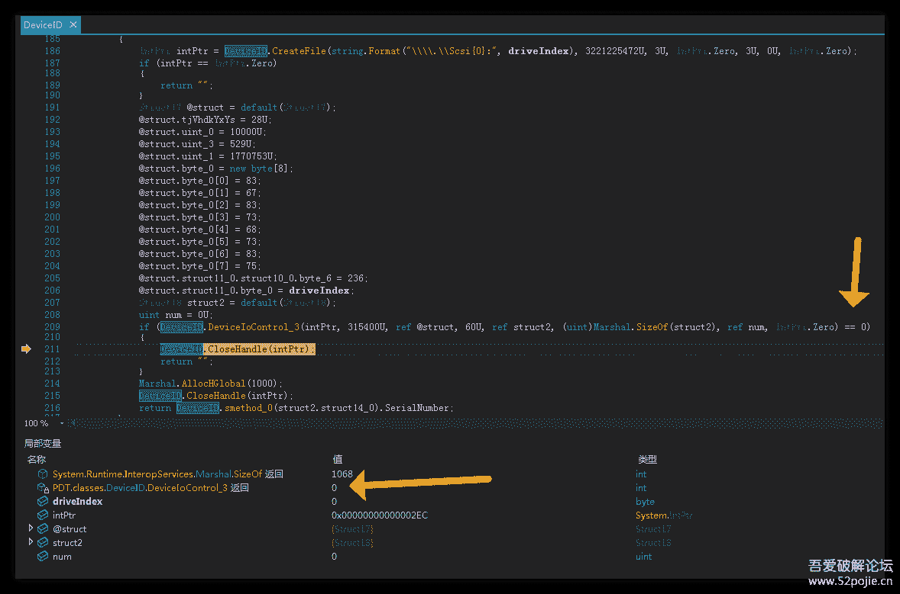

sshot-17.png (60.33 KB, 下载次数: 0)

[href="forum.php?mod=attachment&aid=MjYyODU2MHxjNDdkZmM5ZnwxNzkzNTczMzY2fDE2ODA4NnwxODExMjkx&nothumb=yes" target="_blank"](https://www.52pojie.cn/forum.php?mod=attachment&aid=MjYyODU2MHxjNDdkZmM5ZnwxNzkzNTczMzY2fDE2ODA4NnwxODExMjkx&nothumb=yes)

2023-7-22 04:58 上传

而最后一种方式通过2954240U/2D1400方式可以读取数据

但是在处理获取到的硬件信息时就会报错,这个错误就是我们看到的访问数组超过字段值(访问的数组下标值不存在)

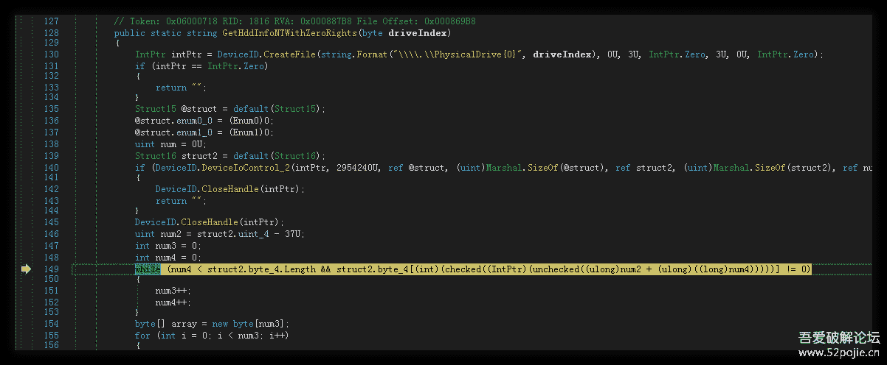

sshot-18.png (31.71 KB, 下载次数: 0)

[href="forum.php?mod=attachment&aid=MjYyODU2MXw2MjlkYzE1N3wxNzkzNTczMzY2fDE2ODA4NnwxODExMjkx&nothumb=yes" target="_blank"](https://www.52pojie.cn/forum.php?mod=attachment&aid=MjYyODU2MXw2MjlkYzE1N3wxNzkzNTczMzY2fDE2ODA4NnwxODExMjkx&nothumb=yes)

2023-7-22 05:02 上传

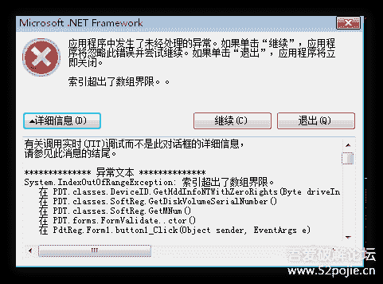

sshot-19.png (30.69 KB, 下载次数: 0)

[href="forum.php?mod=attachment&aid=MjYyODU2Mnw5OTg1ZTk3M3wxNzkzNTczMzY2fDE2ODA4NnwxODExMjkx&nothumb=yes" target="_blank"](https://www.52pojie.cn/forum.php?mod=attachment&aid=MjYyODU2Mnw5OTg1ZTk3M3wxNzkzNTczMzY2fDE2ODA4NnwxODExMjkx&nothumb=yes)

2023-7-22 05:02 上传

这是在虚拟机中,但是在实体机中就读取不到数据

所以问题就出在通过通过API无法获取到正确的硬件数据

由于精力和能力有限就没有办法继续往深层挖掘了,希望懂C++的高手们深挖一下,以便我们这些小菜学习学习.

### 2. 搂草打兔子
既然已经分析90%了,那么我们看看剩下的10%是干什么的

我们假设可以获取到数据,那么数据是怎么处理的呢?

1.前三种方式

`return DeviceID.smethod_0(struct2.struct14_0).SerialNumber;`

前三种方式是通过直接提取返回数据`struct`结构体的序列号字段的字符串数据,简单概括就是直接返回序列号

其中在获取数据的时候调用了一个方法中的代码

```
for (int i = 0; i 
```
原来是把奇数位和偶数位的数据进行对调,为什么需要对调呢?

还记得前面提到的`DeviceIoControl`参数的参考资料的一段话吗?

> 

如果仅用命令行,有些硬盘序列号顺序是反的,有些硬盘序列号是乱码的,有的甚至重装系统就变了,有的完全错误和硬盘标签压根就不一样。

2.最后一种报错的处理方式

```
string @String = asciiencoding.GetString(array);

                                byte[] array2 = new byte[@string.Length / 2];

                                for (int j = 0; j 
```
一样的配方,一样的味道,只不过把序列号每两位字符当做十六进制来返回字符串,那么如果遇到返回的数据中包含G-Z,空格等其他符号那么处理后的数据肯定是有问题的,或者直接报错!

### 2. 个人点评
由于此插件年代久远,当时的程序员更专注于使用API来实现获取硬件信息,对现实电脑运行环境考虑不足,从而造成了无法正确获取硬件数据的问题.

就我个人而言,如果是我,我会使用C#专属的`ManagementObjectSearcher`来获取硬件信息

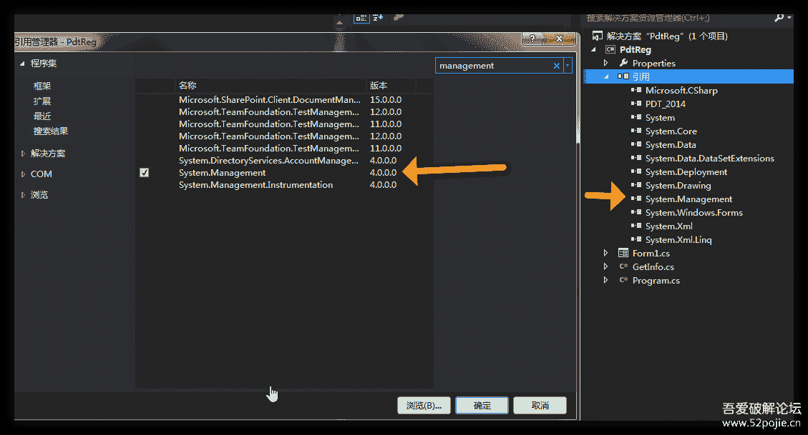

sshot-22.png (87.34 KB, 下载次数: 0)

[href="forum.php?mod=attachment&aid=MjYyODczNHw3ZjlhNDM1NHwxNzkzNTczMzY2fDE2ODA4NnwxODExMjkx&nothumb=yes" target="_blank"](https://www.52pojie.cn/forum.php?mod=attachment&aid=MjYyODczNHw3ZjlhNDM1NHwxNzkzNTczMzY2fDE2ODA4NnwxODExMjkx&nothumb=yes)

2023-7-22 12:52 上传

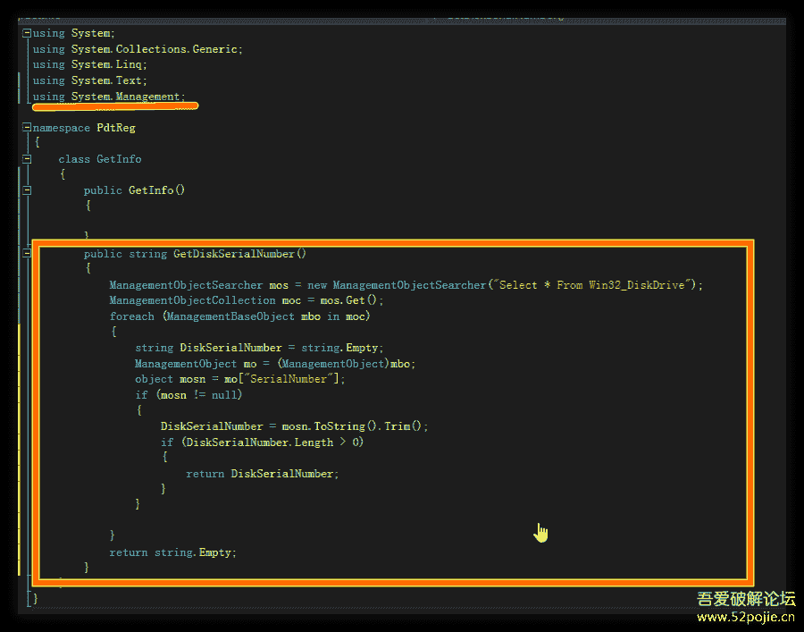

sshot-21.png (75.58 KB, 下载次数: 0)

[href="forum.php?mod=attachment&aid=MjYyODczNXxkZTg3MjAxMXwxNzkzNTczMzY2fDE2ODA4NnwxODExMjkx&nothumb=yes" target="_blank"](https://www.52pojie.cn/forum.php?mod=attachment&aid=MjYyODczNXxkZTg3MjAxMXwxNzkzNTczMzY2fDE2ODA4NnwxODExMjkx&nothumb=yes)

2023-7-22 12:52 上传

这种方式完全可以规避通过API获取硬件信息的各种问题

### 2. 程序修复
治病要去根,既然是逆向,我们就直接返回一个伪造的序列号,彻底屏蔽掉这个获取硬件类的程序代码

具体实现是:`SoftReg`类中

源程序:


```csharp
public string GetDiskVolumeSerialNumber()
                {
                        string text = DeviceID.GetHddInfoAsScsiDriveInNT(0);
                        if (text == null || text == string.Empty)
                        {
                                text = DeviceID.GetHddInfoNTUsingSmart(0);
                                if (text == null || text == string.Empty)
                                {
                                        text = DeviceID.GetHddInfoNTWithAdminRights(0);
                                        if (text == null || text == string.Empty)
                                        {
                                                text = DeviceID.GetHddInfoNTWithZeroRights(0);
                                        }
                                }
                        }
                        if (text == "000000001" || text == "000000001")
                        {
                                text = string.Empty;
                        }
                        if (text == null || text == string.Empty)
                        {
                                MessageBox.Show("XXXXXXX");
                        }
                        return text;
                }
```

修改为

```csharp
public string GetDiskVolumeSerialNumber()

                {

                        return "52pojie";

                }
```

具体如何操作呢?

在`dnspy`中，代码部分右键，选择`编辑方法`，在打开的编辑器中直接修改代码即可，然后点击`编译`。

然后菜单栏`文件` -> `保存模块` -> `保存`即可。

### 效果展示

使用宿主软件打开插件注册面板(为什么不用我们自己写的软件这个会在以后的帖子里面说明,反正也运行不起啦,哈哈哈~)

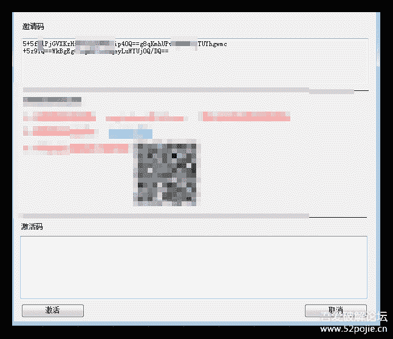

sshot-20.png (19.62 KB, 下载次数: 0)

[2023-7-22 05:20 上传](https://www.52pojie.cn/forum.php?mod=attachment&aid=MjYyODU2M3w0NmM3Nzc1OXwxNzkzNTczMzY2fDE2ODA4NnwxODExMjkx&nothumb=yes)

### 番外篇

刚才修改的这段代码有一段代码很有意思

```csharp
                        if (text == "000000001" || text == "000000001")
                        {
                                text = string.Empty;
                        }
```

刚开始我也不明白为什么要加上这个，序列号为1的硬盘存在吗?

直到我搜了一下资料

[//www.doc88.com/p-98373095782009.html](https://www.doc88.com/p-98373095782009.html)

原来这个序列号虚拟机的硬盘序列号,不允许虚拟机使用这个插件,呵呵呵~插件开发这费心了,没用的知识又增加了

### 总结

通过一整天的分析,查阅资料,了解到API操作硬件的相关知识,也明白了软件的整体验证流程

不知道看完帖子的群友们有没有用`C#`的`Winform`写出自己第一个有按钮的软件呢?

破解不是目的,从破解的过程学习别人的软件架构和功能用法才是我们的追求,当然能发现他人程序的BUG并且修复BUG才会让我们的技术更上一层楼~.

创作不易,感谢大家的支持!
