# [Web逆向] 《某某点评》九卦连线图风控逆向第一部分

- 原帖：<https://www.52pojie.cn/forum.php?mod=viewthread&tid=1812867>
- 抓取时间：2026-11-01T22:49:16

## 1. 随便访问某某点评店铺的首页，多刷新几次或者换ip访问会触发风控如下图

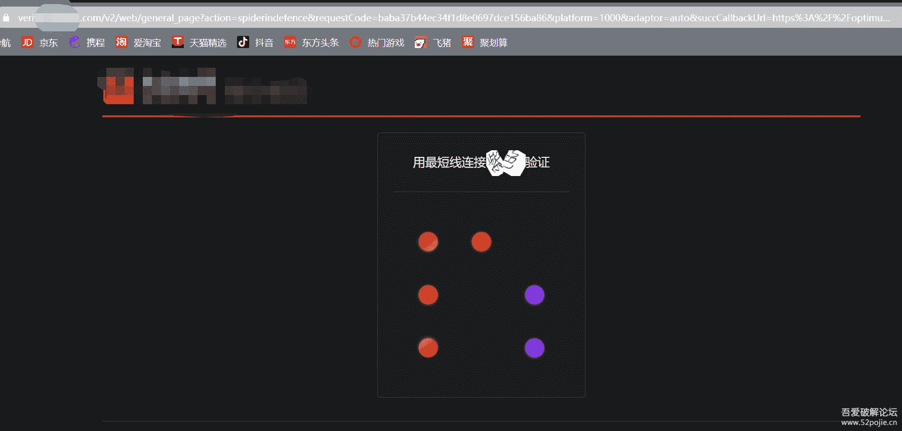

`ver.png`（88.57 KB，下载次数：0）  
[附件下载](https://www.52pojie.cn/forum.php?mod=attachment&aid=MjYyOTg5NHwyN2VkOTY5OHwxNzkzNTczMzU0fDE2ODA4NnwxODEyODY3&nothumb=yes)  
2023-7-25 11:48 上传

## 2. 抓包分析，发现生成验证码要传入必要参数：`request_code` 和 `_token`

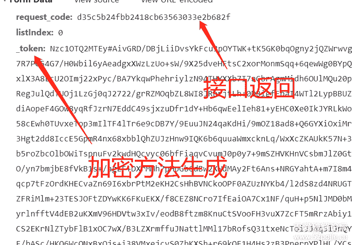

`0-1.png`（104.71 KB，下载次数：0）  
[附件下载](https://www.52pojie.cn/forum.php?mod=attachment&aid=MjYyOTg4Mnw3NWY4ZWI1ZnwxNzkzNTczMzU0fDE2ODA4NnwxODEyODY3&nothumb=yes)  
2023-7-25 11:47 上传

## 3. 跟栈分析，可以AST还原整个文件（可以参考这个老哥写的<https://blog.csdn.net/weixin_44772112/article/details/128721509>，很不错），或者硬跟，找到加密点

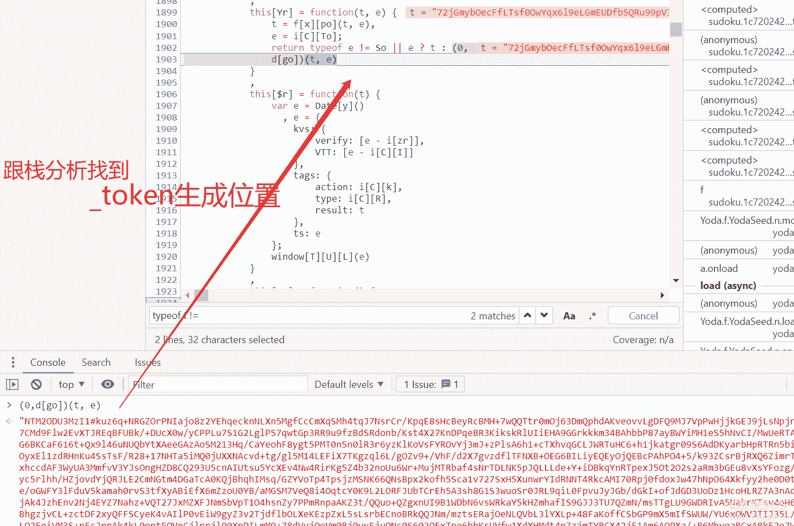

`0-2 (2).png`（223.47 KB，下载次数：0）  
[附件下载](https://www.52pojie.cn/forum.php?mod=attachment&aid=MjYyOTg4M3w2Y2IxMzMyZnwxNzkzNTczMzU0fDE2ODA4NnwxODEyODY3&nothumb=yes)  
2023-7-25 11:47 上传

## 4. 跟进去之后会发现这个接口的 `_token` 很多值都可以固定写死，也需要之前接口返回的参数参与加密运算

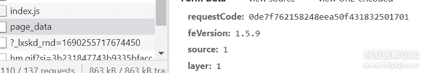

`0-3.png`（24.48 KB，下载次数：1）  
[附件下载](https://www.52pojie.cn/forum.php?mod=attachment&aid=MjYyOTg4NHxkOGFjZWFhMnwxNzkzNTczMzU0fDE2ODA4NnwxODEyODY3&nothumb=yes)  
2023-7-25 11:47 上传

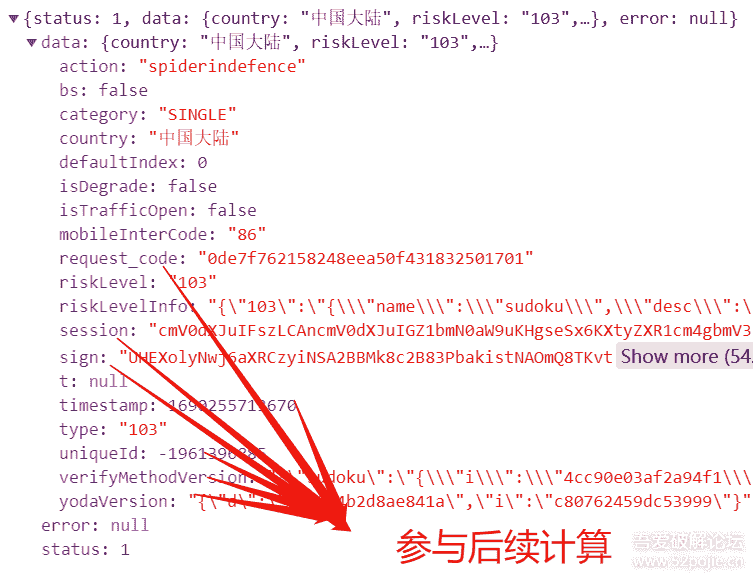

`0-4.png`（92.56 KB，下载次数：1）  
[附件下载](https://www.52pojie.cn/forum.php?mod=attachment&aid=MjYyOTg4NXwxMWU2OGEwMnwxNzkzNTczMzU0fDE2ODA4NnwxODEyODY3&nothumb=yes)  
2023-7-25 11:47 上传

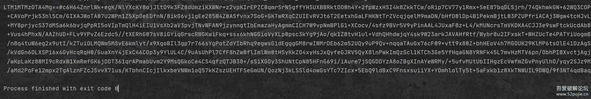

`微信图片_20230725120954.png`（636 KB，下载次数：0）  
[附件下载](https://www.52pojie.cn/forum.php?mod=attachment&aid=MjYyOTkwNXxjZjY4ZDgyMHwxNzkzNTczMzU0fDE2ODA4NnwxODEyODY3&nothumb=yes)  
2023-7-25 12:10 上传

## 5. 成功生成 `_token` 后，请求拿到验证码数据，发现页面展示和接口返回的大验证码有一部分点的位置有出入

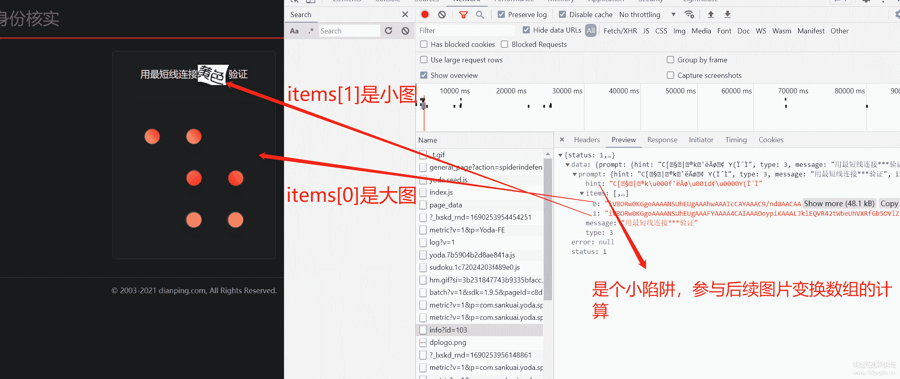

`1.png`（243.88 KB，下载次数：0）  
[附件下载](https://www.52pojie.cn/forum.php?mod=attachment&aid=MjYyOTg4NnxlZmZjMmRmNXwxNzkzNTczMzU0fDE2ODA4NnwxODEyODY3&nothumb=yes)  
2023-7-25 11:47 上传

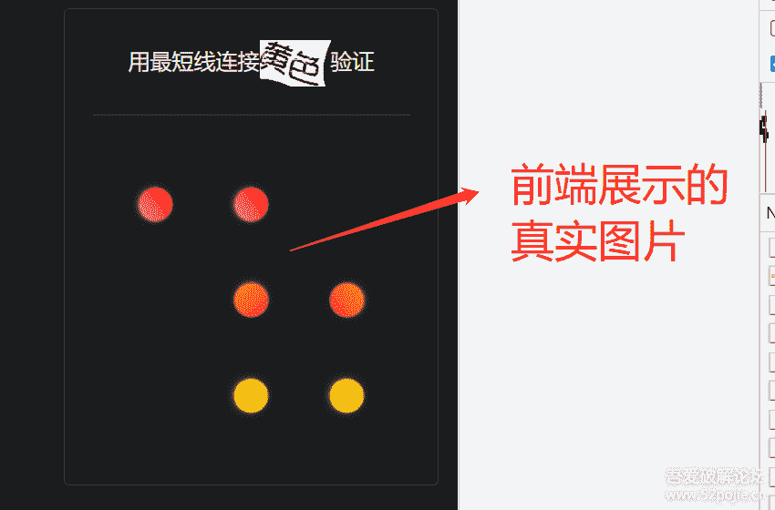

`2.png`（48.58 KB，下载次数：0）  
[附件下载](https://www.52pojie.cn/forum.php?mod=attachment&aid=MjYyOTg4N3xmNGI2Yzc4ZXwxNzkzNTczMzU0fDE2ODA4NnwxODEyODY3&nothumb=yes)  
2023-7-25 11:47 上传

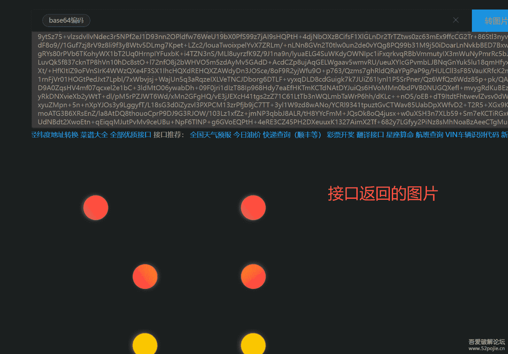

`2222.png`（175.71 KB，下载次数：2）  
[附件下载](https://www.52pojie.cn/forum.php?mod=attachment&aid=MjYyOTkwMnwyMjA3N2I2OHwxNzkzNTczMzU0fDE2ODA4NnwxODEyODY3&nothumb=yes)  
2023-7-25 12:05 上传

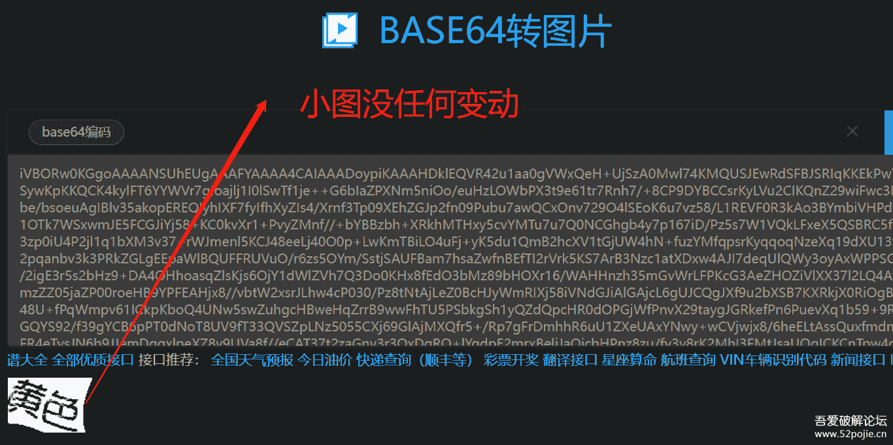

`3.png`（159.76 KB，下载次数：1）  
[附件下载](https://www.52pojie.cn/forum.php?mod=attachment&aid=MjYyOTg4OHw2ODdkNzJkZXwxNzkzNTczMzU0fDE2ODA4NnwxODEyODY3&nothumb=yes)  
2023-7-25 11:47 上传

## 6. 判断 `Canvas` 参与其中，打 `Canvas` 事件监听断点

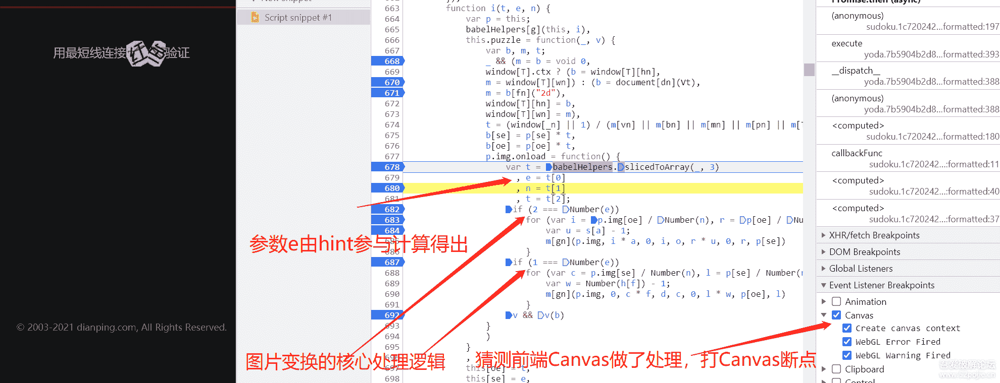

`4-1.png`（218.28 KB，下载次数：0）  
[附件下载](https://www.52pojie.cn/forum.php?mod=attachment&aid=MjYyOTg4OXxjNjlhMDUyZHwxNzkzNTczMzU0fDE2ODA4NnwxODEyODY3&nothumb=yes)  
2023-7-25 11:47 上传

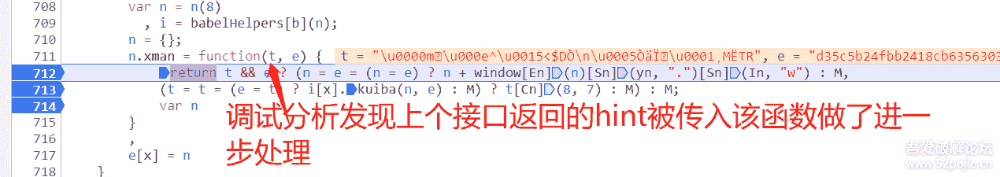

`4-2.png`（53.9 KB，下载次数：1）  
[附件下载](https://www.52pojie.cn/forum.php?mod=attachment&aid=MjYyOTg5MHwwYTdlZWM0MXwxNzkzNTczMzU0fDE2ODA4NnwxODEyODY3&nothumb=yes)  
2023-7-25 11:47 上传

## 7. 导入 `Canvas` 包，扣代码或者算法还原

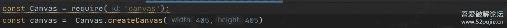

`5-1.png`（32.28 KB，下载次数：1）  
[附件下载](https://www.52pojie.cn/forum.php?mod=attachment&aid=MjYyOTg5MXxlM2Y4MDljZnwxNzkzNTczMzU0fDE2ODA4NnwxODEyODY3&nothumb=yes)  
2023-7-25 11:47 上传

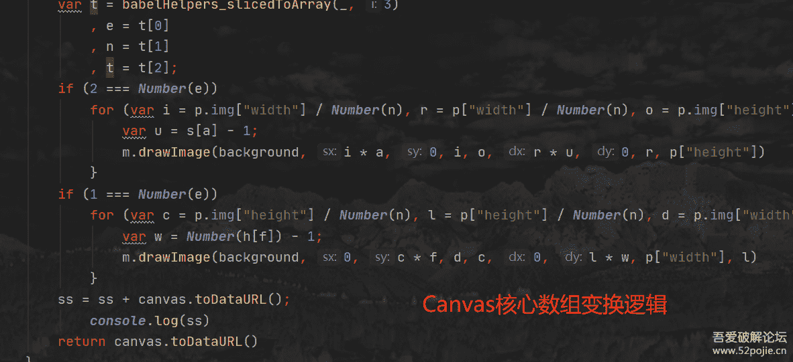

`5-2.png`（317.67 KB，下载次数：2）  
[附件下载](https://www.52pojie.cn/forum.php?mod=attachment&aid=MjYyOTg5MnwwNjgyNGIwZXwxNzkzNTczMzU0fDE2ODA4NnwxODEyODY3&nothumb=yes)  
2023-7-25 11:48 上传

## 8. 成功还原正确的图片

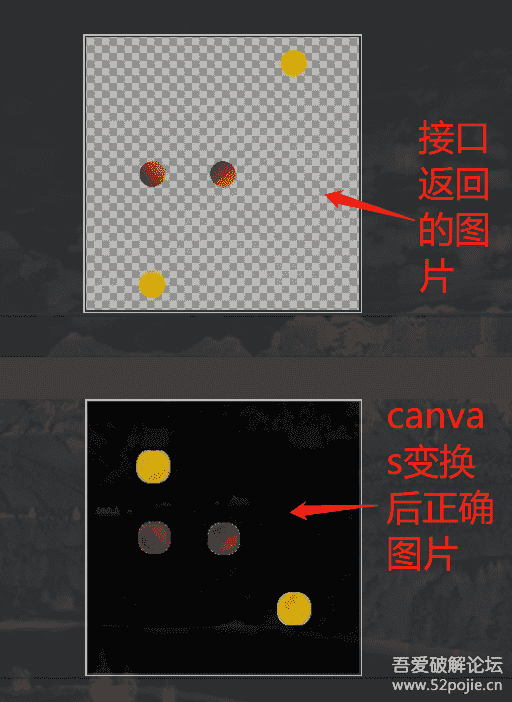

`5-3.png`（154.06 KB，下载次数：0）  
[附件下载](https://www.52pojie.cn/forum.php?mod=attachment&aid=MjYyOTg5M3w4Yzg3MTM1YXwxNzkzNTczMzU0fDE2ODA4NnwxODEyODY3&nothumb=yes)  
2023-7-25 11:48 上传

## 9. 验证码获取及正确验证码还原部分分析完了，下一 part 分析验证码识别逻辑和最终生成验证加密值逻辑方法
