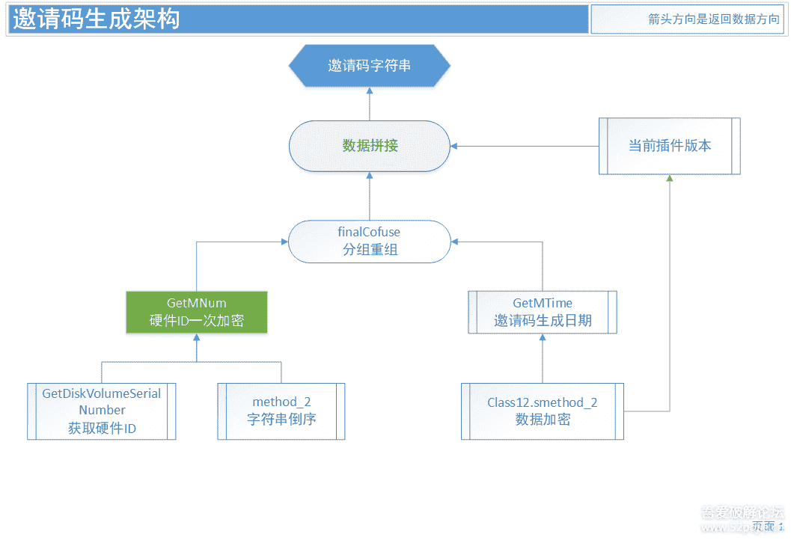
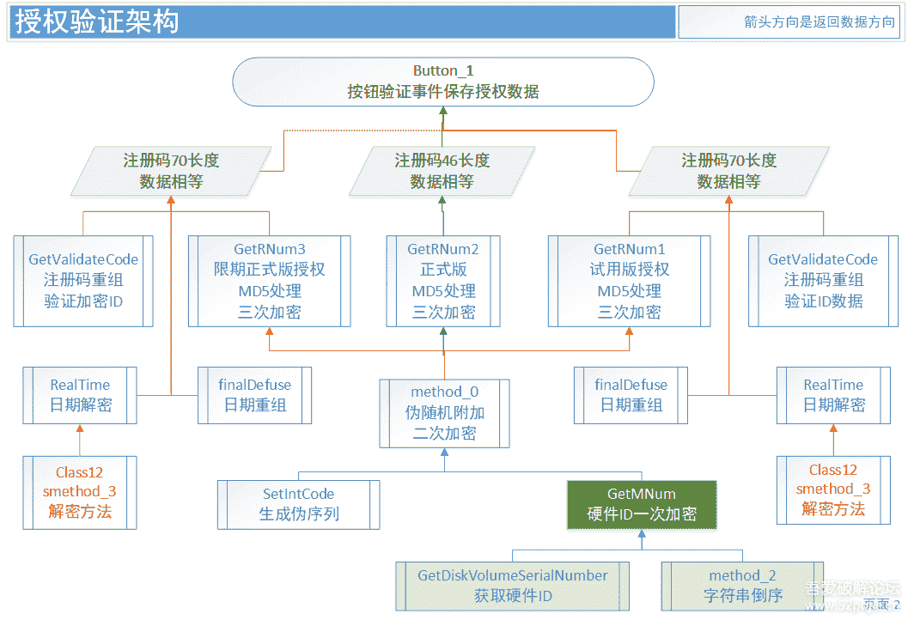
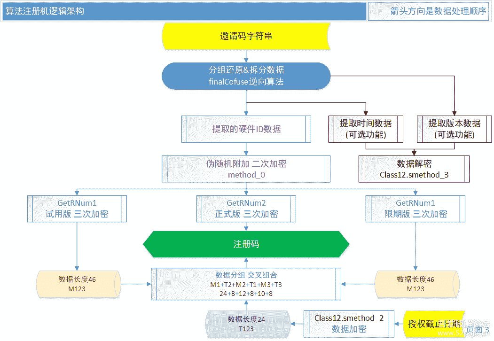
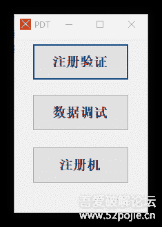
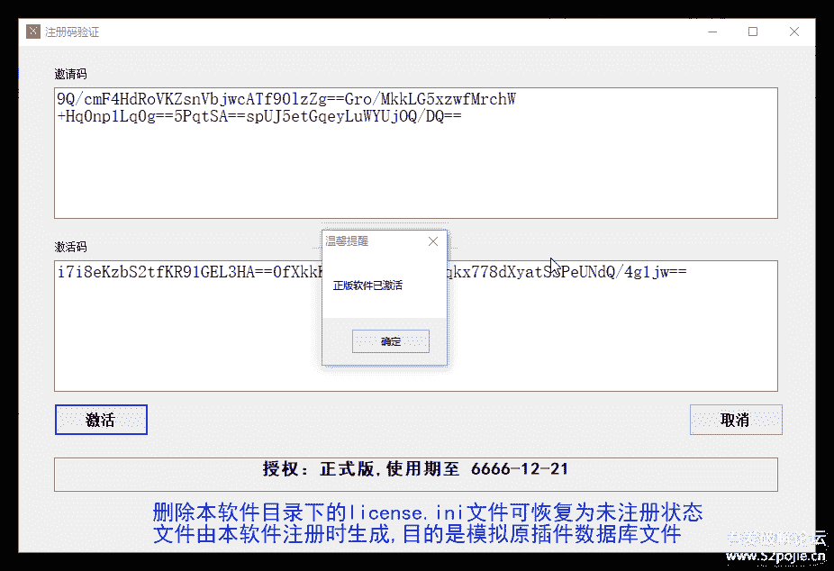
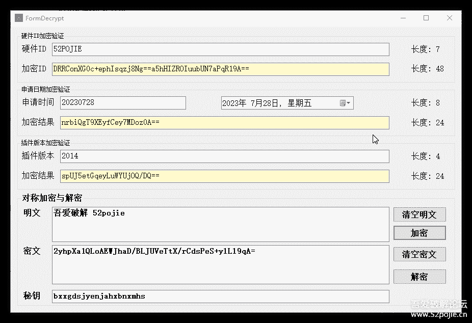
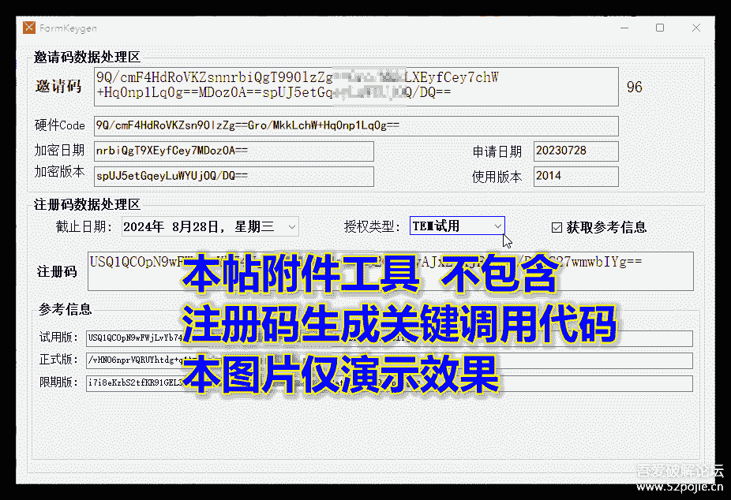

# [.NET逆向] 某工程制图插件逆向(三) 注册码分析和注册机的编写[C# Winform 编程入门]

- 原帖: https://www.52pojie.cn/forum.php?mod=viewthread&tid=1814183
- 抓取时间: 2026-11-01T22:49:06

## 前言

### 分享的目的

分享的目的不是为了让大家去破解这个软件，而是在破解的途中学习关于 Visual Studio 平台下的 C# 编程语言中的 Winform 开发模式，学习别人的代码架构和注册验证逻辑，还有一些功能实现的代码应用。

破解是逆向的过程，那么开发就是正向的过程，和衣服一个道理，只有知道衣服是怎么穿上的，脱衣服的时候才能游刃有余!

对于这个逆向的研究将会分为三个独立的帖子进行解析，依次是：

1. 程序崩溃的代码修复 - 中等难度
2. 各种爆破点的定位和效果点评 - 初级难度
3. 注册码的分析与注册机的编写 - 高级难度

### 所需工具

- dnspy（查看代码）
- Visual Studio 2013（程序开发工具）

插件安装包下载地址：

```
aHR0cDovLzI5NTA4MDAueXNlcGFuLmNvbS8=
```

A.52PJ专区 CadPlugin

## 前期准备

请先阅读并理解实操前两篇帖子的内容：

[//www.52pojie.cn/thread-1811291-1-1.html](https://www.52pojie.cn/thread-1811291-1-1.html)
[//www.52pojie.cn/thread-1811554-1-1.html](https://www.52pojie.cn/thread-1811554-1-1.html)

## 理清思路

要分析注册码的算法，首先要分析邀请码的构成，从邀请码中提取我们需要的数据，才能更容易的获得注册码的生成架构。

## 邀请码的生成流程

`PDT.forms.FormValidate` 类预加载代码段：

```
this.textBox2.Text = this.softReg_0.finalCofuse(this.softReg_0.GetMNum(), this.softReg_0.GetMTime()) + Class12.smethod_2("2014", "cadversion");
```



## 授权验证的流程

`PDT.forms.FormValidate` 类，`button1_Click` 方法中：



## 注册码的流程

注册码的流程其实就是制造一个符合授权验证的字符串，也就是授权验证的逆向操作。



## 提取邀请码信息

### 分析邀请码构成代码

先看一下`finalCofuse`方法：

```
public string finalCofuse(string p1, string p2)
{
        string text = null;
        string text2 = null;
        string text3 = null;
        string text4 = null;
        string text5 = null;
        string text6 = null;
        try
        {
                text = p1.Substring(0, 16);//p1的1到16位字符串
                text2 = p1.Substring(16, 16);//p1的17到32位字符串
                text3 = p1.Substring(32, 16);//p1的33到48位字符串
                text4 = p2.Substring(0, 8);//p2的1到8位字符串
                text5 = p2.Substring(8, 8);//p2的9-16位字符串
                text6 = p2.Substring(16, 8);//p2的17到24位字符串
        }
        catch
        {
                MessageBox.Show("软件无法正常运行");
        }
        return string.Concat(new string[] { text, text4, text2, text5, text3, text6 });
}
```

由此可知，邀请码的构成是（`M`代表机器码，`T`代表时间，`V`代表版本）：

`M1+T1+M2+T2+M3+T3+V`

`16+8+16+8+16+8+n`

所以我们先对邀请码进行还原：

```
string text1 = InvitationCode.Substring(0, 16);
string text2 = InvitationCode.Substring(16, 8);
string text3 = InvitationCode.Substring(24, 16);
string text4 = InvitationCode.Substring(40, 8);
string text5 = InvitationCode.Substring(48, 16);
string text6 = InvitationCode.Substring(64, 8);

this.InvEnVer = InvitationCode.Substring(72);
this.InvEnMID = string.Format("{0}{1}{2}", text1, text3, text5);
this.InvEnTime = string.Format("{0}{1}{2}", text2, text4, text6);
```

再看`GetMNum()`方法：

```
string diskVolumeSerialNumber = this.GetDiskVolumeSerialNumber();
if (diskVolumeSerialNumber != null && !(diskVolumeSerialNumber == string.Empty))
{
        string text = diskVolumeSerialNumber;
        string text2 = this.method_2(text);
        MD5 md = new MD5CryptoServiceProvider();
        byte[] bytes = Encoding.Default.GetBytes(text);
        byte[] array = md.ComputeHash(bytes);
        byte[] bytes2 = Encoding.Default.GetBytes(text2);
        byte[] array2 = md.ComputeHash(bytes2);
        return Convert.ToBase64String(array) + Convert.ToBase64String(array2);
}
return null;
```

对机器码进行了 `MD5` 操作，并且转换成了 `BASE64`，因为 `MD5` 是不可逆的，所以无法还原，所以我们就无需考虑解密。

通过对另外两个数据，时间和版本的分析是对称加密，所以可以进行解密，解密方法一般是和加密方法代码放在一起的，观察相同类下的方法内程序参数结构就可以判断。

### 验证邀请码返回值

按照邀请码构成代码，建立程序对邀请码各部分数据进行验证。

通过复现代码，可知：

1. 邀请码中的机器码无论原始值是什么，返回值最终永远是48位。
2. 邀请码中的时间加密后永远是24位。
3. 邀请码中的版本加密后永远是24位。

那么邀请码总共是 `48+24+24=96` 位。

### 还原授权验证代码

#### 第一个条件判定

首先我们看第一个判断逻辑，字符串长度46，根据上面的流程图，补全代码即可，在这里注意一下流程图的绿色背景部分。

这个方法在邀请码中也使用了，所以我们通过这个可最终得知：

验证时并没有还原原始机器码，使用的这个方法值，所以我们可以通过在我们的注册码还原时直接赋值数据来实现。

通过`setStatus(SoftReg.VALIDATE_STATUS.FUL)`代码和前文的分析我们可得知这个是正式版的注册码。

#### 第二个条件判定

##### `GetRNum1` 加密的机器码

在`GetValidateCode()`方法中：

```
public string GetValidateCode(string s)
{
        string text = s.Substring(0, 24);
        string text2 = s.Substring(32, 12);
        string text3 = s.Substring(52, 10);
        return text + text2 + text3;
}
```

`24+12+10=46` 与`GetRNum1()`方法的返回值进行对比是否相等。

##### `finalDefuse(text)`

```
public string finalDefuse(string p)
{
        string text = p.Substring(24, 8);
        string text2 = p.Substring(44, 8);
        string text3 = p.Substring(62, 8);
        return text2 + text + text3;
}
```

`8+8+8=24`

`46+24=70`

通过以上代码分析，我们可以确定注册码的构成是：

`MA24+TB8+MB12+TA8+M10+TC8`

那么`T`是什么呢？我们往下看：

```
text3 = this.softReg_0.RealTime(this.softReg_0.finalDefuse(text));
```

```
DateTime dateTime = CTime.GetStandardTime();//获取服务器日期
if (dateTime == DateTime.MinValue)
{
        dateTime = DateTime.Now;//本机当前日期
}
if (int.Parse(dateTime.ToString("yyyyMMdd"))
```

原来是检查授权到期时间的，`RealTime`方法就是解密到期日期的。

#### 第三个判断条件

##### `GetRNum3`

和第二个判断条件是一模一样，就是机器码的附加加密数据不一样。在此不做过多的说明。

## 注册码生成

通过对上面的代码分析和流程图梳理，我们就可以编写注册机代码了。大部分代码我们都可以借鉴源程序的代码。

### 差异代码

首先我们要提取邀请码中的信息，并解密。


# 注册码生成示例

## 初始代码片段

```
public void GetUnFinalCofuse(string InvitationCode)
{
        string text1 = InvitationCode.Substring(0, 16);
        string text2 = InvitationCode.Substring(16, 8);
        string text3 = InvitationCode.Substring(24, 16);
        string text4 = InvitationCode.Substring(40, 8);
        string text5 = InvitationCode.Substring(48, 16);
        string text6 = InvitationCode.Substring(64, 8);
        this.InvEnVer = InvitationCode.Substring(72);
        this.InvEnMID = string.Format("{0}{1}{2}", text1, text3, text5);//机器码(主要数据)
        this.InvEnTime = string.Format("{0}{1}{2}", text2, text4, text6);
        this.InvDeTime = this.DecryptData(this.InvEnTime, this.timeKey);//解密后的邀请码申请日期(非必要)
        this.InvDeVer = this.DecryptData(this.InvEnVer, this.verKey);//解密后的版本信息(非必要)
}
```

## 方法调整说明

`private string GetRNum1()`
`private string GetRNum2()`
`private string GetRNum3()`

这三个方法直接抄原程序的就行，我这里只是把 `this.method_0()` 这个方法名改成了 `this.MachineCode()`。`this.method_0()` 这个方法里只需要改一个地方：

```csharp
string mnum = this.GetMNum();
```

你需要把 `this.GetMNum()` 这个方法（子程序）改成一个字段（值），这个值就是前面提取的 `this.InvEnMID`。

对了，这个方法还调用了一个 `SetIntCode()`。如果想省事可以像我一样，把它整合到里面来。

```csharp
private string MachineCode()
{
        int[] array = new int[127];
        char[] array2 = new char[25];
        int[] array3 = new int[25];
        for (int i = 1; i = 48 && array3[l] = 65 && array3[l] = 112 && array3[l]  122)
                {
                        text += Convert.ToChar(array3[l] - 12).ToString();
                }
                else
                {
                        text += Convert.ToChar(array3[l] - 11).ToString();
                }
        }
        return text;
}
```

这样包括声明字段，初始化字段的那些东西就都可以省略了

然后如果需要生成限期授权的话就生成一个加密的过期时间

最后重新按照验证逻辑重新组合一下数据就成了最终的注册码了

## 小疑问解答

对于0基础的小伙伴们有一个疑问，那就是验证的时候是怎么区分试用版与限期版的？

大家仔细观察就可以发现 `GetRNum*` 的方法中每个方法在字符串转换成字节进行 `MD5` 加密的时候，附加的数据都是不一样的，所以最终的 `MD5` 值也不一样

最终验证时的机器码肯定也不一样，呵呵呵~

## 完整代码

```
using System;

using System.Collections.Generic;

using System.Linq;

using System.Text;

using System.IO;

using System.Security.Cryptography;

namespace PDT_Tool.Keygen

{

    public enum LicType

    {

        TEM试用 = 1,

        FUL永久 = 2,

        PRIOD限期 = 3,

    }

    public class Licenses

    {

        private string timeKey = "bxxgdsjyenjahxbnxmhs";//日期相关加解密秘钥

        private string verKey = "cadversion";//版本信息加解密秘钥

        public string InvEnTime;    //加密的邀请码生成时间(邀请码来源)

        public string InvEnVer;     //加密的邀请码插件版本(邀请码来源)

        public string InvEnMID;     //加密的邀请码硬件ID(邀请码来源)

        public string InvDeTime;    //解密的邀请码生成时间(邀请码来源  解密)

        public string InvDeVer;     //解密的邀请码插件版本(邀请码来源  解密)

        public string LicForTmp;    //试用版注册码

        public string LicForFul;    //正式版注册码

        public string LicForPriod;  //限期版注册码

        /// 

        /// 生成注册码

        /// 

        /// 邀请码

        /// 授权截止日期

        /// 授权码类型

        /// 

        public string GetLicCode(string InviaCode, DateTime PriodDateTime, LicType LicMode)

        {

            GetUnFinalCofuse(InviaCode);//提取数据并解密

            string PrDate = PriodDateTime.ToString("yyyyMMdd");

            string EnPriodDate = EncryptData(PrDate, timeKey);//授权截止日期加密,返回24位加密字符串

            LicForTmp = GenLicCode(GetRNum1(), EnPriodDate);    //试用版

            LicForFul = GetRNum2();                             //正式版

            LicForPriod = GenLicCode(GetRNum3(), EnPriodDate);  //限期版

            string ResultLicCode = null;

            switch (LicMode)

            {

                case LicType.TEM试用:

                    ResultLicCode = LicForTmp;

                    break;

                case LicType.FUL永久:

                    ResultLicCode = LicForFul;

                    break;

                case LicType.PRIOD限期:

                    ResultLicCode = LicForPriod;

                    break;

            }

            return ResultLicCode;

        }

        /// 

        /// 还原并提取邀请码中的相关数据,并对其进行解密

        /// 

        /// 原始邀请码

        public void GetUnFinalCofuse(string InvitationCode)

        {

            string ic = InvitationCode;

            string m1 = ic.Substring(0, 16);

            string t1 = ic.Substring(16, 8);

            string m2 = ic.Substring(24, 16);

            string t2 = ic.Substring(40, 8);

            string m3 = ic.Substring(48, 16);

            string t3 = ic.Substring(64, 8);

            InvEnVer = ic.Substring(72);//加密的插件版本

            InvEnMID = string.Format("{0}{1}{2}", m1, m2, m3);//加密的硬件ID

            InvEnTime = string.Format("{0}{1}{2}", t1, t2, t3);//加密的生成日期

            //解密

            InvDeTime = DecryptData(InvEnTime, timeKey);//解密后的生成日期

            InvDeVer = DecryptData(InvEnVer, verKey);//解密后的插件版本

        }

        #region 内部数据代码段

        /// 

        /// 对注册验证数据进行重组

        /// 

        /// 加密的硬件ID

        /// 加密的授权截止日期

        /// 返回注册码数据

        private string GenLicCode(string ResultHardId, string ResultPriodDate)

        {

            string id = ResultHardId;

            string dt = ResultPriodDate;

            string ResultLicCode = null;

            if (id.Length == 46 && dt.Length == 24)

            {

                string m1 = id.Substring(0, 24);

                string m2 = id.Substring(24, 12);

                string m3 = id.Substring(36, 10);

                string t1 = dt.Substring(0, 8);

                string t2 = dt.Substring(8, 8);

                string t3 = dt.Substring(16, 8);

                ResultLicCode = string.Concat(m1, t2, m2, t1, m3, t3);

            }

            return ResultLicCode;

        }

        /// 

        /// 试用授权模式机器码加密数据(不可逆)

        /// 

        /// 

        private string GetRNum1()

        {

            MD5 md = new MD5CryptoServiceProvider();

            byte[] bytes = Encoding.Default.GetBytes(MachineCode() + "_~CopyRights");

            byte[] array = md.ComputeHash(bytes);

            byte[] bytes2 = Encoding.Default.GetBytes("seasky~!_CopyRighTs" + MachineCode());

            byte[] array2 = md.ComputeHash(bytes2);

            string text = Convert.ToBase64String(array) + Convert.ToBase64String(array2);

            byte[] array3 = md.ComputeHash(Encoding.Default.GetBytes(text));

            string ResultStr = TrimChar(Convert.ToBase64String(array3) + Convert.ToBase64String(array2));

            return ResultStr;

        }

        /// 

        /// 正式版授权模式机器码加密数据(不可逆)

        /// 

        /// 

        private string GetRNum2()

        {

            MD5 md = new MD5CryptoServiceProvider();

            byte[] bytes = Encoding.Default.GetBytes(MachineCode() + "xjhyyurhmxnnvhsyhrhkjdsoiuo213rnsdcxnm,xjknsiou2yuo$%^@##$%f89[]123812yu!@#$");

            byte[] array = md.ComputeHash(bytes);

            byte[] bytes2 = Encoding.Default.GetBytes("seasxxhych^%%jksfd239ujsdd9u74()jksdfklsd82shyr!!____" + MachineCode());

            byte[] array2 = md.ComputeHash(bytes2);

            string text = Convert.ToBase64String(array) + Convert.ToBase64String(array2);

            byte[] array3 = md.ComputeHash(Encoding.Default.GetBytes(text));

            string ResultStr= TrimChar(Convert.ToBase64String(array3) + Convert.ToBase64String(array2));

            return ResultStr;

        }

        /// 

        /// 限期授权模式机器码加密数据(不可逆)

        /// 

        /// 

        private string GetRNum3()

        {

            MD5 md = new MD5CryptoServiceProvider();

            byte[] bytes = Encoding.Default.GetBytes(MachineCode() + "nvcuhvnju1iu83__hdusaycbn");

            byte[] array = md.ComputeHash(bytes);

            byte[] bytes2 = Encoding.Default.GetBytes("ikxcihvjkhuixuhih1ui*211878276t3" + MachineCode());

            byte[] array2 = md.ComputeHash(bytes2);

            string text = Convert.ToBase64String(array) + Convert.ToBase64String(array2);

            byte[] array3 = md.ComputeHash(Encoding.Default.GetBytes(text));

            string ResultStr = TrimChar(Convert.ToBase64String(array3) + Convert.ToBase64String(array2));
```


```csharp
return ResultStr;
}

/// 
/// 去除指定字符
/// 
/// 原始字符串
/// 返回结果字符串
private string TrimChar(string CharStr)
{
    return CharStr.Trim(new char[] { '=' });
}

/// 
/// 对加密后的机器码进行二次编码
/// 
/// 返回二次编码后的机器码
private string MachineCode()
{
    int[] intCode = new int[127];
    char[] charCode = new char[25];
    int[] intNumber = new int[25];

    for (int c = 1; c = 48 && intNumber[k] = 65 && intNumber[k] = 112 && intNumber[k]  122)
    {
        text += Convert.ToChar(intNumber[k] - 12).ToString();
    }
    else
    {
        text += Convert.ToChar(intNumber[k] - 11).ToString();
    }

    return text;
}

/// 
/// 数据加密
/// 
/// 需要加密的字符串
/// 加密秘钥
/// 返回加密数据
private string EncryptData(string DateStr, string EnCryptKey)
{
    MemoryStream memoryStream = new MemoryStream();
    RijndaelManaged rijndaelManaged = new RijndaelManaged();
    byte[] TimeBytes = Encoding.UTF8.GetBytes(DateStr);
    byte[] KeyArray = new byte[32];
    Array.Copy(Encoding.UTF8.GetBytes(EnCryptKey.PadRight(KeyArray.Length)), KeyArray, KeyArray.Length);
    rijndaelManaged.Mode = CipherMode.ECB;
    rijndaelManaged.Padding = PaddingMode.PKCS7;
    rijndaelManaged.KeySize = 128;
    rijndaelManaged.Key = KeyArray;
    CryptoStream cryptoStream = new CryptoStream(memoryStream, rijndaelManaged.CreateEncryptor(), CryptoStreamMode.Write);
    string ResultString;

    try
    {
        cryptoStream.Write(TimeBytes, 0, TimeBytes.Length);
        cryptoStream.FlushFinalBlock();
        ResultString = Convert.ToBase64String(memoryStream.ToArray());
    }
    finally
    {
        cryptoStream.Close();
        memoryStream.Close();
        rijndaelManaged.Clear();
    }

    return ResultString;
}

/// 
/// 数据解密
/// 
/// 待解密数据
/// 解密秘钥
/// 返回解密数据
private string DecryptData(string EncodeDate, string DeCryptKey)
{
    byte[] EncodeBytes = Convert.FromBase64String(EncodeDate);
    byte[] KeyArray = new byte[32];
    Array.Copy(Encoding.UTF8.GetBytes(DeCryptKey.PadRight(KeyArray.Length)), KeyArray, KeyArray.Length);
    MemoryStream memoryStream = new MemoryStream(EncodeBytes);
    RijndaelManaged rijndaelManaged = new RijndaelManaged();
    rijndaelManaged.Mode = CipherMode.ECB;
    rijndaelManaged.Padding = PaddingMode.PKCS7;
    rijndaelManaged.KeySize = 128;
    rijndaelManaged.Key = KeyArray;
    CryptoStream cryptoStream = new CryptoStream(memoryStream, rijndaelManaged.CreateDecryptor(), CryptoStreamMode.Read);
    string @ResultStr;

    try
    {
        byte[] ResultStream = new byte[EncodeBytes.Length + 32];
        int ResultLenth = cryptoStream.Read(ResultStream, 0, EncodeBytes.Length + 32);
        byte[] ResultBytes = new byte[ResultLenth];
        Array.Copy(ResultStream, 0, ResultBytes, 0, ResultLenth);
        @ResultStr = Encoding.UTF8.GetString(ResultBytes);
    }
    finally
    {
        cryptoStream.Close();
        memoryStream.Close();
        rijndaelManaged.Clear();
    }

    return @ResultStr;
}
#endregion
}
}
```

## 特别声明

尊重原作者版权,请勿商用! 代码仅供学习交流使用

## 试炼工具

通过三天的代码修改和调试,已经完成了授权验证/数据加解密验证/注册码生成的所有流程



`sshot-1.png` (15.63 KB, 下载次数: 0)

[附件链接](https://www.52pojie.cn/forum.php?mod=attachment&aid=MjYzMDc4NnxmOWEzNWY3Y3wxNzkzNTczMzQ0fDE2ODA4NnwxODE0MTgz&nothumb=yes)

2023-7-28 00:05 上传



`sshot-2.png` (56.93 KB, 下载次数: 0)

[附件链接](https://www.52pojie.cn/forum.php?mod=attachment&aid=MjYzMDc4N3wwMTczY2YzYnwxNzkzNTczMzQ0fDE2ODA4NnwxODE0MTgz&nothumb=yes)

2023-7-28 00:05 上传



`sshot-3.png` (27.96 KB, 下载次数: 0)

[附件链接](https://www.52pojie.cn/forum.php?mod=attachment&aid=MjYzMDc4OHw0NmZmYzViY3wxNzkzNTczMzQ0fDE2ODA4NnwxODE0MTgz&nothumb=yes)

2023-7-28 00:05 上传



`sshot-4.png` (121.59 KB, 下载次数: 0)

[附件链接](https://www.52pojie.cn/forum.php?mod=attachment&aid=MjYzMDc4OXw5ZGU0YTBlYXwxNzkzNTczMzQ0fDE2ODA4NnwxODE0MTgz&nothumb=yes)

2023-7-28 00:05 上传

为了方便初学者理解：

1. 将原插件的SQL数据库操作代码部分改为ini配置文件操作
2. 保留了程序中和授权验证的SQL代码解析功能的仿真代码
3. 因原插件代码获取服务器时间的服务器IP失效直接屏蔽掉了
4. 保留了90%程序授权验证程序架构方法名和代码结构
5. 将原插件脱壳后未能恢复的命名控件补全,对未正确解析的方法名和字段名进行了英文近义词替换
6. 对于仅使用1到2次的NET自带功能直接使用完整命名控件路径,方便初学者对常用功能使用的命名空间的名称定义.
7. 因c#自带硬件信息获取函数库需要时间响应,首次启动授权验证界面时会出现几秒的卡顿(并未加入多线程功能)
8. 本工具可实现邀请码数据解密,自定义加密/解密数据验证,重启验证授权功能
9. 为了响应论坛版规和防止伸手党,并尊重插件原作者版权,软件中屏蔽部分注册码生成关键代码,直接使用本工具无法生成注册码
10. 本软件历时三天时间完成,可作为C#初学者练手程序,也可以作为C#程序员离线授权功能模块的参考程序
11. 本软件需要.NET Framework 4.0以上版本运行库方可运行
12. 压缩包解压密码:`52pojie`

## 关于免费评分

注册时间一年多了,还是个小星星,再不升级都没心情研究逆向了,拿出你们发财的小手给个评分呗,谢谢哈~!

本帖免费评分热心值累计达100发布本程序源代码,累计达200出系列视频教程讲解软件逆向过程和本软件代码编写过程(C# Winform程序开发),带你步入程序员的行列,将来自己开发个小软件玩玩也是不错的选择.


[附件下载](https://www.52pojie.cn/forum.php?mod=attachment&aid=MjYzMDc4NXw2NDM0NmQwYXwxNzkzNTczMzQ0fDE2ODA4NnwxODE0MTgz) (21.9 KB, 下载次数: 160)

2023-7-27 23:52 上传

点击文件名下载附件

试炼工具

下载积分: 吾爱币 -1 CB
