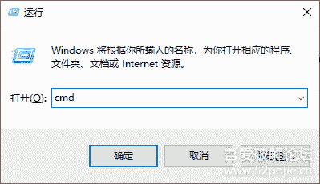
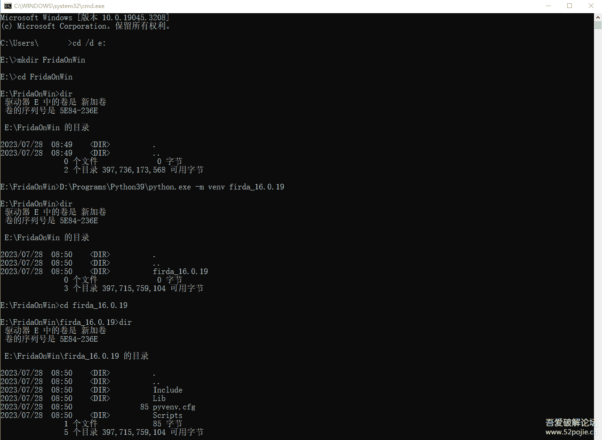
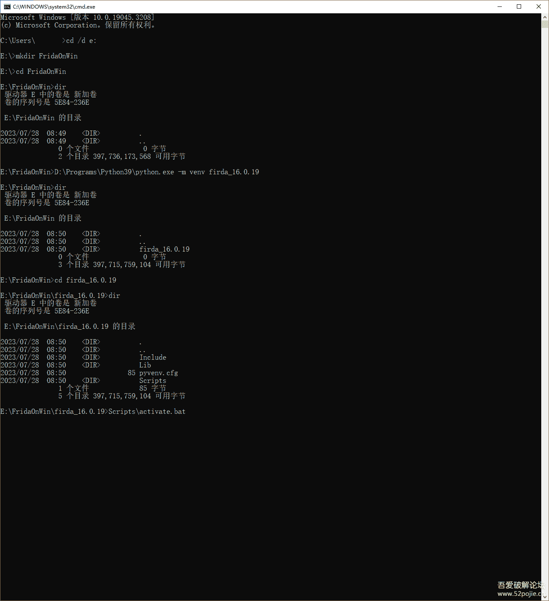
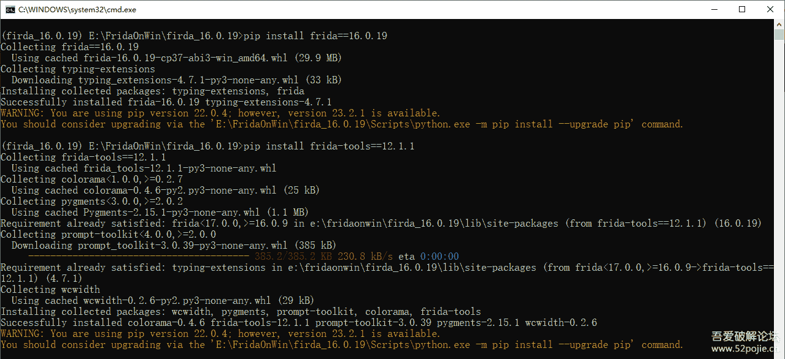
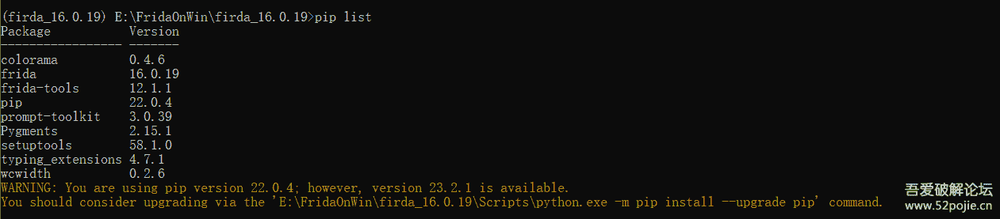

# [分享] Windows下小白学Frida逆向1 安装特定版本Frida

- 原帖: https://www.52pojie.cn/forum.php?mod=viewthread&tid=1814293
- 抓取时间: 2026-11-01T22:49:05

## 1. 按 Alt+R 输入 `cmd` 打开命令窗口


Snipaste_2023-07-28_09-42-46.png (17.69 KB, 下载次数: 1)
[href="forum.php?mod=attachment&aid=MjYzMDgxM3w0NDNlNDRiOHwxNzkzNTczMzQzfDE2ODA4NnwxODE0Mjkz&nothumb=yes" target="_blank"](https://www.52pojie.cn/forum.php?mod=attachment&aid=MjYzMDgxM3w0NDNlNDRiOHwxNzkzNTczMzQzfDE2ODA4NnwxODE0Mjkz&nothumb=yes)
2023-7-28 09:43 上传

## 2.
```
cd /d e:
mkdir FridaOnWin
cd FridaOnWin
D:\Programs\Python39\python.exe -m venv firda_16.0.19
cd firda_16.0.19
```

Snipaste_2023-07-28_08-52-49.png (102.73 KB, 下载次数: 2)
[href="forum.php?mod=attachment&aid=MjYzMDgxOXwyYzVlNThlZXwxNzkzNTczMzQzfDE2ODA4NnwxODE0Mjkz&nothumb=yes" target="_blank"](https://www.52pojie.cn/forum.php?mod=attachment&aid=MjYzMDgxOXwyYzVlNThlZXwxNzkzNTczMzQzfDE2ODA4NnwxODE0Mjkz&nothumb=yes)
2023-7-28 09:50 上传

## 3. 输入
```
Scripts\activate.bat
```
然后回车

Snipaste_2023-07-28_08-55-23.png (109.87 KB, 下载次数: 2)
[href="forum.php?mod=attachment&aid=MjYzMDgyMXw3NGE4MDU2Y3wxNzkzNTczMzQzfDE2ODA4NnwxODE0Mjkz&nothumb=yes" target="_blank"](https://www.52pojie.cn/forum.php?mod=attachment&aid=MjYzMDgyMXw3NGE4MDU2Y3wxNzkzNTczMzQzfDE2ODA4NnwxODE0Mjkz&nothumb=yes)
2023-7-28 15:15 上传
会变成如下图

Snipaste_2023-07-28_08-55-44.png (21.71 KB, 下载次数: 2)
[href="forum.php?mod=attachment&aid=MjYzMDgzMHxmZjE3NzAwYnwxNzkzNTczMzQzfDE2ODA4NnwxODE0Mjkz&nothumb=yes" target="_blank"](https://www.52pojie.cn/forum.php?mod=attachment&aid=MjYzMDgzMHxmZjE3NzAwYnwxNzkzNTczMzQzfDE2ODA4NnwxODE0Mjkz&nothumb=yes)
2023-7-28 10:14 上传

## 4. 安装 `frida` 和 `frida-tools`
```
pip install frida==16.0.19
pip install frida-tools==12.1.1
```

Snipaste_2023-07-28_09-35-37.png (107.79 KB, 下载次数: 4)
[href="forum.php?mod=attachment&aid=MjYzMDgyNHw1OTZkNGU4ZnwxNzkzNTczMzQzfDE2ODA4NnwxODE0Mjkz&nothumb=yes" target="_blank"](https://www.52pojie.cn/forum.php?mod=attachment&aid=MjYzMDgyNHw1OTZkNGU4ZnwxNzkzNTczMzQzfDE2ODA4NnwxODE0Mjkz&nothumb=yes)
2023-7-28 09:59 上传

Snipaste_2023-07-28_09-36-08.png (35.36 KB, 下载次数: 2)
[href="forum.php?mod=attachment&aid=MjYzMDgyNXw4OTAxZjczY3wxNzkzNTczMzQzfDE2ODA4NnwxODE0Mjkz&nothumb=yes" target="_blank"](https://www.52pojie.cn/forum.php?mod=attachment&aid=MjYzMDgyNXw4OTAxZjczY3wxNzkzNTczMzQzfDE2ODA4NnwxODE0Mjkz&nothumb=yes)
2023-7-28 10:00 上传
这里有个麻烦的地方就是如何确定 `frida` 和 `frida-tools` 版本的对应关系,我的方法是查看 `frida` 的发布日期,然后在 `frida-tools` 里面查找比 `frida` 发布日期早的最近的那个版本号,比如我安装的 `frida` 版本是 `16.0.19` 发布日期是 `2023.04.28`,然后在 `frida-tools` 发布页查看发现 `2023.02.17` 的 `12.1.1` 版本是离 `2023.04.28` 之前最近的一个版本,于是就确定使用 `12.1.1` 版本

Snipaste_2023-07-28_10-05-31.png (87.23 KB, 下载次数: 2)
[href="forum.php?mod=attachment&aid=MjYzMDgyN3w5Zjc1ODQzZHwxNzkzNTczMzQzfDE2ODA4NnwxODE0Mjkz&nothumb=yes" target="_blank"](https://www.52pojie.cn/forum.php?mod=attachment&aid=MjYzMDgyN3w5Zjc1ODQzZHwxNzkzNTczMzQzfDE2ODA4NnwxODE0Mjkz&nothumb=yes)
2023-7-28 10:06 上传

Snipaste_2023-07-28_10-05-53.png (73.78 KB, 下载次数: 3)
[href="forum.php?mod=attachment&aid=MjYzMDgyOXw3MGUzMWMwMXwxNzkzNTczMzQzfDE2ODA4NnwxODE0Mjkz&nothumb=yes" target="_blank"](https://www.52pojie.cn/forum.php?mod=attachment&aid=MjYzMDgyOXw3MGUzMWMwMXwxNzkzNTczMzQzfDE2ODA4NnwxODE0Mjkz&nothumb=yes)
2023-7-28 10:06 上传

```
frida发布日期查看  
https://github.com/frida/frida/tags
frida-tools发布日期查看
https://github.com/frida/frida-tools/tags
```
