# [.NET逆向] 一款VS的C++代码插件-试用证书分析记录

- 原帖: https://www.52pojie.cn/forum.php?mod=viewthread&tid=1814700
- 抓取时间: 2026-11-01T22:49:02

## 最终效果

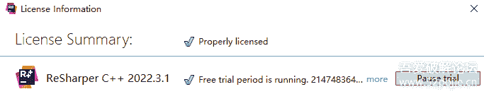

Pasted image 20230729200040.png (18.89 KB, 下载次数: 1)

[href="forum.php?mod=attachment&aid=MjYzMTM3NXxkOTAzNjFiNXwxNzkzNTczMzM5fDE2ODA4NnwxODE0NzAw&nothumb=yes" target="_blank"](https://www.52pojie.cn/forum.php?mod=attachment&aid=MjYzMTM3NXxkOTAzNjFiNXwxNzkzNTczMzM5fDE2ODA4NnwxODE0NzAw&nothumb=yes)

2023-7-30 00:26 上传

## 前期准备

下载安装VS2022

下载最新版本的RxShxxpxr C++插件，并安装完成

下载最新版本Dnspy（64位）

## 背景

- 该插件实在好用，但。。。
- 网络上找到的资源不能直接使用
- 该插件至少在2019.2.3版本以后新增了网络登录验证；
- 证书服务的算法有所改变，且证书服务器作者停止更新，或无法找到该资料
- 现存补丁不能适应最新版本的
- 近期有点时间整理下家用电脑的开发环境

## 过程

根据旧版本Patch信息，定位到试用证书的过期验证；`System.Boolean JetBrains.Application.License2.Evaluation.EvaluationInfoEx::IsExpired(JetBrains.Application.License2.Evaluation.IEvaluationInfo,JetBrains.Application.License2.ISupportsEvaluation)`；但发现存在登录验证，这块的逻辑是根本没走到。无奈用不了，所以接下来的目标是找到在哪里做的账号是否登录的判断

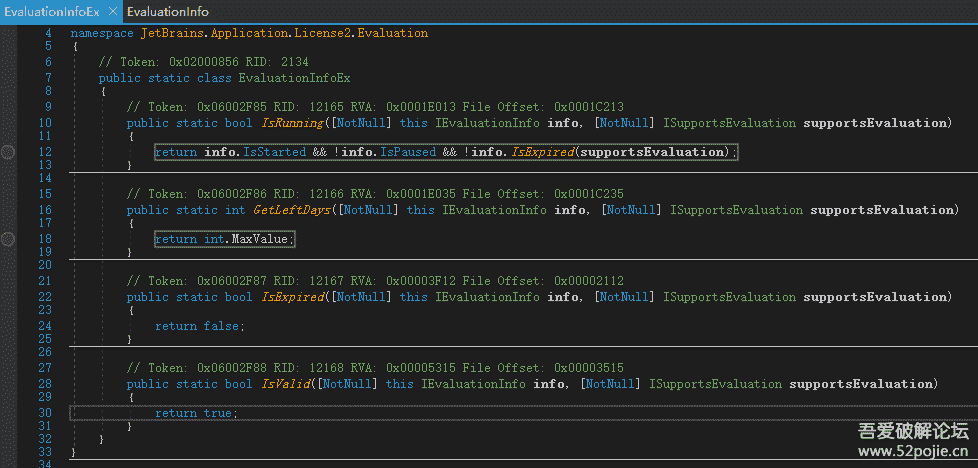

Pasted image 20230729201218.png (28.65 KB, 下载次数: 2)

[href="forum.php?mod=attachment&aid=MjYzMTM3NnxjYTZjOWFiNnwxNzkzNTczMzM5fDE2ODA4NnwxODE0NzAw&nothumb=yes" target="_blank"](https://www.52pojie.cn/forum.php?mod=attachment&aid=MjYzMTM3NnxjYTZjOWFiNnwxNzkzNTczMzM5fDE2ODA4NnwxODE0NzAw&nothumb=yes)

2023-7-30 00:28 上传

既然这时的方法重要，说明是核心逻辑，使用“分析”看看都在什么地方使用了；其中Check字样比较突出，打上断点，果然

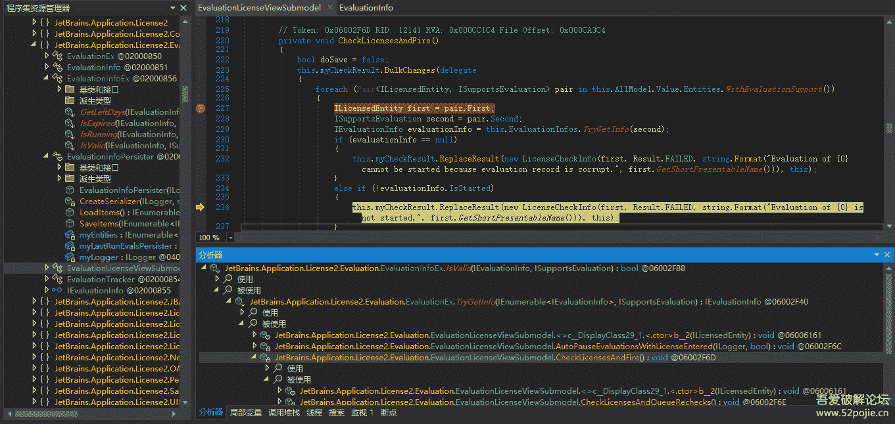

Pasted image 20230729202756.png (147.61 KB, 下载次数: 2)

[href="forum.php?mod=attachment&aid=MjYzMTM3N3xmODk1YmI2YnwxNzkzNTczMzM5fDE2ODA4NnwxODE0NzAw&nothumb=yes" target="_blank"](https://www.52pojie.cn/forum.php?mod=attachment&aid=MjYzMTM3N3xmODk1YmI2YnwxNzkzNTczMzM5fDE2ODA4NnwxODE0NzAw&nothumb=yes)

2023-7-30 00:28 上传

本想直接修改这个字段，但修改不了，原因：这是个属性方法，效果同字段，但却是个方法。

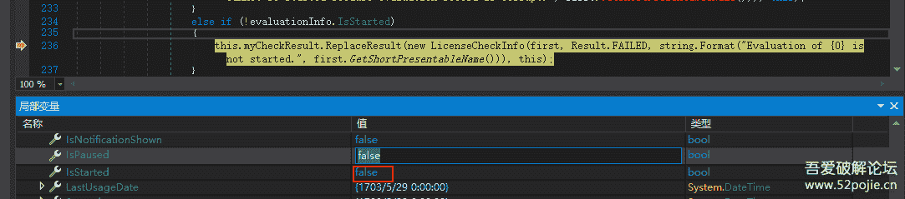

Pasted image 20230729202947.png (26.32 KB, 下载次数: 2)

[href="forum.php?mod=attachment&aid=MjYzMTM3OXwyMjI4ODQ5MnwxNzkzNTczMzM5fDE2ODA4NnwxODE0NzAw&nothumb=yes" target="_blank"](https://www.52pojie.cn/forum.php?mod=attachment&aid=MjYzMTM3OXwyMjI4ODQ5MnwxNzkzNTczMzM5fDE2ODA4NnwxODE0NzAw&nothumb=yes)

2023-7-30 00:30 上传

不能修改值，那看看来源是哪？我们打开堆栈，但委托+方法返回值的形式，一时没明白从哪调过来的。且`Pair`来自`this.AllModel.Value.Entities.WithEvaluationSupport()`

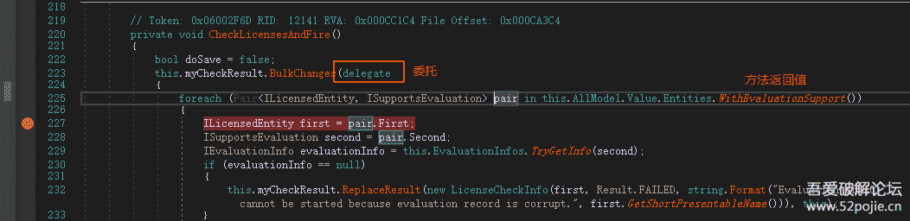

Pasted image 20230729203302.png (24.85 KB, 下载次数: 2)

[href="forum.php?mod=attachment&aid=MjYzMTM4MXwyZDQ1OTkwOXwxNzkzNTczMzM5fDE2ODA4NnwxODE0NzAw&nothumb=yes" target="_blank"](https://www.52pojie.cn/forum.php?mod=attachment&aid=MjYzMTM4MXwyZDQ1OTkwOXwxNzkzNTczMzM5fDE2ODA4NnwxODE0NzAw&nothumb=yes)

2023-7-30 00:30 上传

先看`this.AllModel`从哪来，发现其只存在`get`，没有`set`？那值怎么设置的？对了，是直接赋值，但不知为什么，dnspy没搜索到？

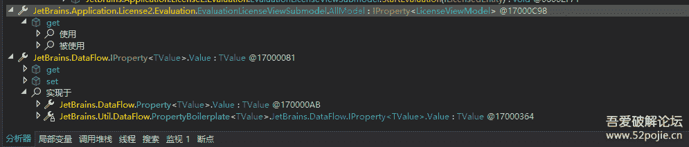

Pasted image 20230729204101.png (38.18 KB, 下载次数: 4)

[href="forum.php?mod=attachment&aid=MjYzMTM4M3wzM2RjMzhjNXwxNzkzNTczMzM5fDE2ODA4NnwxODE0NzAw&nothumb=yes" target="_blank"](https://www.52pojie.cn/forum.php?mod=attachment&aid=MjYzMTM4M3wzM2RjMzhjNXwxNzkzNTczMzM5fDE2ODA4NnwxODE0NzAw&nothumb=yes)

2023-7-30 00:31 上传

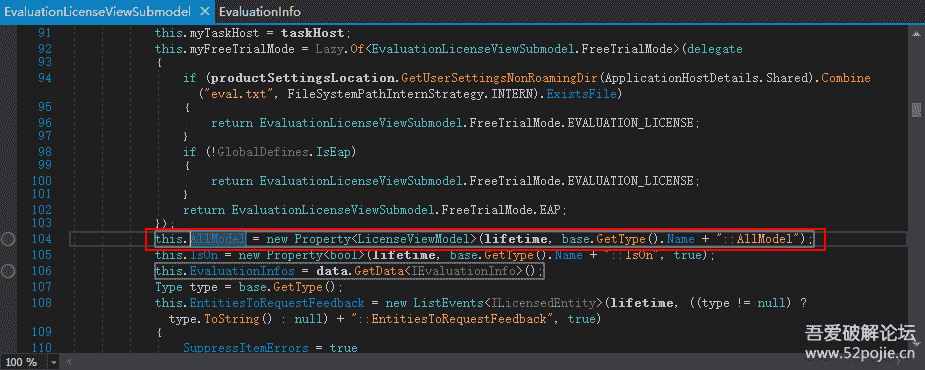

Pasted image 20230729204459.png (32.01 KB, 下载次数: 3)

[href="forum.php?mod=attachment&aid=MjYzMTM4Mnw3ZWQ4YWMyM3wxNzkzNTczMzM5fDE2ODA4NnwxODE0NzAw&nothumb=yes" target="_blank"](https://www.52pojie.cn/forum.php?mod=attachment&aid=MjYzMTM4Mnw3ZWQ4YWMyM3wxNzkzNTczMzM5fDE2ODA4NnwxODE0NzAw&nothumb=yes)

2023-7-30 00:31 上传

下断查看取值及来源（堆栈），但可惜，此时的`Value`字段为空。

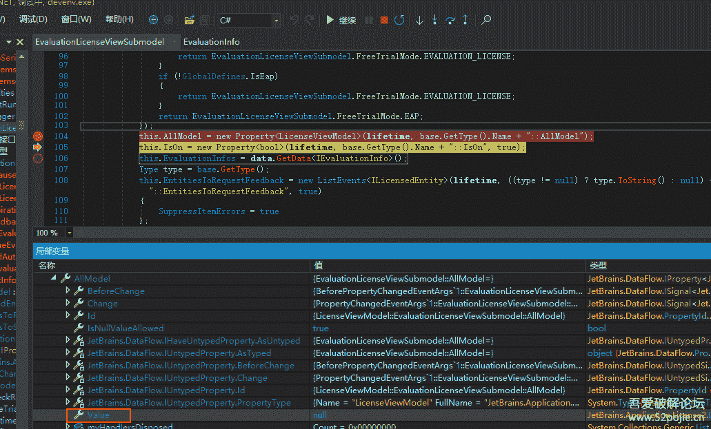

Pasted image 20230729204738.png (107.15 KB, 下载次数: 2)

[href="forum.php?mod=attachment&aid=MjYzMTM4NHw0ZGM4OTQ4OHwxNzkzNTczMzM5fDE2ODA4NnwxODE0NzAw&nothumb=yes" target="_blank"](https://www.52pojie.cn/forum.php?mod=attachment&aid=MjYzMTM4NHw0ZGM4OTQ4OHwxNzkzNTczMzM5fDE2ODA4NnwxODE0NzAw&nothumb=yes)

2023-7-30 00:32 上传

经过分析。。，找到添加的入口；

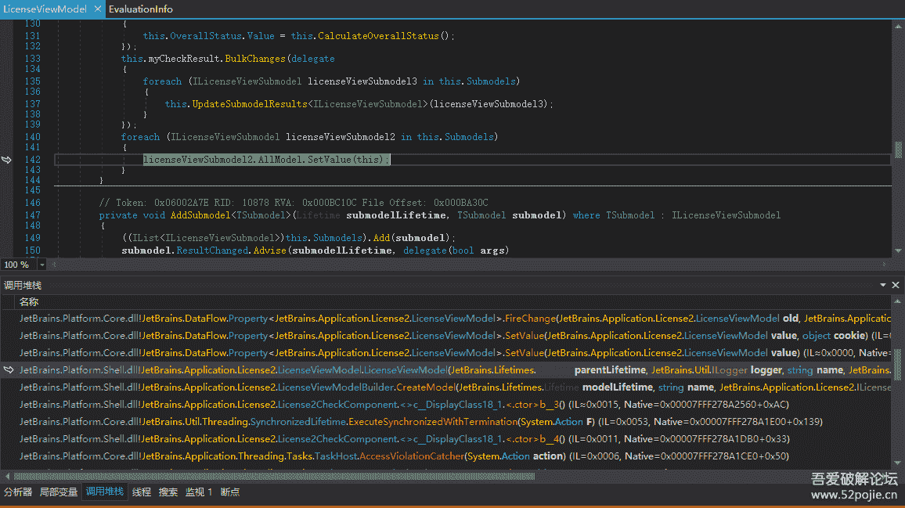

Pasted image 20230729211215.png (94.92 KB, 下载次数: 1)

[href="forum.php?mod=attachment&aid=MjYzMTM4NXw2ZDMyMDVjOXwxNzkzNTczMzM5fDE2ODA4NnwxODE0NzAw&nothumb=yes" target="_blank"](https://www.52pojie.cn/forum.php?mod=attachment&aid=MjYzMTM4NXw2ZDMyMDVjOXwxNzkzNTczMzM5fDE2ODA4NnwxODE0NzAw&nothumb=yes)

2023-7-30 00:32 上传

中间是一段分析。。发现submodule来自这里：`this.myLicensedEntities`，而这个数据来源如下：

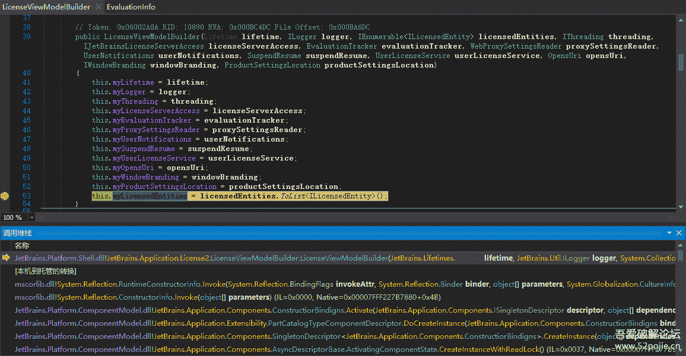

Pasted image 20230729211726.png (83.13 KB, 下载次数: 2)

[href="forum.php?mod=attachment&aid=MjYzMTM4Nnw1NDBhYjRkYnwxNzkzNTczMzM5fDE2ODA4NnwxODE0NzAw&nothumb=yes" target="_blank"](https://www.52pojie.cn/forum.php?mod=attachment&aid=MjYzMTM4Nnw1NDBhYjRkYnwxNzkzNTczMzM5fDE2ODA4NnwxODE0NzAw&nothumb=yes)

2023-7-30 00:32 上传

搞错了，这个里没有重点的`IsStart`；重新分析!

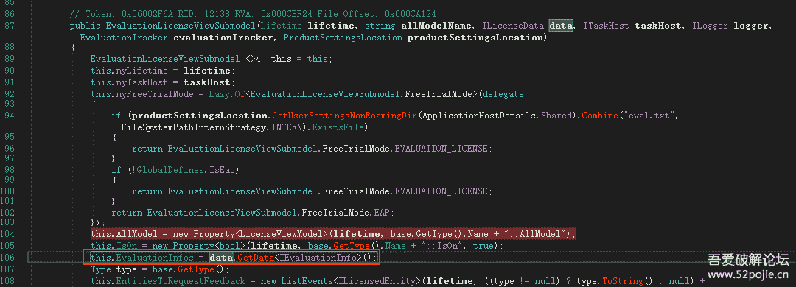

Pasted image 20230729212517.png (33.83 KB, 下载次数: 3)

[href="forum.php?mod=attachment&aid=MjYzMTM5MXwyMjU5OGU0N3wxNzkzNTczMzM5fDE2ODA4NnwxODE0NzAw&nothumb=yes" target="_blank"](https://www.52pojie.cn/forum.php?mod=attachment&aid=MjYzMTM5MXwyMjU5OGU0N3wxNzkzNTczMzM5fDE2ODA4NnwxODE0NzAw&nothumb=yes)

2023-7-30 00:33 上传

断点后，查看堆栈：

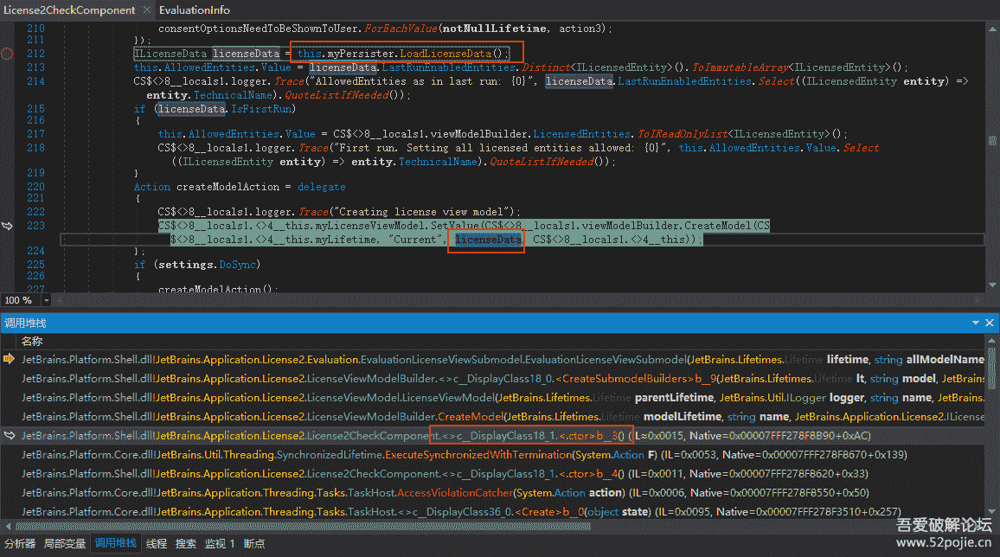

Pasted image 20230729213054.png (105.1 KB, 下载次数: 2)

[href="forum.php?mod=attachment&aid=MjYzMTM5M3xmMDZhNjU1Y3wxNzkzNTczMzM5fDE2ODA4NnwxODE0NzAw&nothumb=yes" target="_blank"](https://www.52pojie.cn/forum.php?mod=attachment&aid=MjYzMTM5M3xmMDZhNjU1Y3wxNzkzNTczMzM5fDE2ODA4NnwxODE0NzAw&nothumb=yes)

2023-7-30 00:33 上传

发现`LicenseData`中的成员`myData`

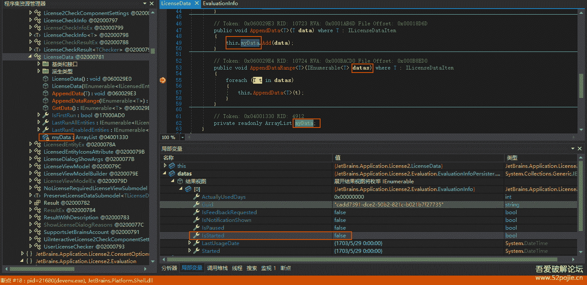

Pasted image 20230729214645.png (148.12 KB, 下载次数: 1)

[href="forum.php?mod=attachment&aid=MjYzMTM5NHw1MDkyOTlkNXwxNzkzNTczMzM5fDE2ODA4NnwxODE0NzAw&nothumb=yes" target="_blank"](https://www.52pojie.cn/forum.php?mod=attachment&aid=MjYzMTM5NHw1MDkyOTlkNXwxNzkzNTczMzM5fDE2ODA4NnwxODE0NzAw&nothumb=yes)

2023-7-30 00:34 上传

下断后发现，里面有刚才看到的试用版证书的信息。进一步分析来源：

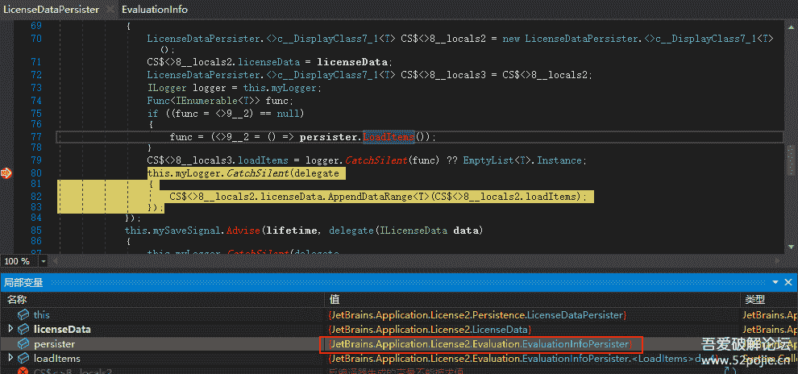

Pasted image 20230729222511.png (46.24 KB, 下载次数: 0)

[href="forum.php?mod=attachment&aid=MjYzMTM5NXw3NWEzYzIwOXwxNzkzNTczMzM5fDE2ODA4NnwxODE0NzAw&nothumb=yes" target="_blank"](https://www.52pojie.cn/forum.php?mod=attachment&aid=MjYzMTM5NXw3NWEzYzIwOXwxNzkzNTczMzM5fDE2ODA4NnwxODE0NzAw&nothumb=yes)

2023-7-30 00:34 上传

下图是`LoadItems`的实现：

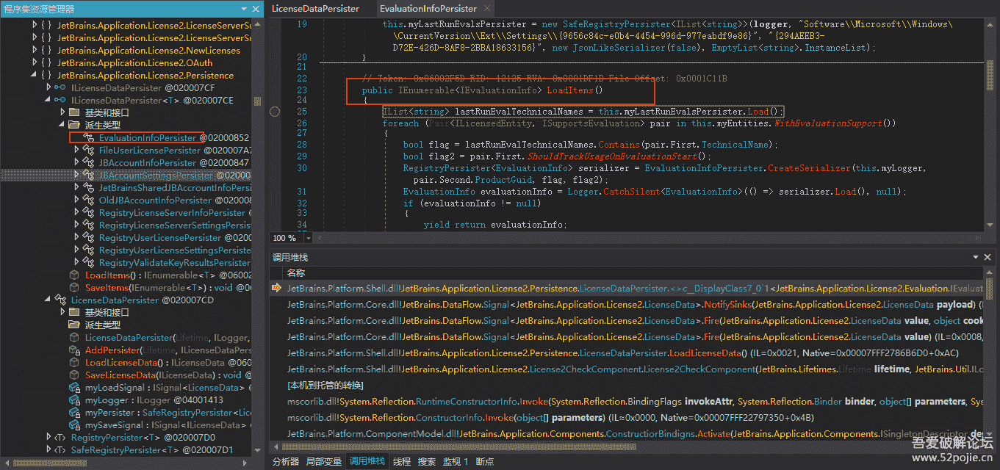

Pasted image 20230729222630.png (168.08 KB, 下载次数: 2)

[href="forum.php?mod=attachment&aid=MjYzMTM5NnxjNmVmNDZjMnwxNzkzNTczMzM5fDE2ODA4NnwxODE0NzAw&nothumb=yes" target="_blank"](https://www.52pojie.cn/forum.php?mod=attachment&aid=MjYzMTM5NnxjNmVmNDZjMnwxNzkzNTczMzM5fDE2ODA4NnwxODE0NzAw&nothumb=yes)

2023-7-30 00:35 上传

断点调试并观察结果可知后续结论。

## 结论

安装完成后，会生成一个试用证书，由 `JetBrains.Application.License2.Persistence.RegistryPersister1 JetBrains.Application.License2.Evaluation.EvaluationInfoPersister::CreateSerializer(JetBrains.Util.ILogger,System.String,System.Boolean,System.Boolean)` 创建；创建时有两个参数，用于控制是否自动启用，是否记录使用时长；

检查自动启用逻辑，在`System.Collections.Generic.IEnumerable1 JetBrains.Application.License2.Evaluation.EvaluationInfoPersister::LoadItems()`中判断，`bool flag = lastRunEvalTechnicalNames.Contains(pair.First.TechnicalName)`；而`TechnicalName`经过调试，值为`ReSharperCpp`，从下图获得：

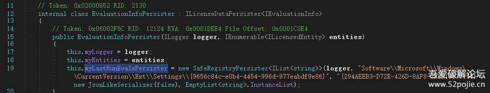

Pasted image 20230729232937.png (18.28 KB, 下载次数: 2)


[href="forum.php?mod=attachment&aid=MjYzMTM5N3wyZmU0OTI1M3wxNzkzNTczMzM5fDE2ODA4NnwxODE0NzAw&nothumb=yes" target="_blank"](https://www.52pojie.cn/forum.php?mod=attachment&aid=MjYzMTM5N3wyZmU0OTI1M3wxNzkzNTczMzM5fDE2ODA4NnwxODE0NzAw&nothumb=yes)

2023-7-30 00:35 上传

经过调试，该注册表项的值为“`{ReSharperCpp}`”时，会自动启用；像这样

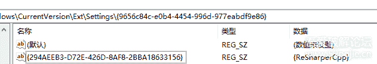

Pasted image 20230729233108.png (16.35 KB, 下载次数: 1)

[href="forum.php?mod=attachment&aid=MjYzMTM5OHxjZWU3YmUwYXwxNzkzNTczMzM5fDE2ODA4NnwxODE0NzAw&nothumb=yes" target="_blank"](https://www.52pojie.cn/forum.php?mod=attachment&aid=MjYzMTM5OHxjZWU3YmUwYXwxNzkzNTczMzM5fDE2ODA4NnwxODE0NzAw&nothumb=yes)

2023-7-30 00:36 上传

证书创建完成后，由`System.Void JetBrains.Application.License2.Evaluation.EvaluationInfoPersister::SaveItems(System.Collections.Generic.IEnumerable1)`方法，保存到注册表；

#### 方案一

本想写代码修改dll，但目前没有思路。此方案不用修改dll，仅修改注册表即可。

- 使用`dnspy`打开`Shell.dll`后，打开`System.Void JetBrains.Application.License2.Evaluation.EvaluationInfoPersister::.ctor`，找到注册表地址，在表中添加字符串`ReSharperCpp`; 如果版本能对上，则

```
Windows Registry Editor Version 5.00
[HKEY_CURRENT_USER\SOFTWARE\Microsoft\Windows\CurrentVersion\Ext\Settings\{9656c84c-e0b4-4454-996d-977eabdf9e86}]
"{294AEEB3-D72E-426D-8AF8-2BBA18633156}"="{ReSharperCpp}"
```

因存在30天限制，需要30天内清除`{9656c84c-e0b4-4454-996d-977eabdf9e86}`下生成的临时试用证书。如下图所示。

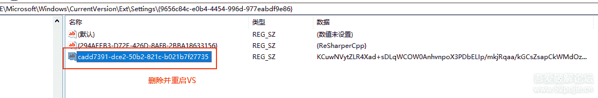

Pasted image 20230730000338.png (23.11 KB, 下载次数: 2)

[href="forum.php?mod=attachment&aid=MjYzMTM5OXwwY2NjZTRlOHwxNzkzNTczMzM5fDE2ODA4NnwxODE0NzAw&nothumb=yes" target="_blank"](https://www.52pojie.cn/forum.php?mod=attachment&aid=MjYzMTM5OXwwY2NjZTRlOHwxNzkzNTczMzM5fDE2ODA4NnwxODE0NzAw&nothumb=yes)

2023-7-30 00:36 上传

#### 方案二

对`JetBrains.Platform.Shell.dll`打补丁，修改类实现

- 修改`EvaluationInfoEx`类的实现为下文所示：

```
    public static class EvaluationInfoEx

    {

            // Token: 0x06002F85 RID: 12165 RVA: 0x0001E013 File Offset: 0x0001C213

            public static bool IsRunning([NotNull] this IEvaluationInfo info, [NotNull] ISupportsEvaluation supportsEvaluation)

            {

                    return info.IsStarted && !info.IsPaused && !info.IsExpired(supportsEvaluation);

            }

            // Token: 0x06002F86 RID: 12166 RVA: 0x0001E035 File Offset: 0x0001C235

            public static int GetLeftDays([NotNull] this IEvaluationInfo info, [NotNull] ISupportsEvaluation supportsEvaluation)

            {

                    return int.MaxValue;

            }

            // Token: 0x06002F87 RID: 12167 RVA: 0x00003F12 File Offset: 0x00002112

            public static bool IsExpired([NotNull] this IEvaluationInfo info, [NotNull] ISupportsEvaluation supportsEvaluation)

            {

                    return false;

            }

            // Token: 0x06002F88 RID: 12168 RVA: 0x00005315 File Offset: 0x00003515

            public static bool IsValid([NotNull] this IEvaluationInfo info, [NotNull] ISupportsEvaluation supportsEvaluation)

            {

                    return true;

            }

    }
```

修改`JetBrains.Application.License2.Persistence.RegistryPersister JetBrains.Application.License2.Evaluation.EvaluationInfoPersister::CreateSerializer()`方法的实现为下文所示：

```
                private static RegistryPersister CreateSerializer(ILogger logger, string guid, bool autoStart, bool trackUsageOnStart)
                {
                        EvaluationInfo evaluationInfo = EvaluationInfo.CreateInstallerValue(guid);
                        evaluationInfo.StartEvaluation();
                        evaluationInfo.SetUsed(true);
                        JsonLikeSerializer jsonLikeSerializer = new JsonLikeSerializer('[', ']', ',', '=', true);
                        return new SafeRegistryPersister(logger, "Software\\Microsoft\\Windows\\CurrentVersion\\Ext\\Settings\\{9656c84c-e0b4-4454-996d-977eabdf9e86}", guid, jsonLikeSerializer, evaluationInfo);
                }
```

说明：1.用于解决30天限制问题；2.用来解决安装后，默认不启用试用版证书问题
