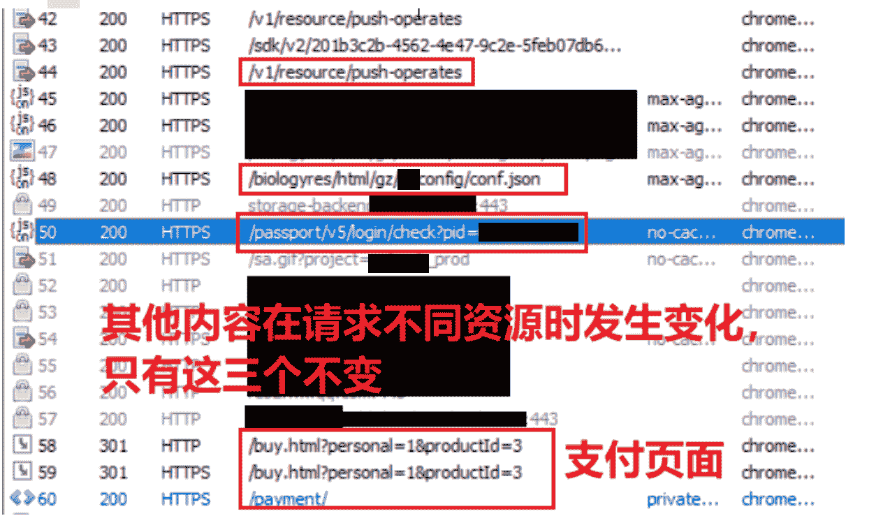
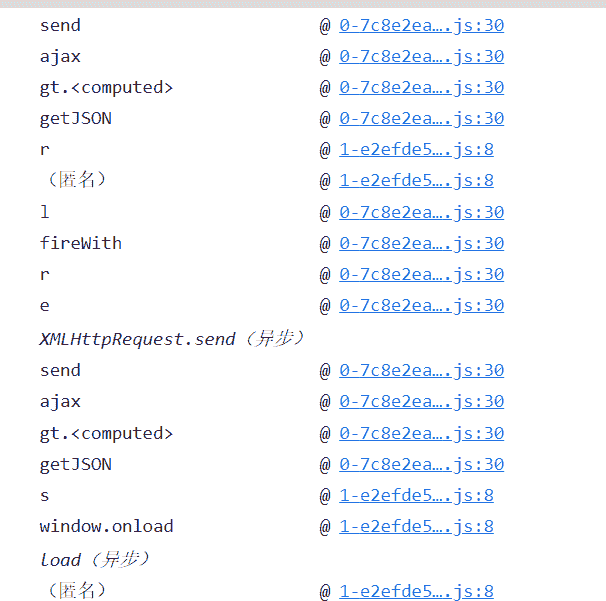

# [Web逆向] 对某实验网页VIP及购买检测的分析

- 原帖: https://www.52pojie.cn/forum.php?mod=viewthread&tid=1815274
- 抓取时间: 2026-11-01T22:48:56

## 总体分析

在该网站中，部分资源要求vip


## 入口vip

点击资源后弹出如上图vip弹窗，且没有进一步操作。

进过对同源站点某功能分析，确定该网站vip限制关键词为`isvip`。

该公司网站公用一个检测js，其中一个更新数据的函数

```
case 7:
    // .....
    return i = b.Z.getGradePid(u),
        o = l.vip_info[i],
        p = o.vip === 1,
        c.next = 17,
        a({
        type: "updateState",
        payload: {
            isVip: p,
            gradePid: i
        }
        });
```

注意`payload`中`isvip`数据，强制设为1后突破第一层。用devtool替换后刷新即可。

PS：详细怎么得到`isvip`的过程是几个月前做的，现在忘了。

### 2> 跳转支付

该网页在点击资源后加载时再次检测vip，并且快速跳转到支付页面。

由于跳转太快，相关代码无法保留，禁用js后整个网站无法运行。

### 3> 阻断跳转

尝试抓包，逐个分析支付相关请求发出前的数据包。



其中`/biologyres/html/gz/**config/conf.json`返回为：

```
{
  "pid": "**********",
  "loginAuth": "https://storage-backend.******.com/passport/v5/login/check",
  "authAction": {
    "notLogin": { "redirectURL": "https://passport.******.com/?return_url=" },
    "notVip": { "redirectURL": "http://www.******.com/buy.html" }
  },
  "tokenAuth": "https://resourceapi.******.com/api/v1/vip/info",
  "baseUrl": ""
}
```

尝试将这个包恒定返回500，js运行中断在加载页面。

虽然没有跳转，但是依旧没有正常运行

### 3> 跳过跳转

这时在devtool中分析发出的堆栈，排除请求api，找到一段可以代码：



```
function r() {
    $.getJSON("**config/conf.json", function(e) {
        window.config = e,
        window.resUrl = window.config.baseUrl && "null" != window.config.baseUrl ? window.config.baseUrl : "",
        "E" == window.config.pid[0] && (window.grade = 1),
        a()
    })
}
```

其上一段匿名函数为

```
n ? e && e() : console.log("***************")
```

（其中`e()`就是上文的`r()`）

下一段就是请求api，唯一确定相关代码位置。

观察到`a()`是唯一未知有可能导致跳转，动态调试找到代码：

```
function a() {
    if ((0,
    l.default)() || A(),
    /^http:\/\/127\.0\.0\.1/.test(window.location.href))
        try {
            if (window.top.NBUtil && !0 === window.top.NBUtil.isNWApp)
                return E = !0,
                void o(!0)
        } catch (e) {}
    M(courseID) ? c() : f().then(function(e) {
        e.login ? e.vip ? c() : _(window.config.authAction.notVip.redirectURL + "?personal=1&productId=" + (window.grade + 2)) : _("" + window.config.authAction.notLogin.redirectURL + encodeURIComponent(window.top.location.href))
    })
}
```

注意到`e.vip`，加`debugger`和`console.log(e)`，确定`e`的形式（这里注意要关闭自动回复，否则代码将在上方报错中断）：

```
{
    "login": true,
    "vip": false
}
```

将`vip`强制改为`true`刷新即可通过。
