# [Web逆向] 美之图逆向获取图片链接

- 原帖：<https://www.52pojie.cn/forum.php?mod=viewthread&tid=1816298>
- 抓取时间：2026-11-01T22:48:45

美之图：`aHR0cHM6Ly9tbXp6dHQuY29tLw==`

由于在学习 JS 逆向的阶段，看到原帖“小姐姐网站（美之图）JS 逆向”，蠢蠢欲动，想要抓取一些素材，以下为记录学习的过程。原帖的方式已经不适用于现有的方式，但是基本加密方式没有变化，加密的数据已经无法从网页的注释中获取，而是要通过接口获取。

## 分析网站

【地址】`aHR0cHM6Ly9tbXp6dHQuY29tL3Bob3RvLzkyOTgy`

打开网站，通过 `F12` 分析源码，会发现网站用了无限 `debugger`。关于无限 `debugger` 的解决方式百度一下会有很多，不做过多讲解，但是本人在进行处理的时候遇到一个问题，就是使用本地文件覆盖。

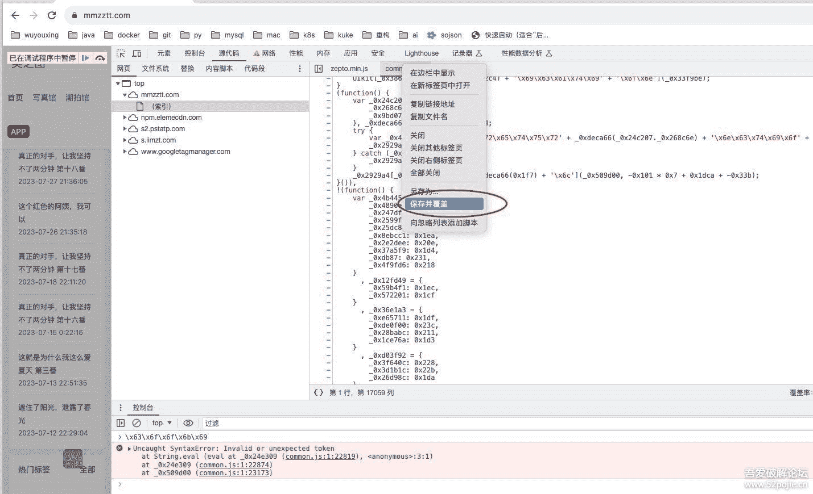

注释了一些代码。

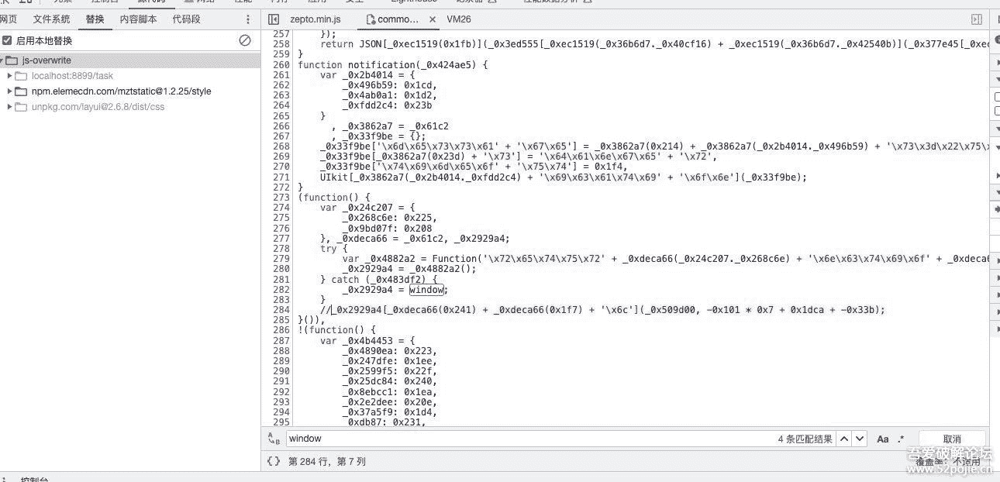

注释完一直无法访问，不知道是什么原因。

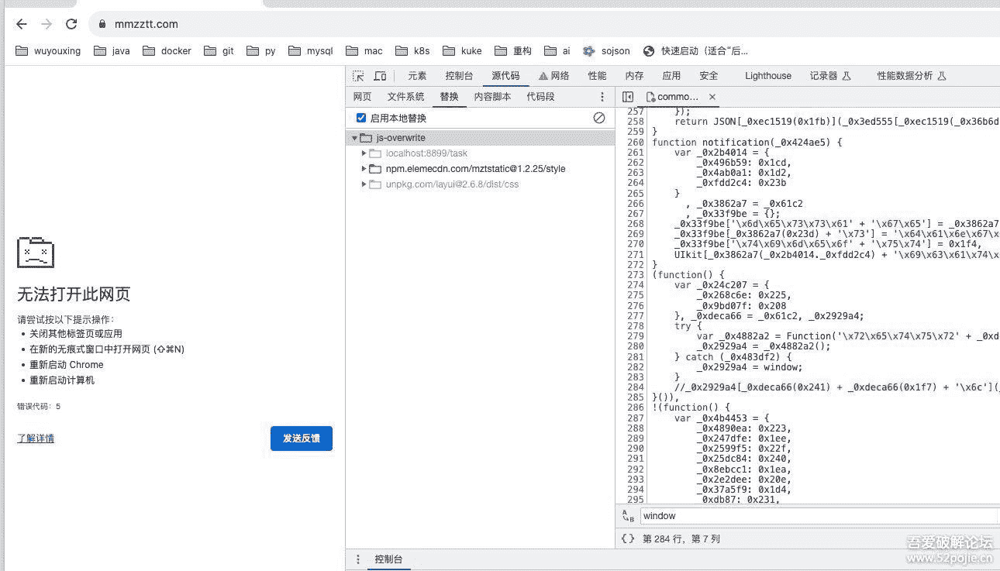

既然不能通过本地覆盖，只有分析调用栈 hook 掉相应的方法了。

### 绕过无限 `debugger`

打开 `common.js`，发现通过定时器调用了一个 `_0x509d00` 函数。

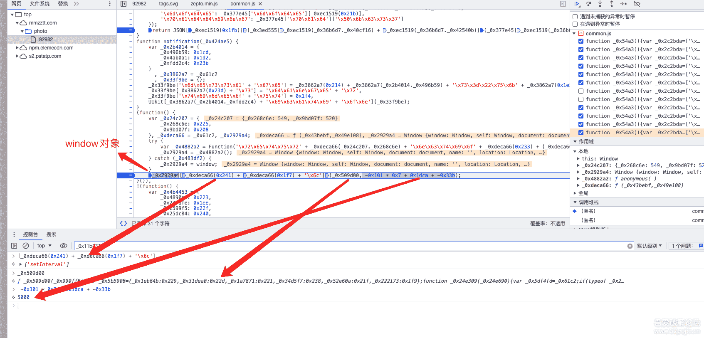

`_0x509d00` 这个函数一直在循环调用，只需要屏蔽掉这个函数即可。

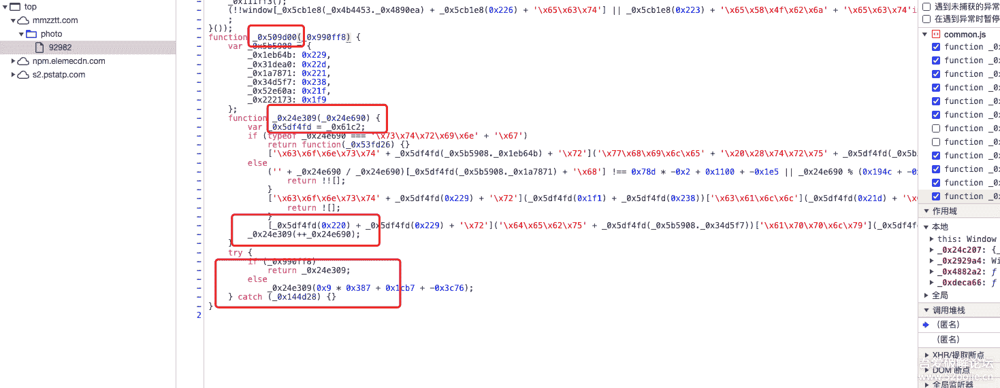

在控制台把 `_0x509d00` 函数修改为 `_0x509d00 = function(){}`。

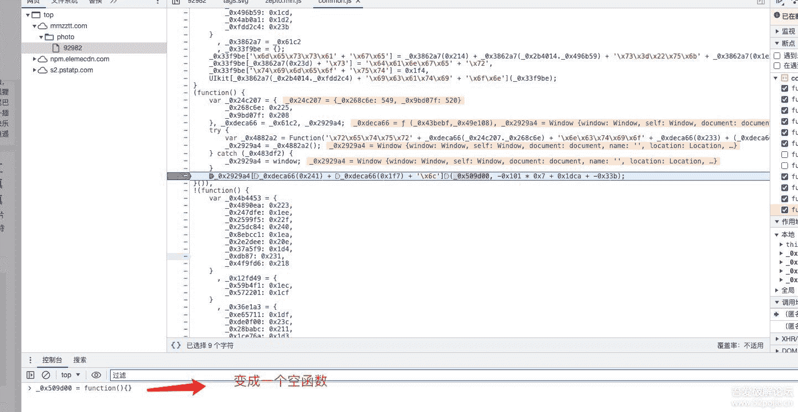

### 分析 `post.js` 调用逻辑

根据调用栈打断点 `post.js`，根据逻辑可知，通过 `sessionStorage` 获取 `'cache_92982'` 的值，来选择执行 `loadData` 还是 `_0x8e5f` 函数。

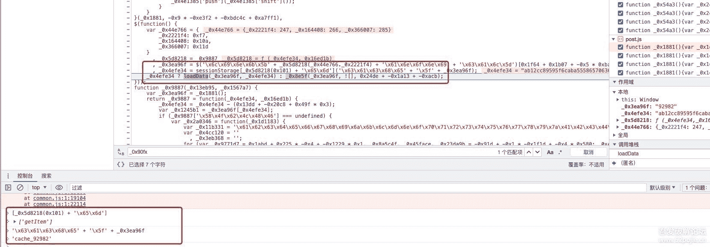

`_0x8e5f` 函数基本可以分析出：这个函数通过调用请求获取数据之后，调用 `loadData`，然后把获取到的数据放在 `sessionStorage` 中。

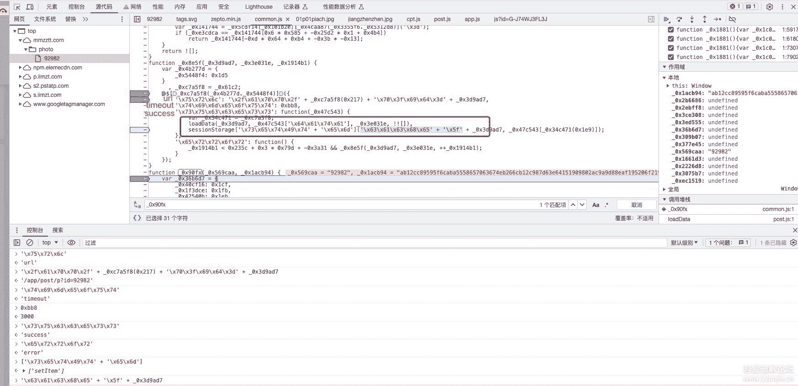

### 分析 `loadData` 与 `_0x90fx`

`loadData` 函数中，`_0x1d1183` 这个变量储存了所有图片的 `_0x1d1183 = _0x90fx(_0x16ed1b, _0x1245b1);`。

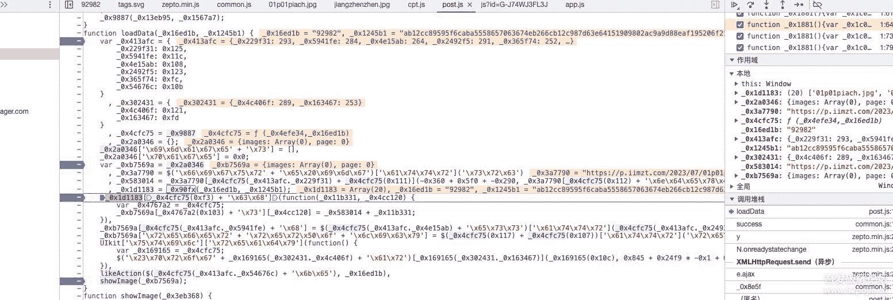

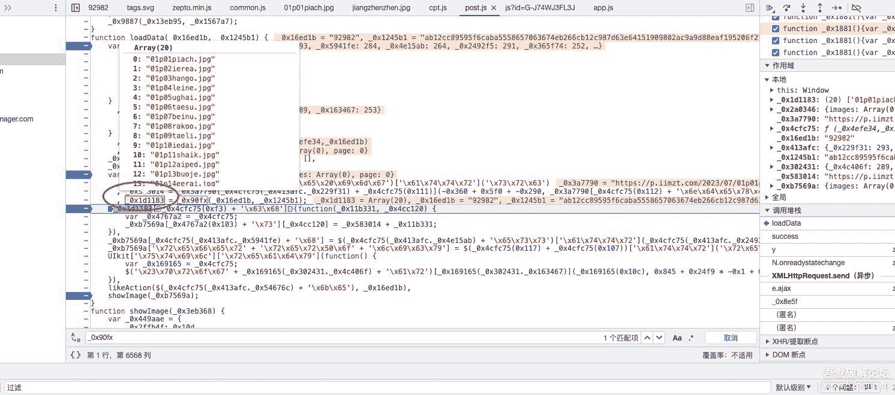

`_0x90fx` 关键函数。

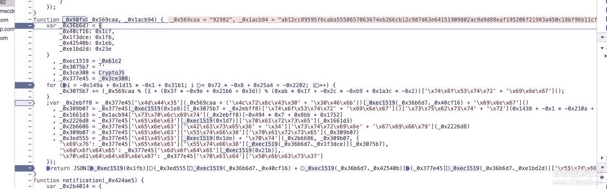

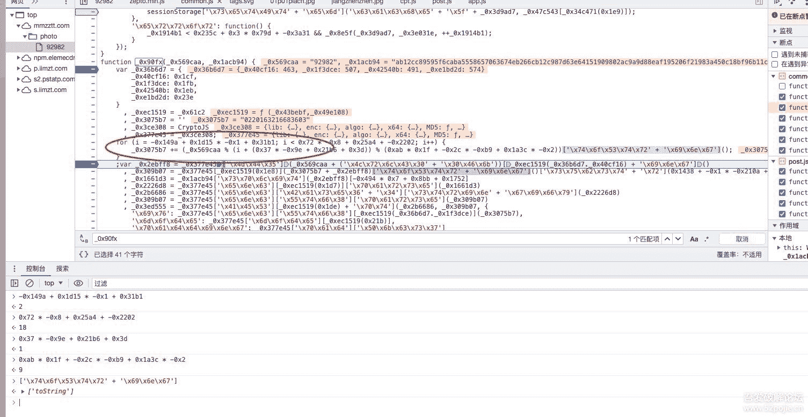

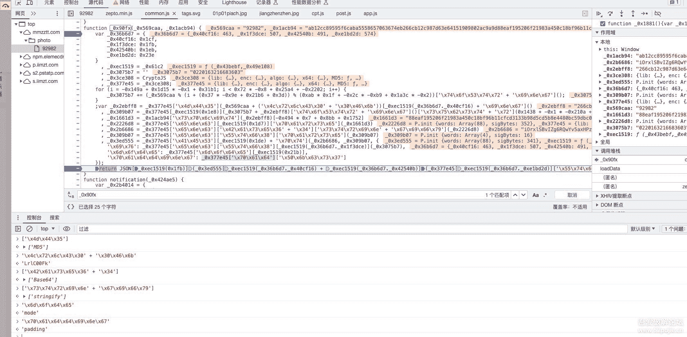

### 翻译核心函数 `common.js`

```
function _0x90fx(_0x569caa, _0x1acb94) {
    // _0x569caa 为帖子id
    // _0x1acb94 为_0x8e5f 函数调用的结果 同时也放在sessionStorage中，即一次加载缓存在sessionStorage减少接口调用
    var _0x36b6d7 = {
        _0x40cf16: 0x1cf,
        _0x1f3dce: 0x1fb,
        _0x42540b: 0x1eb,
        _0xe1bd2d: 0x23e
    }
    , _0xec1519 = _0x61c2
    , _0x3075b7 = ''
    , _0x3ce308 = CryptoJS
    // _0x3ce308 _0x377e45 即为 CryptoJS引用
    , _0x377e45 = _0x3ce308;
    // for (i=2;i_0x3075b7 = 帖子id % (i + 1) % 9
    for (i = -0x149a + 0x1d15 * -0x1 + 0x31b1; i // 详细翻译见下面的js代码
    ;var _0x2ebff8 = _0x377e45['\x4d\x44\x35'](_0x569caa + ('\x4c\x72\x6c\x43\x30' + '\x30\x46\x6b'))[_0xec1519(_0x36b6d7._0x40cf16) + '\x69\x6e\x67']()
    , _0x309b07 = _0x377e45[_0xec1519(0x1e8)](_0x3075b7 + _0x2ebff8)['\x74\x6f\x53\x74\x72' + '\x69\x6e\x67']()['\x73\x75\x62\x73\x74' + '\x72'](0x1438 + -0x1 * -0x210a + -0x5ea * 0x9, 0x2e * -0x29 + 0xe2b + -0x3 * 0x23f)
    , _0x1661d3 = _0x1acb94['\x73\x70\x6c\x69\x74'](_0x2ebff8)[-0x494 * 0x7 + 0x8bb + 0x1752]
    , _0x2226d8 = _0x377e45['\x65\x6e\x63'][_0xec1519(0x1d7)]['\x70\x61\x72\x73\x65'](_0x1661d3)
    , _0x2b6686 = _0x377e45['\x65\x6e\x63']['\x42\x61\x73\x65\x36' + '\x34']['\x73\x74\x72\x69\x6e' + '\x67\x69\x66\x79'](_0x2226d8)
    , _0x309b07 = _0x377e45['\x65\x6e\x63']['\x55\x74\x66\x38']['\x70\x61\x72\x73\x65'](_0x309b07)
    , _0x3ed555 = _0x377e45['\x41\x45\x53'][_0xec1519(0x1de) + '\x70\x74'](_0x2b6686, _0x309b07, {
        '\x69\x76': _0x377e45['\x65\x6e\x63']['\x55\x74\x66\x38'][_0xec1519(_0x36b6d7._0x1f3dce)](_0x3075b7),
        '\x6d\x6f\x64\x65': _0x377e45['\x6d\x6f\x64\x65'][_0xec1519(0x21b)],
        '\x70\x61\x64\x64\x69\x6e\x67': _0x377e45['\x70\x61\x64']['\x50\x6b\x63\x73\x37']
    });
    return JSON[_0xec1519(0x1fb)](_0x3ed555[_0xec1519(_0x36b6d7._0x40cf16) + _0xec1519(_0x36b6d7._0x42540b)](_0x377e45[_0xec1519(_0x36b6d7._0xe1bd2d)]['\x55\x74\x66\x38']));
}
```


## JavaScript 解密函数

```javascript
const CryptoJS = require('crypto-js');

SIGN = "LrlC00Fk"

function decrypt_pid(pid, encrypt_data, iv) {
    let s = md5(pid+SIGN)
    let split_word = md5(iv + s).substr(8,16)
    let data_1 = encrypt_data.split(s)[1]
    let words_data = encHexParse(data_1)
    let decrypt_data = encBase64(words_data)
    let key = encUtf8Parse(split_word)

    let result = CryptoJS.AES.decrypt(decrypt_data,key,{
        'iv': encUtf8Parse(iv),
        'mode': CryptoJS['mode']['CBC'],
        'padding': CryptoJS['pad']['Pkcs7']
    })
    let json = JSON.parse(result.toString(CryptoJS['enc']['Utf8']))
    return json;
}
function md5(str){
    return CryptoJS['MD5'](str).toString();
}

function encHexParse(s) {
    return CryptoJS['enc']['Hex']['parse'](s);
}

function encBase64(w) {
    return CryptoJS['enc']['Base64']['stringify'](w);
}

function encUtf8Parse(w) {
    return CryptoJS['enc']['Utf8']['parse'](w);
}
```

分析这段函数的时候，就把一些混淆过的数据放在控制台上直接输出就好，混淆过的 js 就是增加翻译难度而已。

掌握了核心的函数之后，我们就可以编写代码来获取数据了。

## Python 获取图片数据

```python
#!/usr/bin/python
# -*- coding: UTF-8 -*-
import execjs
import requests
import json

BASE_URL = "https://mmzztt.com/app/post/p?id={}"

node = execjs.get()
ctx = node.compile(open('common.js', encoding='utf-8', ).read())

def decrypt(pid, encrypt_data, iv):
    cnonce = ctx.call('decrypt_pid', pid, encrypt_data, iv)
    return cnonce

# 根据传入的pid获取图片数据
def fetch_data(pid):
    url = BASE_URL.format(pid)
    res = requests.get(url, headers={
        "referer": "https://mmzztt.com/",
        "user-agent": "Mozilla/5.0 (Macintosh; Intel Mac OS X 10_15_7) AppleWebKit/537.36 (KHTML, like Gecko) Chrome/115.0.0.0 Safari/537.36"
    })
    if res.status_code == 200:
        return res.text
    return ''

def get_images_by_pid(pid):
    result = fetch_data(pid)
    if len(result) == 0:
        print("未获取到数据退出")
        return

    encrypt_data = json.loads(result)['data']
    print("通过接口获取加密的数据：{}".format(encrypt_data))

    ## "0220163216683603"
    iv = "".join([str(int(pid) % (i+1) % 9) for i in range(2, 18)])
    rr = decrypt(pid, encrypt_data, iv)
    print(rr)

if __name__ == '__main__':
    pid = "92982"
    get_images_by_pid(pid)
```

## 运行结果

```text
通过接口获取加密的数据：ab12cc89595f6caba5558657063674eb266cb12c987d63e64151909802ac9a9d88eaf195206f21983a450c18bf96b11cfcd3133b98d5cd5b8e4480bc59dbc067b3223dbcbf03dd183a00c408fa04045071eb14ee602e034f1f969cfe392111d45783746111d09375ba51eca4019034bfd36fde56d728e7a99e275f456aa84a2a0d2df94da8dcdb79b38bcfa100bc6647cfb2e9cd164828f4d2ccbc963f0fc9c459ac23bc9f4178f00869b928736a30dfbd09748458fa3f0efb702fd73de859ef436f6f962ef8b4a4b8205bdd82b89bfde8c36cf3ec4423872be8fe69548df449f1241b354ac756b561102955c387c4812111c5492e22d7b6f4a8b8ebf93b34be9b3a65654c18b2cbad850cca4714d7c2fbfd7d9860eeecdf3059a0e2c2343c0940a7c5ff2b9fbaa4cc7973fa1830fd73588b91d29df9dccd5cbf5005e1eb7c406c3e5eb9740a9d882e4bd8c243441f2101497b432daf78618ff75a176e3f20350d689a4a6902caecca17fa0e11362ebc1f209f04495f7989ed24f8ea1ac1a16d
['01p01piach.jpg', '01p02ierea.jpg', '01p03hango.jpg', '01p04leine.jpg', '01p05ughai.jpg', '01p06taesu.jpg', '01p07beinu.jpg', '01p08rakoo.jpg', '01p09taeli.jpg', '01p10iedai.jpg', '01p11shaik.jpg', '01p12aiped.jpg', '01p13buoje.jpg', '01p14eerai.jpg', '01p15eenee.jpg', '01p16dooth.jpg', '01p17ieree.jpg', '01p18oshah.jpg', '01p19gusha.jpg', '01p20kujei.jpg']
```

获取到了图片列表：

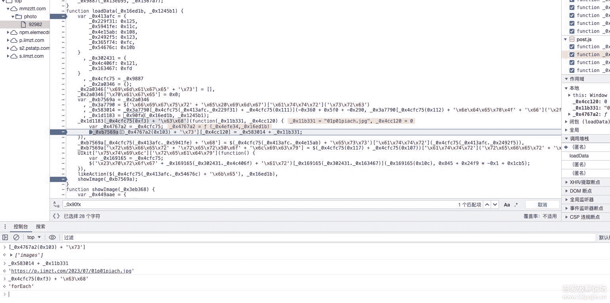

`14.jpg` (191.71 KB, 下载次数: 2)

[附件下载](https://www.52pojie.cn/forum.php?mod=attachment&aid=MjYzMjM0MXw0YzE3MzQ3MnwxNzkzNTczMzIyfDE2ODA4NnwxODE2Mjk4&nothumb=yes)

2023-8-2 11:25 上传

### 图片地址赋值

```javascript
, _0x1d1183 = _0x90fx(_0x16ed1b, _0x1245b1);

// foreach 给图片赋值
_0x1d1183[_0x4cfc75(0xf3) + '\x63\x68'](function(_0x11b331, _0x4cc120) {
    var _0x4767a2 = _0x4cfc75;
    _0xb7569a[_0x4767a2(0x103) + '\x73'][_0x4cc120] = _0x583014 + _0x11b331;  // 图片地址
}),
```

这样就能拿到全部的图片信息啦。
