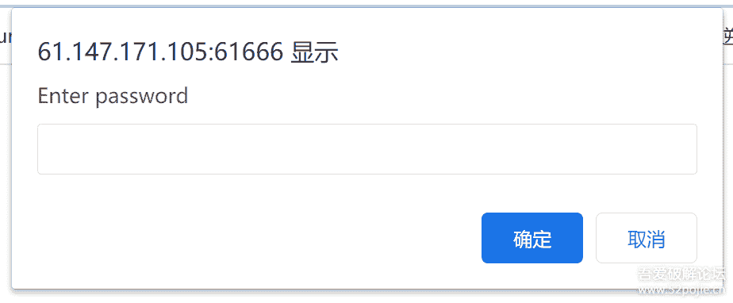
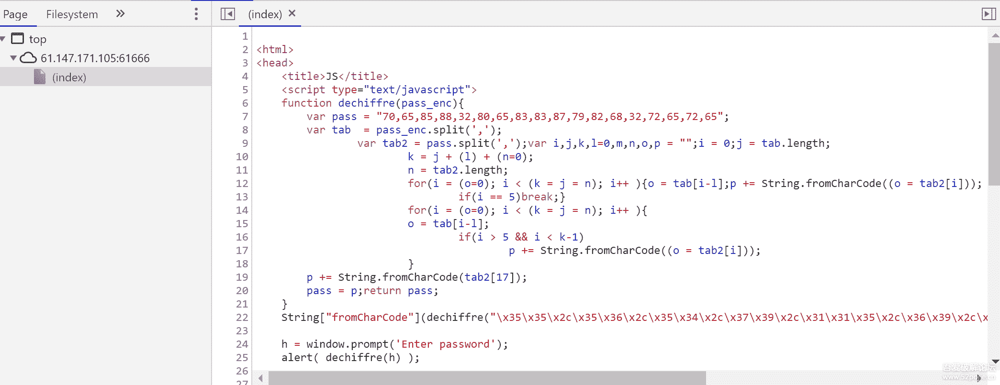
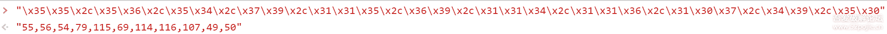
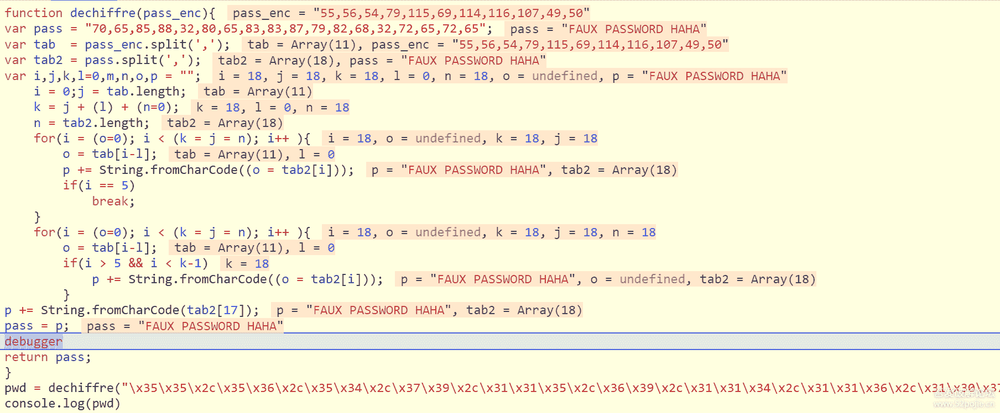
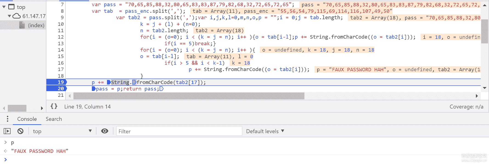
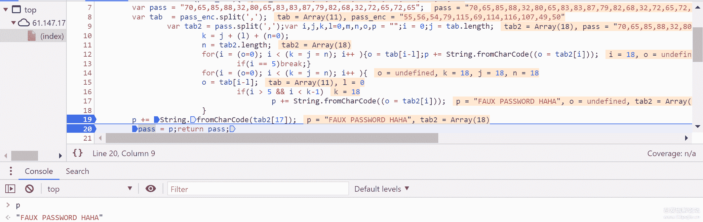
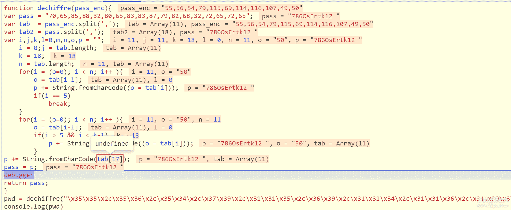
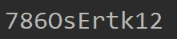

# [Web逆向] 攻防世界simple_js

- 原帖: https://www.52pojie.cn/forum.php?mod=viewthread&tid=1817848
- 抓取时间: 2026-11-01T22:48:33

## 前言

作为攻防世界唯一一道关于有关js的题目。大多WriteUP都是一笔带过，直接就是ascall编码转换成字符拼接。却没有一个WriteUP分析过源码并且修改源码通关的。

## 题目描述

小宁发现了一个网页，但却一直输不对密码。（`Flag` 格式为 `Cyberpeace{xxxxxxxxx}`）

一进网页弹出了输入密码，输入密码错误返回 `FAUX PASSWORD HAHA`，那我们应该怎么做呢，我的建议是爆破（开玩笑的）。



附件 1：[下载](https://www.52pojie.cn/forum.php?mod=attachment&aid=MjYzMzQ4NnwwYzVlN2IyYnwxNzkzNTczMzExfDE2ODA4NnwxODE3ODQ4&nothumb=yes)（2023-8-6 12:04 上传）

打开控制面板看看有没有前端代码，题目起名有js那么题目肯定是与js有关的。



附件 2：[下载](https://www.52pojie.cn/forum.php?mod=attachment&aid=MjYzMzQ4N3w3OTY3ODhkN3wxNzkzNTczMzExfDE2ODA4NnwxODE3ODQ4&nothumb=yes)（2023-8-6 12:05 上传）

哟西，文件里面果然有段js代码，接下来便对这段代码进行逆向分析！

初始js代码:

```js
function dechiffre(pass_enc){
    var pass = "70,65,85,88,32,80,65,83,83,87,79,82,68,32,72,65,72,65";
    var tab  = pass_enc.split(',');
            var tab2 = pass.split(',');var i,j,k,l=0,m,n,o,p = "";i = 0;j = tab.length;
                    k = j + (l) + (n=0);
                    n = tab2.length;
                    for(i = (o=0); i  5 && i 
```

我总共总结了几种方法可以得到flag。但万物不离其宗，都是为了把正确密码传进 `dechiffre` 函数里面执行。

初始代码太复杂了，我们可以通过逆向调试的手段去掉一些无关紧要的代码。

## 正文

把初始代码扣进编译器，首先分析函数里面的 `pass_enc.split(',')`，可以初步判断传进去的 `pass_enc` 参数是有逗号隔开的，不然直接就爆错。由于 `dechiffre` 函数没有用到传进去的 `pass_enc` 参数所以代码没有报错。

分析 `dechiffre` 函数外面的代码：

```js
String["fromCharCode"](dechiffre("\x35\x35\x2c\x35\x36\x2c\x35\x34\x2c\x37\x39\x2c\x31\x31\x35\x2c\x36\x39\x2c\x31\x31\x34\x2c\x31\x31\x36\x2c\x31\x30\x37\x2c\x34\x39\x2c\x35\x30"));

h = window.prompt('Enter password');

alert( dechiffre(h) );
```

传进 `dechiffre` 函数的参数总共有两个，第一个是 `"\x35\x35\x2c\x35\x36\x2c\x35\x34\x2c\x37\x39\x2c\x31\x31\x35\x2c\x36\x39\x2c\x31\x31\x34\x2c\x31\x31\x36\x2c\x31\x30\x37\x2c\x34\x39\x2c\x35\x30"`，第二个便是我们刚进入网页需要输入的密码，第二个直接pass掉了，难道这个世界上真的有人的密码是用逗号隔开的吗，如果有的话，那肯定是"逗逼"。

第一个参数他并没有逗号隔开的，不过明眼一看就是十六进制，转成十进制看看是什么！

复制到控制台运行，得到了用逗号隔开的密码。



附件 3：[下载](https://www.52pojie.cn/forum.php?mod=attachment&aid=MjYzMzQ4OHw4YWY2OWEzN3wxNzkzNTczMzExfDE2ODA4NnwxODE3ODQ4&nothumb=yes)（2023-8-6 12:05 上传）

改写代码，直接把第一个参数转为十进制传进 `dechiffre` 函数。

改写后的代码：

```js
function dechiffre(pass_enc){
var pass = "70,65,85,88,32,80,65,83,83,87,79,82,68,32,72,65,72,65";
var tab  = pass_enc.split(',');
var tab2 = pass.split(',');var i,j,k,l=0,m,n,o,p = "";i = 0;j = tab.length;
    k = j + (l) + (n=0);
    n = tab2.length;
    for(i = (o=0); i  5 && i 
```

在 `dechiffre` 函数的最后一段代码加入 `debugger` 丢到浏览器执行看看代码是如何执行的。



附件 4：[下载](https://www.52pojie.cn/forum.php?mod=attachment&aid=MjYzMzQ4OXwzZDJlM2E4ZHwxNzkzNTczMzExfDE2ODA4NnwxODE3ODQ4&nothumb=yes)（2023-8-6 12:06 上传）

这样子的代码并不容易分析，因为有一些误导的代码。

下面是需要改写的代码：

```js
i = (o=0)—>i=0

i ik = j + (l) + (n=0)—>k=j
```

改写之后的代码：

```js
function dechiffre(pass_enc){
var pass = "70,65,85,88,32,80,65,83,83,87,79,82,68,32,72,65,72,65";
var tab  = pass_enc.split(',');
var tab2 = pass.split(',');
var i,j,k,l=0,m,n,o,p = "";
    i = 0;j = tab.length;
    k=j
    n = tab2.length;
    for(i = 0; i  5 && i 
```

### 第一种通关方法

在未修改前的代码19行下个断点，刷新。`p="FAUX PASSWORD HAH"`



附件 5：[下载](https://www.52pojie.cn/forum.php?mod=attachment&aid=MjYzMzQ5MHxmZjA5OTk0N3wxNzkzNTczMzExfDE2ODA4NnwxODE3ODQ4&nothumb=yes)（2023-8-6 12:06 上传）

在未修改前的代码20行下个断点，单步调试。`p="FAUX PASSWORD HAHA"`



附件 6：[下载](https://www.52pojie.cn/forum.php?mod=attachment&aid=MjYzMzQ5MXxmMjUxYTgwN3wxNzkzNTczMzExfDE2ODA4NnwxODE3ODQ4&nothumb=yes)（2023-8-6 12:06 上传）

`p += String.fromCharCode(tab2[17])` 的作用就是在所有ascall转字符拼接完了之后再拼接一个A。



附件 7：[下载](https://www.52pojie.cn/forum.php?mod=attachment&aid=MjYzMzQ5MnwwMDM5ZTFlZXwxNzkzNTczMzExfDE2ODA4NnwxODE3ODQ4&nothumb=yes)（2023-8-6 12:07 上传）

而传进来的数组 `pass_enc` 并没有第十七个数值，所以是个未定义。拼接也是空。而他的本意就是拼接 `pass` 的第十七个字符也就是 `"65"` 字符A，所以修改后的代码完全可以把这一行删掉。

`tab` 是传下来的数组 `pass_enc` 分割的，把拼接的 `tab2` 全部修改成 `tab`。把 `tab2` 的长度 `n` 也修改成 `tab` 的长度 `j`，并且把 `p += String.fromCharCode(tab2[17]);` 删掉。这样子我们就能把传进来的数组全部转换成字符并且拼接起来。

修改后的代码：

```js
function dechiffre(pass_enc){
var pass = "70,65,85,88,32,80,65,83,83,87,79,82,68,32,72,65,72,65";
var tab  = pass_enc.split(',');
var tab2 = pass.split(',');
var i,j,k,l=0,m,n,o,p = "";
    i = 0;j = tab.length;
    k = j;
    n = tab2.length;
    for(i = 0; i  5 && i 
```

结果：


附件 8：[下载](https://www.52pojie.cn/forum.php?mod=attachment&aid=MjYzMzQ5M3w1YWU5OTg1ZXwxNzkzNTczMzExfDE2ODA4NnwxODE3ODQ4&nothumb=yes)（2023-8-6 12:07 上传）

### 第二种通关方法

从代码可以看出两次 `for` 循环都是把 `tab2` 数组从ascall码转换成字符。

而 `tab2` 数组是内置的 `var pass = "70,65,85,88,32,80,65,83,83,87,79,82,68,32,72,65,72,65"`

所以我们直接把 `tab2` 数组转换成传进来的参数。

改写之后的代码：

```js
function dechiffre(pass_enc){
var pass = "55,56,54,79,115,69,114,116,107,49,50";
var tab  = pass_enc.split(',');
var tab2 = pass.split(',');
var i,j,k,l=0,m,n,o,p = "";
    i = 0;j = tab.length;
    k = j;
    n = tab2.length;
    for(i = 0; i  5 && i 
```

执行结果：



附件 9：[下载](https://www.52pojie.cn/forum.php?mod=attachment&aid=MjYzMzQ5NHw3ZWJiZTg3NnwxNzkzNTczMzExfDE2ODA4NnwxODE3ODQ4&nothumb=yes)（2023-8-6 12:07 上传）

## 结尾

电脑麦克风坏了，后续视频录好了会发在b站上面。

b站主页：[space.bilibili.com/440700836](https://space.bilibili.com/440700836)

此文章仅供技术交流使用，如有侵权联系我删除。
