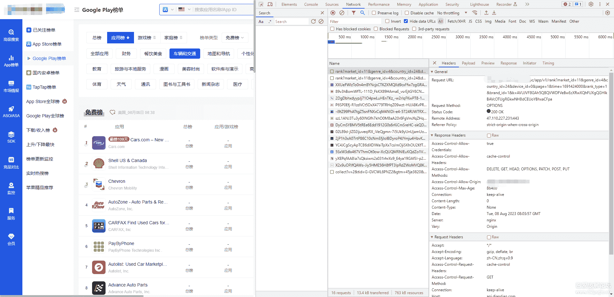
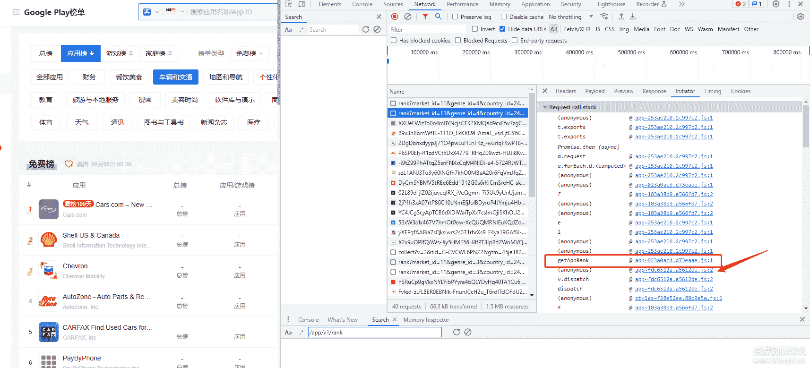
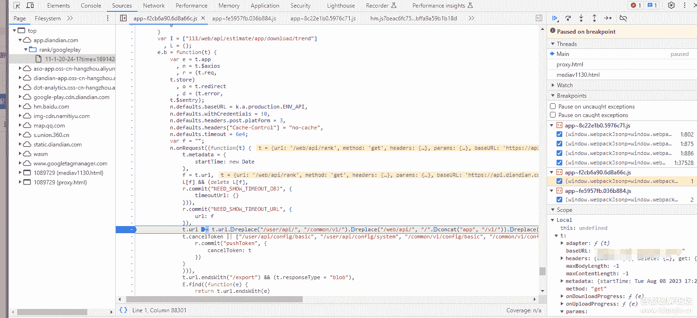
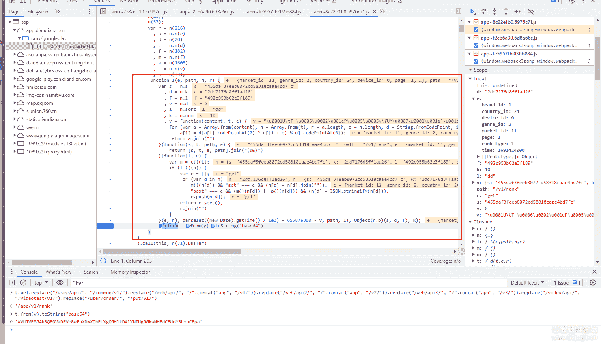

# [Web逆向] 【某点数据】榜单数据抓取

- 原帖: https://www.52pojie.cn/forum.php?mod=viewthread&tid=1818816
- 抓取时间: 2026-11-01T22:48:28

一直在搞其他事情，好久没搞js加密分析了，正好遇到一个很简单的数据要搞。想着也很久没在论坛发帖了，这次就发下。【某点数据】的榜单数据抓取。




```
列表页接口：【https://xxx/pc/app/v1/rank?market_id=11&genre_id=4&country_id=24&device_id=0&page=1&time=1691424000&rank_type=1&brand_id=1&k=AVUJVF8GAh5QBQVWDFVeBwEcXRwXQhFUXgQGHlkBAVcOTUgRGkwNHBdCEUoYBhxaCFpa】
打开列表页链接清空下请求，点击下其他的分类，一下子就看到数据返回的接口了。除了k是根据动态计算的，其他都是按照分类或者时间戳写死的。
2.png (255.3 KB, 下载次数: 2)

[href="forum.php?mod=attachment&aid=MjYzNDEwM3w5MTlkMDIwM3wxNzkzNTczMzA1fDE2ODA4NnwxODE4ODE2&nothumb=yes" target="_blank"](https://www.52pojie.cn/forum.php?mod=attachment&aid=MjYzNDEwM3w5MTlkMDIwM3wxNzkzNTczMzA1fDE2ODA4NnwxODE4ODE2&nothumb=yes)

2023-8-8 17:13 上传
```

老规矩先全局搜下接口路径，发现没有，好家伙，藏的那么深，从接口执行堆栈流程看到有个`getAppRank`过于明显果断从这里开始debug。



3.png (225.15 KB, 下载次数: 2)

[href="forum.php?mod=attachment&aid=MjYzNDEwNXwxOTY0NWM0ZnwxNzkzNTczMzA1fDE2ODA4NnwxODE4ODE2&nothumb=yes" target="_blank"](https://www.52pojie.cn/forum.php?mod=attachment&aid=MjYzNDEwNXwxOTY0NWM0ZnwxNzkzNTczMzA1fDE2ODA4NnwxODE4ODE2&nothumb=yes)

2023-8-8 17:13 上传

```
```

debug过程中发现接口路径是从【`/web/api/rank`】替换到【`/app/v1/rank`】



6.png (156.37 KB, 下载次数: 1)

[href="forum.php?mod=attachment&aid=MjYzNDExOHw2ZjNiZGU2ZHwxNzkzNTczMzA1fDE2ODA4NnwxODE4ODE2&nothumb=yes" target="_blank"](https://www.52pojie.cn/forum.php?mod=attachment&aid=MjYzNDExOHw2ZjNiZGU2ZHwxNzkzNTczMzA1fDE2ODA4NnwxODE4ODE2&nothumb=yes)

2023-8-8 17:25 上传

```
```

最后我们顺着debug看下`k`的生成规则是啥，发现`k`是由请求参数+base64生成这就好弄了，分析下这块逻辑。



5.png (190.3 KB, 下载次数: 2)

[href="forum.php?mod=attachment&aid=MjYzNDExMXw2NDA2MDQ3MHwxNzkzNTczMzA1fDE2ODA4NnwxODE4ODE2&nothumb=yes" target="_blank"](https://www.52pojie.cn/forum.php?mod=attachment&aid=MjYzNDExMXw2NDA2MDQ3MHwxNzkzNTczMzA1fDE2ODA4NnwxODE4ODE2&nothumb=yes)

2023-8-8 17:21 上传

简单带你直接把这块js扣下看看缺啥补啥。具体看代码上的注释，已经把原代码和修改的备注了。

```
20230810 【'1d8en73(i4'】 本以为是固定参数，后发现是每天虽则签名更改，一天都不会变动，等有空再更新上来
```

```
function getToken(e, path, n, r) {

        function u8ArrZBase64(u8Arr) {

          try{

                         let CHUNK_SIZE = 0x8000;

                         let index = 0;

                         let length = u8Arr.length;

                         let result = '';

                         let slice;

                         while (index
```

前几天没来得及更新，次日发现某点还有个需要签名会每天变动，因此以下补充签名生成规则。对应上述代码中【`Object(h.b)(s, d, f)`】，开始debug进去查看，着急搬砖直接上解析后的加密规则，在代码里都注释了

```
function readUInt32BE(tt, t) {

        return 16777216 * tt[t] + (tt[t + 1] >> 8 ^ 255 & d ^ 99,

                r[l] = d,

                n[d] = l;

                var c = t[l]

                  , m = t[c]

                  , v = t[m]

                  , y = 257 * t[d] ^ 16843008 * d;

                o[0][l] = y >> 8,

                o[1][l] = y >> 16,

                o[2][l] = y >> 24,

                o[3][l] = y,

                y = 16843009 * v ^ 65537 * m ^ 257 * c ^ 16843008 * l,

                h[0][d] = y >> 8,

                h[1][d] = y >> 16,

                h[2][d] = y >> 24,

                h[3][d] = y,

                0 === l ? l = f = 1 : (l = c ^ t[t[t[v ^ c]]],

                f ^= t[t[f]])

        }

        return {

                SBOX: r,

                INV_SBOX: n,

                SUB_MIX: o,

                INV_SUB_MIX: h

        }

}();

function _reset(tt) {

        for (var t = tt, e = t.length, r = e + 6, n = 4 * (r + 1), o = [], h = 0; h >> 24,

                l = d.SBOX[l >>> 24] >> 16 & 255] >> 8 & 255]  6 && h % e == 4 && (l = d.SBOX[l >>> 24] >> 16 & 255] >> 8 & 255] >> 24]] ^ d.INV_SUB_MIX[1][d.SBOX[y >>> 16 & 255]] ^ d.INV_SUB_MIX[2][d.SBOX[y >>> 8 & 255]] ^ d.INV_SUB_MIX[3][d.SBOX[255 & y]]

        }

        return {

                '_nRounds' : r,

                '_keySchedule' : o,

                '_invKeySchedule' : c

        }

}

function DAES(t) {

        var _key = oFunction(t);

        var rs = _reset(_key);

        return {

                '_key' : _key,

                '_nRounds' : rs._nRounds,

                '_keySchedule' : rs._keySchedule,

                '_invKeySchedule' : rs._invKeySchedule

        }

}

function dFrom(sData,sP) {

        k(sData,sP,0,16);

        return sData;

}

function k(t, e, r, n) {

        r = Number(r) || 0;

        var f = t.length - r;

        n ? (n = Number(n)) > f && (n = f) : n = f;

        var o = e.length;

        if (o % 2 != 0)

                throw new TypeError("Invalid hex string");

        n > o / 2 && (n = o / 2);

        for (var i = 0; i >> 24] ^ m[_ >>> 16 & 255] ^ v[M >>> 8 & 255] ^ y[255 & S] ^ e[E++],

                l = c[_ >>> 24] ^ m[M >>> 16 & 255] ^ v[S >>> 8 & 255] ^ y[255 & w] ^ e[E++],

                f = c[M >>> 24] ^ m[S >>> 16 & 255] ^ v[w >>> 8 & 255] ^ y[255 & _] ^ e[E++],

                d = c[S >>> 24] ^ m[w >>> 16 & 255] ^ v[_ >>> 8 & 255] ^ y[255 & M] ^ e[E++],

                w = h,

                _ = l,

                M = f,

                S = d;

        return h = (n[w >>> 24] >> 16 & 255] >> 8 & 255] >> 24] >> 16 & 255] >> 8 & 255] >> 24] >> 16 & 255] >> 8 & 255] >> 24] >> 16 & 255] >> 8 & 255] >>= 0, l >>>= 0, f >>>= 0, d >>>= 0]

}

function N(t, e, r, n) {

        e >> 8 * (n ? i : 3 - i) & 255

}

function writeUInt32BE(tData, t, e,r) {

        return t = +t,

        e |= 0,

        true ? (tData[e] = t >>> 24,

        tData[e + 1] = t >>> 16,

        tData[e + 2] = t >>> 8,

        tData[e + 3] = 255 & t) : N(tData, t, e, !1),

        e + 4

}

function decryptBlock(t,kData){

        var e = (t = oFunction(t))[1];

        t[1] = t[3],

        t[3] = e;

        var thisData = DAES(new TextEncoder().encode(kData));

        var tData = new Uint8Array(16);

        var r = l(t, thisData._invKeySchedule, d.INV_SUB_MIX, d.INV_SBOX, thisData._nRounds)

          , h = new Uint8Array(16);

        // console.log('e:'+e);

        // console.log('h:'+h);

        // console.log('r:'+r);

        // console.log('t:'+t);

        writeUInt32BE(tData, r[0], 0),

        writeUInt32BE(tData, r[3], 4),

        writeUInt32BE(tData, r[2], 8),

        writeUInt32BE(tData, r[1], 12),

        h;

        return tData;

}

function exports(a, b) {

        for (var t = Math.min(a.length, b.length), r = new Uint8Array(16), i = 0; i  n && (t = n),

        (e = void 0 === e ? n : ~~e)  n && (e = n),

        e  16)

                throw new Error("unable to decrypt data");

        var i = -1;

        for (; ++i
```

最后先调用`getSign`再根据参数调用`getToken`即可

```
