# [Web逆向] 挖洞遇到验证码那些事

- 原帖：[https://www.52pojie.cn/forum.php?mod=viewthread&tid=1820059](https://www.52pojie.cn/forum.php?mod=viewthread&tid=1820059)
- 抓取时间：2026-11-01T22:48:20

## 前言

平台：aHR0cHM6Ly93d3cudnVsYm94LmNvbS8=公益SRC

厂商：zay7qMuz

链接：aHR0cHM6Ly91cGFzcy4xMGpxa2EuY29tLmNuL2xvZ2lu

文章搭配视频地址：[https://b23.tv/SFVSkKk](https://b23.tv/SFVSkKk)

## 正文

输入手机号码与账号密码登录的接口都有滑块。区别在于账号密码登录的时候有个加盐密码。流程比手机号码的接口复杂一下，为了省时间。此文章便是根据手机号码的接口去写的，毕竟咱的目的是过滑块嘛。


`2023-08-11-10-37-59-image.png` (300.91 KB, 下载次数: 2)
[附件](https://www.52pojie.cn/forum.php?mod=attachment&aid=MjYzNDgyM3wxYjY2YWY1YXwxNzkzNTczMjk4fDE2ODA4NnwxODIwMDU5&nothumb=yes) 1 2023-8-11 16:12 上传

### 发包逻辑分析

每次刷新验证码，都会发四个数据包下来。第一个数据包用于请求图片。图片链接的拼接就是`urlParams`加上`imgs`的值。

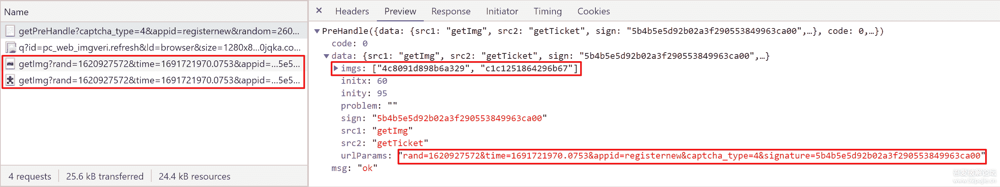
`2023-08-11-10-47-47-image.png` (148.34 KB, 下载次数: 1)
[附件](https://www.52pojie.cn/forum.php?mod=attachment&aid=MjYzNDgyNHw3MzcyYWI1MHwxNzkzNTczMjk4fDE2ODA4NnwxODIwMDU5&nothumb=yes) 2 2023-8-11 16:13 上传

第三个数据包是背景图


`2023-08-11-10-49-00-image.png` (352.46 KB, 下载次数: 0)
[附件](https://www.52pojie.cn/forum.php?mod=attachment&aid=MjYzNDgyNXwwZmUyNTg4M3wxNzkzNTczMjk4fDE2ODA4NnwxODIwMDU5&nothumb=yes) 3 2023-8-11 16:15 上传

第四个数据包是缺口图片


`2023-08-11-10-49-10-image.png` (18.39 KB, 下载次数: 1)
[附件](https://www.52pojie.cn/forum.php?mod=attachment&aid=MjYzNDgyNnwzN2E1NzkxYXwxNzkzNTczMjk4fDE2ODA4NnwxODIwMDU5&nothumb=yes) 4 2023-8-11 16:15 上传

正确拼接验证码，短信验证码发送成功

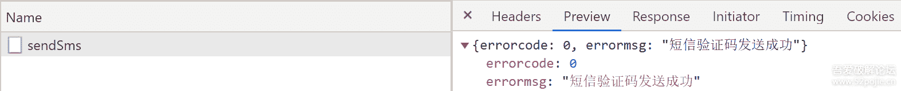
`2023-08-11-10-54-29-image.png` (40.71 KB, 下载次数: 1)
[附件](https://www.52pojie.cn/forum.php?mod=attachment&aid=MjYzNDgyN3wyOGM3NTBhZHwxNzkzNTczMjk4fDE2ODA4NnwxODIwMDU5&nothumb=yes) 5 2023-8-11 16:15 上传

`captcha_signature`在刷新验证码发下来的数据包里面的`sign`参数。

`captcha_phrase`和`captcha_ticket`在`getTicket`接口从服务器返回回来的，`captcha_phrase`是缺口，如果缺口对齐失败的话`captcha_ticket`是获取不到的。所以得先把`getTicket`接口的参数补齐拿到`ticket`。

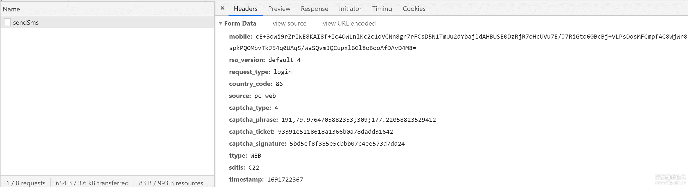
`2023-08-11-10-54-45-image.png` (142.33 KB, 下载次数: 2)
[附件](https://www.52pojie.cn/forum.php?mod=attachment&aid=MjYzNDgyOHw0ZTA3NWIwOXwxNzkzNTczMjk4fDE2ODA4NnwxODIwMDU5&nothumb=yes) 6 2023-8-11 16:16 上传

`getTicket`的前五个参数直接从`getPreHandle`接口返回的`urlParams`获取。

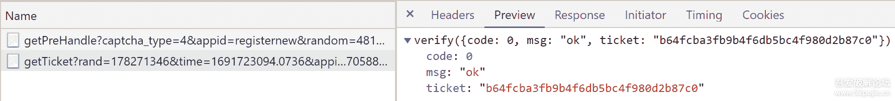
`2023-08-11-11-05-45-image.png` (67.96 KB, 下载次数: 1)
[附件](https://www.52pojie.cn/forum.php?mod=attachment&aid=MjYzNDgyOXw0OGQ5NGFkMXwxNzkzNTczMjk4fDE2ODA4NnwxODIwMDU5&nothumb=yes) 7 2023-8-11 16:16 上传

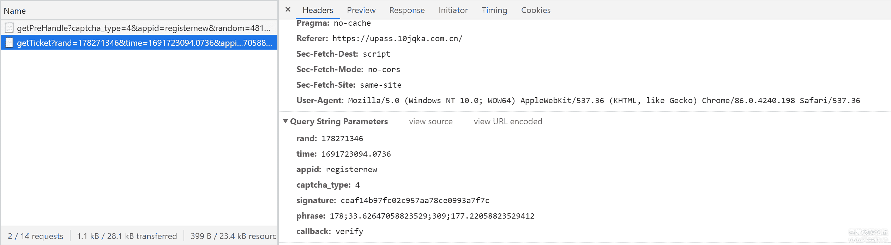
`2023-08-11-11-05-25-image.png` (165.64 KB, 下载次数: 1)
[附件](https://www.52pojie.cn/forum.php?mod=attachment&aid=MjYzNDgzMHw5NzBlOTljYnwxNzkzNTczMjk4fDE2ODA4NnwxODIwMDU5&nothumb=yes) 8 2023-8-11 16:16 上传

`phrase`直接用搜索大法就能搜到关键位置

```javascript
phrase: (x) + ";" + inity + ";" + opt.width + ";" + opt.height
```

`x`是缺口识别的`x`轴，`opt.width`和`opt.height`是固定的值

`inity`也是直接在`js`文件一搜就能拿到他的关键代码。`data.data.inity`在`getPreHandle`接口里面的`inity`。这段代码就是取那个`inity`相除相乘再拼接到`phrase`里头

```javascript
inity = (data.data.inity / 195 * opt.height);
```

`x`直接就是缺口识别然后减去15（因为图片实际大小跟他在网页上面的大小不一样），懒得缩小了。因为通过训练相同的图片跟缺口其`x`就相差15，直接减更方便（懒人做法）

图片缺口识别代码：

```python
def detect_captcha_gap(bg, tp):
    '''
    bg: 背景图片
    tp: 缺口图片
    return: 空缺距背景图左边的距离
    '''
    # 读取背景图片和缺口图片
    bg_img = cv2.imread(bg)  # 背景图片
    tp_img = cv2.imread(tp)  # 缺口图片
    # 识别图片边缘
    bg_edge = cv2.Canny(bg_img, 100, 200)
    tp_edge = cv2.Canny(tp_img, 100, 200)
    # 转换图片格式
    bg_pic = cv2.cvtColor(bg_edge, cv2.COLOR_GRAY2RGB)
    tp_pic = cv2.cvtColor(tp_edge, cv2.COLOR_GRAY2RGB)
    # cv2.imwrite("bg_style.png",bg_pic)  # 保存背景轮廓提取
    # cv2.imwrite("slide_style.png",tp_pic)  # 保存滑块背景提取
    # 缺口匹配
    res = cv2.matchTemplate(bg_pic, tp_pic, cv2.TM_CCOEFF_NORMED)
    min_val, max_val, min_loc, max_loc = cv2.minMaxLoc(res)  # 寻找最优匹配
    th, tw = tp_pic.shape[:2]
    tl = max_loc  # 左上角点的坐标
    # 返回缺口的左上角X坐标
    br = (tl[0] + tw, tl[1] + th)  # 右下角点的坐标
    cv2.rectangle(bg_img, tl, br, (0, 0, 255), 2)  # 绘制矩形
    cv2.imwrite("result_new.png", bg_img)  # 保存在本地
    # 返回缺口的左上角X坐标
    return tl[0]

x = detect_captcha_gap("bg.jpg","tp.jpg")-15
```

`mobile`加密就是一个rsa加密，没有任何混淆跟难点。

验证码校验接口还有个`hexin-v`参数

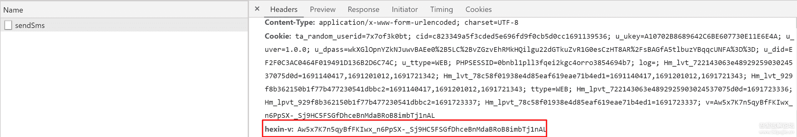
`2023-08-11-11-33-38-image.png` (182.68 KB, 下载次数: 2)
[附件](https://www.52pojie.cn/forum.php?mod=attachment&aid=MjYzNDgzMXwzMTk0OGFhOHwxNzkzNTczMjk4fDE2ODA4NnwxODIwMDU5&nothumb=yes) 9 2023-8-11 16:17 上传

### 2> `hexin-v`硬扣

校验验证码的数据包里面有个加密的`header`参数`hexin-v`，他跟`cookie`的`v`是一模一样的。有两种方法可以找到关键加密位置，第一种是`headers` hook，第二种是`cookie` hook。

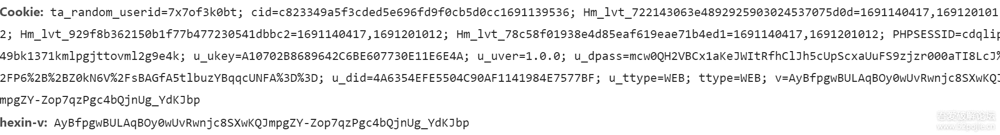
`2023-08-09-20-53-15-image.png` (121.48 KB, 下载次数: 0)
[附件](https://www.52pojie.cn/forum.php?mod=attachment&aid=MjYzNDgzMnxmNzExMmEzMnwxNzkzNTczMjk4fDE2ODA4NnwxODIwMDU5&nothumb=yes) 10 2023-8-11 16:17 上传

`cookie` hook代码：

```javascript
(function () {
    'use strict';
    var cookieTemp = "";
    Object.defineProperty(document, 'cookie', {
        set: function (val) {
            console.log('Hook捕获到cookie设置->', val);
            if (val.indexOf('v') != -1) {
                debugger;
            }
            cookieTemp = val;
            return val;
        },
        get: function () {
            return cookieTemp;
        }
    });
})();
```

在控制台输入`hook`的代码

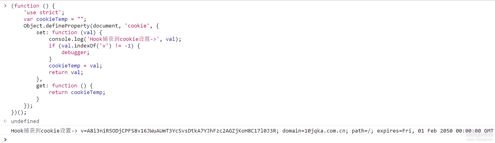
`2023-08-09-20-57-45-image.png` (102.56 KB, 下载次数: 0)
[附件](https://www.52pojie.cn/forum.php?mod=attachment&aid=MjYzNDgzNHwyMTYwNWJlZnwxNzkzNTczMjk4fDE2ODA4NnwxODIwMDU5&nothumb=yes) 11 2023-8-11 16:17 上传

断点断了下来。回溯堆栈找到关键代码加密的地方

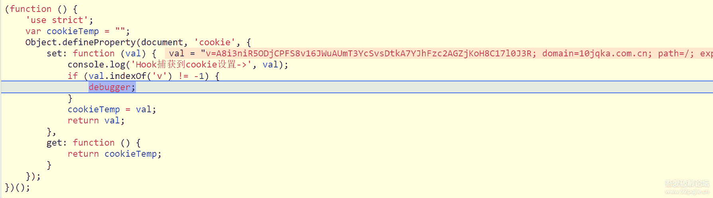
`2023-08-09-20-59-13-image.png` (90.84 KB, 下载次数: 1)
[附件](https://www.52pojie.cn/forum.php?mod=attachment&aid=MjYzNDgzNXxmYzU2ZDQyZHwxNzkzNTczMjk4fDE2ODA4NnwxODIwMDU5&nothumb=yes) 12 2023-8-11 16:18 上传

`w`函数便是设置`cookie`的函数，`r`就是`v`加密生成返回的值。那么`qn.update()`就是`v`生成的函数了。把断点下到`qn.update()`那一行然后刷新。由于这个网站的`js`文件是动态生成的，所以需要重新进入新的`js`文件在`qn.update()`那一行重新下个断点刷新。

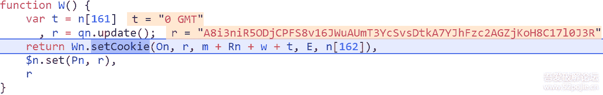
`2023-08-09-21-01-45-image.png` (44.2 KB, 下载次数: 2)


[href="forum.php?mod=attachment&aid=MjYzNDgzNnxmYzhhNGRiMnwxNzkzNTczMjk4fDE2ODA4NnwxODIwMDU5&nothumb=yes" target="_blank"](https://www.52pojie.cn/forum.php?mod=attachment&aid=MjYzNDgzNnxmYzhhNGRiMnwxNzkzNTczMjk4fDE2ODA4NnwxODIwMDU5&nothumb=yes)

### 13
2023-8-11 16:18 上传
断点断下之后进入`qn.update()`看看里面写了啥
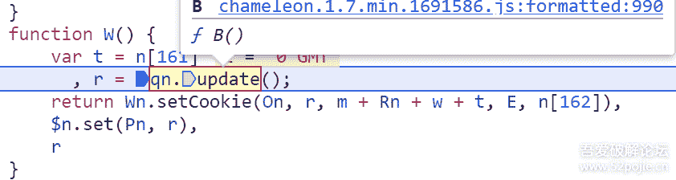
2023-08-09-21-11-36-image.png (41.65 KB, 下载次数: 1)
[href="forum.php?mod=attachment&aid=MjYzNDgzOHwzYmEzZjY0NXwxNzkzNTczMjk4fDE2ODA4NnwxODIwMDU5&nothumb=yes" target="_blank"](https://www.52pojie.cn/forum.php?mod=attachment&aid=MjYzNDgzOHwzYmEzZjY0NXwxNzkzNTczMjk4fDE2ODA4NnwxODIwMDU5&nothumb=yes)

### 14
2023-8-11 16:18 上传
进入到`qn.update()`函数内部可以看出他返回了另外一个函数的返回值。
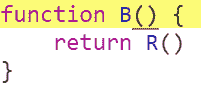
2023-08-09-21-12-22-image.png (4.6 KB, 下载次数: 0)
[href="forum.php?mod=attachment&aid=MjYzNDgzOXw3Mzc4OWM2N3wxNzkzNTczMjk4fDE2ODA4NnwxODIwMDU5&nothumb=yes" target="_blank"](https://www.52pojie.cn/forum.php?mod=attachment&aid=MjYzNDgzOXw3Mzc4OWM2N3wxNzkzNTczMjk4fDE2ODA4NnwxODIwMDU5&nothumb=yes)

### 15
2023-8-11 16:19 上传
把断点断到`R`函数这一行进入到`R`函数内部。

2023-08-09-21-13-54-image.png (36.21 KB, 下载次数: 2)
[href="forum.php?mod=attachment&aid=MjYzNDg0MHxlZWM5Yzk3ZHwxNzkzNTczMjk4fDE2ODA4NnwxODIwMDU5&nothumb=yes" target="_blank"](https://www.52pojie.cn/forum.php?mod=attachment&aid=MjYzNDg0MHxlZWM5Yzk3ZHwxNzkzNTczMjk4fDE2ODA4NnwxODIwMDU5&nothumb=yes)

### 16
2023-8-11 16:19 上传
`R`函数往`E`对象里面压入一堆值。找找`E`在哪里生成的。
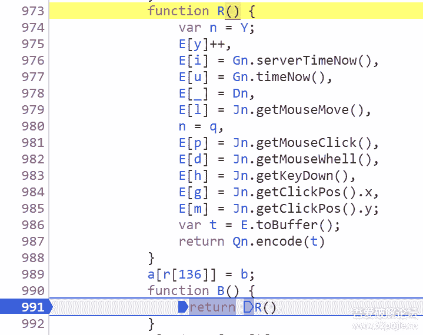
2023-08-09-21-15-44-image.png (94.81 KB, 下载次数: 1)
[href="forum.php?mod=attachment&aid=MjYzNDg0MXwzYmExYTk4OXwxNzkzNTczMjk4fDE2ODA4NnwxODIwMDU5&nothumb=yes" target="_blank"](https://www.52pojie.cn/forum.php?mod=attachment&aid=MjYzNDg0MXwzYmExYTk4OXwxNzkzNTczMjk4fDE2ODA4NnwxODIwMDU5&nothumb=yes)

### 17
2023-8-11 16:19 上传
`E`对象是在`b`函数里面被赋值的，但因作用域的原因，他并不是在这里声明的，`E`声明的地方还得往上面去找。
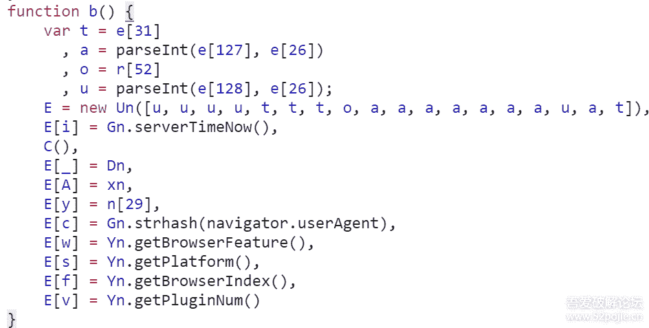
2023-08-09-21-17-56-image.png (71.91 KB, 下载次数: 1)
[href="forum.php?mod=attachment&aid=MjYzNDg0Mnw0OGM2YjkzY3wxNzkzNTczMjk4fDE2ODA4NnwxODIwMDU5&nothumb=yes" target="_blank"](https://www.52pojie.cn/forum.php?mod=attachment&aid=MjYzNDg0Mnw0OGM2YjkzY3wxNzkzNTczMjk4fDE2ODA4NnwxODIwMDU5&nothumb=yes)

### 18
2023-8-11 16:20 上传
在945行找到`E`声明的地方，同时也发现了这一段大的函数是一个自执行的函数。
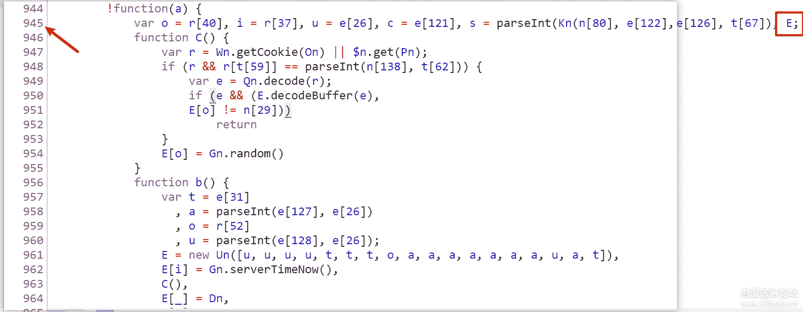
2023-08-09-21-32-54-image.png (126.7 KB, 下载次数: 1)
[href="forum.php?mod=attachment&aid=MjYzNDg0M3xhYjdiMTVhMnwxNzkzNTczMjk4fDE2ODA4NnwxODIwMDU5&nothumb=yes" target="_blank"](https://www.52pojie.cn/forum.php?mod=attachment&aid=MjYzNDg0M3xhYjdiMTVhMnwxNzkzNTczMjk4fDE2ODA4NnwxODIwMDU5&nothumb=yes)

### 19
2023-8-11 16:20 上传
开始扣代码，就只扣需要的代码，`R()`是`v`加密后的值，`R`函数里面有`E`对象，`E`对象是在`b`函数里面被实例化的。`b`函数也扣下来，`b`函数里面调用了`C`函数。`C`函数也一并扣下来。因为`E`对象是全局作用域，其声明的代码在几个函数的外面。
```
var o = r[40], i = r[37], u = e[26], c = e[121], s = parseInt(Kn(n[80], e[122], t[135]), t[67]), f = n[94], v = r[59], l = e[74], p = n[53], d = parseInt(t[29], t[62]), h = parseInt(n[68], n[134]), g = n[135], m = parseInt(e[123], n[51]), w = parseInt(n[136], e[58]), I = parseInt(e[124], t[136]), _ = parseInt(e[125], e[79]), y = parseInt(n[137], n[134]), A = parseInt(e[126], t[67]), E;  
    function C() {  
        var r = Wn.getCookie(On) || $n.get(Pn);  
        if (r && r[t[59]] == parseInt(n[138], t[62])) {  
            var e = Qn.decode(r);  
            if (e && (E.decodeBuffer(e),  
            E[o] != n[29]))  
                return  
        }  
        E[o] = Gn.random()  
    }  
    function b() {  
        var t = e[31]  
          , a = parseInt(e[127], e[26])  
          , o = r[52]  
          , u = parseInt(e[128], e[26]);  
        E = new Un([u, u, u, u, t, t, t, o, a, a, a, a, a, a, a, u, a, t]),  
        E[i] = Gn.serverTimeNow(),  
        C(),  
        E[_] = Dn,  
        E[A] = xn,  
        E[y] = n[29],  
        E[c] = Gn.strhash(navigator.userAgent),  
        E[w] = Yn.getBrowserFeature(),  
        E[s] = Yn.getPlatform(),  
        E[f] = Yn.getBrowserIndex(),  
        E[v] = Yn.getPluginNum()  
    }  
    function R() {  
        var n = Y;  
        E[y]++,  
        E[i] = Gn.serverTimeNow(),  
        E[u] = Gn.timeNow(),  
        E[_] = Dn,  
        E[l] = Jn.getMouseMove(),  
        n = q,  
        E[p] = Jn.getMouseClick(),  
        E[d] = Jn.getMouseWhell(),  
        E[h] = Jn.getKeyDown(),  
        E[g] = Jn.getClickPos().x,  
        E[m] = Jn.getClickPos().y;  
        var t = E.toBuffer();  
        return Qn.encode(t)  
    }  

    console.log(R())
```
代码运行报错，`r`未定义。那么`e`,`t`,`n`是否也是未定义。在浏览器运行一下看看是什么呢
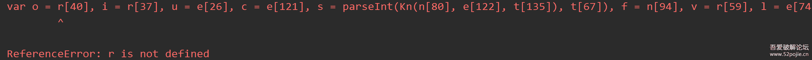
2023-08-10-10-03-21-image.png (21.22 KB, 下载次数: 0)
[href="forum.php?mod=attachment&aid=MjYzNDg0NnxlMDU0OTFjZXwxNzkzNTczMjk4fDE2ODA4NnwxODIwMDU5&nothumb=yes" target="_blank"](https://www.52pojie.cn/forum.php?mod=attachment&aid=MjYzNDg0NnxlMDU0OTFjZXwxNzkzNTczMjk4fDE2ODA4NnwxODIwMDU5&nothumb=yes)

### 20
2023-8-11 16:22 上传
在控制台打印`r`,`e`,`t`,`n`。发现他们都是大数组。直接扣下来就行了
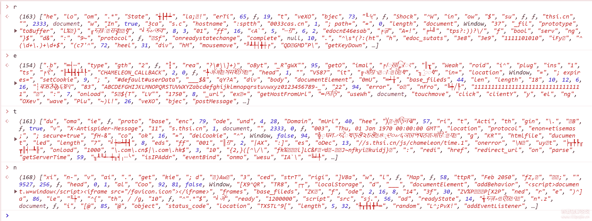
2023-08-10-10-06-04-image.png (552.34 KB, 下载次数: 1)
[href="forum.php?mod=attachment&aid=MjYzNDg0OXw0Yjg1MjhkZXwxNzkzNTczMjk4fDE2ODA4NnwxODIwMDU5&nothumb=yes" target="_blank"](https://www.52pojie.cn/forum.php?mod=attachment&aid=MjYzNDg0OXw0Yjg1MjhkZXwxNzkzNTczMjk4fDE2ODA4NnwxODIwMDU5&nothumb=yes)

### 21
2023-8-11 16:23 上传
```
var n=["xi", "n-", "v", "ai", ".", "get", "kie", "; d", "\x1c)Aw\x1b", "3", "ced", "strT", "rigi", "]V8a", "w", "l", Array, "Map", Function, 58, "ttpR", "Feb 2050", "fZ,\x19", "\x15\x18;", "", 9527, 256, String, "head", 0, 1, "al", "Coo", 92, 81, !1, window, "[X9^QR", "TR8", "\u250c\u252c", "localStorage", "d", "___", "documentElement", "addBehavior", 'document.w=window', "frames", "base_fileds", "ZK\x1f", "f", "ode", 2, 16, 8, "14", "3f", 30, "ZV%P\x0e\x03\x12P[X2P", "ned", "r", "e", ")^]a", 86, "le", "\u2559\u253e", "^{", "th", / /g, "10", RegExp, '^".*"$', "\u255b\u0972", "ready", "1200000", "script", "src", "sj.", 56, "ad", "readyState", 14, "\u2545\u0978\u095b\u09f5\u09a9\u090e\u099a\u09d0\u0980\u09d8", "n*.z", document, Date, "i", "[@", 85, "@", "object", "status_code", "location", "TX5TL^9[", "length", 5, 32, "\u2544\u2530\u2542\u252a\u254b\u2538\u2550", "random", "L^;PvX!", "addEventListener", !0, "onwheel", "O_3PT", "*6?v", "rra", " gs\x19?", "\u2543\u252b", "x arm", "\u2541\u0961\u097b\u09ff\u09b4", "\x15t", "Po", "\x1a+FrJ", 22, 12, 34, "KV", "maxHeight", "\u2576\u2515\u2561\u2508\u257e\u251b\u2543\u250c\u256e\u2504\u2561\u2502\u2576", 7, "Object", "opr", "QQBrowser", "%TuD4", "\u2554\u0975\u0948\u09fe\u09bd\u0938", "iso-8859-1", "defaultCharset", 23, "ng", "zh-cn", "language", "Native Client", "^Android", "plugins", "mroftalPteg", 10, 11, "13", "16", "74", "[^\\r\\n]", "*)\\r?$", "\u255b\u253d", "Fri, 01 ", "error", "[object Request]", "^\x16FyT", "allow", "sredaeh", "headers", "it", 95, 60, encodeURIComponent, 46, "PE3S", "#", "host", "0\x1a)_", "g", "Wi", "prototype", "0 GMT", "/", "`z\x1a}lc\x06", 15, "^", "_raw", "CHAMELEON_LOADED"],  
```


# 代码调试记录

## 数组定义

```
t = ["du", "oma", "ie", RegExp, "proto", "base", "enc", 79, "ode", "und", 4, 28, "Domain", "mUrl", 40, "hee", "\u2573\u0952\u0977\u09dc\u09bf\u0928\u099d", 57, "ri", "t", "Acti", "th", "gin", "\\.", "\x18B", Array, !0, "v", "X-Antispider-Message", "11", "s.thsi.cn", 1, document, "", 2333, 0, String, "003", "Thu, 01 Jan 1970 00:00:00 GMT", "location", "protocol", "enon=etisemas ;", "; secure=true", "fH-&", "co", "ok", 16, "=", "delCookie", "^", window, !1, 94, "\u256c\u093c\u0918\u09b2\u09f4\u0978\u09c8\u0996\u09dc\u0994\u09e8\u099a\u0994\u0992\u09ea\u0a4d\u0a26\u09e6\u09f6\u096c\u091e\u09a2\u09be\u09aa\u0998\u0920\u090c\u0911\u0a73\u0981\u09bb\u092f\u09b1", "g", 'KR"', "htmlfile", "ducument", "led", "length", "7", "\u255b\u253e\u2550\u2537\u2543\u252b", 8, "eds", "ff", "001", "\u2551\u097b", 2, "|AX", ":]", "es", "oDec", 13, "//s.thsi.cn/js/chameleon/time.1", "onerror", "\\N\x05", "uy\x1et", "\u255e\u2530\u2544\u2521\u2553\u2532\u2551\u2525\u254c\u253a\u255f", "onload", "1000", "\\.com\\.cn$|\\.com\\.hk$", 3, "10", "{2,}([^\\/\\", "fk%\x1f\x10\bl]LC&F\x07\r\x7f\nd\x18-\x07\x14J~nfkyi\x07kuidj}\x1c", ":", "redi", "href", "redirect_url", "on", "parse", "getServerTime", 59, "\u2556\u2538\u2559\u2535\u254c\u253f\u2556\u2525\u2577\u2504\u2570", "isIPAddr", "eventBind", "onmo", "wesu", "IA`\\", "\u255a\u2535\u2540", "sew", "ell", "isTrusted", "clientX", "getMouseMove", '_R"xWB%P{[?VS', "a", "32", "4gCD", "^iP", "\u2579\u250c\u2561", "callPhantom", "ActiveXObject", "vendor", "i", "Maxthon", "chrome", "\x1f2}e", "}\x1a", "\u2562\u2520\u2552\u253d\u254a\u2539\u255c\u252e", "P\\erk", "msDoNotTrack", "20", "as", "webgl2", "name", "bjec", "\u2576\u097e\u094e\u09f8\u09a6\u0938\u09b6\u09fe\u0996\u09d7\u09a7\u09d2\u09cc", "mroftalp", "$8", "111100000", Date, "\u2569\u253e\u2557\u2539\u250f\u253b", "x\x17r]v", "f^\x06]WY3", 95, 10, "hos", "ow", "\x18\x07f\x0f\b\x07l\x05", "open", "Y[:", "getAllResponseHeaders", "error", "fetch", "type", "toString", "headers", "ement", "se", "\u2569\u2501\u2575\u2501\u2571\u2502\u253d\u2561\u255b", "\u2543\u2522\u2550\u2537\u2552\u2526", "#", "target", "\u255b\u0978\u0954\u09f6\u09a4\u0935", "HE9AWT9Y", "apply", "or", "JbD}p", "124f80", "CHAMELEON_LOADED"],  

r =["he", "lo", "om", ".*", "State", "\u2545\u2520\u2543\u2537", "la;\x19!", "erTi", 65, Array, 19, "t", "veXO", "bjec", 73, "\u2559\u096b", String, "Shock", "^W", "in", "ow", "$", "su", Function, RegExp, "thsi.cn", "", 2333, document, "w", "In", !0, "3ca", "s.c", "hostname", ":sptth", "0033cas.cn", 1, "; path=", "=", 0, "length", "document", window, "37", "_fil", "prototype", "toBuffer", "l%\x16}", "\u2553\u0978\u0959\u09fe\u09b4\u0938\u09ac\u09c4\u0992\u09db\u09a7\u09c3", "\u255b\u0978\u0954\u09f6\u09a4\u0935", 8, 3, "01", "ff", 16, "", "languages", "TR8RL_", "PDF|Acrobat", "ShockwaveFlash.ShockwaveFlash", "^MacIntel", "^Linux [ix]\\d+", "getBrowserIndex", "getBrowserFeature", "Init", "MG2TLR", "[ \\t]*(", 62, "\u2544\u2536\u2555\u2510\u257c", "bm", "^(.*?):", "304", "gm", "otorp", "url", "headers", 42, "6p\x15i", "click", "parentNode", "tagName", "A", "\\?", "&", "?", "src", "analysisRst", "insertBefore", 76, "XMLH", "_str"],  

e=[".b", "\u2550\u2524\u254c", "type", "gth", "2", Date, "\u2507", "rea", "?\\#\\\\]+)", "oByt", '_R"gWX"', 95, "getO", "imal", "\u2552\u094e\u0959\u09e3\u09bf\u0931\u0982", "\u2551\u2530", "Weak", "roid", "i^", "plug", "ins", "1", "ts", "\u2552\u096f\u0948", "\u255f\u253a\u2542\u252b\u2545\u2568\u251e", "CHAMELEON_CALLBACK", 2, 0, RegExp, "\u2544\u0972\u0914\u09e5\u09b8\u092e\u0987\u099f\u0997\u09d3", "head", 1, "", "V587", "it", "\u2554\u0975\u095f\u09f2\u09bb\u093e\u0981\u09de\u099f\u09d4\u09a7", "\u2556\u0971\u0956\u09fe\u09a7", "in=", "location", window, "=", "; expires=", "setCookie", 9, "; ", "#default#userData", "___$&", "qY?A", "div", "body", "documentElement", "0mU", "\u2550\u2535\u2541", "base_fileds", 44, "len", "length", "18", 10, 12, 6, 16, "\u2506\u092c\u090b\u09a0\u09e1\u096c\u09df\u0980", "83", "ABCDEFGHIJKLMNOPQRSTUVWXYZabcdefghijklmnopqrstuvwxyz0123456789-_", "22", 94, "error", "o\x1f", "nFro", "\u255a\u253f\u2571\u251e", "11111111111111111111111111111111", "\x14", ":", 7, "onload", "5\x1e${T", 'LV"', "1750", 8, "_url", "ex\x19=", "getHostFromUrl", "\u2550\u0978\u094e\u09dc\u09bf", "useWh", document, "touchmove", "click", "clientY", "y", "el", "ng", "OXev", "wave", "Plu", "~)l!", 26, "veXO", "bjec", "postMessage", "t8A", "\u2541\u0978\u0954\u09f5\u09bf\u092f", "chrome", "BIDUBrowser", "LBBROWSER", "mMR", "\u2554\u0975\u0948\u09fe\u09bd\u0938", "Q", "2X", "TheWorld", "plugins", "ca", "ontouchstart", "navigator", "OR4QJ^ PJ", "KN%A]Z\x1aTVP#T_R", !1, "i", "localStorage", "^ARM", "^BlackBerry", 3, "\u2506\u2536\u2506", "1100", "14", "17", "10001", "10", "100", "me", "eque", " l", "renetsiLtnevEdda", "^@tuh", "jsonp_ignore", Object, "headers", "base", "^_", "target", "ferh", "PV%]", "unload", "tagName", "SCRIPT", "dlihCdneppa", "tna", "?", "\\.", "$", "11", "nd", "tcejbOXevitcA", "Init"];
```

## 运行报 `window`、`document` 未定义

运行报`window`，`document`未定义。在开头定义一下为空对象。

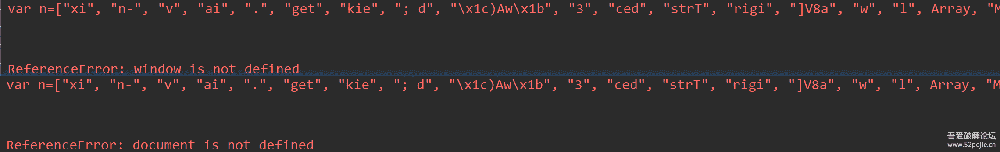

2023-08-10-10-09-43-image.png (39.41 KB, 下载次数: 1)

[href="forum.php?mod=attachment&aid=MjYzNDg1MHwzNTY5YjQwOHwxNzkzNTczMjk4fDE2ODA4NnwxODIwMDU5&nothumb=yes" target="_blank"](https://www.52pojie.cn/forum.php?mod=attachment&aid=MjYzNDg1MHwzNTY5YjQwOHwxNzkzNTczMjk4fDE2ODA4NnwxODIwMDU5&nothumb=yes)

22  
2023-8-11 16:23 上传

### 定义空对象

```
var window ={}  
var document={}
```

## 运行报 `Kn` 未定义

运行报`Kn`未定义。

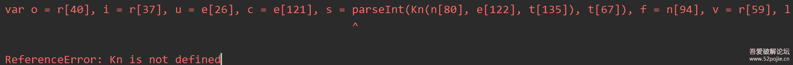

2023-08-10-10-11-32-image.png (21.24 KB, 下载次数: 1)

[href="forum.php?mod=attachment&aid=MjYzNDg1MXw4YTZlMTBhYnwxNzkzNTczMjk4fDE2ODA4NnwxODIwMDU5&nothumb=yes" target="_blank"](https://www.52pojie.cn/forum.php?mod=attachment&aid=MjYzNDg1MXw4YTZlMTBhYnwxNzkzNTczMjk4fDE2ODA4NnwxODIwMDU5&nothumb=yes)

23  
2023-8-11 16:24 上传

把断点下到报错代码那一行，进去`Kn`函数内部。

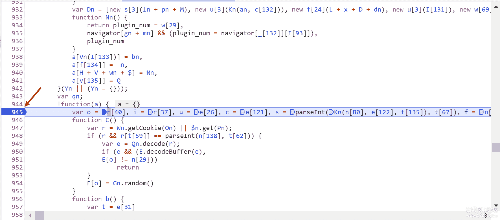

2023-08-10-10-14-24-image.png (164.61 KB, 下载次数: 1)

[href="forum.php?mod=attachment&aid=MjYzNDg1MnxlMzNmYjI1Y3wxNzkzNTczMjk4fDE2ODA4NnwxODIwMDU5&nothumb=yes" target="_blank"](https://www.52pojie.cn/forum.php?mod=attachment&aid=MjYzNDg1MnxlMzNmYjI1Y3wxNzkzNTczMjk4fDE2ODA4NnwxODIwMDU5&nothumb=yes)

24  
2023-8-11 16:24 上传

### 查看 `Kn` 函数

```
function Kn() {  

    var r = arguments[t[31]];  

    if (!r)  

        return t[33];  

    for (var a = e[32], o = n[25], i = n[29]; i 
```

## 运行报错 `Y` 未定义

运行报错`Y`未定义。

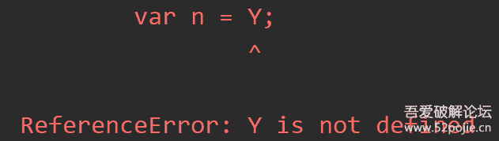

2023-08-10-10-15-54-image.png (13.16 KB, 下载次数: 0)

[href="forum.php?mod=attachment&aid=MjYzNDg1M3w1N2JlNTU5ZnwxNzkzNTczMjk4fDE2ODA4NnwxODIwMDU5&nothumb=yes" target="_blank"](https://www.52pojie.cn/forum.php?mod=attachment&aid=MjYzNDg1M3w1N2JlNTU5ZnwxNzkzNTczMjk4fDE2ODA4NnwxODIwMDU5&nothumb=yes)

25  
2023-8-11 16:24 上传

浏览器查看`Y`是字符串“1”，直接在代码中写固定就行。

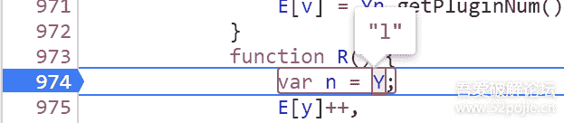

2023-08-10-10-16-34-image.png (22.99 KB, 下载次数: 1)

[href="forum.php?mod=attachment&aid=MjYzNDg1NXwzMjIyMWM0ZXwxNzkzNTczMjk4fDE2ODA4NnwxODIwMDU5&nothumb=yes" target="_blank"](https://www.52pojie.cn/forum.php?mod=attachment&aid=MjYzNDg1NXwzMjIyMWM0ZXwxNzkzNTczMjk4fDE2ODA4NnwxODIwMDU5&nothumb=yes)

26  
2023-8-11 16:24 上传

## 调用 `b` 函数

报这个错的原因是因为没有调用`b`函数，在`R`函数的开头调用运行一下`b`函数。

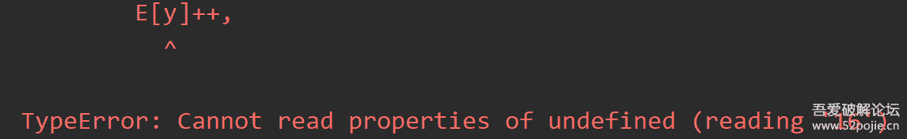

2023-08-10-10-23-01-image.png (14.96 KB, 下载次数: 2)

[href="forum.php?mod=attachment&aid=MjYzNDg1Nnw4NGJmYWU1MXwxNzkzNTczMjk4fDE2ODA4NnwxODIwMDU5&nothumb=yes" target="_blank"](https://www.52pojie.cn/forum.php?mod=attachment&aid=MjYzNDg1Nnw4NGJmYWU1MXwxNzkzNTczMjk4fDE2ODA4NnwxODIwMDU5&nothumb=yes)

27  
2023-8-11 16:25 上传

## `Un` 函数未定义

对象实例化`Un`函数是未定义的。去浏览器扣。

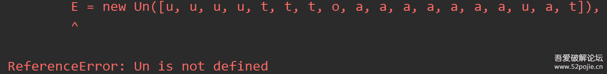

2023-08-10-10-25-10-image.png (15.01 KB, 下载次数: 1)


[href="forum.php?mod=attachment&aid=MjYzNDg1N3xiMDVkZWFkOHwxNzkzNTczMjk4fDE2ODA4NnwxODIwMDU5&nothumb=yes" target="_blank"](https://www.52pojie.cn/forum.php?mod=attachment&aid=MjYzNDg1N3xiMDVkZWFkOHwxNzkzNTczMjk4fDE2ODA4NnwxODIwMDU5&nothumb=yes)

28

2023-8-11 16:25 上传

## 浏览器扣下来的 `Un` 函数

```
  var Un = function() {
            var a = r[44]
              , o = r[45];
            function i(a) {
                this[e[53]] = a;
                for (var o = r[40], i = a[t[59]]; o >= t[62];
                return u
            }
            ,
            i[A + E][Xn(e[54], r[49], x)] = function(a) {
                for (var i = t[63], u = this[T + o + i], c = t[35], s = n[29], f = u[Xn(n[48], r[50])]; s  n[29]);this[s] = l >>> e[27]
                }
            }
            ,
            i
        }()
```

运行报错`Xn`未定义，分析代码的作用是把函数赋给对象，那么`i`后面跟着的肯定是字符串，把函数赋给某某对象原型链下面的某个属性。

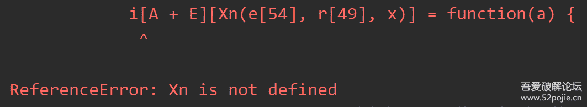

`2023-08-10-10-27-47-image.png` (16.44 KB, 下载次数: 1)

[href="forum.php?mod=attachment&aid=MjYzNDg1OXwxYWQ2OTFiMXwxNzkzNTczMjk4fDE2ODA4NnwxODIwMDU5&nothumb=yes" target="_blank"](https://www.52pojie.cn/forum.php?mod=attachment&aid=MjYzNDg1OXwxYWQ2OTFiMXwxNzkzNTczMjk4fDE2ODA4NnwxODIwMDU5&nothumb=yes)

29

2023-8-11 16:25 上传

替换即可。

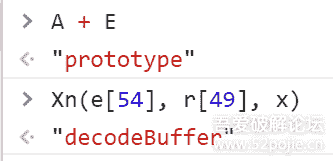

`2023-08-10-10-30-54-image.png` (17.26 KB, 下载次数: 1)

[href="forum.php?mod=attachment&aid=MjYzNDg2MHwxMjQxOTMzYXwxNzkzNTczMjk4fDE2ODA4NnwxODIwMDU5&nothumb=yes" target="_blank"](https://www.52pojie.cn/forum.php?mod=attachment&aid=MjYzNDg2MHwxMjQxOTMzYXwxNzkzNTczMjk4fDE2ODA4NnwxODIwMDU5&nothumb=yes)

30

2023-8-11 16:26 上传

运行报错`Gn`未定义，直接进入`Gn.serverTimeNow()`函数内部查看写了什么。

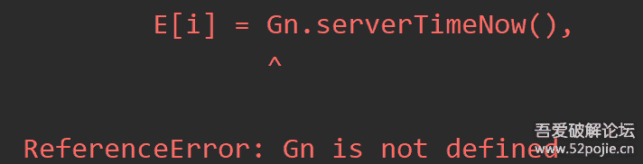

`2023-08-10-10-32-53-image.png` (14.79 KB, 下载次数: 1)

[href="forum.php?mod=attachment&aid=MjYzNDg2MXxjYjI5N2YwMHwxNzkzNTczMjk4fDE2ODA4NnwxODIwMDU5&nothumb=yes" target="_blank"](https://www.52pojie.cn/forum.php?mod=attachment&aid=MjYzNDg2MXxjYjI5N2YwMHwxNzkzNTczMjk4fDE2ODA4NnwxODIwMDU5&nothumb=yes)

31

2023-8-11 16:26 上传

## 浏览器扣下来的代码，看看这段代码有什么作用。

```
        function cn() {

            var n = (s,

            u,

            new v[84]);

            return typeof TOKEN_SERVER_TIME == x + T + C ? I[27] : (time = parseInt(TOKEN_SERVER_TIME),

            time)

        }
```

`cn()`函数有一个三元表达式，`TOKEN_SERVER_TIME`是数值，`x + T + C`是`"undefined"`，`TOKEN_SERVER_TIME == x + T + C`是`false`

所以执行`(time = parseInt(TOKEN_SERVER_TIME),time)`

这段函数的整体意思是将`TOKEN_SERVER_TIME`取整赋值给`time`，再把`time`值返回。

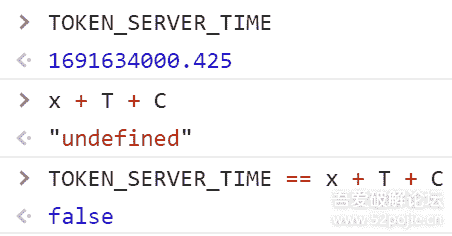

`2023-08-10-11-22-39-image.png` (23.33 KB, 下载次数: 0)

[href="forum.php?mod=attachment&aid=MjYzNDg2MnxlOTQwODdmY3wxNzkzNTczMjk4fDE2ODA4NnwxODIwMDU5&nothumb=yes" target="_blank"](https://www.52pojie.cn/forum.php?mod=attachment&aid=MjYzNDg2MnxlOTQwODdmY3wxNzkzNTczMjk4fDE2ODA4NnwxODIwMDU5&nothumb=yes)

32

2023-8-11 16:27 上传

`E[i] = Gn.serverTimeNow()`直接改写成`E[i] = parseInt(TOKEN_SERVER_TIME)`

运行代码报错`TOKEN_SERVER_TIME`未定义，在浏览器搜索`TOKEN_SERVER_TIME`。

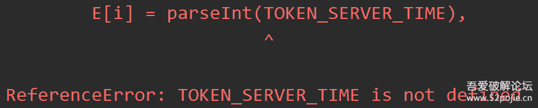

`2023-08-10-11-27-06-image.png` (18.14 KB, 下载次数: 1)

[href="forum.php?mod=attachment&aid=MjYzNDg2M3w4MDA2YjU5NnwxNzkzNTczMjk4fDE2ODA4NnwxODIwMDU5&nothumb=yes" target="_blank"](https://www.52pojie.cn/forum.php?mod=attachment&aid=MjYzNDg2M3w4MDA2YjU5NnwxNzkzNTczMjk4fDE2ODA4NnwxODIwMDU5&nothumb=yes)

33

2023-8-11 16:27 上传

在第一行就可以看到`TOKEN_SERVER_TIME`。直接扣下来


`2023-08-10-11-27-49-image.png` (7.02 KB, 下载次数: 1)

[href="forum.php?mod=attachment&aid=MjYzNDg2NHwwNmRlMDFjYXwxNzkzNTczMjk4fDE2ODA4NnwxODIwMDU5&nothumb=yes" target="_blank"](https://www.52pojie.cn/forum.php?mod=attachment&aid=MjYzNDg2NHwwNmRlMDFjYXwxNzkzNTczMjk4fDE2ODA4NnwxODIwMDU5&nothumb=yes)

34

2023-8-11 16:27 上传

## `C` 函数分析

运行报错`Wn`未定义。这段`C`函数代码要是直接去扣就入坑了，先看看这个`C`函数有什么作用。

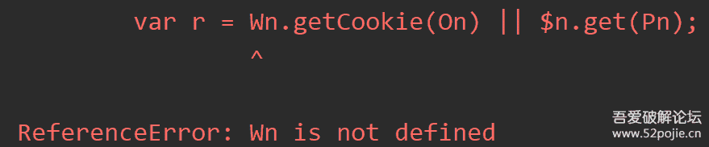

`2023-08-10-11-30-46-image.png` (15.84 KB, 下载次数: 1)

[href="forum.php?mod=attachment&aid=MjYzNDg2NXw4NjQ3NDkxMXwxNzkzNTczMjk4fDE2ODA4NnwxODIwMDU5&nothumb=yes" target="_blank"](https://www.52pojie.cn/forum.php?mod=attachment&aid=MjYzNDg2NXw4NjQ3NDkxMXwxNzkzNTczMjk4fDE2ODA4NnwxODIwMDU5&nothumb=yes)

35

2023-8-11 16:28 上传

第一行代码就是取cookie名为`v`的值，如果没取到cookie的`v`值就去取headers的`"hexin-v"`值。

```
var r = Wn.getCookie(On) || $n.get(Pn);
```

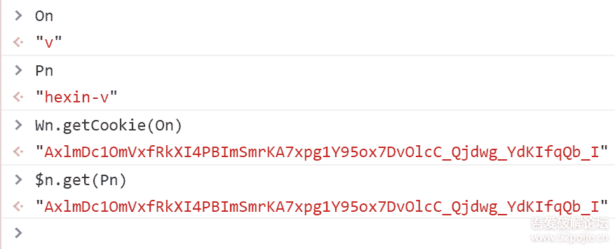

`2023-08-10-11-33-10-image.png` (49.33 KB, 下载次数: 2)

[href="forum.php?mod=attachment&aid=MjYzNDg2NnxjZjU4NmM4Y3wxNzkzNTczMjk4fDE2ODA4NnwxODIwMDU5&nothumb=yes" target="_blank"](https://www.52pojie.cn/forum.php?mod=attachment&aid=MjYzNDg2NnxjZjU4NmM4Y3wxNzkzNTczMjk4fDE2ODA4NnwxODIwMDU5&nothumb=yes)

36

2023-8-11 16:28 上传

一般情况下都不是第一次运行，那么他就会取得到前面cookie的`v`值。那么下面的`if`判断就会成立，就会执行。但是我们总不可能每次运行代码都去取他前面的cookie，那实在是太复杂了。假设，我是说假设。假设我每一次进去这个网站都是第一次，都取不到cookie的`v`值和headers的`"hexin-v"`。那么这段代码又是有什么样的作用呢。

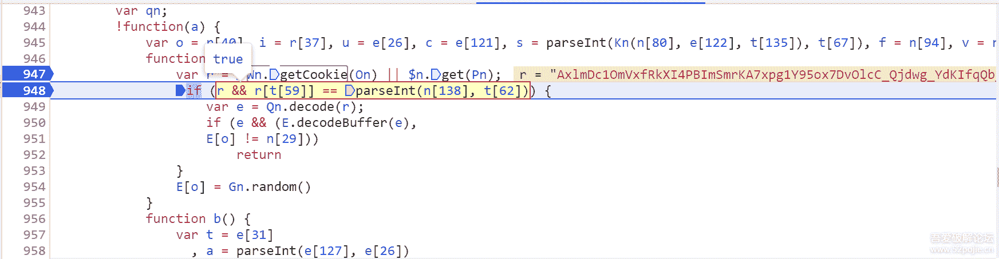

`2023-08-10-11-36-49-image.png` (116.41 KB, 下载次数: 1)

[href="forum.php?mod=attachment&aid=MjYzNDg2N3xkYWM4YjUxMnwxNzkzNTczMjk4fDE2ODA4NnwxODIwMDU5&nothumb=yes" target="_blank"](https://www.52pojie.cn/forum.php?mod=attachment&aid=MjYzNDg2N3xkYWM4YjUxMnwxNzkzNTczMjk4fDE2ODA4NnwxODIwMDU5&nothumb=yes)

37

2023-8-11 16:28 上传

cookie的`v`和headers的`"hexin-v"`都取不到值的话那么`if`里面的就是`null`。就直接执行后面的代码

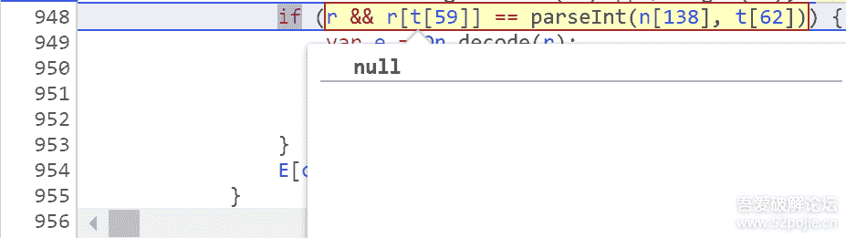

`2023-08-10-11-49-39-image.png` (31.88 KB, 下载次数: 0)

[href="forum.php?mod=attachment&aid=MjYzNDg2OHw0OTRmNzc4MHwxNzkzNTczMjk4fDE2ODA4NnwxODIwMDU5&nothumb=yes" target="_blank"](https://www.52pojie.cn/forum.php?mod=attachment&aid=MjYzNDg2OHw0OTRmNzc4MHwxNzkzNTczMjk4fDE2ODA4NnwxODIwMDU5&nothumb=yes)

38

2023-8-11 16:28 上传

最后`C`函数的代码就是直接改写成`E[o] = Gn.random()`

运行报错，直接扣`Gn.random()`


`2023-08-10-11-51-57-image.png` (14.24 KB, 下载次数: 1)

[href="forum.php?mod=attachment&aid=MjYzNDg2OXxiODY0ZDBkZnwxNzkzNTczMjk4fDE2ODA4NnwxODIwMDU5&nothumb=yes" target="_blank"](https://www.52pojie.cn/forum.php?mod=attachment&aid=MjYzNDg2OXxiODY0ZDBkZnwxNzkzNTczMjk4fDE2ODA4NnwxODIwMDU5&nothumb=yes)

39

2023-8-11 16:29 上传

```
        function rn() {

            var n = sn;

            return n = G,

            Math.random() * parseInt("11111111111111111111111111111111", 2) >>> 0

        }
```

`C`函数可以值改写成


# 浏览器指纹相关报错与代码改写分析

## 初始表达式与 `Dn` 报错

```
E[o] =Math.random() * parseInt("11111111111111111111111111111111", 2) >>> 0
```

### `Dn` 报错

`Dn` 报错

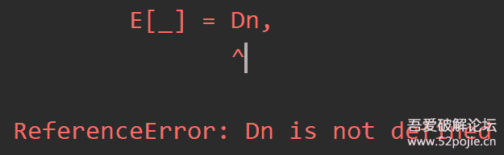

`2023-08-10-12-08-35-image.png` (13.1 KB, 下载次数: 1)

[附件下载](https://www.52pojie.cn/forum.php?mod=attachment&aid=MjYzNDg3MHw3YzcwN2YxNnwxNzkzNTczMjk4fDE2ODA4NnwxODIwMDU5&nothumb=yes)

40 2023-8-11 16:29 上传

### `Dn` 的数值

`Dn` 是数值 0


`2023-08-10-12-09-44-image.png` (1.48 KB, 下载次数: 1)

[附件下载](https://www.52pojie.cn/forum.php?mod=attachment&aid=MjYzNDg3MXw1YmJhYThmYnwxNzkzNTczMjk4fDE2ODA4NnwxODIwMDU5&nothumb=yes)

41 2023-8-11 16:30 上传

## `xn` 未定义与数值分析

### `xn` 未定义

`xn` 未定义

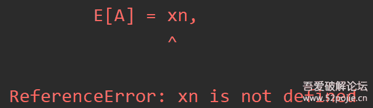

`2023-08-10-12-10-26-image.png` (13.08 KB, 下载次数: 1)

[附件下载](https://www.52pojie.cn/forum.php?mod=attachment&aid=MjYzNDg3MnxlYzM3NDcxNnwxNzkzNTczMjk4fDE2ODA4NnwxODIwMDU5&nothumb=yes)

42 2023-8-11 16:30 上传

### `xn` 的数值

`xn` 是数值 3


`2023-08-10-12-10-42-image.png` (1.51 KB, 下载次数: 0)

[附件下载](https://www.52pojie.cn/forum.php?mod=attachment&aid=MjYzNDg3M3w2Y2E0NTNmZXwxNzkzNTczMjk4fDE2ODA4NnwxODIwMDU5&nothumb=yes)

43 2023-8-11 16:30 上传

## `Gn` 报错与 `strhash` 分析

报了 `Gn` 的错。分析这段代码就是把浏览器指纹 `ua` 传进了 `strhash` 函数。可以直接取最后的值写固定。

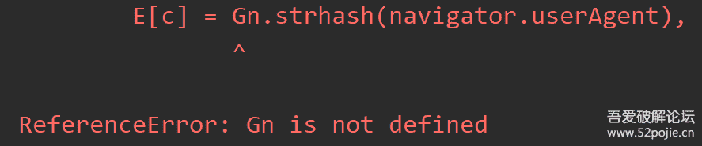

`2023-08-10-12-13-19-image.png` (15.82 KB, 下载次数: 1)

[附件下载](https://www.52pojie.cn/forum.php?mod=attachment&aid=MjYzNDg3NHw5NmRkNzVlY3wxNzkzNTczMjk4fDE2ODA4NnwxODIwMDU5&nothumb=yes)

44 2023-8-11 16:30 上传

`E[c] = 自己浏览器头strhash后的值`

后面的报错都是这几个值未定义。

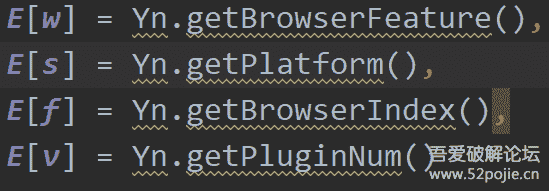

`2023-08-10-12-17-44-image.png` (25.31 KB, 下载次数: 2)

[附件下载](https://www.52pojie.cn/forum.php?mod=attachment&aid=MjYzNDg3NXxmM2NlYjk3NnwxNzkzNTczMjk4fDE2ODA4NnwxODIwMDU5&nothumb=yes)

45 2023-8-11 16:31 上传

## 浏览器特性相关函数

- `getBrowserFeature`—>获得浏览器特性
- `getPlatform`—>获取浏览器平台
- `getBrowserIndex`—>获取当前网页所在浏览器的索引
- `getPluginNum`—>获取当前网页或浏览器环境中已安装或可用的插件数量。

至于改写的话直接取最后的值就行了。

## `R` 函数报错与时间函数

`b` 函数都改完之后到 `R` 函数报错了。`Gn.serverTimeNow()` 在 `b` 函数就已经扣过了。

`Gn.serverTimeNow()`—>`parseInt(TOKEN_SERVER_TIME)`

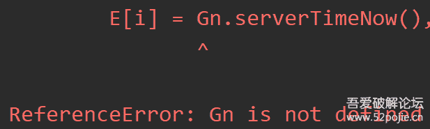

`2023-08-10-12-34-47-image.png` (15.33 KB, 下载次数: 0)

[附件下载](https://www.52pojie.cn/forum.php?mod=attachment&aid=MjYzNDg3NnxhY2ZjNmVkM3wxNzkzNTczMjk4fDE2ODA4NnwxODIwMDU5&nothumb=yes)

46 2023-8-11 16:31 上传

`Gn.timeNow()` 未定义

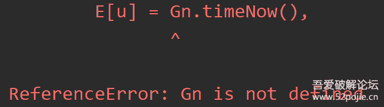

`2023-08-10-12-38-04-image.png` (14.7 KB, 下载次数: 1)

[附件下载](https://www.52pojie.cn/forum.php?mod=attachment&aid=MjYzNDg3N3xhNzZjMzBiOHwxNzkzNTczMjk4fDE2ODA4NnwxODIwMDU5&nothumb=yes)

47 2023-8-11 16:31 上传

进入 `Gn.timeNow()` 函数内部是个 `on` 函数

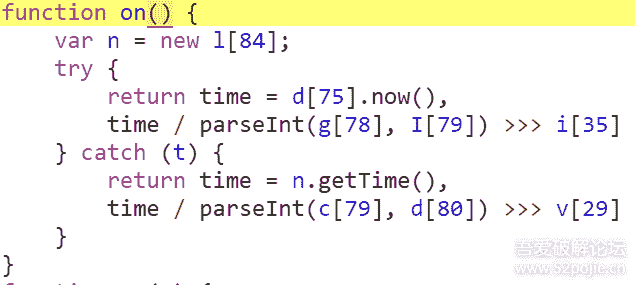

`2023-08-10-12-40-33-image.png` (42.23 KB, 下载次数: 1)

[附件下载](https://www.52pojie.cn/forum.php?mod=attachment&aid=MjYzNDg3OHxhOWVkODA4ZXwxNzkzNTczMjk4fDE2ODA4NnwxODIwMDU5&nothumb=yes)

48 2023-8-11 16:31 上传

`on` 函数的作用就是取当前时间戳除以 1000 再无符号右移 0 位。

### 改写后的代码

```
E[u] = Date.now()/ 1000
```

后面的代码都是未定义的

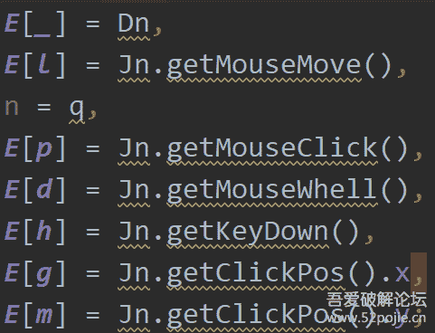

`2023-08-10-12-44-46-image.png` (37.69 KB, 下载次数: 1)

[附件下载](https://www.52pojie.cn/forum.php?mod=attachment&aid=MjYzNDg3OXw4MTMyY2ExMnwxNzkzNTczMjk4fDE2ODA4NnwxODIwMDU5&nothumb=yes)

49 2023-8-11 16:32 上传

`Dn` 是数值 0，`n` 是字符串 `"DOMMous"`

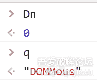

`2023-08-10-12-45-24-image.png` (10.32 KB, 下载次数: 0)

[附件下载](https://www.52pojie.cn/forum.php?mod=attachment&aid=MjYzNDg4MHwzMzlmYzRkNnwxNzkzNTczMjk4fDE2ODA4NnwxODIwMDU5&nothumb=yes)

50 2023-8-11 16:32 上传

## 鼠标与键盘事件相关函数

- `getMouseMove`—>获取鼠标当前的横坐标和纵坐标
- `getMouseClick`—>获取鼠标点击时的横坐标和纵坐标，以及所点击的按钮
- `getMouseWhell`—>获取滚轮事件的信息
- `getKeyDown`—>获取按键事件的信息
- `getClickPos`—>获取鼠标点击的坐标，然后进行相应的操作，比如记录点击位置或者根据点击位置执行特定的逻辑。

直接取最后运行完的值。

## `Qn.encode` 未定义与 `Qn` 对象补全

运行 `Qn.encode` 未定义

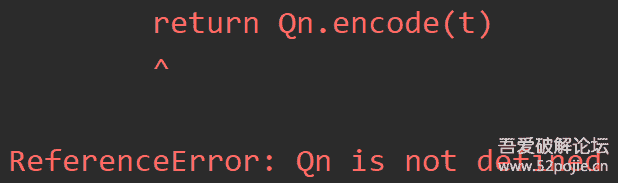

`2023-08-10-13-56-34-image.png` (14.84 KB, 下载次数: 2)

[附件下载](https://www.52pojie.cn/forum.php?mod=attachment&aid=MjYzNDg4MXw5ZmIwZTZkMnwxNzkzNTczMjk4fDE2ODA4NnwxODIwMDU5&nothumb=yes)

51 2023-8-11 16:32 上传

进入函数内部，`Qn` 对象总共有 4 个方法，直接把 `Qn` 对象补齐。

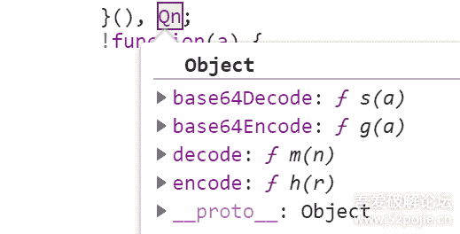

`2023-08-10-13-58-01-image.png` (36.8 KB, 下载次数: 0)

[附件下载](https://www.52pojie.cn/forum.php?mod=attachment&aid=MjYzNDg4MnwyYjZiMmQ1N3wxNzkzNTczMjk4fDE2ODA4NnwxODIwMDU5&nothumb=yes)

52 2023-8-11 16:33 上传

```
var Qn;
!function(a) {
            var o = e[55]
              , i = n[49]
              , u = n[50]
              , c = r[52];
            function s(a) {
                var o, i, u;
                o = i = u = t;
                var c, s, f;
                c = s = f = r;
                var v, p, d;
                v = p = d = e;
                var h, g, m;
                h = g = m = n;
                for (var w = g[29], I = (en,
                on,
                a[d[56]]), _ = []; w > parseInt(Vn(f[53], Tn), d[61]), y >> c[51] & parseInt(Xn(X, p[62]), g[51]), y & parseInt(u[64], h[52]))
                }
                return _
            }
            function f(n, t, a, i, u) {
                for (var c = n[o + C]; t > parseInt(e[65], n[53])), v.charAt(s >> parseInt(n[54], t[62]) & parseInt(Xn(e[66], r[58], S), e[61])), v.charAt(s >> r[59] & parseInt(B + i, t[46])), v.charAt(s & parseInt(n[55], r[55])))
                }
                return c.join(Vn(r[26], n[56]))
            }
            function m(n) {
                var t, a, o;
                t = a = o = r;
                var i, u, v;
                i = u = v = e;
                var l = s(n);
                if (l[u[27]] != c)
                    return error = i[67],
                    void 0;
                var p = l[t[37]]
                  , h = [];
                return f(l, +a[60], h, +i[27], p),
                d(h) == p ? h : void 0
            }
            a[Vn(r[61])] = g,
            a[Hn($n, n[57], t[68])] = s,
            a[k + u] = h,
            a[O + S] = m
        }(Qn || (Qn = {}));
```

### 运行报错

运行报错

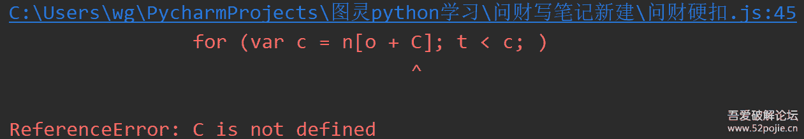

`2023-08-10-15-33-00-image.png` (27.53 KB, 下载次数: 2)


## 附件与截图记录

### 附件 53
- 下载链接：[附件 53](https://www.52pojie.cn/forum.php?mod=attachment&aid=MjYzNDg4M3xmMTUwOWQ0ZHwxNzkzNTczMjk4fDE2ODA4NnwxODIwMDU5&nothumb=yes)
- 上传时间：2023-8-11 16:33
- 说明：在浏览器打印`o+C`是字符串`"length"`，直接替换
- 图片：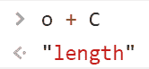
- 文件：`2023-08-10-15-33-42-image.png`（2.63 KB，下载次数：1）

### 附件 54
- 下载链接：[附件 54](https://www.52pojie.cn/forum.php?mod=attachment&aid=MjYzNDg4NHw5YTAzYTY5Y3wxNzkzNTczMjk4fDE2ODA4NnwxODIwMDU5&nothumb=yes)
- 上传时间：2023-8-11 16:33
- 图片：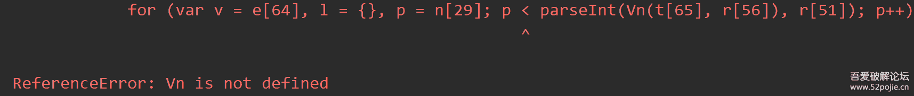
- 文件：`2023-08-10-14-27-52-image.png`（19.46 KB，下载次数：1）

### 附件 55
- 下载链接：[附件 55](https://www.52pojie.cn/forum.php?mod=attachment&aid=MjYzNDg4NXxjMDY4ZDA3Y3wxNzkzNTczMjk4fDE2ODA4NnwxODIwMDU5&nothumb=yes)
- 上传时间：2023-8-11 16:33
- 说明：在浏览器打印`Vn(r[61])`是字符串`"100"`，直接替换
- 图片：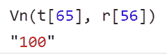
- 文件：`2023-08-10-14-26-33-image.png`（3.83 KB，下载次数：2）

### 附件 56
- 下载链接：[附件 56](https://www.52pojie.cn/forum.php?mod=attachment&aid=MjYzNDg4NnxkNzllNzRmNXwxNzkzNTczMjk4fDE2ODA4NnwxODIwMDU5&nothumb=yes)
- 上传时间：2023-8-11 16:34
- 说明：后面几个都是未定义的，在浏览器找到对应的值替换
- 图片：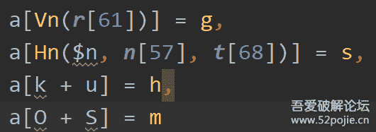
- 文件：`2023-08-10-14-28-29-image.png`（18.83 KB，下载次数：2）

### 附件 57
- 下载链接：[附件 57](https://www.52pojie.cn/forum.php?mod=attachment&aid=MjYzNDg4N3wzMzliY2IyYnwxNzkzNTczMjk4fDE2ODA4NnwxODIwMDU5&nothumb=yes)
- 上传时间：2023-8-11 16:34
- 图片：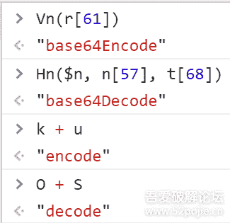
- 文件：`2023-08-10-14-29-47-image.png`（27.26 KB，下载次数：1）

### 附件 58
- 下载链接：[附件 58](https://www.52pojie.cn/forum.php?mod=attachment&aid=MjYzNDg4OHw0NmYwN2Q4MHwxNzkzNTczMjk4fDE2ODA4NnwxODIwMDU5&nothumb=yes)
- 上传时间：2023-8-11 16:34


```
a["base64Encode"] = g,
a["base64Decode"] = s,
a["encode"] = h,
a["decode"] = m
```

直接拿运行之后的结果进行替换


2023-08-10-14-31-16-image.png (16.29 KB, 下载次数: 0)

[href="forum.php?mod=attachment&aid=MjYzNDg4OXw5ODEwNjY0YXwxNzkzNTczMjk4fDE2ODA4NnwxODIwMDU5&nothumb=yes" target="_blank"](https://www.52pojie.cn/forum.php?mod=attachment&aid=MjYzNDg4OXw5ODEwNjY0YXwxNzkzNTczMjk4fDE2ODA4NnwxODIwMDU5&nothumb=yes)

59

2023-8-11 16:34 上传

`Xn(q, t[66], In)—>"ff"`


2023-08-10-14-32-10-image.png (9.73 KB, 下载次数: 0)

[href="forum.php?mod=attachment&aid=MjYzNDg5MHxlYWQ1MzUxOXwxNzkzNTczMjk4fDE2ODA4NnwxODIwMDU5&nothumb=yes" target="_blank"](https://www.52pojie.cn/forum.php?mod=attachment&aid=MjYzNDg5MHxlYWQ1MzUxOXwxNzkzNTczMjk4fDE2ODA4NnwxODIwMDU5&nothumb=yes)

60

2023-8-11 16:35 上传


2023-08-10-14-33-58-image.png (13.71 KB, 下载次数: 2)

[href="forum.php?mod=attachment&aid=MjYzNDg5MXxhZDg0NjVkYXwxNzkzNTczMjk4fDE2ODA4NnwxODIwMDU5&nothumb=yes" target="_blank"](https://www.52pojie.cn/forum.php?mod=attachment&aid=MjYzNDg5MXxhZDg0NjVkYXwxNzkzNTczMjk4fDE2ODA4NnwxODIwMDU5&nothumb=yes)

61

2023-8-11 16:35 上传

`G—>"w"`


2023-08-10-14-34-20-image.png (1.77 KB, 下载次数: 0)

[href="forum.php?mod=attachment&aid=MjYzNDg5MnwzM2Q2NThjZnwxNzkzNTczMjk4fDE2ODA4NnwxODIwMDU5&nothumb=yes" target="_blank"](https://www.52pojie.cn/forum.php?mod=attachment&aid=MjYzNDg5MnwzM2Q2NThjZnwxNzkzNTczMjk4fDE2ODA4NnwxODIwMDU5&nothumb=yes)

62

2023-8-11 16:35 上传


2023-08-10-14-35-15-image.png (21.07 KB, 下载次数: 1)

[href="forum.php?mod=attachment&aid=MjYzNDg5M3xhYWMzZDY4N3wxNzkzNTczMjk4fDE2ODA4NnwxODIwMDU5&nothumb=yes" target="_blank"](https://www.52pojie.cn/forum.php?mod=attachment&aid=MjYzNDg5M3xhYWMzZDY4N3wxNzkzNTczMjk4fDE2ODA4NnwxODIwMDU5&nothumb=yes)

63

2023-8-11 16:36 上传

`Xn(e[66], r[58], S)—>"3f"`


2023-08-10-14-35-26-image.png (11.16 KB, 下载次数: 2)

[href="forum.php?mod=attachment&aid=MjYzNDg5NHw0Y2MwNTY3ZXwxNzkzNTczMjk4fDE2ODA4NnwxODIwMDU5&nothumb=yes" target="_blank"](https://www.52pojie.cn/forum.php?mod=attachment&aid=MjYzNDg5NHw0Y2MwNTY3ZXwxNzkzNTczMjk4fDE2ODA4NnwxODIwMDU5&nothumb=yes)

64

2023-8-11 16:36 上传


2023-08-10-14-36-16-image.png (20.84 KB, 下载次数: 1)

[href="forum.php?mod=attachment&aid=MjYzNDg5NXxmZmM5ODlmY3wxNzkzNTczMjk4fDE2ODA4NnwxODIwMDU5&nothumb=yes" target="_blank"](https://www.52pojie.cn/forum.php?mod=attachment&aid=MjYzNDg5NXxmZmM5ODlmY3wxNzkzNTczMjk4fDE2ODA4NnwxODIwMDU5&nothumb=yes)

65

2023-8-11 16:36 上传

`B + i—>"3f"`


2023-08-10-14-36-26-image.png (1.94 KB, 下载次数: 2)

[href="forum.php?mod=attachment&aid=MjYzNDg5NnxhNTFjNDg5ZHwxNzkzNTczMjk4fDE2ODA4NnwxODIwMDU5&nothumb=yes" target="_blank"](https://www.52pojie.cn/forum.php?mod=attachment&aid=MjYzNDg5NnxhNTFjNDg5ZHwxNzkzNTczMjk4fDE2ODA4NnwxODIwMDU5&nothumb=yes)

66

2023-8-11 16:36 上传


2023-08-10-14-36-55-image.png (14.97 KB, 下载次数: 3)

[href="forum.php?mod=attachment&aid=MjYzNDg5N3xkMzZiNGNjOHwxNzkzNTczMjk4fDE2ODA4NnwxODIwMDU5&nothumb=yes" target="_blank"](https://www.52pojie.cn/forum.php?mod=attachment&aid=MjYzNDg5N3xkMzZiNGNjOHwxNzkzNTczMjk4fDE2ODA4NnwxODIwMDU5&nothumb=yes)

67

2023-8-11 16:37 上传

`Vn(r[26], n[56])—>""`


2023-08-10-14-37-45-image.png (9.46 KB, 下载次数: 2)

[href="forum.php?mod=attachment&aid=MjYzNDg5OHw5MDVhODFhMnwxNzkzNTczMjk4fDE2ODA4NnwxODIwMDU5&nothumb=yes" target="_blank"](https://www.52pojie.cn/forum.php?mod=attachment&aid=MjYzNDg5OHw5MDVhODFhMnwxNzkzNTczMjk4fDE2ODA4NnwxODIwMDU5&nothumb=yes)

68

2023-8-11 16:37 上传

代码再次执行，值便出来了。


2023-08-10-15-34-32-image.png (14.88 KB, 下载次数: 0)

[href="forum.php?mod=attachment&aid=MjYzNDg5OXw4ZTA5OThlOXwxNzkzNTczMjk4fDE2ODA4NnwxODIwMDU5&nothumb=yes" target="_blank"](https://www.52pojie.cn/forum.php?mod=attachment&aid=MjYzNDg5OXw4ZTA5OThlOXwxNzkzNTczMjk4fDE2ODA4NnwxODIwMDU5&nothumb=yes)

69

2023-8-11 16:37 上传

带上值去请求一遍。手机验证码发送成功


2023-08-10-15-35-18-image.png (10.66 KB, 下载次数: 1)

[href="forum.php?mod=attachment&aid=MjYzNDkwMHxkNjQ2ZDFlNnwxNzkzNTczMjk4fDE2ODA4NnwxODIwMDU5&nothumb=yes" target="_blank"](https://www.52pojie.cn/forum.php?mod=attachment&aid=MjYzNDkwMHxkNjQ2ZDFlNnwxNzkzNTczMjk4fDE2ODA4NnwxODIwMDU5&nothumb=yes)

70

2023-8-11 16:38 上传

## 2> hexin-v(js-dom补环境)

在网上看到一堆文章都又说直接用`js-dom`包补`document`和`window`两个环境。

直接把整个js文件复制下来


2023-08-11-10-21-57-image.png (18.49 KB, 下载次数: 0)

[href="forum.php?mod=attachment&aid=MjYzNDkwMXwwNTc3MzI2OXwxNzkzNTczMjk4fDE2ODA4NnwxODIwMDU5&nothumb=yes" target="_blank"](https://www.52pojie.cn/forum.php?mod=attachment&aid=MjYzNDkwMXwwNTc3MzI2OXwxNzkzNTczMjk4fDE2ODA4NnwxODIwMDU5&nothumb=yes)

71

2023-8-11 16:38 上传

定义一个全局变量接受`v`的值,方便后面导出。

运行代码报`window`未定义


2023-08-11-10-24-29-image.png (15.27 KB, 下载次数: 2)

[href="forum.php?mod=attachment&aid=MjYzNDkwMnwzYTQ5OTM4YnwxNzkzNTczMjk4fDE2ODA4NnwxODIwMDU5&nothumb=yes" target="_blank"](https://www.52pojie.cn/forum.php?mod=attachment&aid=MjYzNDkwMnwzYTQ5OTM4YnwxNzkzNTczMjk4fDE2ODA4NnwxODIwMDU5&nothumb=yes)

72

2023-8-11 16:38 上传

导包

```
const jsdom = require('jsdom')
const {JSDOM} = jsdom;
const {window} = new JSDOM(``);
```

运行代码报`document`未定义


2023-08-11-10-25-42-image.png (15.6 KB, 下载次数: 1)

[href="forum.php?mod=attachment&aid=MjYzNDkwM3wzYzZlNjAzOXwxNzkzNTczMjk4fDE2ODA4NnwxODIwMDU5&nothumb=yes" target="_blank"](https://www.52pojie.cn/forum.php?mod=attachment&aid=MjYzNDkwM3wzYzZlNjAzOXwxNzkzNTczMjk4fDE2ODA4NnwxODIwMDU5&nothumb=yes)

73

2023-8-11 16:38 上传

```
const document = window.document
```

运行代码报`navigator`未定义


2023-08-11-10-26-33-image.png (16.14 KB, 下载次数: 0)

[href="forum.php?mod=attachment&aid=MjYzNDkwNHxjYzViNWNmYXwxNzkzNTczMjk4fDE2ODA4NnwxODIwMDU5&nothumb=yes" target="_blank"](https://www.52pojie.cn/forum.php?mod=attachment&aid=MjYzNDkwNHxjYzViNWNmYXwxNzkzNTczMjk4fDE2ODA4NnwxODIwMDU5&nothumb=yes)

74

2023-8-11 16:39 上传

```
const navigator = window.navigator
```


2023-08-11-10-27-19-image.png (189.92 KB, 下载次数: 2)

[href="forum.php?mod=attachment&aid=MjYzNDkwNXxiNTg1MjcyM3wxNzkzNTczMjk4fDE2ODA4NnwxODIwMDU5&nothumb=yes" target="_blank"](https://www.52pojie.cn/forum.php?mod=attachment&aid=MjYzNDkwNXxiNTg1MjcyM3wxNzkzNTczMjk4fDE2ODA4NnwxODIwMDU5&nothumb=yes)

75

2023-8-11 16:39 上传

打印值出来了，报错不用管。直接用`py`调用。也是成功的！


2023-08-11-10-30-21-image.png (10.58 KB, 下载次数: 0)

[href="forum.php?mod=attachment&aid=MjYzNDkwNnw3ZjFlODViM3wxNzkzNTczMjk4fDE2ODA4NnwxODIwMDU5&nothumb=yes" target="_blank"](https://www.52pojie.cn/forum.php?mod=attachment&aid=MjYzNDkwNnw3ZjFlODViM3wxNzkzNTczMjk4fDE2ODA4NnwxODIwMDU5&nothumb=yes)

76

2023-8-11 16:39 上传

## 2> 结尾

本文章仅供学习交流使用，如有侵权，联系我删除。
