# [原创] PE文件解析基础

- 原帖: https://www.52pojie.cn/forum.php?mod=viewthread&tid=1820306
- 抓取时间: 2026-11-01T22:48:16

## PE加载过程

硬盘文件->加载到内存(`FileBuffer`)->PE Loader加载并拉伸->`ImageBuffer`(起始位置`ImageBase`)

## DOS头

从0x00~0x3f共0x40字节固定大小

```c
typedef struct _IMAGE_DOS_HEADER {      // DOS .EXE header
    WORD   e_magic;                     // Magic number
    WORD   e_cblp;                      // Bytes on last page of file
    WORD   e_cp;                        // Pages in file
    WORD   e_crlc;                      // Relocations
    WORD   e_cparhdr;                   // Size of header in paragraphs
    WORD   e_minalloc;                  // Minimum extra paragraphs needed
    WORD   e_maxalloc;                  // Maximum extra paragraphs needed
    WORD   e_ss;                        // Initial (relative) SS value
    WORD   e_sp;                        // Initial SP value
    WORD   e_csum;                      // Checksum
    WORD   e_ip;                        // Initial IP value
    WORD   e_cs;                        // Initial (relative) CS value
    WORD   e_lfarlc;                    // File address of relocation table
    WORD   e_ovno;                      // Overlay number
    WORD   e_res[4];                    // Reserved words
    WORD   e_oemid;                     // OEM identifier (for e_oeminfo)
    WORD   e_oeminfo;                   // OEM information; e_oemid specific
    WORD   e_res2[10];                  // Reserved words
    LONG   e_lfanew;                    // File address of new exe header
  } IMAGE_DOS_HEADER, *PIMAGE_DOS_HEADER;
```

`e_magic`: pe指纹 `"MZ"`

`e_lfanew`: pe头的偏移

其他成员无关紧要

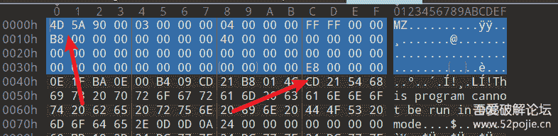

1 dos头.png (37.15 KB, 下载次数: 3)

[href="forum.php?mod=attachment&aid=MjYzNTA4NnxiMjdhYWQxN3wxNzkzNTczMjkzfDE2ODA4NnwxODIwMzA2&nothumb=yes" target="_blank"](https://www.52pojie.cn/forum.php?mod=attachment&aid=MjYzNTA4NnxiMjdhYWQxN3wxNzkzNTczMjkzfDE2ODA4NnwxODIwMzA2&nothumb=yes)

2023-8-12 11:13 上传

### DOS Stub

从dos头到pe头之间是dos存根

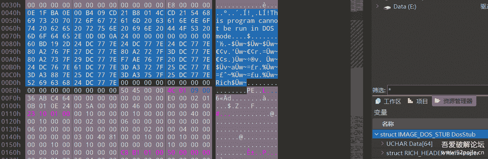

2 dos存根.png (90.53 KB, 下载次数: 2)

[href="forum.php?mod=attachment&aid=MjYzNTA4OXxjYTc1ODU4NnwxNzkzNTczMjkzfDE2ODA4NnwxODIwMzA2&nothumb=yes" target="_blank"](https://www.52pojie.cn/forum.php?mod=attachment&aid=MjYzNTA4OXxjYTc1ODU4NnwxNzkzNTczMjkzfDE2ODA4NnwxODIwMzA2&nothumb=yes)

2023-8-12 11:14 上传

dos存根的数据基本没用,主要是在DOS环境运行时执行

我们可以用DosBox的DOS环境运行exe程序

运行结果

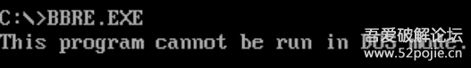

1.2 dos运行exe.png (14.11 KB, 下载次数: 2)

[href="forum.php?mod=attachment&aid=MjYzNTA4N3w1NTRiM2U3M3wxNzkzNTczMjkzfDE2ODA4NnwxODIwMzA2&nothumb=yes" target="_blank"](https://www.52pojie.cn/forum.php?mod=attachment&aid=MjYzNTA4N3w1NTRiM2U3M3wxNzkzNTczMjkzfDE2ODA4NnwxODIwMzA2&nothumb=yes)

2023-8-12 11:13 上传

查看DosStub处代码

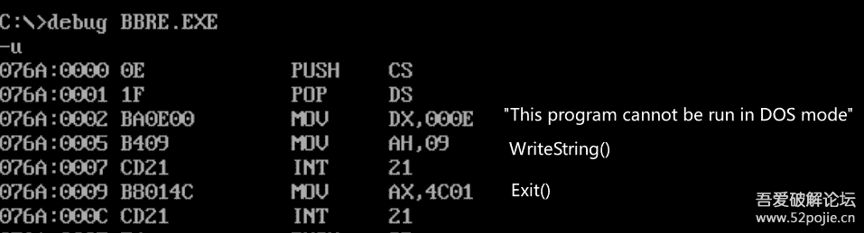

1.3 dos运行exe.png (52.84 KB, 下载次数: 2)

[href="forum.php?mod=attachment&aid=MjYzNTA4OHwzNjRjYzcxYnwxNzkzNTczMjkzfDE2ODA4NnwxODIwMzA2&nothumb=yes" target="_blank"](https://www.52pojie.cn/forum.php?mod=attachment&aid=MjYzNTA4OHwzNjRjYzcxYnwxNzkzNTczMjkzfDE2ODA4NnwxODIwMzA2&nothumb=yes)

2023-8-12 11:14 上传

## NT/PE头

PE文件头由PE文件头标识,标准PE头,扩展PE头三部分组成

32位

```c
typedef struct _IMAGE_NT_HEADERS {

  DWORD                   Signature;

  IMAGE_FILE_HEADER       FileHeader;//20字节

  IMAGE_OPTIONAL_HEADER32 OptionalHeader;//32位0xE0字节 64位0xF0字节

} IMAGE_NT_HEADERS32, *PIMAGE_NT_HEADERS32;
```

64位

```c
typedef struct _IMAGE_NT_HEADERS64 {
  DWORD                   Signature;        
  IMAGE_FILE_HEADER       FileHeader;
  IMAGE_OPTIONAL_HEADER64 OptionalHeader;
} IMAGE_NT_HEADERS64, *PIMAGE_NT_HEADERS64;
```

`Signature`=50 40 00 00 `'PE\0\0'`

`FileHeader`是标准PE头

`OptionalHeader`是可选PE头 但是非常重要

### 标准PE头/文件头

占20字节 在pe文件头标识后即可找到

```c
typedef struct _IMAGE_FILE_HEADER {

  WORD  Machine; //程序允许的cpu型号,为0代表所有        

  DWORD NumberOfSections; //区段数量

  DWORD TimeDateStamp; //时间戳

  DWORD PointerToSymbolTable;

  DWORD NumberOfSymbols;

  WORD  SizeOfOptionalHeader; //可选pe头大小 32位默认E0 64位默认F0

  WORD  Characteristics; //文件属性,每个位有不同含义

} IMAGE_FILE_HEADER, *PIMAGE_FILE_HEADER;
```

重要成员

`Machine`                //cpu型号

`NumberOfSections`        //节区数

`SizeOfOptionalHeader`        //可选PE头大小 有默认值,可修改

`WORD Characteristics;` //属性

### 可选PE头/扩展头

```c
typedef struct _IMAGE_OPTIONAL_HEADER {
    //
    // Standard fields.
    //

    WORD    Magic;                                                //用于标识32/64位文件 PE32: 10B PE64: 20B
    BYTE    MajorLinkerVersion;
    BYTE    MinorLinkerVersion;
    DWORD   SizeOfCode;                                        //所有代码段的总大小 按照FileAlignment对齐后的大小 编译器填入 无用
    DWORD   SizeOfInitializedData;                //所有已初始化数据区块的大小 按文件对齐 编译器填入 没用(可改)
    DWORD   SizeOfUninitializedData;        //所有未初始化数据区块的大小 按文件对齐 编译器填入 没用(可改)
    DWORD   AddressOfEntryPoint;                //程序入口OEP RVA
    DWORD   BaseOfCode;                                   //代码区起始地址
    DWORD   BaseOfData;                                   //数据区起始地址

    //
    // NT additional fields.
    //

    DWORD   ImageBase;                                                //内存镜像基址(程序默认载入基地址)
    DWORD   SectionAlignment;                                 //内存中对齐大小
    DWORD   FileAlignment;                                         //文件的对齐大小(存储在硬盘中的对齐值)
    WORD    MajorOperatingSystemVersion;
    WORD    MinorOperatingSystemVersion;
    WORD    MajorImageVersion;
    WORD    MinorImageVersion;
    WORD    MajorSubsystemVersion;
    WORD    MinorSubsystemVersion;
    DWORD   Win32VersionValue;
    DWORD   SizeOfImage;                                        //内存中整个PE文件的映射的尺寸,可比实际值大,必须是SectionAlignment的整数倍
    DWORD   SizeOfHeaders;                                         //所有的头加上节表文件对齐之后的值
    DWORD   CheckSum;                                                //映像校验和,一些系统.dll文件有要求,判断是否被修改
    WORD    Subsystem;                                                
    WORD    DllCharacteristics;                                //文件特性,不是针对DLL文件的,16进制转换2进制可以根据属性对应的表格得到相应的属性
    DWORD   SizeOfStackReserve;
    DWORD   SizeOfStackCommit;
    DWORD   SizeOfHeapReserve;
    DWORD   SizeOfHeapCommit;
    DWORD   LoaderFlags;
    DWORD   NumberOfRvaAndSizes;
    IMAGE_DATA_DIRECTORY DataDirectory[IMAGE_NUMBEROF_DIRECTORY_ENTRIES]; //数据目录表,结构体数组
} IMAGE_OPTIONAL_HEADER32, *PIMAGE_OPTIONAL_HEADER32;
```

重要成员:

`AddressOfEntryPoint;`         //程序入口OEP

`ImageBase;`                            //内存镜像地址

`SectionAlignment;`                 //内存对齐大小

`FileAlignment;`                         //文件对齐大小

`SizeOfImage;`                         //文件在内存中的大小(按照SectiionAlignment对齐后)

`SizeOfHeaders;`                        //DOS头+NT头+标准PE头+可选PE头+节表 按照文件对齐后的总大小

`NumberOfRvaAndSizes`                 //数据目录表个数

`DataDirectory[IMAGE_NUMBEROF_DIRECTORY_ENTRIES]`        //数据目录表 存放导出表导入表等的地址和大小

### 节表

紧跟在可选头后面的就是节表,PE中的节表以数组形式存在

```c
typedef struct _IMAGE_SECTION_HEADER {
    BYTE    Name[IMAGE_SIZEOF_SHORT_NAME];           //8字节节区名
    unio{        //内存中的大小,该节在没有对齐之前的真实尺寸,该值可以不准确
            DWORD   PhysicalAddress;
            DWORD   VirtualSize;
    } Misc;
    DWORD   VirtualAddress;                            //内存中的偏移地址 加上ImageBase才是真实地址
    DWORD   SizeOfRawData;                                   //节在文件中对齐后的大小
    DWORD   PointerToRawData;                           //节区在文件中的偏移
    DWORD   PointerToRelocations;
    DWORD   PointerToLinenumbers;
    WORD    NumberOfRelocations;
    WORD    NumberOfLinenumbers;
    DWORD   Characteristics;                           //节的属性
} IMAGE_SECTION_HEADER, *PIMAGE_SECTION_HEADER;
```

重要成员

`Name[IMAGE_SIZEOF_SHORT_NAME];` 节区名

`VirtualSize;`                节区大小

`VirtualAddress;`        节区起始地址

`PointerToRawData;`        节区文件偏移

`Characteristics;`                节区属性

#### 打印节表

```c
    //打印节表

    void showSectionHeaders() {

        printf("\n----------SectionHeaders----------\n");

        for (DWORD i = 0; i 
```

运行结果


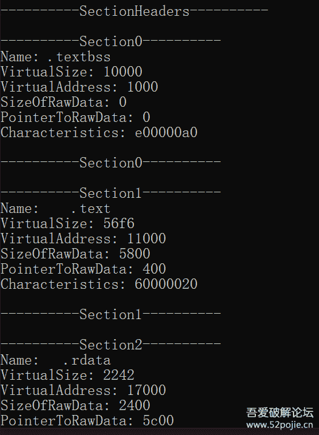

`55 打印节表.png`（53 KB，下载次数: 2）

<https://www.52pojie.cn/forum.php?mod=attachment&aid=MjYzNTA5MXw0NDY5N2I2YXwxNzkzNTczMjkzfDE2ODA4NnwxODIwMzA2&nothumb=yes>

2023-8-12 11:15 上传

# 3> 代码段空白区添加代码

## 4> 基本原理

在代码区添加硬编码（汇编代码的十六进制形式），修改 `oep` 使得程序开始执行时执行注入的代码。

最后再跳转回原始的 `oep`。

- 获取函数地址
- 计算偏移
- 代码区手动添加代码
- 修改 `oep` 指向 shellcode
- 执行完 shellcode 后跳回 `oep`

注意：需要先关闭程序的随机基址，在可选头的 `DllCharacteristics` 中，将 `0x40` 改为 `0x00` 即可。

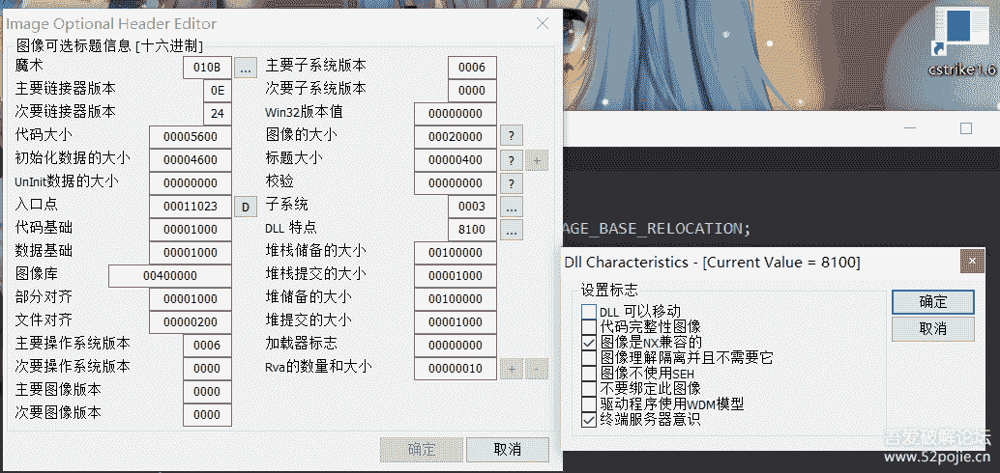

`6 取消勾选Dll可移动.png`（103.24 KB，下载次数: 1）

<https://www.52pojie.cn/forum.php?mod=attachment&aid=MjYzNTA5MnxjMzY2Y2RmMnwxNzkzNTczMjkzfDE2ODA4NnwxODIwMzA2&nothumb=yes>

2023-8-12 11:15 上传

## 4> 案例分析

示例程序代码

```
#include 
#include 

int main() {

    MessageBox(0, L"HelloWorld!", L"Title", 0);
    return 0;
}
```

运行后会弹出 HelloWorld 弹窗，这里仅做简单注入，四个参数全部压入 `0`，此时会弹出错误窗口。

分析：

- 首先在 `.text` 段中找一段空白代码区用于写入硬编码

这里选取 `59A0` 处开始写入，`5A00` 开始是 `.rdata` 段。

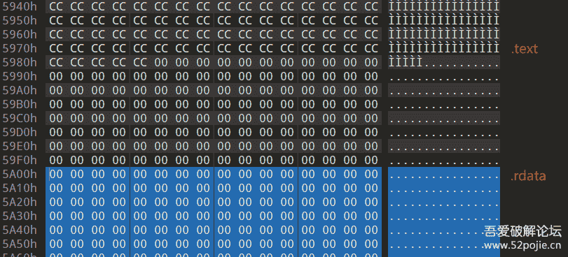

`7 寻找空白text代码区.png`（37.04 KB，下载次数: 1）

<https://www.52pojie.cn/forum.php?mod=attachment&aid=MjYzNTA5M3w3MTQ2ZDU4NXwxNzkzNTczMjkzfDE2ODA4NnwxODIwMzA2&nothumb=yes>

2023-8-12 11:15 上传

- 确定硬编码

首先是四个参数 `6A 00 6A 00 6A 00 6A 00`（4 个 `push 0`）。

然后是 `call MessageBox` 和 `jmp oep`。

`MessageBox` 地址可以运行 `od`，输入 `bp MessageBoxA` 下断点找到。

`OEP` 为 `411023`（`ImageBase=400000 ep=11023`）。

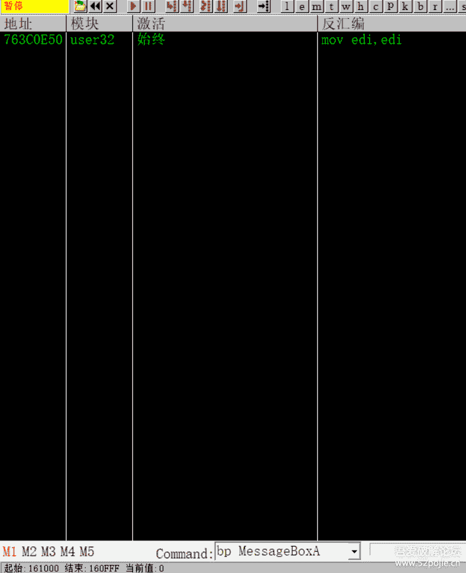

`8 下断点找msgbox地址.png`（57.1 KB，下载次数: 1）

<https://www.52pojie.cn/forum.php?mod=attachment&aid=MjYzNTA5NHw0ODliZTMzNHwxNzkzNTczMjkzfDE2ODA4NnwxODIwMzA2&nothumb=yes>

2023-8-12 11:15 上传

- 计算 `call` 和 `jmp` 的偏移

`call` 和 `jmp` 的硬编码分别为 `E8 E9`，他们后面跟的 4 字节数据是偏移值。

且 `offset=desAddr-(call/jmp Addr+5)`。

即偏移值等于目的地址减去自身地址的下个指令地址（自身指令长度为 5，所以 `+5` 是下个指令地址）。

由于 `.text` 段的 `rva=11000`，所以 `va=400000+11000=411000`。

那么 `59A0` 处的 `RVA=59A0-400+411000=4165A0`。

`call offset=763C0E50-4165AD=75FAA8A3`

`jmp offset=411023-4165B2=FFFFAA71`

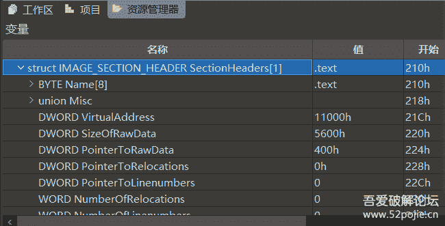

`9 text段rva.png`（33.11 KB，下载次数: 2）

<https://www.52pojie.cn/forum.php?mod=attachment&aid=MjYzNTA5NXwyMTdiY2NlMXwxNzkzNTczMjkzfDE2ODA4NnwxODIwMzA2&nothumb=yes>

2023-8-12 11:16 上传

- 写入硬编码并修改

写入后的代码


修改 `oep`，这里改的是 `rva`，将原本的入口点 `11023` 改为 `165A0` 即可。

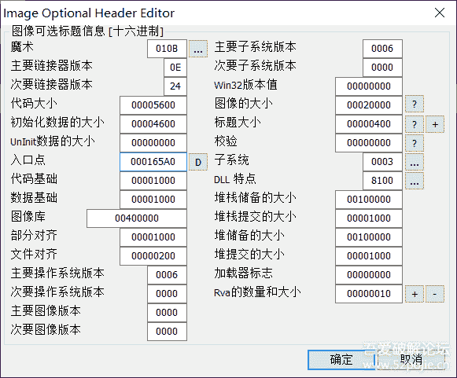

`11 修改oep.png`（29.94 KB，下载次数: 2）

<https://www.52pojie.cn/forum.php?mod=attachment&aid=MjYzNTA5N3wyYWRjZDhiOXwxNzkzNTczMjkzfDE2ODA4NnwxODIwMzA2&nothumb=yes>

2023-8-12 11:16 上传

执行结果

可以看到程序入口点已经被修改为 `4165A0`，并且输出错误弹窗，之后会跳转到原始的 `OEP` 处输出 HelloWorld 弹窗。

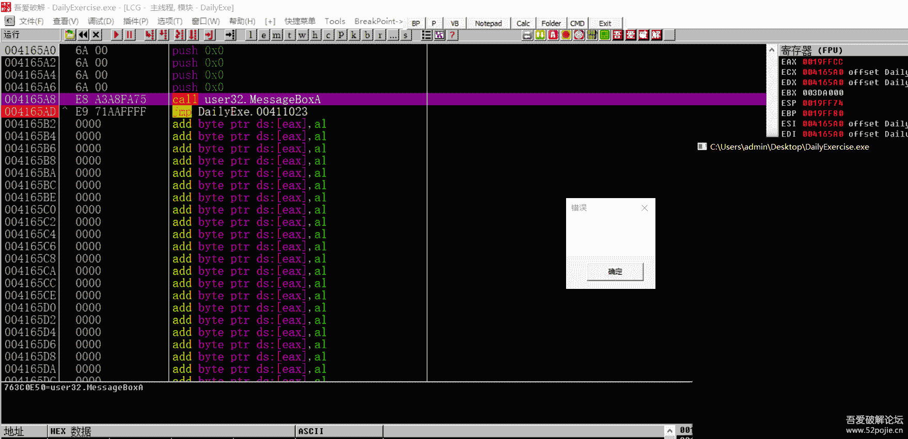

`11 text注入运行结果.png`（359.79 KB，下载次数: 2）

<https://www.52pojie.cn/forum.php?mod=attachment&aid=MjYzNTA5Nnw3NDYxYTU5NnwxNzkzNTczMjkzfDE2ODA4NnwxODIwMzA2&nothumb=yes>

2023-8-12 11:16 上传

# 3> 新增节添加代码

通过 `.text` 段空白区注入代码实用性不高，通过新增节可以增大注入代码量，灵活性更高。

## 基本过程

- 判断是否有足够空间创建新的节表

每个节表占 40 字节，要保证有 80 字节空白区（多余 40 字节用于兼容部分系统）。

在节表尾部和段首部之间便是空白区。

如果尾部空白区大小不足，可以将 PE 头整体向上移动，覆盖掉 DOS Stub（这段数据不影响程序运行）。


- 创建新的节表

这里可以通过复制 `.text` 段的节表实现，复制之后需要调整部分成员。

- 矫正 PE 文件信息

需要修改的成员有

```
Name // 节区名称
VirtualAddress // 节区的 RVA 地址（在内存中的偏移地址）
SizeOfRawData // 节区文件中对齐后的尺寸
PointerToRawData // 节区在文件中的偏移量
Characteristics // 节区的属性如可读，可写，可执行等
NumberOfSections
SizeOfImage
```

- 申请新的空间用于存储新的 PE 文件
- 写入注入代码
- 保存文件

## 代码实现


## 创建新节区并注入代码

```
    //创建新的节区 返回新节区指针
    PIMAGE_SECTION_HEADER CreateNewSection(const char* NewSectionName,DWORD NewSectionSize) {
        //1. 检查节表空闲区是否足够保存新的节表 80字节
        //空白空间起始地址=NT头偏移+NT头大小+所有节表大小
        DWORD BlankMemAddr = (NToffset + sizeof(IMAGE_NT_HEADERS)) + numberOfSections * sizeof(IMAGE_SECTION_HEADER);
        DWORD BlankMemSize = sizeOfHeaders - BlankMemAddr;//空白空间大小=SizeOfHeaders-各个表头大小-所有节表大小
        if (BlankMemSize NumberOfSections = ++numberOfSections;         //NumberOfSections +1

        //节区头 
        memcpy(pNewSectionHeader->Name, NewSectionName,strlen(NewSectionName));//name
        pNewSectionHeader->Misc.VirtualSize = NewSectionSize;               //virtualsize

        //注意这里必须先修改VirtualAddress
        //virtualaddress 各段间是紧邻着的 所以可以根据上个段的末尾来确定新段的起始地址 上个段的起始地址+上个段的大小对于0x1000向上取[url=]片[/url]整即可
        pNewSectionHeader->VirtualAddress = AlignSize(pSectionHeader[numberOfSections - 2].VirtualAddress + pSectionHeader[numberOfSections - 2].SizeOfRawData, 0x1000);
        pNewSectionHeader->SizeOfRawData = NewSectionSize;//SizeOfRawData
        //PointerToRawData 文件偏移=上个段的文件起始地址+段在文件中的大小
        pNewSectionHeader->PointerToRawData = pSectionHeader[numberOfSections - 2].PointerToRawData + pSectionHeader[numberOfSections - 2].SizeOfRawData;
        pNewSectionHeader->Characteristics |= 0x20000000;           //Characteristics 可执行权限

        //可选头
        pOptionalHeader->SizeOfImage = sizeOfImage = sizeOfImage + AlignSize(NewSectionSize,0x1000);//可选PE头 SizeOfImage 必须是内存对齐的整数倍 直接添加一页大小

        return pNewSectionHeader;
    }

    //通过创建新节区的方式注入代码
    BOOL InjectCodeByCreateNewSection() {
        //1. 创建新的节区
        PIMAGE_SECTION_HEADER pNewSectionHeader = CreateNewSection(".inject", 0x1000);

        //修正可选头
        DWORD OEP = addressOfEntryPoint; //保存OEP
        pOptionalHeader->DllCharacteristics &= 0xFFFFFFBF;//取消ASLR随机基址 随机基址的值是0x40 所以和(0xFFFFFFFF-0x40)进行与运算即可
        pOptionalHeader->AddressOfEntryPoint = addressOfEntryPoint= pNewSectionHeader->VirtualAddress;//修改EP 注意ep=rva 不用加基址

        //2. 将代码写入新的节区
        BYTE InjectCode[18] = {         //偏移  指令
            0x6a,0x00,                  //0     push 0
            0x6a,0x00,                  //0     push 0
            0x6a,0x00,                  //0     push 0
            0x6a,0x00,                  //0     push 0
            0xe8,0x00,0x00,0x00,0x00,   //8     call MessageBox MessageBox=0x763C0E50 这个地址会随着系统启动而变化
            0xe9,0x00,0x00,0x00,0x00    //13    jmp oep

        };
        DWORD MessageBoxAddr = 0x76260E50;
        //矫正call和jmp地址 
        *(DWORD*)&InjectCode[9] =OffsetOfCallAndJmp(MessageBoxAddr, imageBase + pNewSectionHeader->VirtualAddress+8) ;
        *(DWORD*)&InjectCode[14] = OffsetOfCallAndJmp(OEP, pNewSectionHeader->VirtualAddress + 13);//跳转回oep正常执行程序     
        memcpy(FileBuffer + pNewSectionHeader->PointerToRawData, InjectCode, sizeof(InjectCode));//将代码写入新的内存空间            

        //3. 保存文件
        return FileBufferWriteToFile(L"InjectCodeByCreateNewSection1.exe");
    }
```

### 执行结果

`inject` 节表

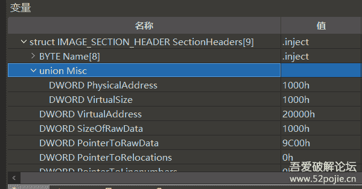

16 inject节表.png (27.02 KB, 下载次数: 1)

[附件下载](https://www.52pojie.cn/forum.php?mod=attachment&aid=MjYzNTA5OHxiYWU2NjAyZHwxNzkzNTczMjkzfDE2ODA4NnwxODIwMzA2&nothumb=yes)

2023-8-12 11:17 上传

`inject` 节区

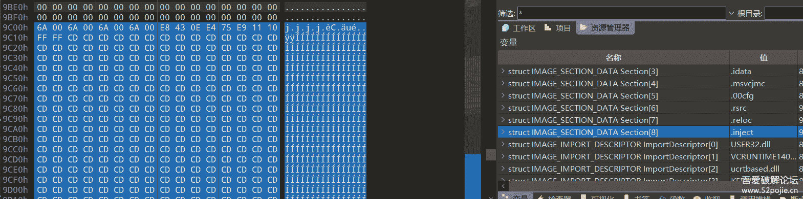

17 inject节区.png (85.24 KB, 下载次数: 0)

[附件下载](https://www.52pojie.cn/forum.php?mod=attachment&aid=MjYzNTA5OXw0ZmJjNzAyNHwxNzkzNTczMjkzfDE2ODA4NnwxODIwMzA2&nothumb=yes)

2023-8-12 11:17 上传

程序运行情况

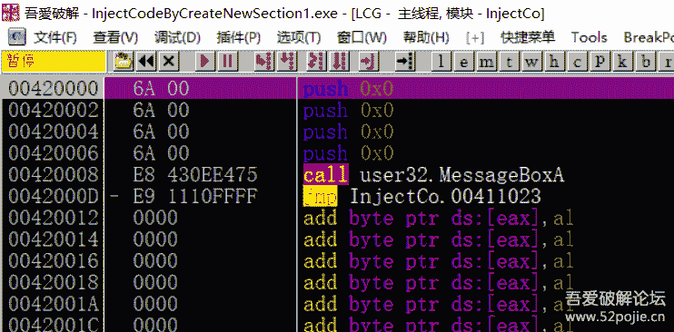

18 inject执行结果.png (143.12 KB, 下载次数: 1)

[附件下载](https://www.52pojie.cn/forum.php?mod=attachment&aid=MjYzNTEwMHw3YzE1NWUyN3wxNzkzNTczMjkzfDE2ODA4NnwxODIwMzA2&nothumb=yes)

2023-8-12 11:17 上传

## 扩大节

当节表后的空白区大小不够时，可以选择扩大节。

注意只能扩大最后一个节区，因为这样才不会影响到后续偏移。

基本过程：

- 申请空间存储新的 `FileBuffer`
- 修正 PE 信息
- 保存修改后的 PE 文件

需要修正的成员有：

- `SizeOfRawData` // 节区文件中对齐后的尺寸
- `VirtualSize` // 内存对齐后的尺寸
- `SizeOfImage` // 映像大小

代码：

```
    //扩大节区
    BOOL ExpandSection(DWORD ExSize) {
        //扩大节区大小是针对ImageBuffer而言的,所以我们添加的大小要进行内存对齐
        //1. 申请一块新空间
        ExpandFileBuffer(ExSize);       //注意这个节表指针要在申请新空间之后
        PIMAGE_SECTION_HEADER pLastSectionHeader = &pSectionHeader[numberOfSections - 1];//只能扩大最后一个节区

        //2. 调整SizeOfImage
        //如果VirtualSize+ExSize超过了AlignSize(VirtualSize,0x1000) 那么需要调整,否则不需要改变
        //例如vs=0x500 ex=0x400 显然,原始vs内存对齐也会占0x1000 扩展后没有超过0x1000
        //取文件大小和内存大小的最大值

        //先计算扩展后的内存对齐值和扩展前的内存对齐值之间的差值
        DWORD AlignExImage = AlignSize(pLastSectionHeader->Misc.VirtualSize + ExSize, 0x1000) -
            AlignSize(max(pLastSectionHeader->Misc.VirtualSize, pLastSectionHeader->SizeOfRawData), 0x1000);//内存对齐后的值
        if(AlignExImage >0)//如果差值>0说明需要扩展映像 否则内存对齐的空白区足够存储扩展区
            pOptionalHeader->SizeOfImage = sizeOfImage = sizeOfImage + AlignExImage;

        //3. 修改文件大小和内存大小 注意要在修改sizeofimage后再更新这两个值
        pLastSectionHeader->SizeOfRawData += AlignSize(ExSize, 0x200);//文件大小必须是文件对齐整数倍
        pLastSectionHeader->Misc.VirtualSize += ExSize;//由于是内存对齐前的大小,所以直接加上文件对齐后的大小即可

        //4. 保存文件
        return FileBufferWriteToFile(L"ExpandSectionFile.exe");
    }
```

### 执行结果

可以看到原始节区 `VirtualSize=57E`、`RawSize=600`。

扩大 `0x1400` 后：

- 新 `VirtualSize=57E+1400=197E`
- 新 `RawSize=600+1400=1A00`

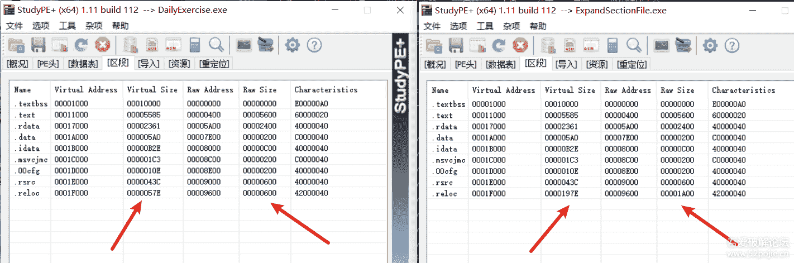

19 扩大节区成功.png (115.04 KB, 下载次数: 1)

[附件下载](https://www.52pojie.cn/forum.php?mod=attachment&aid=MjYzNTEwMXw0YmY1Mjg4YXwxNzkzNTczMjkzfDE2ODA4NnwxODIwMzA2&nothumb=yes)

2023-8-12 11:17 上传

`Image` 大小仅增加 1000

这是由于 `400+600=A00` 没有超过内存对齐大小，原来的内存额外空间可以容纳这 400 字节，所以映像只需增加一个页。

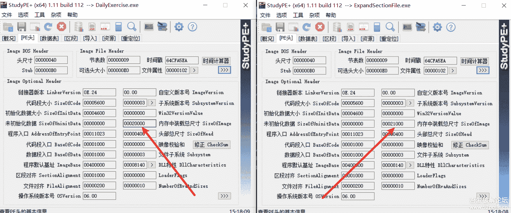

20 扩大节区映像大小.png (195.07 KB, 下载次数: 2)

[附件下载](https://www.52pojie.cn/forum.php?mod=attachment&aid=MjYzNTEwMnwyN2YzOTk5OHwxNzkzNTczMjkzfDE2ODA4NnwxODIwMzA2&nothumb=yes)

2023-8-12 11:18 上传

## 合并节

合并节也是针对 `ImageBuffer` 而言，可以直接对 `Imagebuffer` 操作。

- 将所有节区属性合并到节区 1
- 调整节表的文件偏移和内存大小
- 删除其他节表
- 保存文件

代码：

```
    //合并所有节区为1个 

    BOOL CombineSection() {

        //1. 直接修改ImageBuffer

        PIMAGE_DOS_HEADER pDosHeaderOfImage = (PIMAGE_DOS_HEADER)imageBuffer;

        PIMAGE_NT_HEADERS pNtHeadersOfImage = (PIMAGE_NT_HEADERS)(imageBuffer + pDosHeader->e_lfanew);

        PIMAGE_FILE_HEADER pFileHeaderOfImage = (PIMAGE_FILE_HEADER)(&pNtHeadersOfImage->FileHeader);

        PIMAGE_OPTIONAL_HEADER pOptionalHeaderOfImage = (PIMAGE_OPTIONAL_HEADER)(&pNtHeadersOfImage->OptionalHeader);

        PIMAGE_SECTION_HEADER pSectionHeaderOfImage = (PIMAGE_SECTION_HEADER)((DWORD)pOptionalHeaderOfImage + pFileHeaderOfImage->SizeOfOptionalHeader);

        //复制节区属性

        for (DWORD i = 1; i SizeOfHeaders = AlignSize(sizeOfHeaders - (numberOfSections - 1) * sizeof(IMAGE_SECTION_HEADER), 0x200);//调整头大小

        //删除其他节表

        memset(&pSectionHeaderOfImage[1], 0, sizeof(IMAGE_SECTION_HEADER) * (numberOfSections - 1));

        pFileHeaderOfImage->NumberOfSections = 1;

        return ImageBufferWriteToFile(L"CombineSectionFromDailyExercise.exe");

    }
```

### 执行结果

合并前节表包含 9 个节区，PE 文件很紧凑，原文件大小 39KB。

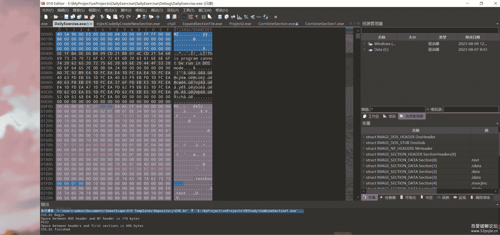

21 合并节区前.png (349 KB, 下载次数: 3)


<https://www.52pojie.cn/forum.php?mod=attachment&aid=MjYzNTEwM3w1Y2M3OTlmZHwxNzkzNTczMjkzfDE2ODA4NnwxODIwMzA2&nothumb=yes>

2023-8-12 11:18 上传

合并后仅剩一个节区，并且 `PE` 文件很空旷，大部分空间是 `0`，新文件大小为 `128KB`。

合并后节区开始地址为 `1000`，而 `headers` 到 `200` 处截止，此时又可以添加新的节区。

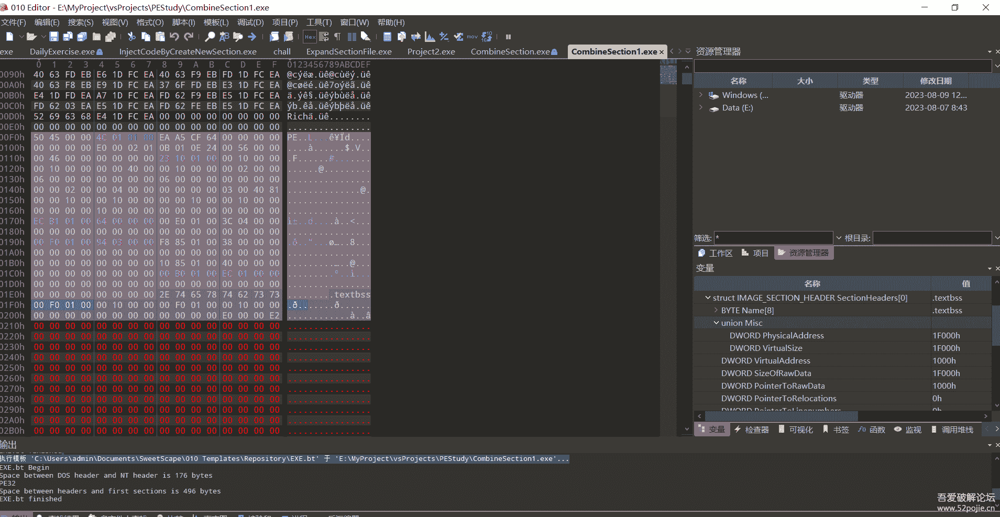

`22 合并节区后.png`（178.11 KB，下载次数：1）

<https://www.52pojie.cn/forum.php?mod=attachment&aid=MjYzNTEwNHwzNTg4YzUxN3wxNzkzNTczMjkzfDE2ODA4NnwxODIwMzA2&nothumb=yes>

2023-8-12 11:18 上传

## 2> `RVA`&`VA`&`FOA`&`RAW`

### `RVA`（Relative Virtual Address）

`RVA` 是相对虚拟地址，它是相对于模块的加载基址（`ImageBase`）的地址偏移量。在可执行文件中，`RVA` 通常用于指定代码或数据在内存中的位置。`RVA` 是相对于模块内部的地址，不受具体加载地址的影响。

`RVA = VA - ImageBase`

### `VA`（Virtual Address）

`VA` 是虚拟地址，它是代码或数据在内存中的真实地址，用于指定在内存中的具体位置。在运行时，操作系统会将 `RVA` 转换为真实的 `VA`，即根据模块的加载基址（`ImageBase`）将 `RVA` 映射到内存中的实际地址。

`VA = RVA + ImageBase`

### `FOA`（File Offset Address）

`FOA` 是可执行文件（如 `PE` 文件）中的文件偏移地址，它指的是代码或数据在文件中的位置偏移量。与 `RVA` 和 `VA` 不同，`FOA` 是直接表示在文件中的偏移量，不涉及地址重定位或内存映射。

`FOA` 和 `RAW` 均是指文件偏移。

### 总结

- `RVA` 是相对于模块加载基址的地址偏移量，`RVA` 是在可执行文件中使用的，用于在文件中表示位置。
- `VA` 是代码或数据在内存中的真实地址，`VA` 是在运行时使用的，表示内存中的实际位置。
- `FOA` 是代码或数据在文件中距离文件起始位置（`0x00`）的偏移值。

## 3> 换算

### 4> 已知 `RVA` 求 `FOA`

- `RVA = VA - ImageBase`
- 确定 `RVA` 所在节区。
  可通过节区内存起始地址 `RVA`，即 `VirtualAddress`：
  `FOA = RVA - 节区起始地址 RVA + 节区文件偏移 = RVA - VirtualAddress + PointerToRawData`

### 4> 已知 `FOA` 求 `RVA`

- 确定 `FOA` 所在节区。
  节区文件起始地址即 `PointerToRawData`：
  `RVA = FOA - 节区文件起始地址 + 节区内存起始地址 = FOA - PointerToRawData + VirtualAddress`

### 4> 实例

`OEP` 的 `VA=411023`，`ImageBase=400000`。

`.text` 段：

`VirtualAddress=11000`（节区内存起始地址 `RVA`），`PointerToRawData=400`（节区文件偏移 `FOA`）。

`VirtualSize`（节区在内存中的大小）=`5585`，`SizeOfRawData=5600`（节区在文件中的大小）。

节区在文件中的大小大于内存中的大小，因为文件对齐，所以会有部分填充 `0` 的空白区域。

注：这里的 `VirtualSize` 并不一定准确，因为加载后内存对齐值为 `1000`，所以实际内存大小应该是 `6000`。

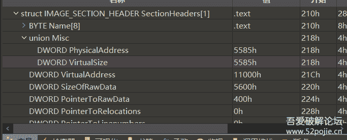

`13 text段.png`（30.97 KB，下载次数：2）

<https://www.52pojie.cn/forum.php?mod=attachment&aid=MjYzNTEwNXw0ZWNiYTEwNHwxNzkzNTczMjkzfDE2ODA4NnwxODIwMzA2&nothumb=yes>

2023-8-12 11:18 上传

所以 `OEP` 的 `RVA=411023-400000=11023`。

显然该 `RVA` 属于 `.text` 段：`11000`。

`OEP` 的 `FOA=11023-11000+400=423`。

通过 `PETools` 检查可以发现入口点 `FOA`（即 `RAW`）=`0x423`，与计算结果一致。

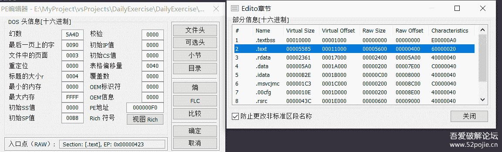

`12 RVA和FOA换算.png`（46.65 KB，下载次数：1）

<https://www.52pojie.cn/forum.php?mod=attachment&aid=MjYzNTEwN3xmNDM1MjlhYXwxNzkzNTczMjkzfDE2ODA4NnwxODIwMzA2&nothumb=yes>

2023-8-12 11:19 上传

### 3> 换算代码

```cpp
//RVA转FOA
DWORD RVA2FOA(DWORD RVA) {
    DWORD FOA = 0;
    //1. 判断RVA属于哪个节区 节区内存起始地址= pSectionHeader[i].VirtualAddress && RVA = pSectionHeader[i].PointerToRawData && FOA 
```

## 2> 静态/动态链接库

### 3> 静态库

在链接阶段，会将汇编生成的目标文件 `.o` 与引用到的库一起链接打包到可执行文件中。因此对应的链接方式称为静态链接。

**优点**：方便。

**缺点**：二进制代码需要编译到 `exe` 中，浪费空间。

注：静态库的二进制代码保存在 `.lib` 中。

#### 4> 生成静态库

在 `VS` 中可以创建静态库项目，建议创建空项目。

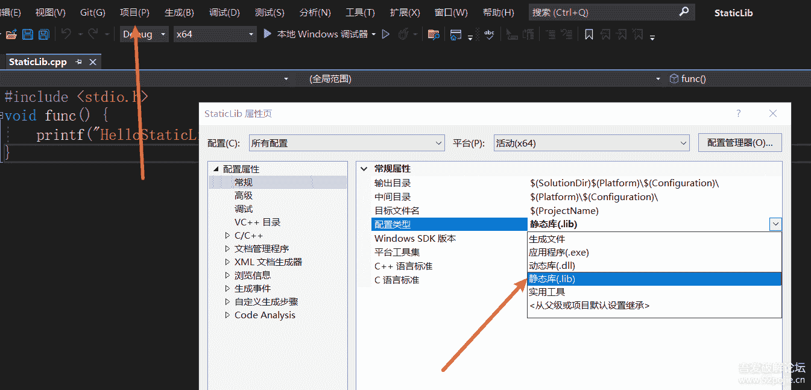

`27 创建静态库项目.png`（95.91 KB，下载次数：0）

<https://www.52pojie.cn/forum.php?mod=attachment&aid=MjYzNTEwOHxkYjhmMjk1OXwxNzkzNTczMjkzfDE2ODA4NnwxODIwMzA2&nothumb=yes>

2023-8-12 11:19 上传

在静态库项目中创建 `StaticLib.cpp` 源文件和 `StaticLib.h` 头文件。

代码实例：

```cpp
//StaticLib.cpp 源文件保存函数代码
#include 

void func() {
        printf("HelloStaticLib!");
}

//StaticLib.h 头文件保存函数声明
void func();
```

点击生成即可生成静态库，得到 `.lib` 文件。

#### 4> 使用静态库函数

在项目中找到 `StaticLib.lib` 和 `StaticLib.h` 文件，复制到需要使用该静态库的工程目录中。

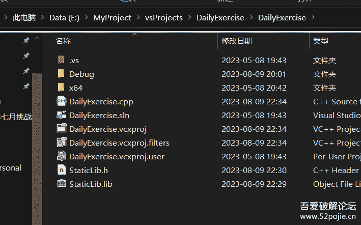

`25 导入静态库.png`（47.46 KB，下载次数：3）

<https://www.52pojie.cn/forum.php?mod=attachment&aid=MjYzNTEwOXwyNjRjNDc4Y3wxNzkzNTczMjkzfDE2ODA4NnwxODIwMzA2&nothumb=yes>

2023-8-12 11:19 上传

在工程目录中导入 `StaticLib.h` 文件。

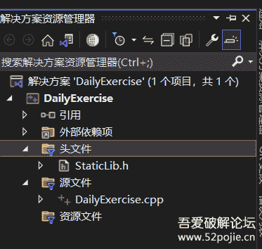

`26 导入头文件.png`（35.3 KB，下载次数：1）

<https://www.52pojie.cn/forum.php?mod=attachment&aid=MjYzNTExMHw1M2M4NjU4NnwxNzkzNTczMjkzfDE2ODA4NnwxODIwMzA2&nothumb=yes>

2023-8-12 11:19 上传

程序代码：

```cpp
#include  
#include "StaticLib.h"        //导入头文件,头文件有函数声明
#pragma comment(lib,"StaticLib.lib")//加载静态库,这里保存函数二进制代码
int main() {
        func();                //直接使用静态库中定义的函数即可
        return 0;
}
```

运行结果：

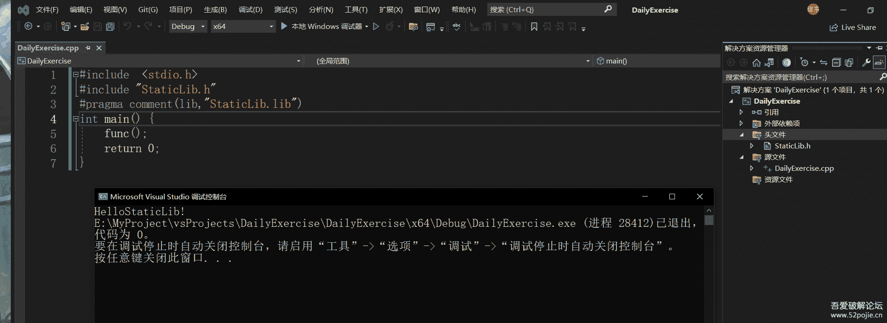

`24 静态库运行结果.png`（157.14 KB，下载次数：2）

<https://www.52pojie.cn/forum.php?mod=attachment&aid=MjYzNTExMnxhMTAyNWYzMHwxNzkzNTczMjkzfDE2ODA4NnwxODIwMzA2&nothumb=yes>

2023-8-12 11:20 上传

### 3> 动态库

动态库是在程序需要使用时加载，不同程序可以使用同一份 `dll`，大大节省了空间。

`dll` 查看工具推荐：[Dependencies](https://github.com/lucasg/Dependencies)

同创建静态库类似，建议使用空项目，创建好后将项目属性中的生成文件修改为动态库 `Dll` 即可。

然后创建头文件和源文件。

#### 4> 导出函数

生成动态库文件有关键字导出和 `.def` 导出两种方式。

##### 5> `__declspec` 关键字导出函数

关键字功能解释：

```cpp
extern         //表示是全局函数 可供其他函数调用

"C"                 //按照C语言的方式编译链接,此时函数名不变 C++由于有重载机制,编译出的函数符号名会比较复杂

__declspec(dllexport)//告诉编译器该函数为导出函数
```

代码实例：

```cpp
//DllTest.h
extern "C" __declspec(dllexport) void func();

//DllTest.cpp
//注意这里.cpp和.h的函数前都需要有__declspec(dllexport) 否则只会生成.dll而没有.lib
//注意都要有extern "C" 即保证函数声明和函数定义要一致
#include
extern "C" __declspec(dllexport) void func() {
        printf("HelloDynamicLib!");
}
```

点击生成即可得到 `.dll` 和 `.lib` 文件。

##### 5> `.def` 文件导出函数

首先在源文件目录创建 `.def` 文件。

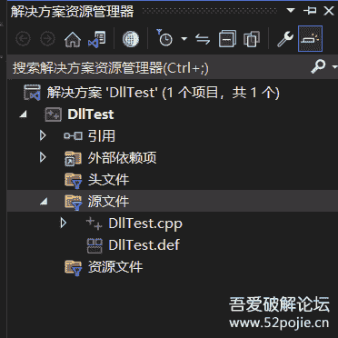

`31 创建def文件.png`（31.37 KB，下载次数：0）

<https://www.52pojie.cn/forum.php?mod=attachment&aid=MjYzNTExM3xiOWMwNTkxNnwxNzkzNTczMjkzfDE2ODA4NnwxODIwMzA2&nothumb=yes>

2023-8-12 11:20 上传

代码示例：

```cpp
//DllTest.cpp

#include

void func1() {
        printf("HelloDynamicLib!");
}

int plus(int x, int y) {
        return x + y;
}

int sub(int x, int y) {
        return x - y;
}

//DllTest.def

LIBRARY "DllTest"        //标识工程目录

EXPORTS                           //导出标识

func1 @15                        //函数名@序号

plus @1

sub  @3 NONAME                //NONAME导出的函数只有序号没有函数名
```

设置一下链接器，找到输入，修改模块定义文件如下：

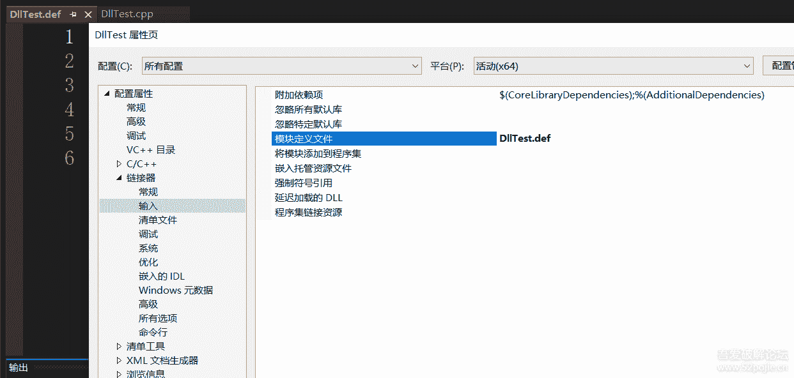

`30 添加def文件.png`（57.67 KB，下载次数：0）

<https://www.52pojie.cn/forum.php?mod=attachment&aid=MjYzNTExNHw5MzUzMGM2YnwxNzkzNTczMjkzfDE2ODA4NnwxODIwMzA2&nothumb=yes>

2023-8-12 11:20 上传

点击生成即可得到 `.dll` 和 `.lib` 文件。

注意 `NONAME` 导出的函数只有序号没有函数名，原来的 `sub` 函数在这里是 `Oridinal_3`。

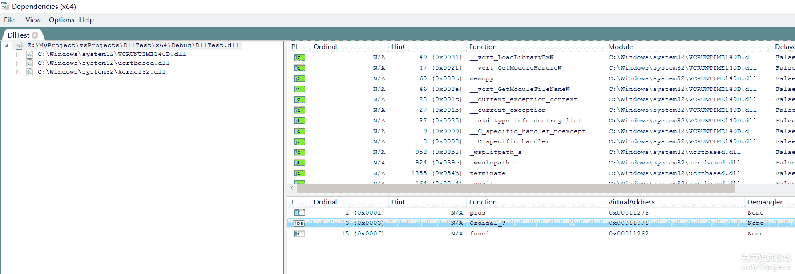

`32 无名函数.png`（121.21 KB，下载次数：1）

<https://www.52pojie.cn/forum.php?mod=attachment&aid=MjYzNTExNXw1OTRmMGQ4YXwxNzkzNTczMjkzfDE2ODA4NnwxODIwMzA2&nothumb=yes>

2023-8-12 11:20 上传

#### 4> 使用 `dll`

##### 5> 隐式链接

基本步骤：

- 将 `.dll`、`.lib` 放到工程目录中。
- 使用 `#pragma comment(lib,"dllname.lib")` 导入 `lib` 文件。
  静态库的 `.lib` 文件保存二进制代码，而 `dll` 中的 `.lib` 文件仅仅是指示函数位置。
- 加入函数声明：
  `extern "C" __declspec(dllexport) void func();`

具体示例：

首先将 `.dll` 和 `.lib` 放到工程目录中。

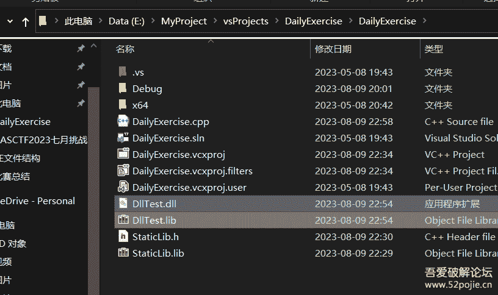

`28 导入动态库.png`（63.11 KB，下载次数：1）

<https://www.52pojie.cn/forum.php?mod=attachment&aid=MjYzNTExN3xmNDM1MjlhYXwxNzkzNTczMjkzfDE2ODA4NnwxODIwMzA2&nothumb=yes>

2023-8-12 11:20 上传


## 隐式链接

[附件](https://www.52pojie.cn/forum.php?mod=attachment&aid=MjYzNTExNnw5ZTIyZGE2N3wxNzkzNTczMjkzfDE2ODA4NnwxODIwMzA2&nothumb=yes)

2023-8-12 11:21 上传

### 程序代码

```c
#pragma comment(lib,"DllTest.lib")                        //导入.lib
extern "C" __declspec(dllimport) void func();//导入函数声明
int main() {
        func();//直接调用
        return 0;
}
```

### 运行结果

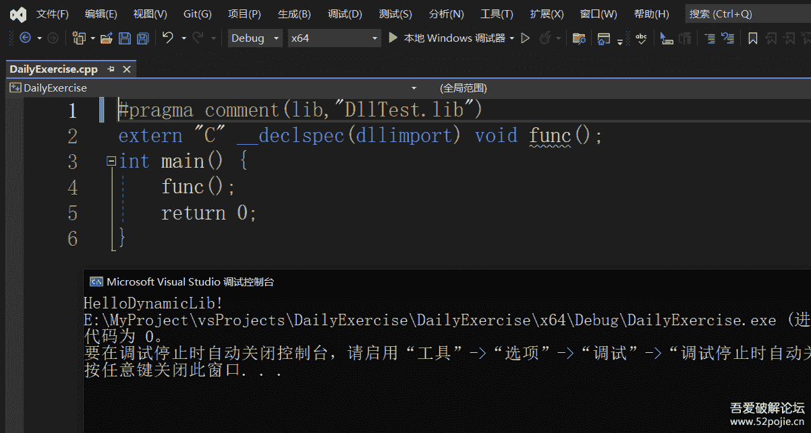

29 dll运行结果.png (94.08 KB, 下载次数: 3)

[附件](https://www.52pojie.cn/forum.php?mod=attachment&aid=MjYzNTExN3xkODdhOWNkOHwxNzkzNTczMjkzfDE2ODA4NnwxODIwMzA2&nothumb=yes)

2023-8-12 11:21 上传

## 显式链接

### 基本使用方法

```c
//1. 定义函数指针

typedef int (__stdcall *lpPlus)(int,int);

//2. 声明函数指针

lpPlus plus;

//3. 动态加载dll

HINSTANCE hModule=LoadLibrary("Dllname.dll");

//4. 获取函数地址

plus=(lpPlus)GetProcAddress(hModule,"_Plus@8");

//默认的cdecl可以直接用函数名 如果是__stdcall会导致函数名改变 

//5. 调用函数

int a=plus(1,2);
```

### 示例程序代码

```c
#include//包含了win32的函数和数据结构
#include
int main() {
        typedef int(*lpPlus)(int, int);
        lpPlus plus;
        HINSTANCE hModule = LoadLibrary(L"DllTest.dll");//L是代表宽字符
        plus = (lpPlus)GetProcAddress(hModule, "plus");
        printf("%d", plus(1, 2));
        return 0;
}
```

### 运行结果

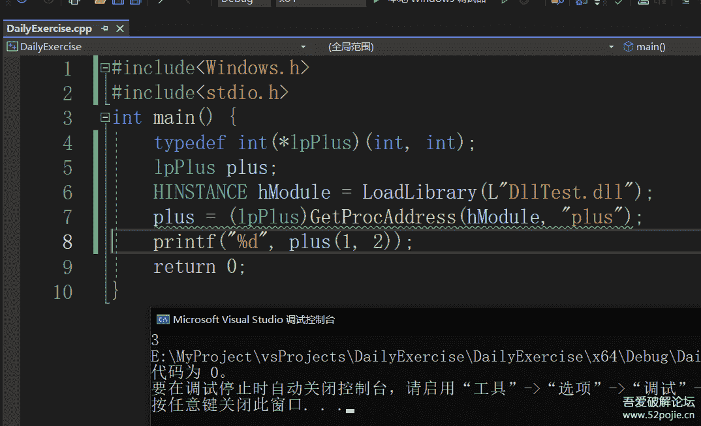

33 显式链接运行结果.png (114.18 KB, 下载次数: 2)

[附件](https://www.52pojie.cn/forum.php?mod=attachment&aid=MjYzNTExOHxjMTE3MDU2M3wxNzkzNTczMjkzfDE2ODA4NnwxODIwMzA2&nothumb=yes)

2023-8-12 11:21 上传

## 数据目录表

### 定义

```c
typedef struct _IMAGE_DATA_DIRECTORY {

    DWORD   VirtualAddress;//虚拟地址RVA，数据目录表的起始位置

    DWORD   Size;//大小

} IMAGE_DATA_DIRECTORY, *PIMAGE_DATA_DIRECTORY;
```

### 表项定义

```c
#define IMAGE_DIRECTORY_ENTRY_EXPORT        //0 导出表
#define IMAGE_DIRECTORY_ENTRY_IMPORT        //1 导入表 
#define IMAGE_DIRECTORY_ENTRY_RESOURCE      //2 资源目录
#define IMAGE_DIRECTORY_ENTRY_EXCEPTION     //3 异常目录
#define IMAGE_DIRECTORY_ENTRY_SECURITY      //4 安全目录
#define IMAGE_DIRECTORY_ENTRY_BASERELOC     //5 重定位基本表
#define IMAGE_DIRECTORY_ENTRY_DEBUG         //6 调试目录
#define IMAGE_DIRECTORY_ENTRY_COPYRIGHT     //7 描述字串 64位为ARCHITECTURE
#define IMAGE_DIRECTORY_ENTRY_GLOBALPTR     //8 机器值
#define IMAGE_DIRECTORY_ENTRY_TLS           //9 TLS目录
#define IMAGE_DIRECTORY_ENTRY_LOAD_CONFIG   //10 载入配值目录
#define IMAGE_DIRECTORY_ENTRY_BOUND_IMPORT  //11 绑定输入表
#define IMAGE_DIRECTORY_ENTRY_IAT           //12 导入地址表
#define IMAGE_DIRECTORY_ENTRY_DELAY_IMPORT  //13 延迟载入描述
#define IMAGE_DIRECTORY_ENTRY_COM_DESCRIPTOR//14 COM信息
//第16个保留
```

### 可选头成员

可选头的最后两个成员分别定义了数据目录表的个数和数据目录表数组，指向了一些关键表格。

```c
DWORD   NumberOfRvaAndSizes;

IMAGE_DATA_DIRECTORY DataDirectory[IMAGE_NUMBEROF_DIRECTORY_ENTRIES]; //数据目录表,结构体数组
```

比较重要的有导出表、导入表、重定位表、`IAT` 表。

### 打印数据目录表

```c
//打印数据目录表
    void PrintDirectory() {
        PIMAGE_DATA_DIRECTORY pDirectory = pOptionalHeader->DataDirectory;
        printf("\n**********数据目录表**********\n");
        for (DWORD i = 0; i NumberOfRvaAndSizes; i++) {
            switch (i) {
            case IMAGE_DIRECTORY_ENTRY_EXPORT:
                printf("\n==========导出表==========\n");
                break;
            case IMAGE_DIRECTORY_ENTRY_IMPORT:
                printf("\n==========导入表==========\n");
                break;
            case IMAGE_DIRECTORY_ENTRY_RESOURCE:
                printf("\n==========资源目录==========\n");
                break;
            case IMAGE_DIRECTORY_ENTRY_EXCEPTION:
                printf("\n==========异常目录==========\n");
                break;
            case IMAGE_DIRECTORY_ENTRY_SECURITY:
                printf("\n==========安全目录=========\n");
                break;
            case IMAGE_DIRECTORY_ENTRY_BASERELOC:
                printf("\n==========重定位基本表==========\n");
                break;
            case IMAGE_DIRECTORY_ENTRY_DEBUG:
                printf("\n==========调试目录==========\n");
                break;
            case IMAGE_DIRECTORY_ENTRY_ARCHITECTURE:
                printf("\n==========描述字串==========\n");
                break;
            case IMAGE_DIRECTORY_ENTRY_GLOBALPTR:
                printf("\n==========机器值==========\n");
                break;
            case IMAGE_DIRECTORY_ENTRY_TLS:
                printf("\n==========TLS目录==========\n");
                break;
            case IMAGE_DIRECTORY_ENTRY_LOAD_CONFIG:
                printf("\n==========载入配置目录==========\n");
                break;
            case IMAGE_DIRECTORY_ENTRY_BOUND_IMPORT:
                printf("\n==========绑定输入表==========\n");
                break;
            case IMAGE_DIRECTORY_ENTRY_IAT:
                printf("\n==========导入地址表==========\n");
                break;
            case IMAGE_DIRECTORY_ENTRY_DELAY_IMPORT:
                printf("\n==========延迟导入表==========\n");
                break;
            case IMAGE_DIRECTORY_ENTRY_COM_DESCRIPTOR:
                printf("\n==========COM信息==========\n");
                break;
            case 15:
                printf("\n==========保留表==========\n");
                break;
            }
            printf("VirtualAddress=%x\nSize=%x\nFOA=%x\n", pDirectory[i].VirtualAddress, pDirectory[i].Size,RVA2FOA(pDirectory[i].VirtualAddress));

        }
        printf("\n**********数据目录表打印完毕**********\n\n");
    }
```

## 导出表

导出表记录了 pe 文件导出的函数，所以 `.exe` 和 `.dll` 程序都可以导出函数。

数据目录表中记录了导出表的地址和偏移，这个地址是 `RVA`，需要转换为 `FOA`。

```c
typedef struct _IMAGE_EXPORT_DIRECTORY {

    DWORD   Characteristics;

    DWORD   TimeDateStamp;

    WORD    MajorVersion;

    WORD    MinorVersion;

    DWORD   Name;                                   // 指向导出表文件名 RVA-> FOA + FileBuffer=char *name

    DWORD   Base;                                   // 导出函数起始序号

    DWORD   NumberOfFunctions;                // 所有导出函数的个数

    DWORD   NumberOfNames;                    // 以函数名称导出的函数个数

    DWORD   AddressOfFunctions;     // 导出函数地址表首地址RVA 记录了所有导出函数的地址 每个表项大小4字节 

    DWORD   AddressOfNames;         // 导出函数名称表首地址RVA 每个表项都是函数名的字符串指针RVA 每个表项大小4字节

    DWORD   AddressOfNameOrdinals;  // 导出函数序号表首地址RVA 其中存储的序号为-Base后的值  每个表项大小2字节

} IMAGE_EXPORT_DIRECTORY, *PIMAGE_EXPORT_DIRECTORY;
```

通过 `NONAME` 关键字可以使部分导出函数没有名称仅有地址。

### 关键成员

```text
Name                                
Base                                
NumberOfFunctions                
NumberOfNames                    
AddressOfFunctions    
AddressOfNames        
AddressOfNameOrdinals  
```

### 具体示例

假设：

导出函数名称表 `FuncNameTable`

导出函数序号表 `FuncOridinalTable`

导出函数地址表 `FuncAddressTable`

函数地址 `RVA`     `FuncAddress`

使用上一节的 Dll 函数。

```text
//DllTest.def

LIBRARY "DllTest"

EXPORTS

func1 @15

plus @1

sub  @3 NONAME        //sub序号为3 无导出函数名
```

```c
//DllTest.cpp

#include

#include

void func1() {

        printf("HelloDynamicLib!");

}

int plus(int x, int y) {

        return x + y;

}

int sub(int x, int y) {

        return x - y;

}
```

### DLL的导出表信息

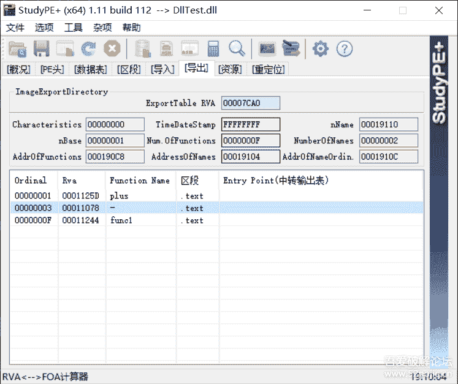

37 导出表信息.png (102.24 KB, 下载次数: 2)

[附件](https://www.52pojie.cn/forum.php?mod=attachment&aid=MjYzNTExOXw5YmVhN2MyN3wxNzkzNTczMjkzfDE2ODA4NnwxODIwMzA2&nothumb=yes)

2023-8-12 11:21 上传

## 序号导出

假设已知导出函数序号 `OridinalNum`

那么 `FuncAddress=FuncAddressTable[OridinalNum-Base]`

即导出函数序号-`Base` 值可以直接作为下标查找导出函数地址表得到导出函数地址

已知函数 `sub` 的导出序号为 `3`，所以 `3-1=2` 直接查找得到其地址


所以无名函数的序号可以通过遍历导出函数地址表来得到

## 名称导出

通过函数名称查找函数地址的过程

- 首先查找导出函数名称表，判断数组中哪个字符串和目的函数名称相同
- 将该元素的下标作为索引，查找导出函数序号表
- 将导出函数序号表中该下标元素的内容作为下标查找导出函数地址表，该值即为函数地址

即


```
if(strcmp(name,FuncNameTable[i])==0) 
        FuncAddress=FuncAddressTable[FuncOridinalTable[i]];
```

假设要查找 `plus` 函数。

`plus` 这个函数名在函数名称表中的下标为1。

而 `FuncOridinalTable[1]=0`。

所以 `plus Address=FuncAddressTable[0]=1125d`。


### 注意

- 导出函数地址表中有很多地址为0的项目。由于导出函数地址表的大小 = `NumberOfFunctions` = 导出函数最大序号 - 最小序号，当序号不是连续时，就会用0地址填充多余表项。

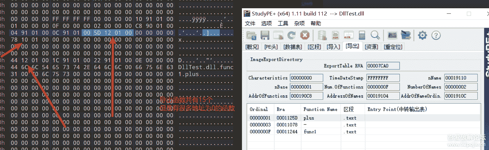

34 导出函数地址表.png（129.75 KB，下载次数：1）

[href="forum.php?mod=attachment&aid=MjYzNTEyMHw5MWJmYWU5ZXwxNzkzNTczMjkzfDE2ODA4NnwxODIwMzA2&nothumb=yes" target="_blank"](https://www.52pojie.cn/forum.php?mod=attachment&aid=MjYzNTEyMHw5MWJmYWU5ZXwxNzkzNTczMjkzfDE2ODA4NnwxODIwMzA2&nothumb=yes)

2023-8-12 11:21 上传

- 导出函数序号表存储的序号是真实序号 - `Base`，所以序号最小的导出函数对应的存储序号是0。
- 导出函数序号表中不保存无名称函数的序号。通过序号查找函数时，将序号值 - `Base` 直接作为下标查找导出函数地址表。

### 通过序号查找函数地址

```
//通过函数序号获取函数地址
DWORD GetFuncAddrByOridinals(WORD OridinalNum) {
    DWORD* pExportFuncAddressTable = (DWORD*)(RVA2FOA(pExportDirectory->AddressOfFunctions) + FileBuffer);//导出函数地址表
    return pExportFuncAddressTable[OridinalNum - pExportDirectory->Base];//减去Base值作为索引直接查找函数地址 
}
```

### 通过函数名查找函数地址

代码

```
//通过函数名获取函数地址
DWORD GetFuncAddrByName(const char* FuncName) {
    WORD* pExportFuncOridinalsTable = (WORD*)(RVA2FOA(pExportDirectory->AddressOfNameOrdinals) + FileBuffer);//导出函数序号表
    DWORD* pExportFuncAddressTable = (DWORD*)(RVA2FOA(pExportDirectory->AddressOfFunctions) + FileBuffer);//导出函数地址表
    DWORD* pExportFuncNamesTable = (DWORD*)(RVA2FOA(pExportDirectory->AddressOfNames) + FileBuffer);//导出函数名称表

    DWORD pos = -1,OridinalNum=0;
    //1. 通过导出函数名称表得到序号表下标
    for (DWORD i = 0; i NumberOfNames; i++) {
        //注意导出函数名称表表项是字符串指针 该指针值为RVA
        if (strcmp(FuncName, (char*)(RVA2FOA(pExportFuncNamesTable[i])+FileBuffer)) == 0)
        {
            pos = i;
            break;
        }
    }
    if (pos == -1)//查找失败
        return 0;

    //2. 通过序号表得到序号
    OridinalNum = pExportFuncOridinalsTable[pos];

    //3. 得到函数地址
    return pExportFuncAddressTable[OridinalNum];
}
```

运行结果和PE工具显示的一致。

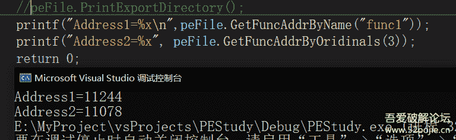

38 获取函数地址.png（55.62 KB，下载次数：3）

[href="forum.php?mod=attachment&aid=MjYzNTEyMXxjYjEyNmNjM3wxNzkzNTczMjkzfDE2ODA4NnwxODIwMzA2&nothumb=yes" target="_blank"](https://www.52pojie.cn/forum.php?mod=attachment&aid=MjYzNTEyMXxjYjEyNmNjM3wxNzkzNTczMjkzfDE2ODA4NnwxODIwMzA2&nothumb=yes)

2023-8-12 11:22 上传

### 打印导出表

```
//根据函数序号返回函数名地址RVA
BYTE* GetFuncNameByOridinals(WORD OridinalNum) {
    WORD* pExportFuncOridinalsTable = (WORD*)(RVA2FOA(pExportDirectory->AddressOfNameOrdinals) + FileBuffer);//导出函数序号表
    DWORD* pExportFuncNamesTable = (DWORD*)(RVA2FOA(pExportDirectory->AddressOfNames) + FileBuffer);//导出函数名称表
    for (DWORD i = 0; i NumberOfNames; i++)
    {
        if (pExportFuncOridinalsTable[i] == OridinalNum)//实际存储的序号=函数序号-base
            return RVA2FOA(pExportFuncNamesTable[i])+FileBuffer;
    }
    return NULL;//没有找到说明是无名函数
}

//打印导出表详细信息
void PrintExportDirectory() {
    printf("\n==========导出表==========\n");
    printf("Name: %x (%s)\n",pExportDirectory->Name,(char*)(FileBuffer+RVA2FOA(pExportDirectory->Name)));
    printf("Base: %x\n", pExportDirectory->Base);
    printf("NumberOfFunctions: \t%x\n", pExportDirectory->NumberOfFunctions);
    printf("NumberOfNames: \t\t%x\n", pExportDirectory->NumberOfNames);
    printf("AddressOfFunctions: \tRVA=%x\tFOA=%x\n", pExportDirectory->AddressOfFunctions,RVA2FOA(pExportDirectory->AddressOfFunctions));
    printf("AddressOfNames: \tRVA=%x\tFOA=%x\n", pExportDirectory->AddressOfNames, RVA2FOA(pExportDirectory->AddressOfNames));
    printf("AddressOfNameOrdinals: \tRVA=%x\tFOA=%x\n", pExportDirectory->AddressOfNameOrdinals , RVA2FOA(pExportDirectory->AddressOfNameOrdinals));
    WORD* pExportFuncOridinalsTable =(WORD*)(RVA2FOA(pExportDirectory->AddressOfNameOrdinals) + FileBuffer);//导出函数序号表
    DWORD* pExportFuncAddressTable = (DWORD*)(RVA2FOA(pExportDirectory->AddressOfFunctions)+ FileBuffer);//导出函数地址表
    DWORD* pExportFuncNamesTable = (DWORD*)(RVA2FOA(pExportDirectory->AddressOfNames )+ FileBuffer);//导出函数名称表
    printf("\nOridinal\t     RVA\t     FOA\tFunctionName\n");
    for (DWORD i = 0; i NumberOfFunctions; i++) {
        if (pExportFuncAddressTable[i] == 0)//地址为零则跳过
            continue;
        BYTE* FuncName = NULL;
        //由于导出函数序号表仅保存有名函数序号,所以有序号必定有名称,否则无名称
        //函数序号=函数地址表下标+Base
        printf("%08x\t%08x\t%08x\t",i+pExportDirectory->Base, pExportFuncAddressTable[i],RVA2FOA(pExportFuncAddressTable[i]));
        //是否存在函数名要单独判断 存储序号=函数序号-Base,故传递i即可
        if (FuncName = GetFuncNameByOridinals(i))
            printf("%s\n", FuncName);
        else
            printf("NONAME\n");
    }
    printf("\n==========导出表结束==========\n");
}
```

运行结果

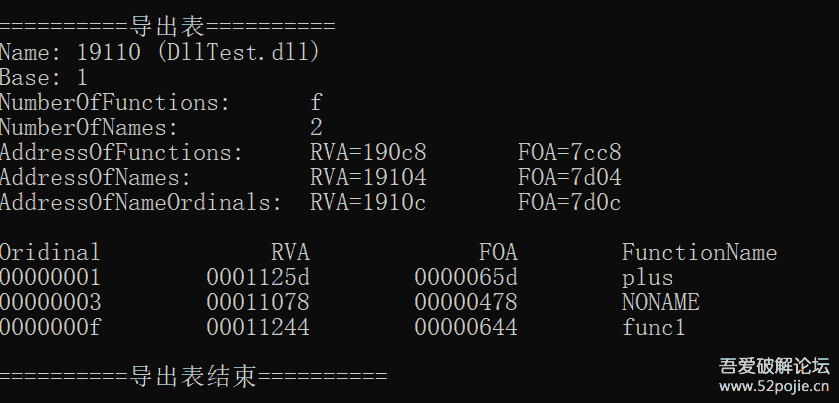

39 打印导出表.png（40.53 KB，下载次数：2）

[href="forum.php?mod=attachment&aid=MjYzNTEyMnw3ZDcwMjM5N3wxNzkzNTczMjkzfDE2ODA4NnwxODIwMzA2&nothumb=yes" target="_blank"](https://www.52pojie.cn/forum.php?mod=attachment&aid=MjYzNTEyMnw3ZDcwMjM5N3wxNzkzNTczMjkzfDE2ODA4NnwxODIwMzA2&nothumb=yes)

2023-8-12 11:22 上传

查看二进制文件。

导出函数地址表从 `7CC8` 开始共 `0xE` 个表项。

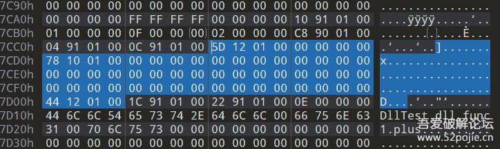

40 导出函数地址表.png（32.83 KB，下载次数：1）

[href="forum.php?mod=attachment&aid=MjYzNTEyM3w3MmEwYThhYnwxNzkzNTczMjkzfDE2ODA4NnwxODIwMzA2&nothumb=yes" target="_blank"](https://www.52pojie.cn/forum.php?mod=attachment&aid=MjYzNTEyM3w3MmEwYThhYnwxNzkzNTczMjkzfDE2ODA4NnwxODIwMzA2&nothumb=yes)

2023-8-12 11:22 上传

导出函数序号表从 `7D0C` 开始共2个表项，每个表项2字节。

存储序号分别是 `0xe`（`f` `func1`） `0x0`（1 `plus`）。

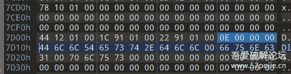

42 导出函数序号表.png（24.73 KB，下载次数：0）

[href="forum.php?mod=attachment&aid=MjYzNTEyNHxlNjVmMmZiMHwxNzkzNTczMjkzfDE2ODA4NnwxODIwMzA2&nothumb=yes" target="_blank"](https://www.52pojie.cn/forum.php?mod=attachment&aid=MjYzNTEyNHxlNjVmMmZiMHwxNzkzNTczMjkzfDE2ODA4NnwxODIwMzA2&nothumb=yes)

2023-8-12 11:22 上传

导出函数名称表从 `7D04` 开始共2个表项，每个表项四字节，指向字符串指针。

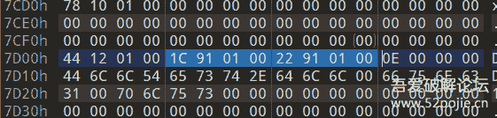

41 导出函数名称表.png（23.19 KB，下载次数：1）

[href="forum.php?mod=attachment&aid=MjYzNTEyNXwxYmEwZjAwYnwxNzkzNTczMjkzfDE2ODA4NnwxODIwMzA2&nothumb=yes" target="_blank"](https://www.52pojie.cn/forum.php?mod=attachment&aid=MjYzNTEyNXwxYmEwZjAwYnwxNzkzNTczMjkzfDE2ODA4NnwxODIwMzA2&nothumb=yes)

2023-8-12 11:22 上传

## 重定位表

### 重定位

重定位的概念：进程拥有独立的4GB虚拟空间，`.exe` 最先被加载，其次加载 `.dll`。显然 `exe` 可以占用默认基址 `400000` 起始的空间，但是 `dll` 默认基址 `10000000` 会有冲突。

如果能按照预定 `ImageBase` 加载则不需要重定位表，所以很多 `exe` 程序没有重定位表但是 `dll` 有。

部分编译生成的地址 = `ImageBase + RVA`（`VA` 绝对地址）。

假设全局变量 `x` 的 `RVA=62153`，基址 `400000`。

那么 `mov eax,[x] =A1 53 21 46 00`。

即一些指令中涉及到地址的硬编码是固定写好的（绝对地址）。

如果 `dll` 模块没有加载到默认的基址处，那么这些使用绝对地址的指令就需要修正。

重定位表则记录了需要修正的指令地址。

### 重定位表解析

重定位表定义

数据目录表中第6个表项指向了重定位表


# 重定位表

```c
typedef struct _IMAGE_BASE_RELOCATION {
    DWORD   VirtualAddress; // 重定位数据页面起始地址
    DWORD   SizeOfBlock;        // 重定位块的长度
//WORD    TypeOffset[1];        // 重定位项数组
    //该数组每个元素占2字节,加上VirtualAddress后才是真实地址
} IMAGE_BASE_RELOCATION;
//最后一个块的值全为0
typedef IMAGE_BASE_RELOCATION*,PIMAGE_BASE_RELOCATION;
```

重定位表是一块一块存储的，每块的大小不一定相等，通过重定位表起始地址 + `SizeOfBlock` 可以查找下一块数据。

重定位表的每个块会存储每一页（`1000h`）需要修改的表项，`VirtualAddress` 即是页面起始地址。

所以真正需要修复的地址 = `VirtualAddress` + 表项地址。

假设 `VirtualAddress = 8000`，表项存储 `12 34 56 78`。

那么需要修改的地址为 `8012 8034 8056 8078`（不考虑下面的高四位标识）。

每个重定位项占 2 字节，其中高四位用于表示这个地址是否需要修改，低 12 位用于存储偏移值。

如果高四位 = `0011`，那么需要修改。

注意：由于内存对齐的需要，假设表项有 5 个共 10 字节，那么实际表项会多一个空项用于内存对齐。

结束时重定位表结构全为 `0`。

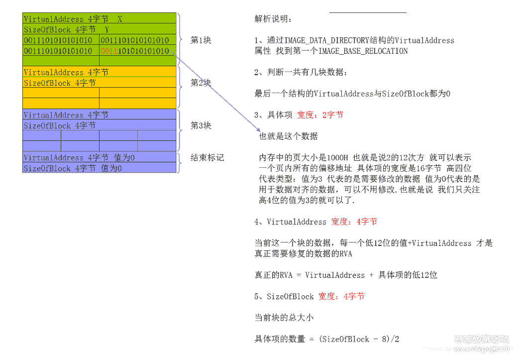

`54 重定位表.png` (191.62 KB, 下载次数: 1)

[href="forum.php?mod=attachment&aid=MjYzNTEyNnxjNTkyYzQ4Y3wxNzkzNTczMjkzfDE2ODA4NnwxODIwMzA2&nothumb=yes" target="_blank"](https://www.52pojie.cn/forum.php?mod=attachment&aid=MjYzNTEyNnxjNTkyYzQ4Y3wxNzkzNTczMjkzfDE2ODA4NnwxODIwMzA2&nothumb=yes)

2023-8-12 11:22 上传

查看重定位表

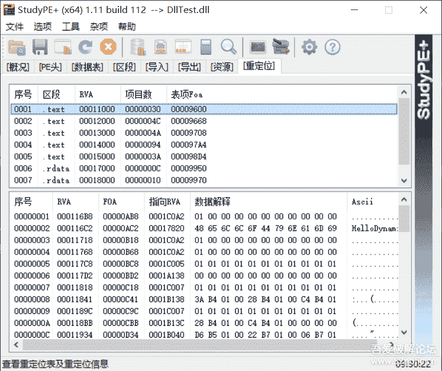

`49 查看重定位表.png` (123.33 KB, 下载次数: 1)

[href="forum.php?mod=attachment&aid=MjYzNTEyN3xmNThjOWQxOHwxNzkzNTczMjkzfDE2ODA4NnwxODIwMzA2&nothumb=yes" target="_blank"](https://www.52pojie.cn/forum.php?mod=attachment&aid=MjYzNTEyN3xmNThjOWQxOHwxNzkzNTczMjkzfDE2ODA4NnwxODIwMzA2&nothumb=yes)

2023-8-12 11:23 上传

## 打印重定位表

```c
    //通过RVA判断所属区段名

    PCHAR GetSectionNameByRva(DWORD RVA) {

        for (DWORD i = 0; i = pSectionHeader[i].VirtualAddress && RVA VirtualAddress;//每个块的虚拟地址即为页面起始地址

        printf("序号\t属性\t     RVA\t     FOA\t指向RVA\n");

        for (DWORD i = 0; i SizeOfBlock - 8) / 2; i++) {

            //每块高四位用作属性判断,低12位才是页内偏移值 还要注意与运算优先级低于+ 不用括号会导致出错 

            //指向的RVA即需要矫正的地址

            printf("%04x\t%4x\t%08x\t%08x\t%08x\n", i, pBlock[i] >> 12, (pBlock[i] & 0x0fff) + PageOffset, RVA2FOA((pBlock[i] & 0x0fff) + PageOffset), *(DWORD*)(FileBuffer + RVA2FOA((pBlock[i] & 0x0fff) + PageOffset)) & 0x00ffffff);

        }

    }

    //打印重定位表

    void PrintRelocationTable() {

        PIMAGE_BASE_RELOCATION pRelocationTable = pBaseRelocation;

        printf("\n==========重定位表==========\n");

        printf("序号\t    区段\t     RVA\t     FOA\t项目数\n");

        //表块全为0时结束

        DWORD count = 0;

        while (pRelocationTable->VirtualAddress || pRelocationTable->SizeOfBlock) {

            //项目数=(sizeofBlock-8)/2

            printf("%4d\t%8s\t%08x\t%08x\t%08x\n", count++, GetSectionNameByRva(pRelocationTable->VirtualAddress), pRelocationTable->VirtualAddress, RVA2FOA(pRelocationTable->VirtualAddress), (pRelocationTable->SizeOfBlock - 8) / 2);

            pRelocationTable = (PIMAGE_BASE_RELOCATION)((DWORD)pRelocationTable + pRelocationTable->SizeOfBlock);//注意这里应该将指针值强转后+块大小指向下一个块

        }

        pRelocationTable = pBaseRelocation;

        count = 0;

        while (pRelocationTable->VirtualAddress || pRelocationTable->SizeOfBlock) {

            printf("\n==========Block%d==========\n", count++);

            PrintRelocationBlock(pRelocationTable);//打印第i个块

            pRelocationTable = (PIMAGE_BASE_RELOCATION)((DWORD)pRelocationTable + pRelocationTable->SizeOfBlock);

        }

        printf("\n==========重定位表结束==========\n");

    }
```

### 运行结果

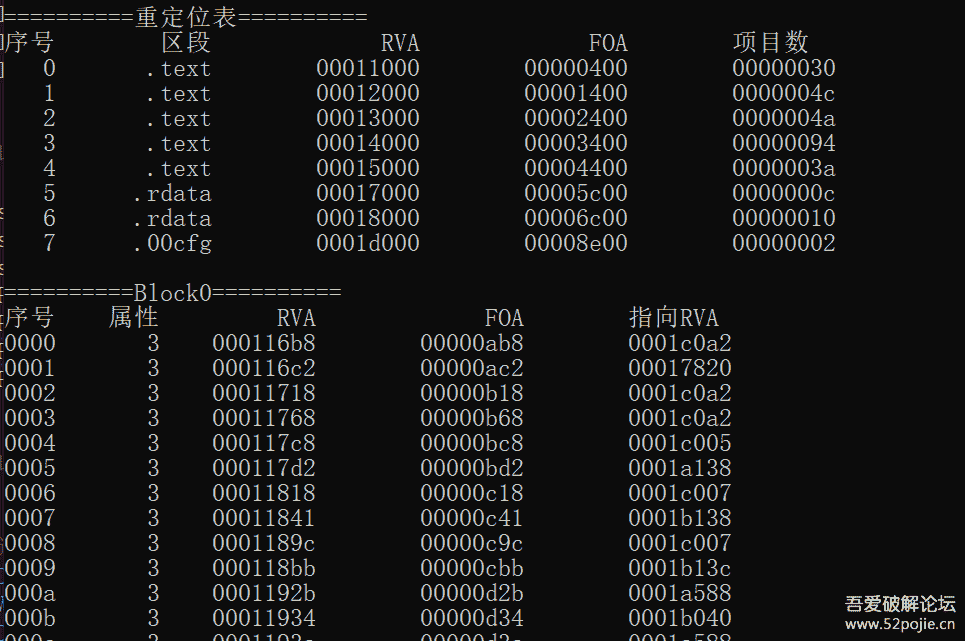

`48 打印重定位表.png` (70.77 KB, 下载次数: 2)

[href="forum.php?mod=attachment&aid=MjYzNTEyOHw3MTY1MGYxYnwxNzkzNTczMjkzfDE2ODA4NnwxODIwMzA2&nothumb=yes" target="_blank"](https://www.52pojie.cn/forum.php?mod=attachment&aid=MjYzNTEyOHw3MTY1MGYxYnwxNzkzNTczMjkzfDE2ODA4NnwxODIwMzA2&nothumb=yes)

2023-8-12 11:23 上传

# 导入表

数据目录表第 2 个表项是导入表，紧跟在导出表后。

`PE` 文件可能会有多个导入表，以结构体数组形式存在，结束标识为全 `0`。

```c
typedef struct _IMAGE_IMPORT_DESCRIPTOR {
union {
    DWORD   Characteristics;  
    DWORD   OriginalFirstThunk;        //RVA 指向INT 导入名称表 存储导入函数名称 IMAGE_THUNK_DATA结构数组 
} DUMMYUNIONNAME;
    DWORD   TimeDateStamp;                 //时间戳 如果该值为0则说明dll未被绑定 如果为-1则说明该dll被绑定
    DWORD   ForwarderChain; 
    DWORD   Name;                           //RVA 指向dll名 以0结尾
    DWORD   FirstThunk;                  //RVA 指向IAT 导入地址表 存储导入函数地址 IMAGE_THUNK_DATA结构数组 
} IMAGE_IMPORT_DESCRIPTOR;
typedef IMAGE_IMPORT_DESCRIPTOR UNALIGNED *PIMAGE_IMPORT_DESCRIPTOR;
```

## 重要成员

- `OriginalFirstThunk`：指向 `INT` 表
- `FirstThunk`：指向 `IAT` 表

## `INT` 和 `IAT`

`INT`：导入名称表，存储导入函数名称。

`IAT`：导入地址表，存储导入函数地址。

这两张表的定义如下：

```c
typedef struct _IMAGE_THUNK_DATA32 {

    union {

        DWORD ForwarderString;      //PBYTE 

        DWORD Function;             //PDWORD

        DWORD Ordinal;                           //按序号导入的函数序号

        DWORD AddressOfData;        //PIMAGE_IMPORT_BY_NAME 指向导入函数名称结构

    } u1;

} IMAGE_THUNK_DATA32;

typedef IMAGE_THUNK_DATA32 * PIMAGE_THUNK_DATA32;
```

`IAT` 表中，该结构存储的是导入函数地址 `RVA`。

`INT` 表中，该结构可能存储导入函数序号或者是导入函数名称结构地址 `RVA`。

- 当最高位为 1 时表示按序号导入，此时低 31 位作为序号值。
- 当最高位为 0 时表示按名称导入，此时低 31 位作为导入函数名称结构地址 `RVA`。

## 绑定导入

`IAT` 表有两种情况：

- 在 `PE` 文件加载到内存前，两张表存储的内容一致，加载后修复 `IAT`。
  
  `PE` 加载前，`INT` 和 `IAT` 都指向 `IMAGE_IMPORT_BY_NAME`，即导入函数名称结构。
  
  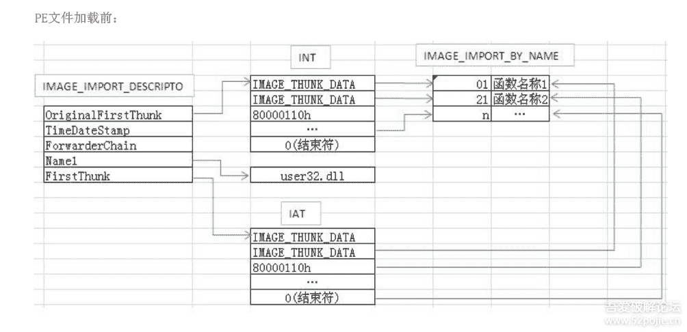
  
  `50 PE加载前.png` (193.8 KB, 下载次数: 1)
  
  [href="forum.php?mod=attachment&aid=MjYzNTEyOXwwOThjMDQ1NHwxNzkzNTczMjkzfDE2ODA4NnwxODIwMzA2&nothumb=yes" target="_blank"](https://www.52pojie.cn/forum.php?mod=attachment&aid=MjYzNTEyOXwwOThjMDQ1NHwxNzkzNTczMjkzfDE2ODA4NnwxODIwMzA2&nothumb=yes)
  
  2023-8-12 11:23 上传
  
  加载到内存后，`IAT` 表被修复，存储导入函数地址。
  
  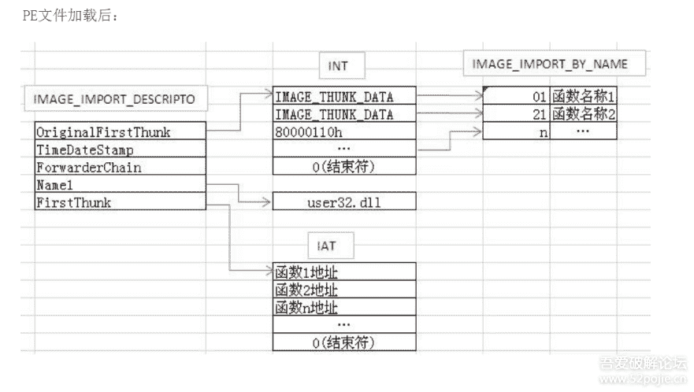
  
  `51 PE加载后.png` (160.46 KB, 下载次数: 1)
  
  [href="forum.php?mod=attachment&aid=MjYzNTEzMHwxMGVjNjFjMXwxNzkzNTczMjkzfDE2ODA4NnwxODIwMzA2&nothumb=yes" target="_blank"](https://www.52pojie.cn/forum.php?mod=attachment&aid=MjYzNTEzMHwxMGVjNjFjMXwxNzkzNTczMjkzfDE2ODA4NnwxODIwMzA2&nothumb=yes)
  
  2023-8-12 11:23 上传

- `PE` 文件加载前 `IAT` 表已经修复过。
  
  此时 `IAT` 已经保存了导入函数地址，地址 = `RVA + ImageBase`，这就是绑定导入。
  
  导入表的 `TimeDateStamp` 为 `-1` 时表示已经进行绑定导入；如果为 `0`，表示没有绑定导入。
  
  优点：启动程序快。
  
  缺点：如果没有加载到正确基址，仍然需要修复 `IAT` 表。

## 打印导入表

以 `DllTest.dll` 为例，用 `PEStudy` 打开。

上方区域有三张导入表，分别列出了 `dllname` 以及它们 `INT` 和 `IAT` 的位置。

下方区域第一列是 `IAT` 表项（即导入函数地址），第二列是 `INT` 表项的 `FOA`（`ThunkData`），第三列是 `INT` 表项指向的值（`*ThunkData`）。


打印导入表的代码


```cpp
 //打印INT表
    void PrintINT(PIMAGE_IMPORT_DESCRIPTOR pImportTable) {
        printf("\n==========INT==========\n");
        printf("ThunkRVA\tThunkFOA\tThunkVal\tFuncName\n\n");
        PIMAGE_THUNK_DATA32 pThunkData = (PIMAGE_THUNK_DATA32)(RVA2FOA(pImportTable->OriginalFirstThunk) + FileBuffer);
        while (pThunkData->u1.Ordinal) {
            //最高位为1时表示按序号导入,低31位作为序号值
            printf("%08x\t%08x\t%08x\t", FOA2RVA((DWORD)pThunkData - (DWORD)FileBuffer), (DWORD)pThunkData - (DWORD)FileBuffer, pThunkData->u1);
            if (pThunkData->u1.Ordinal & 0x80000000) {
                printf("%08x\n", pThunkData->u1.Ordinal & 0x7FFFFFFF);
            }
            //最高位为0时表示按函数名称导入,值作为指向IMAGE_IMPORT_BY_NAME结构体地址的RVA
            else
            {
                PIMAGE_IMPORT_BY_NAME pImportName = (PIMAGE_IMPORT_BY_NAME)(RVA2FOA(pThunkData->u1.AddressOfData) + FileBuffer);
                printf("%s\n", pImportName->Name);
            }
            pThunkData++;
        }
    }
    //打印IAT表
    void PrintIAT(PIMAGE_IMPORT_DESCRIPTOR pImportTable) {
        printf("\n==========IAT==========\n");
        PDWORD pThunkData = (PDWORD)(RVA2FOA(pImportTable->FirstThunk) + FileBuffer);
        printf(" FuncRVA\t FuncFOA\tFuncAddr\n");
            while (*pThunkData) {
                printf("%08x\t%08x\t%08x\n", *pThunkData,RVA2FOA(*pThunkData), *pThunkData+imageBase);
                pThunkData++;
            }
    }
    //打印导入表
    void PrintImportTable() {
        PIMAGE_IMPORT_DESCRIPTOR pImportTable = pImportDescriptor;
        printf("\n**********导入表**********\n");
        printf("DllName\t\t\t INT RVA\tTimeStamp\tIAT RVA\n");
        while (pImportTable->OriginalFirstThunk) {
            printf("%-24s%08x\t%08x\t%08x\n", (RVA2FOA(pImportTable->Name) + FileBuffer),pImportTable->OriginalFirstThunk,pImportTable->TimeDateStamp,pImportTable->FirstThunk);
            pImportTable++;
        }

        pImportTable = pImportDescriptor;
        while (pImportTable->OriginalFirstThunk) {

            printf("\n==========DllName:%s==========\n", RVA2FOA(pImportTable->Name) + FileBuffer);
            PrintINT(pImportTable);
            PrintIAT(pImportTable);

            pImportTable++;
        }
        printf("\n**********导入表**********\n");
    }
```

## 运行结果

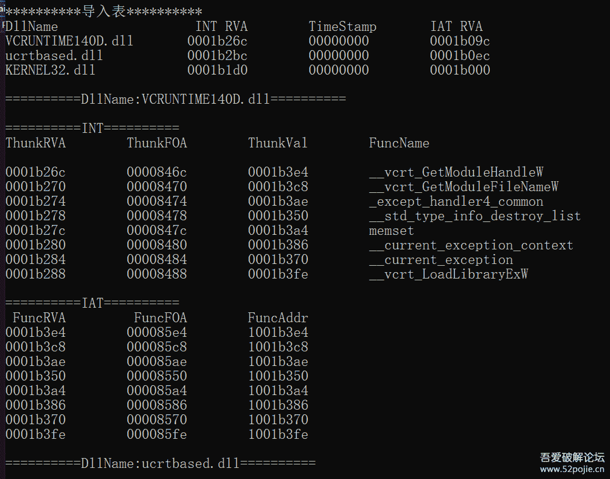

47 打印导入表.png (83.73 KB, 下载次数: 1)

[href="forum.php?mod=attachment&aid=MjYzNTEzMXxjYzRlMTFjZHwxNzkzNTczMjkzfDE2ODA4NnwxODIwMzA2&nothumb=yes" target="_blank"](https://www.52pojie.cn/forum.php?mod=attachment&aid=MjYzNTEzMXxjYzRlMTFjZHwxNzkzNTczMjkzfDE2ODA4NnwxODIwMzA2&nothumb=yes)

2023-8-12 11:23 上传

## 参考资料

- [//www.bilibili.com/video/BV1w54y1y7Di?p=55&vd_source=8c182d1e4a80cc9f34dfe996135c2c23" target="_blank" rel="noopener noreferrer nofollow"](https://www.bilibili.com/video/BV1w54y1y7Di?p=55&vd_source=8c182d1e4a80cc9f34dfe996135c2c23:rel="nofollow noopener" href="https)
- [//tttang.com/archive/1553/" target="_blank" rel="noopener noreferrer nofollow"](https://tttang.com/archive/1553/:rel="nofollow noopener" href="https)
- [//thunderjie.github.io/2019/03/27/PE%E7%BB%93%E6%9E%84%E8%AF%A6%E8%A7%A3/" target="_blank" rel="noopener noreferrer nofollow"](https://thunderjie.github.io/2019/03/27/PE%E7%BB%93%E6%9E%84%E8%AF%A6%E8%A7%A3/:rel="nofollow noopener" href="https)
- [//blog.csdn.net/weixin_43655282/article/details/104291312" target="_blank" rel="noopener noreferrer nofollow"](https://blog.csdn.net/weixin_43655282/article/details/104291312:rel="nofollow noopener" href="https)
- [//www.bilibili.com/video/BV1By4y1r7Cq?p=148" target="_blank" rel="noopener noreferrer nofollow"](https://www.bilibili.com/video/BV1By4y1r7Cq?p=148:rel="nofollow noopener" href="https)
- [//www.kanxue.com/chm.htm?id=16807&pid=node1001252" target="_blank" rel="noopener noreferrer nofollow"](https://www.kanxue.com/chm.htm?id=16807&pid=node1001252:rel="nofollow noopener" href="https)

## 完整代码

```cpp
#include

#include

#include 

#include 

using namespace std;

class PEFile {

private:

    HANDLE hFile;                                   //文件句柄

    HANDLE hProcess;                                //进程句柄

    DWORD ProcessBaseAddr;                          //进程基址

    BYTE* FileBuffer;                               //文件缓冲指针

    BYTE* imageBuffer;                              //映像缓冲指针

    DWORD fileBufferSize;                           //文件缓冲大小

    DWORD imageBufferSize;                          //映像缓冲大小

    //FileBuffer的各个指针

    PIMAGE_DOS_HEADER pDosHeader;                   //Dos头

    PIMAGE_NT_HEADERS pNtHeader;                    //NT头

    PIMAGE_FILE_HEADER pFileHeader;                 //标准PE头

    PIMAGE_OPTIONAL_HEADER pOptionalHeader;         //扩展PE头

    PIMAGE_DATA_DIRECTORY pDataDirectory;           //数据目录表

    PIMAGE_EXPORT_DIRECTORY pExportDirectory;       //导出表

    PIMAGE_BASE_RELOCATION pBaseRelocation;         //重定位表

    PIMAGE_IMPORT_DESCRIPTOR pImportDescriptor;     //导入表

    PIMAGE_SECTION_HEADER pSectionHeader;           //节表

    //dos头关键成员

    WORD dosSignature;          //dos签名

    LONG   NToffset;            //nt头偏移

    //NT头关键成员

    DWORD peSignature;

    //标准PE头关键成员

    WORD Machine;               //cpu型号

    DWORD numberOfSections;     //节区数

    WORD sizeOfOptionalHeader;  //可选pe头大小

    //可选PE头关键成员

    DWORD addressOfEntryPoint;  //程序入口点EP

    DWORD imageBase;            //内存镜像基址

    DWORD sectionAlignment;     //内存对齐大小

    DWORD fileAlignment;        //文件对齐大小

    DWORD sizeOfImage;          //内存映像大小

    DWORD sizeOfHeaders;        //各种头的大小

    //初始化各个表头指针

    void InitHeaders() {

        pDosHeader = (IMAGE_DOS_HEADER*)FileBuffer;//DOS头

        pNtHeader = (IMAGE_NT_HEADERS*)(FileBuffer + pDosHeader->e_lfanew);//NT头

        pFileHeader = (IMAGE_FILE_HEADER*)((DWORD)pNtHeader + sizeof(DWORD));//标准PE头

        pOptionalHeader = (IMAGE_OPTIONAL_HEADER*)((DWORD)pFileHeader + sizeof(IMAGE_FILE_HEADER));//可选PE头

        pSectionHeader = (IMAGE_SECTION_HEADER*)((DWORD)pOptionalHeader + pFileHeader->SizeOfOptionalHeader);//节表

        pDataDirectory = (PIMAGE_DATA_DIRECTORY)(pOptionalHeader->DataDirectory);//数据目录表

        pBaseRelocation = (PIMAGE_BASE_RELOCATION)(FileBuffer + RVA2FOA(pDataDirectory[IMAGE_DIRECTORY_ENTRY_BASERELOC].VirtualAddress));//重定位表

        pImportDescriptor = (PIMAGE_IMPORT_DESCRIPTOR)(FileBuffer + RVA2FOA(pDataDirectory[IMAGE_DIRECTORY_ENTRY_IMPORT].VirtualAddress));//导入表

        if (pDataDirectory[IMAGE_DIRECTORY_ENTRY_EXPORT].VirtualAddress != 0)//如果存在导出表则获取导出表地址,否则置空

            pExportDirectory = (PIMAGE_EXPORT_DIRECTORY)(FileBuffer + RVA2FOA(pDataDirectory[IMAGE_DIRECTORY_ENTRY_EXPORT].VirtualAddress));//导出表

        else pExportDirectory = NULL;

    }

    //初始化FileBuffer关键成员

    void InitKeyMembers() {

        //dos头

        dosSignature = pDosHeader->e_magic;

        NToffset = pDosHeader->e_lfanew;

        //NT头

        peSignature = pNtHeader->Signature;

        //标准PE头 20字节

        Machine = pFileHeader->Machine;

        numberOfSections = pFileHeader->NumberOfSections;

        sizeOfOptionalHeader = pFileHeader->SizeOfOptionalHeader;

        //可选头,根据32/64位有不同大小

        addressOfEntryPoint = pOptionalHeader->AddressOfEntryPoint;

        imageBase = pOptionalHeader->ImageBase;

        sectionAlignment = pOptionalHeader->SectionAlignment;

        fileAlignment = pOptionalHeader->FileAlignment;

        sizeOfImage = pOptionalHeader->SizeOfImage;

        sizeOfHeaders = pOptionalHeader->SizeOfHeaders;

    }

    //打印DOS头

    void showDosHeader() {

        printf("\n----------DosHeader----------\n");

        printf("DosSignature: %x\n", dosSignature);

        printf("NtHeaderOffset: %x\n", NToffset);

        printf("\n----------DosHeader----------\n");

    }

    //打印标准Pe头

    void showFileHeader() {

        printf("\n----------FileHeader----------\n");

        printf("Machine: %x\n", Machine);
```


```
        printf("NumberOfSections: %x\n", numberOfSections);
        printf("SizeOfOptionalHeader: %x\n", sizeOfOptionalHeader);
        printf("\n----------FileHeader----------\n");
    }

    //打印可选PE头
    void showOptionalHeader() {
        printf("\n----------OptionalHeader----------\n");
        printf("EntryPoint: %x\n", addressOfEntryPoint);
        printf("ImageBase: %x\n", imageBase);
        printf("SectionAlignment: %x\n", sectionAlignment);
        printf("FileAlignment: %x\n", fileAlignment);
        printf("SizeOfImage; %x\n", sizeOfImage);
        printf("SizeOfHeaders: %x\n", sizeOfHeaders);
        printf("\n----------OptionalHeader----------\n");
    }

    //打印NT头
    void showNtHeader() {
        printf("\n-----------NtHeader----------\n");
        printf("PeSignature: %x\n", peSignature);
        showFileHeader();
        showOptionalHeader();
        printf("\n-----------NtHeader----------\n");
    }

    //打印节表
    void showSectionHeaders() {
        printf("\n----------SectionHeaders----------\n");
        for (DWORD i = 0; i DataDirectory;
        printf("\n**********数据目录表**********\n");
        for (DWORD i = 0; i NumberOfRvaAndSizes; i++) {
            switch (i) {
            case IMAGE_DIRECTORY_ENTRY_EXPORT:
                printf("\n==========导出表==========\n");
                break;
            case IMAGE_DIRECTORY_ENTRY_IMPORT:
                printf("\n==========导入表==========\n");
                break;
            case IMAGE_DIRECTORY_ENTRY_RESOURCE:
                printf("\n==========资源目录==========\n");
                break;
            case IMAGE_DIRECTORY_ENTRY_EXCEPTION:
                printf("\n==========异常目录==========\n");
                break;
            case IMAGE_DIRECTORY_ENTRY_SECURITY:
                printf("\n==========安全目录=========\n");
                break;
            case IMAGE_DIRECTORY_ENTRY_BASERELOC:
                printf("\n==========重定位基本表==========\n");
                break;
            case IMAGE_DIRECTORY_ENTRY_DEBUG:
                printf("\n==========调试目录==========\n");
                break;
            case IMAGE_DIRECTORY_ENTRY_ARCHITECTURE:
                printf("\n==========描述字串==========\n");
                break;
            case IMAGE_DIRECTORY_ENTRY_GLOBALPTR:
                printf("\n==========机器值==========\n");
                break;
            case IMAGE_DIRECTORY_ENTRY_TLS:
                printf("\n==========TLS目录==========\n");
                break;
            case IMAGE_DIRECTORY_ENTRY_LOAD_CONFIG:
                printf("\n==========载入配置目录==========\n");
                break;
            case IMAGE_DIRECTORY_ENTRY_BOUND_IMPORT:
                printf("\n==========绑定输入表==========\n");
                break;
            case IMAGE_DIRECTORY_ENTRY_IAT:
                printf("\n==========导入地址表==========\n");
                break;
            case IMAGE_DIRECTORY_ENTRY_DELAY_IMPORT:
                printf("\n==========延迟导入表==========\n");
                break;
            case IMAGE_DIRECTORY_ENTRY_COM_DESCRIPTOR:
                printf("\n==========COM信息==========\n");
                break;
            case 15:
                printf("\n==========保留表==========\n");
                break;
            }
            printf("VirtualAddress=%x\nSize=%x\nFOA=%x\n", pDirectory[i].VirtualAddress, pDirectory[i].Size, RVA2FOA(pDirectory[i].VirtualAddress));
        }
        printf("\n**********数据目录表打印完毕**********\n\n");
    }

    //通过函数名获取导出函数地址
    DWORD GetFuncAddrByName(const char* FuncName) {
        WORD* pExportFuncOridinalsTable = (WORD*)(RVA2FOA(pExportDirectory->AddressOfNameOrdinals) + FileBuffer);//导出函数序号表
        DWORD* pExportFuncAddressTable = (DWORD*)(RVA2FOA(pExportDirectory->AddressOfFunctions) + FileBuffer);//导出函数地址表
        DWORD* pExportFuncNamesTable = (DWORD*)(RVA2FOA(pExportDirectory->AddressOfNames) + FileBuffer);//导出函数名称表
        DWORD pos = -1, OridinalNum = 0;
        //1. 通过导出函数名称表得到序号表下标
        for (DWORD i = 0; i NumberOfNames; i++) {
            //注意导出函数名称表表项是字符串指针 该指针值为RVA
            if (strcmp(FuncName, (char*)(RVA2FOA(pExportFuncNamesTable[i]) + FileBuffer)) == 0)
            {
                pos = i;
                break;
            }
        }
        if (pos == -1)//查找失败
            return 0;
        //2. 通过序号表得到序号
        OridinalNum = pExportFuncOridinalsTable[pos];
        //3. 得到函数地址
        return pExportFuncAddressTable[OridinalNum];
    }

    //通过函数序号获取导出函数地址
    DWORD GetFuncAddrByOridinals(WORD OridinalNum) {
        DWORD* pExportFuncAddressTable = (DWORD*)(RVA2FOA(pExportDirectory->AddressOfFunctions) + FileBuffer);//导出函数地址表
        return pExportFuncAddressTable[OridinalNum - pExportDirectory->Base];//减去Base值作为索引直接查找函数地址
    }

    //根据导出函数序号返回导出函数名
    PCHAR GetFuncNameByOridinals(WORD OridinalNum) {
        WORD* pExportFuncOridinalsTable = (WORD*)(RVA2FOA(pExportDirectory->AddressOfNameOrdinals) + FileBuffer);//导出函数序号表
        DWORD* pExportFuncNamesTable = (DWORD*)(RVA2FOA(pExportDirectory->AddressOfNames) + FileBuffer);//导出函数名称表
        for (DWORD i = 0; i NumberOfNames; i++)
        {
            if (pExportFuncOridinalsTable[i] == OridinalNum)//实际存储的序号=函数序号-base
                return (PCHAR)(RVA2FOA(pExportFuncNamesTable[i]) + FileBuffer);
        }
        return NULL;//没有找到说明是无名函数
    }

    //打印导出表详细信息
    void PrintExportDirectory() {
        //不存在导出表
        if (!pExportDirectory)
        {
            printf("**********不存在导出表**********\n");
            return;
        }
        printf("\n==========导出表==========\n");
        printf("Name: %x (%s)\n", pExportDirectory->Name, (char*)(FileBuffer + RVA2FOA(pExportDirectory->Name)));
        printf("Base: %x\n", pExportDirectory->Base);
        printf("NumberOfFunctions: \t%x\n", pExportDirectory->NumberOfFunctions);
        printf("NumberOfNames: \t\t%x\n", pExportDirectory->NumberOfNames);
        printf("AddressOfFunctions: \tRVA=%x\tFOA=%x\n", pExportDirectory->AddressOfFunctions, RVA2FOA(pExportDirectory->AddressOfFunctions));
        printf("AddressOfNames: \tRVA=%x\tFOA=%x\n", pExportDirectory->AddressOfNames, RVA2FOA(pExportDirectory->AddressOfNames));
        printf("AddressOfNameOrdinals: \tRVA=%x\tFOA=%x\n", pExportDirectory->AddressOfNameOrdinals, RVA2FOA(pExportDirectory->AddressOfNameOrdinals));
        WORD* pExportFuncOridinalsTable = (WORD*)(RVA2FOA(pExportDirectory->AddressOfNameOrdinals) + FileBuffer);//导出函数序号表
        DWORD* pExportFuncAddressTable = (DWORD*)(RVA2FOA(pExportDirectory->AddressOfFunctions) + FileBuffer);//导出函数地址表
        DWORD* pExportFuncNamesTable = (DWORD*)(RVA2FOA(pExportDirectory->AddressOfNames) + FileBuffer);//导出函数名称表
        printf("\nOridinal\t     RVA\t     FOA\tFunctionName\n");
        for (DWORD i = 0; i NumberOfFunctions; i++) {
            if (pExportFuncAddressTable[i] == 0)//地址为零则跳过
                continue;
            PCHAR FuncName = NULL;
            //由于导出函数序号表仅保存有名函数序号,所以有序号必定有名称,否则无名称
            //函数序号=函数地址表下标+Base
            printf("%08x\t%08x\t%08x\t", i + pExportDirectory->Base, pExportFuncAddressTable[i], RVA2FOA(pExportFuncAddressTable[i]));
            //是否存在函数名要单独判断 存储序号=函数序号-Base,故传递i即可
            if (FuncName = GetFuncNameByOridinals(i))
                printf("%s\n", FuncName);
            else
                printf("NONAME\n");
        }
        printf("\n==========导出表结束==========\n");
    }

    //打印重定位表的某个块
    void PrintRelocationBlock(PIMAGE_BASE_RELOCATION pRelocationBlock) {
        PWORD pBlock = (PWORD)((DWORD)pRelocationBlock + 8);//注意每个表项占2字节 但是高4位用来判断是否需要修改
        DWORD PageOffset = pRelocationBlock->VirtualAddress;//每个块的虚拟地址即为页面起始地址
        printf("序号\t属性\t     RVA\t     FOA\t指向RVA\n");
        for (DWORD i = 0; i SizeOfBlock - 8) / 2; i++) {
            //每块高四位用作属性判断,低12位才是页内偏移值 还要注意与运算优先级低于+ 不用括号会导致出错
```


```cpp
//指向的RVA即需要矫正的地址

printf("%04x\t%4x\t%08x\t%08x\t%08x\n", i, pBlock[i] >> 12, (pBlock[i] & 0x0fff) + PageOffset, RVA2FOA((pBlock[i] & 0x0fff) + PageOffset), *(DWORD*)(FileBuffer + RVA2FOA((pBlock[i] & 0x0fff) + PageOffset)) & 0x00ffffff);

}

}

//打印重定位表

void PrintRelocationTable() {

    PIMAGE_BASE_RELOCATION pRelocationTable = pBaseRelocation;

    printf("\n==========重定位表==========\n");

    printf("序号\t    区段\t     RVA\t     FOA\t项目数\n");

    //表块全为0时结束

    DWORD count = 0;

    while (pRelocationTable->VirtualAddress || pRelocationTable->SizeOfBlock) {

        //项目数=(sizeofBlock-8)/2

        printf("%4d\t%8s\t%08x\t%08x\t%08x\n", count++, GetSectionNameByRva(pRelocationTable->VirtualAddress), pRelocationTable->VirtualAddress, RVA2FOA(pRelocationTable->VirtualAddress), (pRelocationTable->SizeOfBlock - 8) / 2);

        pRelocationTable = (PIMAGE_BASE_RELOCATION)((DWORD)pRelocationTable + pRelocationTable->SizeOfBlock);//注意这里应该将指针值强转后+块大小指向下一个块

    }

    pRelocationTable = pBaseRelocation;

    count = 0;

    while (pRelocationTable->VirtualAddress || pRelocationTable->SizeOfBlock) {

        printf("\n==========Block%d==========\n", count++);

        PrintRelocationBlock(pRelocationTable);//打印第i个块

        pRelocationTable = (PIMAGE_BASE_RELOCATION)((DWORD)pRelocationTable + pRelocationTable->SizeOfBlock);

    }

    printf("\n==========重定位表结束==========\n");

}

//打印INT表

void PrintINT(PIMAGE_IMPORT_DESCRIPTOR pImportTable) {

    printf("\n==========INT==========\n");

    printf("ThunkRVA\tThunkFOA\tThunkVal\tFuncName\n\n");

    PIMAGE_THUNK_DATA32 pThunkData = (PIMAGE_THUNK_DATA32)(RVA2FOA(pImportTable->OriginalFirstThunk) + FileBuffer);

    while (pThunkData->u1.Ordinal) {

        //最高位为1时表示按序号导入,低31位作为序号值

        printf("%08x\t%08x\t%08x\t", FOA2RVA((DWORD)pThunkData - (DWORD)FileBuffer), (DWORD)pThunkData - (DWORD)FileBuffer, pThunkData->u1.Ordinal);

        if (pThunkData->u1.Ordinal & 0x80000000) {

            printf("%08x\n", pThunkData->u1.Ordinal & 0x7FFFFFFF);

        }

        //最高位为0时表示按函数名称导入,值作为指向IMAGE_IMPORT_BY_NAME结构体地址的RVA

        else

        {

            PIMAGE_IMPORT_BY_NAME pImportName = (PIMAGE_IMPORT_BY_NAME)(RVA2FOA(pThunkData->u1.AddressOfData) + FileBuffer);

            printf("%s\n", pImportName->Name);

        }

        pThunkData++;

    }

}

//打印IAT表

void PrintIAT(PIMAGE_IMPORT_DESCRIPTOR pImportTable) {

    printf("\n==========IAT==========\n");

    PDWORD pThunkData = (PDWORD)(RVA2FOA(pImportTable->FirstThunk) + FileBuffer);

    printf(" FuncRVA\t FuncFOA\tFuncAddr\n");

        while (*pThunkData) {

            printf("%08x\t%08x\t%08x\n", *pThunkData,RVA2FOA(*pThunkData), *pThunkData+imageBase);

            pThunkData++;

        }

}

//打印导入表

void PrintImportTable() {

    PIMAGE_IMPORT_DESCRIPTOR pImportTable = pImportDescriptor;

    printf("\n**********导入表**********\n");

    printf("DllName\t\t\t INT RVA\tTimeStamp\tIAT RVA\n");

    while (pImportTable->OriginalFirstThunk) {

        printf("%-24s%08x\t%08x\t%08x\n", (RVA2FOA(pImportTable->Name) + FileBuffer),pImportTable->OriginalFirstThunk,pImportTable->TimeDateStamp,pImportTable->FirstThunk);

        pImportTable++;

    }

    pImportTable = pImportDescriptor;

    while (pImportTable->OriginalFirstThunk) {

        printf("\n==========DllName:%s==========\n", RVA2FOA(pImportTable->Name) + FileBuffer);

        PrintINT(pImportTable);

        PrintIAT(pImportTable);

        pImportTable++;

    }

    printf("\n**********导入表**********\n");

}

//通过RVA判断所属区段名

PCHAR GetSectionNameByRva(DWORD RVA) {

    for (DWORD i = 0; i = pSectionHeader[i].VirtualAddress && RVA = pSectionHeader[i].VirtualAddress && RVA = pSectionHeader[i].PointerToRawData && FOA NumberOfSections = ++numberOfSections;         //NumberOfSections +1

    //节区头 

    memcpy(pNewSectionHeader->Name, NewSectionName, strlen(NewSectionName));//name

    pNewSectionHeader->Misc.VirtualSize = NewSectionSize;               //virtualsize

    //注意这里必须先修改VirtualAddress

    //virtualaddress 各段间是紧邻着的 所以可以根据上个段的末尾来确定新段的起始地址 上个段的起始地址+上个段的大小对于0x1000向上取整即可

    pNewSectionHeader->VirtualAddress = AlignSize(pSectionHeader[numberOfSections - 2].VirtualAddress + pSectionHeader[numberOfSections - 2].SizeOfRawData, 0x1000);

    pNewSectionHeader->SizeOfRawData = NewSectionSize;//SizeOfRawData

    //PointerToRawData 文件偏移=上个段的文件起始地址+段在文件中的大小

    pNewSectionHeader->PointerToRawData = pSectionHeader[numberOfSections - 2].PointerToRawData + pSectionHeader[numberOfSections - 2].SizeOfRawData;

    pNewSectionHeader->Characteristics |= 0x20000000;           //Characteristics 可执行权限

    //可选头

    pOptionalHeader->SizeOfImage = sizeOfImage = sizeOfImage + AlignSize(NewSectionSize, 0x1000);//可选PE头 SizeOfImage 必须是内存对齐的整数倍 直接添加一页大小

    return pNewSectionHeader;

}

//通过创建新节区的方式注入代码

BOOL InjectCodeByCreateNewSection() {

    //1. 创建新的节区

    PIMAGE_SECTION_HEADER pNewSectionHeader = CreateNewSection(".inject", 0x1000);

    //修正可选头

    DWORD OEP = addressOfEntryPoint; //保存OEP

    pOptionalHeader->DllCharacteristics &= 0xFFFFFFBF;//取消ASLR随机基址 随机基址的值是0x40 所以和(0xFFFFFFFF-0x40)进行与运算即可

    pOptionalHeader->AddressOfEntryPoint = addressOfEntryPoint = pNewSectionHeader->VirtualAddress;//修改EP 注意ep=rva 不用加基址

    //2. 将代码写入新的节区

    BYTE InjectCode[18] = {         //偏移  指令

        0x6a,0x00,                  //0     push 0

        0x6a,0x00,                  //0     push 0

        0x6a,0x00,                  //0     push 0

        0x6a,0x00,                  //0     push 0

        0xe8,0x00,0x00,0x00,0x00,   //8     call MessageBox MessageBox=0x763C0E50 这个地址会随着系统启动而变化

        0xe9,0x00,0x00,0x00,0x00    //13    jmp oep

    };

    DWORD MessageBoxAddr = 0x76260E50;

    //矫正call和jmp地址 

    *(DWORD*)&InjectCode[9] = OffsetOfCallAndJmp(MessageBoxAddr, imageBase + pNewSectionHeader->VirtualAddress + 8);

    *(DWORD*)&InjectCode[14] = OffsetOfCallAndJmp(OEP, pNewSectionHeader->VirtualAddress + 13);//跳转回oep正常执行程序     

    memcpy(FileBuffer + pNewSectionHeader->PointerToRawData, InjectCode, sizeof(InjectCode));//将代码写入新的内存空间            

    //3. 保存文件

    return FileBufferWriteToFile(L"InjectCodeByCreateNewSection1.exe");

}

//扩大节区

BOOL ExpandSection(DWORD ExSize) {

    //扩大节区大小是针对ImageBuffer而言的,所以我们添加的大小要进行内存对齐

    //1. 申请一块新空间

    ExpandFileBuffer(ExSize);       //注意这个节表指针要在申请新空间之后

    PIMAGE_SECTION_HEADER pLastSectionHeader = &pSectionHeader[numberOfSections - 1];//只能扩大最后一个节区

    //2. 调整SizeOfImage

    //如果VirtualSize+ExSize超过了AlignSize(VirtualSize,0x1000) 那么需要调整,否则不需要改变

    //例如vs=0x500 ex=0x400 显然,原始vs内存对齐也会占0x1000 扩展后没有超过0x1000

    //取文件大小和内存大小的最大值

    //先计算扩展后的内存对齐值和扩展前的内存对齐值之间的差值

    DWORD AlignExImage = AlignSize(pLastSectionHeader->Misc.VirtualSize + ExSize, 0x1000) -

        AlignSize(max(pLastSectionHeader->Misc.VirtualSize, pLastSectionHeader->SizeOfRawData), 0x1000);//内存对齐后的值

    if (AlignExImage > 0)//如果差值>0说明需要扩展映像 否则内存对齐的空白区足够存储扩展区

        pOptionalHeader->SizeOfImage = sizeOfImage = sizeOfImage + AlignExImage;

    //3. 修改文件大小和内存大小 注意要在修改sizeofimage后再更新这两个值

    pLastSectionHeader->SizeOfRawData += AlignSize(ExSize, 0x200);//文件大小必须是文件对齐整数倍

    pLastSectionHeader->Misc.VirtualSize += ExSize;//由于是内存对齐前的大小,所以直接加上文件对齐后的大小即可

    //4. 保存文件

    return FileBufferWriteToFile(L"ExpandSectionFile.exe");

}

//合并所有节区为1个 

BOOL CombineSection() {

    //1. 直接修改ImageBuffer
```


```cpp
PIMAGE_DOS_HEADER pDosHeaderOfImage = (PIMAGE_DOS_HEADER)imageBuffer;

PIMAGE_NT_HEADERS pNtHeadersOfImage = (PIMAGE_NT_HEADERS)(imageBuffer + pDosHeader->e_lfanew);

PIMAGE_FILE_HEADER pFileHeaderOfImage = (PIMAGE_FILE_HEADER)(&pNtHeadersOfImage->FileHeader);

PIMAGE_OPTIONAL_HEADER pOptionalHeaderOfImage = (PIMAGE_OPTIONAL_HEADER)(&pNtHeadersOfImage->OptionalHeader);

PIMAGE_SECTION_HEADER pSectionHeaderOfImage = (PIMAGE_SECTION_HEADER)((DWORD)pOptionalHeaderOfImage + pFileHeaderOfImage->SizeOfOptionalHeader);

//复制节区属性

for (DWORD i = 1; i SizeOfHeaders = AlignSize(sizeOfHeaders - (numberOfSections - 1) * sizeof(IMAGE_SECTION_HEADER), 0x200);//调整头大小

//删除其他节表

memset(&pSectionHeaderOfImage[1], 0, sizeof(IMAGE_SECTION_HEADER) * (numberOfSections - 1));

pFileHeaderOfImage->NumberOfSections = 1;

return ImageBufferWriteToFile(L"CombineSection1.exe");

}

~PEFile() {

if (FileBuffer) //释放空间
    delete[] FileBuffer;

if (imageBuffer)
    delete[] imageBuffer;

if (hProcess)
    CloseHandle(hProcess);

}

};

int main() {

//PEFile peFile = PEFile(L"C:\\Users\\admin\\Desktop\\DailyExercise.exe");

PEFile peFile = PEFile(L"C:\\Users\\admin\\Desktop\\DllTest.dll");

peFile.showPeFile();

return 0;

}
```

### 附: 示例程序文件


[href="forum.php?mod=attachment&aid=MjYzNTEzNHw5OGM2OWY1ZXwxNzkzNTczMjkzfDE2ODA4NnwxODIwMzA2" target="_blank"](https://www.52pojie.cn/forum.php?mod=attachment&aid=MjYzNTEzNHw5OGM2OWY1ZXwxNzkzNTczMjkzfDE2ODA4NnwxODIwMzA2)

(66.85 KB, 下载次数: 36)

2023-8-12 11:26 上传

点击文件名下载附件

下载积分: 吾爱币 -1 CB
