# [.NET逆向] 某VS调试插件 逆向分析

- 原帖: https://www.52pojie.cn/forum.php?mod=viewthread&tid=1822662
- 抓取时间: 2026-11-01T22:48:03

## 前情提要

想起来以前用过的一个 VS 调试插件，拿来调试 `Linq` 和过滤列表啥的还挺舒服。

以前这类都是找现成的，现在办公电脑不太好弄那些玩意，所以要不自己动手试试？

顺便水一贴~

## 官方地址

https://oz-code.com/

看了眼，似乎被收购了，飘了，现在文档啥的都没了，怎么用估计还得自己摸索和找博客，看着也挺久没更新了...

可以在官网下，也可以直接通过 VS 里面的扩展工具搜应该也能搜到。

## 开始分析

先装起来，打开 VS 然后切到插件的 About 菜单。

[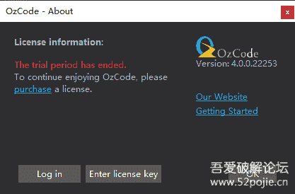](https://www.52pojie.cn/forum.php?mod=attachment&aid=MjYzNjUwN3wyZjM2NjVhOHwxNzkzNTczMjgxfDE2ODA4NnwxODIyNjYy) (19.43 KB, 下载次数: 1) 2023-8-18 11:28 上传

啥也不干点下注册看看。

[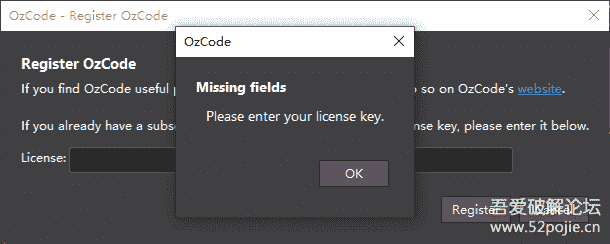](https://www.52pojie.cn/forum.php?mod=attachment&aid=MjYzNjUwOHxjYmRiMDViYnwxNzkzNTczMjgxfDE2ODA4NnwxODIyNjYy) (21.61 KB, 下载次数: 1) 2023-8-18 11:30 上传

然后找下插件目录，用 Everything 搜一下 `*ozcode*.dll`。

[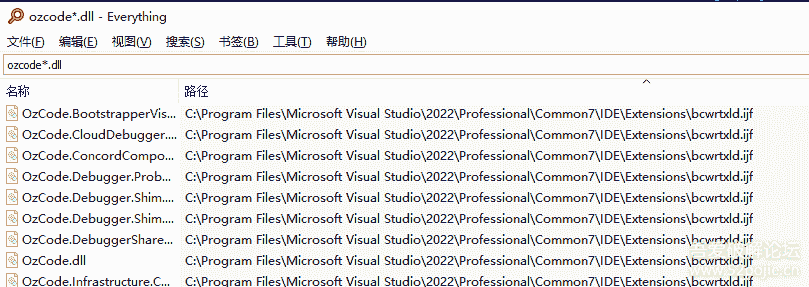](https://www.52pojie.cn/forum.php?mod=attachment&aid=MjYzNjUwOXwxM2M4YWFkMXwxNzkzNTczMjgxfDE2ODA4NnwxODIyNjYy) (49.9 KB, 下载次数: 0) 2023-8-18 11:30 上传

根据以前搜索过的工具介绍，前人似乎都是动的 `DebuggerShared.dll`，所以站下肩膀不过分。

我们也在里面搜一下关键词啥的。

[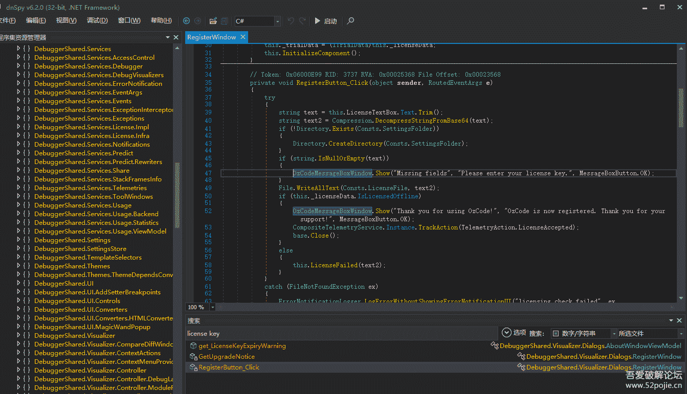](https://www.52pojie.cn/forum.php?mod=attachment&aid=MjYzNjUxMHxiZWI5YzM0NXwxNzkzNTczMjgxfDE2ODA4NnwxODIyNjYy) (138.97 KB, 下载次数: 1) 2023-8-18 11:30 上传

ヽ(✿ﾟ▽ﾟ)ノ 好耶，无壳无花！

[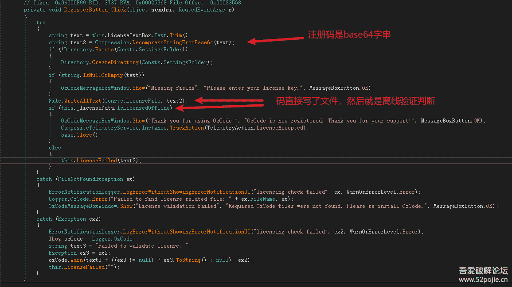](https://www.52pojie.cn/forum.php?mod=attachment&aid=MjYzNjUxMXxmYmY2M2QwNXwxNzkzNTczMjgxfDE2ODA4NnwxODIyNjYy) (53.59 KB, 下载次数: 0) 2023-8-18 11:30 上传

[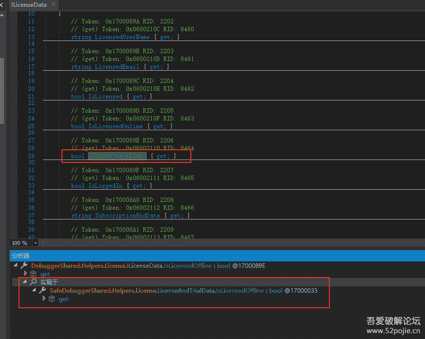](https://www.52pojie.cn/forum.php?mod=attachment&aid=MjYzNjUxMnw0MjdhNDEyYXwxNzkzNTczMjgxfDE2ODA4NnwxODIyNjYy) (38.24 KB, 下载次数: 1) 2023-8-18 11:30 上传

[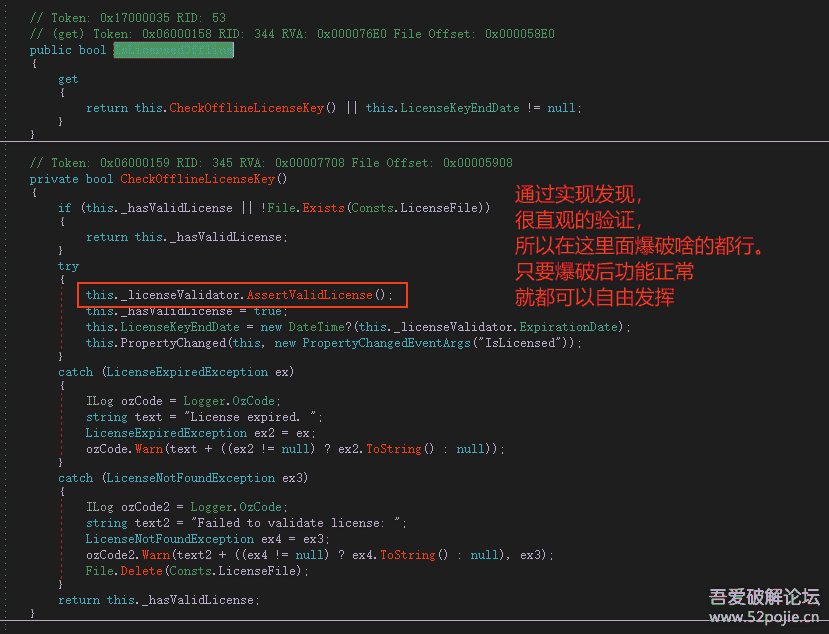](https://www.52pojie.cn/forum.php?mod=attachment&aid=MjYzNjUxM3w4ZTVkNTk4M3wxNzkzNTczMjgxfDE2ODA4NnwxODIyNjYy) (49.67 KB, 下载次数: 2) 2023-8-18 11:30 上传

继续跟验证函数。

[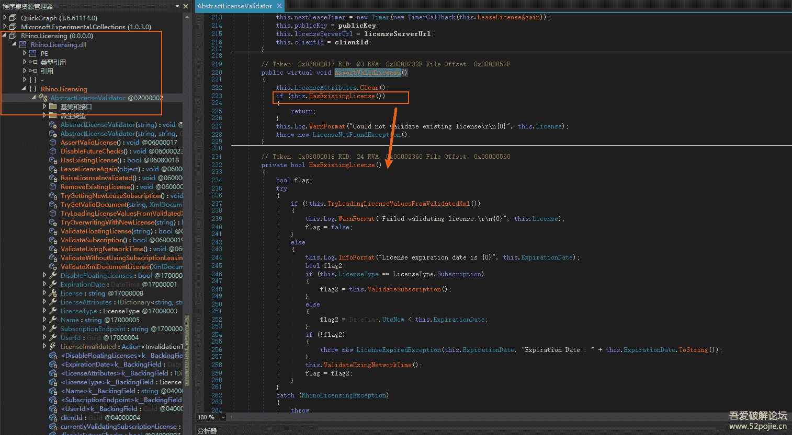](https://www.52pojie.cn/forum.php?mod=attachment&aid=MjYzNjUxNHw2MDk4YmU5N3wxNzkzNTczMjgxfDE2ODA4NnwxODIyNjYy) (153.03 KB, 下载次数: 1) 2023-8-18 11:30 上传

发现逻辑换到了 `Rhino.Licensing.dll`。

继续走流程

[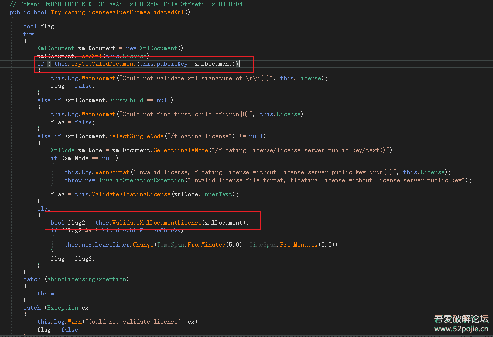](https://www.52pojie.cn/forum.php?mod=attachment&aid=MjYzNjUxNXw1Mjk4YWY4OXwxNzkzNTczMjgxfDE2ODA4NnwxODIyNjYy) (31.96 KB, 下载次数: 1) 2023-8-18 11:30 上传

分析得出，注册码本体是 是一个许可证 XML，然后会被处理为 Base64。

[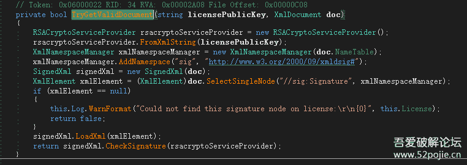](https://www.52pojie.cn/forum.php?mod=attachment&aid=MjYzNjUxNnw3OTM1M2VhZHwxNzkzNTczMjgxfDE2ODA4NnwxODIyNjYy) (19.38 KB, 下载次数: 1) 2023-8-18 11:30 上传

有看到 `publickey` 和熟悉的 `bool` 验签，这里也是个爆破点。

再继续走流程

[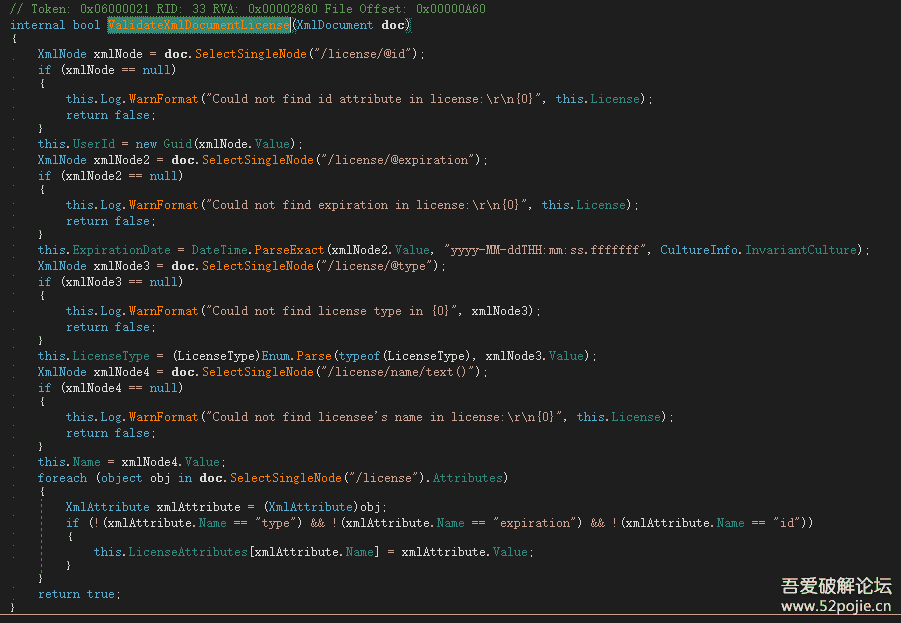](https://www.52pojie.cn/forum.php?mod=attachment&aid=MjYzNjUxN3w4MDI3MzI0OHwxNzkzNTczMjgxfDE2ODA4NnwxODIyNjYy) (31.17 KB, 下载次数: 1) 2023-8-18 11:30 上传

许可证的结构就有了。

然后咱简单看了眼这个库，兄弟们康我发现了啥~

[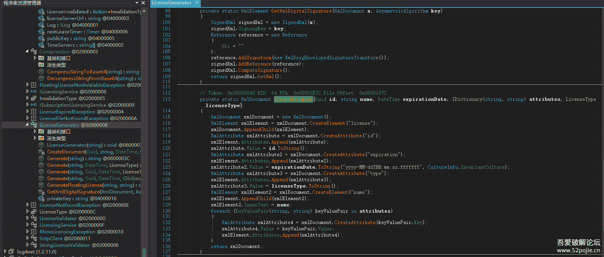](https://www.52pojie.cn/forum.php?mod=attachment&aid=MjYzNjUxOXxiZjg0OWQ3YnwxNzkzNTczMjgxfDE2ODA4NnwxODIyNjYy) (129.42 KB, 下载次数: 1) 2023-8-18 11:30 上传

另外，因为这个库不是 OZ 关键词相关，所以直接上网搜了下 `Rhino.Licensing.dll`。

发现是个开源的验证组件。

https://github.com/hibernating-rhinos/rhino-licensing

emmmm，那么许可证就可以自己生成了，前提是 Patch 掉那段验签的逻辑。

直接 `return true` 就行。

咱们再看看解析 Base64 的部分。

[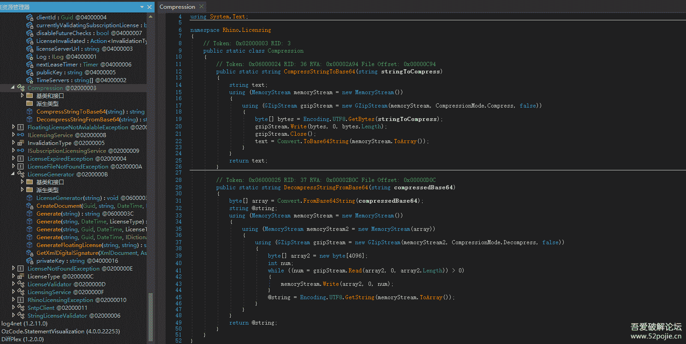](https://www.52pojie.cn/forum.php?mod=attachment&aid=MjYzNjUyMHw1YzVmODk3NXwxNzkzNTczMjgxfDE2ODA4NnwxODIyNjYy) (132.58 KB, 下载次数: 0) 2023-8-18 11:30 上传

嗯嗯，配套设施齐全，那么似乎可以动手了吧~

直接 Patch `Rhino.Licensing.dll`，然后写个小 Demo 引用它。

[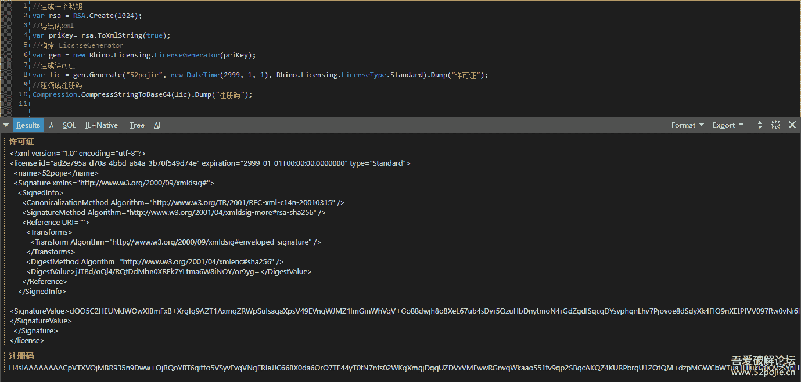](https://www.52pojie.cn/forum.php?mod=attachment&aid=MjYzNjUyMXxhN2FkMDc1MXwxNzkzNTczMjgxfDE2ODA4NnwxODIyNjYy) (92.9 KB, 下载次数: 1) 2023-8-18 11:30 上传

```
H4sIAAAAAAAACpVTXVOjMBR935n9Dww+OjRQoYBT6qitto5VSyvFvqVNgFRIaJJC668X0da6OrO7TF44yT0fN7nts02WKgXmgjDqqUZDVxVMFwwRGnvqWkaao551fv9qp2SBqcAKQZ4KURPbrgU1ZOtQM+dzpMGWCbWTua1Hluki28QVzSYnHMqat+m6rqYb1Zro+mm9Gvr7pypym2NPHUtIEeRIrdQUpU1hhjtWM2dLgtug/qvxMYkplGuOlco4FZ6aSJmfAlCWZaM8aTAeg2bFCnQXVAeQIPHRO+NHLUYDGrEPpMIuIWWULGBKXmqvQywThpTzNGacyCT7SWDiv2kYwO9dapWItjBMqr0h+olhqQr4ZN+7/RfamlM3d761jHF8xAXURAKbVusLsY8jzKuLwsqjP/DUXcR6b8IhFRHjmThAD/G/2vjSPkwLnLIcI03s0hxaqYjBj4rtLomxkP+ZvMp09D3vni2A6Rp3ljeTCwTYKDWBP5JdNJxTPfR7z/bTrcxga+qQu/snwLi7jb02OKzcNxDsO7h7HeDb8/i8vvdiNLq3Lpv93uMQTe/LcHCRXW0ujkMeRyv3fDYxzjfZauZP8/F6IGAMw1wEptsLaDy9Gc6MNLvOpkmwCo6vmeOgcpk4zAnxbctez03RLbg1eln35126lRm7M/k1msVoMF4tVt0nUeTJit4mhf2wZAXDDhqjbfhsXqUjl4Y9+RAFge7afqkXd6TVt8sq9h/m6+n5BN9mGnwMdecVdwBRWAYEAAA=
```

### 测试一下

[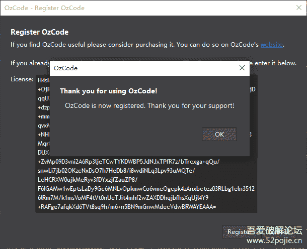](https://www.52pojie.cn/forum.php?mod=attachment&aid=MjYzNjUyMnxhYWU4NWY3ZHwxNzkzNTczMjgxfDE2ODA4NnwxODIyNjYy) (43.71 KB, 下载次数: 1) 2023-8-18 11:30 上传

[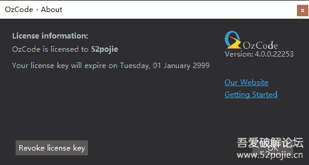](https://www.52pojie.cn/forum.php?mod=attachment&aid=MjYzNjUyNHwyZTIzMTMyN3wxNzkzNTczMjgxfDE2ODA4NnwxODIyNjYy) (20.22 KB, 下载次数: 1) 2023-8-18 11:30 上传

### 附录

仅供学习交流，请勿用于商业
