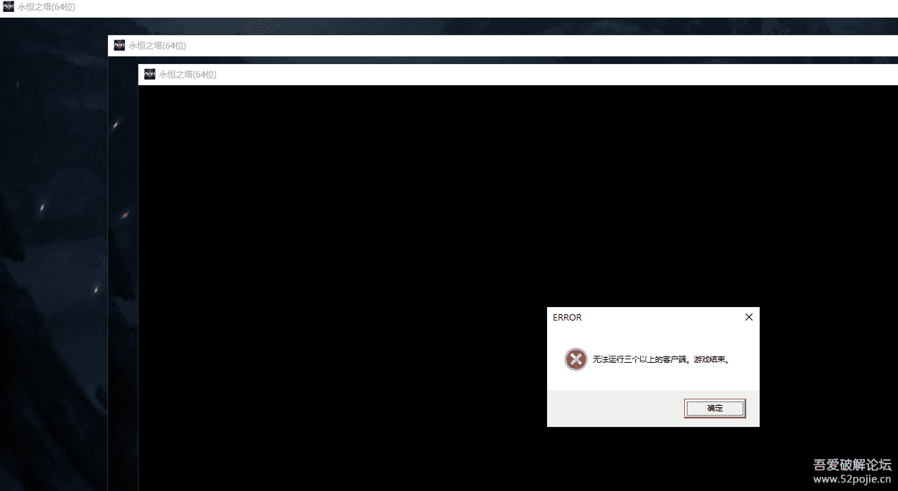
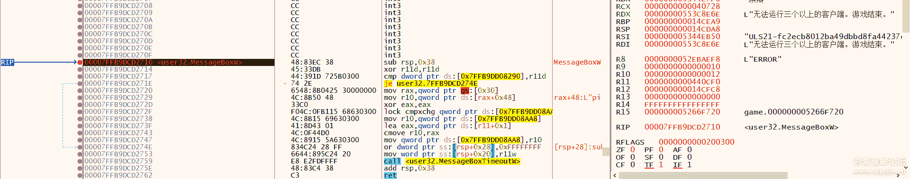
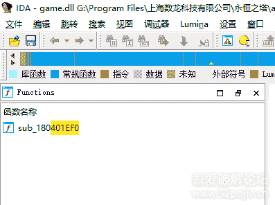
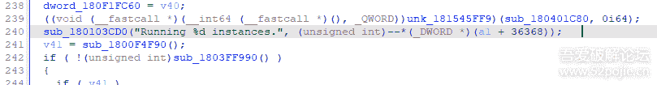
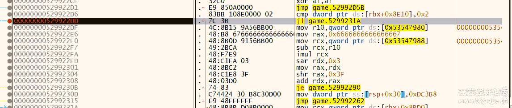
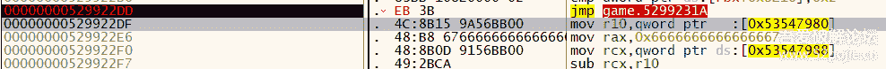

# [原创] 某游戏限制多开逆向分析 实战篇

- 原帖：https://www.52pojie.cn/forum.php?mod=viewthread&tid=1822759
- 抓取时间：2026-11-01T22:48:02

大伙儿，玩过网络游戏的应该都知道。有些网络游戏会限制启动的数量，防止一台电脑上登录太多账号。

`image.png` (130.01 KB, 下载次数: 1)

[附件下载](https://www.52pojie.cn/forum.php?mod=attachment&aid=MjYzNjU4M3w2NmMzODVlMXwxNzkzNTczMjc5fDE2ODA4NnwxODIyNzU5&nothumb=yes)

1 2023-8-18 15:10 上传

- 今天实战的游戏过限制多开检测

逆向思路：观察到会弹窗那就先下个断点尝试一下。

- 发现真会调用这个 api

`image.png` (134.68 KB, 下载次数: 2)

[附件下载](https://www.52pojie.cn/forum.php?mod=attachment&aid=MjYzNjU4N3xlNGM0MzA0ZHwxNzkzNTczMjc5fDE2ODA4NnwxODIyNzU5&nothumb=yes)

2 2023-8-18 15:12 上传

2. 然后回溯分析找到函数头部 `RVA:401EF0` 所属模块 `game.dll`，丢入 IDA 分析，找到该函数。

`image.png` (22.67 KB, 下载次数: 2)

[附件下载](https://www.52pojie.cn/forum.php?mod=attachment&aid=MjYzNjU4OHwzZGFmMzdhMXwxNzkzNTczMjc5fDE2ODA4NnwxODIyNzU5&nothumb=yes)

3 2023-8-18 15:12 上传

3. `F5` 看伪代码

`image.png` (21.29 KB, 下载次数: 1)

[附件下载](https://www.52pojie.cn/forum.php?mod=attachment&aid=MjYzNjU4OXxiNzg2NjZlNHwxNzkzNTczMjc5fDE2ODA4NnwxODIyNzU5&nothumb=yes)

4 2023-8-18 15:13 上传

这里中文意思就是已经运行了几个程序的意思，那猜测这个就是输出 debug 日志之类的了，估计检测代码就在周围了，继续分析一下。

4. 经过分析后函数有点大一下子看伪代码看不出来（不过可以确定的是关键代码就在这边了），得调试器动态调试，比较一下每一个跳转结果。函数蛮大的，最终分析到 `cmp` 比较一个变量和 2 进行比较。

`image.png` (68.08 KB, 下载次数: 2)

[附件下载](https://www.52pojie.cn/forum.php?mod=attachment&aid=MjYzNjU5MnwxNzFjNzUxZHwxNzkzNTczMjc5fDE2ODA4NnwxODIyNzU5&nothumb=yes)

2023-8-18 15:15 上传

这里原本是不会跳转的，改成 `jmp`。

`image.png` (27.59 KB, 下载次数: 1)

[附件下载](https://www.52pojie.cn/forum.php?mod=attachment&aid=MjYzNjU5M3wzYWFiYzlmYXwxNzkzNTczMjc5fDE2ODA4NnwxODIyNzU5&nothumb=yes)

2023-8-18 15:16 上传

打完补丁之后直接运行，就可以无视双开限制了，愉快多开了！
